# รูปเล่มกรณีศึกษาและแนวคำตอบมาตรฐาน หมวดระบบสุขภาพ (HS1–HS6) — ฉบับสังเคราะห์ A4

**รายวิชา RACM 303 เวชศาสตร์ชุมชน 1 (Community Medicine I) ปีการศึกษา 2569 (เฉพาะคณาจารย์ผู้สอน)**  
ภาควิชาเวชศาสตร์ชุมชน คณะแพทยศาสตร์โรงพยาบาลรามาธิบดี มหาวิทยาลัยมหิดล

## คำชี้แจง

โจทย์สำหรับชั่วโมงอภิปรายนี้นำมาจากข้อสอบเก่าที่เคยสอบของปีที่ผ่าน ๆ มา โดยโจทย์ทั้งหมดนำมาจากสถานการณ์จริงที่เกิดขึ้นในสังคมในช่วงนั้น ๆ หรือเป็นสถานการณ์สมมุติ และมีข้อคำถามที่เกี่ยวกับประเด็นที่เรียนมา โดยข้อคำถามจะเป็นระดับประยุกต์ความรู้ที่เรียนมา (apply) หรือระดับการวิเคราะห์ (analyze) เป็นหลัก

**วัตถุประสงค์ของคาบชั่วโมงอภิปราย**
1. เพื่อให้นักศึกษาได้ลองฝึกตอบคำถามโดยประยุกต์ความรู้ที่ได้เรียนไปในชั่วโมง lecture
2. เพื่อให้นักศึกษาทราบแนวการออกข้อสอบและแนวการตอบสำหรับการสอบหมวดระบบสุขภาพ

**การจัดกระบวนการเรียนในคาบการอภิปราย**
1. แต่ละห้องให้แบ่งนักศึกษาออกเป็นกลุ่มย่อย 3 กลุ่ม เพื่อให้มีขนาดไม่ใหญ่เกินไป
2. ทุกกลุ่มย่อยอภิปรายร่วมกันในกลุ่มเพื่อตอบโจทย์ทุกข้อในแต่ละคาบ
3. ในแต่ละคาบมีโจทย์กรณีศึกษา 1–3 โจทย์ (หัวข้อที่ 1 และ 6 มี 3 โจทย์, หัวข้อที่ 2 และ 3 มี 2 โจทย์, หัวข้อที่ 4 และ 5 มี 1 โจทย์ซึ่งประกอบด้วยหลายคำถามย่อย) แต่ละคาบมีเวลา 120–140 นาที ดังนั้นจัดสรรเวลาให้โจทย์หรือประเด็นหลักแต่ละข้อดังนี้
   - a. หารืออภิปรายร่วมกันในกลุ่ม 15–20 นาที
   - b. อภิปรายแลกเปลี่ยนกันระหว่างกลุ่ม 15–20 นาที
   - c. อาจารย์เฉลย 15–20 นาที

---

## หัวข้อ 1. สุขภาพ ปัจจัยกำหนดสุขภาพ และระดับของการป้องกันโรค (HS1: Health, Determinants of Health, and Levels of Disease Prevention)
- **กำหนดการอภิปราย:** วันพฤหัสบดีที่ 26 พฤศจิกายน 2569 เวลา 09.40 – 12.00 น. · **สัดส่วนน้ำหนักเนื้อหา:** 20% · **คะแนนอ้างอิงรวม:** 40 คะแนนสุทธิ (3 กรณีศึกษา)

### Scenario 1 ภาวะอ้วนในเด็กและการวิเคราะห์ความเชื่อมโยงปัจจัยกำหนดสุขภาพ (10 คะแนนสุทธิ)

เด็กชายโมโน อายุ 10 ขวบ สูง 140 ซม. น้ำหนัก 50 กก. เป็นบุตรคนเดียว อาศัยอยู่ในครอบครัวกับพ่อแม่รวมสามคนในอพาร์ทเม้นท์เช่าแห่งหนึ่งชานกรุงเทพมหานคร เสียค่าเช่าเดือนละ 5,000 บาท พ่อและแม่เป็นพนักงานประจำบริษัทเอกชน ทำงานสัปดาห์ละ 6 วัน และบางสัปดาห์ต้องทำงานล่วงเวลาเพิ่มเติม โดยปกติพ่อและแม่กลับถึงบ้านประมาณหนึ่งทุ่ม ทั้งครอบครัวเดินทางด้วยรถขนส่งสาธารณะในการไปทำงานและไปโรงเรียน โมโนเรียนอยู่ชั้นประถมศึกษาปีที่ 5 โรงเรียนรัฐบาลแห่งหนึ่งไม่ไกลจากที่พักมากนัก

โมโนเป็นเด็กอวบอ้วนตั้งแต่เล็ก ๆ เวลาใครเห็นก็มักทักว่าน่ารักน่ากอด ปู่ย่าซึ่งมีเชื้อสายจีนก็ชมและบอกว่าโหงวเฮ้งดี โตขึ้นจะได้เป็นใหญ่เป็นโต พ่อแม่จึงไม่ได้กังวลเรื่องน้ำหนักของโมโน ประกอบกับไม่ค่อยมีเวลาดูแลใกล้ชิดเพราะต้องทำงานทั้งคู่ ตอนเช้าต้องออกจากที่พักตั้งแต่หกโมงเช้าเพื่อไปโรงเรียนพร้อมกับที่พ่อแม่ออกไปทำงาน เมื่อเลิกเรียนก็กลับห้องพักมาก่อน ส่วนใหญ่นั่งเล่นเกมและดูโทรทัศน์ ซื้อขนมขบเคี้ยวกินตามที่เห็นโฆษณาในโทรทัศน์หรือที่เพื่อน ๆ นิยมกิน และต้องหาอาหารเย็นรับประทานเองเพราะกว่าพ่อแม่จะกลับมาก็ดึก ส่วนวันเสาร์ที่พ่อแม่ไปทำงานก็หาอาหารรับประทานเองในละแวกที่พักและใช้เวลาส่วนใหญ่อยู่กับเกมและโทรทัศน์

โรงเรียนที่โมโนเรียนมีแผงขายอาหารทั้งช่วงเช้าและเที่ยง มีทั้งอาหารคาวหวานและขนมขบเคี้ยวต่าง ๆ จำหน่าย ช่วงเย็นหลังเลิกเรียนก็มีพ่อค้าแม่ค้าแผงลอยขายขนม ลูกชิ้นทอด และเครื่องดื่มหวานหน้าโรงเรียน ซึ่งโมโนซื้อกินทุกวันก่อนกลับบ้าน แม้โมโนจะมีรูปร่างอ้วนแต่ก็ไม่ได้รู้สึกกังวลแต่อย่างใดเพราะมีเพื่อนหลายคนในชั้นเรียนที่อ้วนเหมือนกัน ส่วนในชั่วโมงพลศึกษาส่วนใหญ่ครูปล่อยให้นักเรียนเล่นกันเองตามอัธยาศัย

โมโนไม่ค่อยได้ออกกำลังกายเนื่องจากรู้สึกเหนื่อยง่ายเวลาออกกำลังกายจึงไม่อยากเคลื่อนไหวออกแรง ประกอบกับละแวกที่พักไม่มีสวนสาธารณะหรือสนามเด็กเล่นให้ไปทำกิจกรรมกลางแจ้ง ส่วนใหญ่จึงขลุกอยู่ในห้องเช่าเล่นเกมเป็นหลัก

**จาก scenario ข้างต้น จงตอบคำถามต่อไปนี้**

1. จงประยุกต์ใช้กรอบแนวคิดปัจจัยกำหนดสุขภาพ (Determinants of Health Framework) <u>ระบุปัญหาสุขภาพหลักตรงกลางแผนภาพพร้อมข้อมูลสนับสนุน</u> (1 คะแนน) และ<u>วิเคราะห์ประเด็นปัจจัยกำหนดสุขภาพในทั้ง 4 หมวดพร้อมยกเหตุการณ์ใน scenario มาสนับสนุน</u> (9 คะแนน: หมวดปัจเจก 3 ประเด็น, สังคมและสิ่งแวดล้อม 3 ประเด็น, ระบบบริการสุขภาพ 1 ประเด็น และปัจจัยเชิงโครงสร้างฯ 2 ประเด็น) ลงในแผนภาพและตารางกระดาษคำตอบต่อไปนี้ (รวม 10 คะแนนสุทธิ)

> **วิธีคิดคะแนน (รวม 10 คะแนนสุทธิ): คิดประเด็นละ 1 คะแนน รวม 10 แถว แยกเป็น 2 ช่องย่อยในแต่ละแถว ได้แก่ ระบุประเด็นปัจจัย/ภาวะสุขภาพหลัก (0.5 คะแนน) + ยกพฤติกรรมหรือบริบทจาก scenario ที่สนับสนุนสอดคล้องกัน (0.5 คะแนน) รวม (0.5 + 0.5) × 10 แถว = 10 คะแนน (หากระบุประเด็นและหลักฐานไม่สอดคล้องกับหมวดในคอลัมน์ซ้าย จะไม่พิจารณาให้คะแนนในแถวนั้น)**

| องค์ประกอบในแผนภาพความเชื่อมโยง (Determinants of Health Diagram) | ประเด็นปัจจัยกำหนดสุขภาพ / ภาวะสุขภาพหลัก (ช่องละ 0.5 คะแนน) | พฤติกรรม / บริบท / เหตุการณ์ใน scenario ที่สนับสนุนการวิเคราะห์ (ช่องละ 0.5 คะแนน) |
| --- | --- | --- |
| ปัญหาสุขภาพหลักตรงกลางแผนภาพ (Central Health Outcome) [รวม 1 คะแนน] | ____________________________________ ____________________________________ (0.5 คะแนน) | ____________________________________ ____________________________________ (0.5 คะแนน) |
| 1. ปัจจัยด้านปัจเจก (Individual factors) [ตอบ 3 ประเด็น · รวม 3 คะแนน] | 1) _________________________________ ____________________________________ (0.5 คะแนน) | ____________________________________ ____________________________________ (0.5 คะแนน) |
| *(ต่อเนื่องจากแถวบน)* | 2) _________________________________ ____________________________________ (0.5 คะแนน) | ____________________________________ ____________________________________ (0.5 คะแนน) |
| *(ต่อเนื่องจากแถวบน)* | 3) _________________________________ ____________________________________ (0.5 คะแนน) | ____________________________________ ____________________________________ (0.5 คะแนน) |
| 2. ปัจจัยด้านสังคมและสิ่งแวดล้อม (Social & Environmental factors) [ตอบ 3 ประเด็น · รวม 3 คะแนน] | 1) _________________________________ ____________________________________ (0.5 คะแนน) | ____________________________________ ____________________________________ (0.5 คะแนน) |
| *(ต่อเนื่องจากแถวบน)* | 2) _________________________________ ____________________________________ (0.5 คะแนน) | ____________________________________ ____________________________________ (0.5 คะแนน) |
| *(ต่อเนื่องจากแถวบน)* | 3) _________________________________ ____________________________________ (0.5 คะแนน) | ____________________________________ ____________________________________ (0.5 คะแนน) |
| 3. ระบบบริการสุขภาพ (Health services system) [ตอบ 1 ประเด็น · รวม 1 คะแนน] | 1) _________________________________ ____________________________________ (0.5 คะแนน) | ____________________________________ ____________________________________ (0.5 คะแนน) |
| 4. ปัจจัยเชิงโครงสร้างที่มีอิทธิพลต่อความเหลื่อมล้ำด้านสุขภาพ (Structural determinants) [ตอบ 2 ประเด็น · รวม 2 คะแนน] | 1) _________________________________ ____________________________________ (0.5 คะแนน) | ____________________________________ ____________________________________ (0.5 คะแนน) |
| *(ต่อเนื่องจากแถวบน)* | 2) _________________________________ ____________________________________ (0.5 คะแนน) | ____________________________________ ____________________________________ (0.5 คะแนน) |
| รวมคะแนนข้อ 1: 10 แถว × (0.5 + 0.5 คะแนน) | รวมคอลัมน์ประเด็น: ______ / 5 คะแนน | รวมคอลัมน์หลักฐาน: ______ / 5 คะแนน (สุทธิ ______ / 10) |

#### เฉลย

1. จงประยุกต์ใช้กรอบแนวคิดปัจจัยกำหนดสุขภาพ (Determinants of Health Framework) ระบุปัญหาสุขภาพหลักตรงกลางแผนภาพพร้อมข้อมูลสนับสนุน (1 คะแนน) และวิเคราะห์ประเด็นปัจจัยกำหนดสุขภาพในทั้ง 4 หมวดพร้อมยกเหตุการณ์ใน scenario มาสนับสนุน (9 คะแนน) ลงในแผนภาพและตารางกระดาษคำตอบต่อไปนี้ (รวม 10 คะแนนสุทธิ)

***เกณฑ์และวิธีคิดคะแนน (รวม 10 คะแนนสุทธิ): คิดตามช่องคำตอบสีแดง 10 แถว × (0.5 + 0.5 คะแนน) = 10 คะแนน (กรณีหมวดสังคมและสิ่งแวดล้อมหรือหมวดโครงสร้าง หากผู้เรียนเลือกประเด็นอื่นที่มีหลักฐานตรงในโจทย์ เช่น สภาพห้องเช่าคับแคบไร้สนามเด็กเล่น ให้ตรวจได้ตามความสอดคล้อง)***

| องค์ประกอบในแผนภาพความเชื่อมโยง (Determinants of Health Diagram) | ประเด็นปัจจัยกำหนดสุขภาพ / ภาวะสุขภาพหลัก (ช่องละ 0.5 คะแนน) | พฤติกรรม / บริบท / เหตุการณ์ใน scenario ที่สนับสนุนการวิเคราะห์ (ช่องละ 0.5 คะแนน) |
| --- | --- | --- |
| ปัญหาสุขภาพหลักตรงกลางแผนภาพ (Central Health Outcome) [รวม 1 คะแนน] | <u>*ภาวะอ้วนในเด็ก (Childhood Obesity)*</u> *(0.5 คะแนน)* | <u>*สูง 140 ซม. น้ำหนัก 50 กก. คำนวณ BMI = 25.5 กก./ม.² และเริ่มเหนื่อยง่ายเวลาออกกำลังกาย (มี Disease ชัดเจน แต่เจ้าตัวไม่กังวล/ไม่มี Illness)*</u> *(0.5 คะแนน)* |
| 1. ปัจจัยด้านปัจเจก (Individual factors) [ตอบ 3 ประเด็น · รวม 3 คะแนน] | 1) <u>*พื้นฐานทางชีวภาพและพฤติกรรมเนือยนิ่ง/กิจกรรมทางกายน้อย*</u> *(0.5 คะแนน)* | <u>*เป็นเด็กอวบอ้วนตั้งแต่เล็ก เหนื่อยง่ายจึงไม่อยากออกแรง ใช้เวลาว่างนั่งเล่นเกมและดูโทรทัศน์ในห้องเช่าเป็นหลัก*</u> *(0.5 คะแนน)* |
| *(ต่อเนื่องจากแถวบน)* | 2) <u>*พฤติกรรมการบริโภคอาหารและเครื่องดื่มพลังงานสูง*</u> *(0.5 คะแนน)* | <u>*ซื้อขนมขบเคี้ยวตามโฆษณาทีวี/เพื่อน ซื้อลูกชิ้นทอดและน้ำหวานหน้าโรงเรียนทุกวัน และต้องเลือกหาอาหารมื้อเย็นกับวันเสาร์กินเอง*</u> *(0.5 คะแนน)* |
| *(ต่อเนื่องจากแถวบน)* | 3) <u>*การรับรู้ส่วนบุคคลที่ยังไม่ตระหนักถึงความเสี่ยงสุขภาพ*</u> *(0.5 คะแนน)* | <u>*ไม่รู้สึกกังวลเรื่องรูปร่างอ้วน เพราะได้รับคำชมมาตั้งแต่เด็กและเห็นเพื่อนในชั้นเรียนอ้วนหลายคน*</u> *(0.5 คะแนน)* |
| 2. ปัจจัยด้านสังคมและสิ่งแวดล้อม (Social & Environmental factors) [ตอบ 3 ประเด็น · รวม 3 คะแนน] | 1) <u>*ข้อจำกัดเวลาการดูแลของครอบครัวและบรรทัดฐานคนรอบข้าง*</u> *(0.5 คะแนน)* | <u>*พ่อแม่ทำงาน 6 วัน/สัปดาห์และทำ OT กลับทุ่มหนึ่ง ไม่มีเวลาดูแลมื้ออาหาร และปู่ย่าชมว่าโหงวเฮ้งดีจึงไม่มองว่าอ้วนเป็นปัญหา*</u> *(0.5 คะแนน)* |
| *(ต่อเนื่องจากแถวบน)* | 2) <u>*สภาพที่พักอาศัยคับแคบและชุมชนขาดพื้นที่กิจกรรมทางกาย*</u> *(0.5 คะแนน)* | <u>*อาศัยในอพาร์ทเม้นท์เช่าพื้นที่จำกัด และละแวกที่พักไม่มีสวนสาธารณะหรือสนามเด็กเล่นที่ปลอดภัยสำหรับทำกิจกรรมกลางแจ้ง*</u> *(0.5 คะแนน)* |
| *(ต่อเนื่องจากแถวบน)* | 3) <u>*สิ่งแวดล้อมทางอาหารและชั่วโมงพลศึกษาในโรงเรียนไม่เอื้อต่อสุขภาพ*</u> *(0.5 คะแนน)* | <u>*มีแผงขายขนมเช้า–เที่ยง แผงลอยของทอด/น้ำหวานหน้าโรงเรียน และชั่วโมงพละครูปล่อยให้เล่นกันเองโดยขาดการจัดกิจกรรมทางกายที่เหมาะสม*</u> *(0.5 คะแนน)* |
| 3. ระบบบริการสุขภาพ (Health services system) [ตอบ 1 ประเด็น · รวม 1 คะแนน] | 1) <u>*ขาดระบบเฝ้าระวังคัดกรองโภชนาการและอนามัยโรงเรียนเชิงรุก*</u> *(0.5 คะแนน)* | <u>*มีนักเรียนอ้วนหลายคนในชั้นเรียน แต่ยังไม่มีการคัดกรองเชิงรุก การให้คำปรึกษาเชื่อมสู่ผู้ปกครอง หรือการร่วมปรับสิ่งแวดล้อมโรงเรียน*</u> *(0.5 คะแนน)* |
| 4. ปัจจัยเชิงโครงสร้างที่มีอิทธิพลต่อความเหลื่อมล้ำด้านสุขภาพ (Structural determinants) [ตอบ 2 ประเด็น · รวม 2 คะแนน] | 1) <u>*ช่องว่างนโยบายกำกับอาหารรอบสถานศึกษา ผังเมือง และการกระจายอำนาจท้องถิ่น*</u> *(0.5 คะแนน)* | <u>*ขาดมาตรการควบคุมอาหารว่าง/น้ำหวานในและหน้าโรงเรียน และผังเมืองชานเมืองขยายตัวโดยไร้ข้อกำหนดจัดพื้นที่สีเขียวหรือสนามเด็กเล่น*</u> *(0.5 คะแนน)* |
| *(ต่อเนื่องจากแถวบน)* | 2) <u>*ปัจจัยเชิงพาณิชย์ (CDoH) ค่านิยมวัฒนธรรม และโครงสร้างตลาดแรงงาน*</u> *(0.5 คะแนน)* | <u>*การตลาดและโฆษณาขนมขบเคี้ยวทางทีวีที่มุ่งเป้าเด็ก ค่านิยมวัฒนธรรมต่อรูปร่างเด็ก และโครงสร้างงานเอกชน 6 วัน/สัปดาห์ที่จำกัดเวลาครอบครัว*</u> *(0.5 คะแนน)* |
| รวมคะแนนข้อ 1: 10 แถว × (0.5 + 0.5 คะแนน) | รวมคอลัมน์ประเด็น: <u>*0.5 × 10 = 5*</u> *(5 คะแนน)* | รวมคอลัมน์หลักฐาน: <u>*0.5 × 10 = 5*</u> *(รวมสุทธิ 10 คะแนน)* |

*กรอบแนวคิดประกอบการเฉลย: พลวัตความเชื่อมโยงของปัจจัยกำหนดสุขภาพ 3 กลุ่ม (ปัจเจก · สิ่งแวดล้อม · ระบบบริการสุขภาพ) ภายใต้วงล้อมของปัจจัยเชิงโครงสร้างที่มีอิทธิพลต่อความเหลื่อมล้ำด้านสุขภาพ (Structural Determinants) และบทบาทแพทย์ 3 บทบาท*

***บทสังเคราะห์เชื่อมโยงกรอบแนวคิดสำคัญ (Disease vs. Illness และพลวัตปัจจัยกำหนดสุขภาพเชิงระบบ)***

*กรณีของเด็กชายโมโนสะท้อนความแตกต่างระหว่างมิติความผิดปกติทางชีวการแพทย์กับประสบการณ์ความเจ็บป่วยได้อย่างชัดเจน กล่าวคือ โมโนมีภาวะโรคหรือความผิดปกติทางกายที่ตรวจวัดได้ชัดเจน (disease) ได้แก่ ภาวะอ้วนในเด็ก (ดัชนีมวลกาย 25.5 กิโลกรัมต่อตารางเมตร) และเริ่มมีอาการเหนื่อยง่ายเมื่อออกแรง แต่กลับไม่มีความรู้สึกทุกข์ทรมานหรือรับรู้ว่าตนเองกำลังเจ็บป่วย (illness) เนื่องจากบรรทัดฐานทางวัฒนธรรมของครอบครัวและกลุ่มเพื่อนมองรูปร่างอ้วนเป็นสิ่งปกติและน่ารัก หากระบบบริการสุขภาพตั้งรับรอผู้ป่วยเดินเข้ามาในคลินิกเพียงอย่างเดียว ย่อมไม่สามารถเข้าถึงเด็กกลุ่มนี้ได้ทันท่วงที*

*นอกจากนี้ การวางองค์ประกอบลงในแผนภาพวงล้อมซ้อนช่วยให้เห็นว่า พฤติกรรมการกินขนมขบเคี้ยวและความเนือยนิ่งของเด็กไม่ได้เกิดจากการขาดวินัยส่วนบุคคลเพียงลำพัง แต่เป็นผลลัพธ์ของปฏิสัมพันธ์สองทิศทางระหว่างปัจจัยระดับปัจเจก สิ่งแวดล้อมในครอบครัวและโรงเรียน และช่องว่างของระบบอนามัยโรงเรียน ซึ่งทั้งหมดถูกกำกับอยู่ภายใต้วงล้อมของปัจจัยเชิงโครงสร้างต้นน้ำ ทั้งโครงสร้างชั่วโมงทำงานของแรงงานเอกชน ผังเมืองชานเมืองที่ไร้พื้นที่เล่นปลอดภัย และการตลาดอาหารพลังงานสูงที่มุ่งเป้าเด็ก (commercial determinants of health)*

---

### Scenario 2 ปัจจัยกำหนดสุขภาพทางสังคมและการคัดกรองสารเสพติดในคลินิกฝากครรภ์ (10 คะแนนสุทธิ (ข้อ 1 = 6 คะแนน · ข้อ 2 = 4 คะแนน))

ที่โรงพยาบาลชุมชนแห่งหนึ่ง แผนกฝากครรภ์ (ANC) มีขั้นตอนในการตรวจคัดกรองสารเสพติดในปัสสาวะ (urine amphetamine) ในหญิงที่มาฝากครรภ์ทุกราย เพื่อค้นหาการใช้สารแอมเฟตามีนตั้งแต่ระยะเริ่มแรก (detection) และให้การบำบัดเลิกยาทันที เพื่อไม่ให้เกิดความเสี่ยงต่อภาวะแทรกซ้อนขณะตั้งครรภ์ หรือผลกระทบต่อทารกในครรภ์อันเนื่องมาจากการใช้สารแอมเฟตามีนของมารดา

จากการคัดกรองพบว่า มีหญิงตั้งครรภ์ที่ผลตรวจเป็นบวก (positive) บ่อยครั้งขึ้นกว่าในอดีต เจ้าหน้าที่จึงได้รวบรวมข้อมูลเชิงลึกเพิ่มเติม พบว่าลักษณะร่วมกันของหญิงตั้งครรภ์ที่มีผล urine amphetamine positive ได้แก่ มีอายุระหว่าง 15–18 ปี เป็นผู้ไม่มีงานประจำ การศึกษาสูงสุดระดับชั้นมัธยมศึกษาปีที่ 3 และมีคู่สมรสหรือสมาชิกในครอบครัวที่ใช้สารเสพติดแอมเฟตามีน

หญิงตั้งครรภ์บางรายให้ข้อมูลเพิ่มเติมว่า ใช้สารดังกล่าวเพื่อให้สามารถทำงานได้มีประสิทธิภาพและทนทานขึ้น เนื่องจากต้องกรีดยางพาราในช่วงเช้ามืดและไปทำงานรับจ้างทั่วไปต่อในช่วงกลางวัน ซึ่งผู้ที่ประกอบอาชีพรับจ้างลักษณะเดียวกันในพื้นที่ส่วนใหญ่ก็ใช้สารนี้เช่นกัน อีกทั้งการหาซื้อสารเสพติดแอมเฟตามีนมาใช้สามารถทำได้ง่ายโดยมีแหล่งซื้อขายหลายแห่งในชุมชน

**จาก scenario ข้างต้น จงตอบคำถามต่อไปนี้**

1. จากกรอบแนวคิดปัจจัยกำหนดสุขภาพทางสังคมขององค์การอนามัยโลก (WHO Conceptual Framework for Action on the Social Determinants of Health: CSDH) จง<u>จำแนกปัจจัยกำหนดสุขภาพของหญิงตั้งครรภ์ที่มีผล urine amphetamine positive</u> ออกเป็น<u>ปัจจัยเชิงโครงสร้างที่มีอิทธิพลต่อความเหลื่อมล้ำด้านสุขภาพ (ตอบ 3 ประเด็น)</u> (3 คะแนน) และ<u>ปัจจัยทางสังคมที่มีผลต่อสุขภาพ / ปัจจัยตัวกลาง (ตอบ 3 ประเด็น)</u> (3 คะแนน) โดยระบุมิติย่อยและข้อมูลจาก scenario ลงในตารางกระดาษคำตอบต่อไปนี้ (รวม 6 คะแนนสุทธิ)

> **วิธีคิดคะแนน (รวม 6 คะแนนสุทธิ): ตอบหมวดละ 3 ประเด็น (รวม 6 แถว) คิดแถวละ 1 คะแนน แยกเป็น ระบุมิติย่อยตามกรอบ WHO CSDH ถูกต้อง (0.5 คะแนน) + ยกข้อมูลหรือเหตุการณ์จาก scenario สนับสนุนสอดคล้องกัน (0.5 คะแนน) รวม (0.5 + 0.5) × 6 แถว = 6 คะแนน**

| หมวดปัจจัยตามกรอบแนวคิด WHO CSDH | มิติย่อยของปัจจัยกำหนดสุขภาพ (ช่องละ 0.5 คะแนน) | ข้อมูล / เหตุการณ์ใน scenario ที่สนับสนุน (ช่องละ 0.5 คะแนน) |
| --- | --- | --- |
| 1. ปัจจัยเชิงโครงสร้างที่มีอิทธิพลต่อความเหลื่อมล้ำด้านสุขภาพ (Structural determinants of health inequities) [ตอบ 3 ประเด็น · รวม 3 คะแนน] | 1) _______________________________ __________________________________ (0.5 คะแนน) | __________________________________ __________________________________ (0.5 คะแนน) |
| *(ต่อเนื่องจากแถวบน)* | 2) _______________________________ __________________________________ (0.5 คะแนน) | __________________________________ __________________________________ (0.5 คะแนน) |
| *(ต่อเนื่องจากแถวบน)* | 3) _______________________________ __________________________________ (0.5 คะแนน) | __________________________________ __________________________________ (0.5 คะแนน) |
| 2. ปัจจัยทางสังคมที่มีผลต่อสุขภาพ / ปัจจัยตัวกลาง (Intermediary determinants of health) [ตอบ 3 ประเด็น · รวม 3 คะแนน] | 1) _______________________________ __________________________________ (0.5 คะแนน) | __________________________________ __________________________________ (0.5 คะแนน) |
| *(ต่อเนื่องจากแถวบน)* | 2) _______________________________ __________________________________ (0.5 คะแนน) | __________________________________ __________________________________ (0.5 คะแนน) |
| *(ต่อเนื่องจากแถวบน)* | 3) _______________________________ __________________________________ (0.5 คะแนน) | __________________________________ __________________________________ (0.5 คะแนน) |
| รวมคะแนนข้อ 1: หมวดละ 3 ประเด็น × (0.5 + 0.5 คะแนน) | รวมมิติย่อย: ______ / 3 คะแนน | รวมหลักฐาน: ______ / 3 คะแนน (สุทธิ ______ / 6) |

2. การตรวจคัดกรอง urine amphetamine ในหญิงที่มาฝากครรภ์ทุกราย จัดเป็นการป้องกันโรคใน<u>ระดับใด (level of disease prevention)</u> (2 คะแนน) และ<u>เพราะเหตุใด</u> จงระบุเหตุผลประกอบจากสถานการณ์ 2 ประเด็น (2 คะแนน) ลงในตารางกระดาษคำตอบต่อไปนี้ (รวม 4 คะแนนสุทธิ)

> **วิธีคิดคะแนน (รวม 4 คะแนนสุทธิ): แบ่งเป็น (1) ระบุระดับของการป้องกันโรคถูกต้อง 1 ช่อง = 2 คะแนน และ (2) อธิบายเหตุผลประกอบจากสถานการณ์ที่สอดคล้องกัน 2 ประเด็นย่อย ประเด็นละ 1 คะแนน = 2 คะแนน รวม 2 + 1 + 1 = 4 คะแนน (เกณฑ์ความสอดคล้อง: หากระบุระดับการป้องกันโรคผิด จะไม่พิจารณาให้คะแนนในส่วนเหตุผลประกอบ)**

| ประเด็นคำถาม | คำตอบและเหตุผลประกอบจากสถานการณ์ |
| --- | --- |
| 2.1 ระดับของการป้องกันโรค (Level of Disease Prevention) | _____________________________________________________________________ (2 คะแนน) |
| 2.2 เหตุผลประกอบจากสถานการณ์ (ระบุ 2 ประเด็น) | 1) ________________________________________________________ (1 คะแนน) 2) ________________________________________________________ (1 คะแนน) |

#### เฉลย

1. จากกรอบแนวคิดปัจจัยกำหนดสุขภาพทางสังคมขององค์การอนามัยโลก (WHO CSDH) จงจำแนกปัจจัยกำหนดสุขภาพของหญิงตั้งครรภ์ที่มีผล urine amphetamine positive ออกเป็นปัจจัยเชิงโครงสร้างฯ (3 คะแนน) และปัจจัยทางสังคมที่มีผลต่อสุขภาพ/ปัจจัยตัวกลาง (3 คะแนน) ลงในตารางต่อไปนี้ (รวม 6 คะแนนสุทธิ)

***เกณฑ์และวิธีคิดคะแนนข้อ 1 (รวม 6 คะแนนสุทธิ): ตรวจให้คะแนนหมวดละ 3 ประเด็น ประเด็นละ 1 คะแนน [มิติย่อย 0.5 + หลักฐานจากโจทย์ 0.5] รวม 6 คะแนน (ในหมวดปัจจัยเชิงโครงสร้างฯ สามารถเลือกตอบ 3 ใน 4 ประเด็น ได้แก่ การศึกษา อาชีพนอกระบบ การบังคับใช้กฎหมายปราบปรามยาเสพติด หรือค่านิยมกลุ่มอาชีพ)***

| หมวดปัจจัยตามกรอบแนวคิด WHO CSDH | มิติย่อยของปัจจัยกำหนดสุขภาพ (ช่องละ 0.5 คะแนน) | ข้อมูล / เหตุการณ์ใน scenario ที่สนับสนุน (ช่องละ 0.5 คะแนน) |
| --- | --- | --- |
| 1. ปัจจัยเชิงโครงสร้างที่มีอิทธิพลต่อความเหลื่อมล้ำด้านสุขภาพ (Structural determinants of health inequities) [เลือกตอบ 3 ใน 4 ข้อ · รวม 3 คะแนน] | 1) <u>*สถานะทางเศรษฐกิจสังคม — ระบบและระดับการศึกษา (Education)*</u> *(0.5 คะแนน)* | <u>*การศึกษาสูงสุดระดับชั้นมัธยมศึกษาปีที่ 3 จำกัดโอกาสทางอาชีพและความรอบรู้เท่าทันโทษของสารเสพติด*</u> *(0.5 คะแนน)* |
| *(ต่อเนื่องจากแถวบน)* | 2) <u>*สถานะทางเศรษฐกิจสังคม — อาชีพและโครงสร้างตลาดแรงงานนอกระบบ (Occupation)*</u> *(0.5 คะแนน)* | <u>*เป็นงานที่ไม่มีงานประจำและไม่มีนายจ้างชัดเจน ขาดหลักประกันความมั่นคงและการคุ้มครองความปลอดภัยในการทำงาน*</u> *(0.5 คะแนน)* |
| *(ต่อเนื่องจากแถวบน)* | 3) <u>*บริบทการเมือง/นโยบายปราบปรามยาเสพติด หรือค่านิยมทางสังคมในการทำงาน*</u> *(0.5 คะแนน)* | <u>*หาซื้อแอมเฟตามีนได้ง่าย มีแหล่งขายหลายแห่งในชุมชน; หรือค่านิยมกลุ่มอาชีพที่เชื่อว่าใช้ยาแล้วทำงานหนักต่อเนื่องได้เต็มประสิทธิภาพ*</u> *(0.5 คะแนน)* |
| 2. ปัจจัยทางสังคมที่มีผลต่อสุขภาพ / ปัจจัยตัวกลาง (Intermediary determinants of health) [ตอบ 3 ประเด็น · รวม 3 คะแนน] | 1) <u>*ปัจจัยด้านจิตสังคมและอิทธิพลคนใกล้ชิด (Psychosocial & peer/family factors)*</u> *(0.5 คะแนน)* | <u>*มีคู่สมรสหรือสมาชิกในครอบครัวใช้สารเสพติดแอมเฟตามีน และผู้ทำงานแบบเดียวกันส่วนใหญ่ก็ใช้สารนี้*</u> *(0.5 คะแนน)* |
| *(ต่อเนื่องจากแถวบน)* | 2) <u>*ปัจจัยทางชีวภาพและพฤติกรรมสุขภาพ (Biological & behavioral factors)*</u> *(0.5 คะแนน)* | <u>*ตั้งครรภ์ในวัยรุ่นอายุ 15–18 ปี (teenage pregnancy) มีแนวโน้มขาดความพร้อมและทักษะการดูแลตนเอง (self-care)*</u> *(0.5 คะแนน)* |
| *(ต่อเนื่องจากแถวบน)* | 3) <u>*สภาพความเป็นอยู่และสภาพการทำงานจริง (Material & working circumstances)*</u> *(0.5 คะแนน)* | <u>*การไม่มีงานประจำทำให้รายได้ไม่มั่นคง ต้องโหมกรีดยางเช้ามืดและรับจ้างทั่วไปต่อในช่วงกลางวัน*</u> *(0.5 คะแนน)* |
| รวมคะแนนข้อ 1: หมวดละ 3 ประเด็น × (0.5 + 0.5 คะแนน) | รวมมิติย่อย: <u>*0.5 × 6 = 3*</u> *(3 คะแนน)* | รวมหลักฐาน: <u>*0.5 × 6 = 3*</u> *(รวมสุทธิ 6 คะแนน)* |

*กรอบแนวคิดประกอบการเฉลยข้อ 1 (ก): กรอบแนวคิดปัจจัยกำหนดสุขภาพทางสังคม (CSDH Conceptual Framework, WHO 2007) แสดงการส่งต่ออิทธิพลจากปัจจัยเชิงโครงสร้างต้นน้ำสู่ปัจจัยทางสังคมที่มีผลต่อสุขภาพและความเหลื่อมล้ำทางสุขภาพ*

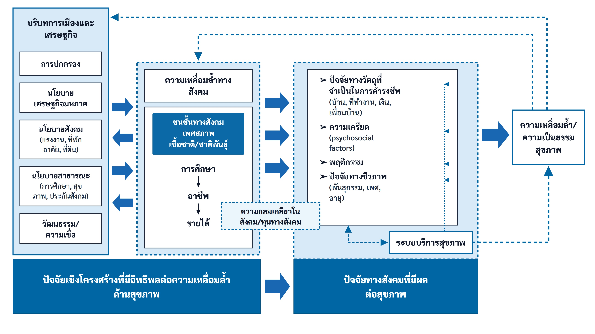
*กรอบแนวคิดประกอบการเฉลยข้อ 1 (ข): แผนผังกรอบแนวคิดปัจจัยกำหนดสุขภาพทางสังคมฉบับเต็มภาษาไทย (ประยุกต์จาก Solar & Irwin / WHO CSDH, 2010)*

2. การตรวจคัดกรอง urine amphetamine ในหญิงที่มาฝากครรภ์ทุกราย จัดเป็นการป้องกันโรคในระดับใด (2 คะแนน) และเพราะเหตุใด จงระบุเหตุผลประกอบจากสถานการณ์ 2 ประเด็น (2 คะแนน) ลงในตารางต่อไปนี้ (รวม 4 คะแนนสุทธิ)

***เกณฑ์และวิธีคิดคะแนนข้อ 2 (รวม 4 คะแนนสุทธิ): ระบุระดับการป้องกันโรคถูกต้อง 2 คะแนน + เหตุผลประกอบ 2 ประเด็นย่อย ประเด็นละ 1 คะแนน = 4 คะแนน (หากระบุระดับผิดจะได้ 0 คะแนนทั้งข้อ)***

| ประเด็นคำถาม | คำตอบและเหตุผลประกอบจากสถานการณ์ |
| --- | --- |
| 2.1 ระดับของการป้องกันโรค (Level of Disease Prevention) | <u>*การป้องกันระดับทุติยภูมิ หรือการป้องกันขั้นที่สอง (Secondary prevention)*</u> *(2 คะแนน)* |
| 2.2 เหตุผลประกอบจากสถานการณ์ (ระบุ 2 ประเด็น) | 1) <u>*เป็นการตรวจคัดกรองในหญิงตั้งครรภ์ทุกรายเพื่อค้นหาผู้ที่เริ่มใช้สารแอมเฟตามีนแล้วตั้งแต่ระยะแรกเริ่มที่ยังไม่มีภาวะแทรกซ้อนปรากฏชัด (early detection / screening)*</u> *(1 คะแนน)* 2) <u>*เพื่อให้การบำบัดเลิกยาทันที (prompt treatment / early intervention) ป้องกันไม่ให้เกิดภาวะแทรกซ้อนขณะตั้งครรภ์ต่อมารดาหรือผลกระทบอันตรายต่อทารกในครรภ์*</u> *(1 คะแนน)* |

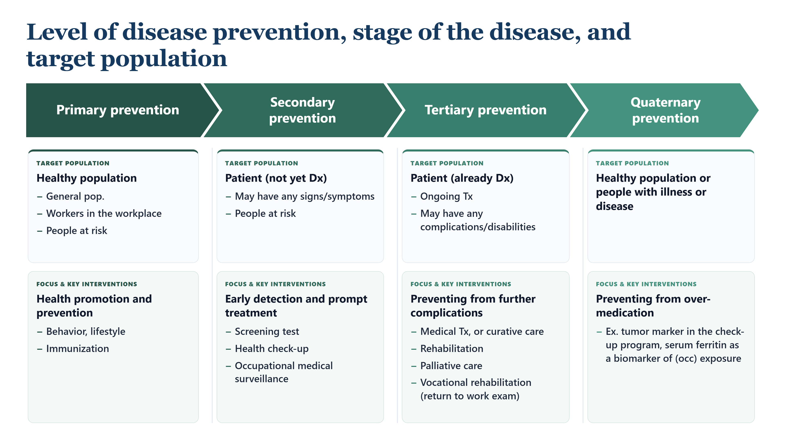
*กรอบแนวคิดประกอบการเฉลยข้อ 2 (ก): ระดับของการป้องกันโรคทั้ง 4 ระดับ เชื่อมโยงระยะของโรค กลุ่มเป้าหมาย และจุดเน้นของมาตรการหลัก (Leavell & Clark, 1965; Jamoulle, 2015)*

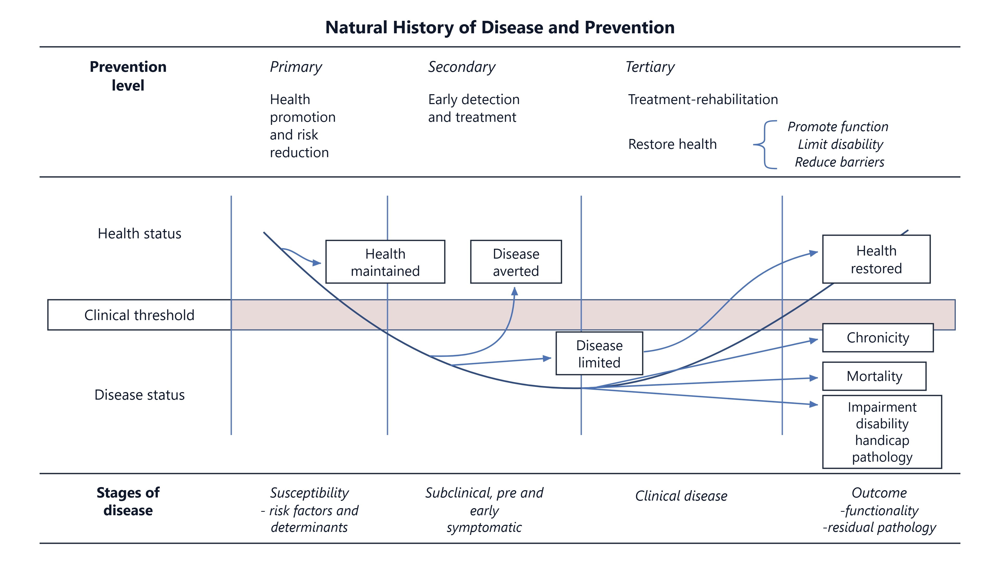
*กรอบแนวคิดประกอบการเฉลยข้อ 2 (ข): ธรรมชาติการดำเนินโรคและการคัดกรองระยะเริ่มแรกก่อนเกิดอาการหรือภาวะแทรกซ้อนในการป้องกันระดับทุติยภูมิ (Secondary Prevention)*

***ข้อสังเกตสำคัญสำหรับการตรวจให้คะแนนและการอภิปรายต่อยอด***

*จุดที่ผู้เรียนมักสับสนในคำถามข้อที่ 2 คือการเข้าใจผิดว่าการคัดกรองเพื่อป้องกันไม่ให้ทารกเกิดภาวะแทรกซ้อนเป็น Primary prevention ซึ่งในความเป็นจริง หญิงตั้งครรภ์ที่ตรวจพบผลบวกได้เริ่มมีการใช้สารแอมเฟตามีนเกิดขึ้นแล้ว การตรวจปัสสาวะทุกรายในคลินิกฝากครรภ์จึงทำหน้าที่ค้นหาภาวะผิดปกติหรือการสัมผัสปัจจัยก่อโรคที่เกิดขึ้นแล้วตั้งแต่ระยะไร้ความเสียหายรุนแรง (early detection) เพื่อให้การบำบัดรักษาอย่างทันท่วงที (prompt intervention) อันเป็นหัวใจของการป้องกันระดับทุติยภูมิ (secondary prevention) ทั้งนี้ ในทางเวชปฏิบัติที่โรงพยาบาลชุมชน การคัดกรองดังกล่าวต้องดำเนินการควบคู่กับท่าทีที่ปลอดภัย ไม่ตีตรา และเชื่อมโยงสู่ระบบบำบัดช่วยเหลือทางสังคมอย่างแท้จริง เพื่อไม่ให้หญิงตั้งครรภ์วัยรุ่นเกิดความหวาดกลัวจนหลุดออกจากระบบฝากครรภ์*

---

### Scenario 3 สุขภาวะของคนทำงานในโรงงานอุตสาหกรรม ปัจจัยกำหนดสุขภาพ และระดับของการป้องกันโรค (20 คะแนนสุทธิ (ข้อ 1 = 8 · ข้อ 2 = 4 · ข้อ 3 = 8 คะแนน))

นายสมชาย อายุ 40 ปี เป็นผู้จัดการฝ่ายผลิต ณ โรงงานประกอบฮาร์ดดิสก์แห่งหนึ่ง มีประวัติบิดาและพี่ชายเป็นโรคกล้ามเนื้อหัวใจขาดเลือด นายสมชายไม่สูบบุหรี่ แต่ดื่มสุราตามเทศกาล

นายสมชายทำงานวันละ 8 ชั่วโมง สัปดาห์ละ 5 วัน แต่ในช่วงเร่งการผลิตเป็นเวลา 2 เดือนใน 1 ปี ต้องทำงานล่วงเวลาเพิ่มเติมรวมเป็นสัปดาห์ละ 60 ชั่วโมง นายสมชายมีหน้าที่ควบคุมการทำงานของพนักงานฝ่ายผลิต โดยเดินตรวจตราในสายการผลิตประมาณ 5–6 ชั่วโมงต่อวัน และทำงานด้านเอกสารในสำนักงานประมาณ 2–3 ชั่วโมงต่อวัน

โรงงานจัดสวัสดิการที่พักใกล้เคียงโรงงานให้ โดยภรรยาและลูกสามารถมาพักอาศัยอยู่ร่วมกันได้ บริเวณโรงงานมีสวนหย่อมและห้องออกกำลังกาย (ฟิตเนส) ให้ใช้บริการโดยไม่มีค่าใช้จ่าย และโรงอาหารในโรงงานมีการระบุข้อมูลโภชนาการกำกับไว้ทุกเมนูอาหาร

โรงงานจัดการตรวจสุขภาพประจำปีให้แก่พนักงานทุกคน โดยโปรแกรมการตรวจสุขภาพได้รับการออกแบบและคัดเลือกรายการตรวจโดยแพทย์อาชีวเวชศาสตร์ นายสมชายเข้ารับการตรวจสุขภาพประจำปีทุกปี ซึ่งในช่วง 3 ปีล่าสุดตรวจพบว่ามีภาวะไขมันในเลือดสูงและความดันโลหิตสูง นายสมชายจึงเข้ารับการรักษาและติดตามอาการอย่างต่อเนื่องโดยมีนัดพบแพทย์ทุก 6 เดือน

นอกจากนี้ โรงงานยังจัดโครงการสร้างเสริมสุขภาพหลายโครงการ ทั้งแบบกึ่งบังคับและแบบให้พนักงานเข้าร่วมโดยสมัครใจ เช่น โครงการเลิกบุหรี่ โครงการนับแคล (สะสมชั่วโมงการออกกำลังกาย กิจกรรมทางกาย และการเลือกเมนูอาหาร) โครงการการยศาสตร์ (เสริมสร้างกล้ามเนื้อเพื่อลดการบาดเจ็บทางระบบกล้ามเนื้อและโครงร่าง และให้ความรู้เรื่องท่าทางการทำงานที่ปลอดภัย) และโครงการแข่งขันกีฬาภายในองค์กร

ทั้งนี้ นายสมชายได้เข้าร่วมโครงการแข่งขันกีฬาภายในโดยมีทีมฟุตบอลกับเพื่อนร่วมงานมาอย่างต่อเนื่อง และได้ตัดสินใจสมัครเข้าร่วมโครงการนับแคลในช่วงปีที่ผ่านมา หลังจากตระหนักว่าผลตรวจสุขภาพตลอด 3 ปีล่าสุดของตนมีภาวะไขมันในเลือดสูงและความดันโลหิตสูง

**จาก scenario ข้างต้น จงตอบคำถามต่อไปนี้**

1. อิงตามนิยาม “สุขภาพ” ในธรรมนูญว่าด้วยระบบสุขภาพแห่งชาติ พ.ศ. 2552 จงระบุ<u>ภาวะสุขภาพ (health status) ของนายสมชายทั้ง 4 มิติ</u> (4 คะแนน) พร้อมวิเคราะห์<u>พฤติกรรมหรือเหตุการณ์ใน scenario ที่ส่งผลต่อสุขภาวะของนายสมชาย (ทั้งทางบวกและ/หรือทางลบ)</u> (4 คะแนน) ลงในตารางกระดาษคำตอบต่อไปนี้ (รวม 8 คะแนนสุทธิ)

> **วิธีคิดคะแนน (รวม 8 คะแนนสุทธิ): คิดตามช่องว่างในตารางรวม 8 ช่อง ช่องละ 1 คะแนน แบ่งเป็น ภาวะสุขภาพของนายสมชาย 4 มิติ × 1 คะแนน = 4 คะแนน และพฤติกรรม/เหตุการณ์ในสถานการณ์ที่ส่งผลต่อมิตินั้น 4 มิติ × 1 คะแนน = 4 คะแนน รวม 4 + 4 = 8 คะแนน (ตอบข้อมูลที่ถูกต้องสอดคล้องกับมิตินั้นอย่างน้อย 1 ประเด็น ได้ช่องละ 1 คะแนน)**

| มิติตามนิยาม ‘สุขภาพ’ (ธรรมนูญสุขภาพแห่งชาติ พ.ศ. 2552) | ภาวะสุขภาพของนายสมชาย (Health Status · ช่องละ 1 คะแนน) | พฤติกรรม / เหตุการณ์ใน scenario ที่ส่งผลต่อสุขภาวะ [ทั้งผลทางบวกและ/หรือทางลบ] (ช่องละ 1 คะแนน) |
| --- | --- | --- |
| 1) สุขภาพทางกาย (Physical health) | ____________________________________ ____________________________________ (1 คะแนน) | ____________________________________ ____________________________________ (1 คะแนน) |
| 2) สุขภาพทางจิตใจ (Mental health) | ____________________________________ ____________________________________ (1 คะแนน) | ____________________________________ ____________________________________ (1 คะแนน) |
| 3) สุขภาพทางสังคม (Social health) | ____________________________________ ____________________________________ (1 คะแนน) | ____________________________________ ____________________________________ (1 คะแนน) |
| 4) สุขภาพทางปัญญา / จิตวิญญาณ (Spiritual / Intellectual) | ____________________________________ ____________________________________ (1 คะแนน) | ____________________________________ ____________________________________ (1 คะแนน) |

2. จงวิเคราะห์ปัจจัยที่มีผลต่อภาวะสุขภาพของนายสมชายจากสถานการณ์ข้างต้น โดย<u>จำแนกตามกรอบแนวคิดปัจจัยกำหนดสุขภาพ (determinants of health) ทั้ง 4 หมวด</u> พร้อมระบุข้อมูลจากเนื้อหาโจทย์มาสนับสนุนลงในตารางกระดาษคำตอบต่อไปนี้ (รวม 4 คะแนนสุทธิ)

> **วิธีคิดคะแนน (รวม 4 คะแนนสุทธิ): คิดหมวดละ 1 คะแนน × 4 หมวด = 4 คะแนน เมื่อยกข้อมูลหลักฐานจากสถานการณ์ที่ตรงกับหมวดปัจจัยกำหนดสุขภาพนั้นได้อย่างน้อย 1 ประเด็นถูกต้อง**

| หมวดของปัจจัยกำหนดสุขภาพ (Determinants of Health) | ข้อมูล / เหตุการณ์จาก scenario ที่สนับสนุน (ช่องละ 1 คะแนน) |
| --- | --- |
| 2.1 ปัจจัยส่วนบุคคล (Individual / Personal factors) | _____________________________________________________________________ _____________________________________________________________________ (1 คะแนน) |
| 2.2 ปัจจัยด้านสิ่งแวดล้อม (Environmental factors) | _____________________________________________________________________ _____________________________________________________________________ (1 คะแนน) |
| 2.3 ปัจจัยด้านระบบบริการสุขภาพ (Health services system) | _____________________________________________________________________ _____________________________________________________________________ (1 คะแนน) |
| 2.4 ปัจจัยด้านการเมือง เศรษฐกิจ และสังคม (Political, economic & social factors) | _____________________________________________________________________ _____________________________________________________________________ (1 คะแนน) |

3. จงจำแนก<u>กิจกรรมหรือการดำเนินการที่ปรากฏใน scenario ตามระดับของการป้องกันโรคทั้ง 4 ระดับ</u> (Primary, Secondary, Tertiary และ Quaternary prevention) พร้อม<u>ระบุกลุ่มเป้าหมายหรือวัตถุประสงค์ให้สอดคล้องกับระดับการป้องกันโรคนั้น</u>ลงในตารางกระดาษคำตอบต่อไปนี้ (รวม 8 คะแนนสุทธิ)

> **วิธีคิดคะแนน (รวม 8 คะแนนสุทธิ): แบ่งตามระดับการป้องกันโรค 4 ระดับ ระดับละ 2 คะแนน ได้แก่ Primary (2 ช่องย่อย × 1 คะแนน), Secondary (2 ช่องย่อย × 1 คะแนน), Tertiary (2 ช่องย่อย × 1 คะแนน) และ Quaternary (1 ช่อง = 2 คะแนน) รวม 2 + 2 + 2 + 2 = 8 คะแนน (เกณฑ์สำคัญ: ต้องระบุทั้งกิจกรรมและกลุ่มเป้าหมาย/วัตถุประสงค์ให้สอดคล้องกับระดับการป้องกันโรคนั้น หากระบุแต่ชื่อโครงการโดยไม่เชื่อมโยงกลุ่มเป้าหมายจะไม่ได้คะแนน)**

| ระดับของการป้องกันโรค (Levels of Disease Prevention) | กิจกรรมใน scenario พร้อมระบุกลุ่มเป้าหมายและวัตถุประสงค์ที่สอดคล้อง |
| --- | --- |
| 3.1 การป้องกันระดับปฐมภูมิ (Primary Prevention) [รวม 2 คะแนน] | 1) ________________________________________________________ (1 คะแนน) 2) ________________________________________________________ (1 คะแนน) |
| 3.2 การป้องกันระดับทุติยภูมิ (Secondary Prevention) [รวม 2 คะแนน] | 1) ________________________________________________________ (1 คะแนน) 2) ________________________________________________________ (1 คะแนน) |
| 3.3 การป้องกันระดับตติยภูมิ (Tertiary Prevention) [รวม 2 คะแนน] | 1) ________________________________________________________ (1 คะแนน) 2) ________________________________________________________ (1 คะแนน) |
| 3.4 การป้องกันระดับจตุรภูมิ / ขั้นที่สี่ (Quaternary Prevention) [รวม 2 คะแนน] | _____________________________________________________________________ _____________________________________________________________________ (2 คะแนน) |

#### เฉลย

1. อิงตามนิยาม “สุขภาพ” ในธรรมนูญว่าด้วยระบบสุขภาพแห่งชาติ พ.ศ. 2552 จงระบุภาวะสุขภาพของนายสมชายทั้ง 4 มิติ (4 คะแนน) พร้อมวิเคราะห์พฤติกรรมหรือเหตุการณ์ใน scenario ที่ส่งผลต่อสุขภาวะของนายสมชาย (4 คะแนน) ลงในตารางต่อไปนี้ (รวม 8 คะแนนสุทธิ)

***เกณฑ์และวิธีคิดคะแนนข้อ 1 (รวม 8 คะแนนสุทธิ): ช่องคำตอบสีแดง 8 ช่อง ช่องละ 1 คะแนน (ภาวะสุขภาพ 4 มิติ = 4 คะแนน + พฤติกรรม/เหตุการณ์ 4 มิติ = 4 คะแนน; ตอบได้ถูกต้องอย่างน้อย 1 ตัวอย่างต่อช่องได้เต็ม 1 คะแนน)***

| มิติตามนิยาม ‘สุขภาพ’ (ธรรมนูญสุขภาพแห่งชาติ พ.ศ. 2552) | ภาวะสุขภาพของนายสมชาย (Health Status · ช่องละ 1 คะแนน) | พฤติกรรม / เหตุการณ์ใน scenario ที่ส่งผลต่อสุขภาวะ [ทั้งผลทางบวกและ/หรือทางลบ] (ช่องละ 1 คะแนน) |
| --- | --- | --- |
| 1) สุขภาพทางกาย (Physical health) | <u>*ตรวจพบภาวะไขมันในเลือดสูงและความดันโลหิตสูง (3 ปีล่าสุด); มีความเสี่ยงโรคหัวใจและหลอดเลือดสูงกว่าคนทั่วไป*</u> *(1 คะแนน)* | <u>*บวก: ไม่สูบบุหรี่ เดินตรวจงาน 5–6 ชม./วัน เล่นฟุตบอล ร่วมโครงการนับแคล มีฟิตเนส/ฉลากโภชนาการ และติดตามรักษาทุก 6 เดือน; ลบ: ประวัติครอบครัวโรคหัวใจ ดื่มสุราตามเทศกาล และทำ OT 60 ชม./สัปดาห์ช่วงเร่งผลิต*</u> *(1 คะแนน)* |
| 2) สุขภาพทางจิตใจ (Mental health) | <u>*แนวโน้มสุขภาพจิตโดยรวมดี แต่อาจมีความเครียดหรือความเหนื่อยล้าสะสมในช่วงเร่งการผลิต*</u> *(1 คะแนน)* | <u>*บวก: ที่พักใกล้โรงงานให้ครอบครัวมาอยู่ด้วยกัน มีสวนหย่อม ฟิตเนส และกีฬาฟุตบอลช่วยผ่อนคลาย; ลบ: ช่วงเร่งการผลิต 2 เดือน/ปี ต้องทำงานถึง 60 ชม./สัปดาห์*</u> *(1 คะแนน)* |
| 3) สุขภาพทางสังคม (Social health) | <u>*มีสุขภาวะทางสังคมที่ดี มีบทบาทผู้นำฝ่ายผลิต ครอบครัวอบอุ่น และมีกลุ่มเพื่อนร่วมงานทำกิจกรรมกีฬาต่อเนื่อง*</u> *(1 คะแนน)* | <u>*บวก: โรงงานจัดสวัสดิการที่พักให้ภรรยาและลูกพักอาศัยร่วมกันได้ และจัดโครงการแข่งขันกีฬาภายใน (ทีมฟุตบอลกับเพื่อนร่วมงาน)*</u> *(1 คะแนน)* |
| 4) สุขภาพทางปัญญา / จิตวิญญาณ (Spiritual / Intellectual) | <u>*แนวโน้มดี (หรือปานกลาง–ดี): รู้เท่าทัน ไม่สูบบุหรี่ ตรวจสุขภาพและติดตามรักษาสม่ำเสมอ และตระหนักรู้ตัดสินใจเข้าโครงการนับแคล*</u> *(1 คะแนน)* | <u>*บวก: ข้อมูลสะท้อนจากผลตรวจสุขภาพประจำปี ฉลากโภชนาการทุกเมนู และโครงการสร้างเสริมสุขภาพของโรงงานที่กระตุ้นให้ตระหนักรู้และปรับพฤติกรรมตนเอง*</u> *(1 คะแนน)* |

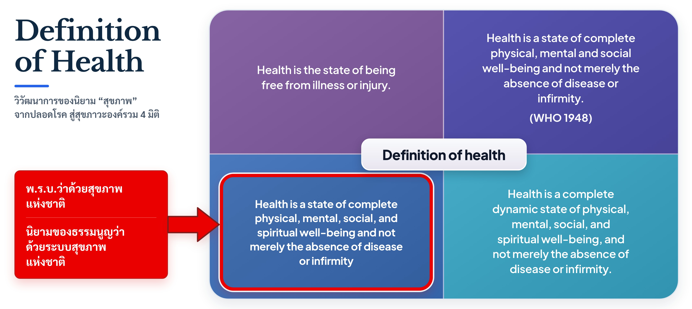
*กรอบแนวคิดประกอบการเฉลยข้อ 1 (ก): วิวัฒนาการนิยามสุขภาพ 4 มุมมอง จากการปราศจากโรคสู่สุขภาวะองค์รวมและศักยภาพในการปรับตัว*

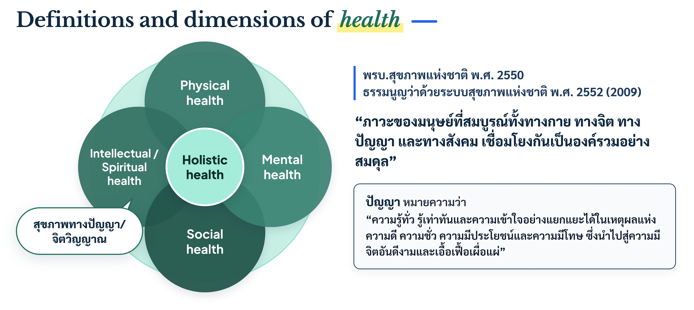
*กรอบแนวคิดประกอบการเฉลยข้อ 1 (ข): นิยามสุขภาพองค์รวม 4 มิติ (กาย · จิต · สังคม · ปัญญา) ตาม พ.ร.บ.สุขภาพแห่งชาติ พ.ศ. 2550 และธรรมนูญว่าด้วยระบบสุขภาพแห่งชาติ พ.ศ. 2552*

2. จงวิเคราะห์ปัจจัยที่มีผลต่อภาวะสุขภาพของนายสมชายโดยจำแนกตามกรอบแนวคิดปัจจัยกำหนดสุขภาพทั้ง 4 หมวด พร้อมระบุข้อมูลจากเนื้อหาโจทย์มาสนับสนุน (รวม 4 คะแนนสุทธิ)

***เกณฑ์และวิธีคิดคะแนนข้อ 2 (รวม 4 คะแนนสุทธิ): ช่องคำตอบสีแดง 4 หมวด หมวดละ 1 คะแนน (ยกตัวอย่างจากโจทย์สอดคล้องอย่างน้อย 1 อย่างต่อหมวดได้ 1 คะแนน)***

| หมวดของปัจจัยกำหนดสุขภาพ (Determinants of Health) | ข้อมูล / เหตุการณ์จาก scenario ที่สนับสนุน (ช่องละ 1 คะแนน) |
| --- | --- |
| 2.1 ปัจจัยส่วนบุคคล (Individual / Personal factors) | <u>*เพศชาย อายุ 40 ปี ประวัติบิดาและพี่ชายเป็นโรคกล้ามเนื้อหัวใจขาดเลือด ไม่สูบบุหรี่ ดื่มสุราตามเทศกาล เล่นฟุตบอล ร่วมโครงการนับแคล และติดตามการรักษาต่อเนื่อง*</u> *(1 คะแนน)* |
| 2.2 ปัจจัยด้านสิ่งแวดล้อม (Environmental factors) | <u>*โรงงานจัดสภาพแวดล้อมเอื้อต่อสุขภาพ ได้แก่ สวนหย่อม ฟิตเนสฟรี โรงอาหารมีฉลากข้อมูลโภชนาการทุกเมนู และจัดโครงการการยศาสตร์ดูแลสภาพการทำงาน*</u> *(1 คะแนน)* |
| 2.3 ปัจจัยด้านระบบบริการสุขภาพ (Health services system) | <u>*มีการจัดตรวจสุขภาพประจำปีอย่างต่อเนื่องที่ออกแบบโดยแพทย์อาชีวเวชศาสตร์ และมีระบบการรักษาและนัดติดตามอาการทุก 6 เดือน*</u> *(1 คะแนน)* |
| 2.4 ปัจจัยด้านการเมือง เศรษฐกิจ และสังคม (Political, economic & social factors) | <u>*โครงสร้างเวลาทำงานที่มีช่วงเร่งการผลิตล่วงเวลา 60 ชม./สัปดาห์ (2 เดือน/ปี) ลักษณะงานที่เดินตรวจสายการผลิต 5–6 ชม./วัน และนโยบายสวัสดิการที่พักครอบครัวขององค์กร*</u> *(1 คะแนน)* |

*กรอบแนวคิดประกอบการเฉลยข้อ 2: กรอบแนวคิดปัจจัยกำหนดสุขภาพทั้ง 4 หมวด และปฏิสัมพันธ์เชื่อมโยงเชิงระบบ*

3. จงจำแนกกิจกรรมหรือการดำเนินการที่ปรากฏใน scenario ตามระดับของการป้องกันโรคทั้ง 4 ระดับ พร้อมระบุกลุ่มเป้าหมายหรือวัตถุประสงค์ให้สอดคล้องกับระดับการป้องกันโรคนั้น (รวม 8 คะแนนสุทธิ)

***เกณฑ์และวิธีคิดคะแนนข้อ 3 (รวม 8 คะแนนสุทธิ): 4 ระดับการป้องกันโรค ระดับละ 2 คะแนน [Primary (1+1) + Secondary (1+1) + Tertiary (1+1) + Quaternary (2) = 8 คะแนน] โดยต้องระบุกลุ่มเป้าหมาย/วัตถุประสงค์ให้ตรงกับระดับการป้องกันโรค***

| ระดับของการป้องกันโรค (Levels of Disease Prevention) | กิจกรรมใน scenario พร้อมระบุกลุ่มเป้าหมายและวัตถุประสงค์ที่สอดคล้อง |
| --- | --- |
| 3.1 การป้องกันระดับปฐมภูมิ (Primary Prevention) [รวม 2 คะแนน] | 1) <u>*โครงการสร้างเสริมสุขภาพสำหรับพนักงานทั่วไปที่ยังไม่เกิดโรค เช่น โครงการแข่งขันกีฬาภายใน โครงการเลิกบุหรี่ โครงการการยศาสตร์ลดบาดเจ็บกล้ามเนื้อ และโครงการนับแคลในผู้ที่ยังไม่ป่วย*</u> *(1 คะแนน)* 2) <u>*การจัดสิ่งแวดล้อมที่เอื้อต่อสุขภาพในโรงงาน (สวนหย่อม ฟิตเนสฟรี ฉลากโภชนาการทุกเมนู) เพื่อลดปัจจัยเสี่ยงและป้องกันไม่ให้เกิดโรคตั้งแต่ต้น*</u> *(1 คะแนน)* |
| 3.2 การป้องกันระดับทุติยภูมิ (Secondary Prevention) [รวม 2 คะแนน] | 1) <u>*การจัดตรวจสุขภาพประจำปีให้แก่พนักงานทุกคนเพื่อค้นหาความผิดปกติตั้งแต่ระยะเริ่มแรกที่ยังไม่มีอาการ (early detection) จนพบไขมันและความดันสูงของนายสมชาย*</u> *(1 คะแนน)* 2) <u>*การนำผู้ที่ตรวจพบความผิดปกติเข้าสู่กระบวนการวินิจฉัยและเริ่มให้การรักษาตั้งแต่ระยะแรก (prompt treatment)*</u> *(1 คะแนน)* |
| 3.3 การป้องกันระดับตติยภูมิ (Tertiary Prevention) [รวม 2 คะแนน] | 1) <u>*การรับการรักษาและนัดติดตามอาการต่อเนื่องทุก 6 เดือนในนายสมชายซึ่งป่วยเป็นความดันโลหิตสูงและไขมันในเลือดสูงแล้ว เพื่อป้องกันภาวะแทรกซ้อนโรคหัวใจและหลอดเลือด*</u> *(1 คะแนน)* 2) <u>*การที่นายสมชายสมัครเข้าโครงการนับแคลภายหลังทราบว่าตนเองป่วยเป็นไขมันและความดันสูง เพื่อชะลอความรุนแรงของโรคและลดความเสี่ยงทุพพลภาพ*</u> *(1 คะแนน)* |
| 3.4 การป้องกันระดับจตุรภูมิ / ขั้นที่สี่ (Quaternary Prevention) [รวม 2 คะแนน] | <u>*โปรแกรมตรวจสุขภาพประจำปีของพนักงานได้รับการออกแบบและคัดเลือกรายการตรวจที่เหมาะสมตามความเสี่ยงจริงโดยแพทย์อาชีวเวชศาสตร์ ช่วยลดการส่งตรวจที่เกินความจำเป็น (over-investigation) และป้องกันอันตรายจากการแทรกแซงทางการแพทย์ที่ไม่จำเป็น*</u> *(2 คะแนน)* |

*กรอบแนวคิดประกอบการเฉลยข้อ 3 (ก): มุมมองตามลำดับเวลาของการป้องกันโรค (The Chronological View of Disease Prevention — Leavell & Clark, 1958)*

*กรอบแนวคิดประกอบการเฉลยข้อ 3 (ข): มุมมองเชิงความสัมพันธ์ระหว่างมุมมองผู้ให้บริการกับมุมมองผู้ใช้บริการ และการป้องกันระดับที่ 4 (Quaternary Prevention — Marc Jamoulle / WONCA)*

***เกณฑ์สำคัญในการตรวจให้คะแนนและการเชื่อมโยงแนวคิดระดับการป้องกันโรค***

*จุดเน้นสำคัญที่สุดของคำถามข้อที่ 3 คือการชี้ให้เห็นว่า กิจกรรมเดียวกัน เช่น โครงการนับแคล เมื่อดำเนินการในกลุ่มพนักงานสุขภาพดีเพื่อป้องกันไม่ให้เกิดโรคความดันโลหิตสูงหรือไขมันในเลือดสูง จัดเป็น Primary prevention แต่เมื่อนายสมชายซึ่งได้รับการวินิจฉัยว่าป่วยเป็นโรคดังกล่าวแล้วเข้าร่วมเพื่อควบคุมระดับความดันและไขมันไม่ให้เกิดโรคกล้ามเนื้อหัวใจขาดเลือดตามรอยบิดาและพี่ชาย กิจกรรมเดียวกันนี้จึงทำหน้าที่เป็น Tertiary prevention อย่างชัดเจน*

---

## หัวข้อ 2. โครงสร้างของระบบสุขภาพและรูปแบบการดูแล (HS2: Structure of Health Systems and Models of Care)
- **กำหนดการอภิปราย:** วันจันทร์ที่ 30 พฤศจิกายน 2569 เวลา 09.40 – 12.00 น. · **สัดส่วนน้ำหนักเนื้อหา:** 15% · **คะแนนอ้างอิงรวม:** 15 คะแนนสุทธิ (2 กรณีศึกษา)

### Scenario 1 วิกฤตภาระงานแพทย์ใช้ทุนลาออกและการวิเคราะห์ปัญหาโรงพยาบาลชุมชนเชิงระบบ (8 คะแนนสุทธิ (จากคะแนนดิบ 12 คะแนน ÷ 1.5))

ผู้อำนวยการโรงพยาบาลชุมชน (ผอ.รพช.) แห่งหนึ่งกำลังเผชิญกับวิกฤตการณ์ครั้งสำคัญ เมื่อแพทย์ใช้ทุน (Intern) จำนวน 2 คน ตัดสินใจยื่นใบลาออกพร้อมกันหลังจากเริ่มปฏิบัติงานได้เพียง 2 สัปดาห์ สร้างความตระหนกและส่งผลกระทบต่อการให้บริการเป็นวงกว้าง ผู้อำนวยการจึงเรียกประชุมด่วนร่วมกับทีมบริหารและหัวหน้าฝ่ายงานต่าง ๆ เพื่อค้นหาสาเหตุเชิงระบบและแนวทางแก้ไขปัญหาร่วมกัน

ตัวแทนแพทย์ใช้ทุนเปิดใจถึงสาเหตุของการลาออกว่าเกิดจากภาวะหมดไฟในการทำงาน (burnout) เนื่องจากต้องแบกรับภาระงานสูงถึง 110 ชั่วโมงต่อสัปดาห์ โดยเวลาส่วนใหญ่หมดไปกับการตรวจรักษาผู้ป่วยโรคไม่ติดต่อเรื้อรัง (NCDs) กลุ่มที่มีอาการคงที่จำนวนมหาศาล จนเบียดบังเวลาในการดูแลผู้ป่วยวิกฤตหรือกรณีซับซ้อนที่ต้องใช้ทักษะการตัดสินใจทางการแพทย์ขั้นสูง ขณะที่หัวหน้าพยาบาลชี้ให้เห็นว่าพยาบาลวิชาชีพที่มีประสบการณ์ก็ยังถูกใช้งานไม่เต็มศักยภาพ โดยเคยเสนอให้จัดตั้งคลินิกโรคเรื้อรังที่บริหารจัดการโดยทีมพยาบาล (nurse-led clinic) เพื่อช่วยแบ่งเบาภาระงานของแพทย์ แต่ข้อเสนอดังกล่าวยังไม่สามารถขับเคลื่อนได้ เนื่องจากต้องรอระเบียบหรือนโยบายที่เป็นลายลักษณ์อักษรที่ชัดเจนจากส่วนกลางเสียก่อน

ด้านหัวหน้าห้องฉุกเฉินส่งสัญญาณเตือนว่า พยาบาลห้องฉุกเฉินและนักปฏิบัติการฉุกเฉินการแพทย์ (Paramedic) กำลังเริ่มทยอยลาออกจากระบบงานที่บั่นทอนจิตใจ โดยเฉพาะปัญหาระบบบริการการแพทย์ฉุกเฉิน (EMS) ที่ยังขาดประสิทธิภาพ แม้ประชาชนจะสามารถแจ้งเหตุและส่งพิกัดผ่านแอปพลิเคชัน 1669 ได้สะดวกแล้ว แต่ระบบคอมพิวเตอร์ของโรงพยาบาลกลับไม่รองรับการเชื่อมต่อข้อมูลดังกล่าว ทำให้เจ้าหน้าที่ต้องกรอกข้อมูลและค้นหาพิกัดซ้ำซ้อน ส่งผลให้การออกเหตุล่าช้าและเพิ่มความเสี่ยงต่อชีวิตของผู้ป่วยวิกฤต จึงเสนอให้เร่งปรับปรุงฐานข้อมูลของโรงพยาบาลให้เชื่อมโยงรับส่งข้อมูลกับแอปพลิเคชันภายนอกได้โดยตรง

ส่วนหัวหน้ากลุ่มงานบริการด้านปฐมภูมิเสนอทางออกระยะยาวว่า ควรผลักดันให้โรงพยาบาลส่งเสริมสุขภาพตำบล (รพ.สต.) ทำหน้าที่เป็นด่านหน้า (gatekeeper) อย่างแท้จริง โดยใช้กลยุทธ์การมอบหมายและกระจายงาน (task-shifting) ให้ทีมสหวิชาชีพดูแลผู้ป่วยโรคเรื้อรังที่อาการคงที่ ร่วมกับการใช้ระบบปรึกษาทางไกล (teleconsultation) เชื่อมต่อข้อมูลและการสื่อสารกับแพทย์ผู้เชี่ยวชาญ อย่างไรก็ตาม โมเดลนี้จำเป็นต้องยกระดับโครงสร้างพื้นฐานของ รพ.สต. ให้ได้มาตรฐานเสียก่อน โดยเฉพาะคลังยาและระบบลูกโซ่ความเย็น (cold chain) ซึ่งปัจจุบันมองเห็นโอกาสที่จะดำเนินการได้สำเร็จภายหลังการถ่ายโอน รพ.สต. ไปสู่องค์การบริหารส่วนจังหวัด (อบจ.) ที่จะทำให้ รพ.สต. มีอำนาจและงบประมาณโดยตรงในการพัฒนาศักยภาพตนเองได้รวดเร็วยิ่งขึ้น

ภายหลังรับฟังทุกฝ่าย ผู้อำนวยการโรงพยาบาลได้สรุปบทเรียนสำคัญว่า แม้ปัญหาจะปรากฏกระจัดกระจายอยู่ในแต่ละแผนก แต่ต้นตอที่แท้จริงของปัญหาทั้งหมดไม่ได้อยู่ที่ตัวบุคคล หากแต่อยู่ที่ข้อจำกัดเชิงโครงสร้างและการขาดอำนาจตัดสินใจอย่างอิสระของโรงพยาบาล ซึ่งถูกจำกัดกรอบด้วยระเบียบและข้อบังคับจากส่วนกลาง ทำให้ไม่สามารถปรับตัวแก้ไขปัญหาหน้างานได้อย่างทันท่วงที

**คำถาม**

1) ในฐานะผู้อำนวยการโรงพยาบาลชุมชน จงสังเคราะห์ข้อมูลจากการประชุมตามกรอบแนวคิดองค์ประกอบของระบบสุขภาพขององค์การอนามัยโลก (WHO 6 building blocks of health systems) โดย<u>ระบุชื่อองค์ประกอบที่พบปัญหาให้ครบทั้ง 6 องค์ประกอบ</u> พร้อม<u>ยกข้อมูลจากสถานการณ์มาสนับสนุนว่ามีปัญหาในองค์ประกอบนั้นอย่างไร</u> และ<u>ระบุแนวทางการแก้ปัญหาเชิงรูปธรรมที่มีการนำเสนอในที่ประชุม</u>ให้สอดคล้องกันในตารางกระดาษคำตอบต่อไปนี้ (องค์ประกอบละ 2 คะแนนดิบ รวม 12 คะแนนดิบ นำมาหารด้วย 1.5 เป็นคะแนนสุทธิ 8 คะแนน)

> **วิธีคิดคะแนน (รวม 8 คะแนนสุทธิ): คิดคะแนนดิบองค์ประกอบละ 2 คะแนนดิบ แยกตามช่องในแต่ละแถว ได้แก่ ชื่อองค์ประกอบ WHO 6 Building Blocks (0.5 คะแนนดิบ) + ข้อมูลจากสถานการณ์ที่สนับสนุนว่ามีปัญหา (0.75 คะแนนดิบ) + แนวทางการแก้ปัญหาที่นำเสนอในที่ประชุม (0.75 คะแนนดิบ) รวมครบ 6 องค์ประกอบ = 12 คะแนนดิบ แล้วนำมาหารด้วย 1.5 เป็นคะแนนสุทธิ 8 คะแนน (เกณฑ์ความสอดคล้อง: ต้องเชื่อมโยงสอดคล้องกันในแถวเดียวกัน; หากตอบสอดคล้องกันบางส่วนประมาณ 2 ใน 3 ส่วน ได้ 1 คะแนนดิบ และหากระบุแต่ชื่อองค์ประกอบโดยไม่มีข้อมูลปัญหาและแนวทางแก้ไขที่สอดคล้องประกอบ จะได้ 0 คะแนนดิบในองค์ประกอบนั้น)**

| ลำดับ | ชื่อองค์ประกอบตามกรอบ WHO 6 Building Blocks (ช่องละ 0.5 คะแนนดิบ) | ข้อมูลจากสถานการณ์ที่สนับสนุนว่ามีปัญหา (Supporting Evidence) (ช่องละ 0.75 คะแนนดิบ) | แนวทางการแก้ปัญหาที่นำเสนอในที่ประชุม (Proposed Solutions) (ช่องละ 0.75 คะแนนดิบ) |
| --- | --- | --- | --- |
| 1 | ________________________ ________________________ (0.5 คะแนนดิบ) | ____________________________________ ____________________________________ (0.75 คะแนนดิบ) | ____________________________________ ____________________________________ (0.75 คะแนนดิบ) |
| 2 | ________________________ ________________________ (0.5 คะแนนดิบ) | ____________________________________ ____________________________________ (0.75 คะแนนดิบ) | ____________________________________ ____________________________________ (0.75 คะแนนดิบ) |
| 3 | ________________________ ________________________ (0.5 คะแนนดิบ) | ____________________________________ ____________________________________ (0.75 คะแนนดิบ) | ____________________________________ ____________________________________ (0.75 คะแนนดิบ) |
| 4 | ________________________ ________________________ (0.5 คะแนนดิบ) | ____________________________________ ____________________________________ (0.75 คะแนนดิบ) | ____________________________________ ____________________________________ (0.75 คะแนนดิบ) |
| 5 | ________________________ ________________________ (0.5 คะแนนดิบ) | ____________________________________ ____________________________________ (0.75 คะแนนดิบ) | ____________________________________ ____________________________________ (0.75 คะแนนดิบ) |
| 6 | ________________________ ________________________ (0.5 คะแนนดิบ) | ____________________________________ ____________________________________ (0.75 คะแนนดิบ) | ____________________________________ ____________________________________ (0.75 คะแนนดิบ) |
| สรุปวิธีแปลงคะแนน: รวมคะแนนดิบทั้ง 6 องค์ประกอบ (เต็ม 12 คะแนนดิบ) ÷ 1.5 | *(ต่อเนื่องจากแถวบน)* | รวมคะแนนดิบที่ได้: ______ / 12 คะแนนดิบ | คะแนนสุทธิ (นำคะแนนดิบ ÷ 1.5): ______ / 8 คะแนน |

#### เฉลย

***คำถาม 1: การสังเคราะห์ปัญหาและทางออกเชิงระบบตามกรอบ WHO 6 Building Blocks (องค์ประกอบละ 2 คะแนนดิบ รวม 12 คะแนนดิบ นำมาหารด้วย 1.5 เป็นคะแนนสุทธิ 8 คะแนน)***

***เกณฑ์การให้คะแนนและวิธีคิดคะแนน (องค์ประกอบละ 2 คะแนนดิบ [0.5 + 0.75 + 0.75] รวม 12 คะแนนดิบ ÷ 1.5 = คะแนนสุทธิ 8 คะแนน)***
- *ได้เต็ม 2 คะแนนดิบต่อองค์ประกอบ (0.5 + 0.75 + 0.75 คะแนนดิบ): เมื่อระบุชื่อองค์ประกอบตามกรอบ WHO 6 Building Blocks ถูกต้อง (0.5 คะแนนดิบ) ยกข้อมูลหลักฐานของปัญหาจากสถานการณ์ตรงประเด็น (0.75 คะแนนดิบ) และเชื่อมโยงแนวทางการแก้ปัญหาที่นำเสนอในที่ประชุมได้อย่างสอดคล้องครบทั้ง 3 ช่อง (0.75 คะแนนดิบ)*
- *ได้ 1 คะแนนดิบต่อองค์ประกอบ: เมื่อระบุและวิเคราะห์สอดคล้องกันเพียงบางส่วน (ประมาณ 2 ใน 3 ส่วน เช่น ระบุชื่อองค์ประกอบและปัญหาถูกต้อง แต่แนวทางแก้ไขไม่สอดคล้อง หรือสลับกับองค์ประกอบอื่น)*
- *ได้ 0 คะแนนดิบต่อองค์ประกอบ: เมื่อระบุชื่อองค์ประกอบผิด หรือระบุแต่ชื่อองค์ประกอบลอย ๆ โดยไม่มีข้อมูลปัญหาและแนวทางแก้ไขที่สอดคล้องจากสถานการณ์ประกอบ*

| ลำดับ | ชื่อองค์ประกอบตามกรอบ WHO 6 Building Blocks (ช่องละ 0.5 คะแนนดิบ) | ข้อมูลจากสถานการณ์ที่สนับสนุนว่ามีปัญหา (Supporting Evidence) (ช่องละ 0.75 คะแนนดิบ) | แนวทางการแก้ปัญหาที่นำเสนอในที่ประชุม (Proposed Solutions) (ช่องละ 0.75 คะแนนดิบ) |
| --- | --- | --- | --- |
| 1 | <u>*ภาวะผู้นำและการอภิบาลระบบ (Leadership and Governance)*</u> *(0.5 คะแนนดิบ)* | <u>*- รพช. ขาดอำนาจตัดสินใจอย่างอิสระ ติดกรอบระเบียบส่วนกลาง; ข้อเสนอ nurse-led clinic ขับเคลื่อนไม่ได้เพราะต้องรอระเบียบลายลักษณ์อักษร*</u> *(0.75 คะแนนดิบ)* | <u>*- กระจายอำนาจการอภิบาลผ่านการถ่ายโอน รพ.สต. สู่ อบจ. ควบคู่กับการผลักดันระเบียบรองรับการขยายบทบาทวิชาชีพ*</u> *(0.75 คะแนนดิบ)* |
| 2 | <u>*กำลังคนด้านสุขภาพ (Health Workforce)*</u> *(0.5 คะแนนดิบ)* | <u>*- แพทย์ Intern ทำงานหนัก 110 ชม./สัปดาห์ เกิดภาวะ burnout จนลาออก 2 คน ทีม ER ทยอยลาออก และจัดสรรงานไม่ตรงสมรรถนะวิชาชีพ (skill mismatch)*</u> *(0.75 คะแนนดิบ)* | <u>*- ขยายบทบาทพยาบาลจัดตั้งคลินิกโรคเรื้อรัง (nurse-led clinic) และกระจายงาน (task-shifting) ให้ทีมสหวิชาชีพดูแลผู้ป่วย NCDs อาการคงที่*</u> *(0.75 คะแนนดิบ)* |
| 3 | <u>*การจัดบริการสุขภาพ (Service Delivery)*</u> *(0.5 คะแนนดิบ)* | <u>*- ผู้ป่วย NCDs อาการคงที่กระจุกตัวแออัดที่ รพช. ขาดระบบ gatekeeper ปฐมภูมิ และระบบ EMS ออกเหตุล่าช้าเสี่ยงต่อความปลอดภัยผู้ป่วยวิกฤต*</u> *(0.75 คะแนนดิบ)* | <u>*- พัฒนา รพ.สต. ให้เป็นด่านหน้า (gatekeeper) ลดความแออัดใน รพช. และใช้ระบบ teleconsultation เชื่อมการดูแลไร้รอยต่อ*</u> *(0.75 คะแนนดิบ)* |
| 4 | <u>*ระบบสารสนเทศด้านสุขภาพ (Health Information Systems)*</u> *(0.5 คะแนนดิบ)* | <u>*- ระบบคอมพิวเตอร์ของ รพช. ไม่เชื่อมต่อกับแอปพลิเคชัน 1669 ทำให้ต้องกรอกข้อมูลและค้นหาพิกัดซ้ำซ้อน (lack of interoperability)*</u> *(0.75 คะแนนดิบ)* | <u>*- ปรับปรุงฐานข้อมูลให้เชื่อมโยงรับ–ส่งข้อมูลกับแอปพลิเคชัน 1669 โดยตรง และนำ teleconsultation มาช่วยสื่อสารข้อมูลทางคลินิก*</u> *(0.75 คะแนนดิบ)* |
| 5 | <u>*ระบบยา วัคซีน เวชภัณฑ์ และเทคโนโลยี (Medical Products, Vaccines & Technologies)*</u> *(0.5 คะแนนดิบ)* | <u>*- โครงสร้างพื้นฐานคลังยาและระบบลูกโซ่ความเย็น (cold chain) ของ รพ.สต. ยังไม่ได้มาตรฐาน เสี่ยงต่อคุณภาพการเก็บรักษายา*</u> *(0.75 คะแนนดิบ)* | <u>*- ยกระดับมาตรฐานโครงสร้างพื้นฐานคลังยาและระบบลูกโซ่ความเย็นของ รพ.สต. เพื่อรองรับการกระจายผู้ป่วยโรคเรื้อรังไปดูแลใกล้บ้าน*</u> *(0.75 คะแนนดิบ)* |
| 6 | <u>*การคลังด้านสุขภาพ (Health Financing)*</u> *(0.5 คะแนนดิบ)* | <u>*- รพ.สต. มีข้อจำกัดด้านงบประมาณลงทุนที่คล่องตัวในการปรับปรุงโครงสร้างพื้นฐานคลังยาและระบบสนับสนุนบริการ*</u> *(0.75 คะแนนดิบ)* | <u>*- ใช้กลไกการกระจายอำนาจทางการคลังหลังถ่ายโอน รพ.สต. สู่ อบจ. เพื่อให้มีงบประมาณโดยตรงในการพัฒนาศักยภาพหน่วยบริการ*</u> *(0.75 คะแนนดิบ)* |
| สรุปวิธีแปลงคะแนน: รวมคะแนนดิบทั้ง 6 องค์ประกอบ (เต็ม 12 คะแนนดิบ) ÷ 1.5 | *(ต่อเนื่องจากแถวบน)* | รวมคะแนนดิบที่ได้: <u>*2 × 6 = 12*</u> *(12 คะแนนดิบ)* | คะแนนสุทธิ: <u>*นำ 12 ÷ 1.5 = 8*</u> *(8 คะแนนสุทธิ)* |

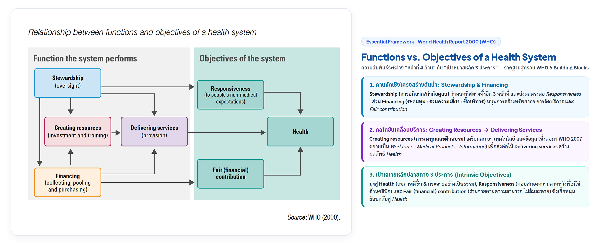
*กรอบแนวคิดประกอบการเฉลย (ก): ความสัมพันธ์ระหว่างหน้าที่หลัก 4 ด้าน (Stewardship · Financing · Creating Resources · Delivering Services) กับเป้าหมายหลัก 3 ประการของระบบสุขภาพ (WHO, 2000)*

*กรอบแนวคิดประกอบการเฉลย (ข): องค์ประกอบหลักของระบบสุขภาพ 6 ด้าน (WHO 6 Building Blocks) เทียบกับการวิเคราะห์ระบบสุขภาพในฐานะระบบซับซ้อนปรับตัวได้ (Complex Adaptive System)*

***การวิเคราะห์ด้านภาวะผู้นำและการอภิบาลระบบ (leadership and governance) — ต้นตอเชิงโครงสร้าง***

*บทสรุปของผู้อำนวยการชี้ให้เห็นว่าความบกพร่องด้านการอภิบาลระบบและการรวมศูนย์อำนาจเป็นรากเหง้าที่ล็อกองค์ประกอบอื่นไว้ การที่โรงพยาบาลขาดความเป็นอิสระในการตัดสินใจ (lack of autonomy) และติดค้างการรอนโยบายลายลักษณ์อักษรจากส่วนกลาง ทำให้ไม่สามารถปรับรูปแบบงานหรือเปิดคลินิกโรคเรื้อรังโดยพยาบาลได้ทันต่อวิกฤต การถ่ายโอนภารกิจปฐมภูมิสู่องค์กรปกครองส่วนท้องถิ่นควบคู่กับการปลดล็อกระเบียบวิชาชีพจึงเป็นจุดคานงัดเชิงโครงสร้างที่สำคัญ*

***การวิเคราะห์ด้านกำลังคนด้านสุขภาพ (health workforce) และด้านการจัดบริการสุขภาพ (service delivery)***

*ปัญหาด้านกำลังคนและด้านการจัดบริการเชื่อมโยงกันเป็นลูกโซ่ เมื่อระบบบริการปฐมภูมิยังทำหน้าที่ด่านหน้า (gatekeeper) ได้ไม่เต็มประสิทธิภาพ ผู้ป่วยโรคเรื้อรังอาการคงที่จำนวนมหาศาลจึงไหลเข้ามากระจุกตัวที่โรงพยาบาลชุมชน ส่งผลให้เกิดการจัดสรรทักษะบุคลากรไม่เหมาะสม (skill mismatch) แพทย์ใช้ทุนต้องทำงานถึง 110 ชั่วโมงต่อสัปดาห์จนเกิดภาวะหมดไฟและยื่นใบลาออก ขณะที่พยาบาลผู้เชี่ยวชาญกลับไม่ได้ใช้ศักยภาพเต็มที่ แนวทางแก้ไขจึงต้องดำเนินการคู่ขนานทั้งการขยายบทบาทวิชาชีพ (nurse-led clinic) การมอบหมายงานแก่ทีมสหวิชาชีพ (task-shifting) และการยกระดับ รพ.สต. ร่วมกับระบบปรึกษาทางไกล (teleconsultation)*

***การวิเคราะห์ด้านสารสนเทศ (health information) ด้านยาและเวชภัณฑ์ (medical products) และด้านการคลังสุขภาพ (health financing)***

*ในด้านระบบสนับสนุน การขาดความเชื่อมโยงแลกเปลี่ยนข้อมูล (interoperability) ระหว่างระบบคอมพิวเตอร์ของโรงพยาบาลกับแอปพลิเคชัน 1669 ก่อให้เกิดภาระงานบันทึกข้อมูลซ้ำซ้อนและทำให้การออกเหตุฉุกเฉินล่าช้า ขณะเดียวกัน การจะผ่องถ่ายผู้ป่วยโรคเรื้อรังไปรับบริการต่อเนื่องที่ รพ.สต. ได้อย่างปลอดภัย จำเป็นต้องแก้คอขวดด้านมาตรฐานคลังยาและระบบลูกโซ่ความเย็น (cold chain) ซึ่งต้องอาศัยความคล่องตัวด้านงบประมาณลงทุนจากการคลังท้องถิ่นภายหลังการถ่ายโอนสู่ อบจ. ทั้งหมดนี้สะท้อนว่าทั้ง 6 องค์ประกอบของระบบสุขภาพไม่ได้แยกขาดจากกัน แต่มีภาวะผู้นำและการคลังสุขภาพเป็นกลไกขับเคลื่อนทรัพยากรไปสู่การจัดบริการที่มีผู้ป่วยและประชาชนเป็นศูนย์กลาง*

---

### Scenario 2 การเลือกรูปแบบการดูแลสุขภาพเปรียบเทียบสภาวะผู้ป่วย 2 ระยะ (7 คะแนนสุทธิ (สถานการณ์ละ 3.5 คะแนน))

สถานการณ์ผู้ป่วยที่ 2.1: ชายอายุ 25 ปี ถูกพามาพบแพทย์โดยญาติเนื่องจากมีอาการเปลี่ยนแปลงในช่วงสัปดาห์ที่ผ่านมา โดยเริ่มเก็บตัว พูดพึมพำคนเดียว และมีความคิดหลงผิดหวาดระแวงว่าอาหารมียาพิษ จึงปฏิเสธการรับประทานอาหารและน้ำ รวมถึงนอนไม่หลับติดต่อกันมา 3–4 วัน จนร่างกายเริ่มอ่อนเพลียและซูบผอมลงอย่างชัดเจน ญาติพยายามให้การดูแลเบื้องต้นที่บ้านแล้วแต่ไม่สำเร็จ ผู้ป่วยเริ่มดูแลสุขอนามัยส่วนตัวไม่ได้ จากการตรวจประเมินพบว่าผู้ป่วยไม่มีพฤติกรรมก้าวร้าวและสัญญาณชีพยังคงที่ (stable vital signs) แต่แพทย์วินิจฉัยว่าเป็นภาวะเจ็บป่วยเฉียบพลันที่ส่งผลกระทบต่อสุขภาพกายและการดูแลตนเองอย่างรุนแรง (severe self-neglect) จนร่างกายทรุดโทรม ซึ่งเกินขีดความสามารถในการดูแลที่บ้าน จึงพิจารณาว่าจำเป็นต้องได้รับการดูแลในสถานที่ที่มีความพร้อมในการติดตามอาการ ปรับยา และดูแลโภชนาการได้อย่างใกล้ชิดตลอด 24 ชั่วโมง จนกว่าอาการจะทุเลา

สถานการณ์ผู้ป่วยที่ 2.2: หญิงอายุ 35 ปี มีประวัติการเจ็บป่วยทางจิตเวชมานานกว่า 10 ปี ปัจจุบันสามารถอาศัยอยู่กับครอบครัวในชุมชนได้โดยไม่มีพฤติกรรมก้าวร้าว เนื่องจากให้ความร่วมมือในการรับประทานยาต่อเนื่องตามแพทย์สั่ง ทำให้ไม่มีอาการกำเริบรุนแรงมาระยะหนึ่งแล้ว อย่างไรก็ตาม เธอยังต้องการการติดตามอาการเป็นระยะเพื่อป้องกันการกลับเป็นซ้ำ และแพทย์ประเมินว่าเธอมีศักยภาพที่จะกลับไปประกอบอาชีพได้ แต่ยังขาดความมั่นใจและทักษะทางสังคมบางประการ จึงจำเป็นต้องได้รับการสนับสนุนระยะยาวเพื่อฟื้นฟูสมรรถภาพและส่งเสริมให้สามารถจัดการตนเองได้ในสภาพแวดล้อมจริง

**คำถาม**

1) จากสถานการณ์ผู้ป่วยที่ 2.1 และ 2.2 จงวิเคราะห์เปรียบเทียบลงในตารางกระดาษคำตอบให้<u>สอดคล้องกันอย่างเป็นเหตุเป็นผลครบทั้ง 3 ประเด็นหลัก</u> ได้แก่ (1) <u>WHAT: ผู้ป่วยแต่ละรายต้องการรูปแบบการดูแลหลัก (Model of Care) แบบใดมากที่สุด</u> (สถานการณ์ละ 0.5 คะแนน) (2) <u>WHY: สภาวะทางคลินิก การดำเนินโรค และความสามารถในการดูแลตนเอง/ครอบครัวใดที่เป็นเหตุผลบ่งชี้ให้เลือกรูปแบบดังกล่าว</u> (สถานการณ์ละ 1.5 คะแนน) และ (3) <u>HOW: ควรมีแนวทางการจัดการดูแลอย่างไร โดยตอบให้ครบทั้ง 4 คำถามย่อย</u> ได้แก่ หลักการ/เป้าหมายหลักของการดูแล กระบวนการและบริการที่ควรส่งมอบ สถานที่ให้บริการหลัก และทีมผู้ให้บริการพร้อมรูปแบบปฏิสัมพันธ์กับผู้ป่วยและครอบครัว (สถานการณ์ละ 1.5 คะแนน) (รวม 7 คะแนนสุทธิ)

> **วิธีคิดคะแนน (รวม 7 คะแนนสุทธิ): คิดแยกตามผู้ป่วย 2 สถานการณ์ สถานการณ์ละ 3.5 คะแนน แบ่งตามช่องในตาราง ได้แก่ 1. WHAT รูปแบบการดูแลหลัก (0.5 คะแนน) + 2. WHY เหตุผลจากสภาวะผู้ป่วย (1.5 คะแนน) + 3. HOW แนวทางการจัดการดูแล 4 ช่องย่อย [3.1 หลักการสำคัญ 0.5 + 3.2 กระบวนการ/บริการ 0.5 + 3.3 สถานที่ดูแล 0.25 + 3.4 ผู้ให้บริการและปฏิสัมพันธ์ 0.25 = 1.5 คะแนน] รวม 3.5 × 2 = 7 คะแนน (เกณฑ์ความสอดคล้องต่อเนื่อง Alignment Rule: คำตอบในส่วน WHY และ HOW ทั้ง 4 ช่องย่อยต้องสอดคล้องเป็นเหตุเป็นผลกับรูปแบบการดูแล WHAT ที่เลือกไว้ในข้อ 1 หากไม่สอดคล้องกับ WHAT ที่เลือกไว้ จะได้ 0 คะแนนในช่องนั้น)**

| ประเด็นคำถามที่ต้องวิเคราะห์ (WHAT · WHY · HOW) | สถานการณ์ผู้ป่วยที่ 2.1 (ชายอายุ 25 ปี · รวม 3.5 คะแนน) | สถานการณ์ผู้ป่วยที่ 2.2 (หญิงอายุ 35 ปี · รวม 3.5 คะแนน) |
| --- | --- | --- |
| 1. WHAT: รูปแบบการดูแลหลัก (Model of Care) • ผู้ป่วยรายนี้ต้องการรูปแบบการดูแลสุขภาพแบบใดเป็นหลักที่เหมาะสมที่สุด? | ____________________________________ ____________________________________ (0.5 คะแนน) | ____________________________________ ____________________________________ (0.5 คะแนน) |
| 2. WHY: เหตุผลจากสภาวะผู้ป่วย (Patient Conditions) • ลักษณะอาการ ความรุนแรง การดำเนินโรค และความสามารถในการดูแลตนเอง/ศักยภาพครอบครัวในโจทย์เป็นอย่างไร จึงบ่งชี้ให้เลือกรูปแบบในข้อ 1? | ____________________________________ ____________________________________ ____________________________________ (1.5 คะแนน) | ____________________________________ ____________________________________ ____________________________________ (1.5 คะแนน) |
| 3. HOW — 3.1 หลักการสำคัญ (Guiding principle) • เป้าหมายหรือหัวใจหลักของการดูแลผู้ป่วยในระยะนี้มุ่งเน้นให้เกิดผลลัพธ์ใดเป็นสำคัญ? | ____________________________________ ____________________________________ (0.5 คะแนน) | ____________________________________ ____________________________________ (0.5 คะแนน) |
| 3. HOW — 3.2 กระบวนการ/บริการ (Interventions) • ควรจัดบริการหรือกิจกรรมการดูแลรักษาสำคัญอะไรบ้างให้แก่ผู้ป่วยรายนี้? (What services should be delivered?) | ____________________________________ ____________________________________ (0.5 คะแนน) | ____________________________________ ____________________________________ (0.5 คะแนน) |
| 3. HOW — 3.3 สถานที่ดูแล (Settings) • ควรจัดบริการดูแลผู้ป่วยในสถานที่หรือบริบทแวดล้อมใดเป็นหลัก? (Where should care be delivered?) | ____________________________________ (0.25 คะแนน) | ____________________________________ (0.25 คะแนน) |
| 3. HOW — 3.4 ผู้ให้บริการและปฏิสัมพันธ์ (Providers & Interaction) • ใครเป็นผู้ให้บริการหลัก และควรมีบทบาทหรือรูปแบบปฏิสัมพันธ์ในการทำงานร่วมกับผู้ป่วยและครอบครัวอย่างไร? (By whom and with what approach?) | ____________________________________ ____________________________________ (0.25 คะแนน) | ____________________________________ ____________________________________ (0.25 คะแนน) |
| รวมคะแนนต่อสถานการณ์ (0.5 + 1.5 + [0.5 + 0.5 + 0.25 + 0.25] = 3.5 คะแนน) | รวมสถานการณ์ที่ 2.1: ______ / 3.5 คะแนน | รวมสถานการณ์ที่ 2.2: ______ / 3.5 คะแนน |

#### เฉลย

***คำถาม 1: การวิเคราะห์เปรียบเทียบรูปแบบการดูแล (WHAT · WHY · HOW ทั้ง 4 มิติย่อย) ของผู้ป่วยทั้งสองระยะ (รวม 7 คะแนนสุทธิ)***

***เกณฑ์การให้คะแนนและวิธีคิดคะแนน (สถานการณ์ละ 3.5 คะแนน [0.5 + 1.5 + (0.5 + 0.5 + 0.25 + 0.25)] × 2 สถานการณ์ = 7 คะแนนสุทธิ — ใช้เกณฑ์ความสอดคล้องต่อเนื่อง Alignment Rule)***
- *ส่วนที่ 1 — WHAT (สถานการณ์ละ 0.5 คะแนน): ได้คะแนนทันทีเมื่อระบุชื่อรูปแบบการดูแลหลักถูกต้อง ได้แก่ สถานการณ์ที่ 2.1 = Acute Care (การดูแลระยะเฉียบพลันแบบผู้ป่วยใน) และสถานการณ์ที่ 2.2 = Chronic Care (การดูแลระยะเรื้อรัง) หรือ Ambulatory Care (หากระบุควบคู่กับ Rehabilitative Care ยิ่งสมบูรณ์)*
- *ส่วนที่ 2 — WHY (สถานการณ์ละ 1.5 คะแนน): อธิบายสภาวะความรุนแรง การดำเนินโรค และความสามารถในการดูแลตนเอง/ครอบครัวที่บ่งชี้ให้เลือกรูปแบบการดูแลในข้อ 1 ได้อย่างสมเหตุสมผล (หากเหตุผลไม่สอดคล้องกับรูปแบบที่เลือกไว้ในข้อ 1 จะได้ 0 คะแนนในช่องนี้)*
- *ส่วนที่ 3 — HOW (สถานการณ์ละ 1.5 คะแนน แยกเป็น 4 ช่องย่อย): 3.1 หลักการสำคัญ (0.5 คะแนน) + 3.2 กระบวนการ/บริการ (0.5 คะแนน) + 3.3 สถานที่ดูแล (0.25 คะแนน) + 3.4 ผู้ให้บริการและปฏิสัมพันธ์ (0.25 คะแนน) โดยทุกช่องต้องสอดคล้องจำเพาะกับรูปแบบการดูแลที่เลือกไว้ในข้อ 1*

| ประเด็นคำถามที่ต้องวิเคราะห์ (WHAT · WHY · HOW) | เฉลยสถานการณ์ผู้ป่วยที่ 2.1 (ชายอายุ 25 ปี · รวม 3.5 คะแนน) | เฉลยสถานการณ์ผู้ป่วยที่ 2.2 (หญิงอายุ 35 ปี · รวม 3.5 คะแนน) |
| --- | --- | --- |
| 1. WHAT: รูปแบบการดูแลหลัก (Model of Care) • ผู้ป่วยรายนี้ต้องการรูปแบบการดูแลสุขภาพแบบใดเป็นหลักที่เหมาะสมที่สุด? | <u>*Acute Care (การดูแลระยะเฉียบพลันแบบผู้ป่วยใน)*</u> *(0.5 คะแนน)* | <u>*Chronic Care (การดูแลระยะเรื้อรัง) หรือ Ambulatory Care ควบคู่กับ Rehabilitative Care*</u> *(0.5 คะแนน)* |
| 2. WHY: เหตุผลจากสภาวะผู้ป่วย (Patient Conditions) • ลักษณะอาการ ความรุนแรง การดำเนินโรค และความสามารถในการดูแลตนเอง/ศักยภาพครอบครัวในโจทย์เป็นอย่างไร จึงบ่งชี้ให้เลือกรูปแบบในข้อ 1? | <u>*มีอาการทางจิตกำเริบเฉียบพลัน หลงผิดหวาดระแวงจนปฏิเสธน้ำและอาหาร นอนไม่หลับ 3–4 วัน เกิดภาวะละเลยการดูแลตนเองอย่างรุนแรง (severe self-neglect) ร่างกายซูบผอมทรุดโทรมเกินขีดความสามารถของครอบครัว ต้องดูแลใกล้ชิด 24 ชม.*</u> *(1.5 คะแนน)* | <u>*เจ็บป่วยเรื้อรังนานกว่า 10 ปี แต่ปัจจุบันอาการสงบคงที่ (stable) รับประทานยาสม่ำเสมอ อาศัยในชุมชนได้ ต้องการการติดตามระยะยาวเพื่อป้องกันการกลับเป็นซ้ำและเสริมทักษะทางสังคมเพื่อกลับไปประกอบอาชีพ*</u> *(1.5 คะแนน)* |
| 3. HOW — 3.1 หลักการสำคัญ (Guiding principle) • เป้าหมายหรือหัวใจหลักของการดูแลผู้ป่วยในระยะนี้มุ่งเน้นให้เกิดผลลัพธ์ใดเป็นสำคัญ? | <u>*ทำให้อาการเฉียบพลันสงบคงที่และพ้นขีดอันตราย (stabilization) ให้จบรอบความเจ็บป่วยเฉียบพลัน (episode of care)*</u> *(0.5 คะแนน)* | <u>*เสริมพลังอำนาจให้จัดการตนเองได้ (empowerment & self-management) และฟื้นฟูคุณภาพชีวิตระยะยาว*</u> *(0.5 คะแนน)* |
| 3. HOW — 3.2 กระบวนการ/บริการ (Interventions) • ควรจัดบริการหรือกิจกรรมการดูแลรักษาสำคัญอะไรบ้างให้แก่ผู้ป่วยรายนี้? (What services should be delivered?) | <u>*เฝ้าระวังใกล้ชิด 24 ชม. ปรับยาจิตเวชจำเพาะ และแก้ไขภาวะขาดน้ำ/ทุพโภชนาการ*</u> *(0.5 คะแนน)* | <u>*ติดตามประเมินอาการและยาต่อเนื่อง สนับสนุนการจัดการตนเอง และฟื้นฟูสมรรถภาพทางสังคมและอาชีพ*</u> *(0.5 คะแนน)* |
| 3. HOW — 3.3 สถานที่ดูแล (Settings) • ควรจัดบริการดูแลผู้ป่วยในสถานที่หรือบริบทแวดล้อมใดเป็นหลัก? (Where should care be delivered?) | <u>*หอผู้ป่วยในของโรงพยาบาล หรือหอผู้ป่วยจิตเวช (inpatient ward)*</u> *(0.25 คะแนน)* | <u>*คลินิกผู้ป่วยนอก (OPD) หน่วยปฐมภูมิ บ้าน และชุมชน*</u> *(0.25 คะแนน)* |
| 3. HOW — 3.4 ผู้ให้บริการและปฏิสัมพันธ์ (Providers & Interaction) • ใครเป็นผู้ให้บริการหลัก และควรมีบทบาทหรือรูปแบบปฏิสัมพันธ์ในการทำงานร่วมกับผู้ป่วยและครอบครัวอย่างไร? (By whom and with what approach?) | <u>*จิตแพทย์/แพทย์เจ้าของไข้และทีมพยาบาลผู้ป่วยใน ให้การดูแลกำกับติดตามใกล้ชิด (directive care)*</u> *(0.25 คะแนน)* | <u>*ทีมสหวิชาชีพทำงานแบบหุ้นส่วน (partnership) ร่วมกับผู้ป่วยที่ตื่นรู้ (activated patient) และครอบครัว*</u> *(0.25 คะแนน)* |
| รวมคะแนนต่อสถานการณ์ (0.5 + 1.5 + [0.5 + 0.5 + 0.25 + 0.25] = 3.5 คะแนน) | รวมสถานการณ์ที่ 2.1: <u>*0.5 + 1.5 + 1.5*</u> *(3.5 คะแนน)* | รวมสถานการณ์ที่ 2.2: <u>*0.5 + 1.5 + 1.5*</u> *(3.5 คะแนน)* |

*กรอบแนวคิดประกอบการเฉลย (ก): ความต่อเนื่องของรูปแบบการดูแลและสถานบริการที่เหมาะสมตามระยะการเปลี่ยนแปลงของสุขภาวะ (Acute Care · Rehabilitative Care · Ambulatory/Chronic Care · Long-Term Care · Palliative Care)*

*กรอบแนวคิดประกอบการเฉลย (ข): ต้นแบบการดูแลผู้ป่วยระยะเรื้อรัง (Chronic Care Model: CCM ของ Wagner · Expanded CCM และกรอบ WHO ICCC)*

***บทวิเคราะห์เปรียบเทียบเชิงคลินิกและระบบบริการ (Acute Episode vs. Chronic Care Model)***

*จุดสังเกตทางคลินิกที่สำคัญในสถานการณ์ที่ 2.1 คือ แม้ผู้ป่วยจะมีสัญญาณชีพคงที่ (stable vital signs) และไม่มีพฤติกรรมก้าวร้าวรุนแรง แต่การปฏิเสธน้ำและอาหารต่อเนื่อง 3–4 วันจากอาการหลงผิดจนเกิดภาวะละเลยการดูแลตนเองอย่างรุนแรง (severe self-neglect) และซูบผอมทรุดโทรม ถือเป็นข้อบ่งชี้ชัดเจนของการดูแลระยะเฉียบพลันแบบผู้ป่วยใน (acute inpatient care) ซึ่งมุ่งเน้นการดูแลกำกับใกล้ชิดตลอด 24 ชั่วโมงโดยทีมแพทย์และพยาบาลในโรงพยาบาลจนพ้นระยะวิกฤตของรอบความเจ็บป่วย (episode of care)*

*ในทางตรงกันข้าม สถานการณ์ที่ 2.2 สะท้อนหัวใจของตัวแบบการดูแลผู้ป่วยโรคเรื้อรัง (Chronic Care Model ของ Wagner) เมื่อผู้ป่วยพ้นระยะเฉียบพลันและมีอาการคงที่ในชุมชน เป้าหมายของระบบสุขภาพต้องเปลี่ยนจากการสั่งการฝ่ายเดียวในโรงพยาบาล มาเป็นการทำงานแบบหุ้นส่วน (partnership) ระหว่างทีมสหวิชาชีพเชิงรุก (จิตแพทย์ พยาบาล นักกิจกรรมบำบัด นักจิตวิทยา นักสังคมสงเคราะห์ และเครือข่ายปฐมภูมิ) กับผู้ป่วยและครอบครัว เพื่อป้องกันการกลับเป็นซ้ำและฟื้นฟูสมรรถภาพทางสังคมสู่อาชีพในสภาพแวดล้อมจริง*

---

## หัวข้อ 3. หน้าที่ของระบบสุขภาพและคุณลักษณะอันพึงประสงค์ของระบบบริการสุขภาพ (HS3: Functions and Desirable Characteristics of Health Services Systems)
- **กำหนดการอภิปราย:** วันจันทร์ที่ 30 พฤศจิกายน 2569 เวลา 14.40 – 16.40 น. · **สัดส่วนน้ำหนักเนื้อหา:** 20% · **คะแนนอ้างอิงรวม:** 14.5 คะแนนสุทธิ (2 กรณีศึกษา)

### Scenario 1 นโยบาย “Cancer Anywhere” (มะเร็งรักษาทุกที่) กับคุณลักษณะอันพึงประสงค์ของระบบบริการสุขภาพ (7.5 คะแนนสุทธิ (ข้อ 1 = 4.5 คะแนน · ข้อ 2 = 3 คะแนน))

“Cancer Anywhere” เป็นนโยบายสำคัญที่สำนักงานหลักประกันสุขภาพแห่งชาติ (สปสช.) และกระทรวงสาธารณสุขร่วมกันผลักดันขึ้น เพื่อแก้ปัญหาการเข้าถึงบริการรักษามะเร็ง เนื่องจากตามระบบเดิมผู้ป่วยรับบริการได้เฉพาะโรงพยาบาลต้นสังกัด ทำให้การส่งต่อเพื่อรับบริการเฉพาะทาง เช่น การให้ยาเคมีบำบัด การฉายรังสี หรือการผ่าตัดมะเร็ง มีความล่าช้า ผู้ป่วยบางรายสูญเสียโอกาสในการรักษาและมีผลกระทบต่อคุณภาพชีวิต นโยบายนี้จึงถูกออกแบบเพื่อลดข้อจำกัดดังกล่าว โดยเปิดโอกาสให้ผู้ป่วยมะเร็งสามารถเข้ารับบริการรักษาได้ทุกหน่วยบริการที่มีศักยภาพทั่วประเทศ เพียงแค่ยืนยันสิทธิผ่านบัตรประชาชนโดยไม่ต้องใช้ใบส่งตัว และไม่ต้องเสียค่าใช้จ่ายเพิ่ม โดยนำร่องในปี พ.ศ. 2566 ก่อนขยายไปทั่วประเทศในปี พ.ศ. 2568

ผลลัพธ์ที่เห็นชัดคือ ผู้ป่วยมะเร็งได้รับการรักษาเร็วขึ้น ลดเวลารอคอย และลดความจำเป็นในการเดินทางข้ามจังหวัดเพื่อขอใบส่งตัว ผู้ป่วยสามารถเลือกเข้ารับการรักษาในโรงพยาบาลที่มีความพร้อมและเทคโนโลยีครบถ้วนมากกว่าในพื้นที่ตน

อย่างไรก็ตาม โครงการยังเผชิญอุปสรรคและข้อท้าทายหลายด้าน การเชื่อมโยงข้อมูลผู้ป่วยและเวชระเบียนอิเล็กทรอนิกส์ระหว่างหน่วยบริการยังไม่สมบูรณ์ ศักยภาพของโรงพยาบาลในแต่ละพื้นที่แตกต่างกัน ทำให้การเข้าถึงยังไม่เสมอภาคในเชิงคุณภาพ ขณะที่บุคลากรเฉพาะทาง เช่น อายุรแพทย์โรคมะเร็ง พยาบาลรังสีรักษา และเภสัชกรเคมีบำบัด ยังคงขาดแคลน นอกจากนี้ ยังมีความกังวลว่าผู้ป่วยจะกระจุกตัวในโรงพยาบาลใหญ่ ซึ่งอาจเพิ่มภาระงานและทำให้ระบบบริการบางส่วนล่าช้า

ฝ่ายผู้ป่วยและครอบครัวส่วนใหญ่แสดงความพึงพอใจที่ได้รับการรักษาเร็วขึ้น ลดความยุ่งยากในการขอใบส่งตัว ขณะที่แพทย์ผู้เชี่ยวชาญบางรายชื่นชมว่านี่คือ “ก้าวสำคัญของระบบสุขภาพไทย” ผู้บริหารระดับกระทรวงสาธารณสุขยืนยันว่า นโยบายนี้เป็นส่วนหนึ่งของการปฏิรูประบบสุขภาพเพื่อสร้างความเป็นธรรมและเข้าถึงได้จริง แต่ก็ยอมรับว่าความท้าทายคือการสร้างสมดุลระหว่าง “ความเป็นธรรม” กับ “ความยั่งยืนทางการคลัง”

นักวิชาการด้านนโยบายสุขภาพให้ความเห็นว่า Cancer Anywhere เป็นตัวอย่างของการขยายสิทธิสุขภาพที่มีความก้าวหน้า แต่ความสำเร็จระยะยาวขึ้นอยู่กับการมีระบบกำกับติดตามที่โปร่งใสและต่อเนื่อง ทั้งในมิติ “ปริมาณ” เช่น จำนวนผู้ป่วยที่เข้าถึงบริการเร็วขึ้น และส่งผลต่อ “คุณภาพ” เช่น ผลลัพธ์การรักษาและคุณภาพชีวิตที่ดีขึ้นเมื่อเข้าถึงการวินิจฉัยและรักษาอย่างรวดเร็ว

ขณะเดียวกัน เสียงจากผู้ให้บริการหน้างานสะท้อนถึงทั้งความภูมิใจและความเหนื่อยล้า พยาบาลโรงพยาบาลศูนย์แห่งหนึ่งกล่าวว่า “ผู้ป่วยไม่ต้องรอคิวนานเหมือนเดิม แต่ภาระงานเรามากขึ้นจนบางครั้งกลัวว่าจะดูแลได้ไม่ทั่วถึง” ขณะที่แพทย์จากอีกจังหวัดกลับมองว่า “นี่คือโอกาสที่ดี เพราะเราช่วยชีวิตคนจากต่างพื้นที่ได้ทันเวลา” อย่างไรก็ตาม การที่สิทธิประโยชน์ Cancer Anywhere ครอบคลุมเพียงการรักษาโรคมะเร็ง ทำให้ผู้ป่วยที่มีโรคประจำตัวอื่นร่วมด้วย เช่น โรคเบาหวาน โรคความดันโลหิตสูง โรคไตวายเรื้อรัง ยังต้องเข้ารับการรักษาที่โรงพยาบาลตามสิทธิต้นสังกัด ทำให้เสียค่าเดินทาง เวลา และโอกาสในการหารายได้

**คำถาม**

1) จากบทความเรื่อง Cancer Anywhere จงวิเคราะห์ว่า การเปิดโอกาสให้ผู้ป่วยมะเร็งเข้ารับบริการรักษาได้ทุกที่โดยไม่ต้องใช้ใบส่งตัว สะท้อนให้เห็นถึง “คุณลักษณะอันพึงประสงค์ของระบบบริการสุขภาพ (desirable characteristics of health services systems)” <u>มากที่สุดในด้านใดบ้าง (ตอบ 2 ประเด็นเรียงตามน้ำหนักความเด่นชัด)</u> โดย<u>ระบุแยกคุณลักษณะหลักและคุณลักษณะย่อย</u> พร้อม<u>อธิบายความหมายตามทฤษฎี</u> และ<u>ยกเนื้อหาจากบทความมาสนับสนุน</u>ลงในตารางต่อไปนี้ (รวม 4.5 คะแนนสุทธิ)

> **วิธีคิดคะแนน (รวม 4.5 คะแนนสุทธิ): ฐานคะแนนดิบต่อประเด็น = 3 คะแนนดิบ (คุณลักษณะหลัก 1 + คุณลักษณะย่อย 1 + ความหมายตามทฤษฎี 0.5 + ตัวอย่างจากบทความ 0.5) แล้วถ่วงน้ำหนักตามความสำคัญ ได้แก่ (1) ประเด็นหลักอันดับที่ 1 คูณน้ำหนัก 1x = 1 + 1 + 0.5 + 0.5 = 3.0 คะแนนสุทธิ และ (2) ประเด็นรองอันดับที่ 2 ถ่วงน้ำหนัก 0.5x (นำคะแนนดิบหารด้วย 2) = 0.5 + 0.5 + 0.25 + 0.25 = 1.5 คะแนนสุทธิ รวมเป็นคะแนนสุทธิ 3.0 + 1.5 = 4.5 คะแนน (เหตุผลและตัวอย่างต้องสอดคล้องกับคุณลักษณะที่ระบุจึงจะได้คะแนน)**

| ลำดับน้ำหนัก | คุณลักษณะหลัก (Main) | คุณลักษณะย่อย (Sub-dimension) | คำอธิบายความหมายตามทฤษฎี | ตัวอย่างเหตุการณ์ในบทความที่สนับสนุน |
| --- | --- | --- | --- | --- |
| อันดับที่ 1 (น้ำหนัก 1x = 3 คะแนน) | _________________ (1 คะแนน) | _____________________ _____________________ (1 คะแนน) | ___________________________ ___________________________ (0.5 คะแนน) | ___________________________ ___________________________ (0.5 คะแนน) |
| อันดับที่ 2 (น้ำหนัก 0.5x ÷ 2 = 1.5 คะแนน) | _________________ (0.5 คะแนน) | _____________________ _____________________ (0.5 คะแนน) | ___________________________ ___________________________ (0.25 คะแนน) | ___________________________ ___________________________ (0.25 คะแนน) |
| รวมวิธีคิดคะแนนข้อ 1: อันดับที่ 1 (3.0 คะแนน) + อันดับที่ 2 (3 คะแนนดิบ ÷ 2 = 1.5 คะแนน) | *(ต่อเนื่องจากแถวบน)* | *(ต่อเนื่องจากแถวบน)* | คะแนนสุทธิรวมข้อ 1: ______ / 4.5 คะแนน | *(ต่อเนื่องจากแถวบน)* |

2) จากบทความดังกล่าว มีคุณลักษณะอันพึงประสงค์ใดของระบบบริการสุขภาพในนโยบายนี้ที่<u>ยังบกพร่องอย่างชัดเจนที่สุด</u> จง<u>ระบุแยกคุณลักษณะหลักและคุณลักษณะย่อย</u> พร้อม<u>อธิบายความหมายตามทฤษฎี</u> และ<u>ยกเนื้อหาจากบทความมาสนับสนุน</u>ว่าข้อจำกัดดังกล่าวส่งผลกระทบอย่างไร ลงในตารางต่อไปนี้ (รวม 3 คะแนนสุทธิ)

> **วิธีคิดคะแนน (รวม 3 คะแนนสุทธิ): คิดตามช่องย่อยในตาราง 4 ช่อง ได้แก่ คุณลักษณะหลักที่บกพร่อง (1 คะแนน) + คุณลักษณะย่อยที่บกพร่อง (1 คะแนน) + คำอธิบายความหมายตามทฤษฎี (0.5 คะแนน) + ตัวอย่างเหตุการณ์และผลกระทบจากบทความ (0.5 คะแนน) รวม 1 + 1 + 0.5 + 0.5 = 3 คะแนน (ต้องสอดคล้องเป็นเหตุเป็นผลในแถวเดียวกัน)**

| คุณลักษณะหลักที่บกพร่อง (1 คะแนน) | คุณลักษณะย่อยที่บกพร่อง (1 คะแนน) | คำอธิบายความหมายตามทฤษฎี (0.5 คะแนน) | ตัวอย่างเหตุการณ์ในบทความที่สะท้อนข้อบกพร่อง (0.5 คะแนน) |
| --- | --- | --- | --- |
| _____________________ (1 คะแนน) | _____________________ _____________________ (1 คะแนน) | _______________________________ _______________________________ (0.5 คะแนน) | _______________________________ _______________________________ (0.5 คะแนน) |

#### เฉลย

***คำถาม 1: การวิเคราะห์คุณลักษณะอันพึงประสงค์ที่สะท้อนเด่นชัดที่สุดของนโยบาย (รวม 4.5 คะแนนสุทธิ)***

***เกณฑ์การให้คะแนนและวิธีคิดคะแนน (ถ่วงน้ำหนักประเด็นหลักอันดับที่ 1 น้ำหนัก 1x = 3.0 คะแนน และประเด็นรองอันดับที่ 2 น้ำหนัก 0.5x [หารด้วย 2] = 1.5 คะแนน รวม 4.5 คะแนนสุทธิ)***
- *อันดับที่ 1 น้ำหนักเต็ม 1x (3.0 คะแนน) — ความเป็นธรรม (Equity): ระบุคุณลักษณะหลัก Equity (1 คะแนน) + คุณลักษณะย่อย การเข้าถึงบริการทางการเงิน/ลดอุปสรรคเชิงบริหาร (Financial & Administrative Accessibility; Equal access for equal need) (1 คะแนน) + อธิบายความหมายตามทฤษฎีถูกต้อง (0.5 คะแนน) + ยกตัวอย่างจากบทความตรงประเด็น (0.5 คะแนน)*
- *อันดับที่ 2 น้ำหนักครึ่งหนึ่ง 0.5x หรือหารด้วย 2 (1.5 คะแนน) — คุณภาพบริการ (Quality): ระบุคุณลักษณะหลัก Quality (0.5 คะแนน) + คุณลักษณะย่อย ความทันเวลา (Timeliness) (0.5 คะแนน) + อธิบายความหมายตามทฤษฎีถูกต้อง (0.25 คะแนน) + ยกตัวอย่างจากบทความตรงประเด็น (0.25 คะแนน)*
- *หมายเหตุสำหรับการอภิปรายเพิ่มเติม: หากผู้เรียนเชื่อมโยงมิติ Responsiveness (Choice of provider & Prompt attention) สามารถนำมาอภิปรายเสริมในชั้นเรียนได้*

| ลำดับน้ำหนัก | คุณลักษณะหลัก (Main) | คุณลักษณะย่อย (Sub-dimension) | คำอธิบายความหมายตามทฤษฎี | ตัวอย่างเหตุการณ์ในบทความที่สนับสนุน |
| --- | --- | --- | --- | --- |
| อันดับที่ 1 (น้ำหนัก 1x = 3 คะแนน) | <u>*ความเป็นธรรม (Equity)*</u> *(1 คะแนน)* | <u>*การเข้าถึงบริการทางการเงิน / การเข้าถึงที่เท่าเทียมตามความจำเป็น (Financial & Administrative Accessibility)*</u> *(1 คะแนน)* | <u>*ผู้ป่วยที่มีความจำเป็นทางสุขภาพเท่ากันมีโอกาสเข้าถึงบริการที่จำเป็นได้โดยไม่มีอุปสรรคทางการเงินหรือขั้นตอนทางราชการมากีดกัน*</u> *(0.5 คะแนน)* | <u>*ยืนยันสิทธิผ่านบัตรประชาชนเข้ารับบริการรักษามะเร็งได้ทุกหน่วยบริการที่มีศักยภาพทั่วประเทศโดยไม่ต้องใช้ใบส่งตัวและไม่ต้องเสียค่าใช้จ่ายเพิ่ม*</u> *(0.5 คะแนน)* |
| อันดับที่ 2 (น้ำหนัก 0.5x ÷ 2 = 1.5 คะแนน) | <u>*คุณภาพบริการ (Quality)*</u> *(0.5 คะแนน)* | <u>*ความทันเวลา (Timeliness)*</u> *(0.5 คะแนน)* | <u>*การลดระยะเวลารอคอยและความล่าช้าที่อาจก่อให้เกิดอันตรายจากการลุกลามของโรคต่อผู้รับบริการ*</u> *(0.25 คะแนน)* | <u>*ผู้ป่วยมะเร็งเข้าถึงยาเคมีบำบัด การฉายรังสี และการผ่าตัดได้เร็วขึ้น ลดการสูญเสียโอกาสในการรักษาและเพิ่มคุณภาพชีวิต*</u> *(0.25 คะแนน)* |
| รวมวิธีคิดคะแนนข้อ 1: อันดับที่ 1 (3.0 คะแนน) + อันดับที่ 2 (3 คะแนนดิบ ÷ 2 = 1.5 คะแนน) | *(ต่อเนื่องจากแถวบน)* | *(ต่อเนื่องจากแถวบน)* | คะแนนสุทธิรวมข้อ 1: <u>*3.0 + 1.5 = 4.5*</u> *(4.5 คะแนนสุทธิ)* | *(ต่อเนื่องจากแถวบน)* |

*กรอบแนวคิดประกอบการเฉลยข้อ 1 (ก): ความสัมพันธ์ระหว่างโครงสร้าง 6 Building Blocks คุณลักษณะอันพึงประสงค์ของระบบบริการสุขภาพ (EQESaRR) และเป้าหมายสุดท้ายของระบบสุขภาพ*

*กรอบแนวคิดประกอบการเฉลยข้อ 1 (ข): ความเป็นธรรมทางสุขภาพ แนวคิดการจัดสรรตามความจำเป็น และมิติการเข้าถึงบริการสุขภาพ 4 ด้าน*

***การสะท้อนด้านความเป็นธรรม (equity) และคุณภาพด้านความทันเวลา (timeliness)***

*หัวใจของนโยบาย Cancer Anywhere คือการทลายกำแพงเชิงขั้นตอนราชการและภาระค่าใช้จ่ายแฝงในการเดินทางกลับไปขอใบส่งตัวจากโรงพยาบาลต้นสังกัด ทำให้ผู้ป่วยมะเร็งทุกคนสามารถเข้าถึงหน่วยบริการที่มีศักยภาพด้านเคมีบำบัด รังสีรักษา และศัลยกรรมมะเร็งได้ตามความจำเป็นทางสุขภาพอย่างเสมอภาค (equal access for equal need) โดยไม่เสียค่าใช้จ่ายเพิ่ม ขณะเดียวกัน ในโรคที่มีการดำเนินโรครุนแรงตามเวลาอย่างโรคมะเร็ง การปลดล็อกขั้นตอนส่งต่อยังยกระดับคุณภาพบริการในมิติความทันเวลา (timeliness) ลดเวลารอคอยและป้องกันการสูญเสียโอกาสทางการรักษาได้อย่างมีนัยสำคัญ*

***คำถาม 2: การวิเคราะห์คุณลักษณะอันพึงประสงค์ที่ยังบกพร่องอย่างชัดเจนในนโยบาย (รวม 3 คะแนนสุทธิ)***

***เกณฑ์การให้คะแนนและวิธีคิดคะแนน (รวม 3 คะแนนสุทธิ: 1 + 1 + 0.5 + 0.5 คะแนน)***
- *ส่วนที่ 1 — การระบุคุณลักษณะที่บกพร่องหลัก (2 คะแนน): ระบุคุณลักษณะหลัก ประสิทธิภาพ (Efficiency) (1 คะแนน) และคุณลักษณะย่อย ประสิทธิภาพการจัดสรรทรัพยากร (Allocative Efficiency) (1 คะแนน)*
- *ส่วนที่ 2 — คำอธิบายความหมายและตัวอย่างจากบทความ (1 คะแนน): อธิบายนิยามของ Allocative Efficiency ได้ถูกต้อง (0.5 คะแนน) และยกเหตุการณ์เรื่องการแยกส่วนสิทธิประโยชน์เฉพาะโรคมะเร็งโดยไม่ครอบคลุมโรคร่วมเรื้อรังอื่น ๆ จนเกิดต้นทุนค่าเดินทางและค่าเสียโอกาส (0.5 คะแนน)*

| คุณลักษณะหลักที่บกพร่อง (1 คะแนน) | คุณลักษณะย่อยที่บกพร่อง (1 คะแนน) | คำอธิบายความหมายตามทฤษฎี (0.5 คะแนน) | ตัวอย่างเหตุการณ์ในบทความที่สะท้อนข้อบกพร่อง (0.5 คะแนน) |
| --- | --- | --- | --- |
| <u>*ประสิทธิภาพ (Efficiency)*</u> *(1 คะแนน)* | <u>*ประสิทธิภาพการจัดสรรทรัพยากร (Allocative Efficiency)*</u> *(1 คะแนน)* | <u>*การจัดสรรทรัพยากรและออกแบบชุดบริการให้เกิดผลลัพธ์ทางสุขภาพและสวัสดิการสังคมรวมสูงสุดต่อทรัพยากรที่ใช้ไป (รวมต้นทุนทางอ้อมของครัวเรือน)*</u> *(0.5 คะแนน)* | <u>*สิทธิประโยชน์แยกส่วนเฉพาะโรคมะเร็ง ไม่ครอบคลุมโรคร่วม เช่น เบาหวาน ความดันโลหิตสูง ไตเรื้อรัง ทำให้ผู้ป่วยต้องเดินทางไปรับบริการหลายแห่ง เสียค่าเดินทาง เวลา และโอกาสหารายได้*</u> *(0.5 คะแนน)* |

*กรอบแนวคิดประกอบการเฉลยข้อ 2: ประสิทธิภาพทางเศรษฐศาสตร์สุขภาพ 3 ระดับ (Technical · Operational · Allocative Efficiency) และการคุ้มครองความเป็นธรรมของระบบ*

***ข้อบกพร่องด้านประสิทธิภาพการจัดสรรทรัพยากร (allocative efficiency) และผลกระทบข้างเคียงเชิงระบบ***

*แม้การเปิดให้รักษามะเร็งได้ทุกที่จะเพิ่มการเข้าถึงบริการเฉพาะโรค แต่การออกแบบชุดสิทธิประโยชน์แบบแยกส่วนเฉพาะโรค (disease-specific vertical benefit) โดยไม่บูรณาการการดูแลโรคร่วมเรื้อรัง เช่น โรคเบาหวาน ความดันโลหิตสูง และโรคไตวายเรื้อรัง ส่งผลให้ผู้ป่วยหนึ่งคนต้องเดินทางสลับไปมาระหว่างโรงพยาบาลรักษามะเร็งกับโรงพยาบาลต้นสังกัด ก่อให้เกิดความสูญเปล่าของทรัพยากรรวมทางสังคม ทั้งค่าเดินทาง เวลา และค่าเสียโอกาสในการประกอบอาชีพของครัวเรือน อันสะท้อนความบกพร่องของประสิทธิภาพการจัดสรรทรัพยากร (allocative efficiency) ยิ่งไปกว่านั้น บทความยังชี้ให้เห็นว่านโยบายที่เร่งขยายการเข้าถึงเพียงมิติเดียวโดยยังไม่พร้อมด้านการเชื่อมโยงเวชระเบียนอิเล็กทรอนิกส์และกำลังคนเฉพาะทาง ย่อมเสี่ยงต่อการกระจุกตัวของผู้ป่วยในโรงพยาบาลใหญ่และกระทบต่อความยั่งยืนของระบบในระยะยาว*

---

### Scenario 2 ช่องว่างของการจัดบริการดูแลแบบประคับประคอง (Palliative Care) ในสังคมสูงวัยไทย (7 คะแนนสุทธิ)

ประเทศไทยก้าวเข้าสู่สังคมสูงวัย ส่งผลให้มีผู้ป่วยโรคไม่ติดต่อเรื้อรังและโรคมะเร็งเพิ่มขึ้นอย่างต่อเนื่อง โดยสถิติมะเร็งในประเทศไทยล่าสุดพบว่าแต่ละปีมีผู้ป่วยมะเร็งรายใหม่ประมาณ 140,000 คนต่อปี และมีผู้เสียชีวิตจากโรคมะเร็งประมาณ 80,000 คนต่อปี ทำให้ “การดูแลแบบประคับประคอง (palliative care)” กลายเป็นองค์ประกอบที่ระบบสุขภาพต้องจัดให้มีอย่างทั่วถึงและเป็นธรรมทั้งในโรงพยาบาล บ้าน และชุมชน ข้อมูลระดับสากลชี้ว่าทั่วโลกมีผู้ป่วยราว 56.8 ล้านคนต่อปีที่ต้องการการดูแลแบบประคับประคอง แต่สามารถเข้าถึงได้เพียงประมาณร้อยละ 14 และยังมีช่องว่างขนาดใหญ่ในการเข้าถึงยาแก้ปวดกลุ่มโอปิออยด์ (opioids) โดยเฉพาะในประเทศรายได้ต่ำถึงปานกลาง สะท้อนให้เห็นว่าการ “มีบริการ” ไม่เท่ากับการ “เข้าถึงบริการที่มีคุณภาพ” เสมอไป

องค์ประกอบสำคัญของการส่งมอบบริการดูแลแบบประคับประคอง ได้แก่ การวางแผนการดูแลล่วงหน้า หรือ Advance Care Plan (ACP) ทว่าจากการศึกษาในบางพื้นที่ของไทยพบว่า บางพื้นที่ยังไม่มีการทำ ACP หรือมีการทำ ACP ที่ยังไม่ครอบคลุม รวมถึงผู้ป่วยและญาติยังไม่ได้มีส่วนร่วมในการตัดสินใจอย่างแท้จริง ทำให้ในหลายครั้งผู้ป่วยที่อยู่ในโปรแกรมการดูแลแบบประคับประคองยังคงถูกนำส่งเข้ารับบริการกู้ชีพหรือห้องฉุกเฉินเมื่อมีอาการเปลี่ยนแปลง ทั้งที่ไม่ตรงกับความต้องการที่แท้จริงของผู้ป่วย

ในเชิงระดับการพัฒนาระบบ ประเทศไทยถูกจัดอยู่ในระดับ 4a (เริ่มมีการบูรณาการเข้ากับบริการสุขภาพหลักในบางส่วน) ซึ่งหมายความว่ายังไม่เป็น “บริการไร้รอยต่อ” อย่างแท้จริง หลายพื้นที่ยังคงทำงานแบบแยกส่วน หน่วยบริการภาครัฐ เอกชน และองค์กรไม่แสวงหากำไรยังขาดกรอบกำกับดูแลและความร่วมมือเชิงระบบ (Public–Private Partnership: PPP) ที่ชัดเจน อีกทั้งโรงพยาบาลบางแห่งแม้จะเริ่มมีทีมดูแลประคับประคองเฉพาะทาง แต่ยังติดข้อจำกัดด้านค่าใช้จ่าย สิทธิประโยชน์ และการส่งมอบบริการให้เป็นไปตามมาตรฐานวิชาชีพ

**คำถาม**

1) จากสถานการณ์การให้บริการดูแลแบบประคับประคองในประเทศไทย จงวิเคราะห์ว่า “คุณลักษณะอันพึงประสงค์ของระบบบริการสุขภาพ (desirable characteristics of health services systems)” มี<u>คุณลักษณะหลัก</u> (1 คะแนน) และ<u>คุณลักษณะย่อย 2 ประการ</u>ใดที่เป็นข้อบกพร่องสำคัญในการส่งมอบบริการทางคลินิก (ประการละ 3 คะแนน) โดย<u>ระบุชื่อคุณลักษณะย่อย อธิบายความหมายตามทฤษฎี และยกเนื้อหาจากสถานการณ์มาสนับสนุน</u>ลงในตารางต่อไปนี้ (รวม 7 คะแนนสุทธิ)

> **วิธีคิดคะแนน (รวม 7 คะแนนสุทธิ): คิดตามช่องย่อยในตารางรวม 7 ช่อง ช่องละ 1 คะแนน ได้แก่ (1) คุณลักษณะหลักที่บกพร่อง = 1 คะแนน และ (2) คุณลักษณะย่อย 2 ด้าน ด้านละ 3 คะแนน [ชื่อคุณลักษณะย่อย 1 คะแนน + คำอธิบายความหมายตามทฤษฎี 1 คะแนน + หลักฐานจากสถานการณ์ 1 คะแนน] รวม 1 + 3 + 3 = 7 คะแนน (กรณีอธิบายความหมายหรือเหตุผลไม่สมบูรณ์ ได้ 0.5 คะแนน/ช่อง)**

| คุณลักษณะหลัก (1 คะแนน) | คุณลักษณะย่อย (ช่องละ 1 คะแนน) | คำอธิบายความหมายตามทฤษฎี (ช่องละ 1 คะแนน) | หลักฐานและเหตุผลประกอบจากสถานการณ์ (ช่องละ 1 คะแนน) |
| --- | --- | --- | --- |
| _____________________ _____________________ (1 คะแนน) | 1) __________________ _____________________ (1 คะแนน) | _______________________________ _______________________________ (1 คะแนน) | _______________________________ _______________________________ (1 คะแนน) |
| *(ต่อเนื่องจากแถวบน)* | 2) __________________ _____________________ (1 คะแนน) | _______________________________ _______________________________ (1 คะแนน) | _______________________________ _______________________________ (1 คะแนน) |

#### เฉลย

***คำถาม 1: การวิเคราะห์ช่องว่างด้านคุณภาพบริการของการดูแลแบบประคับประคอง (รวม 7 คะแนนสุทธิ)***

***เกณฑ์การให้คะแนนและวิธีคิดคะแนน (รวม 7 คะแนนสุทธิ: คุณลักษณะหลัก 1 คะแนน + คุณลักษณะย่อย 2 ด้าน × 3 คะแนน [1 + 1 + 1])***
- *ส่วนที่ 1 — คุณลักษณะหลัก (1 คะแนน): ระบุ คุณภาพบริการ (Quality / Quality of Care)*
- *ส่วนที่ 2 — คุณลักษณะย่อยด้านที่ 1 ประสิทธิผล (Effectiveness · 3 คะแนน): ระบุชื่อ Effectiveness (1 คะแนน) + อธิบายความหมายการจัดบริการตามหลักฐานวิชาการและมาตรฐานวิชาชีพ (1 คะแนน) + ยกหลักฐานจากสถานการณ์เรื่องบางพื้นที่ไม่มี/ทำ ACP ไม่ครอบคลุม ข้อจำกัดการทำตามมาตรฐานบริการ และช่องว่างการเข้าถึงยา opioids (1 คะแนน)*
- *ส่วนที่ 3 — คุณลักษณะย่อยด้านที่ 2 การยึดผู้ป่วยเป็นศูนย์กลาง (Patient-Centeredness · 3 คะแนน): ระบุชื่อ Patient-Centeredness (1 คะแนน) + อธิบายความหมายการเคารพคุณค่า ความต้องการ และการร่วมตัดสินใจของผู้ป่วยและครอบครัว (1 คะแนน) + ยกหลักฐานจากสถานการณ์เรื่องผู้ป่วยและญาติไม่ได้ร่วมวางแผนตัดสินใจ จนถูกนำส่งห้องฉุกเฉินขัดกับความต้องการของผู้ป่วย (1 คะแนน)*

| คุณลักษณะหลัก (1 คะแนน) | คุณลักษณะย่อย (ช่องละ 1 คะแนน) | คำอธิบายความหมายตามทฤษฎี (ช่องละ 1 คะแนน) | หลักฐานและเหตุผลประกอบจากสถานการณ์ (ช่องละ 1 คะแนน) |
| --- | --- | --- | --- |
| <u>*คุณภาพบริการ (Quality)*</u> *(1 คะแนน)* | 1) <u>*ประสิทธิผล (Effectiveness)*</u> *(1 คะแนน)* | <u>*การจัดบริการสุขภาพที่อิงหลักฐานทางวิชาการและเป็นไปตามมาตรฐานวิชาชีพเพื่อให้เกิดผลลัพธ์ทางสุขภาพที่ดี*</u> *(1 คะแนน)* | <u>*บางพื้นที่ไม่มีการทำ ACP หรือทำไม่ครอบคลุม มีข้อจำกัดในการส่งมอบบริการตามมาตรฐานวิชาชีพ และยังมีช่องว่างการเข้าถึงยาแก้ปวดกลุ่ม opioids*</u> *(1 คะแนน)* |
| *(ต่อเนื่องจากแถวบน)* | 2) <u>*การยึดผู้ป่วยเป็นศูนย์กลาง (Patient-Centeredness)*</u> *(1 คะแนน)* | <u>*การดูแลที่เคารพสิทธิ คุณค่า ความปรารถนา และให้ผู้ป่วยกับครอบครัวมีส่วนร่วมในการตัดสินใจทางการแพทย์*</u> *(1 คะแนน)* | <u>*ผู้ป่วยและญาติไม่มีส่วนร่วมในการวางแผนตัดสินใจล่วงหน้า ทำให้เมื่ออาการเปลี่ยนแปลงผู้ป่วยยังถูกนำส่งห้องฉุกเฉินทั้งที่ไม่ใช่ความต้องการของผู้ป่วย*</u> *(1 คะแนน)* |

*กรอบแนวคิดประกอบการเฉลย (ก): มิติคุณภาพของบริการสุขภาพตามกรอบ IOM / STEP (Safety · Timeliness · Effectiveness · Efficiency · Equity · Patient-Centeredness)*

*กรอบแนวคิดประกอบการเฉลย (ข): ความครอบคลุมอย่างมีประสิทธิผล (Effective Coverage: Need – Use – Quality) เปรียบเทียบกับการมีบริการแต่เข้าไม่ถึงคุณภาพมาตรฐาน*

***ความแตกต่างระหว่างการมีบริการ (contact coverage) กับความครอบคลุมที่มีประสิทธิผล (effective coverage)***

*สถานการณ์นี้ชี้ให้เห็นบทเรียนสำคัญของระบบบริการสุขภาพในสังคมสูงวัยว่า การเปิดคลินิกประคับประคองหรือการมีชื่อสิทธิประโยชน์ในระบบเพียงอย่างเดียวไม่อาจรับประกันคุณภาพการดูแลระยะท้ายได้ หากกระบวนการจัดบริการยังขาดประสิทธิผลตามมาตรฐานวิชาชีพ (effectiveness) เช่น การขาดการวางแผนการดูแลล่วงหน้า (Advance Care Plan) และการเข้าไม่ถึงยาควบคุมอาการปวดกลุ่มโอปิออยด์ ควบคู่กับการขาดการยึดผู้ป่วยเป็นศูนย์กลาง (patient-centeredness) ที่เปิดพื้นที่ให้ผู้ป่วยและครอบครัวร่วมตัดสินใจกำหนดเป้าหมายการดูแลของตนเอง จนนำไปสู่การส่งตัวเข้าห้องฉุกเฉินและทำหัตถการยื้อชีวิตที่ไม่สอดคล้องกับเจตจำนงระยะท้ายของผู้ป่วย นอกจากนี้ ในระดับมหภาคยังสะท้อนโจทย์การยกระดับความต่อเนื่องและการประสานบริการไร้รอยต่อระหว่างโรงพยาบาล บ้าน ชุมชน และภาคีทุกภาคส่วนจากระดับ 4a สู่การบูรณาการอย่างสมบูรณ์*

---

## หัวข้อ 4. พฤติกรรมสุขภาพ การปรับเปลี่ยนพฤติกรรม และการสร้างเสริมสุขภาพ (HS4: Health Behavior, Behavior Change, and Health Promotion)
- **กำหนดการอภิปราย:** วันอังคารที่ 1 ธันวาคม 2569 เวลา 09.40 – 12.00 น. · **สัดส่วนน้ำหนักเนื้อหา:** 15% · **คะแนนอ้างอิงรวม:** 15 คะแนนสุทธิ (1 กรณีศึกษา · 3 คำถาม)

### Scenario 1 กับดักสารเคมีและทางออกที่ยั่งยืนของเกษตรกรไทย (15 คะแนนสุทธิ (ข้อ 1 = 1 · ข้อ 2 = 6 · ข้อ 3 = 8 คะแนน))

เกษตรกรไทยจำนวนมากตกอยู่ในสภาวะจำยอมต้องใช้สารเคมีกำจัดศัตรูพืชหรือยาฆ่าแมลงเพื่อความอยู่รอดทางเศรษฐกิจ หวังผลกำไร และลดความเสียหายจากการระบาดของศัตรูพืช แม้จะทราบดีว่าการใช้สารเคมีปริมาณมากส่งผลเสียในระยะยาว ทำให้แมลงดื้อยาและเกิดสารพิษตกค้าง แต่ทางเลือกที่ยั่งยืนอย่าง “เกษตรปลอดภัย” (ควบคุมปริมาณสารเคมีอย่างปลอดภัย) หรือ “เกษตรอินทรีย์” (ไม่ใช้สารเคมีสังเคราะห์) กลับเกิดขึ้นได้ยาก เพราะติดล็อกอยู่ที่ “ความต้องการของตลาด” เนื่องจากผู้ค้ารายใหญ่เน้นรับซื้อเฉพาะผักและผลไม้ที่มีรูปร่างสวยงามไร้ตำหนิ หากไม่ใช้สารเคมีผลผลิตจะไม่สวยและขายไม่ได้ รายได้เลี้ยงครอบครัวจึงกลายเป็นตัวประกันที่บีบให้เกษตรกรต้องวนเวียนอยู่กับการใช้สารเคมีอย่างต่อเนื่อง

สถานการณ์วิกฤตดังกล่าวสะท้อนออกมาอย่างชัดเจนในพื้นที่อำเภอท่าวุ้ง จังหวัดลพบุรี จากการลงพื้นที่สำรวจของนักศึกษาแพทย์ชั้นปีที่ 5 คณะแพทยศาสตร์โรงพยาบาลรามาธิบดี เพื่อตรวจหาสารเคมีตกค้างในเลือดของเกษตรกร พบข้อมูลเชิงประจักษ์ที่น่ากังวลคือ กว่าร้อยละ 43 มีค่าสารเคมีตกค้างอยู่ในระดับ “ไม่ปลอดภัย” และกว่าร้อยละ 22 อยู่ในระดับ “มีความเสี่ยง”

ตัวเลขสถิติเหล่านี้บ่งชี้ถึงอันตรายที่กำลังคุกคามชีวิต เพราะสารกลุ่มออร์กาโนฟอสเฟต (organophosphate) ที่สะสมในร่างกายส่งผลร้ายแรงลึกถึงระดับระบบการทำงานของอวัยวะ โดยในผู้ใหญ่จะก่อให้เกิดโรคทางระบบประสาท หลอดเลือดอักเสบ และความผิดปกติของระบบต่อมไร้ท่อ ส่วนในเด็กจะส่งผลกระทบโดยตรงต่อการพัฒนาสติปัญญา ซึ่งเป็นความสูญเสียที่ไม่สามารถประเมินค่าได้

จากข้อมูลทั้งหมดชี้ให้เห็นว่า ปัจจัยกำหนดสุขภาพเชิงพาณิชย์ (Commercial Determinants of Health: CDoH) คือรากเหง้าของปัญหา ดังนั้นทางออกจึงต้องเริ่มที่การปรับโครงสร้างตลาด โดยภาครัฐและเอกชนต้องเข้ามาหนุนเสริมให้เกิด “ตลาดรับซื้อผลผลิตทางเลือก” สำหรับเกษตรกรที่กล้าปรับเปลี่ยน (แม้ผลผลิตไม่สวยงามไร้ตำหนิก็รับซื้อในราคาที่เป็นธรรม) ซึ่งกลไกนี้จะเข้ามาช่วยปลดล็อกข้อจำกัดและสร้างการเปลี่ยนแปลงในตัวเกษตรกรอย่างเป็นระบบ

กระบวนการสำคัญที่จะทำให้การเปลี่ยนแปลงมีความยั่งยืนคือการส่งเสริมให้เกิด “การรวมกลุ่มของเกษตรกร” เพื่อสร้างเครือข่ายแลกเปลี่ยนเรียนรู้ ช่วยเหลือเกื้อกูลกันในการปรับเปลี่ยนวิถีการผลิต และสร้างอำนาจต่อรอง โดยการที่ภาครัฐและเอกชนยื่นมือเข้ามาหนุนเสริมกลุ่มเกษตรกรอย่างจริงจัง ไม่ปล่อยให้เกษตรกรต้องสู้อย่างโดดเดี่ยว จะช่วยเติมเต็มความรู้สึก “มั่นคงทางจิตใจ” ทำให้เกษตรกรเปลี่ยนมุมมองจากเดิมที่เคยท้อแท้หรือคิดว่าทำไม่ได้ กลับมามีความเชื่อมั่นในศักยภาพของตนเองว่า “ฉันทำได้” และเห็นความเป็นไปได้จริงที่จะลุกขึ้นมาเปลี่ยนแปลงวิถีการผลิตเพื่อสุขภาพที่ดีขึ้น

นอกจากนี้ เมื่อเกษตรกรได้รับข้อมูลความรู้เรื่องโทษภัยของสารเคมีที่ชัดเจน ผนวกกับการได้เห็น “ทางเลือกที่เป็นรูปธรรม” ที่มีตลาดรองรับแน่นอน จะเป็นตัวแปรสำคัญที่กระตุ้นให้เกิดการหยุด คิด ทบทวน และนำไปสู่ “การตัดสินใจเลือกสิ่งใหม่” อย่างมีเหตุผล เกษตรกรจะกล้าก้าวออกจากความเสี่ยงเดิมมาสู่วิถีใหม่ที่ปลอดภัยต่อตนเองและผู้บริโภค เพราะมั่นใจแล้วว่าทางเลือกนี้ทำแล้วอยู่รอดได้จริง การดำเนินการทั้งหมดนี้ต้องทำควบคู่ไปกับการสื่อสารประชาสัมพันธ์ให้ผู้บริโภคเข้าใจคุณค่าของอาหารปลอดภัย ซึ่งจะช่วยลดต้นทุนสารเคมี เพิ่มรายได้ และคืนสุขภาพที่ดีให้แก่ทั้งระบบอย่างยั่งยืน

**คำถาม**

1) จงวิเคราะห์เพื่อระบุให้ชัดเจนว่า พฤติกรรมการกระทำที่ต้องการให้เกษตรกรเปลี่ยนแปลงคืออะไร โดยเปรียบเทียบระหว่าง<u>พฤติกรรมเดิมที่เป็นปัญหา (problem behavior)</u> (0.5 คะแนน) กับ<u>พฤติกรรมใหม่ที่ต้องการส่งเสริม (target behavior)</u> (0.5 คะแนน) ลงในตารางต่อไปนี้ (รวม 1 คะแนนสุทธิ)

> **วิธีคิดคะแนน (รวม 1 คะแนนสุทธิ): แบ่งเป็น 2 ช่อง ช่องละ 0.5 คะแนน ได้แก่ พฤติกรรมเดิมที่เป็นปัญหา (0.5 คะแนน) + พฤติกรรมใหม่ที่ต้องการส่งเสริม (0.5 คะแนน) รวม 1 คะแนน (ต้องระบุเป็น ‘พฤติกรรมการกระทำของเกษตรกร’ ไม่ใช่ระบุผลลัพธ์ทางชีวภาพ เช่น ระดับสารเคมีในเลือดลดลง)**

| ประเภทของพฤติกรรมสุขภาพ | รายละเอียดพฤติกรรมการกระทำของเกษตรกรจากสถานการณ์ |
| --- | --- |
| 1.1 พฤติกรรมเดิมที่เป็นปัญหา (Problem Behavior) | _____________________________________________________________________ (0.5 คะแนน) |
| 1.2 พฤติกรรมใหม่ที่ต้องการส่งเสริม (Target Behavior) | _____________________________________________________________________ (0.5 คะแนน) |

2) จากเนื้อหาโจทย์ มีการดำเนินการใดบ้างที่ช่วยให้เกษตรกรบรรลุ “พฤติกรรมเป้าหมาย (target behavior)” ได้สำเร็จ จงวิเคราะห์โดยใช้กรอบแนวคิด COM-B โดย<u>เลือกตอบ 3 ประเด็นที่สอดคล้องกับหลักฐานในโจทย์</u> (ระบุองค์ประกอบหลัก C / O / M และรหัสองค์ประกอบย่อย C-Ph, C-Ps, O-Ph, O-So, M-Re, M-Au) พร้อม<u>ระบุการดำเนินการจากสถานการณ์และอธิบายเหตุผลเชิงกลไก</u>ลงในตารางต่อไปนี้ (ประเด็นละ 2 คะแนน รวม 6 คะแนนสุทธิ)

> **วิธีคิดคะแนน (รวม 6 คะแนนสุทธิ): เลือกตอบให้ครบ 3 ประเด็นที่มีหลักฐานรองรับในโจทย์ คิดประเด็นละ 2 คะแนน แยกตามช่องย่อย ได้แก่ ชื่อองค์ประกอบหลักและย่อย (0.5 คะแนน) + การดำเนินการในสถานการณ์ (0.5 คะแนน) + คำอธิบายเหตุผลเชิงกลไก (1 คะแนน) รวม 3 ประเด็น × 2 คะแนน = 6 คะแนน (ทั้ง 3 ช่องในแถวเดียวกันต้องสอดคล้องกับเนื้อหาโจทย์จึงจะได้คะแนน)**

| ลำดับ | องค์ประกอบหลัก (C/O/M) และ องค์ประกอบย่อย (0.5 คะแนน/ข้อ) | การดำเนินการในสถานการณ์ที่สนับสนุน (0.5 คะแนน/ข้อ) | คำอธิบายและเหตุผลเชิงกลไกที่ช่วยให้บรรลุพฤติกรรมเป้าหมาย (1 คะแนน/ข้อ) |
| --- | --- | --- | --- |
| 1 | หลัก: ____________ / ย่อย: ____________ (0.5 คะแนน) | ____________________________________ ____________________________________ (0.5 คะแนน) | ____________________________________ ____________________________________ (1 คะแนน) |
| 2 | หลัก: ____________ / ย่อย: ____________ (0.5 คะแนน) | ____________________________________ ____________________________________ (0.5 คะแนน) | ____________________________________ ____________________________________ (1 คะแนน) |
| 3 | หลัก: ____________ / ย่อย: ____________ (0.5 คะแนน) | ____________________________________ ____________________________________ (0.5 คะแนน) | ____________________________________ ____________________________________ (1 คะแนน) |
| รวมคะแนนข้อ 2 (ประเด็นละ 2 คะแนน [0.5 + 0.5 + 1] × 3 ประเด็น) | *(ต่อเนื่องจากแถวบน)* | คะแนนสุทธิรวมข้อ 2: ______ / 6 คะแนน | *(ต่อเนื่องจากแถวบน)* |

3) แนวทางการแก้ไขปัญหาและการดำเนินการในสถานการณ์ข้างต้น มีความสอดคล้องกับกลยุทธ์การสร้างเสริมสุขภาพ 5 ด้าน (5 action areas) ของ<u>กฎบัตรออตตาวา (Ottawa Charter)</u> ในด้านใดบ้าง จง<u>เลือกตอบ 3 ด้านที่ปรากฏชัดเจนในสถานการณ์</u> พร้อม<u>ยกตัวอย่างการดำเนินการจากโจทย์และอภิปรายเหตุผลความสอดคล้อง</u>ลงในตารางต่อไปนี้ (ด้านละ 4 คะแนนดิบ รวม 12 คะแนนดิบ นำมาหารด้วย 1.5 เป็นคะแนนสุทธิ 8 คะแนน)

> **วิธีคิดคะแนน (รวม 8 คะแนนสุทธิ): เลือกตอบให้ครบ 3 ด้านจากกลยุทธ์ที่ปรากฏในสถานการณ์ คิดคะแนนดิบด้านละ 4 คะแนนดิบ แยกตามช่องในแต่ละแถว ได้แก่ ชื่อกลยุทธ์ตาม Ottawa Charter (1 คะแนนดิบ) + กิจกรรม/เหตุการณ์รูปธรรมจากโจทย์ (1.5 คะแนนดิบ) + คำอธิบายเหตุผลความสอดคล้องเชิงการสร้างเสริมสุขภาพ (1.5 คะแนนดิบ) รวม 3 ด้าน = 12 คะแนนดิบ แล้วนำมาหารด้วย 1.5 เป็นคะแนนสุทธิ 8 คะแนน (ทั้ง 3 ช่องในแถวเดียวกันต้องสอดคล้องกัน)**

| ลำดับ | ชื่อกลยุทธ์ตามกฎบัตรออตตาวา (Ottawa Charter Action Area) (ช่องละ 1 คะแนนดิบ) | การดำเนินการ/เหตุการณ์ในโจทย์ที่สนับสนุน (ช่องละ 1.5 คะแนนดิบ) | คำอธิบายเหตุผลความสอดคล้องเชิงกลไกการสร้างเสริมสุขภาพ (ช่องละ 1.5 คะแนนดิบ) |
| --- | --- | --- | --- |
| 1 | _____________________________ _____________________________ (1 คะแนนดิบ) | ____________________________________ ____________________________________ (1.5 คะแนนดิบ) | ____________________________________ ____________________________________ (1.5 คะแนนดิบ) |
| 2 | _____________________________ _____________________________ (1 คะแนนดิบ) | ____________________________________ ____________________________________ (1.5 คะแนนดิบ) | ____________________________________ ____________________________________ (1.5 คะแนนดิบ) |
| 3 | _____________________________ _____________________________ (1 คะแนนดิบ) | ____________________________________ ____________________________________ (1.5 คะแนนดิบ) | ____________________________________ ____________________________________ (1.5 คะแนนดิบ) |
| สรุปวิธีแปลงคะแนนข้อ 3: รวมคะแนนดิบทั้ง 3 ด้าน (เต็ม 12 คะแนนดิบ) ÷ 1.5 | *(ต่อเนื่องจากแถวบน)* | รวมคะแนนดิบที่ได้: ______ / 12 คะแนนดิบ | คะแนนสุทธิ (นำคะแนนดิบ ÷ 1.5): ______ / 8 คะแนน |

#### เฉลย

***คำถาม 1: การระบุพฤติกรรมเดิมที่เป็นปัญหาและพฤติกรรมเป้าหมาย (รวม 1 คะแนนสุทธิ)***

***เกณฑ์การให้คะแนนและวิธีคิดคะแนน (รวม 1 คะแนนสุทธิ: ช่องละ 0.5 คะแนน × 2 ช่อง)***
- *ข้อควรระวังในการตรวจ: ต้องระบุเป็น ‘พฤติกรรมการกระทำของเกษตรกร’ ไม่ใช่ระบุผลลัพธ์ทางชีวภาพ เช่น ‘ระดับสารเคมีในเลือดลดลง’ (ซึ่งเป็น health outcome ไม่ใช่ target behavior)*

| ประเภทของพฤติกรรมสุขภาพ | รายละเอียดพฤติกรรมการกระทำของเกษตรกรจากสถานการณ์ |
| --- | --- |
| 1.1 พฤติกรรมเดิมที่เป็นปัญหา (Problem Behavior) | <u>*การใช้สารเคมีกำจัดศัตรูพืช/ยาฆ่าแมลงในปริมาณมากในการเพาะปลูกเพื่อหวังผลกำไรและทำให้ผลผลิตสวยงามไร้ตำหนิตามเงื่อนไขตลาด*</u> *(0.5 คะแนน)* |
| 1.2 พฤติกรรมใหม่ที่ต้องการส่งเสริม (Target Behavior) | <u>*การปรับเปลี่ยนวิถีการผลิตมาทำเกษตรทางเลือก ได้แก่ ‘เกษตรปลอดภัย’ (ควบคุมปริมาณสารเคมีอย่างปลอดภัย) หรือ ‘เกษตรอินทรีย์’ (งดใช้สารเคมีสังเคราะห์)*</u> *(0.5 คะแนน)* |

***คำถาม 2: การวิเคราะห์กลไกการปรับเปลี่ยนพฤติกรรมตามกรอบแนวคิด COM-B (รวม 6 คะแนนสุทธิ)***

***เกณฑ์การให้คะแนนและวิธีคิดคะแนน (เลือกตอบถูกต้องสอดคล้อง 3 ประเด็นจาก 5 แนวคำตอบที่มีหลักฐานในโจทย์ ประเด็นละ 2 คะแนน [0.5 + 0.5 + 1] × 3 = 6 คะแนนสุทธิ)***
- *หมายเหตุสำคัญ: สถานการณ์นี้ไม่มีหลักฐานด้านสมรรถนะทางกายภาพ (Physical Capability: C-Ph เช่น ความแข็งแรงกล้ามเนื้อหรือทักษะทางกาย) หากผู้เรียนตอบ C-Ph จะไม่ได้คะแนนในประเด็นนั้น*

| ทางเลือก | องค์ประกอบหลัก (C/O/M) และ องค์ประกอบย่อย (0.5 คะแนน/ข้อ) | การดำเนินการในสถานการณ์ที่สนับสนุน (0.5 คะแนน/ข้อ) | คำอธิบายและเหตุผลเชิงกลไกที่ช่วยให้บรรลุพฤติกรรมเป้าหมาย (1 คะแนน/ข้อ) |
| --- | --- | --- | --- |
| ทางเลือก 1 | <u>*Opportunity (โอกาส) / O-Ph: Physical Opportunity*</u> *(0.5 คะแนน)* | <u>*ภาครัฐและเอกชนหนุนเสริมให้เกิด ‘ตลาดรับซื้อผลผลิตทางเลือก’ รับซื้อแม้ผักไม่สวยในราคาที่เป็นธรรม*</u> *(0.5 คะแนน)* | <u>*ปรับบริบทแวดล้อมทางเศรษฐกิจและทรัพยากร ขจัดอุปสรรคช่องทางจำหน่ายและรายได้ที่เป็นตัวล็อกพฤติกรรมเดิม*</u> *(1 คะแนน)* |
| ทางเลือก 2 | <u>*Opportunity (โอกาส) / O-So: Social Opportunity*</u> *(0.5 คะแนน)* | <u>*ส่งเสริม ‘การรวมกลุ่มของเกษตรกร’ แลกเปลี่ยนเรียนรู้และสื่อสารปรับค่านิยมผู้บริโภคให้เห็นคุณค่าอาหารปลอดภัย*</u> *(0.5 คะแนน)* | <u>*สร้างเครือข่ายสนับสนุนทางสังคม (social support) อำนาจต่อรอง และบรรทัดฐานสังคมใหม่ที่เอื้อต่อการทำเกษตรปลอดภัย*</u> *(1 คะแนน)* |
| ทางเลือก 3 | <u>*Capability (ความสามารถ) / C-Ps: Psychological Capability*</u> *(0.5 คะแนน)* | <u>*การให้ข้อมูลความรู้ที่ชัดเจนเรื่องโทษภัยของสารเคมีออร์กาโนฟอสเฟตและแนวทางเกษตรทางเลือก*</u> *(0.5 คะแนน)* | <u>*เพิ่มความรอบรู้ความเข้าใจด้านความเสี่ยงสุขภาพและทักษะทางปัญญาในการประเมินทางเลือกการผลิตใหม่*</u> *(1 คะแนน)* |
| ทางเลือก 4 | <u>*Motivation (แรงจูงใจ) / M-Re: Reflective Motivation*</u> *(0.5 คะแนน)* | <u>*การเห็นทางเลือกที่เป็นรูปธรรมและมีตลาดรองรับแน่นอน จนเกิดความเชื่อมั่นว่า ‘ฉันทำได้’ (self-efficacy)*</u> *(0.5 คะแนน)* | <u>*กระตุ้นกระบวนการหยุดคิดทบทวนประเมินผลดี–ผลเสียอย่างมีเหตุผล และตัดสินใจเปลี่ยนวิถีผลิตเพราะมั่นใจว่าอยู่รอดได้จริง*</u> *(1 คะแนน)* |
| ทางเลือก 5 | <u>*Motivation (แรงจูงใจ) / M-Au: Automatic Motivation*</u> *(0.5 คะแนน)* | <u>*การที่รัฐและเอกชนหนุนเสริมกลุ่มอย่างจริงจัง ไม่ปล่อยให้สู้โดดเดี่ยว เติมเต็มความรู้สึก ‘มั่นคงทางจิตใจ’*</u> *(0.5 คะแนน)* | <u>*คลายความกลัวขาดทุนและความท้อแท้ทางอารมณ์ สร้างความอุ่นใจและแรงขับทางบวกในการก้าวออกจากความเสี่ยงเดิม*</u> *(1 คะแนน)* |
| รวมวิธีคิดคะแนนข้อ 2 (ตรวจให้คะแนนสูงสุด 3 ประเด็นที่สอดคล้อง × ประเด็นละ 2 คะแนน) | *(ต่อเนื่องจากแถวบน)* | คะแนนสุทธิรวมข้อ 2: <u>*2 × 3 = 6*</u> *(6 คะแนนสุทธิ)* | *(ต่อเนื่องจากแถวบน)* |

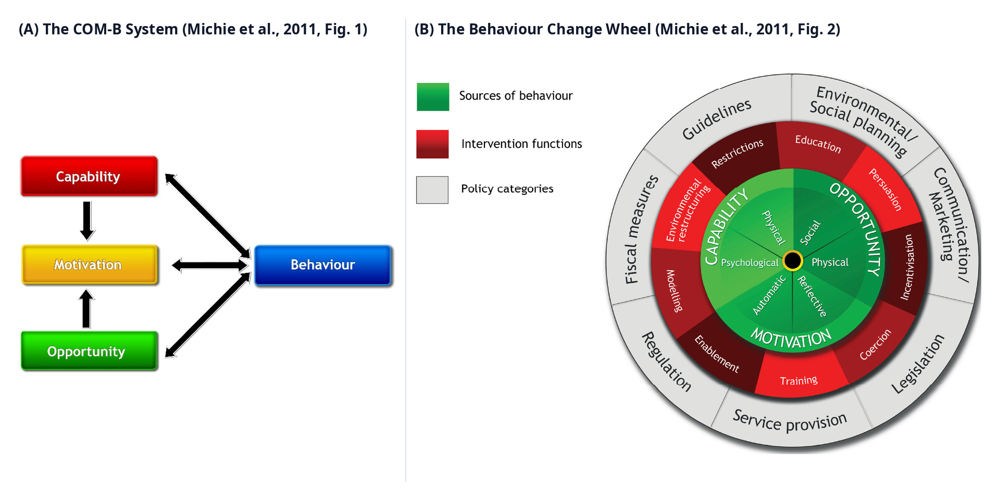
*กรอบแนวคิดประกอบการเฉลยข้อ 2 (ก): ตัวแบบระบบพฤติกรรม COM-B (Capability · Opportunity · Motivation → Behaviour) และวงล้อการปรับเปลี่ยนพฤติกรรม (Michie et al., 2011)*

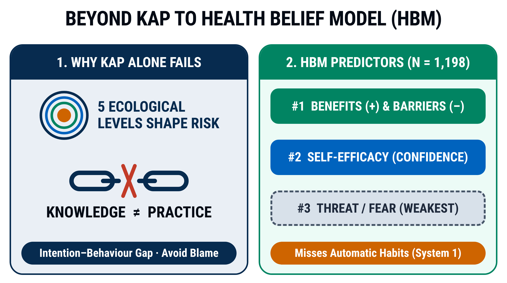
*กรอบแนวคิดประกอบการเฉลยข้อ 2 (ข): ข้อจำกัดของการให้ความรู้เพียงอย่างเดียว (KAP Model) เมื่อพฤติกรรมถูกล็อกด้วยปัจจัยแวดล้อมและเงื่อนไขทางเศรษฐกิจ*

***เหตุผลที่การให้ความรู้เพียงอย่างเดียว (KAP) ไม่เพียงพอเมื่อมีปัจจัยเชิงพาณิชย์ (CDoH) เป็นตัวล็อก***

*กรณีศึกษานี้แสดงให้เห็นข้อจำกัดของการสุขศึกษาแบบดั้งเดิมอย่างชัดเจน เพราะเกษตรกรทราบดีอยู่แล้วว่ายาฆ่าแมลงเป็นอันตราย (มี C-Ps บางส่วนแล้ว) แต่ไม่สามารถเปลี่ยนพฤติกรรมได้ตราบใดที่โครงสร้างตลาดรับซื้อผูกขาดเฉพาะผักสวยงามไร้ตำหนิ การปลดล็อกโอกาสทางกายภาพและทางสังคม (O-Ph และ O-So) ผ่านตลาดทางเลือกราคาเป็นธรรมและการรวมกลุ่มเกษตรกร จึงเป็นเงื่อนไขจำเป็นที่ทำให้ความรู้ (C-Ps) แปรเปลี่ยนเป็นความมั่นคงทางใจ (M-Au) และการตัดสินใจอย่างมีเหตุผล (M-Re) จนเกิดพฤติกรรมเป้าหมายได้อย่างยั่งยืน*

***คำถาม 3: การวิเคราะห์ความสอดคล้องกับกลยุทธ์การสร้างเสริมสุขภาพตามกฎบัตรออตตาวา (ด้านละ 4 คะแนนดิบ × 3 ด้าน = 12 คะแนนดิบ ÷ 1.5 = คะแนนสุทธิ 8 คะแนน)***

***เกณฑ์การให้คะแนนและวิธีคิดคะแนน (เลือกตอบ 3 ด้านจาก 4 กลยุทธ์ที่ปรากฏในโจทย์ ด้านละ 4 คะแนนดิบ [1 + 1.5 + 1.5] รวม 12 คะแนนดิบ ÷ 1.5 = คะแนนสุทธิ 8 คะแนน)***
- *ผู้เรียนเลือกตอบให้ครบ 3 ด้านจาก 4 กลยุทธ์หลักในตารางด้านล่าง (หมายเหตุ: ด้านที่ 5 การปรับระบบบริการสุขภาพ Reorient Health Services สามารถนำมาอภิปรายต่อยอดจากการตรวจคัดกรองสารเคมีเชิงรุกในชุมชนได้)*

| ทางเลือก | ชื่อกลยุทธ์ตามกฎบัตรออตตาวา (Ottawa Charter Action Area) (ช่องละ 1 คะแนนดิบ) | การดำเนินการ/เหตุการณ์ในโจทย์ที่สนับสนุน (ช่องละ 1.5 คะแนนดิบ) | คำอธิบายเหตุผลความสอดคล้องเชิงกลไกการสร้างเสริมสุขภาพ (ช่องละ 1.5 คะแนนดิบ) |
| --- | --- | --- | --- |
| ทางเลือก 1 | <u>*1. การสร้างนโยบายสาธารณะเพื่อสุขภาพ (Build Healthy Public Policy)*</u> *(1 คะแนนดิบ)* | <u>*ภาครัฐและเอกชนตัดสินใจเชิงนโยบายหนุนเสริมให้มีตลาดรับซื้อผลผลิตทางเลือกและระบบราคารับซื้อที่เป็นธรรมแม้ผักไม่สวย*</u> *(1.5 คะแนนดิบ)* | <u>*ใช้มาตรการเชิงนโยบายและเศรษฐศาสตร์แทรกแซงโครงสร้างตลาดเพื่อแก้รากเหง้าปัจจัยกำหนดสุขภาพเชิงพาณิชย์ (CDoH)*</u> *(1.5 คะแนนดิบ)* |
| ทางเลือก 2 | <u>*2. การสร้างสิ่งแวดล้อมที่เอื้อต่อสุขภาพ (Create Supportive Environments)*</u> *(1 คะแนนดิบ)* | <u>*การจัดตั้งช่องทางตลาดทางเลือกควบคู่กับการสื่อสารประชาสัมพันธ์ปรับค่านิยมผู้บริโภคให้เห็นคุณค่าอาหารปลอดภัย*</u> *(1.5 คะแนนดิบ)* | <u>*ปรับสภาพแวดล้อมทางเศรษฐกิจและสังคมให้ทางเลือกที่ดีต่อสุขภาพกลายเป็นทางเลือกที่ทำได้ง่ายและอยู่รอดได้จริง (make the healthy choice the easy choice)*</u> *(1.5 คะแนนดิบ)* |
| ทางเลือก 3 | <u>*3. การเสริมสร้างความเข้มแข็งของชุมชน (Strengthen Community Actions)*</u> *(1 คะแนนดิบ)* | <u>*ส่งเสริมการรวมกลุ่มของเกษตรกรเพื่อแลกเปลี่ยนเรียนรู้ ช่วยเหลือเกื้อกูลกัน และมีรัฐ/เอกชนหนุนเสริมไม่ปล่อยให้สู้โดดเดี่ยว*</u> *(1.5 คะแนนดิบ)* | <u>*สร้างพลังร่วมของชุมชน (community empowerment) เครือข่ายพึ่งพาตนเอง และอำนาจต่อรองในการขับเคลื่อนวิถีการผลิตใหม่ร่วมกัน*</u> *(1.5 คะแนนดิบ)* |
| ทางเลือก 4 | <u>*4. การพัฒนาทักษะส่วนบุคคล (Develop Personal Skills)*</u> *(1 คะแนนดิบ)* | <u>*ให้ข้อมูลความรู้ชัดเจนเรื่องโทษภัยของสารออร์กาโนฟอสเฟตและแนวทางปฏิบัติของเกษตรปลอดภัย/เกษตรอินทรีย์*</u> *(1.5 คะแนนดิบ)* | <u>*ยกระดับความรอบรู้ด้านสุขภาพ (health literacy) และทักษะการคิดทบทวนตัดสินใจเลือกวิถีการผลิตที่ปลอดภัยด้วยตนเอง*</u> *(1.5 คะแนนดิบ)* |
| สรุปวิธีแปลงคะแนนข้อ 3: ตรวจ 3 ด้านที่เลือกตอบ (4 × 3 = 12 คะแนนดิบ) ÷ 1.5 | *(ต่อเนื่องจากแถวบน)* | รวมคะแนนดิบเต็ม: <u>*4 × 3 = 12*</u> *(12 คะแนนดิบ)* | คะแนนสุทธิ: <u>*นำ 12 ÷ 1.5 = 8*</u> *(8 คะแนนสุทธิ)* |

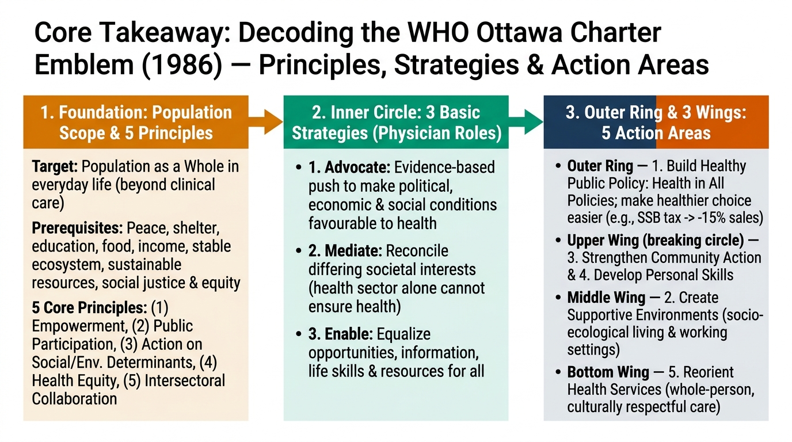
*กรอบแนวคิดประกอบการเฉลยข้อ 3: โครงสร้างกลยุทธ์การสร้างเสริมสุขภาพ 5 ด้าน และบทบาทหลัก 3 ประการ (Advocate · Mediate · Enable) ตามกฎบัตรออตตาวา ค.ศ. 1986*

***บทสังเคราะห์การทำงานสอดประสานกันของกฎบัตรออตตาวาทั้ง 5 ด้าน***

*กรณีศึกษานี้สะท้อนว่าปัญหาสุขภาพที่มีรากเหง้าจากปัจจัยเชิงพาณิชย์ไม่อาจแก้ไขได้ด้วยการพัฒนาทักษะส่วนบุคคล (develop personal skills) เพียงด้านเดียว แต่ต้องอาศัยนโยบายสาธารณะเพื่อสุขภาพ (build healthy public policy) และการสร้างสิ่งแวดล้อมทางตลาดที่เอื้อต่อสุขภาพ (create supportive environments) มาปลดล็อกเงื่อนไขความอยู่รอด ควบคู่กับการรวมกลุ่มสร้างความเข้มแข็งของชุมชน (strengthen community actions) และการต่อยอดระบบบริการสุขภาพเชิงรุกในพื้นที่ (reorient health services) จึงจะคืนสุขภาพที่ดีให้แก่ทั้งเกษตรกรและผู้บริโภคได้อย่างยั่งยืน*

---

## หัวข้อ 5. ระบบสุขภาพปฐมภูมิและบริการปฐมภูมิ (HS5: Primary Health Care and Primary Care)
- **กำหนดการอภิปราย:** วันอังคารที่ 1 ธันวาคม 2569 เวลา 14.40 – 16.40 น. · **สัดส่วนน้ำหนักเนื้อหา:** 15% · **คะแนนอ้างอิงรวม:** 15 คะแนนสุทธิ (1 กรณีศึกษา · 2 คำถาม)

### Scenario 1 โครงการ “สุขภาวะข้างถนน” ภารกิจต่อจิ๊กซอว์สุขภาพเพื่อคนไร้บ้าน (15 คะแนนสุทธิ (ข้อ 1 = 9 คะแนน · ข้อ 2 = 6 คะแนน))

โครงการ “สุขภาวะข้างถนน” เป็นตัวอย่างของการออกแบบระบบการดูแลสุขภาพที่เข้าถึงง่ายและครอบคลุมสำหรับคนไร้บ้าน ซึ่งเป็นกลุ่มประชากรที่เปราะบางที่สุดและมักตกหล่นจากระบบบริการหลัก โครงการนี้ก่อตั้งขึ้นโดย นพ.อานนท์ กุลธรรมานุสรณ์ (หมอไก๋) และทีมงานด้านสุขภาพ จากจุดเริ่มต้นที่มองเห็นว่าปัญหาของคนไร้บ้านไม่ได้มีเพียงเรื่องที่อยู่อาศัย แต่ยังมีช่องว่างขนาดใหญ่บนเส้นทางสุขภาพที่ระบบบริการแบบตั้งรับในโรงพยาบาลไม่อาจแก้ไขได้

ในด้านปัญหาและบริบท คนไร้บ้านต้องเผชิญกำแพงสำคัญสามประการ ได้แก่ ประการแรก ความเปราะบางทางสุขภาพและสังคมจากการเจ็บป่วยด้วยโรคเรื้อรัง การติดเชื้อ และอุบัติเหตุท่ามกลางสภาพแวดล้อมที่ไม่เอื้ออำนวย โดยส่วนใหญ่อยู่ในวัยกลางคนถึงสูงวัย ประการที่สอง กำแพงด้านสิทธิและเอกสาร เนื่องจากคนไร้บ้านจำนวนมากขาดบัตรประชาชนหรือเอกสารยืนยันตัวตน ทำให้ถูกกีดกันจากการเข้าถึงสิทธิการรักษาพยาบาลและเกิดความกังวลในการเข้าสถานที่ราชการ และประการที่สาม วงจรการเจ็บป่วยซ้ำซ้อน เนื่องจากหลังออกจากโรงพยาบาล (hospital discharge) ผู้ป่วยไร้บ้านขาดสถานที่พักฟื้นที่ถูกสุขลักษณะและปลอดภัย การกลับไปนอนพักในพื้นที่สาธารณะทำให้บาดแผลเสี่ยงติดเชื้อ อาการทรุดลง และต้องวนกลับเข้ารับการรักษาซ้ำในโรงพยาบาลอย่างต่อเนื่อง

ในการทำงานเชิงรุก โครงการได้จัดองค์ประกอบของการดูแลสุขภาพอย่างมีคุณภาพออกเป็น 3 ส่วนหลัก ได้แก่ (1) หน่วยให้บริการเคลื่อนที่ (Mobile Clinic) โดยทีมแพทย์ พยาบาล และเภสัชกรอาสาปรับจากการเดินตรวจมาเป็นการตั้งจุดตรวจร่วมกับจุดแจกอาหารของมูลนิธิอิสรชนบริเวณตรอกสาเก ช่วยให้เข้าถึงผู้ป่วยได้มากขึ้นในเวลาจำกัด ให้บริการวัดความดันโลหิต ปรึกษาอาการป่วย จ่ายยาเบื้องต้น ตลอดจนร่วมกับมูลนิธิอิสรชนประสานงานพาคนไร้บ้านไปทำบัตรประชาชน ดำเนินการด้านค่ารักษาพยาบาล และขึ้นทะเบียนรับสิทธิประกันสุขภาพ (2) ดนตรีบำบัด โดยมีนักดนตรีบำบัดและนักจิตวิทยาเข้าร่วมใช้ดนตรีเป็นสื่อกลางลดความหวาดระแวง เปิดใจ และดูแลบาดแผลทางจิตสังคมควบคู่กับสุขภาพกาย และ (3) บ้านพักพิงเพื่อการฟื้นฟู (Medical Respite Care) ซึ่งเป็นบ้านพักพิงทางการแพทย์ชั่วคราวให้ผู้ป่วยระยะกึ่งเฉียบพลันหลังออกจากโรงพยาบาลได้พักฟื้นร่างกายเป็นเวลา 2–4 สัปดาห์ ช่วยสกัดวงจรการป่วยซ้ำ และทำหน้าที่เป็นศูนย์กลางประสานงานกับบุคลากรทางการแพทย์และภาคีเครือข่ายเพื่อส่งต่อบริการทางสังคมอย่างเป็นระบบ

นอกจากนี้ โครงการยังตระหนักว่าสุขภาพไม่ได้เกิดจากบริการทางการแพทย์เพียงอย่างเดียว จึงทำงานร่วมกับมูลนิธิอิสรชนและมูลนิธิกระจกเงาเชื่อมต่อผู้ป่วยเข้ากับโครงการสร้างรายได้ (“จ้างวานข้า”) และภายหลังการฟื้นฟูยังช่วยให้เข้าถึงที่พักอาศัยอย่างยั่งยืนผ่านโครงการที่อยู่อาศัยคนละครึ่งของสำนักงานกองทุนสนับสนุนการสร้างเสริมสุขภาพ (สสส.) การจัดการที่อยู่อาศัยและอาชีพควบคู่กับการรักษาพยาบาลจึงเป็นกุญแจสำคัญของการสร้างสุขภาวะที่สมบูรณ์และยั่งยืน

**จาก scenario ข้างต้น จงตอบคำถามต่อไปนี้**

1. จงวิเคราะห์ว่าโครงการ “สุขภาวะข้างถนน” ได้จัดบริการที่สอดคล้องกับ<u>คุณลักษณะของบริการสุขภาพระดับบุคคล / บริการปฐมภูมิ (characteristics of personal / primary care) ทั้ง 5 ประการ</u>อย่างไรบ้าง โดยตอบตามประเด็นย่อยในตารางกระดาษคำตอบต่อไปนี้ (รวม 9 คะแนนสุทธิ)

> **วิธีคิดคะแนน (รวม 9 คะแนนสุทธิ): คิดตามช่องเติมคำย่อยรวม 9 ช่อง ช่องละ 1 คะแนน แบ่งตามคุณลักษณะบริการปฐมภูมิ 5 ด้าน ได้แก่ ด้านที่ 1–4 ด้านละ 2 คะแนน (แบ่งเป็น 2 ช่องย่อย × 1 คะแนน) = 8 คะแนน และด้านที่ 5 การยึดผู้รับบริการเป็นศูนย์กลาง = 1 คะแนน รวม 2 + 2 + 2 + 2 + 1 = 9 คะแนน**

| คุณลักษณะของบริการปฐมภูมิ (Primary Care Attributes) | การจัดบริการในโครงการ “สุขภาวะข้างถนน” และเหตุผลความสอดคล้อง |
| --- | --- |
| 1. การเข้าถึงบริการด่านแรก (First-Contact Accessibility) [รวม 2 คะแนน] | 1) ________________________________________________________ (1 คะแนน) 2) ________________________________________________________ (1 คะแนน) |
| 2. ความครอบคลุมรอบด้านของบริการ (Comprehensiveness) [รวม 2 คะแนน] | 1) ________________________________________________________ (1 คะแนน) 2) ________________________________________________________ (1 คะแนน) |
| 3. ความต่อเนื่องของการดูแล (Continuity of Care) [รวม 2 คะแนน] | 1) ________________________________________________________ (1 คะแนน) 2) ________________________________________________________ (1 คะแนน) |
| 4. การประสานการดูแล (Coordination of Care) [รวม 2 คะแนน] | 1) ________________________________________________________ (1 คะแนน) 2) ________________________________________________________ (1 คะแนน) |
| 5. การยึดผู้รับบริการ/คนเป็นศูนย์กลาง (Person-Centeredness) [รวม 1 คะแนน] | _____________________________________________________________________ _____________________________________________________________________ (1 คะแนน) |

2. นอกเหนือจากองค์ประกอบด้านการจัดบริการสุขภาพแบบบูรณาการ (Primary Care and Essential Public Health Functions) แล้ว โครงการ “สุขภาวะข้างถนน” มีความสอดคล้องกับ<u>องค์ประกอบหลักอีก 2 เสาหลักของระบบสุขภาพปฐมภูมิ (Primary Health Care ตามปฏิญญา Astana ค.ศ. 2018)</u> อย่างไรบ้าง จง<u>ระบุชื่อองค์ประกอบหลักทั้ง 2 ด้าน</u> และ<u>ยกตัวอย่างรูปธรรมจากโครงการมาสนับสนุนด้านละ 2 ประเด็น</u>ลงในตารางต่อไปนี้ (รวม 6 คะแนนสุทธิ)

> **วิธีคิดคะแนน (รวม 6 คะแนนสุทธิ): คิดเสาหลักละ 3 คะแนน × 2 เสาหลัก = 6 คะแนน โดยในแต่ละเสาหลักแบ่งเป็น ระบุชื่อองค์ประกอบหลักของ PHC ถูกต้อง (1 คะแนน) + ยกตัวอย่างรูปธรรมและอธิบายความสอดคล้อง 2 ประเด็นย่อย ประเด็นละ 1 คะแนน (2 คะแนน) รวม (1 + 1 + 1) × 2 = 6 คะแนน**

| ลำดับ | ชื่อองค์ประกอบหลักของ PHC (นอกเหนือจากบริการสุขภาพบูรณาการ) (ช่องละ 1 คะแนน) | ตัวอย่างการดำเนินงานรูปธรรมในโครงการและเหตุผลความสอดคล้อง (ด้านละ 2 ประเด็นย่อย · ประเด็นละ 1 คะแนน = 2 คะแนน) |
| --- | --- | --- |
| 1 | _____________________________ _____________________________ (1 คะแนน) | 1) ________________________________________________________ (1 คะแนน) 2) ________________________________________________________ (1 คะแนน) |
| 2 | _____________________________ _____________________________ (1 คะแนน) | 1) ________________________________________________________ (1 คะแนน) 2) ________________________________________________________ (1 คะแนน) |

#### เฉลย

1. จงวิเคราะห์ว่าโครงการ “สุขภาวะข้างถนน” ได้จัดบริการที่สอดคล้องกับคุณลักษณะของบริการสุขภาพระดับบุคคล / บริการปฐมภูมิ (characteristics of personal / primary care) ทั้ง 5 ประการอย่างไรบ้าง ลงในตารางต่อไปนี้ (รวม 9 คะแนนสุทธิ)

***เกณฑ์และวิธีคิดคะแนนข้อ 1 (รวม 9 คะแนนสุทธิ): ช่องคำตอบสีแดงรวม 9 ช่องย่อย ช่องละ 1 คะแนน (ด้านที่ 1–4 ด้านละ 1+1 = 2 คะแนน และด้านที่ 5 = 1 คะแนน รวม 9 คะแนน)***

| คุณลักษณะของบริการปฐมภูมิ (Primary Care Attributes) | การจัดบริการในโครงการ “สุขภาวะข้างถนน” และเหตุผลความสอดคล้อง |
| --- | --- |
| 1. การเข้าถึงบริการด่านแรก (First-Contact Accessibility) [รวม 2 คะแนน] | 1) <u>*ตั้งหน่วยบริการเคลื่อนที่ (Mobile Clinic) ร่วมกับจุดแจกอาหารของมูลนิธิอิสรชนที่ตรอกสาเก นำบริการเชิงรุกเข้าหาคนไร้บ้านโดยไม่ถูกปฏิเสธแม้ไม่มีบัตรประชาชน*</u> *(1 คะแนน)* 2) <u>*ประสานงานกับมูลนิธิอิสรชนพาไปทำบัตรประชาชนและขึ้นทะเบียนรับสิทธิหลักประกันสุขภาพเพื่อขจัดอุปสรรคด้านสิทธิระยะยาว*</u> *(1 คะแนน)* |
| 2. ความครอบคลุมรอบด้านของบริการ (Comprehensiveness) [รวม 2 คะแนน] | 1) <u>*ให้บริการวัดความดันโลหิต ปรึกษาอาการ จ่ายยาเบื้องต้น ควบคู่กับการดูแลจิตสังคมด้วยดนตรีบำบัดและนักจิตวิทยา*</u> *(1 คะแนน)* 2) <u>*จัดบ้านพักพิงทางการแพทย์ชั่วคราวระยะพักฟื้น (Medical Respite Care) และเชื่อมสู่โครงการสร้างอาชีพและที่อยู่อาศัยมั่นคง*</u> *(1 คะแนน)* |
| 3. ความต่อเนื่องของการดูแล (Continuity of Care) [รวม 2 คะแนน] | 1) <u>*รับผู้ป่วยหลังออกจากโรงพยาบาล (hospital discharge) เข้าพักฟื้นในบ้านพักพิงทางการแพทย์ชั่วคราวนาน 2–4 สัปดาห์อย่างถูกสุขลักษณะ*</u> *(1 คะแนน)* 2) <u>*ดูแลต่อเนื่องทั้งกายและจิตใจจนฟื้นตัวดีแล้วส่งต่อสู่ที่พักอาศัยยั่งยืน ช่วยสกัดวงจรการติดเชื้อและป่วยซ้ำ (readmission)*</u> *(1 คะแนน)* |
| 4. การประสานการดูแล (Coordination of Care) [รวม 2 คะแนน] | 1) <u>*บ้านพักพิงทำหน้าที่เป็นศูนย์กลาง (hub) ประสานข้อมูลและแผนการรักษาระหว่างโรงพยาบาลกับทีมแพทย์พยาบาลอาสา*</u> *(1 คะแนน)* 2) <u>*ประสานงานข้ามภาคส่วนกับมูลนิธิอิสรชน (บัตรประชาชน/สิทธิ) มูลนิธิกระจกเงา (โครงการจ้างวานข้า) และ สสส. (ที่อยู่อาศัยคนละครึ่ง)*</u> *(1 คะแนน)* |
| 5. การยึดผู้รับบริการ/คนเป็นศูนย์กลาง (Person-Centeredness) [รวม 1 คะแนน] | <u>*เคารพศักดิ์ศรีและเข้าใจความเปราะบางทางจิตสังคมของคนไร้บ้าน โดยใช้ดนตรีบำบัดลดความหวาดระแวง เปิดใจรับฟังความทุกข์ทางใจ และจัดจุดบริการสอดคล้องกับวิถีชีวิตจริง*</u> *(1 คะแนน)* |

*กรอบแนวคิดประกอบการเฉลยข้อ 1: คุณลักษณะหลัก 5 ประการของบริการปฐมภูมิสมรรถนะสูง (Starfield's 4Cs + Person-Centeredness)*

2. ความสอดคล้องกับองค์ประกอบหลักอีก 2 เสาหลักของระบบสุขภาพปฐมภูมิ (Primary Health Care ตามปฏิญญา Astana ค.ศ. 2018) (รวม 6 คะแนนสุทธิ)

***เกณฑ์และวิธีคิดคะแนนข้อ 2 (รวม 6 คะแนนสุทธิ): เสาหลักละ 3 คะแนน [ชื่อองค์ประกอบหลัก 1 คะแนน + ตัวอย่างและเหตุผล 1+1 คะแนน] × 2 เสาหลัก = 6 คะแนน***

| ลำดับ | ชื่อองค์ประกอบหลักของ PHC (นอกเหนือจากบริการสุขภาพบูรณาการ) (ช่องละ 1 คะแนน) | ตัวอย่างการดำเนินงานรูปธรรมในโครงการและเหตุผลความสอดคล้อง (ด้านละ 2 ประเด็นย่อย · ประเด็นละ 1 คะแนน = 2 คะแนน) |
| --- | --- | --- |
| 1 | <u>*การเสริมพลังประชาชนและชุมชน (Empowered People and Communities)*</u> *(1 คะแนน)* | 1) <u>*ฟื้นฟูความไว้วางใจและพลังใจระดับบุคคลด้วยดนตรีบำบัดและการดูแลจิตสังคม ลดความระแวงจนกล้าเปิดใจร่วมวางแผนฟื้นฟูตนเอง*</u> *(1 คะแนน)* 2) <u>*บ้านพักพิงเพื่อการฟื้นฟูช่วยให้ผู้ป่วยกลับมาดูแลจัดการสุขภาวะตนเองได้ ก่อนต่อยอดสู่การมีอาชีพและที่พักอาศัยอย่างพึ่งพาตนเองได้*</u> *(1 คะแนน)* |
| 2 | <u>*การมีนโยบายและมาตรการร่วมกับหลากหลายภาคส่วน (Multisectoral Policy and Action)*</u> *(1 คะแนน)* | 1) <u>*บูรณาการความร่วมมือข้ามภาคส่วนนอกระบบสาธารณสุข ร่วมกับมูลนิธิอิสรชน มูลนิธิกระจกเงา และ สสส.*</u> *(1 คะแนน)* 2) <u>*จัดการปัจจัยกำหนดสุขภาพทางสังคมและเศรษฐกิจที่เป็นรากเหง้า ทั้งการทำบัตรประชาชน การสร้างอาชีพ (จ้างวานข้า) และที่อยู่อาศัยคนละครึ่ง*</u> *(1 คะแนน)* |

*กรอบแนวคิดประกอบการเฉลยข้อ 2: กรอบองค์ประกอบ 3 เสาหลักของระบบสุขภาพปฐมภูมิตามปฏิญญาแอสทานา ค.ศ. 2018 ที่ขับเคลื่อนสู่หลักประกันสุขภาพถ้วนหน้าและเป้าหมายการพัฒนาที่ยั่งยืน*

***การสังเคราะห์ความแตกต่างระหว่างบริการปฐมภูมิ (Primary Care) กับระบบสุขภาพปฐมภูมิ (Primary Health Care)***

*การตั้งคำถามสองข้อคู่กันในกรณีศึกษานี้ช่วยชี้ให้เห็นความแตกต่างเชิงแนวคิดที่สำคัญที่สุดของบทเรียน กล่าวคือ บริการปฐมภูมิ (primary care ในข้อที่ 1) คือระดับของการจัดบริการสุขภาพด่านแรกรายบุคคลและครอบครัวที่มีคุณลักษณะสำคัญ 5 ประการ (การเข้าถึงด่านแรก ความครอบคลุม ความต่อเนื่อง การประสานบริการ และการยึดคนเป็นศูนย์กลาง) ขณะที่ระบบสุขภาพปฐมภูมิ (Primary Health Care: PHC ตามปฏิญญา Astana ค.ศ. 2018 ในข้อที่ 2) เป็นยุทธศาสตร์ของทั้งระบบสุขภาพและทั้งสังคมที่กว้างกว่าคลินิก โดยประกอบด้วย 3 เสาหลักร่วมกัน ได้แก่ (1) บริการสุขภาพแบบบูรณาการที่เชื่อมโยงบริการปฐมภูมิกับงานสาธารณสุขที่จำเป็น (2) นโยบายและการทำงานข้ามภาคส่วนเพื่อจัดการปัจจัยกำหนดสุขภาพ และ (3) การเสริมพลังประชาชนและชุมชนให้สามารถดูแลและกำหนดสุขภาวะของตนเองได้อย่างยั่งยืน*

---

## หัวข้อ 6. การประกันสุขภาพ หลักประกันสุขภาพถ้วนหน้า และกลไกการจ่ายเงินแก่ผู้ให้บริการ (HS6: Health Insurance, Universal Health Coverage, and Provider Payment Methods)
- **กำหนดการอภิปราย:** วันศุกร์ที่ 4 ธันวาคม 2569 เวลา 09.40 – 12.00 น. · **สัดส่วนน้ำหนักเนื้อหา:** 15% · **คะแนนอ้างอิงรวม:** 20 คะแนนสุทธิ (3 กรณีศึกษา)

### Scenario 1 ความก้าวหน้าสู่หลักประกันสุขภาพถ้วนหน้า (Progress toward Universal Health Coverage: SDG 3.8) (6 คะแนนสุทธิ (ข้อ 1 = 3 คะแนน · ข้อ 2 = 3 คะแนน))

องค์การสหประชาชาติ (UN) ได้พัฒนากรอบเป้าหมายการพัฒนาที่ยั่งยืน (Sustainable Development Goals: SDGs) โดยมีแก่นสำคัญคือ “การไม่ทิ้งใครไว้ข้างหลัง (Leave no one behind)” มุ่งสู่โลกที่มีความปลอดภัย เป็นธรรม และมีสุขภาวะดีขึ้นภายในปี ค.ศ. 2030 โดยกำหนดเป้าหมายการพัฒนา 17 ด้าน ซึ่งสุขภาพเป็นเป้าหมายลำดับที่ 3 (SDG 3: Good Health and Well-being)

ตัวชี้วัดสำคัญส่วนหนึ่งของ SDG 3 คือการขับเคลื่อนให้ประเทศต่าง ๆ จัดระบบหลักประกันสุขภาพถ้วนหน้าแก่ประชาชนของตน (Universal Health Coverage: UHC) ทั้งนี้ องค์การอนามัยโลก (WHO) และธนาคารโลก (World Bank) ได้ร่วมกันจัดทำรายงานติดตามความก้าวหน้าทุก ๆ 2 ปี โดยใช้ตัวชี้วัดหลักสองตัว ได้แก่ (1) SDG 3.8.1 ดัชนีความครอบคลุมของบริการสุขภาพที่จำเป็น (Coverage of essential services / Service Coverage Index) และ (2) SDG 3.8.2 อุบัติการณ์ภาระค่าใช้จ่ายด้านสุขภาพจากการจ่ายเงินเองหน้างานที่ก่อให้เกิดหายนะทางการเงินของครัวเรือน (Catastrophic Out-of-Pocket health spending)

ในรายงานการติดตามความก้าวหน้าปี ค.ศ. 2023 ได้นำเสนอการเปลี่ยนแปลงของตัวชี้วัดทั้งสองเมื่อเปรียบเทียบกับปี ค.ศ. 2000 ของ 138 ประเทศทั่วโลก ซึ่งผลลัพธ์มีทั้งประเทศที่ดีขึ้น เปลี่ยนแปลงน้อย และแย่ลง ดังแสดงในภาพต่อไปนี้

*ภาพที่ 6.1 การจำแนกกลุ่มประเทศตามการเปลี่ยนแปลงของตัวชี้วัด SDG 3.8.1 (แกนนอน: ความครอบคลุมบริการสุขภาพที่จำเป็น) และ SDG 3.8.2 (แกนตั้ง: อุบัติการณ์รายจ่ายสุขภาพที่ก่อให้เกิดหายนะทางการเงิน) ใน 138 ประเทศ ตั้งแต่ปี ค.ศ. 2000 (ที่มา: WHO & World Bank Global Monitoring Report 2023)*

**คำถาม**

1) จากข้อมูลและภาพข้างต้น <u>สถานการณ์โดยรวมด้านความครอบคลุมบริการสุขภาพที่จำเป็น (Service Coverage Index: SDG 3.8.1)</u> ใน 138 ประเทศเป็นอย่างไร (1 คะแนน) และมาจาก<u>ปัจจัยสนับสนุนสำคัญใดบ้าง (ตอบมา 2 ปัจจัย)</u> (2 คะแนน) ลงในตารางต่อไปนี้ (รวม 3 คะแนนสุทธิ)

> **วิธีคิดคะแนน (รวม 3 คะแนนสุทธิ): คิดตามช่องคำตอบ 3 ช่อง ช่องละ 1 คะแนน ได้แก่ (1) สรุปแนวโน้มสถานการณ์โดยรวมของ SDG 3.8.1 พร้อมอ้างอิงตัวเลขจากภาพถูกต้อง = 1 คะแนน และ (2) วิเคราะห์ปัจจัยสนับสนุนเชิงระบบที่สมเหตุสมผล 2 ปัจจัย × 1 คะแนน = 2 คะแนน (รวม 1 + 1 + 1 = 3 คะแนน)**

| ประเด็นคำถาม (SDG 3.8.1) | คำตอบและเหตุผลสนับสนุน |
| --- | --- |
| 1.1 สถานการณ์โดยรวมใน 138 ประเทศ (พร้อมอ้างอิงจำนวนประเทศจากภาพ) | _____________________________________________________________________ (1 คะแนน) |
| 1.2 ปัจจัยสนับสนุนสำคัญประการที่ 1 | _____________________________________________________________________ (1 คะแนน) |
| 1.3 ปัจจัยสนับสนุนสำคัญประการที่ 2 | _____________________________________________________________________ (1 คะแนน) |

2) จากข้อมูลและภาพข้างต้น <u>สถานการณ์โดยรวมด้านการล้มละลายหรือหายนะทางการเงินจากการจ่ายค่ารักษาพยาบาลเอง (Catastrophic OOP Health Spending: SDG 3.8.2)</u> ใน 138 ประเทศเป็นอย่างไร (1 คะแนน) และนักศึกษาคิดว่ามาจาก<u>ปัจจัยสาเหตุสำคัญใดบ้าง (ตอบมา 2 ปัจจัย)</u> (2 คะแนน) ลงในตารางต่อไปนี้ (รวม 3 คะแนนสุทธิ)

> **วิธีคิดคะแนน (รวม 3 คะแนนสุทธิ): คิดตามช่องคำตอบ 3 ช่อง ช่องละ 1 คะแนน ได้แก่ (1) สรุปแนวโน้มสถานการณ์โดยรวมของ SDG 3.8.2 พร้อมอ้างอิงตัวเลขจากภาพถูกต้อง = 1 คะแนน และ (2) วิเคราะห์ปัจจัยสาเหตุสำคัญได้ถูกต้องสมเหตุสมผล 2 ปัจจัย × 1 คะแนน = 2 คะแนน (รวม 1 + 1 + 1 = 3 คะแนน)**

| ประเด็นคำถาม (SDG 3.8.2) | คำตอบและเหตุผลสาเหตุสำคัญ |
| --- | --- |
| 2.1 สถานการณ์โดยรวมใน 138 ประเทศ (พร้อมอ้างอิงจำนวนประเทศจากภาพ) | _____________________________________________________________________ (1 คะแนน) |
| 2.2 ปัจจัยสาเหตุสำคัญประการที่ 1 | _____________________________________________________________________ (1 คะแนน) |
| 2.3 ปัจจัยสาเหตุสำคัญประการที่ 2 | _____________________________________________________________________ (1 คะแนน) |

#### เฉลย

***คำถาม 1: การวิเคราะห์แนวโน้มและปัจจัยสนับสนุนด้านความครอบคลุมบริการสุขภาพที่จำเป็น (SDG 3.8.1 · รวม 3 คะแนนสุทธิ)***

***เกณฑ์การให้คะแนนและวิธีคิดคะแนน (รวม 3 คะแนนสุทธิ: สถานการณ์โดยรวม 1 คะแนน + ปัจจัยสนับสนุน 2 ข้อ × 1 คะแนน)***
- *ส่วนปัจจัยสนับสนุน (2 คะแนน): เลือกตอบ 2 ข้อจาก 3 ปัจจัยหลัก ได้แก่ (1) การขยายความครอบคลุมหลักประกันสุขภาพแก่ประชากร, (2) การกระจายหน่วยบริการสุขภาพปฐมภูมิอย่างทั่วถึง, หรือ (3) การจัดบริการเชิงรุกและมาตรการรัฐที่ลดอุปสรรคการเข้าถึงบริการ*

| ประเด็นคำถาม (SDG 3.8.1) | คำตอบและเหตุผลสนับสนุน |
| --- | --- |
| 1.1 สถานการณ์โดยรวมใน 138 ประเทศ (พร้อมอ้างอิงจำนวนประเทศจากภาพ) | <u>*ดีขึ้นมากในเกือบทุกประเทศทั่วโลก โดยดีขึ้นถึง 137 จาก 138 ประเทศ (มีเพียง 1 ประเทศที่เปลี่ยนแปลงน้อย และไม่มีประเทศใดแย่ลงเลย = 0 ประเทศ)*</u> *(1 คะแนน)* |
| 1.2 ปัจจัยสนับสนุนสำคัญประการที่ 1 | <u>*หลายประเทศขยายความครอบคลุมของการมีหลักประกันสุขภาพให้แก่ประชากรเพิ่มขึ้นอย่างต่อเนื่อง*</u> *(1 คะแนน)* |
| 1.3 ปัจจัยสนับสนุนสำคัญประการที่ 2 | <u>*มีการลงทุนกระจายหน่วยบริการสุขภาพปฐมภูมิและจัดบริการเชิงรุกในชุมชน ทำให้ประชาชนเข้าถึงบริการที่จำเป็นได้สะดวกขึ้น*</u> *(1 คะแนน)* |

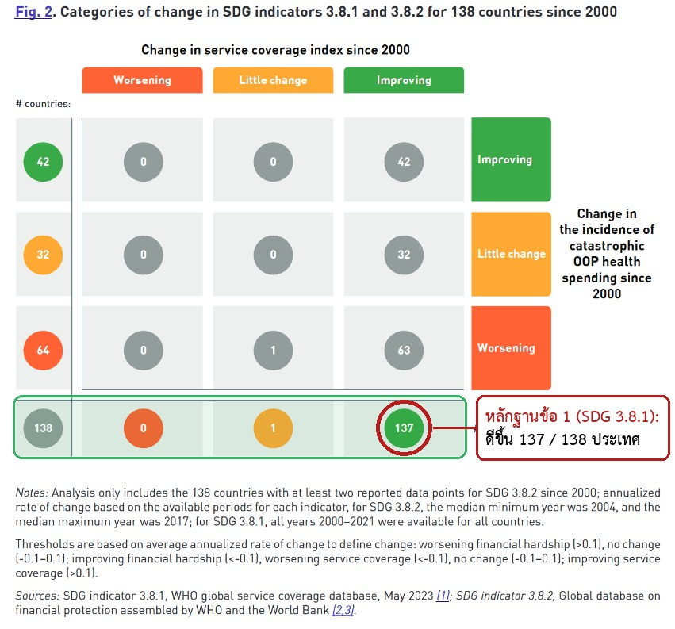
*หลักฐานจากภาพประกอบการเฉลยข้อ 1: แถวสรุปด้านล่างสุดตามแกนนอน (SDG 3.8.1 Service Coverage Index) แสดงจำนวนประเทศที่ดีขึ้นถึง 137 จาก 138 ประเทศ (เปลี่ยนแปลงน้อย 1 ประเทศ และแย่ลง 0 ประเทศ)*

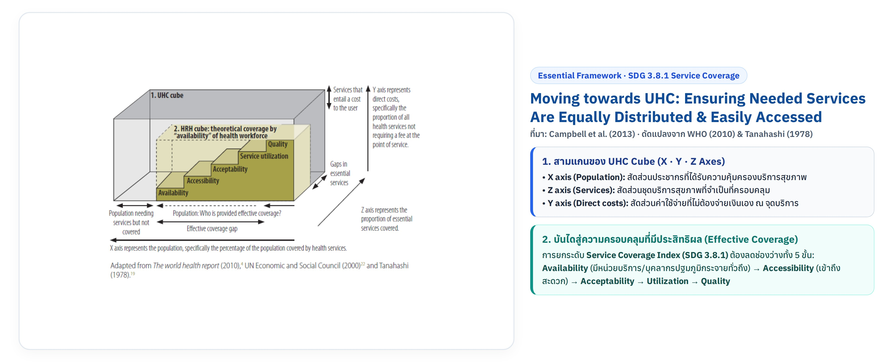
*กรอบแนวคิดประกอบการเฉลยข้อ 1: การขับเคลื่อนสู่หลักประกันสุขภาพถ้วนหน้าและบันได 5 ขั้นสู่ความครอบคลุมที่มีประสิทธิผล (Campbell et al., 2013)*

***บทวิเคราะห์แนวโน้มความครอบคลุมบริการที่จำเป็น (SDG 3.8.1)***

*เมื่อพิจารณาผลรวมตามแกนนอนแถวล่างสุดของตารางไขว้ (0 + 1 + 137 = 138 ประเทศ) จะเห็นชัดเจนว่าตลอดสองทศวรรษที่ผ่านมา โลกมีความก้าวหน้าอย่างโดดเด่นในการขยายความครอบคลุมบริการสุขภาพที่จำเป็น โดยดีขึ้นถึง 137 จาก 138 ประเทศ ปัจจัยขับเคลื่อนหลักมาจากการขยายระบบหลักประกันสุขภาพในหลายประเทศควบคู่กับการลงทุนกระจายเครือข่ายหน่วยบริการปฐมภูมิและบริการเชิงรุกด้านอนามัยแม่และเด็ก โรคติดเชื้อ และโรคไม่ติดต่อเรื้อรัง ทำให้ประชาชนเข้าถึงบริการได้กว้างขวางขึ้น*

***คำถาม 2: การวิเคราะห์แนวโน้มและปัจจัยสาเหตุด้านภาระค่าใช้จ่ายวิบัติจากเงินจ่ายเองหน้างาน (SDG 3.8.2 · รวม 3 คะแนนสุทธิ)***

***เกณฑ์การให้คะแนนและวิธีคิดคะแนน (รวม 3 คะแนนสุทธิ: สถานการณ์โดยรวม 1 คะแนน + ปัจจัยสาเหตุตามกรอบ UHC Cube 2 ข้อ × 1 คะแนน)***
- *ส่วนปัจจัยสาเหตุ (2 คะแนน): เลือกตอบ 2 ใน 3 แกนของ UHC Cube ได้แก่ (1) ความครอบคลุมประชากรยังจำกัด [แกน X], (2) ชุดสิทธิประโยชน์ยังแคบไม่ครอบคลุมบริการค่าใช้จ่ายสูง [แกน Z], หรือ (3) สัดส่วนการร่วมจ่ายค่ารักษาหน้างาน (co-payment / user fees) ยังสูง [แกน Y]*

| ประเด็นคำถาม (SDG 3.8.2) | คำตอบและเหตุผลสาเหตุสำคัญ |
| --- | --- |
| 2.1 สถานการณ์โดยรวมใน 138 ประเทศ (พร้อมอ้างอิงจำนวนประเทศจากภาพ) | <u>*ดีขึ้นเพียงส่วนน้อยและยังน่าเป็นห่วง/ต้องพัฒนาอีกมาก โดยมีเพียง 42 จาก 138 ประเทศที่ดีขึ้น แต่มีถึง 64 ประเทศที่สถานการณ์แย่ลง (และเปลี่ยนแปลงน้อย 32 ประเทศ)*</u> *(1 คะแนน)* |
| 2.2 ปัจจัยสาเหตุสำคัญประการที่ 1 | <u>*ชุดสิทธิประโยชน์ยังจำกัด ไม่ครอบคลุมโรคซับซ้อนหรือเทคโนโลยีค่าใช้จ่ายสูง (แกน Z ของ UHC Cube) ทำให้ครัวเรือนต้องควักเงินจ่ายเองนอกสิทธิ*</u> *(1 คะแนน)* |
| 2.3 ปัจจัยสาเหตุสำคัญประการที่ 2 | <u>*ประชาชนยังต้องร่วมจ่ายค่ารักษาหน้างานในอัตราสูง (แกน Y: high co-payment) หรือระบบหลักประกันยังไม่ครอบคลุมประชากรทุกกลุ่มอย่างแท้จริง (แกน X)*</u> *(1 คะแนน)* |

*หลักฐานจากภาพประกอบการเฉลยข้อ 2: คอลัมน์สรุปซ้ายสุดตามแกนตั้ง (SDG 3.8.2 Catastrophic OOP Spending) ดีขึ้นเพียง 42/138 ประเทศ ขณะที่แย่ลงถึง 64/138 ประเทศ (โดย 63 ประเทศมีความครอบคลุมบริการดีขึ้นแต่รายจ่ายวิบัติแย่ลง)*

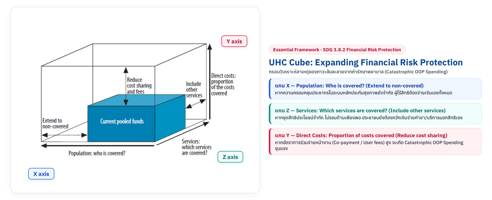
*กรอบแนวคิดประกอบการเฉลยข้อ 2: ลูกบาศก์หลักประกันสุขภาพถ้วนหน้า 3 แกน (UHC Cube — แกน X ความครอบคลุมประชากร · แกน Z ชุดสิทธิประโยชน์ · แกน Y สัดส่วนคุ้มครองรายจ่ายเพื่อลดการจ่ายเงินเองหน้างาน)*

***ความย้อนแย้งระหว่างการเข้าถึงบริการกับการล้มละลายทางการเงินผ่านกรอบลูกบาศก์หลักประกันสุขภาพถ้วนหน้า (UHC Cube)***

*ข้อมูลจากคอลัมน์ซ้ายสุดของตารางไขว้ (42 + 32 + 64 = 138 ประเทศ) และช่องขวาล่างเผยให้เห็นความย้อนแย้งเชิงนโยบายที่สำคัญยิ่ง กล่าวคือ ในบรรดา 137 ประเทศที่ประชาชนเข้าถึงบริการสุขภาพเพิ่มขึ้น กลับมีถึง 63 ประเทศที่ประชาชนเผชิญภาวะหายนะทางการเงินจากค่ารักษาพยาบาลรุนแรงขึ้น ปรากฏการณ์นี้อธิบายได้ด้วยกรอบลูกบาศก์หลักประกันสุขภาพถ้วนหน้า 3 มิติ (UHC Cube) ว่า การมีหน่วยบริการและเทคโนโลยีทางการแพทย์ให้ใช้มากขึ้นโดยที่ระบบหลักประกันสุขภาพยังครอบคลุมประชากรไม่ครบถ้วน (แกน X) ชุดสิทธิประโยชน์ยังแคบไม่ทันต่อโรคซับซ้อน (แกน Z) หรือยังเก็บค่าร่วมจ่ายหน้างานสูง (แกน Y) ย่อมผลักภาระรายจ่ายก้อนโตไปให้ครัวเรือนต้องควักกระเป๋าจ่ายเอง (out-of-pocket payment) จนเกิดการล้มละลายจากการรักษาพยาบาลในที่สุด*

---

### Scenario 2 ประกันสุขภาพเอกชนกับผู้ขายบริการทางเพศและแรงงานนอกระบบ (6 คะแนนสุทธิ (ข้อ 1 = 4 คะแนน · ข้อ 2 = 2 คะแนน))

ผู้ขายบริการทางเพศ (sex workers) ในประเทศไทยยังถูกจัดอยู่ในฐานะ “แรงงานนอกระบบ (informal labor)” กล่าวคือ ไม่มีการขึ้นทะเบียนแรงงานในระบบจ้างงานทางการและไม่อยู่ในระบบคุ้มครองทางสังคมภาคบังคับของลูกจ้างในระบบ เช่น ประกันสังคมตามมาตรา 33 แม้จะสามารถเข้าถึงสิทธิการรักษาพยาบาลขั้นพื้นฐานภายใต้ระบบหลักประกันสุขภาพแห่งชาติ (บัตรทอง) ได้ แต่สิทธิความมั่นคงทางสังคมในมิติการทดแทนรายได้และสวัสดิการอื่นยังมีข้อจำกัดเมื่อเปรียบเทียบกับแรงงานในระบบ

ในด้าน “ประกันสุขภาพเอกชน” ไม่ว่าจะเป็นประกันส่วนบุคคลหรือประกันกลุ่ม หากพิจารณาในกลุ่มผู้ขายบริการทางเพศที่ต้องการซื้อประกันสุขภาพเอกชนเพิ่มเติม บริษัทประกันส่วนใหญ่กลับกำหนด “ข้อยกเว้นของการคุ้มครอง” ไว้อย่างชัดเจน เช่น การไม่คุ้มครองโรคติดต่อทางเพศสัมพันธ์รวมถึงการติดเชื้อเอชไอวี (HIV) และการไม่คุ้มครองบริการป้องกันเชิงรุก เช่น การรับยาต้านไวรัสเพื่อป้องกันก่อนการสัมผัสเชื้อ (Pre-Exposure Prophylaxis: PrEP) หรือหลังการสัมผัสเชื้อ (Post-Exposure Prophylaxis: PEP)

**คำถาม**

1) ตามหลักทฤษฎีการประกันสุขภาพ (Health Insurance Theory) และเศรษฐศาสตร์สาธารณสุข เหตุใดประกันสุขภาพเอกชนจึง<u>ไม่ครอบคลุมโรคติดต่อทางเพศสัมพันธ์และเอชไอวี (HIV)</u> (2 คะแนน) และเหตุใดจึง<u>ไม่ครอบคลุมบริการป้องกันเชิงรุก เช่น บริการ PrEP และ PEP</u> (2 คะแนน) จงวิเคราะห์เหตุผลประกอบกรณีละ 2 ประเด็นลงในตารางต่อไปนี้ (รวม 4 คะแนนสุทธิ)

> **วิธีคิดคะแนน (รวม 4 คะแนนสุทธิ): แบ่งเป็น 2 กรณี กรณีละ 2 คะแนน โดยในแต่ละกรณีคิดแยกเป็น 2 ช่องเหตุผลตามทฤษฎีการประกันสุขภาพ/เศรษฐศาสตร์สาธารณสุข ช่องละ 1 คะแนน รวม (1 + 1) × 2 = 4 คะแนน**

| กรณีข้อยกเว้นของประกันสุขภาพเอกชน | เหตุผลและกลไกตามทฤษฎีประการที่ 1 (ช่องละ 1 คะแนน) | เหตุผลและกลไกตามทฤษฎีประการที่ 2 (ช่องละ 1 คะแนน) |
| --- | --- | --- |
| 1.1 กรณีไม่คุ้มครองโรคติดต่อทางเพศสัมพันธ์และเอชไอวี (STI / HIV) [รวม 2 คะแนน] | _____________________________________ _____________________________________ (1 คะแนน) | _____________________________________ _____________________________________ (1 คะแนน) |
| 1.2 กรณีไม่คุ้มครองบริการป้องกันเชิงรุก (ยา PrEP และ PEP) [รวม 2 คะแนน] | _____________________________________ _____________________________________ (1 คะแนน) | _____________________________________ _____________________________________ (1 คะแนน) |

2) หากแรงงานนอกระบบกลุ่มนี้ต้องการเพิ่ม “หลักประกันความมั่นคงทางสังคม” ที่ครอบคลุมครบทั้ง 5 กรณี ได้แก่ <u>การเจ็บป่วย ทุพพลภาพ เสียชีวิต ชราภาพ และสงเคราะห์บุตร</u> จะมีแนวทางดำเนินการสมัครผ่าน<u>ช่องทางใด รูปแบบใด และมีเงื่อนไขอย่างไร</u>ในปัจจุบัน เพื่อให้ได้รับสิทธิประโยชน์ครบถ้วนตามโจทย์ จงระบุลงในตารางต่อไปนี้ (รวม 2 คะแนนสุทธิ)

> **วิธีคิดคะแนน (รวม 2 คะแนนสุทธิ): คิดตามช่องว่าง 3 ช่อง ได้แก่ (1) ช่องทาง/ระบบที่แนะนำ = 0.5 คะแนน (2) รูปแบบการสมัคร = 0.5 คะแนน และ (3) เงื่อนไขการจ่ายเงินสมทบเพื่อให้ได้สิทธิครบทั้ง 5 กรณี = 1 คะแนน (รวม 0.5 + 0.5 + 1 = 2 คะแนน)**

| ประเด็นการดำเนินการ | คำตอบและเงื่อนไขเฉพาะ |
| --- | --- |
| 2.1 ช่องทาง / ระบบหลักประกันที่แนะนำ | _______________________________________________________ (0.5 คะแนน) |
| 2.2 รูปแบบการสมัครสำหรับแรงงานนอกระบบ | _______________________________________________________ (0.5 คะแนน) |
| 2.3 เงื่อนไขการจ่ายเงินสมทบเพื่อให้ได้รับสิทธิครบทั้ง 5 กรณี | _______________________________________________________ _______________________________________________________ (1 คะแนน) |

#### เฉลย

***คำถาม 1: การวิเคราะห์ข้อยกเว้นของประกันสุขภาพเอกชนตามทฤษฎีการประกันสุขภาพ (รวม 4 คะแนนสุทธิ)***

***เกณฑ์การให้คะแนนและวิธีคิดคะแนน (รวม 4 คะแนนสุทธิ: กรณีละ 2 คะแนน [1 + 1] × 2 กรณี)***
- *ต้องอธิบายเชื่อมโยงทั้งกลไกพฤติกรรมตลาดประกันสมัครใจ (Adverse selection / Positive externalities) และเงื่อนไขทางคณิตศาสตร์ประกันภัยที่ค่าความน่าจะเป็น p เข้าใกล้ 1 (ขัดกับสมมติฐาน p < 1)*

| กรณีข้อยกเว้นของประกันสุขภาพเอกชน | เหตุผลและกลไกตามทฤษฎีประการที่ 1 (ช่องละ 1 คะแนน) | เหตุผลและกลไกตามทฤษฎีประการที่ 2 (ช่องละ 1 คะแนน) |
| --- | --- | --- |
| 1.1 กรณีไม่คุ้มครองโรคติดต่อทางเพศสัมพันธ์และเอชไอวี (STI / HIV) [รวม 2 คะแนน] | <u>*ผู้ที่มีพฤติกรรมเสี่ยงทางเพศทราบความเสี่ยงของตนเองดีกว่าบริษัทประกัน จึงเข้ามาเลือกซื้อประกันมากกว่าคนทั่วไป (adverse selection จากความไม่สมมาตรของข้อมูล)*</u> *(1 คะแนน)* | <u>*ความน่าจะเป็นของการเกิดโรคอยู่ในระดับสูงหรือค่า p เข้าใกล้ 1 ขัดกับสมมติฐานพื้นฐานของประกันสุขภาพ (p < 1) จึงถัวเฉลี่ยความเสี่ยงไม่ได้และถูกกำหนดในข้อยกเว้นมาตรฐาน คปภ.*</u> *(1 คะแนน)* |
| 1.2 กรณีไม่คุ้มครองบริการป้องกันเชิงรุก (ยา PrEP และ PEP) [รวม 2 คะแนน] | <u>*เป็นบริการป้องกันโรคที่มีผลกระทบภายนอกทางบวกต่อสังคมสูง (positive externalities) ในการลดการแพร่เชื้อ ซึ่งตลาดเอกชนไม่จูงใจจัดสรรและเป็นบทบาทหลักของภาครัฐ*</u> *(1 คะแนน)* | <u>*หากเปิดขายแบบสมัครใจจะมีเฉพาะกลุ่มเสี่ยงที่ตั้งใจใช้ยาแน่นอนเข้ามาซื้อ (adverse selection) ทำให้ความน่าจะเป็นของการเคลมค่าใช้จ่าย p เข้าใกล้ 1 จึงรวมกลุ่มถัวเฉลี่ยความเสี่ยงไม่ได้*</u> *(1 คะแนน)* |

*กรอบแนวคิดประกอบการเฉลยข้อ 1 (ก): เงื่อนไขสมมติฐานพื้นฐาน 5 ประการของทฤษฎีการประกันสุขภาพ และเหตุผลทางเศรษฐศาสตร์ของการยกเว้น STI/HIV และ PrEP/PEP*

*กรอบแนวคิดประกอบการเฉลยข้อ 1 (ข): ข้อยกเว้นมาตรฐานประกันสุขภาพเอกชน 21 ข้อ ตามคำสั่งนายทะเบียน คปภ. ที่ 56/2562 (ข้อ 4 ยกเว้นโรคเอดส์ กามโรค และโรคติดต่อทางเพศสัมพันธ์)*

***ความล้มเหลวของตลาดประกันสุขภาพเอกชนสมัครใจ (adverse selection, ค่า p เข้าใกล้ 1 และ positive externalities)***

*ตามสมมติฐานพื้นฐานของทฤษฎีการประกันสุขภาพ กลไกการรวมกลุ่มถัวเฉลี่ยความเสี่ยง (risk pooling) จะทำงานได้ก็ต่อเมื่อความน่าจะเป็นของการเกิดเหตุการณ์เจ็บป่วยต่ำกว่า 1 อย่างมีนัยสำคัญ (p < 1) และผู้เอาประกันไม่มีข้อมูลความเสี่ยงส่วนตนเหนือกว่าผู้รับประกัน ในกรณีโรคติดต่อทางเพศสัมพันธ์และเอชไอวี ผู้ที่มีพฤติกรรมเสี่ยงย่อมทราบความเสี่ยงของตนเองดีกว่าบริษัทประกันและมีแรงจูงใจเข้ามาซื้อประกันมากกว่าคนทั่วไป (adverse selection) ส่งผลให้ค่าความน่าจะเป็นของการเกิดโรค p เข้าใกล้ 1 บริษัทประกันเอกชนจึงกำหนดเป็นข้อยกเว้นมาตรฐานตามคำสั่งนายทะเบียน คปภ. ข้อที่ 4*

*ในทำนองเดียวกัน บริการป้องกันเชิงรุกอย่างยา PrEP และ PEP มีคุณลักษณะทางเศรษฐศาสตร์เป็นบริการที่ก่อให้เกิดผลกระทบภายนอกทางบวกต่อสังคม (positive externalities) เพราะช่วยตัดวงจรการแพร่ระบาดในระดับประชากร ตลาดเอกชนจึงจัดสรรบริการประเภทนี้ต่ำกว่าระดับที่สังคมพึงปรารถนา ประกอบกับหากขายในระบบประกันสมัครใจจะมีเฉพาะผู้ที่ต้องการใช้ยาแน่นอนเข้ามาซื้อ (p เข้าใกล้ 1) ดังนั้นในประเทศไทย รัฐจึงเป็นผู้จัดสรรงบสร้างเสริมสุขภาพและป้องกันโรค (P&P) ภายใต้ สปสช. ให้บริการตรวจเอชไอวีรวมถึงรับยา PrEP และ PEP ฟรีแก่คนไทยทุกสิทธิการรักษา*

***คำถาม 2: แนวทางการเพิ่มหลักประกันความมั่นคงทางสังคมของแรงงานนอกระบบ (รวม 2 คะแนนสุทธิ)***

***เกณฑ์การให้คะแนนและวิธีคิดคะแนน (รวม 2 คะแนนสุทธิ: 0.5 + 0.5 + 1 คะแนน)***
- *ต้องระบุครบทั้งชื่อระบบประกันสังคม รูปแบบมาตรา 40 และเงื่อนไขทางเลือกที่ 3 (สมทบไม่น้อยกว่า 300 บาท/เดือน) จึงจะได้รับสิทธิครบทั้ง 5 กรณีตามที่โจทย์ถาม*

| ประเด็นการดำเนินการ | คำตอบและเงื่อนไขเฉพาะ |
| --- | --- |
| 2.1 ช่องทาง / ชื่อระบบหลักประกันความมั่นคงทางสังคม | <u>*สมัครเข้าสู่ ระบบประกันสังคม (Social Security Scheme)*</u> *(0.5 คะแนน)* |
| 2.2 รูปแบบของการเป็นผู้ประกันตน / มาตราตามกฎหมาย | <u>*ผู้ประกันตนภาคสมัครใจสำหรับผู้ประกอบอาชีพอิสระ/แรงงานนอกระบบ ตามมาตรา 40*</u> *(0.5 คะแนน)* |
| 2.3 เงื่อนไขทางเลือกและอัตราเงินสมทบต่อเดือนเพื่อให้คุ้มครองครบทั้ง 5 กรณี (รวมสงเคราะห์บุตร) | <u>*ต้องเลือกทางเลือกที่ 3 จ่ายเงินสมทบไม่น้อยกว่า 300 บาทต่อเดือน จึงจะได้รับสิทธิประโยชน์ครบทั้ง 5 กรณี (เจ็บป่วย ทุพพลภาพ เสียชีวิต ชราภาพ และสงเคราะห์บุตร)*</u> *(1 คะแนน)* |

*กรอบแนวคิดประกอบการเฉลยข้อ 2: ตารางเปรียบเทียบสิทธิประโยชน์ระบบประกันสังคม มาตรา 33 · มาตรา 39 · มาตรา 40 (ทางเลือกที่ 3 อัตรา 300 บาท/เดือน คุ้มครองครบทั้ง 5 กรณีรวมบำเหน็จชราภาพและสงเคราะห์บุตร)*

***การเชื่อมโยงสิทธิประกันสังคมมาตรา 40 ควบคู่กับสิทธิหลักประกันสุขภาพแห่งชาติ***

*แรงงานนอกระบบอายุ 15–65 ปีที่ไม่ได้เป็นผู้ประกันตนมาตรา 33 หรือมาตรา 39 สามารถสมัครเป็นผู้ประกันตนภาคสมัครใจตามมาตรา 40 แห่งพระราชบัญญัติประกันสังคมได้ โดยยังคงใช้สิทธิรักษาพยาบาลจากระบบหลักประกันสุขภาพแห่งชาติ (บัตรทอง) ควบคู่กันตามเดิม ทั้งนี้ การเลือกจ่ายเงินสมทบทางเลือกที่ 3 ในอัตรา 300 บาทต่อเดือน (เทียบกับทางเลือก 70 บาทที่ได้ 3 กรณี และ 100 บาทที่ได้ 4 กรณี) จะให้ความคุ้มครองครบทั้ง 5 มิติ ได้แก่ เงินทดแทนการขาดรายได้เมื่อเจ็บป่วย ทุพพลภาพ เงินค่าทำศพกรณีเสียชีวิต เงินบำเหน็จชราภาพ และเงินสงเคราะห์บุตร*

---

### Scenario 3 การจ่ายตามผลงาน (Pay for Performance: P4P) เปรียบเทียบกับกลไกการจ่ายเงินหลัก (FFS vs. Capitation) (8 คะแนนสุทธิ (ข้อ 1 = 2 · ข้อ 2 = 3 · ข้อ 3 = 3 คะแนน))

ประกาศสำนักงานหลักประกันสุขภาพแห่งชาติ (สปสช.) เรื่อง การจ่ายค่าใช้จ่ายเพื่อบริการสาธารณสุข (ลงวันที่ 28 มิถุนายน พ.ศ. 2568) กรณีบริการควบคุมความรุนแรงของโรคหืด (Asthma) และโรคปอดอุดกั้นเรื้อรัง (COPD) ได้กำหนดหลักเกณฑ์ วิธีการ และเงื่อนไขการจ่ายเพิ่มเติมแบบ “จ่ายตามผลงาน (Pay for Performance: P4P)” นอกเหนือจากการจ่ายปกติที่มีอยู่แล้วสำหรับสองกลุ่มโรคข้างต้น เพื่อส่งเสริมและสนับสนุนการจัดบริการให้ได้คุณภาพมาตรฐานและมีประสิทธิภาพ โดยมีวงเงินรวม 40.84 ล้านบาทสำหรับโรคหืด และ 10.21 ล้านบาทสำหรับโรคปอดอุดกั้นเรื้อรัง ทั้งนี้ การคำนวณคะแนนชดเชยแก่โรงพยาบาลพิจารณาจากร้อยละอัตราการเกิดภาวะกำเริบเฉียบพลัน (acute exacerbation) จนต้องเข้ารับการรักษาเป็นผู้ป่วยใน (IPD / admission) และห้องฉุกเฉิน (ER visit) ดังตาราง

| กลุ่มโรค | เกณฑ์การคำนวณคะแนนจากร้อยละอัตรา Admission และ ER visit |
| --- | --- |
| โรคหืด (Asthma) | • ร้อยละอัตรา Admission และ ER visit ≤ 12.31 ได้ 1 คะแนน • ร้อยละอัตรา Admission และ ER visit ≤ 4.41 ได้ 2 คะแนน |
| โรคปอดอุดกั้นเรื้อรัง (COPD) | • ร้อยละอัตรา Admission และ ER visit ≤ 41.18 ได้ 1 คะแนน • ร้อยละอัตรา Admission และ ER visit ≤ 24.51 ได้ 2 คะแนน |

ตัวอย่างการคำนวณคะแนน: โรงพยาบาล ก มีผู้ป่วยโรคหืดจำนวนทั้งสิ้น 2,000 คน ปีที่ผ่านมามีผู้ป่วยเข้ารับบริการแบบผู้ป่วยในจำนวน 100 คน คิดเป็นร้อยละ 5 จึงได้รับอัตราชดเชย 1 คะแนน นำไปคูณกับจำนวนผู้ป่วยโรคหืดทั้งหมดได้ 2,000 คะแนน เมื่อนำไปคำนวณตามสัดส่วนคะแนนรวมทั้งประเทศ (สมมติเท่ากับ 1,000,000 คะแนน) จะได้รับเงินชดเชยเพิ่มเติมตามเกณฑ์สัดส่วนวงเงิน (ประมาณ 81,686.2 – 82,686.2 บาท ตามตัวเลขอ้างอิงในกรณีศึกษา) นอกเหนือจากงบเหมาจ่ายรายหัวของผู้ป่วยนอกและค่าบริการผู้ป่วยในตามกลุ่มวินิจฉัยโรคร่วม (DRGs) ที่ได้รับอยู่ก่อนแล้ว

ให้นักศึกษาพิจารณาเปรียบเทียบกลไกการจ่ายตามผลงาน (P4P) ข้างต้น กับรูปแบบการจ่ายเงินหลักสมมติของประเทศ A และประเทศ B ในตารางด้านล่างนี้ เพื่อตอบคำถามข้อ 1–3

| ประเด็นเปรียบเทียบ | ประเทศ A | ประเทศ B |
| --- | --- | --- |
| ลักษณะการจ่ายเงินแก่ผู้ให้บริการ | จ่ายตามอัตราค่าบริการที่กำหนดไว้ตามจริงต่อรายการ (Fee-for-Service: FFS) เช่น • ค่าบริการทางการแพทย์ ครั้งละ 300 บาท • ค่าตรวจเอกซเรย์ ครั้งละ 200 บาท • ค่ายาจ่ายตามราคาจริงในตารางราคายา | จ่ายแบบเหมาจ่ายรายหัวครอบคลุม (Inclusive Capitation) เช่น • เหมาจ่าย 4,000 บาท/คน/ปี • ครอบคลุมการเข้ารับบริการทั้งหมด ทั้งบริการผู้ป่วยนอกและบริการผู้ป่วยใน |

**คำถาม**

1) หากพิจารณาตามรูปแบบการจ่ายของประเทศ A และประเทศ B <u>ลักษณะพฤติกรรมการให้บริการของแพทย์ (provider behaviors)</u> ในทั้งสองประเทศจะมีแนวโน้มแตกต่างกันอย่างไร (1 คะแนน) และมาจาก<u>ปัจจัยสาเหตุหรือกลไกแรงจูงใจใด</u> (1 คะแนน) จงเติมคำตอบลงในตารางต่อไปนี้ (รวม 2 คะแนนสุทธิ)

> **วิธีคิดคะแนน (รวม 2 คะแนนสุทธิ): คิดตามช่องคำตอบ 4 ช่อง ช่องละ 0.5 คะแนน ได้แก่ ประเทศ A (พฤติกรรมแพทย์ 0.5 + ปัจจัยสาเหตุ 0.5 = 1 คะแนน) และประเทศ B (พฤติกรรมแพทย์ 0.5 + ปัจจัยสาเหตุ 0.5 = 1 คะแนน) รวม 1 + 1 = 2 คะแนน**

| ประเทศ / รูปแบบการจ่าย | ลักษณะพฤติกรรมการให้บริการของแพทย์ (ช่องละ 0.5 คะแนน) | ปัจจัยสาเหตุ / กลไกแรงจูงใจทางการเงิน (ช่องละ 0.5 คะแนน) |
| --- | --- | --- |
| ประเทศ A (Fee-for-Service) | ____________________________________ ____________________________________ (0.5 คะแนน) | ____________________________________ ____________________________________ (0.5 คะแนน) |
| ประเทศ B (Inclusive Capitation) | ____________________________________ ____________________________________ (0.5 คะแนน) | ____________________________________ ____________________________________ (0.5 คะแนน) |

2) ตามทฤษฎีการคลังสุขภาพ รูปแบบการจ่ายเงินของประเทศ A และประเทศ B มี<u>จุดแข็ง (strengths)</u> และ<u>จุดอ่อน (weaknesses)</u> อย่างไรบ้าง จงเติมลงในตารางต่อไปนี้ (ประเด็นย่อยละ 1 คะแนนดิบ รวม 6 คะแนนดิบ นำมาหารด้วย 2 เป็นคะแนนสุทธิ 3 คะแนน)

> **วิธีคิดคะแนน (รวม 3 คะแนนสุทธิ): คิดคะแนนดิบตามช่องย่อย 6 ประเด็น ประเด็นละ 1 คะแนนดิบ ได้แก่ ประเทศ A (จุดแข็ง 1 ข้อ = 1 คะแนนดิบ + จุดอ่อน 2 ข้อ = 2 คะแนนดิบ) และประเทศ B (จุดแข็ง 2 ข้อ = 2 คะแนนดิบ + จุดอ่อน 1 ข้อ = 1 คะแนนดิบ) รวม 6 คะแนนดิบ แล้วนำมาหารด้วย 2 เป็นคะแนนสุทธิ 3 คะแนน**

| รูปแบบการจ่ายเงิน | จุดแข็งตามทฤษฎี (Strengths) (ประเด็นละ 1 คะแนนดิบ) | จุดอ่อนตามทฤษฎี (Weaknesses) (ประเด็นละ 1 คะแนนดิบ) |
| --- | --- | --- |
| ประเทศ A: จ่ายตามรายบริการ (Fee-for-Service) [รวม 3 คะแนนดิบ] | 1) __________________________________ ____________________________________ (1 คะแนนดิบ) | 1) ________________________ (1 คะแนนดิบ) 2) ________________________ (1 คะแนนดิบ) |
| ประเทศ B: เหมาจ่ายรายหัว (Capitation) [รวม 3 คะแนนดิบ] | 1) ________________________ (1 คะแนนดิบ) 2) ________________________ (1 คะแนนดิบ) | 1) __________________________________ ____________________________________ (1 คะแนนดิบ) |
| สรุปวิธีแปลงคะแนนข้อ 2: รวมคะแนนดิบทั้ง 6 ประเด็น (เต็ม 6 คะแนนดิบ) ÷ 2 | รวมคะแนนดิบที่ได้: ______ / 6 คะแนนดิบ | คะแนนสุทธิ (นำคะแนนดิบ ÷ 2): ______ / 3 คะแนน |

3) หากนำกลไกการจ่ายเพิ่มเติมแบบ <u>Pay for Performance (P4P)</u> ตามประกาศข้างต้นมาใช้จริง จะส่งผลต่อประเทศ A และประเทศ B อย่างไร จงวิเคราะห์เปรียบเทียบให้ครบทั้ง 3 คำถามย่อยในตารางต่อไปนี้ ได้แก่ (1) <u>P4P มุ่งไปปิดช่องว่าง (close the gap) ในประเด็นใดของระบบเดิม</u> (2) <u>คาดว่าจะปิดช่องว่างได้สำเร็จหรือไม่ และขึ้นกับเงื่อนไขใด</u> และ (3) <u>เหตุผลเชิงกลไกแรงจูงใจต่อการจัดบริการควบคุมโรคหืด/COPD เป็นอย่างไร</u> (รวม 3 คะแนนสุทธิ: ประเทศละ 1.5 คะแนน)

> **วิธีคิดคะแนน (รวม 3 คะแนนสุทธิ): คิดแยกตามประเทศ ประเทศละ 1.5 คะแนน แบ่งเป็น 3 ช่องคำถามย่อย ช่องละ 0.5 คะแนน (3.1 ช่องว่างที่มุ่งแก้ 0.5 + 3.2 โอกาสสำเร็จและเงื่อนไข 0.5 + 3.3 เหตุผลเชิงแรงจูงใจ 0.5 = 1.5 คะแนน/ประเทศ) รวม 1.5 × 2 = 3 คะแนน**

| ประเด็นคำถามการวิเคราะห์ P4P | ผลต่อประเทศ A (ฐานเดิม FFS) (รวม 1.5 คะแนน) | ผลต่อประเทศ B (ฐานเดิม Capitation) (รวม 1.5 คะแนน) |
| --- | --- | --- |
| 3.1 ช่องว่างของระบบการจ่ายเดิมที่กลไก P4P มุ่งหวังเข้าไปช่วยแก้ไขคือประเด็นใด? | ____________________________________ (0.5 คะแนน) | ____________________________________ (0.5 คะแนน) |
| 3.2 คาดว่า P4P จะปิดช่องว่างดังกล่าวได้สำเร็จหรือไม่ และขึ้นอยู่กับเงื่อนไขสำคัญอะไร? | ____________________________________ ____________________________________ (0.5 คะแนน) | ____________________________________ ____________________________________ (0.5 คะแนน) |
| 3.3 เหตุผลสนับสนุนเชิงกลไกแรงจูงใจทางการเงินต่อการจัดบริการส่งเสริม ป้องกัน และฟื้นฟูเพื่อลดภาวะกำเริบเฉียบพลัน | ____________________________________ ____________________________________ (0.5 คะแนน) | ____________________________________ ____________________________________ (0.5 คะแนน) |

#### เฉลย

***คำถาม 1: การเปรียบเทียบพฤติกรรมการให้บริการของแพทย์และกลไกแรงจูงใจ (รวม 2 คะแนนสุทธิ)***

***เกณฑ์การให้คะแนนและวิธีคิดคะแนน (รวม 2 คะแนนสุทธิ: ช่องละ 0.5 คะแนน × 4 ช่อง)***
- *เชื่อมโยงทิศทางพฤติกรรมการให้บริการของแพทย์เข้ากับผู้รับความเสี่ยงทางการเงินของแต่ละรูปแบบการจ่ายได้อย่างถูกต้อง*

| ประเทศ / รูปแบบการจ่าย | ลักษณะพฤติกรรมการให้บริการของแพทย์ (ช่องละ 0.5 คะแนน) | ปัจจัยสาเหตุ / กลไกแรงจูงใจทางการเงิน (ช่องละ 0.5 คะแนน) |
| --- | --- | --- |
| ประเทศ A (Fee-for-Service) | <u>*แพทย์มีอิสระเต็มที่และมีแนวโน้มให้บริการถี่ขึ้น สั่งตรวจหรือสั่งยาราคาแพงมากขึ้นเกินความจำเป็น (over-service / over-provision)*</u> *(0.5 คะแนน)* | <u>*เนื่องจากโรงพยาบาลเรียกเก็บค่าบริการได้ทุกรายการตามจริง ยิ่งให้บริการมากยิ่งมีรายรับเพิ่ม (ผู้จ่ายเงินเป็นผู้รับความเสี่ยงทางการเงิน)*</u> *(0.5 คะแนน)* |
| ประเทศ B (Inclusive Capitation) | <u>*แพทย์ระมัดระวังในการสั่งจ่ายมากขึ้น มีแนวโน้มประหยัดหรือหลีกเลี่ยงการรักษาที่มีราคาแพง/ซับซ้อน (เสี่ยงเกิด under-service)*</u> *(0.5 คะแนน)* | <u>*เนื่องจากต้องบริหารจัดการต้นทุนภายใต้วงเงินเหมาจ่ายรายหัวคงที่ที่ได้รับล่วงหน้า หากใช้เกินจะขาดทุน (ผู้ให้บริการเป็นผู้รับความเสี่ยงทางการเงิน)*</u> *(0.5 คะแนน)* |

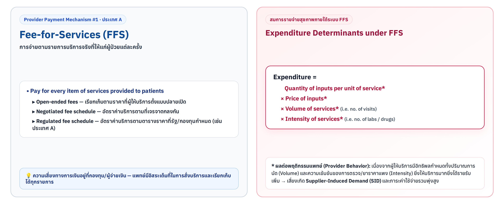
*กรอบแนวคิดประกอบการเฉลยข้อ 1 (ก): รูปแบบการจ่ายตามรายบริการ (Fee-for-Services) และสมการปัจจัยกำหนดรายจ่ายด้านสุขภาพ*

*กรอบแนวคิดประกอบการเฉลยข้อ 1 (ข): กลไกการจ่ายแบบเหมาจ่ายรายหัว (Capitation: เปรียบเทียบ Inclusive Capitation กับ Exclusive Capitation)*

***คำถาม 2: การวิเคราะห์จุดแข็งและจุดอ่อนตามทฤษฎีการคลังสุขภาพ (ประเด็นละ 1 คะแนนดิบ รวม 6 คะแนนดิบ นำมาหารด้วย 2 เป็นคะแนนสุทธิ 3 คะแนน)***

***เกณฑ์การให้คะแนนและวิธีคิดคะแนน (รวม 6 คะแนนดิบ [ประเทศ A = 1 + 2 คะแนนดิบ; ประเทศ B = 2 + 1 คะแนนดิบ] ÷ 2 = คะแนนสุทธิ 3 คะแนน)***
- *หมายเหตุจุดอ่อนของประเทศ B (Capitation): นอกจากปัญหาการให้บริการต่ำกว่ามาตรฐาน (under-provision) แล้ว หากผู้เรียนระบุเรื่องการคัดเลือกความเสี่ยงไม่รับผู้ป่วยหนัก (risk selection / cream-skimming) ก็สามารถให้คะแนนในช่องจุดอ่อนได้เช่นกัน*

| รูปแบบการจ่ายเงิน | จุดแข็งตามทฤษฎี (Strengths) (ประเด็นละ 1 คะแนนดิบ) | จุดอ่อนตามทฤษฎี (Weaknesses) (ประเด็นละ 1 คะแนนดิบ) |
| --- | --- | --- |
| ประเทศ A: จ่ายตามรายบริการ (Fee-for-Service) [รวม 3 คะแนนดิบ] | 1) <u>*สร้างแรงจูงใจในการให้บริการสูง ทำให้ผู้ป่วยเข้าถึงบริการได้ง่ายและรวดเร็ว*</u> *(1 คะแนนดิบ)* | 1) <u>*เกิดอุปสงค์ส่วนเกินที่ผู้ให้บริการกระตุ้นขึ้น (Supplier-Induced Demand: SID)*</u> *(1 คะแนนดิบ)* 2) <u>*ภาระค่าใช้จ่ายด้านสุขภาพรวมพุ่งสูงและควบคุมงบประมาณยาก (cost escalation)*</u> *(1 คะแนนดิบ)* |
| ประเทศ B: เหมาจ่ายรายหัว (Capitation) [รวม 3 คะแนนดิบ] | 1) <u>*ควบคุมค่าใช้จ่ายภาพรวมของระบบได้ดี (cost containment)*</u> *(1 คะแนนดิบ)* 2) <u>*สร้างแรงจูงใจในการจัดบริการส่งเสริมสุขภาพและป้องกันโรคเพื่อลดการเจ็บป่วยหนัก*</u> *(1 คะแนนดิบ)* | 1) <u>*มีแรงจูงใจลดต้นทุนสูงจนอาจให้บริการต่ำกว่ามาตรฐาน (under-provision) หรือคัดเลือกความเสี่ยงไม่รับผู้ป่วยหนัก (risk selection)*</u> *(1 คะแนนดิบ)* |
| สรุปวิธีแปลงคะแนนข้อ 2: รวมคะแนนดิบทั้ง 6 ประเด็น (เต็ม 6 คะแนนดิบ) ÷ 2 | รวมคะแนนดิบที่ได้: <u>*3 + 3 = 6*</u> *(6 คะแนนดิบ)* | คะแนนสุทธิ: <u>*นำ 6 ÷ 2 = 3*</u> *(3 คะแนนสุทธิ)* |

*กรอบแนวคิดประกอบการเฉลยข้อ 2: ตารางเปรียบเทียบแรงจูงใจของกลไกการจ่ายเงินต่อพฤติกรรมผู้ให้บริการและการควบคุมค่าใช้จ่าย (World Health Report 2000)*

***คำถาม 3: การวิเคราะห์บทบาทของการจ่ายตามผลงาน (P4P) ในการปิดช่องว่างของประเทศ A และประเทศ B (รวม 3 คะแนนสุทธิ)***

***เกณฑ์การให้คะแนนและวิธีคิดคะแนน (รวม 3 คะแนนสุทธิ: ประเทศละ 1.5 คะแนน [0.5 + 0.5 + 0.5] × 2 ประเทศ)***
- *พิจารณาการเปรียบเทียบทิศทางแรงจูงใจของ P4P เมื่อวางซ้อนบนกลไกการจ่ายเดิมของแต่ละประเทศ (ขัดแย้งกันในประเทศ A หากวงเงิน P4P น้อย vs เสริมทิศทางเดียวกันในประเทศ B)*

| ประเด็นคำถามการวิเคราะห์ P4P | ผลต่อประเทศ A (ฐานเดิม FFS) (รวม 1.5 คะแนน) | ผลต่อประเทศ B (ฐานเดิม Capitation) (รวม 1.5 คะแนน) |
| --- | --- | --- |
| 3.1 ช่องว่างของระบบการจ่ายเดิมที่กลไก P4P มุ่งหวังเข้าไปช่วยแก้ไขคือประเด็นใด? | <u>*มุ่งแก้ปัญหาการเน้นปริมาณบริการรักษาเมื่อป่วยแล้ว (over-service) โดยดึงความสนใจมาที่คุณภาพการควบคุมโรคเรื้อรัง*</u> *(0.5 คะแนน)* | <u>*มุ่งแก้ปัญหาการประหยัดจนดูแลผู้ป่วยโรคเรื้อรังต่ำกว่ามาตรฐาน (under-service / under-provision)*</u> *(0.5 คะแนน)* |
| 3.2 คาดว่า P4P จะปิดช่องว่างดังกล่าวได้สำเร็จหรือไม่ และขึ้นอยู่กับเงื่อนไขสำคัญอะไร? | <u>*อาจมีผลจำกัดหรือไม่มีผลชัดเจน ขึ้นอยู่กับเงื่อนไขว่าอัตราเงินรางวัล P4P สูงเพียงพอที่จะจูงใจเมื่อเทียบกับรายรับ FFS หรือไม่*</u> *(0.5 คะแนน)* | <u>*สามารถปิดช่องว่างได้ดีและมีประสิทธิภาพ เนื่องจากทิศทางแรงจูงใจของ P4P สอดคล้องไปทางเดียวกับการลดต้นทุนผู้ป่วยในของระบบเหมาจ่าย*</u> *(0.5 คะแนน)* |
| 3.3 เหตุผลสนับสนุนเชิงกลไกแรงจูงใจทางการเงินต่อการจัดบริการส่งเสริม ป้องกัน และฟื้นฟูเพื่อลดภาวะกำเริบเฉียบพลัน | <u>*หากวงเงิน P4P น้อยเกินไป (เช่น เฉลี่ยราว 41 บาท/คน/ปี) โรงพยาบาลอาจยังได้รายรับจาก FFS เมื่อผู้ป่วยกำเริบนอน รพ. คุ้มค่ากว่า จึงไม่จูงใจปรับบริการเชิงรุกเต็มที่*</u> *(0.5 คะแนน)* | <u>*เงินโบนัส P4P เสริมแรงให้โรงพยาบาลจัดบริการสอนพ่นยา ติดตามต่อเนื่อง และฟื้นฟูสมรรถภาพปอดเพื่อลด ER/IPD ซึ่งช่วยทั้งได้รางวัลและประหยัดงบเหมาจ่าย*</u> *(0.5 คะแนน)* |

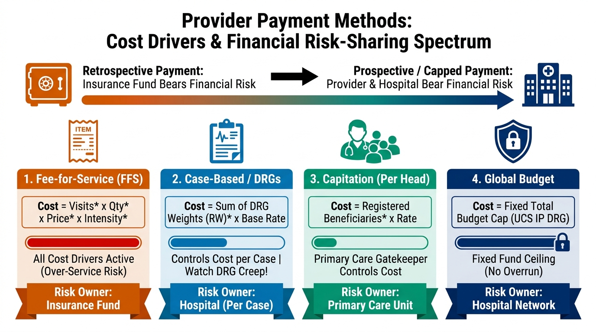
*กรอบแนวคิดประกอบการเฉลยข้อ 3: รูปแบบการจ่ายค่าบริการแก่หน่วยบริการทั้ง 4 รูปแบบ สเปกตรัมการโอนความเสี่ยงทางการเงิน และหลักการออกแบบวิธีจ่ายเงินแบบผสมผสาน (Blended Payment)*

***บทวิเคราะห์เปรียบเทียบประสิทธิผลของ P4P บนฐาน FFS เทียบกับฐาน Capitation และการจ่ายแบบผสมผสาน (blended payment)***

*ในประเทศ A ซึ่งใช้ระบบจ่ายตามรายบริการ (FFS) โรงพยาบาลมีรายรับเพิ่มขึ้นทุกครั้งที่ผู้ป่วยโรคหืดหรือปอดอุดกั้นเรื้อรังเกิดอาการกำเริบเฉียบพลันแล้วต้องมารับบริการห้องฉุกเฉินหรือนอนโรงพยาบาล ดังนั้นเงินรางวัล P4P ก้อนเล็กอาจไม่มากพอที่จะหักล้างรายรับจาก FFS ได้ เว้นแต่จะกำหนดอัตราจ่าย P4P ให้สูงเพียงพอที่จะเปลี่ยนโครงสร้างแรงจูงใจของโรงพยาบาล*

*ตรงกันข้าม ในประเทศ B ซึ่งเหมาจ่ายรายหัวครอบคลุมทั้งผู้ป่วยนอกและผู้ป่วยใน (Inclusive Capitation) โรงพยาบาลต้องแบกรับต้นทุนค่าใช้จ่ายสูงเมื่อผู้ป่วยนอนโรงพยาบาลอยู่แล้ว การเติมเงิน P4P ที่ผูกกับตัวชี้วัดการลดอัตรา Admission และ ER visit จึงเป็นแรงเสริมทิศทางเดียวกันที่ช่วยปิดจุดอ่อนเรื่องการดูแลแบบประหยัดเกินไป (under-provision) บทเรียนนี้สะท้อนเหตุผลที่ระบบหลักประกันสุขภาพแห่งชาติของไทยออกแบบวิธีจ่ายเงินแบบผสมผสาน (blended payment) โดยใช้เหมาจ่ายรายหัวในผู้ป่วยนอก แยกจ่ายผู้ป่วยในตาม DRGs ภายใต้งบประมาณยอดรวม (global budget) และเสริมด้วย P4P ในโรคเรื้อรังสำคัญเพื่อให้เกิดสมดุลระหว่างการควบคุมต้นทุนและคุณภาพการดูแลผู้ป่วย*

---
