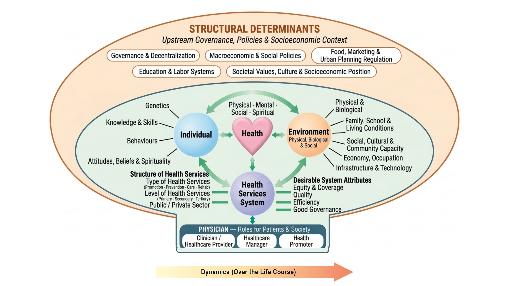
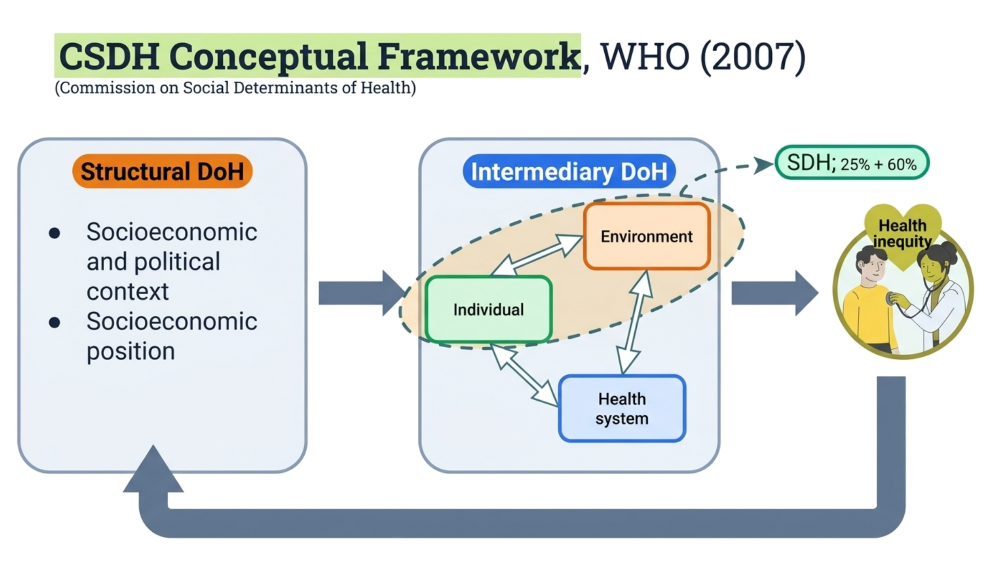
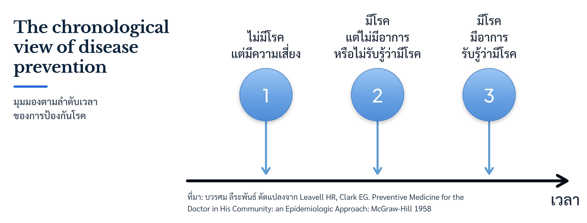
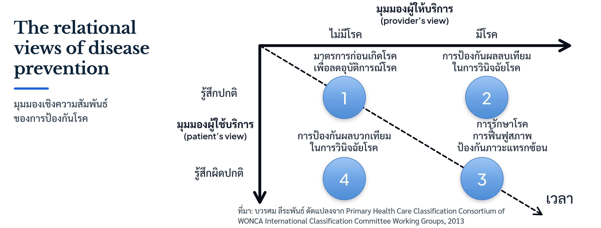
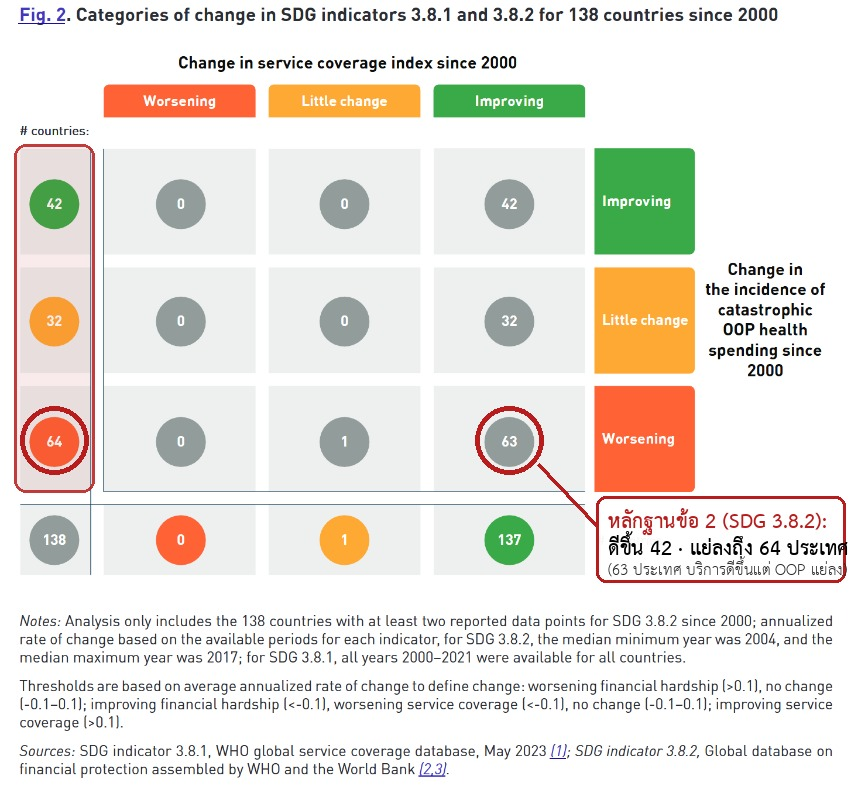
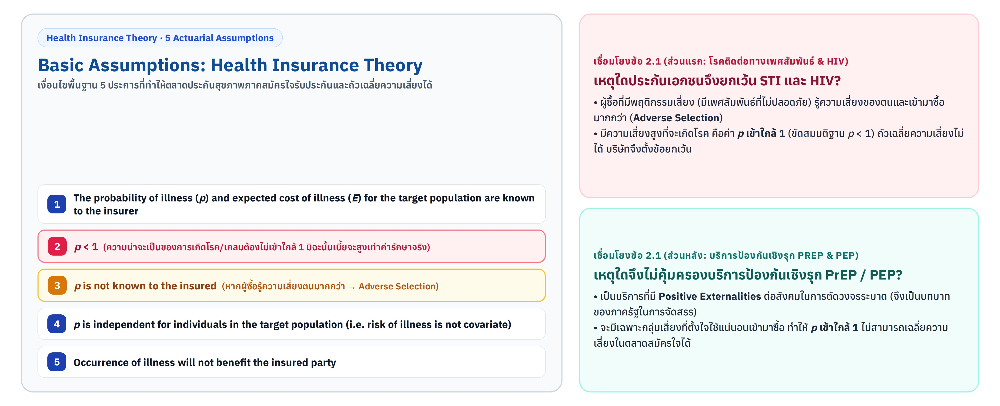
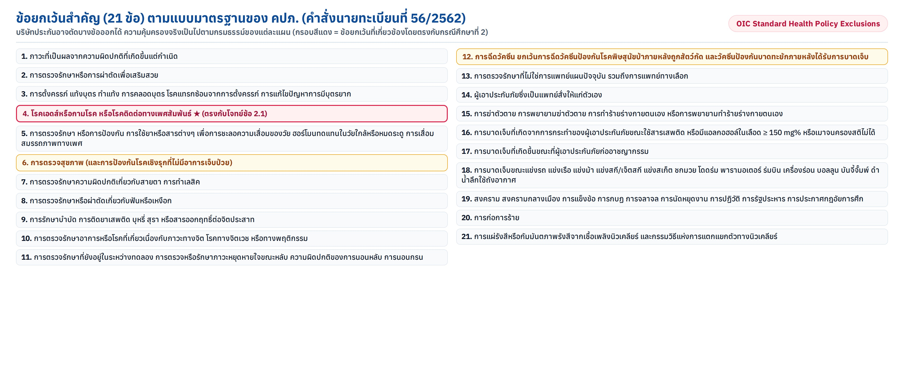
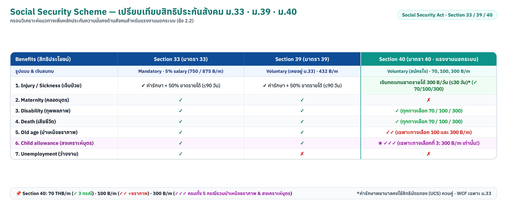
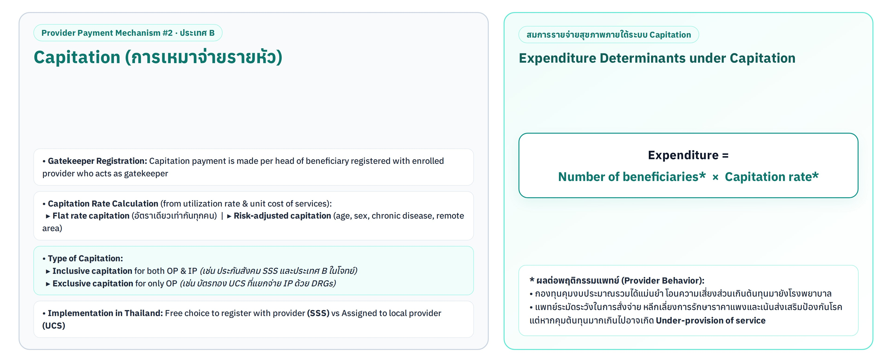
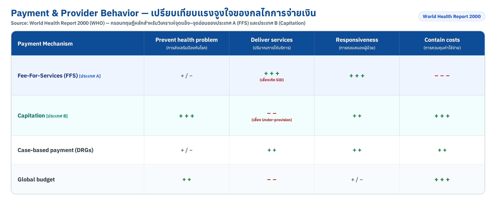

# รูปเล่มกรณีศึกษาและแนวคำตอบมาตรฐาน หมวดระบบสุขภาพ (HS1–HS6) — ฉบับสังเคราะห์ A4

**รายวิชา RACM 303 เวชศาสตร์ชุมชน 1 (Community Medicine I) ปีการศึกษา 2569 (เฉพาะคณาจารย์ผู้สอน)**  
ภาควิชาเวชศาสตร์ชุมชน คณะแพทยศาสตร์โรงพยาบาลรามาธิบดี มหาวิทยาลัยมหิดล

---

## หัวข้อ 1. สุขภาพ ปัจจัยกำหนดสุขภาพ และระดับของการป้องกันโรค (HS1: Health, Determinants of Health, and Levels of Disease Prevention)
- **กำหนดการอภิปราย:** วันพฤหัสบดีที่ 26 พฤศจิกายน 2569 เวลา 09.40 – 12.00 น. · **สัดส่วนน้ำหนักเนื้อหา:** 20% · **คะแนนอ้างอิงรวม:** 40 คะแนน (3 กรณีศึกษา)

### Scenario 1 ภาวะอ้วนในเด็กและการวิเคราะห์ความเชื่อมโยงปัจจัยกำหนดสุขภาพ (10 คะแนน)

เด็กชายโมโน อายุ 10 ขวบ สูง 140 ซม. น้ำหนัก 50 กก. เป็นบุตรคนเดียว อาศัยอยู่ในครอบครัวกับพ่อแม่รวมสามคนในอพาร์ทเม้นท์เช่าแห่งหนึ่งชานกรุงเทพมหานคร เสียค่าเช่าเดือนละ 5,000 บาท พ่อและแม่เป็นพนักงานประจำบริษัทเอกชน ทำงานสัปดาห์ละ 6 วัน และบางสัปดาห์ต้องทำงานล่วงเวลาเพิ่มเติม โดยปกติพ่อและแม่กลับถึงบ้านประมาณหนึ่งทุ่ม ทั้งครอบครัวเดินทางด้วยรถขนส่งสาธารณะในการไปทำงานและไปโรงเรียน โมโนเรียนอยู่ชั้นประถมศึกษาปีที่ 5 โรงเรียนรัฐบาลแห่งหนึ่งไม่ไกลจากที่พักมากนัก

โมโนเป็นเด็กอวบอ้วนตั้งแต่เล็ก ๆ เวลาใครเห็นก็มักทักว่าน่ารักน่ากอด ปู่ย่าซึ่งมีเชื้อสายจีนก็ชมและบอกว่าโหงวเฮ้งดี โตขึ้นจะได้เป็นใหญ่เป็นโต พ่อแม่จึงไม่ได้กังวลเรื่องน้ำหนักของโมโน ประกอบกับไม่ค่อยมีเวลาดูแลใกล้ชิดเพราะต้องทำงานทั้งคู่ ตอนเช้าต้องออกจากที่พักตั้งแต่หกโมงเช้าเพื่อไปโรงเรียนพร้อมกับที่พ่อแม่ออกไปทำงาน เมื่อเลิกเรียนก็กลับห้องพักมาก่อน ส่วนใหญ่นั่งเล่นเกมและดูโทรทัศน์ ซื้อขนมขบเคี้ยวกินตามที่เห็นโฆษณาในโทรทัศน์หรือที่เพื่อน ๆ นิยมกิน และต้องหาอาหารเย็นรับประทานเองเพราะกว่าพ่อแม่จะกลับมาก็ดึก ส่วนวันเสาร์ที่พ่อแม่ไปทำงานก็หาอาหารรับประทานเองในละแวกที่พักและใช้เวลาส่วนใหญ่อยู่กับเกมและโทรทัศน์

โรงเรียนที่โมโนเรียนมีแผงขายอาหารทั้งช่วงเช้าและเที่ยง มีทั้งอาหารคาวหวานและขนมขบเคี้ยวต่าง ๆ จำหน่าย ช่วงเย็นหลังเลิกเรียนก็มีพ่อค้าแม่ค้าแผงลอยขายขนม ลูกชิ้นทอด และเครื่องดื่มหวานหน้าโรงเรียน ซึ่งโมโนซื้อกินทุกวันก่อนกลับบ้าน แม้โมโนจะมีรูปร่างอ้วนแต่ก็ไม่ได้รู้สึกกังวลแต่อย่างใดเพราะมีเพื่อนหลายคนในชั้นเรียนที่อ้วนเหมือนกัน ส่วนในชั่วโมงพลศึกษาส่วนใหญ่ครูปล่อยให้นักเรียนเล่นกันเองตามอัธยาศัย

โมโนไม่ค่อยได้ออกกำลังกายเนื่องจากรู้สึกเหนื่อยง่ายเวลาออกกำลังกายจึงไม่อยากเคลื่อนไหวออกแรง ประกอบกับละแวกที่พักไม่มีสวนสาธารณะหรือสนามเด็กเล่นให้ไปทำกิจกรรมกลางแจ้ง ส่วนใหญ่จึงขลุกอยู่ในห้องเช่าเล่นเกมเป็นหลัก

**จาก scenario ข้างต้น จงตอบคำถามต่อไปนี้**

1. จงประยุกต์ใช้กรอบแนวคิดปัจจัยกำหนดสุขภาพ (Determinants of Health Framework) <u>ระบุภาวะสุขภาพหลักตรงกลางแผนภาพ</u> (1 คะแนน) และ<u>วิเคราะห์ปัจจัยกำหนดสุขภาพในแต่ละหมวดพร้อมข้อมูลสนับสนุนจากสถานการณ์</u> (9 คะแนน) ลงในแผนภาพความเชื่อมโยงและตารางต่อไปนี้ (รวม 10 คะแนน)

| องค์ประกอบในแผนภาพความเชื่อมโยง (Determinants of Health Diagram) | ประเด็นปัจจัยกำหนดสุขภาพ / ภาวะสุขภาพหลัก | พฤติกรรม / บริบท / เหตุการณ์ใน scenario ที่สนับสนุนการวิเคราะห์ |
| --- | --- | --- |
| ปัญหาสุขภาพหลักตรงกลางแผนภาพ (Central Health Outcome) | ____________________________________ (1 คะแนน) | - สูง 140 ซม. น้ำหนัก 50 กก. (คำนวณ BMI = 25.5 กก./ม.²) - เหนื่อยง่ายเมื่อออกกำลังกาย แต่เจ้าตัวไม่รู้สึกกังวล |
| 1. ปัจจัยด้านปัจเจก (Individual factors) [มีปฏิสัมพันธ์สองทิศทาง ↔ ทุกหมวดในวงล้อมชั้นใน] | - ปัจจัยทางชีวภาพ/พื้นฐานร่างกาย และพฤติกรรมเนือยนิ่ง | - อวบอ้วนตั้งแต่เด็กเล็ก; เหนื่อยง่ายจึงนั่งเล่นเกมและดูโทรทัศน์ในห้องพักเป็นหลัก |
| *(ต่อเนื่องจากแถวบน)* | - พฤติกรรมการบริโภคอาหารพลังงานสูง | ____________________________________ ____________________________________ (1 คะแนน) |
| *(ต่อเนื่องจากแถวบน)* | - การรับรู้ส่วนบุคคลต่อภาวะสุขภาพ ____________________________________ (1 คะแนน) | - ได้รับคำชมว่าน่ารัก/โหงวเฮ้งดีมาตั้งแต่เด็ก และเห็นเพื่อนในชั้นเรียนอ้วนหลายคน |
| 2. ปัจจัยด้านสังคมและสิ่งแวดล้อม (Social & Environmental factors) [มีปฏิสัมพันธ์สองทิศทาง ↔ ปัจเจกและระบบบริการ] | - ข้อจำกัดด้านเวลาการดูแลของครอบครัว และบรรทัดฐานคนรอบข้าง | - __________________________________ (1 คะแนน) - __________________________________ (1 คะแนน) |
| *(ต่อเนื่องจากแถวบน)* | - สภาพที่พักอาศัยและสิ่งแวดล้อมกายภาพในชุมชน | - อาศัยในอพาร์ทเม้นท์เช่าพื้นที่จำกัด - __________________________________ (1 คะแนน) |
| *(ต่อเนื่องจากแถวบน)* | - สิ่งแวดล้อมทางอาหารและกิจกรรมทางกายในโรงเรียน | ____________________________________ ____________________________________ (1 คะแนน) |
| 3. ระบบบริการสุขภาพ (Health services system) [วงล้อมชั้นใน] | ____________________________________ ____________________________________ (1 คะแนน) | - มีนักเรียนที่มีภาวะอ้วนหลายคนในชั้นเรียน แต่ยังไม่มีระบบเฝ้าระวังคัดกรองหรือประสานผู้ปกครอง |
| 4. ปัจจัยเชิงโครงสร้างที่มีอิทธิพลต่อความเหลื่อมล้ำด้านสุขภาพ (Structural determinants) [วงล้อมชั้นนอกครอบคลุมทั้งระบบ] | - นโยบายสาธารณะ ผังเมือง มาตรฐานอาหารในสถานศึกษา และการกระจายอำนาจท้องถิ่น | - ขาดความคล่องตัวระดับท้องถิ่นในการจัดพื้นที่เล่นปลอดภัย - __________________________________ (1 คะแนน) |
| *(ต่อเนื่องจากแถวบน)* | - ปัจจัยเชิงพาณิชย์ (CDoH) ค่านิยมวัฒนธรรม และโครงสร้างแรงงาน | ____________________________________ ____________________________________ (1 คะแนน) |

#### เฉลย

1. จงประยุกต์ใช้กรอบแนวคิดปัจจัยกำหนดสุขภาพ (Determinants of Health Framework) ระบุภาวะสุขภาพหลักตรงกลางแผนภาพ (1 คะแนน) และวิเคราะห์ปัจจัยกำหนดสุขภาพในแต่ละหมวดพร้อมข้อมูลสนับสนุนจากสถานการณ์ (9 คะแนน) ลงในแผนภาพความเชื่อมโยงและตารางต่อไปนี้ (รวม 10 คะแนน)

| องค์ประกอบในแผนภาพความเชื่อมโยง (Determinants of Health Diagram) | ประเด็นปัจจัยกำหนดสุขภาพ / ภาวะสุขภาพหลัก | พฤติกรรม / บริบท / เหตุการณ์ใน scenario ที่สนับสนุนการวิเคราะห์ |
| --- | --- | --- |
| ปัญหาสุขภาพหลักตรงกลางแผนภาพ (Central Health Outcome) | <u>*ภาวะอ้วนในเด็ก (Childhood Obesity)*</u> *(1 คะแนน)* | - สูง 140 ซม. น้ำหนัก 50 กก. (คำนวณ BMI = 25.5 กก./ม.²) - เหนื่อยง่ายเมื่อออกกำลังกาย แต่เจ้าตัวไม่รู้สึกกังวล |
| 1. ปัจจัยด้านปัจเจก (Individual factors) [มีปฏิสัมพันธ์สองทิศทาง ↔ ทุกหมวดในวงล้อมชั้นใน] | - ปัจจัยทางชีวภาพ/พื้นฐานร่างกาย และพฤติกรรมเนือยนิ่ง | - อวบอ้วนตั้งแต่เด็กเล็ก; เหนื่อยง่ายจึงนั่งเล่นเกมและดูโทรทัศน์ในห้องพักเป็นหลัก |
| *(ต่อเนื่องจากแถวบน)* | - พฤติกรรมการบริโภคอาหารพลังงานสูง | <u>*- ซื้อขนมขบเคี้ยวตามโฆษณาทีวี/เพื่อน ซื้อลูกชิ้นทอดและเครื่องดื่มหวานหน้าโรงเรียนทุกวัน และต้องหาอาหารมื้อเย็นกับวันเสาร์กินเอง*</u> *(1 คะแนน)* |
| *(ต่อเนื่องจากแถวบน)* | - การรับรู้ส่วนบุคคลต่อภาวะสุขภาพ: <u>*ยังไม่ตระหนักถึงความเสี่ยงสุขภาพ / มองความอ้วนเป็นเรื่องปกติ*</u> *(1 คะแนน)* | - ได้รับคำชมว่าน่ารัก/โหงวเฮ้งดีมาตั้งแต่เด็ก และเห็นเพื่อนในชั้นเรียนอ้วนหลายคน |
| 2. ปัจจัยด้านสังคมและสิ่งแวดล้อม (Social & Environmental factors) [มีปฏิสัมพันธ์สองทิศทาง ↔ ปัจเจกและระบบบริการ] | - ข้อจำกัดด้านเวลาการดูแลของครอบครัว และบรรทัดฐานคนรอบข้าง | - <u>*พ่อแม่ทำงานประจำ 6 วัน/สัปดาห์และทำ OT กลับบ้านทุ่มหนึ่ง เด็กต้องอยู่และหาอาหารกินเอง*</u> *(1 คะแนน)* - <u>*ปู่ย่าและคนรอบข้างชื่นชมว่าน่ารักน่ากอด โหงวเฮ้งดี ทำให้ครอบครัวไม่มองเป็นปัญหาสุขภาพ*</u> *(1 คะแนน)* |
| *(ต่อเนื่องจากแถวบน)* | - สภาพที่พักอาศัยและสิ่งแวดล้อมกายภาพในชุมชน | - อาศัยในอพาร์ทเม้นท์เช่าพื้นที่จำกัด - <u>*ละแวกที่พักไม่มีสวนสาธารณะหรือสนามเด็กเล่นที่ปลอดภัยสำหรับทำกิจกรรมกลางแจ้ง*</u> *(1 คะแนน)* |
| *(ต่อเนื่องจากแถวบน)* | - สิ่งแวดล้อมทางอาหารและกิจกรรมทางกายในโรงเรียน | <u>*- มีแผงขายขนมขบเคี้ยวเช้า–เที่ยง แผงลอยของทอด/น้ำหวานหน้าโรงเรียน และชั่วโมงพละครูปล่อยให้เล่นกันเองโดยขาดการจัดกิจกรรมทางกายที่เหมาะสม*</u> *(1 คะแนน)* |
| 3. ระบบบริการสุขภาพ (Health services system) [วงล้อมชั้นใน] | <u>*- ขาดการดำเนินงานเชิงรุกด้านอนามัยโรงเรียน การคัดกรองโภชนาการ และการให้คำปรึกษาเชื่อมสู่ครอบครัว*</u> *(1 คะแนน)* | - มีนักเรียนที่มีภาวะอ้วนหลายคนในชั้นเรียน แต่ยังไม่มีระบบเฝ้าระวังคัดกรองหรือประสานผู้ปกครอง |
| 4. ปัจจัยเชิงโครงสร้างที่มีอิทธิพลต่อความเหลื่อมล้ำด้านสุขภาพ (Structural determinants) [วงล้อมชั้นนอกครอบคลุมทั้งระบบ] | - นโยบายสาธารณะ ผังเมือง มาตรฐานอาหารในสถานศึกษา และการกระจายอำนาจท้องถิ่น | - ขาดความคล่องตัวระดับท้องถิ่นในการจัดพื้นที่เล่นปลอดภัย - <u>*ช่องว่างนโยบายกำกับดูแลอาหารและโภชนาการในและรอบโรงเรียน นโยบายโรงเรียนสร้างเสริมสุขภาพ และผังเมืองชานเมืองที่ขาดพื้นที่สีเขียว*</u> *(1 คะแนน)* |
| *(ต่อเนื่องจากแถวบน)* | - ปัจจัยเชิงพาณิชย์ (CDoH) ค่านิยมวัฒนธรรม และโครงสร้างแรงงาน | <u>*- การตลาดและโฆษณาขนมขบเคี้ยวทางโทรทัศน์ที่มุ่งเป้าเด็ก ค่านิยมวัฒนธรรมต่อรูปร่างเด็ก และโครงสร้างการจ้างงานเอกชน 6 วัน/สัปดาห์รวมถึงค่าครองชีพที่จำกัดเวลาครอบครัว*</u> *(1 คะแนน)* |

*กรอบแนวคิดประกอบการเฉลย: พลวัตความเชื่อมโยงของปัจจัยกำหนดสุขภาพ 3 กลุ่ม (ปัจเจก · สิ่งแวดล้อม · ระบบบริการสุขภาพ) ภายใต้วงล้อมของปัจจัยเชิงโครงสร้างที่มีอิทธิพลต่อความเหลื่อมล้ำด้านสุขภาพ (Structural Determinants) และบทบาทแพทย์ 3 บทบาท*

***บทสังเคราะห์เชื่อมโยงกรอบแนวคิดสำคัญ (Disease vs. Illness และพลวัตปัจจัยกำหนดสุขภาพเชิงระบบ)***

*กรณีของเด็กชายโมโนสะท้อนความแตกต่างระหว่างมิติความผิดปกติทางชีวการแพทย์กับประสบการณ์ความเจ็บป่วยได้อย่างชัดเจน กล่าวคือ โมโนมีภาวะโรคหรือความผิดปกติทางกายที่ตรวจวัดได้ชัดเจน (disease) ได้แก่ ภาวะอ้วนในเด็ก (ดัชนีมวลกาย 25.5 กิโลกรัมต่อตารางเมตร) และเริ่มมีอาการเหนื่อยง่ายเมื่อออกแรง แต่กลับไม่มีความรู้สึกทุกข์ทรมานหรือรับรู้ว่าตนเองกำลังเจ็บป่วย (illness) เนื่องจากบรรทัดฐานทางวัฒนธรรมของครอบครัวและกลุ่มเพื่อนมองรูปร่างอ้วนเป็นสิ่งปกติและน่ารัก หากระบบบริการสุขภาพตั้งรับรอผู้ป่วยเดินเข้ามาในคลินิกเพียงอย่างเดียว ย่อมไม่สามารถเข้าถึงเด็กกลุ่มนี้ได้ทันท่วงที*

*นอกจากนี้ การวางองค์ประกอบลงในแผนภาพวงล้อมซ้อนช่วยให้เห็นว่า พฤติกรรมการกินขนมขบเคี้ยวและความเนือยนิ่งของเด็กไม่ได้เกิดจากการขาดวินัยส่วนบุคคลเพียงลำพัง แต่เป็นผลลัพธ์ของปฏิสัมพันธ์สองทิศทางระหว่างปัจจัยระดับปัจเจก สิ่งแวดล้อมในครอบครัวและโรงเรียน และช่องว่างของระบบอนามัยโรงเรียน ซึ่งทั้งหมดถูกกำกับอยู่ภายใต้วงล้อมของปัจจัยเชิงโครงสร้างต้นน้ำ ทั้งโครงสร้างชั่วโมงทำงานของแรงงานเอกชน ผังเมืองชานเมืองที่ไร้พื้นที่เล่นปลอดภัย และการตลาดอาหารพลังงานสูงที่มุ่งเป้าเด็ก (commercial determinants of health)*

---

### Scenario 2 ปัจจัยกำหนดสุขภาพทางสังคมและการคัดกรองสารเสพติดในคลินิกฝากครรภ์ (10 คะแนน)

ที่โรงพยาบาลชุมชนแห่งหนึ่ง แผนกฝากครรภ์ (ANC) มีขั้นตอนในการตรวจคัดกรองสารเสพติดในปัสสาวะ (urine amphetamine) ในหญิงที่มาฝากครรภ์ทุกราย เพื่อค้นหาการใช้สารแอมเฟตามีนตั้งแต่ระยะเริ่มแรก (detection) และให้การบำบัดเลิกยาทันที เพื่อไม่ให้เกิดความเสี่ยงต่อภาวะแทรกซ้อนขณะตั้งครรภ์ หรือผลกระทบต่อทารกในครรภ์อันเนื่องมาจากการใช้สารแอมเฟตามีนของมารดา

จากการคัดกรองพบว่า มีหญิงตั้งครรภ์ที่ผลตรวจเป็นบวก (positive) บ่อยครั้งขึ้นกว่าในอดีต เจ้าหน้าที่จึงได้รวบรวมข้อมูลเชิงลึกเพิ่มเติม พบว่าลักษณะร่วมกันของหญิงตั้งครรภ์ที่มีผล urine amphetamine positive ได้แก่ มีอายุระหว่าง 15–18 ปี เป็นผู้ไม่มีงานประจำ การศึกษาสูงสุดระดับชั้นมัธยมศึกษาปีที่ 3 และมีคู่สมรสหรือสมาชิกในครอบครัวที่ใช้สารเสพติดแอมเฟตามีน

หญิงตั้งครรภ์บางรายให้ข้อมูลเพิ่มเติมว่า ใช้สารดังกล่าวเพื่อให้สามารถทำงานได้มีประสิทธิภาพและทนทานขึ้น เนื่องจากต้องกรีดยางพาราในช่วงเช้ามืดและไปทำงานรับจ้างทั่วไปต่อในช่วงกลางวัน ซึ่งผู้ที่ประกอบอาชีพรับจ้างลักษณะเดียวกันในพื้นที่ส่วนใหญ่ก็ใช้สารนี้เช่นกัน อีกทั้งการหาซื้อสารเสพติดแอมเฟตามีนมาใช้สามารถทำได้ง่ายโดยมีแหล่งซื้อขายหลายแห่งในชุมชน

**จาก scenario ข้างต้น จงตอบคำถามต่อไปนี้**

1. จากกรอบแนวคิดปัจจัยกำหนดสุขภาพทางสังคมขององค์การอนามัยโลก (WHO Conceptual Framework for Action on the Social Determinants of Health: CSDH) จง<u>จำแนกปัจจัยกำหนดสุขภาพของหญิงตั้งครรภ์ที่มีผล urine amphetamine positive</u> ออกเป็น<u>ปัจจัยเชิงโครงสร้างที่มีอิทธิพลต่อความเหลื่อมล้ำด้านสุขภาพ</u> (3 คะแนน) และ<u>ปัจจัยทางสังคมที่มีผลต่อสุขภาพ (ปัจจัยตัวกลาง)</u> (3 คะแนน) ในตารางต่อไปนี้ (รวม 6 คะแนน)

| หมวดปัจจัยตามกรอบแนวคิด WHO CSDH | มิติย่อยของปัจจัยกำหนดสุขภาพ | ข้อมูล / เหตุการณ์ใน scenario ที่มีผลต่อสุขภาพ |
| --- | --- | --- |
| 1. ปัจจัยเชิงโครงสร้างที่มีอิทธิพลต่อความเหลื่อมล้ำด้านสุขภาพ (Structural determinants of health inequities) | Socioeconomic position: ____________________________________ (1 คะแนน) | - การศึกษาสูงสุดระดับชั้นมัธยมศึกษาปีที่ 3 ซึ่งอาจจำกัดโอกาสทางอาชีพและความรอบรู้เท่าทันโทษของสารเสพติด |
| *(ต่อเนื่องจากแถวบน)* | Socioeconomic position: อาชีพและโครงสร้างตลาดแรงงานนอกระบบ | ____________________________________ ____________________________________ (1 คะแนน) |
| *(ต่อเนื่องจากแถวบน)* | Socioeconomic and political context: นโยบายรัฐและการบังคับใช้กฎหมายปราบปรามยาเสพติด | ____________________________________ ____________________________________ (1 คะแนน) |
| *(ต่อเนื่องจากแถวบน)* | Cultural and societal values: ค่านิยมและความเชื่อทางสังคมในการทำงาน | - ความเชื่อในกลุ่มอาชีพเดียวกันว่าการใช้สารแอมเฟตามีนช่วยให้ทำงานหนักต่อเนื่องได้เต็มประสิทธิภาพ |
| 2. ปัจจัยทางสังคมที่มีผลต่อสุขภาพ / ปัจจัยตัวกลาง (Intermediary determinants of health) | สภาพแวดล้อมทางสังคมและอิทธิพลคนใกล้ชิด (Psychosocial & peer/family context) | ____________________________________ ____________________________________ (1 คะแนน) |
| *(ต่อเนื่องจากแถวบน)* | ปัจจัยทางชีวภาพและพฤติกรรมสุขภาพ (Biological & behavioral factors) | ____________________________________ ____________________________________ (1 คะแนน) |
| *(ต่อเนื่องจากแถวบน)* | สภาพความเป็นอยู่และสภาพการทำงานจริง (Material & working circumstances) | ____________________________________ ____________________________________ (1 คะแนน) |

2. การตรวจคัดกรอง urine amphetamine ในหญิงที่มาฝากครรภ์ทุกราย จัดเป็นการป้องกันโรคใน<u>ระดับใด (level of disease prevention)</u> (2 คะแนน) และ<u>เพราะเหตุใด</u> จงระบุเหตุผลประกอบจากสถานการณ์ 2 ประเด็น (2 คะแนน) (รวม 4 คะแนน)

#### เฉลย

1. จากกรอบแนวคิดปัจจัยกำหนดสุขภาพทางสังคมขององค์การอนามัยโลก (WHO CSDH) จงจำแนกปัจจัยกำหนดสุขภาพของหญิงตั้งครรภ์ที่มีผล urine amphetamine positive ออกเป็นปัจจัยเชิงโครงสร้างที่มีอิทธิพลต่อความเหลื่อมล้ำด้านสุขภาพ (3 คะแนน) และปัจจัยทางสังคมที่มีผลต่อสุขภาพ (3 คะแนน) ในตารางต่อไปนี้ (รวม 6 คะแนน)

| หมวดปัจจัยตามกรอบแนวคิด WHO CSDH | มิติย่อยของปัจจัยกำหนดสุขภาพ | ข้อมูล / เหตุการณ์ใน scenario ที่มีผลต่อสุขภาพ |
| --- | --- | --- |
| 1. ปัจจัยเชิงโครงสร้างที่มีอิทธิพลต่อความเหลื่อมล้ำด้านสุขภาพ (Structural determinants of health inequities) | Socioeconomic position: <u>*ระดับการศึกษา (education)*</u> *(1 คะแนน)* | - การศึกษาสูงสุดระดับชั้นมัธยมศึกษาปีที่ 3 ซึ่งอาจจำกัดโอกาสทางอาชีพและความรอบรู้เท่าทันโทษของสารเสพติด |
| *(ต่อเนื่องจากแถวบน)* | Socioeconomic position: อาชีพและโครงสร้างตลาดแรงงานนอกระบบ | <u>*- เป็นงานนอกระบบที่ไม่มีงานประจำและไม่มีนายจ้างชัดเจน ขาดหลักประกันความมั่นคงและการคุ้มครองความปลอดภัยในการทำงาน*</u> *(1 คะแนน)* |
| *(ต่อเนื่องจากแถวบน)* | Socioeconomic and political context: นโยบายรัฐและการบังคับใช้กฎหมายปราบปรามยาเสพติด | <u>*- ช่องว่างของการควบคุมและปราบปรามยาเสพติดในพื้นที่ ทำให้หาซื้อแอมเฟตามีนได้ง่ายและมีแหล่งซื้อขายหลายแห่งในชุมชน*</u> *(1 คะแนน)* |
| *(ต่อเนื่องจากแถวบน)* | Cultural and societal values: ค่านิยมและความเชื่อทางสังคมในการทำงาน | - ความเชื่อในกลุ่มอาชีพเดียวกันว่าการใช้สารแอมเฟตามีนช่วยให้ทำงานหนักต่อเนื่องได้เต็มประสิทธิภาพ |
| 2. ปัจจัยทางสังคมที่มีผลต่อสุขภาพ / ปัจจัยตัวกลาง (Intermediary determinants of health) | สภาพแวดล้อมทางสังคมและอิทธิพลคนใกล้ชิด (Psychosocial & peer/family context) | <u>*- มีคู่สมรสหรือสมาชิกในครอบครัวใช้สารเสพติดแอมเฟตามีน รวมถึงเพื่อนร่วมอาชีพเดียวกันส่วนใหญ่ใช้สารนี้เป็นเรื่องปกติ*</u> *(1 คะแนน)* |
| *(ต่อเนื่องจากแถวบน)* | ปัจจัยทางชีวภาพและพฤติกรรมสุขภาพ (Biological & behavioral factors) | <u>*- ตั้งครรภ์ในวัยรุ่นอายุ 15–18 ปี (teenage pregnancy) ซึ่งมีแนวโน้มขาดความพร้อมและทักษะในการดูแลตนเองขณะตั้งครรภ์ (self-care)*</u> *(1 คะแนน)* |
| *(ต่อเนื่องจากแถวบน)* | สภาพความเป็นอยู่และสภาพการทำงานจริง (Material & working circumstances) | <u>*- ความไม่มั่นคงของรายได้จากการไม่มีงานประจำ บีบให้ต้องโหมทำงานหนักต่อเนื่องทั้งกรีดยางเช้ามืดและรับจ้างช่วงกลางวัน*</u> *(1 คะแนน)* |

*กรอบแนวคิดประกอบการเฉลยข้อ 1 (ก): กรอบแนวคิดปัจจัยกำหนดสุขภาพทางสังคม (CSDH Conceptual Framework, WHO 2007) แสดงการส่งต่ออิทธิพลจากปัจจัยเชิงโครงสร้างต้นน้ำสู่ปัจจัยทางสังคมที่มีผลต่อสุขภาพและความเหลื่อมล้ำทางสุขภาพ*

*กรอบแนวคิดประกอบการเฉลยข้อ 1 (ข): แผนผังกรอบแนวคิดปัจจัยกำหนดสุขภาพทางสังคมฉบับเต็มภาษาไทย (ประยุกต์จาก Solar & Irwin / WHO CSDH, 2010)*

2. การตรวจคัดกรอง urine amphetamine ในหญิงที่มาฝากครรภ์ทุกราย จัดเป็นการป้องกันโรคในระดับใด (2 คะแนน) และเพราะเหตุใด (2 คะแนน)

*2.1. ระดับของการป้องกันโรค (2 คะแนน)*
- *i. จัดเป็นการป้องกันระดับทุติยภูมิ หรือการป้องกันขั้นที่สอง (Secondary prevention) (2 คะแนน)*

*2.2. เหตุผลประกอบจากสถานการณ์ (2 คะแนน; คำตอบละ 1 คะแนน)*
- *i. เป็นการตรวจคัดกรองเพื่อค้นหาผู้ใช้สารเสพติดตั้งแต่ระยะแรกเริ่มในกลุ่มหญิงตั้งครรภ์ที่ยังไม่มีภาวะแทรกซ้อนปรากฏชัด (early detection / screening) (1 คะแนน)*
- *ii. เพื่อนำเข้าสู่กระบวนการบำบัดเลิกยาทันที (prompt treatment / early intervention) ก่อนที่จะเกิดภาวะแทรกซ้อนขณะตั้งครรภ์ต่อมารดาหรือผลกระทบอันตรายต่อทารกในครรภ์ (1 คะแนน)*

*กรอบแนวคิดประกอบการเฉลยข้อ 2 (ก): ระดับของการป้องกันโรคทั้ง 4 ระดับ เชื่อมโยงระยะของโรค กลุ่มเป้าหมาย และจุดเน้นของมาตรการหลัก (Leavell & Clark, 1965; Jamoulle, 2015)*

*กรอบแนวคิดประกอบการเฉลยข้อ 2 (ข): ธรรมชาติการดำเนินโรคและการคัดกรองระยะเริ่มแรกก่อนเกิดอาการหรือภาวะแทรกซ้อนในการป้องกันระดับทุติยภูมิ (Secondary Prevention)*

***ข้อสังเกตสำคัญสำหรับการตรวจให้คะแนนและการอภิปรายต่อยอด***

*จุดที่ผู้เรียนมักสับสนในคำถามข้อที่ 2 คือการเข้าใจผิดว่าการคัดกรองเพื่อป้องกันไม่ให้ทารกเกิดภาวะแทรกซ้อนเป็น Primary prevention ซึ่งในความเป็นจริง หญิงตั้งครรภ์ที่ตรวจพบผลบวกได้เริ่มมีการใช้สารแอมเฟตามีนเกิดขึ้นแล้ว การตรวจปัสสาวะทุกรายในคลินิกฝากครรภ์จึงทำหน้าที่ค้นหาภาวะผิดปกติหรือการสัมผัสปัจจัยก่อโรคที่เกิดขึ้นแล้วตั้งแต่ระยะไร้ความเสียหายรุนแรง (early detection) เพื่อให้การบำบัดรักษาอย่างทันท่วงที (prompt intervention) อันเป็นหัวใจของการป้องกันระดับทุติยภูมิ (secondary prevention) ทั้งนี้ ในทางเวชปฏิบัติที่โรงพยาบาลชุมชน การคัดกรองดังกล่าวต้องดำเนินการควบคู่กับท่าทีที่ปลอดภัย ไม่ตีตรา และเชื่อมโยงสู่ระบบบำบัดช่วยเหลือทางสังคมอย่างแท้จริง เพื่อไม่ให้หญิงตั้งครรภ์วัยรุ่นเกิดความหวาดกลัวจนหลุดออกจากระบบฝากครรภ์*

---

### Scenario 3 สุขภาวะของคนทำงานในโรงงานอุตสาหกรรม ปัจจัยกำหนดสุขภาพ และระดับของการป้องกันโรค (20 คะแนน)

นายสมชาย อายุ 40 ปี เป็นผู้จัดการฝ่ายผลิต ณ โรงงานประกอบฮาร์ดดิสก์แห่งหนึ่ง มีประวัติบิดาและพี่ชายเป็นโรคกล้ามเนื้อหัวใจขาดเลือด นายสมชายไม่สูบบุหรี่ แต่ดื่มสุราตามเทศกาล

นายสมชายทำงานวันละ 8 ชั่วโมง สัปดาห์ละ 5 วัน แต่ในช่วงเร่งการผลิตเป็นเวลา 2 เดือนใน 1 ปี ต้องทำงานล่วงเวลาเพิ่มเติมรวมเป็นสัปดาห์ละ 60 ชั่วโมง นายสมชายมีหน้าที่ควบคุมการทำงานของพนักงานฝ่ายผลิต โดยเดินตรวจตราในสายการผลิตประมาณ 5–6 ชั่วโมงต่อวัน และทำงานด้านเอกสารในสำนักงานประมาณ 2–3 ชั่วโมงต่อวัน

โรงงานจัดสวัสดิการที่พักใกล้เคียงโรงงานให้ โดยภรรยาและลูกสามารถมาพักอาศัยอยู่ร่วมกันได้ บริเวณโรงงานมีสวนหย่อมและห้องออกกำลังกาย (ฟิตเนส) ให้ใช้บริการโดยไม่มีค่าใช้จ่าย และโรงอาหารในโรงงานมีการระบุข้อมูลโภชนาการกำกับไว้ทุกเมนูอาหาร

โรงงานจัดการตรวจสุขภาพประจำปีให้แก่พนักงานทุกคน โดยโปรแกรมการตรวจสุขภาพได้รับการออกแบบและคัดเลือกรายการตรวจโดยแพทย์อาชีวเวชศาสตร์ นายสมชายเข้ารับการตรวจสุขภาพประจำปีทุกปี ซึ่งในช่วง 3 ปีล่าสุดตรวจพบว่ามีภาวะไขมันในเลือดสูงและความดันโลหิตสูง นายสมชายจึงเข้ารับการรักษาและติดตามอาการอย่างต่อเนื่องโดยมีนัดพบแพทย์ทุก 6 เดือน

นอกจากนี้ โรงงานยังจัดโครงการสร้างเสริมสุขภาพหลายโครงการ ทั้งแบบกึ่งบังคับและแบบให้พนักงานเข้าร่วมโดยสมัครใจ เช่น โครงการเลิกบุหรี่ โครงการนับแคล (สะสมชั่วโมงการออกกำลังกาย กิจกรรมทางกาย และการเลือกเมนูอาหาร) โครงการการยศาสตร์ (เสริมสร้างกล้ามเนื้อเพื่อลดการบาดเจ็บทางระบบกล้ามเนื้อและโครงร่าง และให้ความรู้เรื่องท่าทางการทำงานที่ปลอดภัย) และโครงการแข่งขันกีฬาภายในองค์กร

ทั้งนี้ นายสมชายได้เข้าร่วมโครงการแข่งขันกีฬาภายในโดยมีทีมฟุตบอลกับเพื่อนร่วมงานมาอย่างต่อเนื่อง และได้ตัดสินใจสมัครเข้าร่วมโครงการนับแคลในช่วงปีที่ผ่านมา หลังจากตระหนักว่าผลตรวจสุขภาพตลอด 3 ปีล่าสุดของตนมีภาวะไขมันในเลือดสูงและความดันโลหิตสูง

**จาก scenario ข้างต้น จงตอบคำถามต่อไปนี้**

1. จงระบุถึง<u>สุขภาพด้านต่าง ๆ ของนายสมชาย</u> ตามนิยามของธรรมนูญว่าด้วยระบบสุขภาพแห่งชาติ พ.ศ. 2552 (4 คะแนน) <u>ด้านของปัจจัยกำหนดสุขภาพ</u> (4 คะแนน) และ<u>พฤติกรรมหรือเหตุการณ์ใน scenario ที่มีผลต่อภาวะสุขภาพทั้งทางบวกและทางลบ</u> (4 คะแนน) ในตารางต่อไปนี้ (รวม 12 คะแนน)

| ด้านของสุขภาพ/สุขภาวะ ตามนิยามของธรรมนูญว่าด้วย ระบบสุขภาพแห่งชาติ | ภาวะสุขภาพของนายสมชาย (Health Status) | ด้านของปัจจัยกำหนดสุขภาพ (Determinants of Health) | พฤติกรรม / เหตุการณ์ใน scenario ที่มีผลต่อภาวะสุขภาพ (บวกและลบ) |
| --- | --- | --- | --- |
| สุขภาพทางกาย (Physical health) | _________________________ _________________________ (1 คะแนน) | ปัจจัยด้าน _______________ (1 คะแนน) | - ไม่สูบบุหรี่ เล่นฟุตบอล และร่วมโครงการนับแคล - _________________________ (1 คะแนน) |
| *(ต่อเนื่องจากแถวบน)* | *(ต่อเนื่องจากแถวบน)* | ปัจจัยด้าน _______________ (1 คะแนน) | - โรงงานมีสวนหย่อม ฟิตเนสฟรี ฉลากโภชนาการทุกเมนู และโครงการการยศาสตร์ |
| *(ต่อเนื่องจากแถวบน)* | *(ต่อเนื่องจากแถวบน)* | ปัจจัยด้าน _______________ (1 คะแนน) | - มีโปรแกรมตรวจสุขภาพประจำปีโดยแพทย์อาชีวเวชศาสตร์ - _________________________ (1 คะแนน) |
| สุขภาพทางจิตใจ (Mental health) | _________________________ _________________________ (1 คะแนน) | ปัจจัยด้าน _______________ _________________________ (1 คะแนน) | - บวก: ที่พักใกล้โรงงาน อยู่กับครอบครัวได้ มีกีฬา/สวนหย่อมผ่อนคลาย - ลบ: ______________________ (1 คะแนน) |
| สุขภาพ/สุขภาวะทางสังคม (Social health) | _________________________ _________________________ (1 คะแนน) | นโยบายสวัสดิการที่พักครอบครัวและกิจกรรมกีฬาภายในองค์กร | - โรงงานจัดที่พักให้ภรรยาและลูกมาอยู่ด้วยกัน และจัดแข่งขันกีฬาฟุตบอลกับเพื่อนร่วมงาน |
| สุขภาพทางปัญญา / จิตวิญญาณ (Spiritual / Intellectual health) | _________________________ _________________________ (1 คะแนน) | ปัจจัยส่วนบุคคลร่วมกับระบบบริการและสิ่งแวดล้อมข้อมูลสุขภาพ | ___________________________ ___________________________ (1 คะแนน) |

2. จงระบุ<u>กิจกรรมหรือการดำเนินการที่เป็นการป้องกันโรคในระดับต่าง ๆ</u> ที่มีใน scenario พร้อมระบุกลุ่มเป้าหมายหรือวัตถุประสงค์ให้สอดคล้องกัน (8 คะแนน)

#### เฉลย

1. จงระบุถึงสุขภาพด้านต่าง ๆ ของนายสมชาย ตามนิยามของธรรมนูญว่าด้วยระบบสุขภาพแห่งชาติ พ.ศ. 2552 (4 คะแนน) ด้านของปัจจัยกำหนดสุขภาพ (4 คะแนน) และพฤติกรรมหรือเหตุการณ์ใน scenario ที่มีผลต่อภาวะสุขภาพทั้งทางบวกและทางลบ (4 คะแนน) ในตารางต่อไปนี้ (รวม 12 คะแนน)

| ด้านของสุขภาพ/สุขภาวะ ตามนิยามของธรรมนูญว่าด้วย ระบบสุขภาพแห่งชาติ | ภาวะสุขภาพของนายสมชาย (Health Status) | ด้านของปัจจัยกำหนดสุขภาพ (Determinants of Health) | พฤติกรรม / เหตุการณ์ใน scenario ที่มีผลต่อภาวะสุขภาพ (บวกและลบ) |
| --- | --- | --- | --- |
| สุขภาพทางกาย (Physical health) | <u>*- ไขมันในเลือดสูง และความดันโลหิตสูง (3 ปีล่าสุด); เสี่ยงโรคหัวใจและหลอดเลือดสูงกว่าคนทั่วไป*</u> *(1 คะแนน)* | ปัจจัยด้าน <u>*ส่วนบุคคล / ปัจเจกบุคคล*</u> *(1 คะแนน)* | - ไม่สูบบุหรี่ เล่นฟุตบอล และร่วมโครงการนับแคล - <u>*ประวัติครอบครัวบิดาและพี่ชายเป็นโรคกล้ามเนื้อหัวใจขาดเลือด และดื่มสุราตามเทศกาล*</u> *(1 คะแนน)* |
| *(ต่อเนื่องจากแถวบน)* | *(ต่อเนื่องจากแถวบน)* | ปัจจัยด้าน <u>*สิ่งแวดล้อม*</u> *(1 คะแนน)* | - โรงงานมีสวนหย่อม ฟิตเนสฟรี ฉลากโภชนาการทุกเมนู และโครงการการยศาสตร์ |
| *(ต่อเนื่องจากแถวบน)* | *(ต่อเนื่องจากแถวบน)* | ปัจจัยด้าน <u>*ระบบบริการสุขภาพ*</u> *(1 คะแนน)* | - มีโปรแกรมตรวจสุขภาพประจำปีโดยแพทย์อาชีวเวชศาสตร์ - <u>*เข้ารับการรักษาและนัดติดตามอาการต่อเนื่องทุก 6 เดือน*</u> *(1 คะแนน)* |
| สุขภาพทางจิตใจ (Mental health) | <u>*- แนวโน้มสุขภาพจิตโดยรวมดี แต่อาจมีความเครียดหรือความเหนื่อยล้าสะสมในช่วงเร่งการผลิต*</u> *(1 คะแนน)* | ปัจจัยด้าน <u>*การเมือง เศรษฐกิจ และสังคม (โครงสร้างงานและสวัสดิการองค์กร)*</u> *(1 คะแนน)* | - บวก: ที่พักใกล้โรงงาน อยู่กับครอบครัวได้ มีกีฬา/สวนหย่อมผ่อนคลาย - ลบ: <u>*ช่วงเร่งการผลิต 2 เดือน/ปี ต้องทำงานล่วงเวลาถึง 60 ชม./สัปดาห์*</u> *(1 คะแนน)* |
| สุขภาพ/สุขภาวะทางสังคม (Social health) | <u>*- มีสุขภาวะทางสังคมที่ดี มีบทบาทผู้นำฝ่ายผลิต ครอบครัวอบอุ่น และมีกลุ่มเพื่อนร่วมงานเล่นฟุตบอลต่อเนื่อง*</u> *(1 คะแนน)* | นโยบายสวัสดิการที่พักครอบครัวและกิจกรรมกีฬาภายในองค์กร | - โรงงานจัดที่พักให้ภรรยาและลูกมาอยู่ด้วยกัน และจัดแข่งขันกีฬาฟุตบอลกับเพื่อนร่วมงาน |
| สุขภาพทางปัญญา / จิตวิญญาณ (Spiritual / Intellectual health) | <u>*- แนวโน้มดี (หรือปานกลาง–ดี): รู้เท่าทัน ไม่สูบบุหรี่ ตรวจติดตามสม่ำเสมอ และตัดสินใจเข้าโครงการนับแคลเมื่อตระหนักถึงผลตรวจ*</u> *(1 คะแนน)* | ปัจจัยส่วนบุคคลร่วมกับระบบบริการและสิ่งแวดล้อมข้อมูลสุขภาพ | <u>*- ผลสะท้อนจากการตรวจสุขภาพประจำปี ฉลากโภชนาการ และโครงการของโรงงานที่กระตุ้นให้ตระหนักรู้และปรับพฤติกรรม*</u> *(1 คะแนน)* |

*กรอบแนวคิดประกอบการเฉลยข้อ 1 (ก): วิวัฒนาการนิยามสุขภาพ 4 มุมมอง จากการปราศจากโรคสู่สุขภาวะองค์รวมและศักยภาพในการปรับตัว*

*กรอบแนวคิดประกอบการเฉลยข้อ 1 (ข): นิยามสุขภาพองค์รวม 4 มิติ (กาย · จิต · สังคม · ปัญญา) ตาม พ.ร.บ.สุขภาพแห่งชาติ พ.ศ. 2550 และธรรมนูญว่าด้วยระบบสุขภาพแห่งชาติ พ.ศ. 2552*

2. ระบุกิจกรรมหรือการดำเนินการที่เป็นการป้องกันโรคในระดับต่าง ๆ ที่มีใน scenario (8 คะแนน)

*2.1. Primary prevention (2 คะแนน; คำตอบละ 1 คะแนน)*
- *i. โครงการสร้างเสริมสุขภาพและป้องกันเฉพาะสำหรับพนักงานทั่วไปที่ยังไม่เกิดโรค เช่น โครงการแข่งขันกีฬาภายใน โครงการเลิกบุหรี่ โครงการการยศาสตร์เพื่อป้องกันการบาดเจ็บกล้ามเนื้อและโครงร่าง และโครงการนับแคลในกลุ่มพนักงานที่ยังไม่ป่วย (1 คะแนน)*
- *ii. การจัดสิ่งแวดล้อมที่เอื้อต่อสุขภาพในโรงงาน ได้แก่ สวนหย่อม ห้องฟิตเนสฟรี และฉลากข้อมูลโภชนาการทุกเมนูในโรงอาหาร เพื่อลดปัจจัยเสี่ยงและป้องกันไม่ให้เกิดโรคตั้งแต่ต้น (1 คะแนน)*

*2.2. Secondary prevention (2 คะแนน; คำตอบละ 1 คะแนน)*
- *i. การจัดตรวจสุขภาพประจำปีให้แก่พนักงานทุกคนเพื่อค้นหาความผิดปกติตั้งแต่ระยะเริ่มแรกที่ยังไม่มีอาการ (early detection / screening) จนตรวจพบภาวะไขมันในเลือดสูงและความดันโลหิตสูงของนายสมชาย (1 คะแนน)*
- *ii. การนำผู้ที่ตรวจพบความผิดปกติเข้าสู่กระบวนการวินิจฉัยและเริ่มให้การรักษาตั้งแต่ระยะแรก (prompt treatment) (1 คะแนน)*

*2.3. Tertiary prevention (2 คะแนน; คำตอบละ 1 คะแนน)*
- *i. การดูแลรักษาและนัดติดตามอาการต่อเนื่องทุก 6 เดือนในนายสมชายซึ่งได้รับการวินิจฉัยว่าเป็นโรคความดันโลหิตสูงและไขมันในเลือดสูงแล้ว เพื่อควบคุมโรคและป้องกันภาวะแทรกซ้อนรุนแรง เช่น โรคกล้ามเนื้อหัวใจขาดเลือดหรือโรคหลอดเลือดสมอง (1 คะแนน)*
- *ii. การที่นายสมชายตัดสินใจเข้าร่วมโครงการนับแคลเพื่อปรับพฤติกรรมการกินและกิจกรรมทางกายภายหลังทราบว่าตนเองป่วยเป็นความดันโลหิตสูงและไขมันในเลือดสูง เพื่อชะลอความรุนแรงของโรคและลดความเสี่ยงทุพพลภาพ (1 คะแนน)*

*2.4. Quaternary prevention (2 คะแนน)*
- *i. การที่โปรแกรมการตรวจสุขภาพประจำปีของพนักงานได้รับการออกแบบและคัดเลือกรายการตรวจอย่างเหมาะสมตามความเสี่ยงจริงของกลุ่มคนทำงานโดยแพทย์อาชีวเวชศาสตร์ ช่วยลดการส่งตรวจที่เกินความจำเป็น (over-investigation / overmedicalization) และป้องกันผลบวกลวงหรืออันตรายจากการแทรกแซงทางการแพทย์ที่ไม่จำเป็น (2 คะแนน)*

*กรอบแนวคิดประกอบการเฉลยข้อ 2 (ก): มุมมองตามลำดับเวลาของการป้องกันโรค (The Chronological View of Disease Prevention — Leavell & Clark, 1958)*

*กรอบแนวคิดประกอบการเฉลยข้อ 2 (ข): มุมมองเชิงความสัมพันธ์ระหว่างมุมมองผู้ให้บริการกับมุมมองผู้ใช้บริการ และการป้องกันระดับที่ 4 (Quaternary Prevention — Marc Jamoulle / WONCA)*

***เกณฑ์สำคัญในการตรวจให้คะแนนและการเชื่อมโยงแนวคิดระดับการป้องกันโรค***

*ในการตรวจคำถามข้อที่ 2 จะไม่ให้คะแนนในกรณีที่ระบุเพียงชื่อโครงการลอย ๆ โดยไม่เชื่อมโยงกลุ่มเป้าหมายหรือวัตถุประสงค์ให้ตรงกับระดับของการป้องกันโรค จุดเน้นสำคัญที่สุดของกรณีศึกษานี้คือการชี้ให้เห็นว่า กิจกรรมเดียวกัน เช่น โครงการนับแคล เมื่อดำเนินการในกลุ่มพนักงานสุขภาพดีเพื่อป้องกันไม่ให้เกิดโรคความดันโลหิตสูงหรือไขมันในเลือดสูง จัดเป็น Primary prevention แต่เมื่อนายสมชายซึ่งได้รับการวินิจฉัยว่าป่วยเป็นโรคดังกล่าวแล้วเข้าร่วมเพื่อควบคุมระดับความดันและไขมันไม่ให้เกิดโรคกล้ามเนื้อหัวใจขาดเลือดตามรอยบิดาและพี่ชาย กิจกรรมเดียวกันนี้จึงทำหน้าที่เป็น Tertiary prevention อย่างชัดเจน*

---

## หัวข้อ 2. โครงสร้างของระบบสุขภาพและรูปแบบการดูแล (HS2: Structure of Health Systems and Models of Care)
- **กำหนดการอภิปราย:** วันจันทร์ที่ 30 พฤศจิกายน 2569 เวลา 09.40 – 12.00 น. · **สัดส่วนน้ำหนักเนื้อหา:** 15% · **คะแนนอ้างอิงรวม:** 15 คะแนนสุทธิ (2 กรณีศึกษา)

### Scenario 1 วิกฤตภาระงานแพทย์ใช้ทุนลาออกและการวิเคราะห์ปัญหาโรงพยาบาลชุมชนเชิงระบบ (8 คะแนนสุทธิ (คะแนนดิบ 12 คะแนน))

ผู้อำนวยการโรงพยาบาลชุมชน (ผอ.รพช.) แห่งหนึ่งกำลังเผชิญกับวิกฤตการณ์ครั้งสำคัญ เมื่อแพทย์ใช้ทุน (Intern) จำนวน 2 คน ตัดสินใจยื่นใบลาออกพร้อมกันหลังจากเริ่มปฏิบัติงานได้เพียง 2 สัปดาห์ สร้างความตระหนกและส่งผลกระทบต่อการให้บริการเป็นวงกว้าง ผู้อำนวยการจึงเรียกประชุมด่วนร่วมกับทีมบริหารและหัวหน้าฝ่ายงานต่าง ๆ เพื่อค้นหาสาเหตุเชิงระบบและแนวทางแก้ไขปัญหาร่วมกัน

ตัวแทนแพทย์ใช้ทุนเปิดใจถึงสาเหตุของการลาออกว่าเกิดจากภาวะหมดไฟในการทำงาน (burnout) เนื่องจากต้องแบกรับภาระงานสูงถึง 110 ชั่วโมงต่อสัปดาห์ โดยเวลาส่วนใหญ่หมดไปกับการตรวจรักษาผู้ป่วยโรคไม่ติดต่อเรื้อรัง (NCDs) กลุ่มที่มีอาการคงที่จำนวนมหาศาล จนเบียดบังเวลาในการดูแลผู้ป่วยวิกฤตหรือกรณีซับซ้อนที่ต้องใช้ทักษะการตัดสินใจทางการแพทย์ขั้นสูง ขณะที่หัวหน้าพยาบาลชี้ให้เห็นว่าพยาบาลวิชาชีพที่มีประสบการณ์ก็ยังถูกใช้งานไม่เต็มศักยภาพ โดยเคยเสนอให้จัดตั้งคลินิกโรคเรื้อรังที่บริหารจัดการโดยทีมพยาบาล (nurse-led clinic) เพื่อช่วยแบ่งเบาภาระงานของแพทย์ แต่ข้อเสนอดังกล่าวยังไม่สามารถขับเคลื่อนได้ เนื่องจากต้องรอระเบียบหรือนโยบายที่เป็นลายลักษณ์อักษรที่ชัดเจนจากส่วนกลางเสียก่อน

ด้านหัวหน้าห้องฉุกเฉินส่งสัญญาณเตือนว่า พยาบาลห้องฉุกเฉินและนักปฏิบัติการฉุกเฉินการแพทย์ (Paramedic) กำลังเริ่มทยอยลาออกจากระบบงานที่บั่นทอนจิตใจ โดยเฉพาะปัญหาระบบบริการการแพทย์ฉุกเฉิน (EMS) ที่ยังขาดประสิทธิภาพ แม้ประชาชนจะสามารถแจ้งเหตุและส่งพิกัดผ่านแอปพลิเคชัน 1669 ได้สะดวกแล้ว แต่ระบบคอมพิวเตอร์ของโรงพยาบาลกลับไม่รองรับการเชื่อมต่อข้อมูลดังกล่าว ทำให้เจ้าหน้าที่ต้องกรอกข้อมูลและค้นหาพิกัดซ้ำซ้อน ส่งผลให้การออกเหตุล่าช้าและเพิ่มความเสี่ยงต่อชีวิตของผู้ป่วยวิกฤต จึงเสนอให้เร่งปรับปรุงฐานข้อมูลของโรงพยาบาลให้เชื่อมโยงรับส่งข้อมูลกับแอปพลิเคชันภายนอกได้โดยตรง

ส่วนหัวหน้ากลุ่มงานบริการด้านปฐมภูมิเสนอทางออกระยะยาวว่า ควรผลักดันให้โรงพยาบาลส่งเสริมสุขภาพตำบล (รพ.สต.) ทำหน้าที่เป็นด่านหน้า (gatekeeper) อย่างแท้จริง โดยใช้กลยุทธ์การมอบหมายและกระจายงาน (task-shifting) ให้ทีมสหวิชาชีพดูแลผู้ป่วยโรคเรื้อรังที่อาการคงที่ ร่วมกับการใช้ระบบปรึกษาทางไกล (teleconsultation) เชื่อมต่อข้อมูลและการสื่อสารกับแพทย์ผู้เชี่ยวชาญ อย่างไรก็ตาม โมเดลนี้จำเป็นต้องยกระดับโครงสร้างพื้นฐานของ รพ.สต. ให้ได้มาตรฐานเสียก่อน โดยเฉพาะคลังยาและระบบลูกโซ่ความเย็น (cold chain) ซึ่งปัจจุบันมองเห็นโอกาสที่จะดำเนินการได้สำเร็จภายหลังการถ่ายโอน รพ.สต. ไปสู่องค์การบริหารส่วนจังหวัด (อบจ.) ที่จะทำให้ รพ.สต. มีอำนาจและงบประมาณโดยตรงในการพัฒนาศักยภาพตนเองได้รวดเร็วยิ่งขึ้น

ภายหลังรับฟังทุกฝ่าย ผู้อำนวยการโรงพยาบาลได้สรุปบทเรียนสำคัญว่า แม้ปัญหาจะปรากฏกระจัดกระจายอยู่ในแต่ละแผนก แต่ต้นตอที่แท้จริงของปัญหาทั้งหมดไม่ได้อยู่ที่ตัวบุคคล หากแต่อยู่ที่ข้อจำกัดเชิงโครงสร้างและการขาดอำนาจตัดสินใจอย่างอิสระของโรงพยาบาล ซึ่งถูกจำกัดกรอบด้วยระเบียบและข้อบังคับจากส่วนกลาง ทำให้ไม่สามารถปรับตัวแก้ไขปัญหาหน้างานได้อย่างทันท่วงที

**คำถาม**

1) ในฐานะผู้อำนวยการโรงพยาบาลชุมชน จงสังเคราะห์ข้อมูลจากการประชุมตามกรอบแนวคิดองค์ประกอบของระบบสุขภาพขององค์การอนามัยโลก (WHO 6 building blocks of health systems) โดย<u>ระบุชื่อองค์ประกอบที่พบปัญหาให้ครบทั้ง 6 องค์ประกอบ</u> พร้อม<u>ยกเนื้อหาจากสถานการณ์มาสนับสนุนว่ามีปัญหาในองค์ประกอบนั้นอย่างไร</u> และ<u>ระบุแนวทางการแก้ปัญหาเชิงรูปธรรมที่มีการนำเสนอในที่ประชุม</u>ให้สอดคล้องกันในตารางต่อไปนี้ (คะแนนดิบ 12 คะแนน ปรับสัดส่วนเป็นคะแนนสุทธิ 8 คะแนน)

| ลำดับ | ชื่อองค์ประกอบตามกรอบ WHO 6 Building Blocks | ข้อมูลจากสถานการณ์ที่สนับสนุนว่ามีปัญหา (Supporting Evidence) | แนวทางการแก้ปัญหาที่นำเสนอในที่ประชุม (Proposed Solutions) |
| --- | --- | --- | --- |
| 1 | ________________________ (0.5 คะแนนดิบ) | ____________________________________ ____________________________________ (0.75 คะแนนดิบ) | ____________________________________ ____________________________________ (0.75 คะแนนดิบ) |
| 2 | ________________________ (0.5 คะแนนดิบ) | ____________________________________ ____________________________________ (0.75 คะแนนดิบ) | ____________________________________ ____________________________________ (0.75 คะแนนดิบ) |
| 3 | ________________________ (0.5 คะแนนดิบ) | ____________________________________ ____________________________________ (0.75 คะแนนดิบ) | ____________________________________ ____________________________________ (0.75 คะแนนดิบ) |
| 4 | ________________________ (0.5 คะแนนดิบ) | ____________________________________ ____________________________________ (0.75 คะแนนดิบ) | ____________________________________ ____________________________________ (0.75 คะแนนดิบ) |
| 5 | ________________________ (0.5 คะแนนดิบ) | ____________________________________ ____________________________________ (0.75 คะแนนดิบ) | ____________________________________ ____________________________________ (0.75 คะแนนดิบ) |
| 6 | ________________________ (0.5 คะแนนดิบ) | ____________________________________ ____________________________________ (0.75 คะแนนดิบ) | ____________________________________ ____________________________________ (0.75 คะแนนดิบ) |

#### เฉลย

***คำถาม 1: การสังเคราะห์ปัญหาและทางออกเชิงระบบตามกรอบ WHO 6 Building Blocks (คะแนนดิบ 12 คะแนน; คะแนนสุทธิ 8 คะแนน)***

***เกณฑ์การให้คะแนน (องค์ประกอบละ 2 คะแนนดิบ รวม 12 คะแนนดิบ นำมาหารด้วย 1.5 เป็นคะแนนสุทธิ 8 คะแนน)***
- *ได้ 2 คะแนนดิบต่อองค์ประกอบ: เมื่อระบุชื่อองค์ประกอบตามกรอบ WHO 6 Building Blocks ถูกต้อง ยกข้อมูลหลักฐานของปัญหาจากสถานการณ์ได้ตรงประเด็น และเชื่อมโยงแนวทางการแก้ปัญหาที่นำเสนอในที่ประชุมได้อย่างสอดคล้องครบทั้ง 3 ส่วน*
- *ได้ 1 คะแนนดิบต่อองค์ประกอบ: เมื่อระบุและวิเคราะห์สอดคล้องกันเพียงบางส่วน (ถูกต้องประมาณ 2 ใน 3 คอลัมน์ เช่น ระบุชื่อองค์ประกอบและปัญหาถูกต้อง แต่แนวทางแก้ไขเป็นขององค์ประกอบอื่น)*
- *ได้ 0 คะแนนดิบต่อองค์ประกอบ: เมื่อระบุชื่อองค์ประกอบผิด หรือระบุแต่ชื่อองค์ประกอบโดยไม่มีเนื้อหาสนับสนุนและแนวทางแก้ไขที่สอดคล้องจากสถานการณ์*

| องค์ประกอบระบบสุขภาพ (WHO 6 Building Blocks) | ข้อมูลจากสถานการณ์ที่สนับสนุนว่ามีปัญหา | แนวทางการแก้ปัญหาที่นำเสนอในที่ประชุม |
| --- | --- | --- |
| <u>*1. ภาวะผู้นำและการอภิบาลระบบ (Leadership and Governance)*</u> *(2 คะแนนดิบ)* | <u>*- รพช. ขาดอำนาจตัดสินใจอย่างอิสระ ติดกรอบระเบียบส่วนกลาง; ข้อเสนอ nurse-led clinic ขับเคลื่อนไม่ได้เพราะต้องรอระเบียบลายลักษณ์อักษร*</u> | <u>*- กระจายอำนาจการอภิบาลผ่านการถ่ายโอน รพ.สต. สู่ อบจ. ควบคู่กับการผลักดันระเบียบรองรับการขยายบทบาทวิชาชีพ*</u> |
| <u>*2. กำลังคนด้านสุขภาพ (Health Workforce)*</u> *(2 คะแนนดิบ)* | <u>*- แพทย์ Intern ทำงานหนัก 110 ชม./สัปดาห์ เกิดภาวะ burnout จนลาออก 2 คน ทีม ER ทยอยลาออก และจัดสรรงานไม่ตรงสมรรถนะวิชาชีพ (skill mismatch)*</u> | <u>*- ขยายบทบาทพยาบาลจัดตั้งคลินิกโรคเรื้อรัง (nurse-led clinic) และกระจายงาน (task-shifting) ให้ทีมสหวิชาชีพดูแลผู้ป่วย NCDs อาการคงที่*</u> |
| <u>*3. การจัดบริการสุขภาพ (Service Delivery)*</u> *(2 คะแนนดิบ)* | <u>*- ผู้ป่วย NCDs อาการคงที่กระจุกตัวแออัดที่ รพช. ขาดระบบ gatekeeper ปฐมภูมิ และระบบ EMS ออกเหตุล่าช้าเสี่ยงต่อความปลอดภัยผู้ป่วยวิกฤต*</u> | <u>*- พัฒนา รพ.สต. ให้เป็นด่านหน้า (gatekeeper) ลดความแออัดใน รพช. และใช้ระบบ teleconsultation เชื่อมการดูแลไร้รอยต่อ*</u> |
| <u>*4. ระบบสารสนเทศด้านสุขภาพ (Health Information Systems)*</u> *(2 คะแนนดิบ)* | <u>*- ระบบคอมพิวเตอร์ของ รพช. ไม่เชื่อมต่อกับแอปพลิเคชัน 1669 ทำให้ต้องกรอกข้อมูลและค้นหาพิกัดซ้ำซ้อน (lack of interoperability)*</u> | <u>*- ปรับปรุงฐานข้อมูลให้เชื่อมโยงรับ–ส่งข้อมูลกับแอปพลิเคชัน 1669 โดยตรง และนำ teleconsultation มาช่วยสื่อสารข้อมูลทางคลินิก*</u> |
| <u>*5. ระบบยา วัคซีน เวชภัณฑ์ และเทคโนโลยี (Medical Products, Vaccines & Technologies)*</u> *(2 คะแนนดิบ)* | <u>*- โครงสร้างพื้นฐานคลังยาและระบบลูกโซ่ความเย็น (cold chain) ของ รพ.สต. ยังไม่ได้มาตรฐาน เสี่ยงต่อคุณภาพการเก็บรักษายา*</u> | <u>*- ยกระดับมาตรฐานโครงสร้างพื้นฐานคลังยาและระบบลูกโซ่ความเย็นของ รพ.สต. เพื่อรองรับการกระจายผู้ป่วยโรคเรื้อรังไปดูแลใกล้บ้าน*</u> |
| <u>*6. การคลังด้านสุขภาพ (Health Financing)*</u> *(2 คะแนนดิบ)* | <u>*- รพ.สต. มีข้อจำกัดด้านงบประมาณลงทุนที่คล่องตัวในการปรับปรุงโครงสร้างพื้นฐานคลังยาและระบบสนับสนุนบริการ*</u> | <u>*- ใช้กลไกการกระจายอำนาจทางการคลังหลังถ่ายโอน รพ.สต. สู่ อบจ. เพื่อให้มีงบประมาณโดยตรงในการพัฒนาศักยภาพหน่วยบริการ*</u> |

*กรอบแนวคิดประกอบการเฉลย (ก): ความสัมพันธ์ระหว่างหน้าที่หลัก 4 ด้าน (Stewardship · Financing · Creating Resources · Delivering Services) กับเป้าหมายหลัก 3 ประการของระบบสุขภาพ (WHO, 2000)*

*กรอบแนวคิดประกอบการเฉลย (ข): องค์ประกอบหลักของระบบสุขภาพ 6 ด้าน (WHO 6 Building Blocks) เทียบกับการวิเคราะห์ระบบสุขภาพในฐานะระบบซับซ้อนปรับตัวได้ (Complex Adaptive System)*

***การวิเคราะห์ด้านภาวะผู้นำและการอภิบาลระบบ (leadership and governance) — ต้นตอเชิงโครงสร้าง***

*บทสรุปของผู้อำนวยการชี้ให้เห็นว่าความบกพร่องด้านการอภิบาลระบบและการรวมศูนย์อำนาจเป็นรากเหง้าที่ล็อกองค์ประกอบอื่นไว้ การที่โรงพยาบาลขาดความเป็นอิสระในการตัดสินใจ (lack of autonomy) และติดค้างการรอนโยบายลายลักษณ์อักษรจากส่วนกลาง ทำให้ไม่สามารถปรับรูปแบบงานหรือเปิดคลินิกโรคเรื้อรังโดยพยาบาลได้ทันต่อวิกฤต การถ่ายโอนภารกิจปฐมภูมิสู่องค์กรปกครองส่วนท้องถิ่นควบคู่กับการปลดล็อกระเบียบวิชาชีพจึงเป็นจุดคานงัดเชิงโครงสร้างที่สำคัญ*

***การวิเคราะห์ด้านกำลังคนด้านสุขภาพ (health workforce) และด้านการจัดบริการสุขภาพ (service delivery)***

*ปัญหาด้านกำลังคนและด้านการจัดบริการเชื่อมโยงกันเป็นลูกโซ่ เมื่อระบบบริการปฐมภูมิยังทำหน้าที่ด่านหน้า (gatekeeper) ได้ไม่เต็มประสิทธิภาพ ผู้ป่วยโรคเรื้อรังอาการคงที่จำนวนมหาศาลจึงไหลเข้ามากระจุกตัวที่โรงพยาบาลชุมชน ส่งผลให้เกิดการจัดสรรทักษะบุคลากรไม่เหมาะสม (skill mismatch) แพทย์ใช้ทุนต้องทำงานถึง 110 ชั่วโมงต่อสัปดาห์จนเกิดภาวะหมดไฟและยื่นใบลาออก ขณะที่พยาบาลผู้เชี่ยวชาญกลับไม่ได้ใช้ศักยภาพเต็มที่ แนวทางแก้ไขจึงต้องดำเนินการคู่ขนานทั้งการขยายบทบาทวิชาชีพ (nurse-led clinic) การมอบหมายงานแก่ทีมสหวิชาชีพ (task-shifting) และการยกระดับ รพ.สต. ร่วมกับระบบปรึกษาทางไกล (teleconsultation)*

***การวิเคราะห์ด้านสารสนเทศ (health information) ด้านยาและเวชภัณฑ์ (medical products) และด้านการคลังสุขภาพ (health financing)***

*ในด้านระบบสนับสนุน การขาดความเชื่อมโยงแลกเปลี่ยนข้อมูล (interoperability) ระหว่างระบบคอมพิวเตอร์ของโรงพยาบาลกับแอปพลิเคชัน 1669 ก่อให้เกิดภาระงานบันทึกข้อมูลซ้ำซ้อนและทำให้การออกเหตุฉุกเฉินล่าช้า ขณะเดียวกัน การจะผ่องถ่ายผู้ป่วยโรคเรื้อรังไปรับบริการต่อเนื่องที่ รพ.สต. ได้อย่างปลอดภัย จำเป็นต้องแก้คอขวดด้านมาตรฐานคลังยาและระบบลูกโซ่ความเย็น (cold chain) ซึ่งต้องอาศัยความคล่องตัวด้านงบประมาณลงทุนจากการคลังท้องถิ่นภายหลังการถ่ายโอนสู่ อบจ. ทั้งหมดนี้สะท้อนว่าทั้ง 6 องค์ประกอบของระบบสุขภาพไม่ได้แยกขาดจากกัน แต่มีภาวะผู้นำและการคลังสุขภาพเป็นกลไกขับเคลื่อนทรัพยากรไปสู่การจัดบริการที่มีผู้ป่วยและประชาชนเป็นศูนย์กลาง*

---

### Scenario 2 การเลือกรูปแบบการดูแลสุขภาพเปรียบเทียบสภาวะผู้ป่วย 2 ระยะ (7 คะแนน)

สถานการณ์ผู้ป่วยที่ 2.1: ชายอายุ 25 ปี ถูกพามาพบแพทย์โดยญาติเนื่องจากมีอาการเปลี่ยนแปลงในช่วงสัปดาห์ที่ผ่านมา โดยเริ่มเก็บตัว พูดพึมพำคนเดียว และมีความคิดหลงผิดหวาดระแวงว่าอาหารมียาพิษ จึงปฏิเสธการรับประทานอาหารและน้ำ รวมถึงนอนไม่หลับติดต่อกันมา 3–4 วัน จนร่างกายเริ่มอ่อนเพลียและซูบผอมลงอย่างชัดเจน ญาติพยายามให้การดูแลเบื้องต้นที่บ้านแล้วแต่ไม่สำเร็จ ผู้ป่วยเริ่มดูแลสุขอนามัยส่วนตัวไม่ได้ จากการตรวจประเมินพบว่าผู้ป่วยไม่มีพฤติกรรมก้าวร้าวและสัญญาณชีพยังคงที่ (stable vital signs) แต่แพทย์วินิจฉัยว่าเป็นภาวะเจ็บป่วยเฉียบพลันที่ส่งผลกระทบต่อสุขภาพกายและการดูแลตนเองอย่างรุนแรง (severe self-neglect) จนร่างกายทรุดโทรม ซึ่งเกินขีดความสามารถในการดูแลที่บ้าน จึงพิจารณาว่าจำเป็นต้องได้รับการดูแลในสถานที่ที่มีความพร้อมในการติดตามอาการ ปรับยา และดูแลโภชนาการได้อย่างใกล้ชิดตลอด 24 ชั่วโมง จนกว่าอาการจะทุเลา

สถานการณ์ผู้ป่วยที่ 2.2: หญิงอายุ 35 ปี มีประวัติการเจ็บป่วยทางจิตเวชมานานกว่า 10 ปี ปัจจุบันสามารถอาศัยอยู่กับครอบครัวในชุมชนได้โดยไม่มีพฤติกรรมก้าวร้าว เนื่องจากให้ความร่วมมือในการรับประทานยาต่อเนื่องตามแพทย์สั่ง ทำให้ไม่มีอาการกำเริบรุนแรงมาระยะหนึ่งแล้ว อย่างไรก็ตาม เธอยังต้องการการติดตามอาการเป็นระยะเพื่อป้องกันการกลับเป็นซ้ำ และแพทย์ประเมินว่าเธอมีศักยภาพที่จะกลับไปประกอบอาชีพได้ แต่ยังขาดความมั่นใจและทักษะทางสังคมบางประการ จึงจำเป็นต้องได้รับการสนับสนุนระยะยาวเพื่อฟื้นฟูสมรรถภาพและส่งเสริมให้สามารถจัดการตนเองได้ในสภาพแวดล้อมจริง

**คำถาม**

1) จากสถานการณ์ผู้ป่วยที่ 2.1 และ 2.2 จงวิเคราะห์เปรียบเทียบใน 3 ประเด็นสำคัญให้<u>สอดคล้องกันอย่างเป็นเหตุเป็นผล</u> ได้แก่ (1) <u>WHAT: รูปแบบการดูแลสุขภาพ (Model of Care) ที่เหมาะสมที่สุด</u> (สถานการณ์ละ 0.5 คะแนน) (2) <u>WHY: สภาวะทางคลินิกและความสามารถในการดูแลตนเองของผู้ป่วยที่เป็นเหตุผลบ่งชี้</u> (สถานการณ์ละ 1.5 คะแนน) และ (3) <u>HOW: แนวทางการจัดการดูแลครอบคลุมหลักการสำคัญ บริการ สถานที่ และผู้ให้บริการ/รูปแบบปฏิสัมพันธ์</u> (สถานการณ์ละ 1.5 คะแนน) ลงในตารางต่อไปนี้ (รวม 7 คะแนน)

| ประเด็นการวิเคราะห์ | สถานการณ์ผู้ป่วยที่ 2.1 (ชายอายุ 25 ปี · 3.5 คะแนน) | สถานการณ์ผู้ป่วยที่ 2.2 (หญิงอายุ 35 ปี · 3.5 คะแนน) |
| --- | --- | --- |
| 1. WHAT: รูปแบบการดูแลที่เหมาะสมที่สุด (Model of Care) | ____________________________________ (0.5 คะแนน) | ____________________________________ (0.5 คะแนน) |
| 2. WHY: เหตุผลสนับสนุนจากสภาวะผู้ป่วย (Patient Conditions) | ____________________________________ ____________________________________ ____________________________________ (1.5 คะแนน) | ____________________________________ ____________________________________ ____________________________________ (1.5 คะแนน) |
| 3. HOW: แนวทางการจัดการดูแล (6W) - หลักการสำคัญ (Guiding principle) - กระบวนการ/บริการ (Interventions) - สถานที่ดูแล (Settings) - ผู้ให้บริการ/ปฏิสัมพันธ์ (Providers) | - หลักการ: __________________________ - บริการ: ___________________________ - สถานที่: ___________________________ - ผู้ให้บริการ/ปฏิสัมพันธ์: _______________ (1.5 คะแนน) | - หลักการ: __________________________ - บริการ: ___________________________ - สถานที่: ___________________________ - ผู้ให้บริการ/ปฏิสัมพันธ์: _______________ (1.5 คะแนน) |

#### เฉลย

***คำถาม 1: การวิเคราะห์เปรียบเทียบรูปแบบการดูแล (WHAT · WHY · HOW) ของผู้ป่วยทั้งสองระยะ (7 คะแนน)***

***เกณฑ์การให้คะแนน (สถานการณ์ละ 3.5 คะแนน รวม 7 คะแนน — ใช้เกณฑ์ความสอดคล้องต่อเนื่อง Alignment Rule)***
- *ส่วนที่ 1 — WHAT (สถานการณ์ละ 0.5 คะแนน): ระบุรูปแบบการดูแลหลักได้ถูกต้อง ได้แก่ สถานการณ์ที่ 2.1 = การดูแลระยะเฉียบพลัน (Acute Care / Inpatient Acute Care) และสถานการณ์ที่ 2.2 = การดูแลระยะเรื้อรัง (Chronic Care) หรือการดูแลผู้ป่วยนอก (Ambulatory Care) (หากระบุควบคู่กับการฟื้นฟูสมรรถภาพ Rehabilitative Care ยิ่งสมบูรณ์)*
- *ส่วนที่ 2 — WHY (สถานการณ์ละ 1.5 คะแนน): อธิบายสภาวะความรุนแรง การดำเนินโรค และความสามารถในการดูแลตนเองที่สนับสนุนรูปแบบการดูแลที่เลือกในข้อ 1 ได้อย่างสมเหตุสมผล (หากไม่สอดคล้องกับรูปแบบที่เลือกไว้ในข้อ 1 จะไม่ได้คะแนนในส่วนนี้)*
- *ส่วนที่ 3 — HOW (สถานการณ์ละ 1.5 คะแนน): ระบุหลักการสำคัญ บริการ สถานที่ และทีมผู้ให้บริการ/รูปแบบปฏิสัมพันธ์ที่จำเพาะและสอดคล้องกับรูปแบบการดูแลในข้อ 1 ครบถ้วน*

| ประเด็นการวิเคราะห์ | เฉลยสถานการณ์ผู้ป่วยที่ 2.1 (ชายอายุ 25 ปี) | เฉลยสถานการณ์ผู้ป่วยที่ 2.2 (หญิงอายุ 35 ปี) |
| --- | --- | --- |
| 1. WHAT: รูปแบบการดูแลหลัก | <u>*Acute Care (การดูแลระยะเฉียบพลันแบบผู้ป่วยใน)*</u> *(0.5 คะแนน)* | <u>*Chronic Care (การดูแลระยะเรื้อรัง) หรือ Ambulatory Care ควบคู่กับ Rehabilitative Care*</u> *(0.5 คะแนน)* |
| 2. WHY: เหตุผลจากสภาวะผู้ป่วย | <u>*มีอาการทางจิตกำเริบเฉียบพลัน หลงผิดหวาดระแวงจนปฏิเสธน้ำและอาหาร นอนไม่หลับ 3–4 วัน เกิดภาวะละเลยการดูแลตนเองอย่างรุนแรง (severe self-neglect) ร่างกายซูบผอมทรุดโทรมเกินขีดความสามารถของครอบครัว ต้องดูแลใกล้ชิด 24 ชม.*</u> *(1.5 คะแนน)* | <u>*เจ็บป่วยเรื้อรังนานกว่า 10 ปี แต่ปัจจุบันอาการสงบคงที่ (stable) รับประทานยาสม่ำเสมอ อาศัยในชุมชนได้ ต้องการการติดตามระยะยาวเพื่อป้องกันการกลับเป็นซ้ำและเสริมทักษะทางสังคมเพื่อกลับไปประกอบอาชีพ*</u> *(1.5 คะแนน)* |
| 3. HOW: แนวทางการจัดการดูแล (6W) | - หลักการ: <u>*ทำให้อาการเฉียบพลันสงบคงที่และพ้นขีดอันตราย (stabilization)*</u> - บริการ: <u>*เฝ้าระวังใกล้ชิด 24 ชม. ปรับยาจิตเวชจำเพาะ และแก้ไขภาวะขาดน้ำ/ทุพโภชนาการ*</u> - สถานที่: <u>*หอผู้ป่วยในของโรงพยาบาล (inpatient ward)*</u> - ผู้ให้บริการ: <u>*จิตแพทย์/แพทย์เจ้าของไข้และทีมพยาบาลผู้ป่วยใน ให้การดูแลกำกับใกล้ชิด (directive care)*</u> *(1.5 คะแนน)* | - หลักการ: <u>*เสริมพลังอำนาจให้จัดการตนเองได้ (empowerment & self-management) และฟื้นฟูคุณภาพชีวิตระยะยาว*</u> - บริการ: <u>*ติดตามประเมินอาการและยาต่อเนื่อง สนับสนุนการจัดการตนเอง และฟื้นฟูสมรรถภาพทางสังคมและอาชีพ*</u> - สถานที่: <u>*คลินิกผู้ป่วยนอก (OPD) หน่วยปฐมภูมิ บ้าน และชุมชน*</u> - ผู้ให้บริการ: <u>*ทีมสหวิชาชีพทำงานแบบหุ้นส่วน (partnership) ร่วมกับผู้ป่วยที่ตื่นรู้และครอบครัว*</u> *(1.5 คะแนน)* |

*กรอบแนวคิดประกอบการเฉลย (ก): ความต่อเนื่องของรูปแบบการดูแลและสถานบริการที่เหมาะสมตามระยะการเปลี่ยนแปลงของสุขภาวะ (Acute Care · Rehabilitative Care · Ambulatory/Chronic Care · Long-Term Care · Palliative Care)*

*กรอบแนวคิดประกอบการเฉลย (ข): ต้นแบบการดูแลผู้ป่วยระยะเรื้อรัง (Chronic Care Model: CCM ของ Wagner · Expanded CCM และกรอบ WHO ICCC)*

***บทวิเคราะห์เปรียบเทียบเชิงคลินิกและระบบบริการ (Acute Episode vs. Chronic Care Model)***

*จุดสังเกตทางคลินิกที่สำคัญในสถานการณ์ที่ 2.1 คือ แม้ผู้ป่วยจะมีสัญญาณชีพคงที่ (stable vital signs) และไม่มีพฤติกรรมก้าวร้าวรุนแรง แต่การปฏิเสธน้ำและอาหารต่อเนื่อง 3–4 วันจากอาการหลงผิดจนเกิดภาวะละเลยการดูแลตนเองอย่างรุนแรง (severe self-neglect) และซูบผอมทรุดโทรม ถือเป็นข้อบ่งชี้ชัดเจนของการดูแลระยะเฉียบพลันแบบผู้ป่วยใน (acute inpatient care) ซึ่งมุ่งเน้นการดูแลกำกับใกล้ชิดตลอด 24 ชั่วโมงโดยทีมแพทย์และพยาบาลในโรงพยาบาลจนพ้นระยะวิกฤตของรอบความเจ็บป่วย (episode of care)*

*ในทางตรงกันข้าม สถานการณ์ที่ 2.2 สะท้อนหัวใจของตัวแบบการดูแลผู้ป่วยโรคเรื้อรัง (Chronic Care Model ของ Wagner) เมื่อผู้ป่วยพ้นระยะเฉียบพลันและมีอาการคงที่ในชุมชน เป้าหมายของระบบสุขภาพต้องเปลี่ยนจากการสั่งการฝ่ายเดียวในโรงพยาบาล มาเป็นการทำงานแบบหุ้นส่วน (partnership) ระหว่างทีมสหวิชาชีพเชิงรุก (จิตแพทย์ พยาบาล นักกิจกรรมบำบัด นักจิตวิทยา นักสังคมสงเคราะห์ และเครือข่ายปฐมภูมิ) กับผู้ป่วยและครอบครัว เพื่อป้องกันการกลับเป็นซ้ำและฟื้นฟูสมรรถภาพทางสังคมสู่อาชีพในสภาพแวดล้อมจริง*

---

## หัวข้อ 3. หน้าที่ของระบบสุขภาพและคุณลักษณะอันพึงประสงค์ของระบบบริการสุขภาพ (HS3: Functions and Desirable Characteristics of Health Services Systems)
- **กำหนดการอภิปราย:** วันจันทร์ที่ 30 พฤศจิกายน 2569 เวลา 14.40 – 16.40 น. · **สัดส่วนน้ำหนักเนื้อหา:** 20% · **คะแนนอ้างอิงรวม:** 14.5 คะแนน (2 กรณีศึกษา)

### Scenario 1 นโยบาย “Cancer Anywhere” (มะเร็งรักษาทุกที่) กับคุณลักษณะอันพึงประสงค์ของระบบบริการสุขภาพ (7.5 คะแนน)

“Cancer Anywhere” เป็นนโยบายสำคัญที่สำนักงานหลักประกันสุขภาพแห่งชาติ (สปสช.) และกระทรวงสาธารณสุขร่วมกันผลักดันขึ้น เพื่อแก้ปัญหาการเข้าถึงบริการรักษามะเร็ง เนื่องจากตามระบบเดิมผู้ป่วยรับบริการได้เฉพาะโรงพยาบาลต้นสังกัด ทำให้การส่งต่อเพื่อรับบริการเฉพาะทาง เช่น การให้ยาเคมีบำบัด การฉายรังสี หรือการผ่าตัดมะเร็ง มีความล่าช้า ผู้ป่วยบางรายสูญเสียโอกาสในการรักษาและมีผลกระทบต่อคุณภาพชีวิต นโยบายนี้จึงถูกออกแบบเพื่อลดข้อจำกัดดังกล่าว โดยเปิดโอกาสให้ผู้ป่วยมะเร็งสามารถเข้ารับบริการรักษาได้ทุกหน่วยบริการที่มีศักยภาพทั่วประเทศ เพียงแค่ยืนยันสิทธิผ่านบัตรประชาชนโดยไม่ต้องใช้ใบส่งตัว และไม่ต้องเสียค่าใช้จ่ายเพิ่ม โดยนำร่องในปี พ.ศ. 2566 ก่อนขยายไปทั่วประเทศในปี พ.ศ. 2568

ผลลัพธ์ที่เห็นชัดคือ ผู้ป่วยมะเร็งได้รับการรักษาเร็วขึ้น ลดเวลารอคอย และลดความจำเป็นในการเดินทางข้ามจังหวัดเพื่อขอใบส่งตัว ผู้ป่วยสามารถเลือกเข้ารับการรักษาในโรงพยาบาลที่มีความพร้อมและเทคโนโลยีครบถ้วนมากกว่าในพื้นที่ตน

อย่างไรก็ตาม โครงการยังเผชิญอุปสรรคและข้อท้าทายหลายด้าน การเชื่อมโยงข้อมูลผู้ป่วยและเวชระเบียนอิเล็กทรอนิกส์ระหว่างหน่วยบริการยังไม่สมบูรณ์ ศักยภาพของโรงพยาบาลในแต่ละพื้นที่แตกต่างกัน ทำให้การเข้าถึงยังไม่เสมอภาคในเชิงคุณภาพ ขณะที่บุคลากรเฉพาะทาง เช่น อายุรแพทย์โรคมะเร็ง พยาบาลรังสีรักษา และเภสัชกรเคมีบำบัด ยังคงขาดแคลน นอกจากนี้ ยังมีความกังวลว่าผู้ป่วยจะกระจุกตัวในโรงพยาบาลใหญ่ ซึ่งอาจเพิ่มภาระงานและทำให้ระบบบริการบางส่วนล่าช้า

ฝ่ายผู้ป่วยและครอบครัวส่วนใหญ่แสดงความพึงพอใจที่ได้รับการรักษาเร็วขึ้น ลดความยุ่งยากในการขอใบส่งตัว ขณะที่แพทย์ผู้เชี่ยวชาญบางรายชื่นชมว่านี่คือ “ก้าวสำคัญของระบบสุขภาพไทย” ผู้บริหารระดับกระทรวงสาธารณสุขยืนยันว่า นโยบายนี้เป็นส่วนหนึ่งของการปฏิรูประบบสุขภาพเพื่อสร้างความเป็นธรรมและเข้าถึงได้จริง แต่ก็ยอมรับว่าความท้าทายคือการสร้างสมดุลระหว่าง “ความเป็นธรรม” กับ “ความยั่งยืนทางการคลัง”

นักวิชาการด้านนโยบายสุขภาพให้ความเห็นว่า Cancer Anywhere เป็นตัวอย่างของการขยายสิทธิสุขภาพที่มีความก้าวหน้า แต่ความสำเร็จระยะยาวขึ้นอยู่กับการมีระบบกำกับติดตามที่โปร่งใสและต่อเนื่อง ทั้งในมิติ “ปริมาณ” เช่น จำนวนผู้ป่วยที่เข้าถึงบริการเร็วขึ้น และส่งผลต่อ “คุณภาพ” เช่น ผลลัพธ์การรักษาและคุณภาพชีวิตที่ดีขึ้นเมื่อเข้าถึงการวินิจฉัยและรักษาอย่างรวดเร็ว

ขณะเดียวกัน เสียงจากผู้ให้บริการหน้างานสะท้อนถึงทั้งความภูมิใจและความเหนื่อยล้า พยาบาลโรงพยาบาลศูนย์แห่งหนึ่งกล่าวว่า “ผู้ป่วยไม่ต้องรอคิวนานเหมือนเดิม แต่ภาระงานเรามากขึ้นจนบางครั้งกลัวว่าจะดูแลได้ไม่ทั่วถึง” ขณะที่แพทย์จากอีกจังหวัดกลับมองว่า “นี่คือโอกาสที่ดี เพราะเราช่วยชีวิตคนจากต่างพื้นที่ได้ทันเวลา” อย่างไรก็ตาม การที่สิทธิประโยชน์ Cancer Anywhere ครอบคลุมเพียงการรักษาโรคมะเร็ง ทำให้ผู้ป่วยที่มีโรคประจำตัวอื่นร่วมด้วย เช่น โรคเบาหวาน โรคความดันโลหิตสูง โรคไตวายเรื้อรัง ยังต้องเข้ารับการรักษาที่โรงพยาบาลตามสิทธิต้นสังกัด ทำให้เสียค่าเดินทาง เวลา และโอกาสในการหารายได้

**คำถาม**

1) จากบทความเรื่อง Cancer Anywhere จงวิเคราะห์ว่า การเปิดโอกาสให้ผู้ป่วยมะเร็งเข้ารับบริการรักษาได้ทุกที่โดยไม่ต้องใช้ใบส่งตัว สะท้อนให้เห็นถึง “คุณลักษณะอันพึงประสงค์ของระบบบริการสุขภาพ (desirable characteristics of health services systems)” <u>มากที่สุดในด้านใดบ้าง (2 ประเด็น)</u> โดย<u>ระบุแยกคุณลักษณะหลักและคุณลักษณะย่อย</u> พร้อม<u>อธิบายความหมายตามทฤษฎี</u> และ<u>ยกเนื้อหาจากบทความมาสนับสนุน</u>การวิเคราะห์ของท่าน (4.5 คะแนน)

| คุณลักษณะหลัก (Main Characteristic) | คุณลักษณะย่อย (Sub-dimension) | คำอธิบายความหมายตามทฤษฎี | ตัวอย่างเหตุการณ์ในบทความที่สนับสนุน |
| --- | --- | --- | --- |
| _____________________ (1 คะแนน) | _____________________ (1 คะแนน) | _______________________________ _______________________________ (0.5 คะแนน) | _______________________________ _______________________________ (0.5 คะแนน) |
| _____________________ (0.5 คะแนน) | _____________________ (0.5 คะแนน) | _______________________________ _______________________________ (0.25 คะแนน) | _______________________________ _______________________________ (0.25 คะแนน) |

2) จากบทความดังกล่าว มีคุณลักษณะอันพึงประสงค์ใดของระบบบริการสุขภาพในนโยบายนี้ที่<u>ยังบกพร่องอย่างชัดเจนที่สุด</u> จง<u>ระบุแยกคุณลักษณะหลักและคุณลักษณะย่อย</u> พร้อม<u>อธิบายความหมายตามทฤษฎี</u> และ<u>ยกเนื้อหาจากบทความมาสนับสนุน</u>ว่าข้อจำกัดดังกล่าวส่งผลกระทบอย่างไร (3 คะแนน)

| คุณลักษณะหลักที่บกพร่อง | คุณลักษณะย่อยที่บกพร่อง | คำอธิบายความหมายตามทฤษฎี | ตัวอย่างเหตุการณ์ในบทความที่สะท้อนข้อบกพร่อง |
| --- | --- | --- | --- |
| _____________________ (1 คะแนน) | _____________________ (1 คะแนน) | _______________________________ _______________________________ (0.5 คะแนน) | _______________________________ _______________________________ (0.5 คะแนน) |

#### เฉลย

***คำถาม 1: การวิเคราะห์คุณลักษณะอันพึงประสงค์ที่สะท้อนเด่นชัดที่สุดของนโยบาย (4.5 คะแนน)***

***เกณฑ์การให้คะแนน (ถ่วงน้ำหนักคุณลักษณะหลักอันดับแรก 1x = 3 คะแนน และอันดับรอง 0.5x = 1.5 คะแนน รวม 4.5 คะแนน)***
- *ประเด็นหลักน้ำหนักเต็ม (3 คะแนน) — ความเป็นธรรม (Equity): ระบุคุณลักษณะหลัก Equity (1 คะแนน) + ระบุคุณลักษณะย่อย การเข้าถึงบริการทางการเงินหรือการลดอุปสรรคเชิงบริหาร/ภูมิศาสตร์ (Financial / Administrative Accessibility; Equal access for equal need) (1 คะแนน) + อธิบายความหมายตามทฤษฎีถูกต้อง (0.5 คะแนน) + ยกตัวอย่างจากบทความตรงประเด็น (0.5 คะแนน)*
- *ประเด็นรองน้ำหนักครึ่งหนึ่ง (1.5 คะแนน) — คุณภาพบริการ (Quality): ระบุคุณลักษณะหลัก Quality (0.5 คะแนน) + ระบุคุณลักษณะย่อย ความทันเวลา (Timeliness) (0.5 คะแนน) + อธิบายความหมายตามทฤษฎีถูกต้อง (0.25 คะแนน) + ยกตัวอย่างจากบทความตรงประเด็น (0.25 คะแนน)*
- *หมายเหตุสำหรับการอภิปรายเพิ่มเติม: หากผู้เรียนเชื่อมโยงมิติการตอบสนองต่อความคาดหวังที่ไม่ใช่ด้านเทคนิคการแพทย์ (Responsiveness — Choice of provider & Prompt attention) สามารถนำมาอภิปรายเสริมในชั้นเรียนได้*

| คุณลักษณะหลัก | คุณลักษณะย่อย | คำอธิบายความหมายตามทฤษฎี | ตัวอย่างเหตุการณ์ในบทความที่สนับสนุน |
| --- | --- | --- | --- |
| <u>*1. ความเป็นธรรม (Equity)*</u> *(1 คะแนน)* | <u>*การเข้าถึงบริการทางการเงิน / การเข้าถึงที่เท่าเทียมตามความจำเป็น (Financial & Administrative Accessibility)*</u> *(1 คะแนน)* | <u>*ผู้ป่วยที่มีความจำเป็นทางสุขภาพเท่ากันมีโอกาสเข้าถึงบริการที่จำเป็นได้โดยไม่มีอุปสรรคทางการเงินหรือขั้นตอนทางราชการมากีดกัน*</u> *(0.5 คะแนน)* | <u>*ยืนยันสิทธิผ่านบัตรประชาชนเข้ารับบริการรักษามะเร็งได้ทุกหน่วยบริการที่มีศักยภาพทั่วประเทศโดยไม่ต้องใช้ใบส่งตัวและไม่ต้องเสียค่าใช้จ่ายเพิ่ม*</u> *(0.5 คะแนน)* |
| <u>*2. คุณภาพบริการ (Quality)*</u> *(0.5 คะแนน)* | <u>*ความทันเวลา (Timeliness)*</u> *(0.5 คะแนน)* | <u>*การลดระยะเวลารอคอยและความล่าช้าที่อาจก่อให้เกิดอันตรายจากการลุกลามของโรคต่อผู้รับบริการ*</u> *(0.25 คะแนน)* | <u>*ผู้ป่วยมะเร็งเข้าถึงยาเคมีบำบัด การฉายรังสี และการผ่าตัดได้เร็วขึ้น ลดการสูญเสียโอกาสในการรักษาและเพิ่มคุณภาพชีวิต*</u> *(0.25 คะแนน)* |

*กรอบแนวคิดประกอบการเฉลยข้อ 1 (ก): ความสัมพันธ์ระหว่างโครงสร้าง 6 Building Blocks คุณลักษณะอันพึงประสงค์ของระบบบริการสุขภาพ (EQESaRR) และเป้าหมายสุดท้ายของระบบสุขภาพ*

*กรอบแนวคิดประกอบการเฉลยข้อ 1 (ข): ความเป็นธรรมทางสุขภาพ แนวคิดการจัดสรรตามความจำเป็น และมิติการเข้าถึงบริการสุขภาพ 4 ด้าน*

***การสะท้อนด้านความเป็นธรรม (equity) และคุณภาพด้านความทันเวลา (timeliness)***

*หัวใจของนโยบาย Cancer Anywhere คือการทลายกำแพงเชิงขั้นตอนราชการและภาระค่าใช้จ่ายแฝงในการเดินทางกลับไปขอใบส่งตัวจากโรงพยาบาลต้นสังกัด ทำให้ผู้ป่วยมะเร็งทุกคนสามารถเข้าถึงหน่วยบริการที่มีศักยภาพด้านเคมีบำบัด รังสีรักษา และศัลยกรรมมะเร็งได้ตามความจำเป็นทางสุขภาพอย่างเสมอภาค (equal access for equal need) โดยไม่เสียค่าใช้จ่ายเพิ่ม ขณะเดียวกัน ในโรคที่มีการดำเนินโรครุนแรงตามเวลาอย่างโรคมะเร็ง การปลดล็อกขั้นตอนส่งต่อยังยกระดับคุณภาพบริการในมิติความทันเวลา (timeliness) ลดเวลารอคอยและป้องกันการสูญเสียโอกาสทางการรักษาได้อย่างมีนัยสำคัญ*

***คำถาม 2: การวิเคราะห์คุณลักษณะอันพึงประสงค์ที่ยังบกพร่องอย่างชัดเจนในนโยบาย (3 คะแนน)***

***เกณฑ์การให้คะแนน (3 คะแนน: 1 + 1 + 0.5 + 0.5)***
- *ส่วนที่ 1 — การระบุคุณลักษณะที่บกพร่องหลัก (2 คะแนน): ระบุคุณลักษณะหลัก ประสิทธิภาพ (Efficiency) (1 คะแนน) และคุณลักษณะย่อย ประสิทธิภาพการจัดสรรทรัพยากร (Allocative Efficiency) (1 คะแนน)*
- *ส่วนที่ 2 — การอธิบายความหมายและการยกเนื้อหาสนับสนุน (1 คะแนน): อธิบายนิยามของ Allocative Efficiency ได้ถูกต้อง (0.5 คะแนน) และยกเหตุการณ์เรื่องการแยกส่วนสิทธิประโยชน์เฉพาะโรคมะเร็งโดยไม่ครอบคลุมโรคร่วมเรื้อรังอื่น ๆ (0.5 คะแนน)*
- *ประเด็นรองในบทความสำหรับอภิปรายเชื่อมโยงเชิงระบบ: ความไม่เสมอภาคเชิงคุณภาพระหว่างพื้นที่ (Equity in Quality), ความไม่เชื่อมโยงของเวชระเบียนอิเล็กทรอนิกส์ (Technical / Operational Efficiency & Continuity) และความยั่งยืนทางการคลังและภาระงานบุคลากรโรงพยาบาลศูนย์ (Sustainability)*

| คุณลักษณะหลักที่บกพร่อง | คุณลักษณะย่อยที่บกพร่อง | คำอธิบายความหมายตามทฤษฎี | ตัวอย่างเหตุการณ์ในบทความที่สะท้อนข้อบกพร่อง |
| --- | --- | --- | --- |
| <u>*ประสิทธิภาพ (Efficiency)*</u> *(1 คะแนน)* | <u>*ประสิทธิภาพการจัดสรรทรัพยากร (Allocative Efficiency)*</u> *(1 คะแนน)* | <u>*การจัดสรรทรัพยากรและออกแบบชุดบริการให้เกิดผลลัพธ์ทางสุขภาพและสวัสดิการสังคมรวมสูงสุดต่อทรัพยากรที่ใช้ไป (รวมต้นทุนทางอ้อมของครัวเรือน)*</u> *(0.5 คะแนน)* | <u>*สิทธิประโยชน์แยกส่วนเฉพาะโรคมะเร็ง ไม่ครอบคลุมโรคร่วม เช่น เบาหวาน ความดันโลหิตสูง ไตเรื้อรัง ทำให้ผู้ป่วยต้องเดินทางไปรับบริการหลายแห่ง เสียค่าเดินทาง เวลา และโอกาสหารายได้*</u> *(0.5 คะแนน)* |

*กรอบแนวคิดประกอบการเฉลยข้อ 2: ประสิทธิภาพทางเศรษฐศาสตร์สุขภาพ 3 ระดับ (Technical · Operational · Allocative Efficiency) และการคุ้มครองความเป็นธรรมของระบบ*

***ข้อบกพร่องด้านประสิทธิภาพการจัดสรรทรัพยากร (allocative efficiency) และผลกระทบข้างเคียงเชิงระบบ***

*แม้การเปิดให้รักษามะเร็งได้ทุกที่จะเพิ่มการเข้าถึงบริการเฉพาะโรค แต่การออกแบบชุดสิทธิประโยชน์แบบแยกส่วนเฉพาะโรค (disease-specific vertical benefit) โดยไม่บูรณาการการดูแลโรคร่วมเรื้อรัง เช่น โรคเบาหวาน ความดันโลหิตสูง และโรคไตวายเรื้อรัง ส่งผลให้ผู้ป่วยหนึ่งคนต้องเดินทางสลับไปมาระหว่างโรงพยาบาลรักษามะเร็งกับโรงพยาบาลต้นสังกัด ก่อให้เกิดความสูญเปล่าของทรัพยากรรวมทางสังคม ทั้งค่าเดินทาง เวลา และค่าเสียโอกาสในการประกอบอาชีพของครัวเรือน อันสะท้อนความบกพร่องของประสิทธิภาพการจัดสรรทรัพยากร (allocative efficiency) ยิ่งไปกว่านั้น บทความยังชี้ให้เห็นว่านโยบายที่เร่งขยายการเข้าถึงเพียงมิติเดียวโดยยังไม่พร้อมด้านการเชื่อมโยงเวชระเบียนอิเล็กทรอนิกส์และกำลังคนเฉพาะทาง ย่อมเสี่ยงต่อการกระจุกตัวของผู้ป่วยในโรงพยาบาลใหญ่และกระทบต่อความยั่งยืนของระบบในระยะยาว*

---

### Scenario 2 ช่องว่างของการจัดบริการดูแลแบบประคับประคอง (Palliative Care) ในสังคมสูงวัยไทย (7 คะแนน)

ประเทศไทยก้าวเข้าสู่สังคมสูงวัย ส่งผลให้มีผู้ป่วยโรคไม่ติดต่อเรื้อรังและโรคมะเร็งเพิ่มขึ้นอย่างต่อเนื่อง โดยสถิติมะเร็งในประเทศไทยล่าสุดพบว่าแต่ละปีมีผู้ป่วยมะเร็งรายใหม่ประมาณ 140,000 คนต่อปี และมีผู้เสียชีวิตจากโรคมะเร็งประมาณ 80,000 คนต่อปี ทำให้ “การดูแลแบบประคับประคอง (palliative care)” กลายเป็นองค์ประกอบที่ระบบสุขภาพต้องจัดให้มีอย่างทั่วถึงและเป็นธรรมทั้งในโรงพยาบาล บ้าน และชุมชน ข้อมูลระดับสากลชี้ว่าทั่วโลกมีผู้ป่วยราว 56.8 ล้านคนต่อปีที่ต้องการการดูแลแบบประคับประคอง แต่สามารถเข้าถึงได้เพียงประมาณร้อยละ 14 และยังมีช่องว่างขนาดใหญ่ในการเข้าถึงยาแก้ปวดกลุ่มโอปิออยด์ (opioids) โดยเฉพาะในประเทศรายได้ต่ำถึงปานกลาง สะท้อนให้เห็นว่าการ “มีบริการ” ไม่เท่ากับการ “เข้าถึงบริการที่มีคุณภาพ” เสมอไป

องค์ประกอบสำคัญของการส่งมอบบริการดูแลแบบประคับประคอง ได้แก่ การวางแผนการดูแลล่วงหน้า หรือ Advance Care Plan (ACP) ทว่าจากการศึกษาในบางพื้นที่ของไทยพบว่า บางพื้นที่ยังไม่มีการทำ ACP หรือมีการทำ ACP ที่ยังไม่ครอบคลุม รวมถึงผู้ป่วยและญาติยังไม่ได้มีส่วนร่วมในการตัดสินใจอย่างแท้จริง ทำให้ในหลายครั้งผู้ป่วยที่อยู่ในโปรแกรมการดูแลแบบประคับประคองยังคงถูกนำส่งเข้ารับบริการกู้ชีพหรือห้องฉุกเฉินเมื่อมีอาการเปลี่ยนแปลง ทั้งที่ไม่ตรงกับความต้องการที่แท้จริงของผู้ป่วย

ในเชิงระดับการพัฒนาระบบ ประเทศไทยถูกจัดอยู่ในระดับ 4a (เริ่มมีการบูรณาการเข้ากับบริการสุขภาพหลักในบางส่วน) ซึ่งหมายความว่ายังไม่เป็น “บริการไร้รอยต่อ” อย่างแท้จริง หลายพื้นที่ยังคงทำงานแบบแยกส่วน หน่วยบริการภาครัฐ เอกชน และองค์กรไม่แสวงหากำไรยังขาดกรอบกำกับดูแลและความร่วมมือเชิงระบบ (Public–Private Partnership: PPP) ที่ชัดเจน อีกทั้งโรงพยาบาลบางแห่งแม้จะเริ่มมีทีมดูแลประคับประคองเฉพาะทาง แต่ยังติดข้อจำกัดด้านค่าใช้จ่าย สิทธิประโยชน์ และการส่งมอบบริการให้เป็นไปตามมาตรฐานวิชาชีพ

**คำถาม**

1) จากสถานการณ์การให้บริการดูแลแบบประคับประคองในประเทศไทย จงวิเคราะห์ว่า “คุณลักษณะอันพึงประสงค์ของระบบบริการสุขภาพ (desirable characteristics of health services systems)” มี<u>คุณลักษณะหลัก</u> (1 คะแนน) และ<u>คุณลักษณะย่อย 2 ประการ</u>ใดที่เป็นข้อบกพร่องสำคัญในการส่งมอบบริการทางคลินิก (ประการละ 3 คะแนน) โดย<u>ระบุชื่อคุณลักษณะย่อย อธิบายความหมายตามทฤษฎี และยกเนื้อหาจากสถานการณ์มาสนับสนุน</u>ลงในตารางต่อไปนี้ (รวม 7 คะแนน)

| คุณลักษณะหลัก (Main Characteristic) | คุณลักษณะย่อย (Sub-dimension) | คำอธิบายความหมายตามทฤษฎี | หลักฐานและเหตุผลประกอบจากสถานการณ์ |
| --- | --- | --- | --- |
| _____________________ (1 คะแนน) | 1) __________________ (1 คะแนน) | _______________________________ _______________________________ (1 คะแนน) | _______________________________ _______________________________ (1 คะแนน) |
| *(ต่อเนื่องจากแถวบน)* | 2) __________________ (1 คะแนน) | _______________________________ _______________________________ (1 คะแนน) | _______________________________ _______________________________ (1 คะแนน) |

#### เฉลย

***คำถาม 1: การวิเคราะห์ช่องว่างด้านคุณภาพบริการของการดูแลแบบประคับประคอง (7 คะแนน)***

***เกณฑ์การให้คะแนน (7 คะแนน: คุณลักษณะหลัก 1 คะแนน + คุณลักษณะย่อย 2 ด้าน ด้านละ 3 คะแนน)***
- *ส่วนที่ 1 — การระบุคุณลักษณะหลัก (1 คะแนน): ระบุ คุณภาพบริการ (Quality / Quality of Care)*
- *ส่วนที่ 2 — คุณลักษณะย่อยด้านที่ 1 ประสิทธิผล (Effectiveness) (3 คะแนน): ระบุชื่อ Effectiveness (1 คะแนน) + อธิบายความหมายของการจัดบริการตามหลักฐานวิชาการและมาตรฐานวิชาชีพ (1 คะแนน) + ยกหลักฐานจากสถานการณ์เรื่องการขาดการทำ ACP อย่างครอบคลุม ข้อจำกัดการทำตามมาตรฐานบริการ และช่องว่างการเข้าถึงยา opioids (1 คะแนน)*
- *ส่วนที่ 3 — คุณลักษณะย่อยด้านที่ 2 การยึดผู้ป่วยเป็นศูนย์กลาง (Patient-Centeredness) (3 คะแนน): ระบุชื่อ Patient-Centeredness (1 คะแนน) + อธิบายความหมายของการเคารพคุณค่า ความต้องการ และการมีส่วนร่วมตัดสินใจของผู้ป่วยและครอบครัว (1 คะแนน) + ยกหลักฐานจากสถานการณ์เรื่องผู้ป่วยและญาติไม่ได้ร่วมวางแผนตัดสินใจ จนถูกนำส่งห้องฉุกเฉินขัดกับเจตจำนงของผู้ป่วย (1 คะแนน)*

| คุณลักษณะหลัก | คุณลักษณะย่อย | คำอธิบายความหมายตามทฤษฎี | หลักฐานและเหตุผลประกอบจากสถานการณ์ |
| --- | --- | --- | --- |
| <u>*คุณภาพบริการ (Quality)*</u> *(1 คะแนน)* | <u>*1) ประสิทธิผล (Effectiveness)*</u> *(1 คะแนน)* | <u>*การจัดบริการสุขภาพที่อิงหลักฐานทางวิชาการและเป็นไปตามมาตรฐานวิชาชีพเพื่อให้เกิดผลลัพธ์ทางสุขภาพที่ดี*</u> *(1 คะแนน)* | <u>*บางพื้นที่ไม่มีการทำ ACP หรือทำไม่ครอบคลุม มีข้อจำกัดในการส่งมอบบริการตามมาตรฐานวิชาชีพ และยังมีช่องว่างการเข้าถึงยาแก้ปวดกลุ่ม opioids*</u> *(1 คะแนน)* |
| *(ต่อเนื่องจากแถวบน)* | <u>*2) การยึดผู้ป่วยเป็นศูนย์กลาง (Patient-Centeredness)*</u> *(1 คะแนน)* | <u>*การดูแลที่เคารพสิทธิ คุณค่า ความปรารถนา และให้ผู้ป่วยกับครอบครัวมีส่วนร่วมในการตัดสินใจทางการแพทย์*</u> *(1 คะแนน)* | <u>*ผู้ป่วยและญาติไม่มีส่วนร่วมในการวางแผนตัดสินใจล่วงหน้า ทำให้เมื่ออาการเปลี่ยนแปลงผู้ป่วยยังถูกนำส่งห้องฉุกเฉินทั้งที่ไม่ใช่ความต้องการของผู้ป่วย*</u> *(1 คะแนน)* |

*กรอบแนวคิดประกอบการเฉลย (ก): มิติคุณภาพของบริการสุขภาพตามกรอบ IOM / STEP (Safety · Timeliness · Effectiveness · Efficiency · Equity · Patient-Centeredness)*

*กรอบแนวคิดประกอบการเฉลย (ข): ความครอบคลุมอย่างมีประสิทธิผล (Effective Coverage: Need – Use – Quality) เปรียบเทียบกับการมีบริการแต่เข้าไม่ถึงคุณภาพมาตรฐาน*

***ความแตกต่างระหว่างการมีบริการ (contact coverage) กับความครอบคลุมที่มีประสิทธิผล (effective coverage)***

*สถานการณ์นี้ชี้ให้เห็นบทเรียนสำคัญของระบบบริการสุขภาพในสังคมสูงวัยว่า การเปิดคลินิกประคับประคองหรือการมีชื่อสิทธิประโยชน์ในระบบเพียงอย่างเดียวไม่อาจรับประกันคุณภาพการดูแลระยะท้ายได้ หากกระบวนการจัดบริการยังขาดประสิทธิผลตามมาตรฐานวิชาชีพ (effectiveness) เช่น การขาดการวางแผนการดูแลล่วงหน้า (Advance Care Plan) และการเข้าไม่ถึงยาควบคุมอาการปวดกลุ่มโอปิออยด์ ควบคู่กับการขาดการยึดผู้ป่วยเป็นศูนย์กลาง (patient-centeredness) ที่เปิดพื้นที่ให้ผู้ป่วยและครอบครัวร่วมตัดสินใจกำหนดเป้าหมายการดูแลของตนเอง จนนำไปสู่การส่งตัวเข้าห้องฉุกเฉินและทำหัตถการยื้อชีวิตที่ไม่สอดคล้องกับเจตจำนงระยะท้ายของผู้ป่วย นอกจากนี้ ในระดับมหภาคยังสะท้อนโจทย์การยกระดับความต่อเนื่องและการประสานบริการไร้รอยต่อระหว่างโรงพยาบาล บ้าน ชุมชน และภาคีทุกภาคส่วนจากระดับ 4a สู่การบูรณาการอย่างสมบูรณ์*

---

## หัวข้อ 4. พฤติกรรมสุขภาพ การปรับเปลี่ยนพฤติกรรม และการสร้างเสริมสุขภาพ (HS4: Health Behavior, Behavior Change, and Health Promotion)
- **กำหนดการอภิปราย:** วันอังคารที่ 1 ธันวาคม 2569 เวลา 09.40 – 12.00 น. · **สัดส่วนน้ำหนักเนื้อหา:** 15% · **คะแนนอ้างอิงรวม:** 15 คะแนน (1 กรณีศึกษา · 3 คำถาม)

### Scenario 1 กับดักสารเคมีและทางออกที่ยั่งยืนของเกษตรกรไทย (15 คะแนน)

เกษตรกรไทยจำนวนมากตกอยู่ในสภาวะจำยอมต้องใช้สารเคมีกำจัดศัตรูพืชหรือยาฆ่าแมลงเพื่อความอยู่รอดทางเศรษฐกิจ หวังผลกำไร และลดความเสียหายจากการระบาดของศัตรูพืช แม้จะทราบดีว่าการใช้สารเคมีปริมาณมากส่งผลเสียในระยะยาว ทำให้แมลงดื้อยาและเกิดสารพิษตกค้าง แต่ทางเลือกที่ยั่งยืนอย่าง “เกษตรปลอดภัย” (ควบคุมปริมาณสารเคมีอย่างปลอดภัย) หรือ “เกษตรอินทรีย์” (ไม่ใช้สารเคมีสังเคราะห์) กลับเกิดขึ้นได้ยาก เพราะติดล็อกอยู่ที่ “ความต้องการของตลาด” เนื่องจากผู้ค้ารายใหญ่เน้นรับซื้อเฉพาะผักและผลไม้ที่มีรูปร่างสวยงามไร้ตำหนิ หากไม่ใช้สารเคมีผลผลิตจะไม่สวยและขายไม่ได้ รายได้เลี้ยงครอบครัวจึงกลายเป็นตัวประกันที่บีบให้เกษตรกรต้องวนเวียนอยู่กับการใช้สารเคมีอย่างต่อเนื่อง

สถานการณ์วิกฤตดังกล่าวสะท้อนออกมาอย่างชัดเจนในพื้นที่อำเภอท่าวุ้ง จังหวัดลพบุรี จากการลงพื้นที่สำรวจของนักศึกษาแพทย์ชั้นปีที่ 5 คณะแพทยศาสตร์โรงพยาบาลรามาธิบดี เพื่อตรวจหาสารเคมีตกค้างในเลือดของเกษตรกร พบข้อมูลเชิงประจักษ์ที่น่ากังวลคือ กว่าร้อยละ 43 มีค่าสารเคมีตกค้างอยู่ในระดับ “ไม่ปลอดภัย” และกว่าร้อยละ 22 อยู่ในระดับ “มีความเสี่ยง”

ตัวเลขสถิติเหล่านี้บ่งชี้ถึงอันตรายที่กำลังคุกคามชีวิต เพราะสารกลุ่มออร์กาโนฟอสเฟต (organophosphate) ที่สะสมในร่างกายส่งผลร้ายแรงลึกถึงระดับระบบการทำงานของอวัยวะ โดยในผู้ใหญ่จะก่อให้เกิดโรคทางระบบประสาท หลอดเลือดอักเสบ และความผิดปกติของระบบต่อมไร้ท่อ ส่วนในเด็กจะส่งผลกระทบโดยตรงต่อการพัฒนาสติปัญญา ซึ่งเป็นความสูญเสียที่ไม่สามารถประเมินค่าได้

จากข้อมูลทั้งหมดชี้ให้เห็นว่า ปัจจัยกำหนดสุขภาพเชิงพาณิชย์ (Commercial Determinants of Health: CDoH) คือรากเหง้าของปัญหา ดังนั้นทางออกจึงต้องเริ่มที่การปรับโครงสร้างตลาด โดยภาครัฐและเอกชนต้องเข้ามาหนุนเสริมให้เกิด “ตลาดรับซื้อผลผลิตทางเลือก” สำหรับเกษตรกรที่กล้าปรับเปลี่ยน (แม้ผลผลิตไม่สวยงามไร้ตำหนิก็รับซื้อในราคาที่เป็นธรรม) ซึ่งกลไกนี้จะเข้ามาช่วยปลดล็อกข้อจำกัดและสร้างการเปลี่ยนแปลงในตัวเกษตรกรอย่างเป็นระบบ

กระบวนการสำคัญที่จะทำให้การเปลี่ยนแปลงมีความยั่งยืนคือการส่งเสริมให้เกิด “การรวมกลุ่มของเกษตรกร” เพื่อสร้างเครือข่ายแลกเปลี่ยนเรียนรู้ ช่วยเหลือเกื้อกูลกันในการปรับเปลี่ยนวิถีการผลิต และสร้างอำนาจต่อรอง โดยการที่ภาครัฐและเอกชนยื่นมือเข้ามาหนุนเสริมกลุ่มเกษตรกรอย่างจริงจัง ไม่ปล่อยให้เกษตรกรต้องสู้อย่างโดดเดี่ยว จะช่วยเติมเต็มความรู้สึก “มั่นคงทางจิตใจ” ทำให้เกษตรกรเปลี่ยนมุมมองจากเดิมที่เคยท้อแท้หรือคิดว่าทำไม่ได้ กลับมามีความเชื่อมั่นในศักยภาพของตนเองว่า “ฉันทำได้” และเห็นความเป็นไปได้จริงที่จะลุกขึ้นมาเปลี่ยนแปลงวิถีการผลิตเพื่อสุขภาพที่ดีขึ้น

นอกจากนี้ เมื่อเกษตรกรได้รับข้อมูลความรู้เรื่องโทษภัยของสารเคมีที่ชัดเจน ผนวกกับการได้เห็น “ทางเลือกที่เป็นรูปธรรม” ที่มีตลาดรองรับแน่นอน จะเป็นตัวแปรสำคัญที่กระตุ้นให้เกิดการหยุด คิด ทบทวน และนำไปสู่ “การตัดสินใจเลือกสิ่งใหม่” อย่างมีเหตุผล เกษตรกรจะกล้าก้าวออกจากความเสี่ยงเดิมมาสู่วิถีใหม่ที่ปลอดภัยต่อตนเองและผู้บริโภค เพราะมั่นใจแล้วว่าทางเลือกนี้ทำแล้วอยู่รอดได้จริง การดำเนินการทั้งหมดนี้ต้องทำควบคู่ไปกับการสื่อสารประชาสัมพันธ์ให้ผู้บริโภคเข้าใจคุณค่าของอาหารปลอดภัย ซึ่งจะช่วยลดต้นทุนสารเคมี เพิ่มรายได้ และคืนสุขภาพที่ดีให้แก่ทั้งระบบอย่างยั่งยืน

**คำถาม**

1) จงวิเคราะห์เพื่อระบุให้ชัดเจนว่า พฤติกรรมที่ต้องการให้เกษตรกรเปลี่ยนแปลงคืออะไร โดยเปรียบเทียบระหว่าง<u>พฤติกรรมเดิมที่เป็นปัญหา (problem behavior)</u> (0.5 คะแนน) กับ<u>พฤติกรรมใหม่ที่ต้องการส่งเสริม (target behavior)</u> (0.5 คะแนน) (รวม 1 คะแนน)

2) จากเนื้อหาโจทย์ มีการดำเนินการใดบ้างที่ช่วยให้เกษตรกรบรรลุ “พฤติกรรมเป้าหมาย (target behavior)” ได้สำเร็จ จงวิเคราะห์โดยใช้กรอบแนวคิด COM-B โดย<u>ระบุแยกองค์ประกอบหลัก (C / O / M) และองค์ประกอบย่อย</u> (C-Ph, C-Ps, O-Ph, O-So, M-Re, M-Au) <u>อย่างน้อย 3 ประเด็น</u> พร้อม<u>ระบุการดำเนินการจากสถานการณ์และอธิบายเหตุผลเชิงกลไก</u>ลงในตารางต่อไปนี้ (6 คะแนน)

| องค์ประกอบหลัก (C / O / M) | องค์ประกอบย่อย (Sub-component) | การดำเนินการในสถานการณ์ที่สนับสนุน | คำอธิบายและเหตุผลเชิงกลไกที่ช่วยให้บรรลุพฤติกรรมเป้าหมาย |
| --- | --- | --- | --- |
| ___________________ | ___________________ (0.5 คะแนน) | _____________________________ _____________________________ (0.5 คะแนน) | _____________________________ _____________________________ (1 คะแนน) |
| ___________________ | ___________________ (0.5 คะแนน) | _____________________________ _____________________________ (0.5 คะแนน) | _____________________________ _____________________________ (1 คะแนน) |
| ___________________ | ___________________ (0.5 คะแนน) | _____________________________ _____________________________ (0.5 คะแนน) | _____________________________ _____________________________ (1 คะแนน) |

3) แนวทางการแก้ไขปัญหาและการดำเนินการในสถานการณ์ข้างต้น มีความสอดคล้องกับกลยุทธ์การสร้างเสริมสุขภาพ 5 ด้าน (5 action areas) ของ<u>กฎบัตรออตตาวา (Ottawa Charter)</u> ในด้านใดบ้าง จง<u>ระบุชื่อกลยุทธ์อย่างน้อย 3 ด้าน</u> พร้อม<u>อภิปรายเหตุผลและยกตัวอย่างเหตุการณ์จากกรณีศึกษา</u>ประกอบ (8 คะแนน)

#### เฉลย

***คำถาม 1: การระบุพฤติกรรมเดิมที่เป็นปัญหาและพฤติกรรมเป้าหมาย (1 คะแนน)***

***เกณฑ์การให้คะแนน (ข้อย่อยละ 0.5 คะแนน รวม 1 คะแนน)***
- *พฤติกรรมเดิมที่เป็นปัญหา (Problem behavior — 0.5 คะแนน): การใช้สารเคมีกำจัดศัตรูพืช/ยาฆ่าแมลงในปริมาณมากในการเพาะปลูกเพื่อหวังผลกำไรและทำให้ผลผลิตสวยงามตามเงื่อนไขตลาด*
- *พฤติกรรมใหม่ที่ต้องการส่งเสริม (Target behavior — 0.5 คะแนน): การปรับเปลี่ยนวิถีการผลิตมาทำเกษตรปลอดภัย (ควบคุมและลดการใช้สารเคมีอย่างปลอดภัย) หรือเกษตรอินทรีย์ (งดใช้สารเคมีสังเคราะห์)*
- *ข้อควรระวังในการตรวจ: ต้องระบุเป็น ‘พฤติกรรมการกระทำของเกษตรกร’ ไม่ใช่ระบุเป็นผลลัพธ์ทางชีวภาพ เช่น ‘ระดับสารเคมีในเลือดลดลง’ (ซึ่งเป็น health outcome ไม่ใช่ target behavior)*

***คำถาม 2: การวิเคราะห์กลไกการปรับเปลี่ยนพฤติกรรมตามกรอบแนวคิด COM-B (6 คะแนน)***

***เกณฑ์การให้คะแนน (เลือกตอบถูกต้องสอดคล้อง 3 ประเด็นจาก 5 ประเด็นที่มีหลักฐานในโจทย์ ประเด็นละ 2 คะแนน = องค์ประกอบหลักและย่อย 0.5 + การดำเนินการจากโจทย์ 0.5 + เหตุผลเชิงกลไก 1 คะแนน)***
- *หมายเหตุสำคัญ: สถานการณ์นี้ไม่มีเนื้อหาสนับสนุนด้านสมรรถนะทางกายภาพ (Physical Capability: C-Ph เช่น ความแข็งแรงของกล้ามเนื้อหรือทักษะทางกาย) หากผู้เรียนตอบ C-Ph โดยไม่มีหลักฐานรองรับจะไม่ได้คะแนนในประเด็นนั้น*

| องค์ประกอบหลัก (C / O / M) | องค์ประกอบย่อย (เลือกตอบ 3 ใน 5 ข้อ) | การดำเนินการในสถานการณ์ที่สนับสนุน (0.5 คะแนน/ข้อ) | เหตุผลเชิงกลไกที่ช่วยให้บรรลุพฤติกรรมเป้าหมาย (1 คะแนน/ข้อ) |
| --- | --- | --- | --- |
| <u>*Opportunity (โอกาส)*</u> | <u>*1. Physical Opportunity (O-Ph: โอกาสทางกายภาพ)*</u> *(0.5 คะแนน)* | <u>*ภาครัฐและเอกชนหนุนเสริมให้เกิด ‘ตลาดรับซื้อผลผลิตทางเลือก’ รับซื้อแม้ผักไม่สวยในราคาที่เป็นธรรม*</u> | <u>*ปรับบริบทแวดล้อมทางเศรษฐกิจและทรัพยากร ขจัดอุปสรรคช่องทางจำหน่ายและรายได้ที่เป็นตัวล็อกพฤติกรรมเดิม*</u> |
| <u>*Opportunity (โอกาส)*</u> | <u>*2. Social Opportunity (O-So: โอกาสทางสังคม)*</u> *(0.5 คะแนน)* | <u>*ส่งเสริม ‘การรวมกลุ่มของเกษตรกร’ แลกเปลี่ยนเรียนรู้และสื่อสารปรับค่านิยมผู้บริโภคให้เห็นคุณค่าอาหารปลอดภัย*</u> | <u>*สร้างเครือข่ายสนับสนุนทางสังคม (social support) อำนาจต่อรอง และบรรทัดฐานทางสังคมใหม่ที่เอื้อต่อการทำเกษตรปลอดภัย*</u> |
| <u>*Capability (ความสามารถ)*</u> | <u>*3. Psychological Capability (C-Ps: ความสามารถทางจิตใจ/ปัญญา)*</u> *(0.5 คะแนน)* | <u>*การให้ข้อมูลความรู้ที่ชัดเจนเรื่องโทษภัยของสารเคมีออร์กาโนฟอสเฟตและแนวทางเกษตรทางเลือก*</u> | <u>*เพิ่มความรอบรู้ความเข้าใจด้านความเสี่ยงสุขภาพและทักษะทางปัญญาในการประเมินทางเลือกการผลิตใหม่*</u> |
| <u>*Motivation (แรงจูงใจ)*</u> | <u>*4. Reflective Motivation (M-Re: แรงจูงใจแบบไตร่ตรอง)*</u> *(0.5 คะแนน)* | <u>*การเห็นทางเลือกที่เป็นรูปธรรมและมีตลาดรองรับแน่นอน จนเกิดความเชื่อมั่นว่า ‘ฉันทำได้’ (self-efficacy)*</u> | <u>*กระตุ้นกระบวนการหยุดคิดทบทวนประเมินผลดี–ผลเสียอย่างมีเหตุผล และตัดสินใจเปลี่ยนวิถีผลิตเพราะมั่นใจว่าอยู่รอดได้จริง*</u> |
| <u>*Motivation (แรงจูงใจ)*</u> | <u>*5. Automatic Motivation (M-Au: แรงจูงใจอัตโนมัติ/อารมณ์)*</u> *(0.5 คะแนน)* | <u>*การที่รัฐและเอกชนหนุนเสริมกลุ่มอย่างจริงจัง ไม่ปล่อยให้สู้โดดเดี่ยว เติมเต็มความรู้สึก ‘มั่นคงทางจิตใจ’*</u> | <u>*คลายความกลัวขาดทุนและความท้อแท้ทางอารมณ์ สร้างความอุ่นใจและแรงขับทางบวกในการก้าวออกจากความเสี่ยงเดิม*</u> |

*กรอบแนวคิดประกอบการเฉลยข้อ 2 (ก): ตัวแบบระบบพฤติกรรม COM-B (Capability · Opportunity · Motivation → Behaviour) และวงล้อการปรับเปลี่ยนพฤติกรรม (Michie et al., 2011)*

*กรอบแนวคิดประกอบการเฉลยข้อ 2 (ข): ข้อจำกัดของการให้ความรู้เพียงอย่างเดียว (KAP Model) เมื่อพฤติกรรมถูกล็อกด้วยปัจจัยแวดล้อมและเงื่อนไขทางเศรษฐกิจ*

***เหตุผลที่การให้ความรู้เพียงอย่างเดียว (KAP) ไม่เพียงพอเมื่อมีปัจจัยเชิงพาณิชย์ (CDoH) เป็นตัวล็อก***

*กรณีศึกษานี้แสดงให้เห็นข้อจำกัดของการสุขศึกษาแบบดั้งเดิมอย่างชัดเจน เพราะเกษตรกรทราบดีอยู่แล้วว่ายาฆ่าแมลงเป็นอันตราย (มี C-Ps บางส่วนแล้ว) แต่ไม่สามารถเปลี่ยนพฤติกรรมได้ตราบใดที่โครงสร้างตลาดรับซื้อผูกขาดเฉพาะผักสวยงามไร้ตำหนิ การปลดล็อกโอกาสทางกายภาพและทางสังคม (O-Ph และ O-So) ผ่านตลาดทางเลือกราคาเป็นธรรมและการรวมกลุ่มเกษตรกร จึงเป็นเงื่อนไขจำเป็นที่ทำให้ความรู้ (C-Ps) แปรเปลี่ยนเป็นความมั่นคงทางใจ (M-Au) และการตัดสินใจอย่างมีเหตุผล (M-Re) จนเกิดพฤติกรรมเป้าหมายได้อย่างยั่งยืน*

***คำถาม 3: การวิเคราะห์ความสอดคล้องกับกลยุทธ์การสร้างเสริมสุขภาพ 5 ด้านตามกฎบัตรออตตาวา (8 คะแนน)***

***เกณฑ์การให้คะแนน (8 คะแนน: ระบุชื่อกลยุทธ์ตาม Ottawa Charter ถูกต้องอย่างน้อย 3 ด้าน พร้อมอภิปรายเหตุผลและยกเหตุการณ์จากสถานการณ์ประกอบอย่างสมบูรณ์)***
- *ผู้เรียนสามารถเลือกอภิปราย 3 ด้านจาก 4 กลยุทธ์ที่ปรากฏชัดเจนในสถานการณ์ ได้แก่ (1) การสร้างนโยบายสาธารณะเพื่อสุขภาพ (Build Healthy Public Policy), (2) การสร้างสิ่งแวดล้อมที่เอื้อต่อสุขภาพ (Create Supportive Environments), (3) การเสริมสร้างความเข้มแข็งของชุมชน (Strengthen Community Actions), และ (4) การพัฒนาทักษะส่วนบุคคล (Develop Personal Skills)*

*กรอบแนวคิดประกอบการเฉลยข้อ 3: โครงสร้างกลยุทธ์การสร้างเสริมสุขภาพ 5 ด้าน และบทบาทหลัก 3 ประการ (Advocate · Mediate · Enable) ตามกฎบัตรออตตาวา ค.ศ. 1986*

***1) การสร้างนโยบายสาธารณะเพื่อสุขภาพ (build healthy public policy)***

*สะท้อนจากการที่ภาครัฐและภาคเอกชนตัดสินใจเชิงนโยบายเข้ามาแทรกแซงปรับโครงสร้างตลาดเกษตรกรรม โดยกำหนดมาตรการสนับสนุนตลาดรับซื้อผลผลิตทางเลือกและระบบราคารับซื้อที่เป็นธรรมสำหรับผลผลิตปลอดสารพิษ แม้รูปลักษณ์ภายนอกจะไม่สวยงามสมบูรณ์แบบ เพื่อแก้รากเหง้าของปัจจัยกำหนดสุขภาพเชิงพาณิชย์*

***2) การสร้างสิ่งแวดล้อมที่เอื้อต่อสุขภาพ (create supportive environments)***

*การจัดตั้งช่องทางตลาดทางเลือกควบคู่กับการรณรงค์สื่อสารปรับค่านิยมของผู้บริโภคให้ตระหนักถึงคุณค่าความปลอดภัยทางอาหาร เป็นการปรับเปลี่ยนสภาพแวดล้อมทางเศรษฐกิจและสังคมให้เอื้อต่อการตัดสินใจ จนทำให้ทางเลือกที่ดีต่อสุขภาพกลายเป็นทางเลือกที่ทำได้ง่ายและอยู่รอดได้จริงในชีวิตประจำวัน (make the healthy choice the easy choice)*

***3) การเสริมสร้างความเข้มแข็งของชุมชน (strengthen community actions) และการพัฒนาทักษะส่วนบุคคล (develop personal skills)***

*ด้านความเข้มแข็งของชุมชนสะท้อนผ่านการรวมกลุ่มของเกษตรกรเป็นเครือข่ายช่วยเหลือเกื้อกูล แลกเปลี่ยนเรียนรู้เทคนิคการเพาะปลูก และสร้างอำนาจต่อรองร่วมกันแทนการต่อสู้โดยลำพัง ขณะที่ด้านการพัฒนาทักษะส่วนบุคคลสะท้อนผ่านการให้ข้อมูลความรู้ที่ชัดเจนถึงพิษภัยของสารออร์กาโนฟอสเฟตต่อระบบประสาทและพัฒนาการเด็ก ควบคู่กับการเรียนรู้ทักษะการทำเกษตรปลอดภัยและเกษตรอินทรีย์ ทั้งนี้ ในมิติที่ 5 ของกฎบัตรออตตาวา คือการปรับระบบบริการสุขภาพ (reorient health services) โรงพยาบาลชุมชนและหน่วยปฐมภูมิในพื้นที่สามารถต่อยอดจากการลงพื้นที่ตรวจคัดกรองสารเคมีตกค้างในเลือดเชิงรุกของนักศึกษาแพทย์ ไปสู่การจัดระบบเฝ้าระวังสุขภาพเกษตรกรเชิงรุกร่วมกับภาคการเกษตรในพื้นที่อย่างต่อเนื่อง*

---

## หัวข้อ 5. ระบบสุขภาพปฐมภูมิและบริการปฐมภูมิ (HS5: Primary Health Care and Primary Care)
- **กำหนดการอภิปราย:** วันอังคารที่ 1 ธันวาคม 2569 เวลา 14.40 – 16.40 น. · **สัดส่วนน้ำหนักเนื้อหา:** 15% · **คะแนนอ้างอิงรวม:** 15 คะแนน (1 กรณีศึกษา · 2 คำถาม)

### Scenario 1 โครงการ “สุขภาวะข้างถนน” ภารกิจต่อจิ๊กซอว์สุขภาพเพื่อคนไร้บ้าน (15 คะแนน)

โครงการ “สุขภาวะข้างถนน” เป็นตัวอย่างของการออกแบบระบบการดูแลสุขภาพที่เข้าถึงง่ายและครอบคลุมสำหรับคนไร้บ้าน ซึ่งเป็นกลุ่มประชากรที่เปราะบางที่สุดและมักตกหล่นจากระบบบริการหลัก โครงการนี้ก่อตั้งขึ้นโดย นพ.อานนท์ กุลธรรมานุสรณ์ (หมอไก๋) และทีมงานด้านสุขภาพ จากจุดเริ่มต้นที่มองเห็นว่าปัญหาของคนไร้บ้านไม่ได้มีเพียงเรื่องที่อยู่อาศัย แต่ยังมีช่องว่างขนาดใหญ่บนเส้นทางสุขภาพที่ระบบบริการแบบตั้งรับในโรงพยาบาลไม่อาจแก้ไขได้

ในด้านปัญหาและบริบท คนไร้บ้านต้องเผชิญกำแพงสำคัญสามประการ ได้แก่ ประการแรก ความเปราะบางทางสุขภาพและสังคมจากการเจ็บป่วยด้วยโรคเรื้อรัง การติดเชื้อ และอุบัติเหตุท่ามกลางสภาพแวดล้อมที่ไม่เอื้ออำนวย โดยส่วนใหญ่อยู่ในวัยกลางคนถึงสูงวัย ประการที่สอง กำแพงด้านสิทธิและเอกสาร เนื่องจากคนไร้บ้านจำนวนมากขาดบัตรประชาชนหรือเอกสารยืนยันตัวตน ทำให้ถูกกีดกันจากการเข้าถึงสิทธิการรักษาพยาบาลและเกิดความกังวลในการเข้าสถานที่ราชการ และประการที่สาม วงจรการเจ็บป่วยซ้ำซ้อน เนื่องจากหลังออกจากโรงพยาบาล (hospital discharge) ผู้ป่วยไร้บ้านขาดสถานที่พักฟื้นที่ถูกสุขลักษณะและปลอดภัย การกลับไปนอนพักในพื้นที่สาธารณะทำให้บาดแผลเสี่ยงติดเชื้อ อาการทรุดลง และต้องวนกลับเข้ารับการรักษาซ้ำในโรงพยาบาลอย่างต่อเนื่อง

ในการทำงานเชิงรุก โครงการได้จัดองค์ประกอบของการดูแลสุขภาพอย่างมีคุณภาพออกเป็น 3 ส่วนหลัก ได้แก่ (1) หน่วยให้บริการเคลื่อนที่ (Mobile Clinic) โดยทีมแพทย์ พยาบาล และเภสัชกรอาสาปรับจากการเดินตรวจมาเป็นการตั้งจุดตรวจร่วมกับจุดแจกอาหารของมูลนิธิอิสรชนบริเวณตรอกสาเก ช่วยให้เข้าถึงผู้ป่วยได้มากขึ้นในเวลาจำกัด ให้บริการวัดความดันโลหิต ปรึกษาอาการป่วย จ่ายยาเบื้องต้น ตลอดจนร่วมกับมูลนิธิอิสรชนประสานงานพาคนไร้บ้านไปทำบัตรประชาชน ดำเนินการด้านค่ารักษาพยาบาล และขึ้นทะเบียนรับสิทธิประกันสุขภาพ (2) ดนตรีบำบัด โดยมีนักดนตรีบำบัดและนักจิตวิทยาเข้าร่วมใช้ดนตรีเป็นสื่อกลางลดความหวาดระแวง เปิดใจ และดูแลบาดแผลทางจิตสังคมควบคู่กับสุขภาพกาย และ (3) บ้านพักพิงเพื่อการฟื้นฟู (Medical Respite Care) ซึ่งเป็นบ้านพักพิงทางการแพทย์ชั่วคราวให้ผู้ป่วยระยะกึ่งเฉียบพลันหลังออกจากโรงพยาบาลได้พักฟื้นร่างกายเป็นเวลา 2–4 สัปดาห์ ช่วยสกัดวงจรการป่วยซ้ำ และทำหน้าที่เป็นศูนย์กลางประสานงานกับบุคลากรทางการแพทย์และภาคีเครือข่ายเพื่อส่งต่อบริการทางสังคมอย่างเป็นระบบ

นอกจากนี้ โครงการยังตระหนักว่าสุขภาพไม่ได้เกิดจากบริการทางการแพทย์เพียงอย่างเดียว จึงทำงานร่วมกับมูลนิธิอิสรชนและมูลนิธิกระจกเงาเชื่อมต่อผู้ป่วยเข้ากับโครงการสร้างรายได้ (“จ้างวานข้า”) และภายหลังการฟื้นฟูยังช่วยให้เข้าถึงที่พักอาศัยอย่างยั่งยืนผ่านโครงการที่อยู่อาศัยคนละครึ่งของสำนักงานกองทุนสนับสนุนการสร้างเสริมสุขภาพ (สสส.) การจัดการที่อยู่อาศัยและอาชีพควบคู่กับการรักษาพยาบาลจึงเป็นกุญแจสำคัญของการสร้างสุขภาวะที่สมบูรณ์และยั่งยืน

**จาก scenario ข้างต้น จงตอบคำถามต่อไปนี้**

1. จงวิเคราะห์ว่าโครงการ “สุขภาวะข้างถนน” ได้จัดบริการที่สอดคล้องกับ<u>คุณลักษณะของบริการสุขภาพระดับบุคคล / บริการปฐมภูมิ (characteristics of personal / primary care) ทั้ง 5 ประการ</u>อย่างไรบ้าง ลงในตารางต่อไปนี้ (9 คะแนน)

| คุณลักษณะของบริการปฐมภูมิ (Primary Care Attributes) | การจัดบริการในโครงการ “สุขภาวะข้างถนน” และเหตุผลความสอดคล้อง |
| --- | --- |
| 1. การเข้าถึงบริการด่านแรก (First-Contact Accessibility) (2 คะแนน) | - การจัดบริการเชิงรุกด่านหน้า: ___________________________________________ - การทลายกำแพงด้านสิทธิระยะยาว: _______________________________________ (2 คะแนน) |
| 2. ความครอบคลุมรอบด้านของบริการ (Comprehensiveness) (2 คะแนน) | _____________________________________________________________________ _____________________________________________________________________ (2 คะแนน) |
| 3. ความต่อเนื่องของการดูแล (Continuity of Care) (2 คะแนน) | _____________________________________________________________________ _____________________________________________________________________ (2 คะแนน) |
| 4. การประสานการดูแล (Coordination of Care) (2 คะแนน) | _____________________________________________________________________ _____________________________________________________________________ (2 คะแนน) |
| 5. การยึดผู้รับบริการ/คนเป็นศูนย์กลาง (Person-Centeredness) (1 คะแนน) | _____________________________________________________________________ _____________________________________________________________________ (1 คะแนน) |

2. นอกเหนือจากองค์ประกอบด้านการจัดบริการสุขภาพแบบบูรณาการ (Primary Care and Essential Public Health Functions) แล้ว โครงการ “สุขภาวะข้างถนน” มีความสอดคล้องกับ<u>องค์ประกอบหลักอีก 2 เสาหลักของระบบสุขภาพปฐมภูมิ (Primary Health Care ตามปฏิญญา Astana ค.ศ. 2018)</u> อย่างไรบ้าง จง<u>ระบุชื่อองค์ประกอบหลักทั้ง 2 ด้าน</u> และ<u>ยกตัวอย่างรูปธรรมจากโครงการมาสนับสนุน</u> (6 คะแนน)

#### เฉลย

1. จงวิเคราะห์ว่าโครงการ “สุขภาวะข้างถนน” ได้จัดบริการที่สอดคล้องกับคุณลักษณะของบริการสุขภาพระดับบุคคล / บริการปฐมภูมิ (characteristics of personal / primary care) ทั้ง 5 ประการอย่างไรบ้าง ลงในตารางต่อไปนี้ (9 คะแนน)

| คุณลักษณะของบริการปฐมภูมิ (Primary Care Attributes) | การจัดบริการในโครงการ “สุขภาวะข้างถนน” และเหตุผลความสอดคล้อง |
| --- | --- |
| 1. การเข้าถึงบริการด่านแรก (First-Contact Accessibility) (2 คะแนน) | - การจัดบริการเชิงรุกด่านหน้า: <u>*ตั้งหน่วยบริการเคลื่อนที่ (Mobile Clinic) ร่วมกับจุดแจกอาหารของมูลนิธิอิสรชนที่ตรอกสาเก ให้คนไร้บ้านเข้าถึงด่านแรกในพื้นที่คุ้นเคยโดยไม่ถูกปฏิเสธแม้ไม่มีบัตรประชาชน*</u> - การทลายกำแพงด้านสิทธิระยะยาว: <u>*ประสานพาไปทำบัตรประชาชนและขึ้นทะเบียนสิทธิหลักประกันสุขภาพเพื่อเปิดทางเข้าสู่ระบบบริการหลัก*</u> *(2 คะแนน)* |
| 2. ความครอบคลุมรอบด้านของบริการ (Comprehensiveness) (2 คะแนน) | <u>*ให้บริการครอบคลุมหลายมิติ ไม่จำกัดแค่จ่ายยารักษาอาการทางกาย ได้แก่ การคัดกรองวัดความดันโลหิตและรักษาเบื้องต้น การดูแลจิตใจและจิตสังคมด้วยดนตรีบำบัดและนักจิตวิทยา การฟื้นฟูระยะกึ่งเฉียบพลันในบ้านพักพิงชั่วคราว และการเชื่อมบริการทางสังคมด้านอาชีพและที่อยู่อาศัย*</u> *(2 คะแนน)* |
| 3. ความต่อเนื่องของการดูแล (Continuity of Care) (2 คะแนน) | <u>*เชื่อมต่อการดูแลข้ามระยะความเจ็บป่วยจากจุดตรวจข้างถนนและรับผู้ป่วยหลังออกจากโรงพยาบาลเข้าพักฟื้นในบ้านพักพิงทางการแพทย์ชั่วคราว (Medical Respite Care) นาน 2–4 สัปดาห์ จนแผลและร่างกายฟื้นตัวดีแล้วส่งต่อเข้าสู่ที่พักอาศัยยั่งยืน ช่วยสกัดวงจรการติดเชื้อและป่วยซ้ำ (readmission)*</u> *(2 คะแนน)* |
| 4. การประสานการดูแล (Coordination of Care) (2 คะแนน) | <u>*บ้านพักพิงทำหน้าที่เป็นศูนย์กลาง (hub) ประสานข้อมูลและแผนการดูแลทั้งภายในระบบบริการสุขภาพ (ระหว่างโรงพยาบาลกับทีมอาสา) และประสานข้ามภาคส่วนกับมูลนิธิอิสรชน (บัตรประชาชน/สิทธิ) มูลนิธิกระจกเงา (โครงการจ้างวานข้า) และ สสส. (ที่อยู่อาศัยคนละครึ่ง)*</u> *(2 คะแนน)* |
| 5. การยึดผู้รับบริการ/คนเป็นศูนย์กลาง (Person-Centeredness) (1 คะแนน) | <u>*เคารพศักดิ์ศรีและเข้าใจความเปราะบางทางจิตสังคมของคนไร้บ้าน โดยใช้ดนตรีบำบัดสร้างพื้นที่ปลอดภัยลดความหวาดระแวง รับฟังความทุกข์ทางใจ และออกแบบจุดบริการให้สอดคล้องกับวิถีชีวิตจริงของผู้รับบริการ*</u> *(1 คะแนน)* |

*กรอบแนวคิดประกอบการเฉลยข้อ 1: คุณลักษณะหลัก 5 ประการของบริการปฐมภูมิสมรรถนะสูง (Starfield's 4Cs + Person-Centeredness)*

2. ความสอดคล้องกับองค์ประกอบหลักอีก 2 เสาหลักของระบบสุขภาพปฐมภูมิ (Primary Health Care ตามปฏิญญา Astana ค.ศ. 2018) (6 คะแนน; ด้านละ 3 คะแนน)

*2.1. การเสริมพลังประชาชนและชุมชน (Empowered People and Communities) (3 คะแนน)*
- *i. การฟื้นฟูความไว้วางใจและพลังใจระดับบุคคล: ใช้ดนตรีบำบัดและการดูแลทางจิตสังคมช่วยลดความระแวง ทำให้คนไร้บ้านกล้าเปิดใจและกลับมามีส่วนร่วมกำหนดเส้นทางฟื้นฟูชีวิตตนเอง (1.5 คะแนน)*
- *ii. การสร้างสมรรถนะในการพึ่งพาตนเองระยะยาว: บ้านพักพิงเพื่อการฟื้นฟูช่วยให้ผู้ป่วยกลับมาดูแลจัดการสุขภาพตนเองได้ ก่อนต่อยอดสู่การมีรายได้และดูแลที่พักอาศัยด้วยตนเองอย่างมีศักดิ์ศรี (1.5 คะแนน)*

*2.2. การมีนโยบายและมาตรการร่วมกับหลากหลายภาคส่วน (Multisectoral Policy and Action) (3 คะแนน)*
- *i. การบูรณาการความร่วมมือกับภาคส่วนนอกระบบสาธารณสุข: ทำงานร่วมกับองค์กรภาคประชาสังคมและหน่วยงานสนับสนุนนโยบาย ได้แก่ มูลนิธิอิสรชน มูลนิธิกระจกเงา และ สสส. (1.5 คะแนน)*
- *ii. การจัดการปัจจัยกำหนดสุขภาพทางสังคมและเศรษฐกิจที่เป็นรากเหง้าของปัญหา: แก้ไขปัญหาสถานะทางทะเบียนและบัตรประชาชน สร้างอาชีพผ่านโครงการจ้างวานข้า และจัดหาที่อยู่อาศัยมั่นคงผ่านโครงการที่อยู่อาศัยคนละครึ่งควบคู่กับการรักษาพยาบาล (1.5 คะแนน)*

*กรอบแนวคิดประกอบการเฉลยข้อ 2: กรอบองค์ประกอบ 3 เสาหลักของระบบสุขภาพปฐมภูมิตามปฏิญญาแอสทานา ค.ศ. 2018 ที่ขับเคลื่อนสู่หลักประกันสุขภาพถ้วนหน้าและเป้าหมายการพัฒนาที่ยั่งยืน*

***การสังเคราะห์ความแตกต่างระหว่างบริการปฐมภูมิ (Primary Care) กับระบบสุขภาพปฐมภูมิ (Primary Health Care)***

*การตั้งคำถามสองข้อคู่กันในกรณีศึกษานี้ช่วยชี้ให้เห็นความแตกต่างเชิงแนวคิดที่สำคัญที่สุดของบทเรียน กล่าวคือ บริการปฐมภูมิ (primary care ในข้อที่ 1) คือระดับของการจัดบริการสุขภาพด่านแรกรายบุคคลและครอบครัวที่มีคุณลักษณะสำคัญ 5 ประการ (การเข้าถึงด่านแรก ความครอบคลุม ความต่อเนื่อง การประสานบริการ และการยึดคนเป็นศูนย์กลาง) ขณะที่ระบบสุขภาพปฐมภูมิ (Primary Health Care: PHC ตามปฏิญญา Astana ค.ศ. 2018 ในข้อที่ 2) เป็นยุทธศาสตร์ของทั้งระบบสุขภาพและทั้งสังคมที่กว้างกว่าคลินิก โดยประกอบด้วย 3 เสาหลักร่วมกัน ได้แก่ (1) บริการสุขภาพแบบบูรณาการที่เชื่อมโยงบริการปฐมภูมิกับงานสาธารณสุขที่จำเป็น (2) นโยบายและการทำงานข้ามภาคส่วนเพื่อจัดการปัจจัยกำหนดสุขภาพ และ (3) การเสริมพลังประชาชนและชุมชนให้สามารถดูแลและกำหนดสุขภาวะของตนเองได้อย่างยั่งยืน*

---

## หัวข้อ 6. การประกันสุขภาพ หลักประกันสุขภาพถ้วนหน้า และกลไกการจ่ายเงินแก่ผู้ให้บริการ (HS6: Health Insurance, Universal Health Coverage, and Provider Payment Methods)
- **กำหนดการอภิปราย:** วันศุกร์ที่ 4 ธันวาคม 2569 เวลา 09.40 – 12.00 น. · **สัดส่วนน้ำหนักเนื้อหา:** 15% · **คะแนนอ้างอิงรวม:** 20 คะแนน (3 กรณีศึกษา)

### Scenario 1 ความก้าวหน้าสู่หลักประกันสุขภาพถ้วนหน้า (Progress toward Universal Health Coverage: SDG 3.8) (6 คะแนน)

องค์การสหประชาชาติ (UN) ได้พัฒนากรอบเป้าหมายการพัฒนาที่ยั่งยืน (Sustainable Development Goals: SDGs) โดยมีแก่นสำคัญคือ “การไม่ทิ้งใครไว้ข้างหลัง (Leave no one behind)” มุ่งสู่โลกที่มีความปลอดภัย เป็นธรรม และมีสุขภาวะดีขึ้นภายในปี ค.ศ. 2030 โดยกำหนดเป้าหมายการพัฒนา 17 ด้าน ซึ่งสุขภาพเป็นเป้าหมายลำดับที่ 3 (SDG 3: Good Health and Well-being)

ตัวชี้วัดสำคัญส่วนหนึ่งของ SDG 3 คือการขับเคลื่อนให้ประเทศต่าง ๆ จัดระบบหลักประกันสุขภาพถ้วนหน้าแก่ประชาชนของตน (Universal Health Coverage: UHC) ทั้งนี้ องค์การอนามัยโลก (WHO) และธนาคารโลก (World Bank) ได้ร่วมกันจัดทำรายงานติดตามความก้าวหน้าทุก ๆ 2 ปี โดยใช้ตัวชี้วัดหลักสองตัว ได้แก่ (1) SDG 3.8.1 ดัชนีความครอบคลุมของบริการสุขภาพที่จำเป็น (Coverage of essential services / Service Coverage Index) และ (2) SDG 3.8.2 อุบัติการณ์ภาระค่าใช้จ่ายด้านสุขภาพจากการจ่ายเงินเองหน้างานที่ก่อให้เกิดหายนะทางการเงินของครัวเรือน (Catastrophic Out-of-Pocket health spending)

ในรายงานการติดตามความก้าวหน้าปี ค.ศ. 2023 ได้นำเสนอการเปลี่ยนแปลงของตัวชี้วัดทั้งสองเมื่อเปรียบเทียบกับปี ค.ศ. 2000 ของ 138 ประเทศทั่วโลก ซึ่งผลลัพธ์มีทั้งประเทศที่ดีขึ้น เปลี่ยนแปลงน้อย และแย่ลง ดังแสดงในภาพต่อไปนี้

*ภาพที่ 6.1 การจำแนกกลุ่มประเทศตามการเปลี่ยนแปลงของตัวชี้วัด SDG 3.8.1 (แกนนอน: ความครอบคลุมบริการสุขภาพที่จำเป็น) และ SDG 3.8.2 (แกนตั้ง: อุบัติการณ์รายจ่ายสุขภาพที่ก่อให้เกิดหายนะทางการเงิน) ใน 138 ประเทศ ตั้งแต่ปี ค.ศ. 2000 (ที่มา: WHO & World Bank Global Monitoring Report 2023)*

**คำถาม**

1) จากข้อมูลและภาพข้างต้น <u>สถานการณ์โดยรวมด้านความครอบคลุมบริการสุขภาพที่จำเป็น (Service Coverage Index: SDG 3.8.1)</u> ใน 138 ประเทศเป็นอย่างไร (1 คะแนน) และมาจาก<u>ปัจจัยสนับสนุนสำคัญใดบ้าง (ตอบมา 2 ปัจจัย)</u> (2 คะแนน) (รวม 3 คะแนน)

2) จากข้อมูลและภาพข้างต้น <u>สถานการณ์โดยรวมด้านการล้มละลายหรือหายนะทางการเงินจากการจ่ายค่ารักษาพยาบาลเอง (Catastrophic OOP Health Spending: SDG 3.8.2)</u> ใน 138 ประเทศเป็นอย่างไร (1 คะแนน) และมาจาก<u>ปัจจัยสาเหตุสำคัญใดบ้าง (ตอบมา 2 ปัจจัย)</u> (2 คะแนน) (รวม 3 คะแนน)

#### เฉลย

***คำถาม 1: การวิเคราะห์แนวโน้มและปัจจัยสนับสนุนด้านความครอบคลุมบริการสุขภาพที่จำเป็น (SDG 3.8.1) (3 คะแนน)***

***เกณฑ์การให้คะแนน (3 คะแนน: สถานการณ์โดยรวม 1 คะแนน + ปัจจัยสนับสนุน 2 ข้อ ข้อละ 1 คะแนน)***
- *ส่วนที่ 1 — สถานการณ์โดยรวม (1 คะแนน): ระบุว่าดัชนีความครอบคลุมบริการสุขภาพที่จำเป็น (Service Coverage Index) ดีขึ้นมากในเกือบทุกประเทศ คือดีขึ้นถึง 137 จาก 138 ประเทศ (มีเพียง 1 ประเทศที่เปลี่ยนแปลงน้อย และไม่มีประเทศใดแย่ลงเลย = 0 ประเทศ)*
- *ส่วนที่ 2 — ปัจจัยสนับสนุน (2 คะแนน; ตอบ 2 ปัจจัย ข้อละ 1 คะแนน): (1) ความครอบคลุมของการมีหลักประกันสุขภาพของประชากรในประเทศต่าง ๆ เพิ่มขึ้น, (2) มีหน่วยบริการสุขภาพปฐมภูมิกระจายตัวทั่วถึงทำให้ประชาชนเข้าถึงบริการได้สะดวกขึ้น, หรือ (3) มีการจัดบริการเชิงรุกและมาตรการลดอุปสรรคในการเข้าถึงบริการสุขภาพที่ดีขึ้น*

*หลักฐานจากภาพประกอบการเฉลยข้อ 1: แถวสรุปด้านล่างสุดตามแกนนอน (SDG 3.8.1 Service Coverage Index) แสดงจำนวนประเทศที่ดีขึ้นถึง 137 จาก 138 ประเทศ (เปลี่ยนแปลงน้อย 1 ประเทศ และแย่ลง 0 ประเทศ)*

*กรอบแนวคิดประกอบการเฉลยข้อ 1: การขับเคลื่อนสู่หลักประกันสุขภาพถ้วนหน้าและบันได 5 ขั้นสู่ความครอบคลุมที่มีประสิทธิผล (Campbell et al., 2013)*

***บทวิเคราะห์แนวโน้มความครอบคลุมบริการที่จำเป็น (SDG 3.8.1)***

*เมื่อพิจารณาผลรวมตามแกนนอนแถวล่างสุดของตารางไขว้ (0 + 1 + 137 = 138 ประเทศ) จะเห็นชัดเจนว่าตลอดสองทศวรรษที่ผ่านมา โลกมีความก้าวหน้าอย่างโดดเด่นในการขยายความครอบคลุมบริการสุขภาพที่จำเป็น โดยดีขึ้นถึง 137 จาก 138 ประเทศ ปัจจัยขับเคลื่อนหลักมาจากการขยายระบบหลักประกันสุขภาพในหลายประเทศควบคู่กับการลงทุนกระจายเครือข่ายหน่วยบริการปฐมภูมิและบริการเชิงรุกด้านอนามัยแม่และเด็ก โรคติดเชื้อ และโรคไม่ติดต่อเรื้อรัง ทำให้ประชาชนเข้าถึงบริการได้กว้างขวางขึ้น*

***คำถาม 2: การวิเคราะห์แนวโน้มและปัจจัยสาเหตุด้านภาระค่าใช้จ่ายวิบัติจากเงินจ่ายเองหน้างาน (SDG 3.8.2) (3 คะแนน)***

***เกณฑ์การให้คะแนน (3 คะแนน: สถานการณ์โดยรวม 1 คะแนน + ปัจจัยสาเหตุตามกรอบ UHC Cube 2 ข้อ ข้อละ 1 คะแนน)***
- *ส่วนที่ 1 — สถานการณ์โดยรวม (1 คะแนน): ระบุว่าสถานการณ์ด้านการคุ้มครองความเสี่ยงทางการเงินดีขึ้นเพียงส่วนน้อยและยังต้องพัฒนาอีกมาก เนื่องจากมีเพียง 42 จาก 138 ประเทศที่ดีขึ้น ขณะที่มีถึง 64 จาก 138 ประเทศที่สถานการณ์แย่ลง (และไม่เปลี่ยนแปลง 32 ประเทศ)*
- *ส่วนที่ 2 — ปัจจัยสาเหตุสำคัญ (2 คะแนน; ตอบ 2 ใน 3 ปัจจัยตามแกนของ UHC Cube ข้อละ 1 คะแนน): (1) ความครอบคลุมประชากรในระบบหลักประกันสุขภาพยังขยายได้จำกัด [แกน X: Population coverage], (2) ชุดสิทธิประโยชน์ยังไม่ครอบคลุมรอบด้านเพียงพอ ทำให้ประชาชนยังต้องควักเงินจ่ายเองสำหรับบริการนอกสิทธิ [แกน Z: Service package], หรือ (3) ประชาชนยังต้องร่วมจ่ายค่ารักษาพยาบาล ณ จุดบริการ (co-payment / user fees) ในสัดส่วนที่ค่อนข้างสูง [แกน Y: Financial protection]*

*หลักฐานจากภาพประกอบการเฉลยข้อ 2: คอลัมน์สรุปซ้ายสุดตามแกนตั้ง (SDG 3.8.2 Catastrophic OOP Spending) ดีขึ้นเพียง 42/138 ประเทศ ขณะที่แย่ลงถึง 64/138 ประเทศ (โดย 63 ประเทศมีความครอบคลุมบริการดีขึ้นแต่รายจ่ายวิบัติแย่ลง)*

*กรอบแนวคิดประกอบการเฉลยข้อ 2: ลูกบาศก์หลักประกันสุขภาพถ้วนหน้า 3 แกน (UHC Cube — แกน X ความครอบคลุมประชากร · แกน Z ชุดสิทธิประโยชน์ · แกน Y สัดส่วนคุ้มครองรายจ่ายเพื่อลดการจ่ายเงินเองหน้างาน)*

***ความย้อนแย้งระหว่างการเข้าถึงบริการกับการล้มละลายทางการเงินผ่านกรอบลูกบาศก์หลักประกันสุขภาพถ้วนหน้า (UHC Cube)***

*ข้อมูลจากคอลัมน์ซ้ายสุดของตารางไขว้ (42 + 32 + 64 = 138 ประเทศ) และช่องขวาล่างเผยให้เห็นความย้อนแย้งเชิงนโยบายที่สำคัญยิ่ง กล่าวคือ ในบรรดา 137 ประเทศที่ประชาชนเข้าถึงบริการสุขภาพเพิ่มขึ้น กลับมีถึง 63 ประเทศที่ประชาชนเผชิญภาวะหายนะทางการเงินจากค่ารักษาพยาบาลรุนแรงขึ้น ปรากฏการณ์นี้อธิบายได้ด้วยกรอบลูกบาศก์หลักประกันสุขภาพถ้วนหน้า 3 มิติ (UHC Cube) ว่า การมีหน่วยบริการและเทคโนโลยีทางการแพทย์ให้ใช้มากขึ้นโดยที่ระบบหลักประกันสุขภาพยังครอบคลุมประชากรไม่ครบถ้วน (แกน X) ชุดสิทธิประโยชน์ยังแคบไม่ทันต่อโรคซับซ้อน (แกน Z) หรือยังเก็บค่าร่วมจ่ายหน้างานสูง (แกน Y) ย่อมผลักภาระรายจ่ายก้อนโตไปให้ครัวเรือนต้องควักกระเป๋าจ่ายเอง (out-of-pocket payment) จนเกิดการล้มละลายจากการรักษาพยาบาลในที่สุด*

---

### Scenario 2 ประกันสุขภาพเอกชนกับผู้ขายบริการทางเพศและแรงงานนอกระบบ (6 คะแนน)

ผู้ขายบริการทางเพศ (sex workers) ในประเทศไทยยังถูกจัดอยู่ในฐานะ “แรงงานนอกระบบ (informal labor)” กล่าวคือ ไม่มีการขึ้นทะเบียนแรงงานในระบบจ้างงานทางการและไม่อยู่ในระบบคุ้มครองทางสังคมภาคบังคับของลูกจ้างในระบบ เช่น ประกันสังคมตามมาตรา 33 แม้จะสามารถเข้าถึงสิทธิการรักษาพยาบาลขั้นพื้นฐานภายใต้ระบบหลักประกันสุขภาพแห่งชาติ (บัตรทอง) ได้ แต่สิทธิความมั่นคงทางสังคมในมิติการทดแทนรายได้และสวัสดิการอื่นยังมีข้อจำกัดเมื่อเปรียบเทียบกับแรงงานในระบบ

ในด้าน “ประกันสุขภาพเอกชน” ไม่ว่าจะเป็นประกันส่วนบุคคลหรือประกันกลุ่ม หากพิจารณาในกลุ่มผู้ขายบริการทางเพศที่ต้องการซื้อประกันสุขภาพเอกชนเพิ่มเติม บริษัทประกันส่วนใหญ่กลับกำหนด “ข้อยกเว้นของการคุ้มครอง” ไว้อย่างชัดเจน เช่น การไม่คุ้มครองโรคติดต่อทางเพศสัมพันธ์รวมถึงการติดเชื้อเอชไอวี (HIV) และการไม่คุ้มครองบริการป้องกันเชิงรุก เช่น การรับยาต้านไวรัสเพื่อป้องกันก่อนการสัมผัสเชื้อ (Pre-Exposure Prophylaxis: PrEP) หรือหลังการสัมผัสเชื้อ (Post-Exposure Prophylaxis: PEP)

**คำถาม**

1) ตามหลักทฤษฎีการประกันสุขภาพ (Health Insurance Theory) และเศรษฐศาสตร์สาธารณสุข เหตุใดประกันสุขภาพเอกชนจึง<u>ไม่ครอบคลุมโรคติดต่อทางเพศสัมพันธ์และเอชไอวี (HIV)</u> (2 คะแนน) และเหตุใดจึง<u>ไม่ครอบคลุมบริการป้องกันเชิงรุก เช่น บริการ PrEP และ PEP</u> (2 คะแนน) (รวม 4 คะแนน)

2) หากแรงงานนอกระบบกลุ่มนี้ต้องการเพิ่ม “หลักประกันความมั่นคงทางสังคม” ที่ครอบคลุมครบทั้ง<u>การเจ็บป่วย ทุพพลภาพ เสียชีวิต เงินบำเหน็จชราภาพ และสงเคราะห์บุตร</u> จะสามารถดำเนินการสมัครผ่าน<u>ช่องทาง/ระบบใด รูปแบบมาตราใด และต้องเลือกเงื่อนไขการจ่ายเงินสมทบอย่างไร</u>ในปัจจุบัน (2 คะแนน)

#### เฉลย

***คำถาม 1: การวิเคราะห์ข้อยกเว้นของประกันสุขภาพเอกชนตามทฤษฎีการประกันสุขภาพ (4 คะแนน)***

***เกณฑ์การให้คะแนน (4 คะแนน: กรณี STI/HIV 2 คะแนน + กรณี PrEP/PEP 2 คะแนน)***
- *ข้อย่อย 1.1 กรณีไม่คุ้มครองโรคติดต่อทางเพศสัมพันธ์และเอชไอวี (2 คะแนน): (1) ระบุประเด็นพฤติกรรมเสี่ยงของผู้ซื้อประกันและการคัดเลือกในทางตรงข้าม (adverse selection) จากความไม่สมมาตรของข้อมูลด้านความเสี่ยง (1 คะแนน) และ (2) อธิบายว่าความน่าจะเป็นของการเกิดโรคอยู่ในระดับสูงหรือค่า p เข้าใกล้ 1 ซึ่งขัดกับสมมติฐานพื้นฐานของทฤษฎีการประกันสุขภาพ (p < 1) ทำให้ไม่สามารถถัวเฉลี่ยความเสี่ยงได้ จึงถูกกำหนดในข้อยกเว้นมาตรฐาน คปภ. (1 คะแนน)*
- *ข้อย่อย 1.2 กรณีไม่คุ้มครองบริการป้องกันเชิงรุก PrEP และ PEP (2 คะแนน): (1) ระบุว่าเป็นบริการสร้างเสริมสุขภาพและป้องกันโรคที่มีผลกระทบภายนอกทางบวกต่อสังคมส่วนรวม (positive externalities) ในการสกัดกั้นการแพร่เชื้อ ซึ่งกลไกตลาดเอกชนไม่จูงใจจัดสรรและควรเป็นบทบาทของภาครัฐ (1 คะแนน) และ (2) อธิบายว่าหากเปิดขายความคุ้มครองดังกล่าวแบบสมัครใจ จะมีเฉพาะกลุ่มเสี่ยงที่ตั้งใจใช้บริการแน่นอนเข้ามาซื้อ ทำให้ความน่าจะเป็นของการเคลมค่าใช้จ่าย p เข้าใกล้ 1 จึงไม่อาจรวมกลุ่มถัวเฉลี่ยความเสี่ยงในตลาดเอกชนได้ (1 คะแนน)*

*กรอบแนวคิดประกอบการเฉลยข้อ 1 (ก): เงื่อนไขสมมติฐานพื้นฐาน 5 ประการของทฤษฎีการประกันสุขภาพ และเหตุผลทางเศรษฐศาสตร์ของการยกเว้น STI/HIV และ PrEP/PEP*

*กรอบแนวคิดประกอบการเฉลยข้อ 1 (ข): ข้อยกเว้นมาตรฐานประกันสุขภาพเอกชน 21 ข้อ ตามคำสั่งนายทะเบียน คปภ. ที่ 56/2562 (ข้อ 4 ยกเว้นโรคเอดส์ กามโรค และโรคติดต่อทางเพศสัมพันธ์)*

***ความล้มเหลวของตลาดประกันสุขภาพเอกชนสมัครใจ (adverse selection, ค่า p เข้าใกล้ 1 และ positive externalities)***

*ตามสมมติฐานพื้นฐานของทฤษฎีการประกันสุขภาพ กลไกการรวมกลุ่มถัวเฉลี่ยความเสี่ยง (risk pooling) จะทำงานได้ก็ต่อเมื่อความน่าจะเป็นของการเกิดเหตุการณ์เจ็บป่วยต่ำกว่า 1 อย่างมีนัยสำคัญ (p < 1) และผู้เอาประกันไม่มีข้อมูลความเสี่ยงส่วนตนเหนือกว่าผู้รับประกัน ในกรณีโรคติดต่อทางเพศสัมพันธ์และเอชไอวี ผู้ที่มีพฤติกรรมเสี่ยงย่อมทราบความเสี่ยงของตนเองดีกว่าบริษัทประกันและมีแรงจูงใจเข้ามาซื้อประกันมากกว่าคนทั่วไป (adverse selection) ส่งผลให้ค่าความน่าจะเป็นของการเกิดโรค p เข้าใกล้ 1 บริษัทประกันเอกชนจึงกำหนดเป็นข้อยกเว้นมาตรฐานตามคำสั่งนายทะเบียน คปภ. ข้อที่ 4*

*ในทำนองเดียวกัน บริการป้องกันเชิงรุกอย่างยา PrEP และ PEP มีคุณลักษณะทางเศรษฐศาสตร์เป็นบริการที่ก่อให้เกิดผลกระทบภายนอกทางบวกต่อสังคม (positive externalities) เพราะช่วยตัดวงจรการแพร่ระบาดในระดับประชากร ตลาดเอกชนจึงจัดสรรบริการประเภทนี้ต่ำกว่าระดับที่สังคมพึงปรารถนา ประกอบกับหากขายในระบบประกันสมัครใจจะมีเฉพาะผู้ที่ต้องการใช้ยาแน่นอนเข้ามาซื้อ (p เข้าใกล้ 1) ดังนั้นในประเทศไทย รัฐจึงเป็นผู้จัดสรรงบสร้างเสริมสุขภาพและป้องกันโรค (P&P) ภายใต้ สปสช. ให้บริการตรวจเอชไอวีรวมถึงรับยา PrEP และ PEP ฟรีแก่คนไทยทุกสิทธิการรักษา*

***คำถาม 2: แนวทางการเพิ่มหลักประกันความมั่นคงทางสังคมของแรงงานนอกระบบ (2 คะแนน)***

***เกณฑ์การให้คะแนน (2 คะแนน: 0.5 + 0.5 + 1 คะแนน)***
- *ส่วนที่ 1 — ชื่อระบบ (0.5 คะแนน): ระบุการสมัครเข้าสู่ ระบบประกันสังคม (Social Security Scheme)*
- *ส่วนที่ 2 — รูปแบบ/มาตรา (0.5 คะแนน): ระบุแบบภาคสมัครใจสำหรับผู้ประกอบอาชีพอิสระ/แรงงานนอกระบบ หรือ ประกันสังคมมาตรา 40 (Section 40)*
- *ส่วนที่ 3 — เงื่อนไขการจ่ายเงินสมทบ (1 คะแนน): ระบุว่าต้องเลือกทางเลือกที่จ่ายเงินสมทบ ไม่น้อยกว่า 300 บาทต่อเดือน (ทางเลือกที่ 3) จึงจะได้รับสิทธิประโยชน์ครบทั้ง 5 กรณีตามที่โจทย์กำหนด*

*กรอบแนวคิดประกอบการเฉลยข้อ 2: ตารางเปรียบเทียบสิทธิประโยชน์ระบบประกันสังคม มาตรา 33 · มาตรา 39 · มาตรา 40 (ทางเลือกที่ 3 อัตรา 300 บาท/เดือน คุ้มครองครบทั้ง 5 กรณีรวมบำเหน็จชราภาพและสงเคราะห์บุตร)*

***การเชื่อมโยงสิทธิประกันสังคมมาตรา 40 ควบคู่กับสิทธิหลักประกันสุขภาพแห่งชาติ***

*แรงงานนอกระบบอายุ 15–65 ปีที่ไม่ได้เป็นผู้ประกันตนมาตรา 33 หรือมาตรา 39 สามารถสมัครเป็นผู้ประกันตนภาคสมัครใจตามมาตรา 40 แห่งพระราชบัญญัติประกันสังคมได้ โดยยังคงใช้สิทธิรักษาพยาบาลจากระบบหลักประกันสุขภาพแห่งชาติ (บัตรทอง) ควบคู่กันตามเดิม ทั้งนี้ การเลือกจ่ายเงินสมทบทางเลือกที่ 3 ในอัตรา 300 บาทต่อเดือน (เทียบกับทางเลือก 70 บาทที่ได้ 3 กรณี และ 100 บาทที่ได้ 4 กรณี) จะให้ความคุ้มครองครบทั้ง 5 มิติ ได้แก่ เงินทดแทนการขาดรายได้เมื่อเจ็บป่วย ทุพพลภาพ เงินค่าทำศพกรณีเสียชีวิต เงินบำเหน็จชราภาพ และเงินสงเคราะห์บุตร*

---

### Scenario 3 การจ่ายตามผลงาน (Pay for Performance: P4P) เปรียบเทียบกับกลไกการจ่ายเงินหลัก (FFS vs. Capitation) (8 คะแนน)

ประกาศสำนักงานหลักประกันสุขภาพแห่งชาติ (สปสช.) เรื่อง การจ่ายค่าใช้จ่ายเพื่อบริการสาธารณสุข (ลงวันที่ 28 มิถุนายน พ.ศ. 2568) กรณีบริการควบคุมความรุนแรงของโรคหืด (Asthma) และโรคปอดอุดกั้นเรื้อรัง (COPD) ได้กำหนดหลักเกณฑ์ วิธีการ และเงื่อนไขการจ่ายเพิ่มเติมแบบ “จ่ายตามผลงาน (Pay for Performance: P4P)” นอกเหนือจากการจ่ายปกติที่มีอยู่แล้วสำหรับสองกลุ่มโรคข้างต้น เพื่อส่งเสริมและสนับสนุนการจัดบริการให้ได้คุณภาพมาตรฐานและมีประสิทธิภาพ โดยมีวงเงินรวม 40.84 ล้านบาทสำหรับโรคหืด และ 10.21 ล้านบาทสำหรับโรคปอดอุดกั้นเรื้อรัง ทั้งนี้ การคำนวณคะแนนชดเชยแก่โรงพยาบาลพิจารณาจากร้อยละอัตราการเกิดภาวะกำเริบเฉียบพลัน (acute exacerbation) จนต้องเข้ารับการรักษาเป็นผู้ป่วยใน (IPD / admission) และห้องฉุกเฉิน (ER visit) ดังตาราง

| กลุ่มโรค | เกณฑ์การคำนวณคะแนนจากร้อยละอัตรา Admission และ ER visit |
| --- | --- |
| โรคหืด (Asthma) | • ร้อยละอัตรา Admission และ ER visit ≤ 12.31 ได้ 1 คะแนน • ร้อยละอัตรา Admission และ ER visit ≤ 4.41 ได้ 2 คะแนน |
| โรคปอดอุดกั้นเรื้อรัง (COPD) | • ร้อยละอัตรา Admission และ ER visit ≤ 41.18 ได้ 1 คะแนน • ร้อยละอัตรา Admission และ ER visit ≤ 24.51 ได้ 2 คะแนน |

ตัวอย่างการคำนวณคะแนน: โรงพยาบาล ก มีผู้ป่วยโรคหืดจำนวนทั้งสิ้น 2,000 คน ปีที่ผ่านมามีผู้ป่วยเข้ารับบริการแบบผู้ป่วยในจำนวน 100 คน คิดเป็นร้อยละ 5 จึงได้รับอัตราชดเชย 1 คะแนน นำไปคูณกับจำนวนผู้ป่วยโรคหืดทั้งหมดได้ 2,000 คะแนน เมื่อนำไปคำนวณตามสัดส่วนคะแนนรวมทั้งประเทศ (สมมติเท่ากับ 1,000,000 คะแนน) จะได้รับเงินชดเชยเพิ่มเติมตามเกณฑ์สัดส่วนวงเงิน (ประมาณ 81,686.2 – 82,686.2 บาท ตามตัวเลขอ้างอิงในกรณีศึกษา) นอกเหนือจากงบเหมาจ่ายรายหัวของผู้ป่วยนอกและค่าบริการผู้ป่วยในตามกลุ่มวินิจฉัยโรคร่วม (DRGs) ที่ได้รับอยู่ก่อนแล้ว

ให้นักศึกษาพิจารณาเปรียบเทียบกลไกการจ่ายตามผลงาน (P4P) ข้างต้น กับรูปแบบการจ่ายเงินหลักสมมติของประเทศ A และประเทศ B ในตารางด้านล่างนี้ เพื่อตอบคำถามข้อ 1–3

| ประเด็นเปรียบเทียบ | ประเทศ A | ประเทศ B |
| --- | --- | --- |
| ลักษณะการจ่ายเงินแก่ผู้ให้บริการ | จ่ายตามอัตราค่าบริการที่กำหนดไว้ตามจริงต่อรายการ (Fee-for-Service: FFS) เช่น • ค่าบริการทางการแพทย์ ครั้งละ 300 บาท • ค่าตรวจเอกซเรย์ ครั้งละ 200 บาท • ค่ายาจ่ายตามราคาจริงในตารางราคายา | จ่ายแบบเหมาจ่ายรายหัวครอบคลุม (Inclusive Capitation) เช่น • เหมาจ่าย 4,000 บาท/คน/ปี • ครอบคลุมการเข้ารับบริการทั้งหมด ทั้งบริการผู้ป่วยนอกและบริการผู้ป่วยใน |

**คำถาม**

1) หากพิจารณาตามรูปแบบการจ่ายของประเทศ A และประเทศ B <u>ลักษณะพฤติกรรมการให้บริการของแพทย์ (provider behaviors)</u> ในทั้งสองประเทศจะมีความแตกต่างกันอย่างไร (1 คะแนน) และมาจาก<u>ปัจจัยสาเหตุหรือกลไกแรงจูงใจใด</u> (1 คะแนน) จงเติมคำตอบลงในตารางต่อไปนี้ (รวม 2 คะแนน)

| ประเทศ / รูปแบบการจ่าย | ลักษณะพฤติกรรมการให้บริการของแพทย์ (ประเทศละ 0.5 คะแนน) | ปัจจัยสาเหตุ / กลไกแรงจูงใจ (ประเทศละ 0.5 คะแนน) |
| --- | --- | --- |
| ประเทศ A (Fee-for-Service) | ____________________________________ ____________________________________ (0.5 คะแนน) | ____________________________________ ____________________________________ (0.5 คะแนน) |
| ประเทศ B (Inclusive Capitation) | ____________________________________ ____________________________________ (0.5 คะแนน) | ____________________________________ ____________________________________ (0.5 คะแนน) |

2) ตามทฤษฎีการคลังสุขภาพ รูปแบบการจ่ายเงินของประเทศ A และประเทศ B มี<u>จุดแข็ง (strengths)</u> และ<u>จุดอ่อน (weaknesses)</u> อย่างไรบ้าง จงเติมลงในตารางต่อไปนี้ (3 คะแนน)

| รูปแบบการจ่ายเงิน | จุดแข็งตามทฤษฎี (Strengths) | จุดอ่อนตามทฤษฎี (Weaknesses) |
| --- | --- | --- |
| ประเทศ A: จ่ายตามรายบริการ (Fee-for-Service · 1.5 คะแนน) | - __________________________________ ____________________________________ (0.5 คะแนน) | - __________________________________ (0.5 คะแนน) - __________________________________ (0.5 คะแนน) |
| ประเทศ B: เหมาจ่ายรายหัว (Capitation · 1.5 คะแนน) | - __________________________________ (0.5 คะแนน) - __________________________________ (0.5 คะแนน) | - __________________________________ ____________________________________ (0.5 คะแนน) |

3) การจ่ายเพิ่มเติมแบบ <u>Pay for Performance (P4P)</u> ตามประกาศข้างต้น สามารถ<u>ปิดช่องว่าง (close the gap)</u> ของรูปแบบการจ่ายเดิมของประเทศ A และประเทศ B ได้อย่างไรบ้าง โดยวิเคราะห์ครอบคลุมว่า (1) มีผลปิดช่องว่างหรือไม่ (2) ขึ้นกับเงื่อนไขหรือทิศทางแรงจูงใจใด และ (3) ส่งผลต่อการจัดบริการส่งเสริม ป้องกัน และฟื้นฟูเพื่อลดภาวะกำเริบเฉียบพลันอย่างไร (3 คะแนน: ประเทศละ 1.5 คะแนน)

#### เฉลย

***คำถาม 1: การเปรียบเทียบพฤติกรรมการให้บริการของแพทย์และกลไกแรงจูงใจ (2 คะแนน)***

***เกณฑ์การให้คะแนน (2 คะแนน: พฤติกรรมแพทย์ประเทศละ 0.5 คะแนน + ปัจจัยสาเหตุประเทศละ 0.5 คะแนน)***
- *ประเทศ A (1 คะแนน): ระบุพฤติกรรมการมีอิสระและแนวโน้มสั่งบริการ/ยาราคาแพงมากขึ้น (0.5 คะแนน) + ระบุสาเหตุจากการเบิกจ่ายค่าบริการได้ตามรายการจริงทุกครั้ง (0.5 คะแนน)*
- *ประเทศ B (1 คะแนน): ระบุพฤติกรรมการสั่งจ่ายอย่างระมัดระวังและหลีกเลี่ยงการรักษาราคาแพง (0.5 คะแนน) + ระบุสาเหตุจากการต้องบริหารต้นทุนภายใต้งบเหมาจ่ายคงที่ที่โรงพยาบาลรับความเสี่ยงทางการเงินไว้แล้ว (0.5 คะแนน)*

| ประเทศ / รูปแบบการจ่าย | ลักษณะพฤติกรรมการให้บริการของแพทย์ | ปัจจัยสาเหตุ / กลไกแรงจูงใจ |
| --- | --- | --- |
| ประเทศ A (Fee-for-Service) | <u>*แพทย์มีอิสระเต็มที่ในการตัดสินใจว่าจะให้บริการอะไร มากน้อยหรือถี่เพียงใด เช่น มีแนวโน้มสั่งตรวจหรือสั่งยาราคาแพงมากขึ้น (over-provision)*</u> *(0.5 คะแนน)* | <u>*เนื่องจากโรงพยาบาลสามารถเรียกเก็บค่าบริการได้ทุกรายการตามจริง (ผู้จ่ายเงินเป็นผู้รับความเสี่ยงทางการเงิน ยิ่งให้บริการมากยิ่งมีรายรับเพิ่ม)*</u> *(0.5 คะแนน)* |
| ประเทศ B (Inclusive Capitation) | <u>*แพทย์มีความระมัดระวังในการสั่งจ่ายมากกว่า เช่น หลีกเลี่ยงการสั่งตรวจหรือการรักษาที่มีราคาแพงเกินจำเป็น*</u> *(0.5 คะแนน)* | <u>*เนื่องจากตระหนักถึงภาระต้นทุนการรักษาที่ต้องหักจากงบเหมาจ่ายรายหัวคงที่ซึ่งโรงพยาบาลได้รับมาล่วงหน้าแล้ว (ผู้ให้บริการเป็นผู้รับความเสี่ยงทางการเงิน)*</u> *(0.5 คะแนน)* |

*กรอบแนวคิดประกอบการเฉลยข้อ 1 (ก): รูปแบบการจ่ายตามรายบริการ (Fee-for-Services) และสมการปัจจัยกำหนดรายจ่ายด้านสุขภาพ*

*กรอบแนวคิดประกอบการเฉลยข้อ 1 (ข): กลไกการจ่ายแบบเหมาจ่ายรายหัว (Capitation: เปรียบเทียบ Inclusive Capitation กับ Exclusive Capitation)*

***คำถาม 2: การวิเคราะห์จุดแข็งและจุดอ่อนตามทฤษฎีการคลังสุขภาพ (3 คะแนน)***

***เกณฑ์การให้คะแนน (3 คะแนน: 6 ประเด็นย่อย ประเด็นละ 0.5 คะแนน)***
- *ประเทศ A — FFS (1.5 คะแนน): จุดแข็ง = สร้างแรงจูงใจในการให้บริการและตอบสนองผู้ป่วยสูง (0.5 คะแนน); จุดอ่อน = เกิดอุปสงค์ที่ผู้ให้บริการกระตุ้น (Supplier-Induced Demand: SID) (0.5 คะแนน) และเกิดภาระค่าใช้จ่ายด้านสุขภาพรวมที่พุ่งสูงควบคุมได้ยาก (0.5 คะแนน)*
- *ประเทศ B — Capitation (1.5 คะแนน): จุดแข็ง = ควบคุมค่าใช้จ่ายรวมได้ดี (0.5 คะแนน) และสร้างแรงจูงใจในการจัดบริการส่งเสริมสุขภาพและป้องกันโรคเพื่อไม่ให้ผู้ป่วยเจ็บป่วยหนัก (0.5 คะแนน); จุดอ่อน = แรงจูงใจในการประหยัดต้นทุนอาจนำไปสู่การให้บริการต่ำกว่าเกณฑ์ที่จำเป็น (Under-provision of service) (0.5 คะแนน)*

| รูปแบบการจ่ายเงิน | จุดแข็งตามทฤษฎี (Strengths) | จุดอ่อนตามทฤษฎี (Weaknesses) |
| --- | --- | --- |
| ประเทศ A: จ่ายตามรายบริการ (Fee-for-Service) | - <u>*สร้างแรงจูงใจในการส่งมอบบริการและตอบสนองต่อผู้ป่วยสูง*</u> *(0.5 คะแนน)* | - <u>*เกิดอุปสงค์ที่ผู้ให้บริการกระตุ้น (Supplier-Induced Demand: SID)*</u> *(0.5 คะแนน)* - <u>*เกิดภาระค่าใช้จ่ายด้านสุขภาพรวมที่สูงและควบคุมงบประมาณยาก*</u> *(0.5 คะแนน)* |
| ประเทศ B: เหมาจ่ายรายหัว (Capitation) | - <u>*ควบคุมค่าใช้จ่ายรวมของระบบได้ดี*</u> *(0.5 คะแนน)* - <u>*สร้างแรงจูงใจให้จัดบริการส่งเสริมสุขภาพและป้องกันโรค*</u> *(0.5 คะแนน)* | - <u>*มีแรงจูงใจจำกัดต้นทุนสูงจนอาจเกิดการให้บริการต่ำกว่ามาตรฐานที่จำเป็น (under-provision of service)*</u> *(0.5 คะแนน)* |

*กรอบแนวคิดประกอบการเฉลยข้อ 2: ตารางเปรียบเทียบแรงจูงใจของกลไกการจ่ายเงินต่อพฤติกรรมผู้ให้บริการและการควบคุมค่าใช้จ่าย (World Health Report 2000)*

***คำถาม 3: การวิเคราะห์บทบาทของการจ่ายตามผลงาน (P4P) ในการปิดช่องว่างของประเทศ A และประเทศ B (3 คะแนน)***

***เกณฑ์การให้คะแนน (3 คะแนน: ประเทศ A = 1.5 คะแนน [0.5 + 0.5 + 0.5] และประเทศ B = 1.5 คะแนน [0.5 + 0.5 + 0.5])***
- *บริบทประเทศ A (ฐานเดิม FFS + เสริม P4P — 1.5 คะแนน): (1) ระบุว่า P4P อาจมีผลหรือไม่มีผลในการปิดช่องว่างของระบบจ่ายตามรายบริการก็ได้ (0.5 คะแนน), (2) ขึ้นอยู่กับเงื่อนไขว่าอัตราเงินชดเชย P4P มากเพียงพอหรือไม่เมื่อเทียบกับรายรับตามรายการบริการ FFS ที่โรงพยาบาลได้รับเมื่อผู้ป่วยกำเริบนอนโรงพยาบาล (0.5 คะแนน), และ (3) หากวงเงินจูงใจไม่สูงพอก็อาจไม่จูงใจให้โรงพยาบาลหันมาทุ่มเทจัดบริการส่งเสริม ป้องกัน และฟื้นฟูสมรรถภาพปอดอย่างเต็มที่ (0.5 คะแนน)*
- *บริบทประเทศ B (ฐานเดิม Inclusive Capitation + เสริม P4P — 1.5 คะแนน): (1) ระบุว่า P4P ไปช่วยปิดช่องว่างของระบบเหมาจ่ายรายหัว (ลดปัญหาการละเลยหรือ under-provision ในการดูแลควบคุมโรคเรื้อรังต่อเนื่อง) ได้อย่างสอดคล้อง (0.5 คะแนน), (2) เนื่องจากช่วยเสริมแรงจูงใจทางการเงินเพิ่มเติมในการจัดบริการส่งเสริม ป้องกัน และฟื้นฟูมากขึ้นซึ่งไปในทิศทางเดียวกับการประหยัดต้นทุนผู้ป่วยในของโรงพยาบาล (0.5 คะแนน), และ (3) ส่งผลลดอัตราการเกิดภาวะกำเริบเฉียบพลัน (acute exacerbation) จนต้องเข้า ER หรือนอนโรงพยาบาลของผู้ป่วยโรคหืดและโรคปอดอุดกั้นเรื้อรัง (0.5 คะแนน)*

*กรอบแนวคิดประกอบการเฉลยข้อ 3: รูปแบบการจ่ายค่าบริการแก่หน่วยบริการทั้ง 4 รูปแบบ สเปกตรัมการโอนความเสี่ยงทางการเงิน และหลักการออกแบบวิธีจ่ายเงินแบบผสมผสาน (Blended Payment)*

***บทวิเคราะห์เปรียบเทียบประสิทธิผลของ P4P บนฐาน FFS เทียบกับฐาน Capitation และการจ่ายแบบผสมผสาน (blended payment)***

*ในประเทศ A ซึ่งใช้ระบบจ่ายตามรายบริการ (FFS) โรงพยาบาลมีรายรับเพิ่มขึ้นทุกครั้งที่ผู้ป่วยโรคหืดหรือปอดอุดกั้นเรื้อรังเกิดอาการกำเริบเฉียบพลันแล้วต้องมารับบริการห้องฉุกเฉินหรือนอนโรงพยาบาล ดังนั้นเงินรางวัล P4P ก้อนเล็ก (จากตัวอย่างเฉลี่ยเพียงประมาณ 41 บาทต่อผู้ป่วยหนึ่งคนต่อปี) อาจไม่มากพอที่จะหักล้างรายรับจาก FFS ได้ เว้นแต่จะกำหนดอัตราจ่าย P4P ให้สูงเพียงพอที่จะเปลี่ยนโครงสร้างแรงจูงใจของโรงพยาบาล*

*ตรงกันข้าม ในประเทศ B ซึ่งเหมาจ่ายรายหัวครอบคลุมทั้งผู้ป่วยนอกและผู้ป่วยใน (Inclusive Capitation) โรงพยาบาลต้องแบกรับต้นทุนค่าใช้จ่ายสูงเมื่อผู้ป่วยนอนโรงพยาบาลอยู่แล้ว การเติมเงิน P4P ที่ผูกกับตัวชี้วัดการลดอัตรา Admission และ ER visit จึงเป็นแรงเสริมทิศทางเดียวกันที่ช่วยปิดจุดอ่อนเรื่องการดูแลแบบประหยัดเกินไป (under-provision) กระตุ้นให้คลินิกโรคระบบทางเดินหายใจสอนพ่นยา ติดตามอาการ และฟื้นฟูสมรรถภาพปอดอย่างมีคุณภาพ บทเรียนนี้สะท้อนเหตุผลที่ระบบหลักประกันสุขภาพแห่งชาติของไทยออกแบบวิธีจ่ายเงินแบบผสมผสาน (blended payment) โดยใช้เหมาจ่ายรายหัวในผู้ป่วยนอก แยกจ่ายผู้ป่วยในตาม DRGs ภายใต้งบประมาณยอดรวม (global budget) และเสริมด้วย P4P ในโรคเรื้อรังสำคัญเพื่อให้เกิดสมดุลระหว่างการควบคุมต้นทุนและคุณภาพการดูแลผู้ป่วย*

---
