# EP6: Measures of Morbidity & Mortality (Measure of Burden of Disease)

- **วิดีโอต้นฉบับ:** [https://www.youtube.com/watch?v=pPAfYlneRQA&t=4s](https://www.youtube.com/watch?v=pPAfYlneRQA&t=4s) (`00:00:04 – 01:02:00`)
- **ข้อมูลการบรรยาย:** บันทึกการบรรยาย RACM 303 (28 พ.ย. 2568) โดย ศ. นพ.วิชัย เอกพลากร · คาบสอนปี 2569: EP6 (พฤ. 3 ธ.ค. 2569 · สัดส่วนข้อสอบ 15%)
- **โครงสร้างการสังเคราะห์:** จัดเรียงตาม **Logical Flow 5 องก์ต่อเนื่อง** ครบทั้ง **43 สไลด์** โดยเชื่อม **Captured Slide → Verbatim Quotation (คำต่อคำ) → Conceptualized Insight & Logical Bridge**

## Stage 1 (00:04 – 12:19): จากโจทย์คลินิกและชุมชนสู่รากฐานการวัดทางระบาดวิทยา (Why Physicians Measure Health Problems & Epidemiologic Fractions)

> **คำถามนำขององก์:** ทำไมแพทย์จึงต้องวัดขนาดปัญหาสุขภาพก่อนเลือกมาตรการแทรกแซง และเศษส่วน 3 ตระกูล (Ratio, Rate, Proportion) ต่างกันที่โครงสร้างตัวตั้ง–ตัวหารอย่างไร?
>
> **แก่นความคิดรวบยอด:** การแก้ปัญหาสุขภาพทั้งระดับคลินิกและประชากรต้องเริ่มจากการวัดขนาดของโรคและปัจจัยเสี่ยงอย่างแม่นยำ โดยเลือกโครงสร้างเศษส่วนให้ตรงกับคำถามว่ากำลังเทียบคนละกลุ่ม (Ratio) เทียบส่วนย่อยในกลุ่มรวม (Proportion) หรือวัดความเร็วต่อหน่วยเวลาเสี่ยง (Rate)

### Slide 1/43 (หน้าสไลด์ 1 · [00:04 – 04:40](https://www.youtube.com/watch?v=pPAfYlneRQA&t=4s)): บทนำคาบเรียน: Measures of Morbidity & Mortality ในเวชปฏิบัติและภาคสนาม

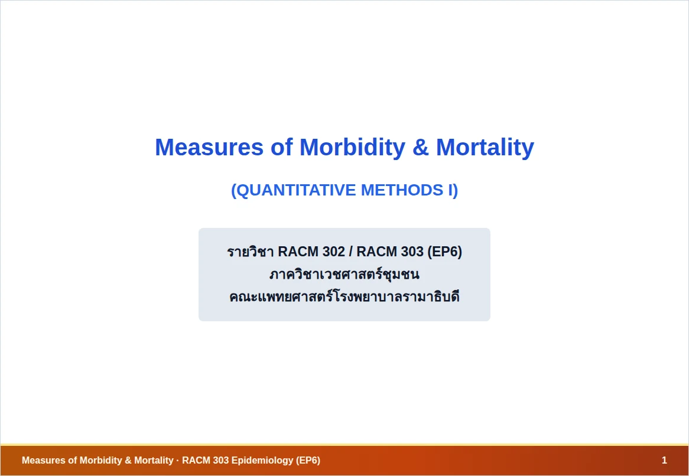

**1) Verbatim Quotation (คำพูดผู้สอนแบบคำต่อคำ):**
- **[00:18](https://www.youtube.com/watch?v=pPAfYlneRQA&t=18s):** “เช้าวันนี้ก็จะคุยถึงเรื่องระบาดวิทยานะฮะ ก็เป็นการศึกษาเชิง Quantitative นะฮะ... ระบาดวิทยานี้ก็ใช้ มันมีสโคประดับคลินิกก็ได้นะ แล้วก็ระดับ Population ประชากรนะฮะ”
- **[02:23](https://www.youtube.com/watch?v=pPAfYlneRQA&t=143s):** “ทาง Population Level เนี่ย วันนี้เราก็จะคุยเรื่องของ Health Survey ซึ่งเราก็จะใช้ปฏิบัติในตอนที่เราไปออกภาคสนามของปี 3 นะ อันนี้เป็นการฝึก Exercise ที่เราจะได้ฝึกเรื่องวิชาการทางระบาดวิทยา”
- **[03:02](https://www.youtube.com/watch?v=pPAfYlneRQA&t=182s):** “ตอนที่เราอ่านหนังสือทางการแพทย์ อ่าน Journal อ่าน Paper ต่างๆ มันก็จะมีคำทางระบาดวิทยาหลายคำเลย เรื่องของ Prevalence, Incidence, Odds Ratio, Relative Risk, Attributable Risk, Rate, Proportion, Adjusted Rate... หัวข้อแรกที่อาจารย์จะพูดถึงก็คือเรื่องของ Morbidity กับ Mortality การป่วยกับการตาย”

**2) Conceptualized Insight (การสังเคราะห์แนวคิดตาม Logical Flow):**
- **แก่นแนวคิดหลัก:** **ระบาดวิทยาเชิงปริมาณเป็นภาษากลางที่เชื่อมเวชปฏิบัติข้างเตียง (การอ่านวารสารและประเมินวิธีรักษา) เข้ากับการสำรวจสุขภาพชุมชนในภาคสนาม (Health Survey)**
- **สูตร / โครงสร้างตัวชี้วัด:** `Epidemiology Scope: Clinical Research ↔ Community Health Survey`
- ครอบคลุมตั้งแต่ Descriptive study (บรรยายขนาดและการกระจายของปัญหา) ไปสู่ Analytic & Experimental study (หาสาเหตุและเปรียบเทียบประสิทธิผลการรักษา)
- แพทย์ต้องเข้าใจความหมายที่แท้จริงของตัวชี้วัดการป่วยและการตายทั้งในฐานะผู้อ่านงานวิจัยทางการแพทย์ (Critical reader) และผู้เก็บข้อมูลดูแลประชากรในโรงพยาบาลและชุมชน
- **สะพานเชื่อมตรรกะ (Logical Flow):** *(รับช่วง)* จุดเริ่มต้นของคาบเรียน: ตั้งคำถามว่าทำไมนักศึกษาแพทย์ชั้นปีที่ 3 ต้องเรียนตัวชี้วัดการป่วยและการตายก่อนลงพื้นที่ภาคสนาม → *(ส่งต่อ)* เชื่อมต่อไปยังเกณฑ์มาตรฐานวิชาชีพเวชกรรมของแพทยสภา เพื่อยืนยันว่าตัวชี้วัดใดบ้างที่เป็นสมรรถนะหลักของแพทย์ไทยทุกคน

### Slide 2/43 (หน้าสไลด์ 2 · [04:40 – 06:20](https://www.youtube.com/watch?v=pPAfYlneRQA&t=280s)): เกณฑ์แพทยสภา: สมรรถนะการวัดความถี่ของภาวะสุขภาพ โรค และสถิติชีพ

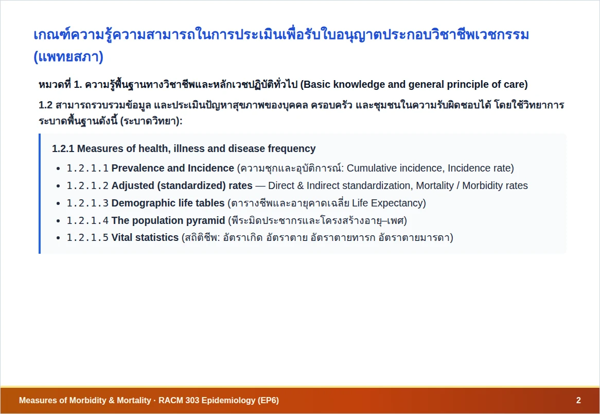

**1) Verbatim Quotation (คำพูดผู้สอนแบบคำต่อคำ):**
- **[04:41](https://www.youtube.com/watch?v=pPAfYlneRQA&t=281s):** “แพทยสภานะ เกณฑ์แพทย์เนี่ยจริงๆ ระบุไว้ชัดเจนนะ เราต้องมีความรู้ความสามารถในเรื่องของทางระบาดวิทยาที่เป็นตัว Measurement น่ะนะฮะ ตัว Prevalence, Incidence”
- **[05:10](https://www.youtube.com/watch?v=pPAfYlneRQA&t=310s):** “หัวข้อนี้ก็จะพูดถึงเรื่อง Adjusted การปรับค่านะฮะ แล้วก็จะ Introduction บอกถึงเรื่อง Life Table อันนี้ก็อยู่ในระบุของเกณฑ์แพทยสภา แล้วก็พวก Vital Statistics สถิติชีพอะไรต่างๆ เหล่านี้”

**2) Conceptualized Insight (การสังเคราะห์แนวคิดตาม Logical Flow):**
- **แก่นแนวคิดหลัก:** **การประเมินปัญหาสุขภาพบุคคล ครอบครัว และชุมชนด้วยตัวชี้วัดทางระบาดวิทยาพื้นฐานเป็นสมรรถนะบังคับตามเกณฑ์มาตรฐานผู้ประกอบวิชาชีพเวชกรรมของแพทยสภา**
- **สูตร / โครงสร้างตัวชี้วัด:** `TMC 1.2.1: Prevalence · Incidence · Adjusted Rates · Life Tables · Pyramid · Vital Stats`
- เกณฑ์หมวด 1.2.1 กำหนดให้แพทย์ต้องใช้และแปลผล Prevalence, Incidence, Adjusted/Standardized rates, Life tables, Population pyramid และ Vital statistics ได้
- เนื้อหาในคาบนี้ทำหน้าที่วางกรอบแนวคิดหลัก (Conceptual overview) เพื่อให้นักศึกษานำไปประยุกต์ใช้ในภาคสนามและต่อยอดการเรียนรู้ด้วยตนเองได้
- **สะพานเชื่อมตรรกะ (Logical Flow):** *(รับช่วง)* รับช่วงจากความสำคัญของระบาดวิทยาในงานแพทย์ มาระบุขอบเขตสมรรถนะที่แพทยสภากำหนดไว้อย่างเป็นรูปธรรม → *(ส่งต่อ)* จัดโครงสร้างสมรรถนะเหล่านี้ออกเป็นแผนที่วัตถุประสงค์การเรียนรู้ (Aims) 3 แกนหลักของคาบเรียน

### Slide 3/43 (หน้าสไลด์ 3 · [06:20 – 07:20](https://www.youtube.com/watch?v=pPAfYlneRQA&t=380s)): วัตถุประสงค์และแผนที่เนื้อหาทั้งคาบ (Aims of the Session)

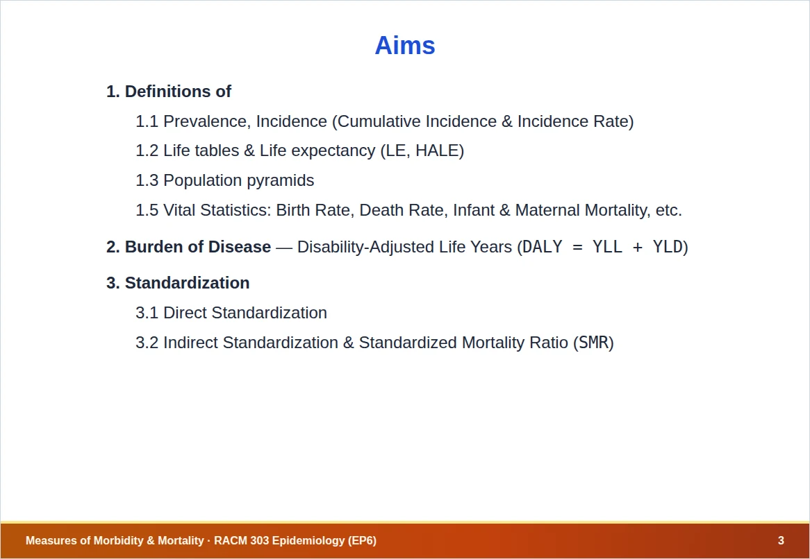

**1) Verbatim Quotation (คำพูดผู้สอนแบบคำต่อคำ):**
- **[06:25](https://www.youtube.com/watch?v=pPAfYlneRQA&t=385s):** “มีคำว่า Burden of Disease ก็คือภาระโรคนะ เพราะว่าเวลาเราจบเป็นแพทย์เนี่ย เราก็จะทราบว่ามีปัญหาสุขภาพอะไรที่มากที่สุดของประชาชนที่เราดูแล หรือของประชาชนไทย หรือของทั้งโลก แล้วเขาวัดกันได้ยังไง”
- **[06:52](https://www.youtube.com/watch?v=pPAfYlneRQA&t=412s):** “อีกอันก็จะเป็นเรื่องของการเปรียบเทียบว่า ถ้าเราดูอัตราการป่วยการตายของแต่ละประชากร หรือประเทศ อย่างของเราเทียบกับต่างประเทศเป็นยังไงบ้าง มันก็จะมีการปรับฐาน Standardize ข้อมูลนะฮะ”

**2) Conceptualized Insight (การสังเคราะห์แนวคิดตาม Logical Flow):**
- **แก่นแนวคิดหลัก:** **โครงสร้างคาบเรียนเรียงลำดับจาก ‘การนิยามตัวชี้วัดเดี่ยว’ ไปสู่ ‘การรวมเป็นภาระโรคองค์รวม (DALY)’ และจบด้วย ‘การปรับมาตรฐานเพื่อเปรียบเทียบข้ามประชากร’**
- **สูตร / โครงสร้างตัวชี้วัด:** `1) Morbidity/Mortality/Demography → 2) Burden (DALY) → 3) Standardization`
- ส่วนที่ 1 ปูฐานนิยามและการคำนวณ Prevalence, Incidence, Vital statistics, Life tables และ Population pyramids
- ส่วนที่ 2 สังเคราะห์การป่วย–พิการ–ตายเข้าด้วยกันเป็น Burden of Disease และส่วนที่ 3 แก้ปัญหาการเปรียบเทียบประชากรที่มีโครงสร้างอายุต่างกันด้วย Standardization
- **สะพานเชื่อมตรรกะ (Logical Flow):** *(รับช่วง)* แปลงเกณฑ์แพทยสภาให้เป็นแผนที่การเรียนรู้ 3 องก์ใหญ่ที่ชัดเจน → *(ส่งต่อ)* ก่อนลงรายละเอียดสูตรคำนวณ ต้องเข้าใจก่อนว่า ‘การวัดภาระโรค’ อยู่ตรงจุดไหนในวงจรการแก้ปัญหาสุขภาพเชิงระบบ

### Slide 4/43 (หน้าสไลด์ 4 · [07:20 – 10:19](https://www.youtube.com/watch?v=pPAfYlneRQA&t=440s)): วงจรระบาดวิทยาเพื่อการจัดการปัญหาสุขภาพ 6 ขั้นตอน (Measurement Loop)

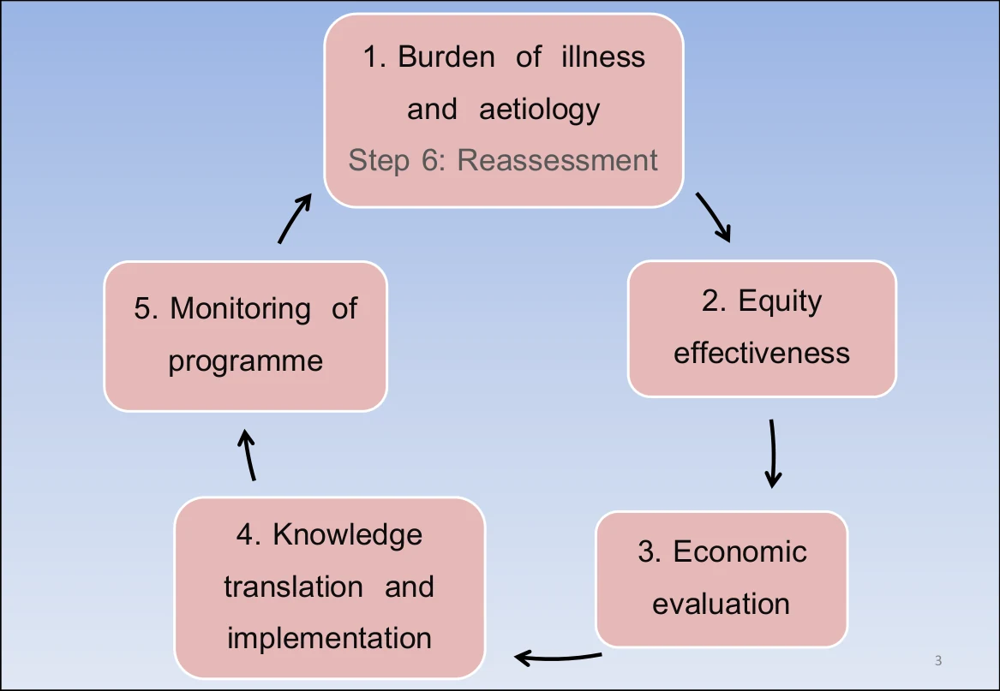

**1) Verbatim Quotation (คำพูดผู้สอนแบบคำต่อคำ):**
- **[07:25](https://www.youtube.com/watch?v=pPAfYlneRQA&t=445s):** “ขั้นตอนการแก้ปัญหาทางสุขภาพ ขั้นแรกก็จะทราบถึงตัว Magnitude ของโรคว่าเป็นเท่าไหร่ มีคนเป็นโรคมากน้อยแค่ไหน มีคนเสียชีวิตเท่าไหร่ แล้วก็สาเหตุตัว Risk Factor หรือ Etiology ที่เกี่ยวข้อง... สมัยนี้ไม่ใช่เฉพาะเชื้อโรคอย่าง TB หรือโควิด แต่กลุ่ม NCD, Cancer, Cardiovascular มันมีหลาย Risk Factors”
- **[08:58](https://www.youtube.com/watch?v=pPAfYlneRQA&t=538s):** “รู้ปัญหาแล้วหาสาเหตุ เสร็จแล้วก็ดูอันที่มัน Effective คือมันเวิร์คแก้ปัญหาได้ไหม ในเชิงระบบสุขภาพก็ดู Equity ด้วยว่ามีความเหลื่อมล้ำไหม แล้วก็หาวิธีที่เหมาะสมคุ้มค่าที่สุดด้วย Economic Evaluation เอาความรู้ไป Translate & Implement แล้วก็ต้อง Monitor และ Reassess หมุนกลับไปเป็นวงจร”

**2) Conceptualized Insight (การสังเคราะห์แนวคิดตาม Logical Flow):**
- **แก่นแนวคิดหลัก:** **การวัดขนาดภาระโรคและสาเหตุ (Step 1) คือจุดตั้งต้นที่ขาดไม่ได้ของวงจรการตัดสินใจทางการแพทย์และระบบสุขภาพ ก่อนจะประเมินประสิทธิผล ความเป็นธรรม ความคุ้มค่า และการติดตามผล**
- **สูตร / โครงสร้างตัวชี้วัด:** `1. Burden & Etiology → 2. Equity Effectiveness → 3. Economic Eval → 4. KT → 5. Monitoring → 6. Reassessment`
- ในยุคโรคไม่ติดต่อเรื้อรัง (NCDs เช่น โรคหลอดเลือดหัวใจ สมอง มะเร็ง อัลไซเมอร์) คำว่า ‘สาเหตุ (Etiology)’ ขยายจากเชื้อโรคเดี่ยวไปสู่ปัจจัยเสี่ยงพหุปัจจัย (Multiple risk factors)
- เมื่อนำมาตรการไปปฏิบัติจริง (Implementation) ตัวชี้วัดการป่วยและการตายชุดเดิมจะถูกนำกลับมาใช้ซ้ำในขั้น Monitoring และ Step 6: Reassessment เพื่อตรวจว่าปัญญาลดลงจริงหรือไม่
- **สะพานเชื่อมตรรกะ (Logical Flow):** *(รับช่วง)* ขยายภาพจากหัวข้อเรียนให้เห็นบทบาทของตัวชี้วัดในวงจรการบริหารจัดการระบบสุขภาพครบ 6 ขั้นตอน → *(ส่งต่อ)* เมื่อเห็นความสำคัญของการวัดในขั้นที่ 1 แล้ว จึงลงสู่รากฐานคณิตศาสตร์ของตัวชี้วัด นั่นคือความต่างของ Ratio, Rate และ Proportion

### Slide 5/43 (หน้าสไลด์ 5 · [10:19 – 12:19](https://www.youtube.com/watch?v=pPAfYlneRQA&t=619s)): รากฐานเศษส่วนทางระบาดวิทยา: Ratio, Rate และ Proportion ต่างกันอย่างไร

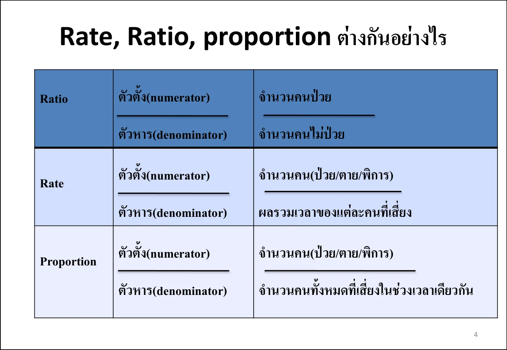

**1) Verbatim Quotation (คำพูดผู้สอนแบบคำต่อคำ):**
- **[10:25](https://www.youtube.com/watch?v=pPAfYlneRQA&t=625s):** “ตัว Indicator หลักๆ มีอยู่ 3 อย่างนะ เป็น Ratio, Rate หรือ Proportion สิ่งที่มันต่างกันก็คือ เวลาพูดถึง Ratio ตัวตั้งกับตัวหารมันไม่เกี่ยวกัน อย่างในห้องนี้ Ratio ของผู้ชายต่อผู้หญิงเป็นเท่าไหร่”
- **[10:56](https://www.youtube.com/watch?v=pPAfYlneRQA&t=656s):** “อันที่ 2 เป็น Rate (อัตรา) ตัวตั้งเราใช้คำว่า Numerator ตัวหารคือ Denominator ในทางการแพทย์ตัวตั้งก็เป็นจำนวนคนป่วย/ตาย/พิการ ส่วนตัวหารเป็นผลรวมเวลาของแต่ละคนที่มีความเสี่ยง”
- **[11:26](https://www.youtube.com/watch?v=pPAfYlneRQA&t=686s):** “อันที่ 3 เป็น Proportion อันนี้เรารู้จักดีเป็นพวก Percentage ตัวตั้งกับตัวหารเกี่ยวกันเพราะตัวตั้งเป็นส่วนหนึ่งของตัวหาร ตัวตั้งเป็น A ตัวหารเป็น A + B เช่น Proportion ของผู้หญิงในห้องนี้ก็คือ หญิง หารด้วย ชาย+หญิง ทั้งหมด”

**2) Conceptualized Insight (การสังเคราะห์แนวคิดตาม Logical Flow):**
- **แก่นแนวคิดหลัก:** **หัวใจของการแยกแยะ Ratio, Proportion และ Rate ไม่ได้อยู่ที่ตัวตั้งเพียงอย่างเดียว แต่อยู่ที่ ‘ตัวตั้งเป็นสับเซตของตัวหารหรือไม่’ และ ‘ตัวหารมีมิติของเวลาเสี่ยงรวมอยู่หรือไม่’**
- **สูตร / โครงสร้างตัวชี้วัด:** `Ratio = A / B  |  Proportion = A / (A + B)  |  Rate = Events / Σ Person-Time`
- Ratio (อัตราส่วน): เปรียบเทียบปริมาณ 2 กลุ่มที่แยกจากกันได้ (เช่น ชาย : หญิง หรือ ป่วย : ไม่ป่วย)
- Proportion (สัดส่วน): ตัวตั้ง (A) เป็นส่วนหนึ่งของตัวหาร (A+B) ในช่วงเวลาเดียวกัน มีค่าระหว่าง 0 ถึง 1 (หรือ 0–100%)
- Rate (อัตราแท้จริง): ตัวหารคือผลรวมระยะเวลาที่แต่ละคนอยู่ในภาวะเสี่ยง (Person-time) จึงวัด ‘ความเร็ว’ ของการเกิดเหตุการณ์
- **สะพานเชื่อมตรรกะ (Logical Flow):** *(รับช่วง)* ปูรากฐานโครงสร้างตัวตั้ง (Numerator) และตัวหาร (Denominator) ของเศษส่วนทั้ง 3 ตระกูล → *(ส่งต่อ)* นำกรอบคิด Ratio–Proportion–Rate นี้ไปจับกับการวัดการเกิดโรคจริง 3 รูปแบบใน Stage 2 (Prevalence, CI, IR)

## Stage 2 (12:19 – 23:58): การวัดการเกิดโรค (Morbidity): ความชุก อุบัติการณ์ และพลวัตอ่างเก็บน้ำของโรค (Measuring Morbidity: Prevalence, Incidence & Disease Pool Dynamics)

> **คำถามนำขององก์:** ความชุก (Prevalence) อุบัติการณ์สะสม (Cumulative Incidence) และอัตราอุบัติการณ์ (Incidence Rate) ตอบคำถามคนละมิติอย่างไร และเชื่อมโยงกันผ่านระยะเวลาของโรคอย่างไร?
>
> **แก่นความคิดรวบยอด:** ความชุกวัดภาระโรคสะสมที่มีอยู่ (เก่า+ใหม่) เพื่อวางแผนบริการ ส่วนอุบัติการณ์วัดเฉพาะผู้ป่วยรายใหม่ในกลุ่มเสี่ยงที่ไม่ป่วยเพื่อสะท้อนความเสี่ยง (CI) และความเร็วของการเกิดโรคต่อหน่วยคน-เวลา (IR) โดยทั้งสองเชื่อมโยงกันดั่งระดับน้ำในอ่าง (P ≈ I × D)

### Slide 6/43 (หน้าสไลด์ 6 · [12:19 – 12:49](https://www.youtube.com/watch?v=pPAfYlneRQA&t=739s)): กรอบการวัดการเกิดโรค (Measurement of Disease Occurrence): 3 องค์ประกอบหลัก

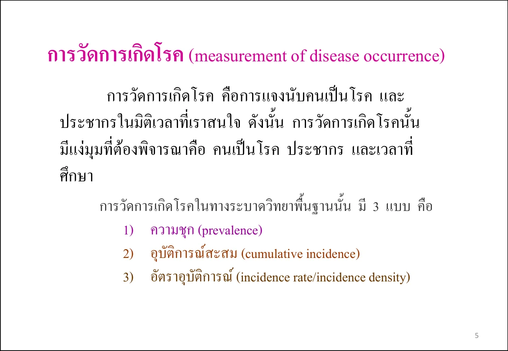

**1) Verbatim Quotation (คำพูดผู้สอนแบบคำต่อคำ):**
- **[12:20](https://www.youtube.com/watch?v=pPAfYlneRQA&t=740s):** “ขนาดปัญหาก็คือจำนวนคนที่เป็นโรค หรือจริงๆ จะวัดเป็นปัญหาของปัจจัยเสี่ยงก็ได้... ถ้าเป็นโรค เราก็จะบอกได้เป็น Prevalence หรือ Incidence ตัว Prevalence ภาษาไทยเรียกความชุกนะฮะ”

**2) Conceptualized Insight (การสังเคราะห์แนวคิดตาม Logical Flow):**
- **แก่นแนวคิดหลัก:** **การวัดการเกิดโรคทางระบาดวิทยาจะมีความหมายได้ต้องระบุครบทั้ง 3 มิติเสมอ ได้แก่ ‘คนเป็นโรค (Cases)’ ‘ประชากรอ้างอิง (Population)’ และ ‘มิติเวลาที่ศึกษา (Time)’**
- **สูตร / โครงสร้างตัวชี้วัด:** `Disease Occurrence = f(Cases, Population at Risk, Time Dimension)`
- การรายงานแต่จำนวนผู้ป่วยลอยๆ โดยไม่ระบุฐานประชากรและช่วงเวลา ไม่สามารถบอกขนาดความรุนแรงหรือเปรียบเทียบพื้นที่ได้
- จำแนกการวัดพื้นฐานออกเป็น 3 ตัวชี้วัดหลัก: ความชุก (Prevalence), อุบัติการณ์สะสม (Cumulative Incidence) และอัตราอุบัติการณ์ (Incidence Rate / Incidence Density)
- **สะพานเชื่อมตรรกะ (Logical Flow):** *(รับช่วง)* ต่อยอดจากหลักเศษส่วนทั่วไป สู่การนิยามองค์ประกอบ 3 มิติของการวัดโรคในประชากร → *(ส่งต่อ)* เจาะลึกตัวชี้วัดตัวแรก คือ ความชุก (Prevalence) ซึ่งวัดภาพรวมของผู้ป่วยที่มีอยู่ทั้งหมด

### Slide 7/43 (หน้าสไลด์ 7 · [12:49 – 14:49 (และย้อนเทียบ 15:09)](https://www.youtube.com/watch?v=pPAfYlneRQA&t=769s)): 1) ความชุก (Prevalence): การวัดผู้ป่วยสะสมทั้งรายเก่าและรายใหม่

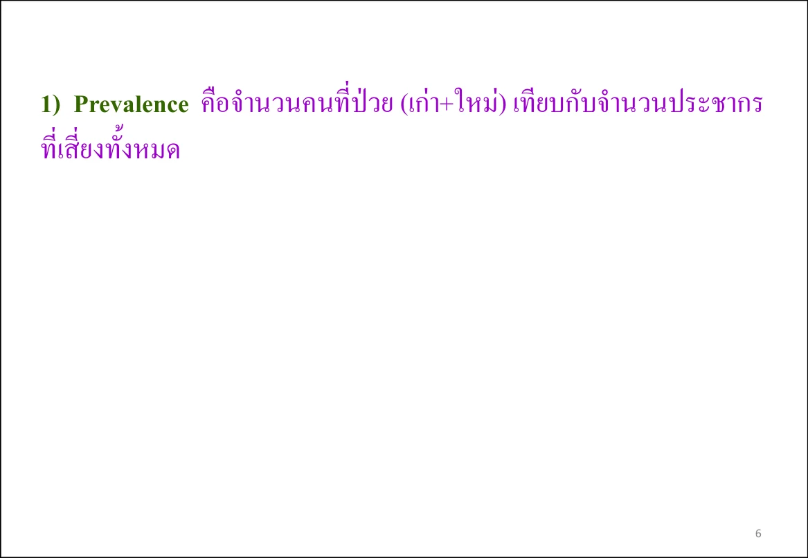

**1) Verbatim Quotation (คำพูดผู้สอนแบบคำต่อคำ):**
- **[12:52](https://www.youtube.com/watch?v=pPAfYlneRQA&t=772s):** “ความชุกก็คือเราบอกว่าขนาดปัญหาขณะนี้มีคนเป็นโรคอยู่เท่าไหร่ มีทั้งคนที่เป็นอยู่แล้ว (เก่า) กับคนที่เป็นใหม่ขึ้นมา อย่างสมมุติตอนนี้ประชาชนไทยเป็นเบาหวานมีเท่าไหร่ ก็จะมีทั้งคนที่ป่วยตั้งแต่ 20–30 ปีก่อน จนกระทั่งรายใหม่ปีนี้ รวมทั้งเก่ากับใหม่เป็น Prevalence”
- **[14:05](https://www.youtube.com/watch?v=pPAfYlneRQA&t=845s):** “การสำรวจสุขภาพประชาชนไทย (NHES) ล่าสุดปี 68 ทีมอาจารย์เวชศาสตร์ชุมชนรามาฯ ร่วมกับมหาวิทยาลัยอื่นสำรวจออกมาได้ เบาหวานประมาณ 10.5 คนต่อ 100 หรือ 10.5% อันนี้คือ Prevalence มีทั้งคนเก่าคนใหม่”

**2) Conceptualized Insight (การสังเคราะห์แนวคิดตาม Logical Flow):**
- **แก่นแนวคิดหลัก:** **ความชุก (Prevalence) เป็นสัดส่วน (Proportion) ที่นับรวมผู้ป่วยทั้งรายเก่าและรายใหม่เทียบกับประชากรทั้งหมด จึงเหมาะที่สุดสำหรับการบอกขนาดภาระงานบริการสุขภาพที่มีอยู่ในปัจจุบัน**
- **สูตร / โครงสร้างตัวชี้วัด:** `Prevalence = จำนวนผู้ป่วยทั้งหมด (เก่า + ใหม่) / จำนวนประชากรที่ศึกษาทั้งหมด`
- ทางคณิตศาสตร์ Prevalence จัดเป็น Proportion (ไม่ใช่ Rate แท้จริง) เพราะตัวตั้งเป็นส่วนหนึ่งของประชากรตัวหาร และมักรายงานเป็นร้อยละ (%)
- ตัวอย่างจริงจากอาจารย์วิชัย: ข้อมูลการสำรวจสุขภาพประชาชนไทยปี พ.ศ. 2568 พบความชุกโรคเบาหวานราว 10.5% ซึ่งสะท้อนยอดผู้ป่วยสะสมที่ระบบบริการต้องดูแล
- **สะพานเชื่อมตรรกะ (Logical Flow):** *(รับช่วง)* เริ่มต้นจากตัวชี้วัดที่เข้าใจง่ายและพบบ่อยที่สุดในการสำรวจภาคตัดขวาง (Cross-sectional survey) คือความชุก → *(ส่งต่อ)* แต่ความชุกปนผู้ป่วยเก่าที่ป่วยมานานเข้ากับผู้ป่วยใหม่ หากต้องการวัด ‘ความเสี่ยงของการเกิดโรคใหม่’ จึงต้องก้าวสู่ Cumulative Incidence

### Slide 8/43 (หน้าสไลด์ 8 · [14:49 – 16:29](https://www.youtube.com/watch?v=pPAfYlneRQA&t=889s)): 2) อุบัติการณ์สะสม (Cumulative Incidence / CI): ความเสี่ยงการเกิดโรครายใหม่

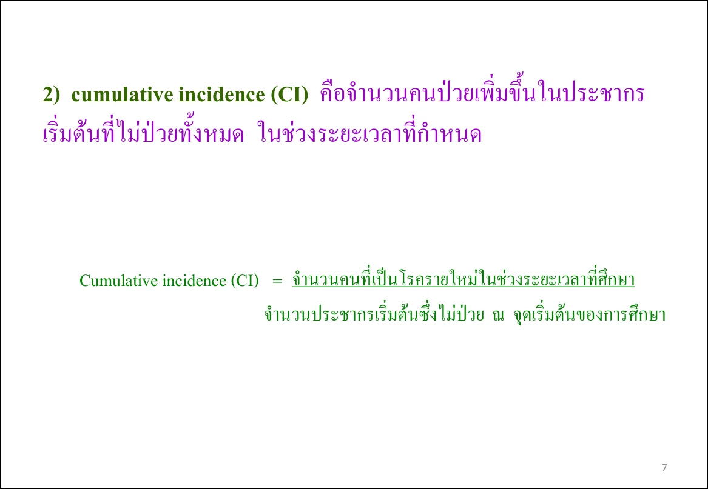

**1) Verbatim Quotation (คำพูดผู้สอนแบบคำต่อคำ):**
- **[14:56](https://www.youtube.com/watch?v=pPAfYlneRQA&t=896s):** “กลับไปเมื่อกี้นี้ Prevalence เป็น Rate หรือเป็น Proportion หรือเป็น Ratio นะฮะ? มันเป็น Proportion นะฮะ! ส่วน Cumulative Incidence ต่างกับ Prevalence ตรงที่ตัวตั้งเป็นรายใหม่ ส่วนมากเราจะ define ในช่วงเวลา 1 ปี”
- **[15:38](https://www.youtube.com/watch?v=pPAfYlneRQA&t=938s):** “ส่วนตัวหารเนี่ย จะเป็นประชากรคนที่เสี่ยงต่อการเป็นโรค แต่ไม่รวมคนที่เป็นโรคแล้วนะฮะ! เพราะงั้นการจะหา Incidence ของเบาหวานในประชากรไทยจึงยากกว่า เพราะต้องคัดคนที่เป็นเบาหวานอยู่เดิมออก เหลือเฉพาะคนที่ไม่เป็นเบาหวานแต่มีโอกาสเป็น”

**2) Conceptualized Insight (การสังเคราะห์แนวคิดตาม Logical Flow):**
- **แก่นแนวคิดหลัก:** **อุบัติการณ์สะสม (Cumulative Incidence) วัดโอกาสหรือความเสี่ยง (Risk) ที่คนปลอดโรค ณ จุดเริ่มต้นจะกลายเป็นผู้ป่วยรายใหม่ภายในช่วงเวลาที่กำหนด โดยต้องตัดผู้ป่วยเดิมออกจากตัวหารเสมอ**
- **สูตร / โครงสร้างตัวชี้วัด:** `CI = จำนวนผู้ป่วยรายใหม่ในช่วงเวลาที่ศึกษา / จำนวนประชากรเริ่มต้นที่ไม่ป่วย (At Risk)`
- ตัวตั้งนับเฉพาะ ‘ผู้ป่วยรายใหม่ (New cases)’ และตัวหารนับเฉพาะ ‘ประชากรกลุ่มเสี่ยงที่ยังไม่ป่วยเมื่อเริ่มศึกษา (Disease-free population at baseline)’
- มีสถานะเป็น Proportion (ค่าระหว่าง 0–1 หรือ %) จึงตีความตรงไปตรงมาเป็น ‘ความเสี่ยง (Risk)’ ของบุคคลในการเกิดโรคในช่วงเวลานั้น เช่น ใน 1 ปี
- **สะพานเชื่อมตรรกะ (Logical Flow):** *(รับช่วง)* แยกผู้ป่วยเก่าออกจากทั้งตัวตั้งและตัวหารของ Prevalence เพื่อให้ได้ค่าความเสี่ยงของการเกิดโรคใหม่ (CI) → *(ส่งต่อ)* แต่ในการติดตามประชากรจริง แต่ละคนอยู่ในช่วงเสี่ยงนานไม่เท่ากัน (ป่วยเร็ว ป่วยช้า หรือสูญหาย) จึงต้องใช้ Incidence Rate ที่คิด ‘เวลาเสี่ยงรายบุคคล’

### Slide 9/43 (หน้าสไลด์ 9 · [16:29 – 17:09](https://www.youtube.com/watch?v=pPAfYlneRQA&t=989s)): 3) อัตราอุบัติการณ์ (Incidence Rate / Incidence Density): ความเร็วของการเกิดโรค

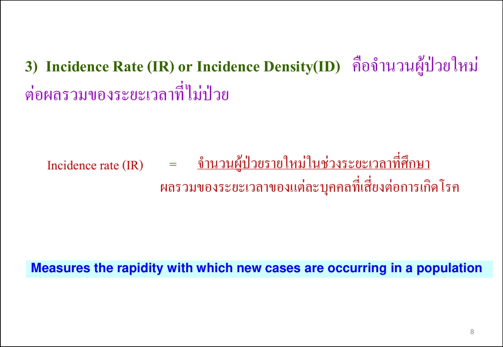

**1) Verbatim Quotation (คำพูดผู้สอนแบบคำต่อคำ):**
- **[16:30](https://www.youtube.com/watch?v=pPAfYlneRQA&t=990s):** “ตัวตั้ง Numerator เหมือนกับ Cumulative Incidence คือเป็นจำนวนรายใหม่ แต่ตัวหารจะต่างไปละ ตัวหารใน Incidence Rate อันนี้เป็น Rate แท้จริง ก็คือตัวหารจะเป็นเวลา”
- **[16:46](https://www.youtube.com/watch?v=pPAfYlneRQA&t=1006s):** “Rate นี่เราหมายถึงความเร็วอ่ะเนาะ Velocity ของการเกิดโรคนะฮะ ตัวหารก็จะเป็นผลรวมระยะเวลาของแต่ละคนที่มีความเสี่ยงต่อการเกิดโรค”

**2) Conceptualized Insight (การสังเคราะห์แนวคิดตาม Logical Flow):**
- **แก่นแนวคิดหลัก:** **อัตราอุบัติการณ์ (Incidence Rate / Density) เป็น Rate แท้จริงที่วัด ‘ความเร็ว (Velocity)’ ของการเกิดผู้ป่วยรายใหม่ต่อผลรวมเวลาปลอดโรคของทุกคนในกลุ่มศึกษา (Person-Time)**
- **สูตร / โครงสร้างตัวชี้วัด:** `IR = จำนวนผู้ป่วยรายใหม่ / ผลรวมระยะเวลาที่แต่ละคนเสี่ยงต่อการเกิดโรค (Σ Person-Time)`
- นับเวลาเข้าสู่ตัวหารเฉพาะช่วงที่บุคคลนั้น ‘ยังไม่ป่วยและยังถูกติดตามอยู่ (Time at risk)’ ทันทีที่ป่วย ตาย หรือขาดการติดตาม การนับเวลาเสี่ยงของคนนั้นจะหยุดลงทันที
- มีหน่วยเป็น ‘ต่อคน-เวลา’ เสมอ เช่น ต่อคน-ปี (per person-year) หรือต่อ 1,000 คน-ปี
- **สะพานเชื่อมตรรกะ (Logical Flow):** *(รับช่วง)* ยกระดับจากสัดส่วนคนป่วยใหม่ (CI) สู่การวัดความเร็วการเกิดโรคด้วยตัวหาร Person-Time (IR) → *(ส่งต่อ)* เพื่อให้เห็นภาพการคำนวณทั้ง Point Prevalence, Period Prevalence, CI และ IR อย่างเป็นรูปธรรม จึงเข้าสู่โจทย์ตัวอย่าง Cohort 100 คน

### Slide 10/43 (หน้าสไลด์ 10 · [17:09 – 18:19 (สลับเทียบถึง 21:58)](https://www.youtube.com/watch?v=pPAfYlneRQA&t=1029s)): ตัวอย่างแผนภาพ Cohort 100 คน: เส้นเวลาการป่วยวัณโรคของผู้ป่วย 5 ราย

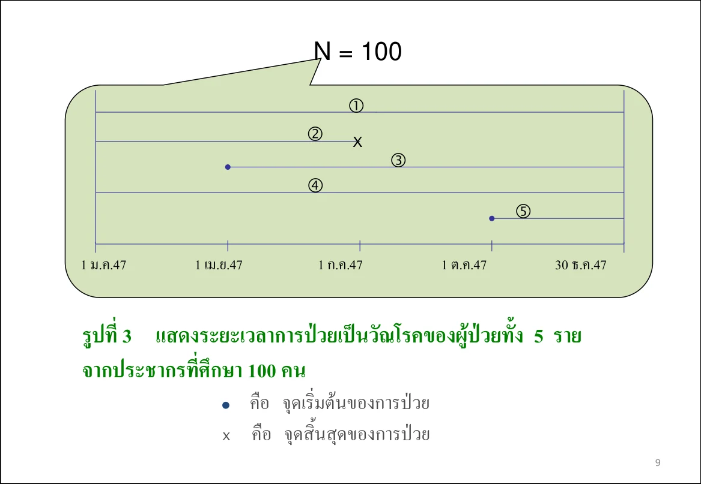

**1) Verbatim Quotation (คำพูดผู้สอนแบบคำต่อคำ):**
- **[17:11](https://www.youtube.com/watch?v=pPAfYlneRQA&t=1031s):** “1 Cohort มีคน 100 คน ศึกษาอยู่ใน 1 ปี (ม.ค. 47 – ธ.ค. 47) ใน 100 คนเนี่ย 95 คนไม่เป็นโรคเลย แต่มี 5 คนเป็นโรค: คนที่ 1 เป็นมาตั้งแต่ต้นจนสิ้นปี, คนที่ 2 เป็นอยู่ครึ่งปีแรกแล้วหาย, คนที่ 3 เริ่มป่วยเมื่อผ่านไป 3 เดือน (1 เม.ย.), คนที่ 4 เป็นมาทั้งปี, คนที่ 5 ไปเริ่มป่วยตอนปลายปี (1 ต.ค.)”
- **[19:55](https://www.youtube.com/watch?v=pPAfYlneRQA&t=1195s):** “ในช่วง 1 ปีเกิด New Case กี่คนฮะ? มี 2 คนนะ คือคนที่ 3 กับคนที่ 5! ส่วนคนที่ 1, 2, 4 พวกนี้เขาเป็นมาแต่เดิมตั้งแต่ต้นปีแล้ว”

**2) Conceptualized Insight (การสังเคราะห์แนวคิดตาม Logical Flow):**
- **แก่นแนวคิดหลัก:** **การเขียนเส้นเวลาผู้ป่วยรายบุคคล ( Person-Time Diagram ) ช่วยแยกแยะ ‘ผู้ป่วยเดิม ณ วันเริ่มศึกษา (รายที่ 1, 2, 4)’ ออกจาก ‘ผู้ป่วยรายใหม่ระหว่างปี (รายที่ 3, 5)’ ได้อย่างแม่นยำไม่สับสน**
- **สูตร / โครงสร้างตัวชี้วัด:** `N = 100 (1 ม.ค. 47 – 30 ธ.ค. 47): 95 คนไม่ป่วยเลย · 5 รายมีเส้นเวลาป่วยต่างกัน`
- ณ 1 ม.ค. 47: มีผู้ป่วยอยู่แล้ว 3 ราย (รายที่ 1, 2, 4) → ดังนั้นประชากรกลุ่มเสี่ยงที่ไม่ป่วยเมื่อเริ่มต้นปีเหลือเพียง 100 − 3 = 97 คน
- ณ 30 ธ.ค. 47: รายที่ 2 หายป่วยไปแล้วเมื่อกลางปี (1 ก.ค.) แต่มีรายที่ 3 และ 5 ป่วยใหม่และยังป่วยข้ามสิ้นปี → มีผู้ป่วย ณ สิ้นปี 4 ราย (รายที่ 1, 3, 4, 5)
- **สะพานเชื่อมตรรกะ (Logical Flow):** *(รับช่วง)* นำนิยามทั้ง 3 แบบจากสไลด์ 7–9 มาวางลงบนเส้นเวลาจริงของประชากร 100 คน → *(ส่งต่อ)* นำข้อมูลจากเส้นเวลาทั้ง 5 รายนี้ไปแทนค่าคำนวณตัวเลขทั้ง 5 ค่าในสไลด์ถัดไปทีละบรรทัด

### Slide 11/43 (หน้าสไลด์ 11 · [18:19 – 22:28](https://www.youtube.com/watch?v=pPAfYlneRQA&t=1099s)): การคำนวณจริงครบ 5 ค่าจาก Cohort 100 คน (Point/Period Prevalence, CI, IR)

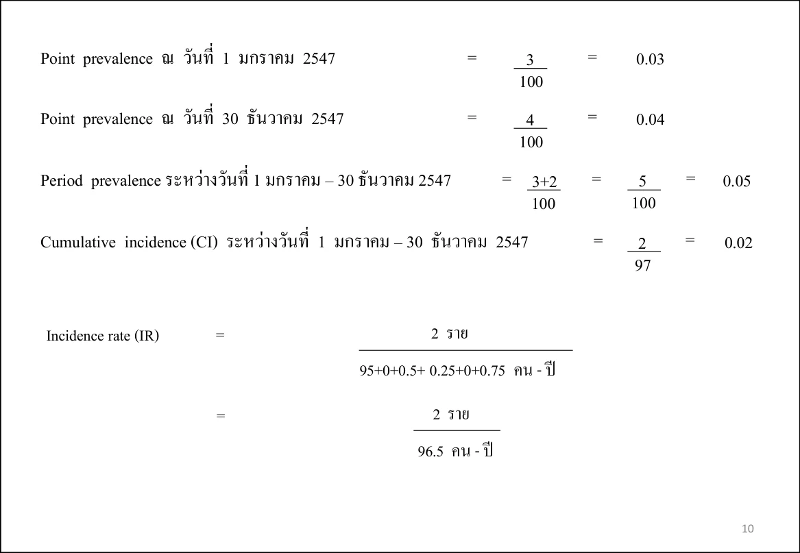

**1) Verbatim Quotation (คำพูดผู้สอนแบบคำต่อคำ):**
- **[19:22](https://www.youtube.com/watch?v=pPAfYlneRQA&t=1162s):** “เวลาพูด Prevalence ส่วนใหญ่เราหมายถึง Point Prevalence แต่ถ้าอยากรู้ว่าในช่วง 1 ปีทั้งหมดมีคนป่วยรวมกี่คน ก็รวมเก่า 3 + ใหม่ 2 = 5 คน หาร 100 ได้ Period Prevalence = 0.05”
- **[20:32](https://www.youtube.com/watch?v=pPAfYlneRQA&t=1232s):** “ส่วน Cumulative Incidence ตัวตั้งคือ New Case 2 ราย ตัวหารดูดีๆ นะฮะ คนที่ป่วยอยู่เดิม 3 คนเราไม่นับว่าเสี่ยงแล้ว ก็ลบไป 3 เหลือตัวหาร 97 ได้ 2/97 = 0.02”
- **[21:05](https://www.youtube.com/watch?v=pPAfYlneRQA&t=1265s):** “ส่วน Incidence Rate ตัวตั้ง 2 รายเหมือนเดิม ตัวหารคือคน-เวลา: 95 คนไม่ป่วยเลยได้ 95 คน-ปี บวกอีก 5 คน คือ คนที่ 1 ป่วยอยู่แล้วเสี่ยง 0, คนที่ 2 หายกลางปีกลับมาเสี่ยงอีกครึ่งปีได้ 0.5, คนที่ 3 เสี่ยงต้นปี 3 เดือนได้ 0.25, คนที่ 4 ป่วยทั้งปีได้ 0, คนที่ 5 เสี่ยงอยู่ 9 เดือนได้ 0.75 รวมเป็น 96.5 คน-ปี!”

**2) Conceptualized Insight (การสังเคราะห์แนวคิดตาม Logical Flow):**
- **แก่นแนวคิดหลัก:** **จากประชากรกลุ่มเดียวกัน ตัวชี้วัดแต่ละตัวมีตัวหารต่างกันตามตรรกะทางระบาดวิทยา โดยเฉพาะกรณีโรคที่หายแล้วเป็นซ้ำได้ (เช่น วัณโรค) ผู้ที่หายป่วยกลางปีจะกลับมานับเวลาเสี่ยง (Person-Time) ได้อีกครั้ง**
- **สูตร / โครงสร้างตัวชี้วัด:** `P(1 ม.ค.)=3/100 · P(30 ธ.ค.)=4/100 · PP=5/100 · CI=2/97 · IR=2/96.5 คน-ปี`
- จุดสังเกตสำคัญที่ผู้สอนชี้: รายที่ 2 ป่วยตั้งแต่ต้นปีจึงไม่ถูกนับในตัวหารของ CI (97 คน) แต่เมื่อรักษาหายที่ 1 ก.ค. สำหรับวัณโรคสามารถติดเชื้อซ้ำได้ จึงกลับมามีเวลาเสี่ยงอีก 0.5 ปีในตัวหารของ IR!
- สรุปค่าที่ได้: Point Prevalence ต้นปี = 3%, สิ้นปี = 4%, Period Prevalence ทั้งปี = 5%, Cumulative Incidence = 2/97 (2.06%), และ Incidence Rate = 2 ต่อ 96.5 คน-ปี
- **สะพานเชื่อมตรรกะ (Logical Flow):** *(รับช่วง)* คำนวณตัวเลขจริงจากแผนภาพ Cohort 100 คนจนเห็นความต่างของตัวตั้งและตัวหารครบทุกสูตร → *(ส่งต่อ)* จากตัวเลขทั้งสองตระกูล (Prevalence vs. Incidence) ก้าวสู่การสรุปความสัมพันธ์เชิงพลวัตด้วยแบบจำลอง ‘อ่างเก็บน้ำของโรค’

### Slide 12/43 (หน้าสไลด์ 12 · [22:28 – 23:58](https://www.youtube.com/watch?v=pPAfYlneRQA&t=1348s)): พลวัตอ่างเก็บน้ำของโรค: ความสัมพันธ์ระหว่าง Prevalence และ Incidence

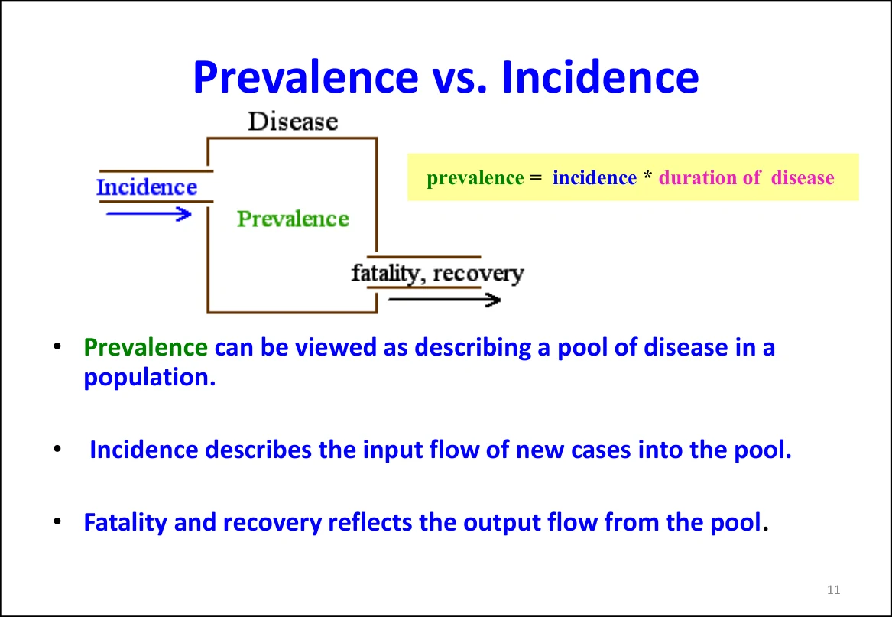

**1) Verbatim Quotation (คำพูดผู้สอนแบบคำต่อคำ):**
- **[22:35](https://www.youtube.com/watch?v=pPAfYlneRQA&t=1355s):** “ถ้าในประชากรมี Pool เหมือนแทงค์น้ำอยู่แทงค์นึง คนที่ป่วยอยู่เดิมก็คือ Prevalence แล้วมี New Case เกิดใหม่เติมเข้ามาในแทงค์ก็คือ Incidence... อย่างเบาหวานตอนนี้เรามียารักษาดี คนไข้ไม่ตายแต่อยู่กับโรคนานขึ้น (Chronic disease) ความชุกของเบาหวานก็เลยเพิ่มขึ้นเรื่อยๆ”
- **[23:32](https://www.youtube.com/watch?v=pPAfYlneRQA&t=1412s):** “แต่ Prevalence ก็ลดลงได้นะ คือถ้าโรคมันรุนแรงคนก็ตายออกไปเร็ว หรือไม่ก็รักษาหายขาดออกไปจากแทงค์ Prevalence ก็จะลดลง”

**2) Conceptualized Insight (การสังเคราะห์แนวคิดตาม Logical Flow):**
- **แก่นแนวคิดหลัก:** **ความชุกเปรียบเสมือนระดับน้ำในอ่างที่เพิ่มขึ้นเมื่อมีผู้ป่วยใหม่ไหลเข้า (Incidence) หรือผู้ป่วยมีชีวิตอยู่กับโรคนานขึ้น (Duration) และลดลงเมื่อผู้ป่วยหายขาดหรือเสียชีวิต**
- **สูตร / โครงสร้างตัวชี้วัด:** `Prevalence ≈ Incidence × Duration  (Inflow: Incidence | Outflow: Recovery + Fatality)`
- ข้อควรระวังทางคลินิก: ความชุกของโรคเรื้อรังที่สูงขึ้นไม่ได้แปลว่าการป้องกันล้มเหลวเสมอไป แต่อาจเกิดจากยารักษาดีขึ้นจนผู้ป่วยไม่เสียชีวิตและมีอายุยืนยาวขึ้นกับโรค
- ในทางกลับกัน โรคที่รุนแรงถึงชีวิตอย่างรวดเร็วจะมี Duration สั้น ทำให้ Prevalence ต่ำแม้จะมี Incidence สูง
- **สะพานเชื่อมตรรกะ (Logical Flow):** *(รับช่วง)* สังเคราะห์ความเข้าใจเรื่อง Prevalence และ Incidence เข้าด้วยกันผ่านสมการ P ≈ I × D → *(ส่งต่อ)* ท่อน้ำไหลออกจากอ่างมี 2 ทางคือ ‘หายป่วย’ กับ ‘เสียชีวิต’ จึงเชื่อมต่อไปสู่ Stage 3 เรื่องการวัดการตาย (Case Fatality & Vital Statistics)

### Slide 17/43 (หน้าสไลด์ 17 · [30:28 – 30:38](https://www.youtube.com/watch?v=pPAfYlneRQA&t=1828s)): จุดคั่นแบบฝึกหัดทบทวนความเข้าใจด้วยตนเอง (Self-Review Checkpoint)

**1) Verbatim Quotation (คำพูดผู้สอนแบบคำต่อคำ):**
- **[30:29](https://www.youtube.com/watch?v=pPAfYlneRQA&t=1829s):** “โอเค อันนี้ก็เป็น Vital Statistics นะฮะ ส่วนอันนี้เป็นแบบฝึกหัดตัวอย่าง เดี๋ยวเราไปดูทบทวนกันเองนะ น่าจะเข้าใจไม่ยาก”

**2) Conceptualized Insight (การสังเคราะห์แนวคิดตาม Logical Flow):**
- **แก่นแนวคิดหลัก:** **โจทย์ทบทวนในสไลด์ชุดนี้ออกแบบไว้ให้นักศึกษาฝึกแยกแยะหน่วยของ Incidence Rate (ต่อ Person-Years) ออกจาก Proportion ด้วยตนเองหลังจบคาบ**
- **สูตร / โครงสร้างตัวชี้วัด:** `Self-Directed Review: Prevalence · Cumulative Incidence · Person-Years`
- ผู้สอนชี้แนะให้นักศึกษาใช้สไลด์แบบฝึกหัดชุดนี้ตรวจสอบความแม่นยำของการคำนวณเวลาเสี่ยงรายบุคคล (Person-Time) ก่อนทำ Exercise 5
- **สะพานเชื่อมตรรกะ (Logical Flow):** *(รับช่วง)* ปิดท้ายพาร์ตสูตรพื้นฐานการป่วยและสถิติชีพด้วยชุดโจทย์ทบทวน → *(ส่งต่อ)* แสดงตัวอย่างแผนภาพ Cohort 12 คนในสไลด์ถัดไปเพื่อตอกย้ำการนับ Person-Years เมื่อมีการตายและการป่วย

### Slide 18/43 (หน้าสไลด์ 18 · [30:38 – 30:58](https://www.youtube.com/watch?v=pPAfYlneRQA&t=1838s)): ตัวอย่างทบทวน: Cohort 12 คน ติดตาม 5 ปี (ค.ศ. 1990–1995)

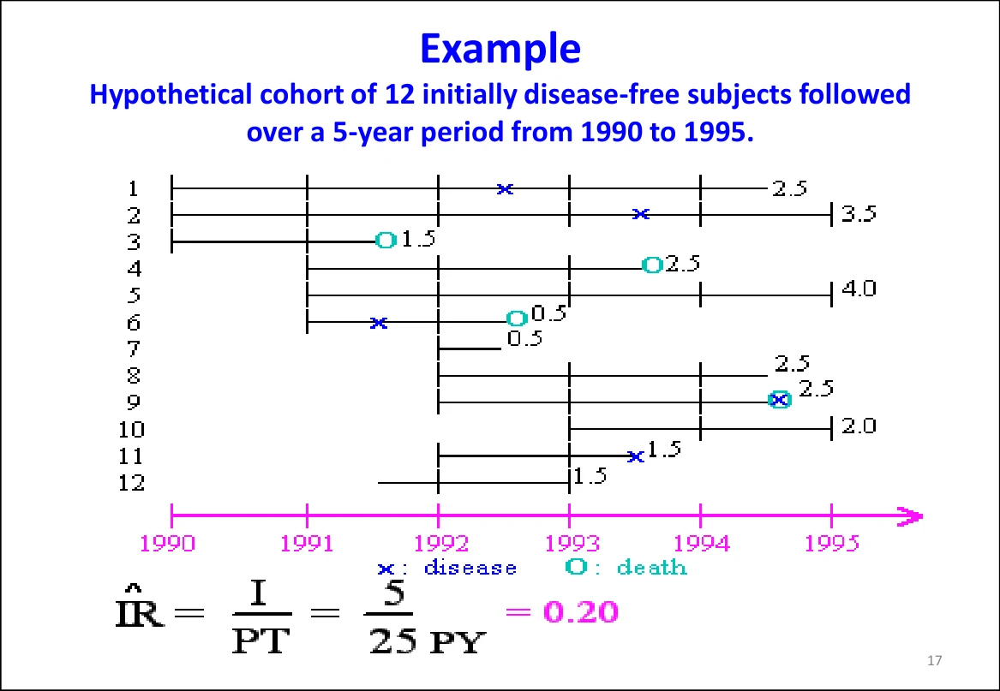

**1) Verbatim Quotation (คำพูดผู้สอนแบบคำต่อคำ):**
- **[30:39](https://www.youtube.com/watch?v=pPAfYlneRQA&t=1839s):** “อันนี้เพื่อคำนวณว่า Incidence Rate ในกลุ่มนี้มีเท่าไหร่ มี 12 คน แล้วก็มีคนที่เข้าศึกษาไม่พร้อมกัน ป่วย (x) และเสียชีวิต (O) รวมเวลาเสี่ยงได้ 25 Person-Years เกิดโรค 5 ราย ได้ 0.20 ต่อคน-ปี”

**2) Conceptualized Insight (การสังเคราะห์แนวคิดตาม Logical Flow):**
- **แก่นแนวคิดหลัก:** **ใน Dynamic Cohort ที่ผู้เข้าร่วมเริ่มศึกษาไม่พร้อมกัน ป่วย หรือเสียชีวิตระหว่างทาง การรวมเวลาปลอดโรครายบุคคล (25 PY) ทำให้คำนวณ Incidence Rate ได้อย่างเที่ยงตรง (20 รายต่อ 100 คน-ปี)**
- **สูตร / โครงสร้างตัวชี้วัด:** `IR = I / PT = 5 cases / 25 person-years = 0.20 (20 cases per 100 person-years)`
- ข้อควรระวัง: ค่า 0.20 ต่อคน-ปี ‘ไม่ใช่ Proportion’ และไม่ใช่ความเสี่ยงร้อยละ 20 แต่คือความเร็วการเกิดโรค 20 รายใหม่ต่อทุกๆ 100 คน-ปีของการติดตาม
- **สะพานเชื่อมตรรกะ (Logical Flow):** *(รับช่วง)* สาธิตการรวม Person-Years ในกลุ่มตัวอย่างขนาดเล็ก 12 คนที่มีทั้งเข้าช้า ป่วย และเสียชีวิต → *(ส่งต่อ)* ขยายสู่ตัวอย่างงานวิจัยขนาดใหญ่ระดับประชากรจริงในโรคพาร์กินสัน

### Slide 19/43 (หน้าสไลด์ 20 · [30:58 – 31:08](https://www.youtube.com/watch?v=pPAfYlneRQA&t=1858s)): ตัวอย่างงานวิจัยคลินิกขนาดใหญ่: อัตราอุบัติการณ์โรคพาร์กินสัน (ติดตาม 6 ปี)

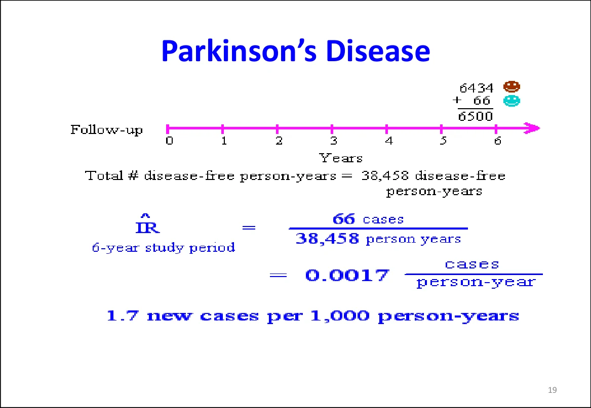

**1) Verbatim Quotation (คำพูดผู้สอนแบบคำต่อคำ):**
- **[30:59](https://www.youtube.com/watch?v=pPAfYlneRQA&t=1859s):** “อันนี้ก็ตัวอย่างเช่นเดียวกัน ไปอ่านทบทวนเอาเองได้นะฮะ อันต่อไปก็จะเป็นตัวตารางชีพ (Life Table)”

**2) Conceptualized Insight (การสังเคราะห์แนวคิดตาม Logical Flow):**
- **แก่นแนวคิดหลัก:** **เมื่ออัตราอุบัติการณ์ต่อ 1 คน-ปีมีค่าน้อยมาก (เช่น 0.0017 รายต่อคน-ปี) ควรคูณฐานตัวคูณ (เช่น 1,000 คน-ปี) เพื่อให้สื่อสารความหมายทางคลินิกได้ชัดเจนเป็น 1.7 รายใหม่ต่อ 1,000 คน-ปี**
- **สูตร / โครงสร้างตัวชี้วัด:** `IR = 66 cases / 38,458 disease-free person-years = 1.7 per 1,000 person-years`
- จากผู้เข้าร่วม 6,500 คน ติดตาม 6 ปี (เกิดโรค 66 ราย ปลอดโรค 6,434 ราย) คิดเป็นเวลาปลอดโรครวม 38,458 คน-ปี แสดงการใช้ IR ในโรคเรื้อรังทางระบบประสาทที่พบบ่อยในผู้สูงอายุ
- **สะพานเชื่อมตรรกะ (Logical Flow):** *(รับช่วง)* สรุปตัวอย่างการคำนวณ Incidence Rate ในงานวิจัยระยะยาว → *(ส่งต่อ)* กลับมาเชื่อมกับอัตราตายจำเพาะกลุ่มอายุ เพื่อนำไปสร้าง ‘ตารางชีพ (Life Table)’ และคำนวณอายุคาดเฉลี่ยของประชากร

## Stage 3 (23:58 – 39:17): ความรุนแรงของโรค สถิติชีพ ตารางชีพ และโครงสร้างประชากรสูงวัย (Case Fatality, Vital Statistics, Life Tables (LE vs. HALE) & Population Pyramids)

> **คำถามนำขององก์:** เราจะวัดความรุนแรงของโรค สถานการณ์การเกิด–การตายของประเทศ อายุคาดเฉลี่ยที่มีสุขภาวะดี (HALE) และการเปลี่ยนผ่านสู่สังคมสูงวัยได้อย่างไร?
>
> **แก่นความคิดรวบยอด:** อัตราป่วยตาย (CFR) สะท้อนความรุนแรงของโรคในหมู่ผู้ป่วย ขณะที่สถิติชีพ (CBR, CDR, IMR, MMR) ตารางชีพ (LE, HALE) และพีระมิดประชากรเผยให้เห็นว่าคนไทยอายุยืนขึ้นแต่ยังสูญเสียปีท้ายของชีวิตไปกับความเจ็บป่วยเรื้อรังท่ามกลางโครงสร้างประชากรที่เข้าสู่สังคมสูงวัย

### Slide 13/43 (หน้าสไลด์ 13 · [23:58 – 26:48](https://www.youtube.com/watch?v=pPAfYlneRQA&t=1438s)): อัตราป่วยตาย (Case Fatality Rate) และภาพรวมสถิติชีพประชากรไทย

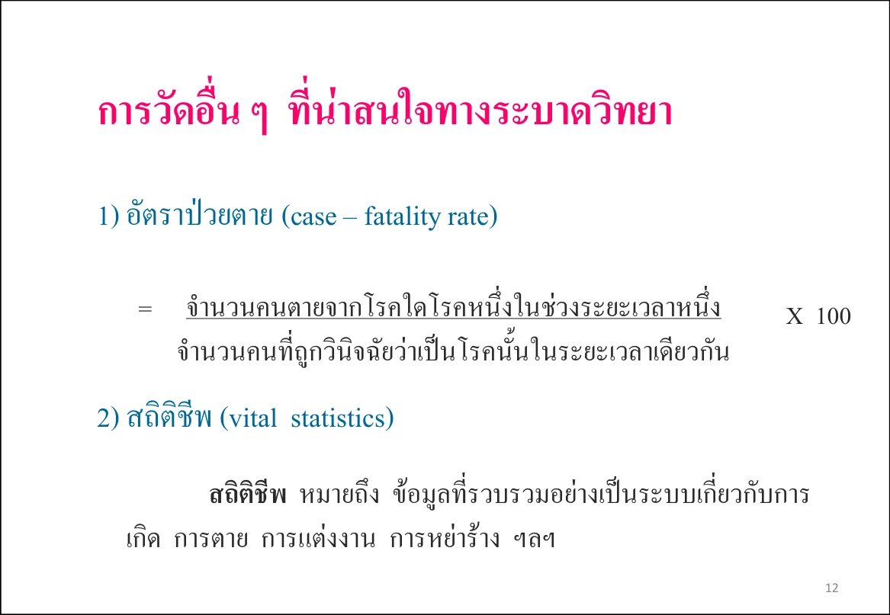

**1) Verbatim Quotation (คำพูดผู้สอนแบบคำต่อคำ):**
- **[24:05](https://www.youtube.com/watch?v=pPAfYlneRQA&t=1445s):** “เราจบหมอเราก็ต้องรู้ว่าตอนนี้สถานการณ์ประชากรไทยเป็นยังไง: ประชากรประมาณ 65 ล้านคน ตายปีละประมาณ 500,000 กว่าคน (ประมาณ 8 กว่าต่อพัน) และเพิ่มขึ้นเพราะ Aging Population ส่วนเด็กเกิดใหม่ลดลงเหลือปีละ 400,000 กว่าคน (ประมาณ 7 ต่อพัน) ตอนนี้ประชากรไทยกำลังลดลงเพราะเกิดน้อยกว่าตาย”
- **[25:32](https://www.youtube.com/watch?v=pPAfYlneRQA&t=1532s):** “ส่วน Case Fatality Rate (หรือ Death-to-case ratio) บอกว่าคนที่เป็นโรคนั้นมีโอกาสตายกี่เปอร์เซ็นต์ มันบอกถึง ‘ความรุนแรงของโรค’ อย่างโควิดช่วงแรกสูง ตอนนี้ลดลงเพราะ Severity ลดลง แต่ถ้าเป็นโรคพิษสุนัขบ้า (Rabies) Case Fatality เหยียบ 100% เกือบทุกราย”

**2) Conceptualized Insight (การสังเคราะห์แนวคิดตาม Logical Flow):**
- **แก่นแนวคิดหลัก:** **อัตราป่วยตาย (CFR) ใช้ตัวหารเป็น ‘ผู้ป่วยโรคนั้น’ เพื่อวัดความรุนแรงของโรค ต่างจากอัตราตาย (Mortality Rate) ที่ใช้ตัวหารเป็น ‘ประชากรทั้งหมด’ เพื่อวัดผลกระทบระดับประชากร**
- **สูตร / โครงสร้างตัวชี้วัด:** `CFR = (จำนวนผู้เสียชีวิตจากโรคนั้น / จำนวนผู้ที่ถูกวินิจฉัยว่าเป็นโรคนั้น) × 100`
- ตัวอย่างเปรียบเทียบชัดเจน: โรคพิษสุนัขบ้ามี CFR เกือบ 100% (รุนแรงสูงสุดเมื่อป่วย) แต่มี Mortality rate ในประชากรไทยต่ำมากเพราะจำนวนคนติดเชื้อน้อย
- บริบทประเทศไทยปัจจุบัน: อัตราตายอย่างหยาบ (~8 ต่อพัน) แซงหน้าอัตราเกิดอย่างหยาบ (~7 ต่อพัน) แล้ว ทำให้ขนาดประชากรไทยเริ่มหดตัวเข้าสู่สังคมสูงวัยระดับสุดยอด
- **สะพานเชื่อมตรรกะ (Logical Flow):** *(รับช่วง)* ขยายจากท่อไหลออกของการป่วย (Fatality) มาทำความเข้าใจความรุนแรงของโรค (CFR) และภาพรวมการเกิด–การตายของประเทศ → *(ส่งต่อ)* แจกแจงสูตรคำนวณสถิติชีพมาตรฐานที่แพทย์ต้องรู้ทีละคู่ เริ่มจาก Crude Birth Rate และ Crude Death Rate

### Slide 14/43 (หน้าสไลด์ 14 · [26:48 – 27:18 (และเน้นย้ำนิยามที่ 28:38)](https://www.youtube.com/watch?v=pPAfYlneRQA&t=1608s)): สถิติชีพพื้นฐาน (1–2): อัตราเกิดอย่างหยาบ (CBR) และอัตราตายอย่างหยาบ (CDR)

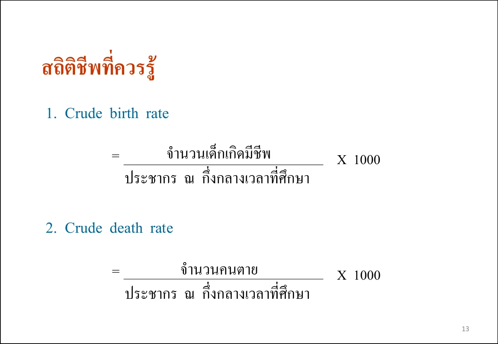

**1) Verbatim Quotation (คำพูดผู้สอนแบบคำต่อคำ):**
- **[26:49](https://www.youtube.com/watch?v=pPAfYlneRQA&t=1609s):** “Crude Birth Rate เป็นจำนวนเด็กเกิดมีชีพหารด้วยจำนวนประชากร ณ กึ่งกลางเวลาที่ศึกษา แล้วคูณ 1,000 ส่วน Crude Death Rate ก็จำนวนคนตายหารด้วยจำนวนประชากร ของไทยตอนนี้ Birth rate ประมาณ 7 ส่วน Death rate ประมาณ 8 ต่อ 1,000”
- **[28:38](https://www.youtube.com/watch?v=pPAfYlneRQA&t=1718s):** “จะเห็นว่าตัวหารพวกนี้ไม่ใช่เวลาแต่เป็นจำนวนคนนะฮะ แต่เขาก็ใช้ชื่อว่า Rate มาตลอดตามธรรมเนียมเดิม จริงๆ เชิงคณิตศาสตร์มันเป็น Proportion ไม่ได้เป็น Rate แท้จริง”

**2) Conceptualized Insight (การสังเคราะห์แนวคิดตาม Logical Flow):**
- **แก่นแนวคิดหลัก:** **CBR และ CDR ใช้ประชากร ณ กึ่งกลางปี (Mid-year population) เป็นตัวหารรวมของทั้งประเทศ และแม้จะมีคำว่า ‘Rate’ ในชื่อตามธรรมเนียมประชากรศาสตร์ แต่โดยโครงสร้างคณิตศาสตร์ในรอบ 1 ปีจัดเป็นสัดส่วนต่อประชากร 1,000 คน**
- **สูตร / โครงสร้างตัวชี้วัด:** `CBR = (เด็กเกิดมีชีพ / ประชากรกลางปี) × 1,000  |  CDR = (จำนวนคนตาย / ประชากรกลางปี) × 1,000`
- เหตุผลที่ใช้ ‘ประชากร ณ กึ่งกลางเวลาที่ศึกษา (เช่น 1 กรกฎาคม)’ เพราะประชากรมีการเกิด ตาย และย้ายถิ่นตลอดปี ค่ากึ่งกลางปีจึงเป็นค่าประมาณประชากรเฉลี่ยที่ดีที่สุด
- ข้อสังเกตสำคัญจากผู้สอน: นักระบาดวิทยายุคหลังนิยาม Rate เคร่งครัดว่าตัวหารต้องเป็น Person-time แต่คำว่า Birth/Death Rate ตั้งขึ้นมาก่อนจึงยังคงเรียกชื่อเดิมสืบมา
- **สะพานเชื่อมตรรกะ (Logical Flow):** *(รับช่วง)* แปลงข้อมูลการเกิด ~4 แสนคน และการตาย ~5 แสนคนของไทยให้เป็นสูตรมาตรฐานต่อประชากร 1,000 คน → *(ส่งต่อ)* เนื่องจากอัตราอย่างหยาบ (Crude) รวมทุกวัยและทุกสาเหตุปนกัน หากต้องการเจาะจงกลุ่มเสี่ยงหรือสาเหตุจึงต้องใช้ Specific Death Rates

### Slide 15/43 (หน้าสไลด์ 15 · [27:18 – 28:38](https://www.youtube.com/watch?v=pPAfYlneRQA&t=1638s)): สถิติชีพจำเพาะ (3–4): อัตราตายจำเพาะกลุ่มอายุและจำเพาะสาเหตุ

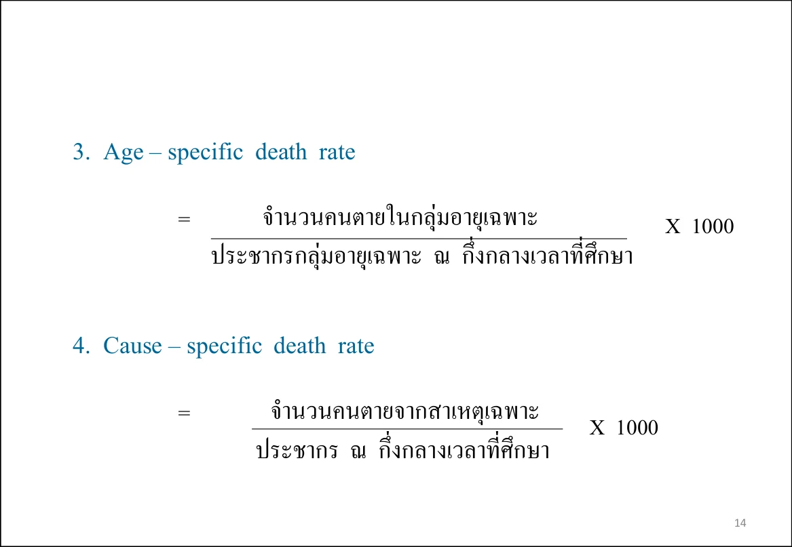

**1) Verbatim Quotation (คำพูดผู้สอนแบบคำต่อคำ):**
- **[27:20](https://www.youtube.com/watch?v=pPAfYlneRQA&t=1640s):** “ต่อไปเป็น Age-Specific ก็คือจำเพาะกลุ่มอายุ เช่น เอาเฉพาะวัยทำงาน 20–59 ปี ตัวตั้งก็คือคนตายในช่วงอายุนั้น หารด้วยจำนวนประชากรที่อยู่ในช่วงอายุเดียวกัน”
- **[27:58](https://www.youtube.com/watch?v=pPAfYlneRQA&t=1678s):** “อีกอันนึงก็ Cause-Specific Death Rate ก็จะเป็นจำนวนคนตายจากสาเหตุเฉพาะ หารด้วยประชากร ณ กึ่งกลางเวลาที่ศึกษา”

**2) Conceptualized Insight (การสังเคราะห์แนวคิดตาม Logical Flow):**
- **แก่นแนวคิดหลัก:** **การวัดอัตราตายจำเพาะกลุ่มอายุต้องจำกัดทั้งตัวตั้งและตัวหารให้อยู่ในกลุ่มอายุเดียวกัน ในขณะที่อัตราตายจำเพาะสาเหตุจำกัดเฉพาะตัวตั้งตามสาเหตุการตายแต่ยังคงหารด้วยประชากรทั้งหมดที่เสี่ยงต่อสาเหตุนั้น**
- **สูตร / โครงสร้างตัวชี้วัด:** `Age-Specific DR = (ตายในกลุ่มอายุ / ประชากรกลุ่มอายุนั้น) × 1,000  |  Cause-Specific DR = (ตายจากสาเหตุ / ประชากรกลางปี) × 1,000`
- Age-Specific Death Rate เป็นข้อมูลวัตถุดิบสำคัญที่สุดที่จะนำไปใช้คำนวณตารางชีพ (Life Table) และการปรับมาตรฐานอายุ (Direct Standardization) ในส่วนท้ายคาบ
- อย่าสับสนระหว่าง Cause-Specific Death Rate (ตายจากโรค X / ประชากรทั้งหมด) กับ Case Fatality Rate (ตายจากโรค X / ผู้ป่วยโรค X)
- **สะพานเชื่อมตรรกะ (Logical Flow):** *(รับช่วง)* แยกย่อย Crude Death Rate ออกตามกลุ่มอายุและสาเหตุเพื่อให้ระบุกลุ่มเสี่ยงได้แม่นยำขึ้น → *(ส่งต่อ)* ก้าวสู่สถิติชีพ 2 ตัวที่มีความไวสูงที่สุดในการสะท้อนคุณภาพระบบสุขภาพและการพัฒนาสังคม คือ IMR และ MMR

### Slide 16/43 (หน้าสไลด์ 16 · [28:48 – 30:28](https://www.youtube.com/watch?v=pPAfYlneRQA&t=1728s)): สถิติชีพสะท้อนการพัฒนาประเทศ (5–6): อัตราตายทารก (IMR) และอัตราตายมารดา (MMR)

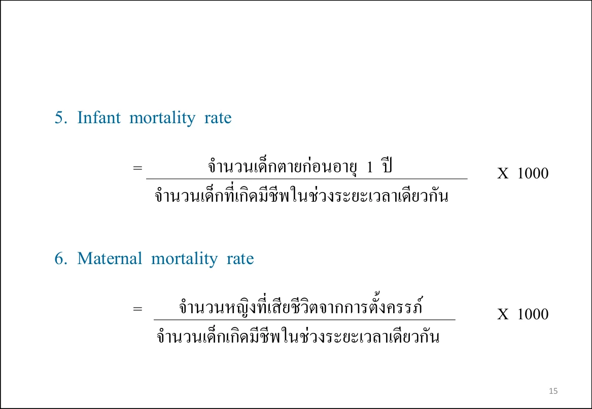

**1) Verbatim Quotation (คำพูดผู้สอนแบบคำต่อคำ):**
- **[28:55](https://www.youtube.com/watch?v=pPAfYlneRQA&t=1735s):** “ดู Infant Mortality Rate ว่าในสังคมนั้นมีความพัฒนาทางการแพทย์และทางสังคม (Social determinants) ดีไหม ถ้าประเทศที่ไม่ค่อยพัฒนาตัว IMR จะสูง... ตัวตั้งเป็นจำนวนเด็กตายก่อนอายุ 1 ปี หารด้วยจำนวนเด็กเกิดมีชีพในช่วงเดียวกัน ของไทยลดลงมาเรื่อยๆ ตอนนี้ต่ำกว่า 10 นิดๆ”
- **[30:05](https://www.youtube.com/watch?v=pPAfYlneRQA&t=1805s):** “อีกอันก็เป็น Maternal Mortality Rate เป็นการเสียชีวิตของแม่ที่ตั้งท้องหรือเสียชีวิตตอนคลอด หารด้วยจำนวนเด็กเกิดมีชีพนะฮะ”

**2) Conceptualized Insight (การสังเคราะห์แนวคิดตาม Logical Flow):**
- **แก่นแนวคิดหลัก:** **อัตราตายทารก (IMR) และอัตราตายมารดา (MMR) ใช้ ‘จำนวนเด็กเกิดมีชีพ’ เป็นตัวหารแทนประชากรรวม และทำหน้าที่เป็นดัชนีชี้วัดความก้าวหน้าทางการแพทย์ อนามัยแม่และเด็ก และปัจจัยกำหนดสุขภาพทางสังคมของประเทศ**
- **สูตร / โครงสร้างตัวชี้วัด:** `IMR = (เด็กตายอายุ < 1 ปี / เด็กเกิดมีชีพปีเดียวกัน) × 1,000  |  MMR = (หญิงตายจากการตั้งครรภ์-คลอด / เด็กเกิดมีชีพ) × 1,000 (หรือ 100,000)`
- IMR นับทารกเสียชีวิตก่อนอายุครบ 1 ปีบริบูรณ์ต่อเด็กเกิดมีชีพ 1,000 คน สะท้อนทั้งคุณภาพการดูแลปริกำเนิด โภชนาการ สุขาภิบาล และเศรษฐานะของครัวเรือน
- MMR ใช้จำนวนเด็กเกิดมีชีพเป็นตัวแทน (Proxy) ของจำนวนการตั้งครรภ์ทั้งหมด เนื่องจากนับได้แม่นยำกว่าในระบบทะเบียนราษฎร (เชิงโครงสร้างจึงเป็น Ratio เพราะแม่ไม่ได้อยู่ในกลุ่มเด็กเกิดมีชีพ)
- **สะพานเชื่อมตรรกะ (Logical Flow):** *(รับช่วง)* สรุปชุดสถิติชีพครบทั้ง 6 ตัว ตั้งแต่ระดับประชากรรวมไปจนถึงอนามัยแม่และเด็ก → *(ส่งต่อ)* แวะทบทวนโจทย์คำนวณ Person-Time สั้นๆ ก่อนเชื่อมสถิติการตายรายกลุ่มอายุเข้าสู่ ‘ตารางชีพ (Life Table)’

### Slide 20/43 (หน้าสไลด์ 23 · [31:08 – 34:28](https://www.youtube.com/watch?v=pPAfYlneRQA&t=1868s)): ตารางชีพ (Life Table) และที่มาของการคำนวณอายุคาดเฉลี่ย (Life Expectancy)

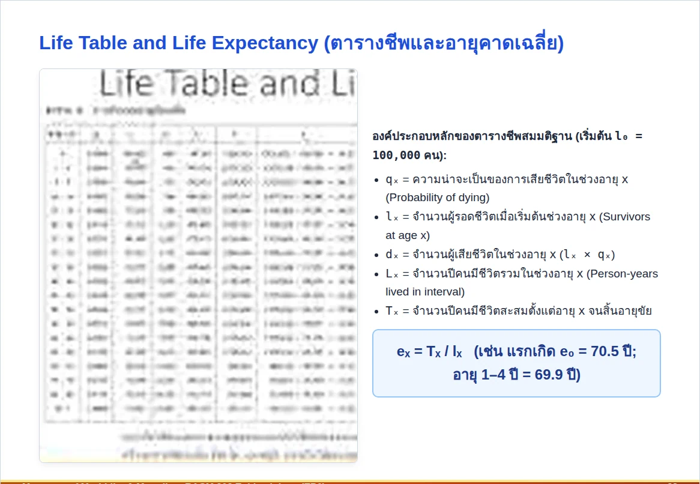

**1) Verbatim Quotation (คำพูดผู้สอนแบบคำต่อคำ):**
- **[31:12](https://www.youtube.com/watch?v=pPAfYlneRQA&t=1872s):** “ตารางชีพ (Life Table) เอามาโชว์เพราะอยู่ในเกณฑ์มาตรฐานแพทยสภา เราไม่ต้องถึงกับคำนวณละเอียดเองทั้งหมด แต่อย่างน้อยต้องรู้ที่มาของตัว Indicator ว่าคำนวณหา Life Expectancy (อายุขัยคาดเฉลี่ย) ยังไง”
- **[32:25](https://www.youtube.com/watch?v=pPAfYlneRQA&t=1945s):** “มันสตาร์ทสมมติจากประชากรเกิดใหม่ l₀ = 100,000 คน แล้วใช้ค่า qₓ คือ Probability of death ในแต่ละช่วงอายุคำนวณจำนวนคนตาย (dₓ), จำนวนปีคนมีชีวิตในแต่ละช่วง (Lₓ) สะสมรวมเป็น Total person-years (Tₓ)”
- **[33:48](https://www.youtube.com/watch?v=pPAfYlneRQA&t=2028s):** “ตัว Life Expectancy (eₓ) ก็มาจาก Tₓ หารด้วย lₓ อย่างตัวอย่างจังหวัดนี้ แรกเกิดได้ 70.5 ปี แปลว่า Newborn ในประชากรนี้คาดว่าจะอยู่ได้เฉลี่ย 70.5 ปี”

**2) Conceptualized Insight (การสังเคราะห์แนวคิดตาม Logical Flow):**
- **แก่นแนวคิดหลัก:** **อายุคาดเฉลี่ย (Life Expectancy, eₓ) ไม่ใช่ค่าเฉลี่ยอายุของคนที่เพิ่งตายในปีนั้น แต่เป็นการจำลองประชากรสมมติ 100,000 คนให้ผ่านความน่าจะเป็นของการตายรายกลุ่มอายุ (qₓ) ในปัจจุบัน เพื่อหาจำนวนปีเฉลี่ยที่จะมีชีวิตอยู่ต่อ**
- **สูตร / โครงสร้างตัวชี้วัด:** `eₓ = Tₓ / lₓ  (ปีคนมีชีวิตสะสมตั้งแต่อายุ x จนสิ้นอายุขัย ÷ จำนวนผู้รอดชีวิต ณ อายุ x)`
- คอลัมน์หลักในตารางชีพ: qₓ (โอกาสตายในช่วงอายุ) → lₓ (ผู้รอดชีวิตต้นช่วง) → dₓ (ผู้เสียชีวิต) → Lₓ (ปีคนมีชีวิตในช่วง) → Tₓ (ปีคนมีชีวิตสะสมที่เหลือ) → eₓ = Tₓ / lₓ
- เป็นตัวชี้วัดสรุปภาพรวมภาวะการตายของประชากรที่ไม่ถูกบิดเบือนด้วยโครงสร้างอายุจริงของประชากร เพราะเริ่มจำลองจากฐาน 100,000 คนเท่ากันเสมอ
- **สะพานเชื่อมตรรกะ (Logical Flow):** *(รับช่วง)* นำ Age-Specific Death Rates จากสไลด์ 15 มาแปลงเป็นความน่าจะเป็นของการตาย (qₓ) ในตารางชีพ → *(ส่งต่อ)* ตั้งคำถามสำคัญต่อยอด: การมีอายุขัยยืนยาวขึ้น (LE สูง) แปลว่าคนไทยมีสุขภาพดีตลอดทุกปีที่อยู่จริงหรือไม่? นำไปสู่ตัวชี้วัด HALE

### Slide 21/43 (หน้าสไลด์ 24 · [34:28 – 37:27](https://www.youtube.com/watch?v=pPAfYlneRQA&t=2068s)): อายุคาดเฉลี่ย (LE) เทียบกับอายุคาดเฉลี่ยของการมีสุขภาวะ (HALE) ของคนไทย

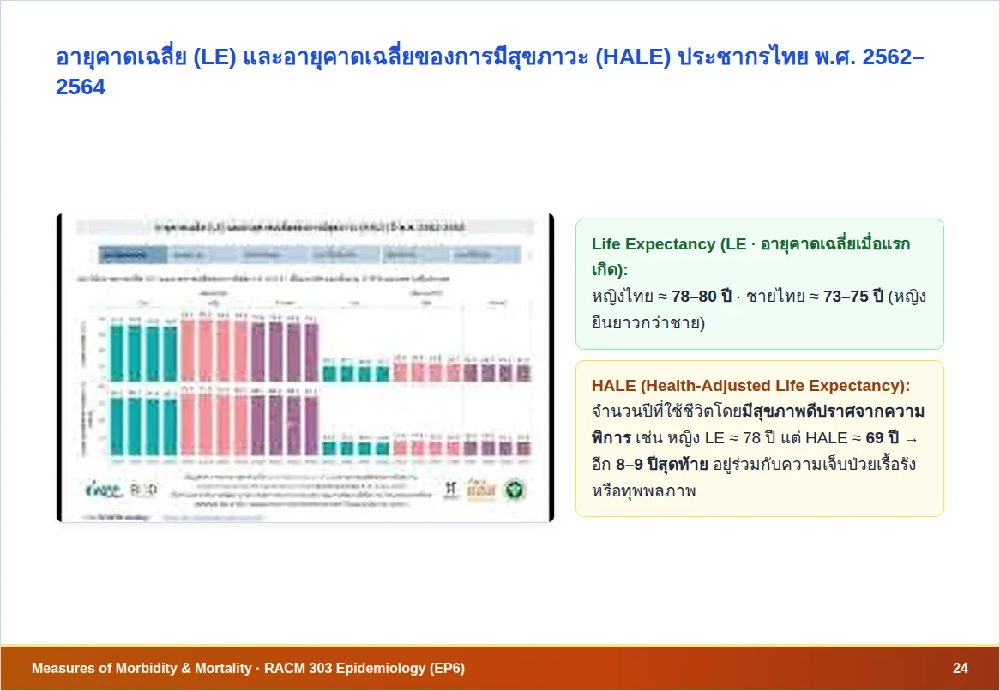

**1) Verbatim Quotation (คำพูดผู้สอนแบบคำต่อคำ):**
- **[35:15](https://www.youtube.com/watch?v=pPAfYlneRQA&t=2115s):** “ในคนไทยช่วงโควิด LE ลดลงนิดนึงแล้วกลับมาขึ้น ผู้ชายประมาณ 73–75 ปี ผู้หญิงประมาณ 78–80 ปี ผู้หญิงอายุยืนกว่าผู้ชาย... อีกตัวนึงคือ HALE (Health-Adjusted Life Expectancy) จะเห็นว่าต่ำกว่าตัว Life Expectancy”
- **[35:58](https://www.youtube.com/watch?v=pPAfYlneRQA&t=2158s):** “สมมุติผู้หญิงอายุคาดเฉลี่ยแรกเกิดได้ 78 ปี แต่จริงๆ 78 ปีไม่ใช่ว่าอยู่ในภาวะสุขภาพดีทั้งหมดนะ ที่ Healthy จริงๆ (HALE) มีอยู่แค่ 69 ปี อีกสัก 8–9 ปีเนี่ยเป็นป่วยหรือทุพพลภาพ ถือว่าไม่ Healthy!”

**2) Conceptualized Insight (การสังเคราะห์แนวคิดตาม Logical Flow):**
- **แก่นแนวคิดหลัก:** **ช่องว่างระหว่าง LE และ HALE เผยความจริงเชิงระบบสุขภาพว่า แม้คนไทยจะมีอายุยืนยาวขึ้น แต่ต้องใช้ชีวิตช่วงท้ายราว 8–9 ปีอยู่ร่วมกับโรคเรื้อรังหรือความเสื่อมถอยของสุขภาวะ**
- **สูตร / โครงสร้างตัวชี้วัด:** `Gap (LE − HALE) ≈ 8–9 ปีท้ายของชีวิตที่อยู่ร่วมกับความเจ็บป่วยเรื้อรังหรือทุพพลภาพ`
- ผู้หญิงไทยมีทั้ง LE และ HALE สูงกว่าผู้ชาย แต่ก็มีจำนวนปีที่อยู่กับภาวะเจ็บป่วยเรื้อรังยาวนานไม่แพ้กัน ขณะที่ประเทศชั้นนำในเอเชียอย่างญี่ปุ่น สิงคโปร์ เกาหลีใต้ และฮ่องกงมีค่าทั้งสองสูงติดอันดับโลก
- เป้าหมายของการแพทย์และสาธารณสุขยุคใหม่จึงไม่ใช่แค่การยืด LE แต่คือการขยับ HALE ให้เข้าใกล้ LE มากที่สุด (Compression of morbidity)
- **สะพานเชื่อมตรรกะ (Logical Flow):** *(รับช่วง)* ยกระดับจากการวัด ‘ปริมาณปีที่มีชีวิต (LE)’ สู่การวัด ‘คุณภาพของปีที่มีสุขภาวะดี (HALE)’ → *(ส่งต่อ)* เมื่ออัตราเกิดลดลง (สไลด์ 14) และอายุขัยยืนยาวขึ้น (สไลด์ 21) ย่อมเปลี่ยนโฉมหน้าโครงสร้างอายุของประเทศ ซึ่งแสดงได้ด้วย ‘พีระมิดประชากร’

### Slide 22/43 (หน้าสไลด์ 25 · [37:27 – 38:37](https://www.youtube.com/watch?v=pPAfYlneRQA&t=2247s)): พีระมิดประชากร (Population Pyramid): แผนภาพสะท้อนโครงสร้างอายุและเพศ

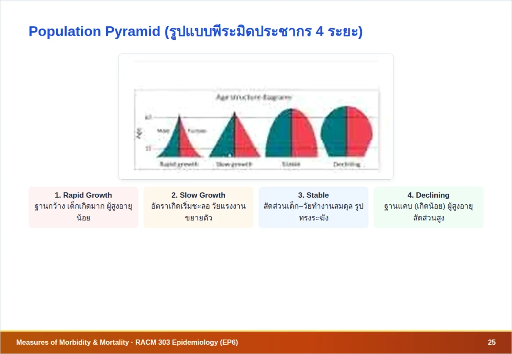

**1) Verbatim Quotation (คำพูดผู้สอนแบบคำต่อคำ):**
- **[37:30](https://www.youtube.com/watch?v=pPAfYlneRQA&t=2250s):** “Population Pyramid จะบอกถึงโครงสร้างประชากร คือสัดส่วนของประชากรในแต่ละกลุ่มอายุ แกน Y เป็นกลุ่มอายุ ซ้ายขวาเป็นชายหญิง สมัยก่อนเด็กจะเยอะคนแก่จะน้อย แต่สมัยนี้ฐานจะตีบลง สัดส่วนเด็กน้อยลง คนวัยกลางคนและคนแก่เพิ่มขึ้น”

**2) Conceptualized Insight (การสังเคราะห์แนวคิดตาม Logical Flow):**
- **แก่นแนวคิดหลัก:** **รูปทรงของพีระมิดประชากรช่วยให้แพทย์อ่านทิศทางการเปลี่ยนผ่านทางประชากรศาสตร์ (Demographic Transition) และคาดการณ์ความต้องการบริการสุขภาพในอนาคตได้ทันที**
- **สูตร / โครงสร้างตัวชี้วัด:** `แกนตั้ง = กลุ่มอายุ (เด็ก → สูงวัย)  |  แกนนอนซ้าย–ขวา = สัดส่วนเพศชาย–หญิง`
- พีระมิดฐานกว้าง (Rapid growth) ต้องการบริการอนามัยแม่และเด็ก–วัคซีน–โรคติดเชื้อเป็นหลัก ส่วนพีระมิดฐานแคบยอดป่อง (Stable / Declining) ต้องการระบบดูแลโรคเรื้อรังและผู้สูงอายุระยะยาว (Long-term care)
- **สะพานเชื่อมตรรกะ (Logical Flow):** *(รับช่วง)* สรุปผลรวมของอัตราเกิดและอัตราตายออกมาเป็นรูปทรงพีระมิดประชากร 4 ระยะ → *(ส่งต่อ)* นำกรอบพีระมิด 4 ระยะมาดูหลักฐานจริงของการเปลี่ยนผ่านประชากรไทยตั้งแต่ปี ค.ศ. 1990 ถึงอนาคต

### Slide 23/43 (หน้าสไลด์ 26 · [38:37 – 39:17](https://www.youtube.com/watch?v=pPAfYlneRQA&t=2317s)): การเปลี่ยนผ่านพีระมิดประชากรไทย (ค.ศ. 1990 → 2020 → 2030+)

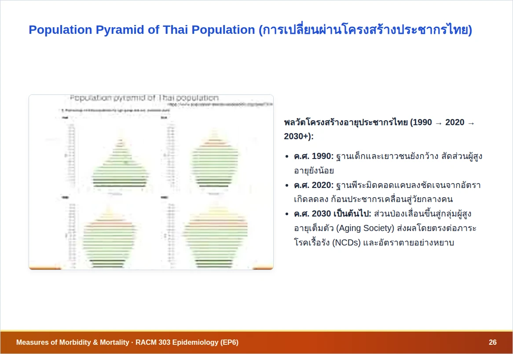

**1) Verbatim Quotation (คำพูดผู้สอนแบบคำต่อคำ):**
- **[38:39](https://www.youtube.com/watch?v=pPAfYlneRQA&t=2319s):** “อันนี้ในประชากรไทยเมื่อปี 1990 เทียบกับปี 2020 จะเห็นว่าฐานเล็กลงแล้วนะ ถ้าปี 2030 มันก็จะป่องข้างบน ค่อยๆ เลื่อนสัดส่วนขึ้นไปเรื่อยๆ”

**2) Conceptualized Insight (การสังเคราะห์แนวคิดตาม Logical Flow):**
- **แก่นแนวคิดหลัก:** **ภายในเวลาเพียง 3–4 ทศวรรษ โครงสร้างประชากรไทยเคลื่อนจากฐานวัยเด็กกว้างไปสู่ก้อนประชากรวัยกลางคนและผู้สูงอายุอย่างรวดเร็ว ซึ่งเป็นแรงขับเคลื่อนหลักของภาระโรคเรื้อรังและทำให้ต้องปรับมาตรฐานอายุเวลาเปรียบเทียบข้อมูล**
- **สูตร / โครงสร้างตัวชี้วัด:** `Thailand Shift: Expansive Base (1990) → Constrictive Aging Society (2020–2030+)`
- เชื่อมโยงโดยตรงกับสองหัวข้อถัดไปของคาบ: (1) ทำไมภาระโรค NCDs และความพิการจึงพุ่งสูงขึ้น (Stage 4: DALY) และ (2) ทำไมเปรียบเทียบอัตราตายข้ามเวลาหรือข้ามพื้นที่จึงต้องทำ Age Standardization (Stage 5)
- **สะพานเชื่อมตรรกะ (Logical Flow):** *(รับช่วง)* ปิดท้าย Stage 3 ด้วยภาพจริงของสังคมสูงวัยไทย → *(ส่งต่อ)* ก้าวเข้าสู่ Stage 4: เมื่อสังคมสูงวัยมีคนป่วยเรื้อรังและพิการจำนวนมากโดยไม่เสียชีวิตทันที เราจะรวม ‘ป่วย + พิการ + ตาย’ เป็นหน่วยวัดเดียวได้อย่างไร?

## Stage 4 (39:17 – 48:37): การสังเคราะห์ภาระโรคองค์รวมด้วยปีสุขภาวะที่สูญเสีย (Burden of Disease & DALY) (Composite Burden of Disease: DALY = YLL + YLD & Priority Setting)

> **คำถามนำขององก์:** เหตุใดการนับแต่จำนวนคนตายจึงมองไม่เห็นภาระโรคที่แท้จริง และตัวชี้วัด DALY ผสานการตายก่อนวัยอันควรเข้ากับความพิการเพื่อจัดลำดับความสำคัญของประเทศอย่างไร?
>
> **แก่นความคิดรวบยอด:** DALY รวมจำนวนปีที่สูญเสียจากการตายก่อนวัยอันควร (YLL) และจำนวนปีที่มีชีวิตอยู่ร่วมกับความพิการถ่วงน้ำหนักความรุนแรง (YLD) เข้าเป็นหน่วยวัดเดียว ทำให้เห็นภาระโรคเรื้อรัง อุบัติเหตุ และปัจจัยเสี่ยงต้นน้ำของคนไทยอย่างครบถ้วนเพื่อจัดลำดับความสำคัญด้านบริการและงานวิจัย

### Slide 24/43 (หน้าสไลด์ 27 · [39:17 – 40:37](https://www.youtube.com/watch?v=pPAfYlneRQA&t=2357s)): แนวคิดภาระโรค (Burden of Disease): ทำไมการนับแค่คนตายจึงไม่พอ

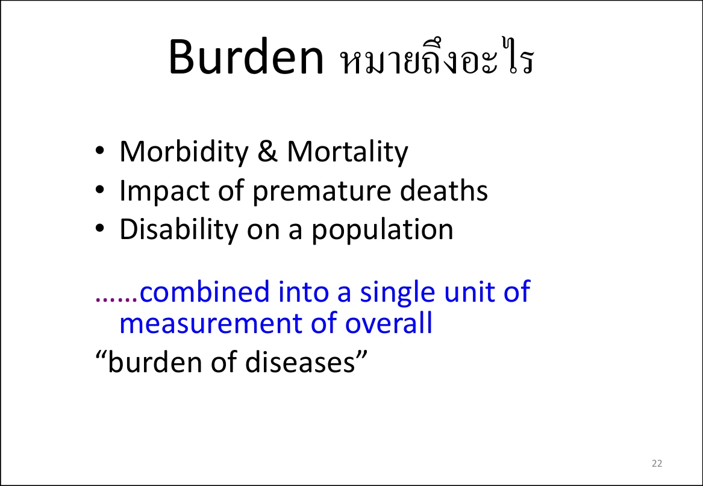

**1) Verbatim Quotation (คำพูดผู้สอนแบบคำต่อคำ):**
- **[39:38](https://www.youtube.com/watch?v=pPAfYlneRQA&t=2378s):** “สมัยก่อนเวลาจัดอันดับปัญหาสุขภาพ เรามักดูแต่อัตราตายอันดับ 1 คืออะไร หรือป่วยอันดับ 1 เท่าไหร่ แยกกัน... แต่เมื่อ 20 กว่าปีก่อนเขาคิดคำใหม่ขึ้นมาว่า จริงๆ แล้วภาระโรคไม่ใช่แค่ตายอย่างเดียว คนที่ยังไม่ตายแต่พิการหรือทุพพลภาพก็ถือว่าเป็นภาระโรคที่สำคัญมาก จึงคิดตัวชี้วัดที่รวมเข้าเป็นหน่วยเดียวกัน”

**2) Conceptualized Insight (การสังเคราะห์แนวคิดตาม Logical Flow):**
- **แก่นแนวคิดหลัก:** **การจัดลำดับปัญหาสุขภาพด้วยอัตราตายเพียงอย่างเดียวจะละเลยโรคที่ทำให้ทุพพลภาพเรื้อรังแต่ไม่ตายทันที (เช่น โรคจิตเวช ซึมเศร้า ข้อเสื่อม ตาบอด หรืออัมพาต) จึงต้องสร้างหน่วยวัดเดียวที่รวมทั้งการตายก่อนวัยอันควรและความพิการเข้าด้วยกัน**
- **สูตร / โครงสร้างตัวชี้วัด:** `Burden of Disease = Morbidity + Disability + Premature Mortality (Single Metric)`
- แนวคิด Global Burden of Disease (GBD) เปลี่ยนกระบวนทัศน์จากการนับ ‘จำนวนคน’ แยกป่วย–แยกตาย มาเป็นการนับ ‘จำนวนปีของชีวิตที่มีสุขภาพดีที่สูญเสียไป’
- **สะพานเชื่อมตรรกะ (Logical Flow):** *(รับช่วง)* ชี้ข้อจำกัดของการแยกวัด Morbidity (Stage 2) และ Mortality (Stage 3) ออกจากกัน → *(ส่งต่อ)* เปิดตัวดัชนีมาตรฐานสากลที่แก้ปัญหานี้ได้สำเร็จ คือ Disability-Adjusted Life Year (DALY)

### Slide 25/43 (หน้าสไลด์ 28 · [40:37 – 42:27](https://www.youtube.com/watch?v=pPAfYlneRQA&t=2437s)): ปีสุขภาวะที่สูญเสีย (Disability-Adjusted Life Year: DALY = YLL + YLD)

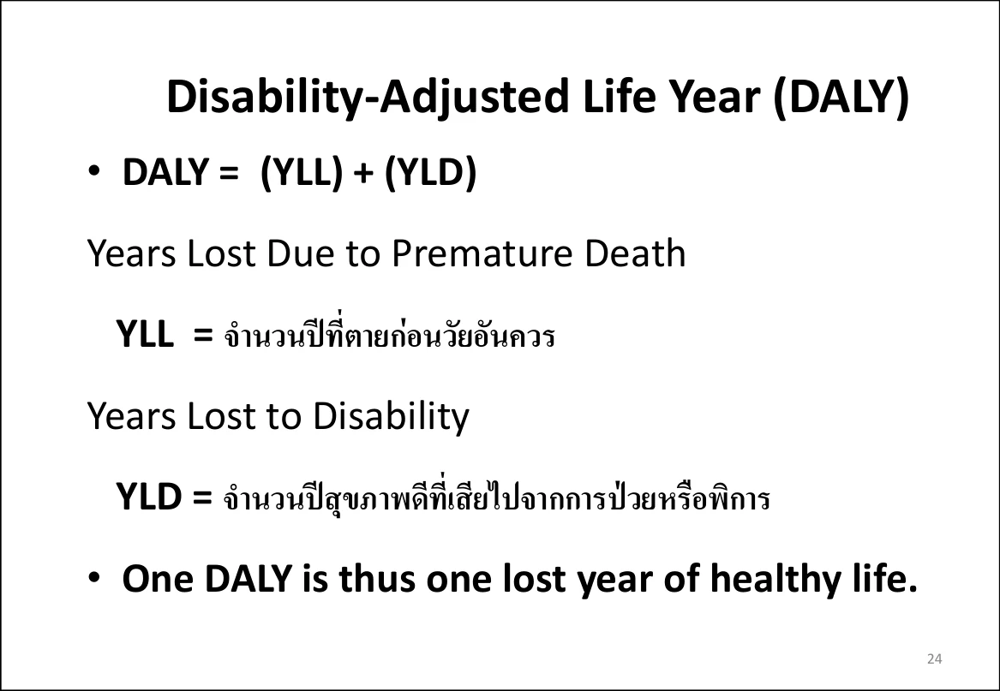

**1) Verbatim Quotation (คำพูดผู้สอนแบบคำต่อคำ):**
- **[41:05](https://www.youtube.com/watch?v=pPAfYlneRQA&t=2465s):** “Component ของ DALY คือจำนวนปีที่เสียไปจากการมีสุขภาพดี (One DALY = one lost year of healthy life) มี 2 อย่างรวมกัน: อันแรกคือ YLL จำนวนปีที่ตายก่อนวัยอันควร สมมุติควรอายุถึง 80 แต่อายุ 20 อุบัติเหตุชนตาย สังคมก็เสียไป 60 ปี”
- **[41:55](https://www.youtube.com/watch?v=pPAfYlneRQA&t=2515s):** “อีกตัวคือ YLD ปีที่เสียไปจากการป่วยหรือพิการ สมมุติอายุ 40 ชนแล้วพิการ อยู่แบบพิการไปอีก 20 ปีแล้วเสียชีวิตตอนอายุ 60 เขาก็จะมีทั้งส่วนที่พิการ 20 ปี (YLD) บวกกับส่วนที่ตายก่อนวัยอันควรอีก 20 ปี (YLL)”

**2) Conceptualized Insight (การสังเคราะห์แนวคิดตาม Logical Flow):**
- **แก่นแนวคิดหลัก:** **1 DALY มีความหมายเท่ากับ ‘1 ปีของชีวิตที่มีสุขภาพดีที่สูญเสียไป’ โดยนำปีที่สูญเสียจากการตายก่อนวัยอันควร (YLL) มาบวกกับปีที่มีชีวิตอยู่แต่สูญเสียสุขภาวะจากความเจ็บป่วยหรือพิการ (YLD)**
- **สูตร / โครงสร้างตัวชี้วัด:** `DALY = YLL (Years of Life Lost) + YLD (Years Lost due to Disability)`
- ตัวอย่างของอาจารย์วิชัยช่วยให้เห็นภาพชัดเจนที่สุด: ผู้ประสบอุบัติเหตุตอนอายุ 40 ปี พิการอยู่ 20 ปี แล้วเสียชีวิตตอนอายุ 60 ปี (เทียบเกณฑ์อายุขัย 80 ปี) จะสร้างภาระโรคทั้ง YLD (จากช่วงพิการอายุ 40–60) และ YLL (จากการตายเร็วไป 20 ปีช่วงอายุ 60–80) รวมกันในคนเดียว
- **สะพานเชื่อมตรรกะ (Logical Flow):** *(รับช่วง)* นิยามความหมายและสมการหลัก DALY = YLL + YLD พร้อมตัวอย่างกรณีศึกษาที่ชัดเจน → *(ส่งต่อ)* แต่ช่วงที่พิการ 20 ปีนั้น เขาไม่ได้สูญเสียสุขภาวะ 100% เหมือนเสียชีวิต แล้วเราจะแปลง ‘ปีที่พิการ’ ให้เทียบเท่ากับ ‘ปีที่ตาย’ ได้อย่างไร? ไปดูสูตร YLL & YLD ในสไลด์ 26

### Slide 26/43 (หน้าสไลด์ 29 · [42:27 – 43:17](https://www.youtube.com/watch?v=pPAfYlneRQA&t=2547s)): โครงสร้างสูตรการคำนวณ YLL และ YLD และการถ่วงน้ำหนักความพิการ

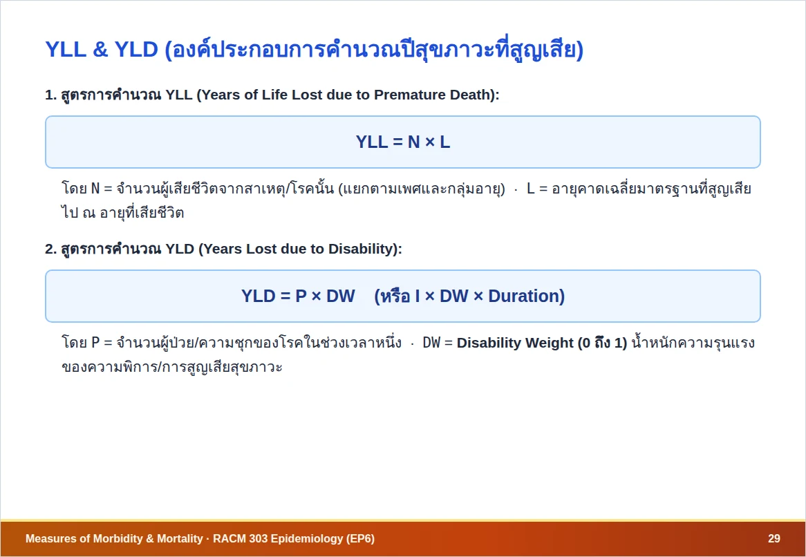

**1) Verbatim Quotation (คำพูดผู้สอนแบบคำต่อคำ):**
- **[42:28](https://www.youtube.com/watch?v=pPAfYlneRQA&t=2548s):** “ตรงพิการนี้จะคิดยังไง เขาก็คิดคำว่า Weight (น้ำหนักความพิการ) เข้ามาคูณ... YLL คือจำนวนคนตาย (N) คูณเวลาอายุขัยที่เสียไป (L) ส่วน YLD ก็เอาจำนวนคนที่เป็นโรค (P) คูณด้วยตัว Disability Weight ที่ว่า”

**2) Conceptualized Insight (การสังเคราะห์แนวคิดตาม Logical Flow):**
- **แก่นแนวคิดหลัก:** **ตัวเชื่อมสำคัญที่ทำให้บวกความพิการเข้ากับการตายได้คือ ‘ค่าน้ำหนักความพิการ (Disability Weight: DW)’ ซึ่งถ่วงระดับความสูญเสียสุขภาวะตั้งแต่ 0 (สุขภาพดีสมบูรณ์) ถึง 1 (เทียบเท่าเสียชีวิต)**
- **สูตร / โครงสร้างตัวชี้วัด:** `YLL = N × L  |  YLD = P × DW  (DW = Disability Weight 0.00 – 1.00)`
- หากผู้ป่วยพิการรุนแรงมากจนเหลือสุขภาวะเพียง 20% (กล่าวคือสูญเสียสุขภาวะ DW = 0.80) การมีชีวิตอยู่แบบพิการ 10 ปี จะคิดเป็นความสูญเสีย YLD = 10 × 0.80 = 8 DALYs
- **สะพานเชื่อมตรรกะ (Logical Flow):** *(รับช่วง)* เปิดเผยกลไกทางคณิตศาสตร์ของตัวถ่วงน้ำหนัก DW ในสมการ YLD → *(ส่งต่อ)* แสดงตารางตัวอย่างค่าน้ำหนักความพิการมาตรฐานขององค์การอนามัยโลก (GBD Disability Classes 1–7) เพื่อให้เห็นระดับความรุนแรงของโรคต่างๆ

### Slide 27/43 (หน้าสไลด์ 30 · [43:17 – 44:17](https://www.youtube.com/watch?v=pPAfYlneRQA&t=2597s)): ระดับความรุนแรงและค่าน้ำหนักความพิการ 7 คลาสตามเกณฑ์ WHO GBD

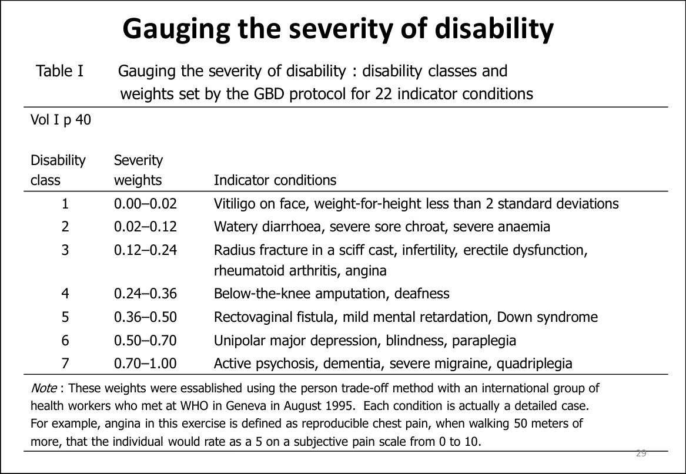

**1) Verbatim Quotation (คำพูดผู้สอนแบบคำต่อคำ):**
- **[43:18](https://www.youtube.com/watch?v=pPAfYlneRQA&t=2598s):** “Disability Weight มาจากกลุ่มผู้เชี่ยวชาญประชุมประเมินกัน อย่าง Vitiligo (ด่างขาวบนใบหน้า) ไม่ถึงกับตายหรือพิการหนัก Weight ก็น้อยมาก (0.00–0.02) แต่ถ้า Anemia, Fracture, Amputation (ตัดขา) ก็มากขึ้นเรื่อยๆ จนถึง Paraplegia, Quadriplegia หรือ Dementia (สมองเสื่อม) พวกนี้ Weight การสูญเสียก็จะสูงมาก (0.70–1.00)”

**2) Conceptualized Insight (การสังเคราะห์แนวคิดตาม Logical Flow):**
- **แก่นแนวคิดหลัก:** **ค่าน้ำหนักความพิการ (DW) สะท้อนผลกระทบของภาวะโรคต่อการทำหน้าที่และคุณภาพชีวิต (ตั้งแต่น้อยมากในโรคผิวหนัง ไปจนถึงเกือบเทียบเท่าการสูญเสียปีชีวิตเต็มปีในภาวะสมองเสื่อมรุนแรงหรืออัมพาตทั้งสี่รยางค์)**
- **สูตร / โครงสร้างตัวชี้วัด:** `DW Scale: Class 1 (0.00–0.02 Vitiligo) → ... → Class 7 (0.70–1.00 Dementia / Quadriplegia)`
- กำหนดขึ้นด้วยวิธี Person trade-off โดยคณะผู้เชี่ยวชาญนานาชาติของ WHO ทำให้สามารถเปรียบเทียบภาระโรคทางกายและทางจิตเวช (เช่น Unipolar major depression อยู่ใน Class 6: DW 0.50–0.70!) บนสเกลเดียวกันได้
- **สะพานเชื่อมตรรกะ (Logical Flow):** *(รับช่วง)* เข้าใจเกณฑ์การให้คะแนนความรุนแรงของความพิการ (DW) ตั้งแต่ระดับ 1 ถึง 7 → *(ส่งต่อ)* เมื่อนำสูตร DALY มาคำนวณกับข้อมูลจริงของประเทศไทย ผลลัพธ์ภาระโรคของชายและหญิงไทยเป็นอย่างไร? ดูรายงาน BOD Thailand ในสไลด์ 28–31

### Slide 28/43 (หน้าสไลด์ 31 · [44:17 – 46:07](https://www.youtube.com/watch?v=pPAfYlneRQA&t=2657s)): ภาระโรคของประชากรไทย (BOD Thailand): การสูญเสีย DALYs แยกตามเพศและกลุ่มโรค

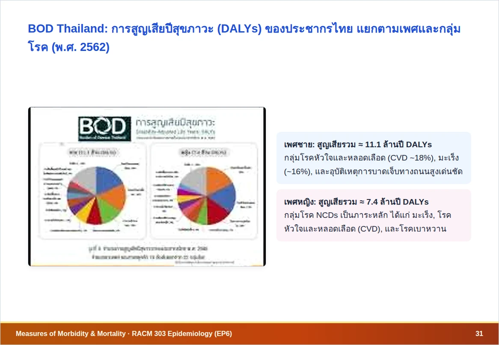

**1) Verbatim Quotation (คำพูดผู้สอนแบบคำต่อคำ):**
- **[44:35](https://www.youtube.com/watch?v=pPAfYlneRQA&t=2675s):** “ของกระทรวงสาธารณสุขจะมีกลุ่มที่ทำ Burden of Disease Thailand คำนวณว่าคนไทยเสีย DALYs แต่ละปีเท่าไหร่ ข้อมูลจะช้านิดนึงเพราะต้องรวบรวมทั้งการป่วยและการพิการ... ปี 62 ผู้ชายสูญเสีย 11.1 ล้านปี ผู้หญิง 7.4 ล้านปี”
- **[45:32](https://www.youtube.com/watch?v=pPAfYlneRQA&t=2732s):** “กลุ่มโรคที่เป็น Burden สูงสุดตอนนี้ก็คือ NCDs: ในผู้ชายมี Cardiovascular 18%, Cancer 16% และมีสีเขียวคืออุบัติเหตุการบาดเจ็บซึ่งเป็นปัญหาขึ้นชื่อของไทย ส่วนผู้หญิงก็เป็น NCDs คือ Cancer, CVD และเบาหวาน”

**2) Conceptualized Insight (การสังเคราะห์แนวคิดตาม Logical Flow):**
- **แก่นแนวคิดหลัก:** **ชายไทยสูญเสียปีสุขภาวะรวมสูงกว่าหญิงไทยอย่างชัดเจน (11.1 เทียบกับ 7.4 ล้านปี) โดยทั้งสองเพศถูกขับเคลื่อนด้วยกลุ่มโรค NCDs (โรคหัวใจและหลอดเลือด มะเร็ง เบาหวาน) ร่วมกับอุบัติเหตุทางถนนที่สูงโดดเด่นในเพศชาย**
- **สูตร / โครงสร้างตัวชี้วัด:** `Thailand BOD (พ.ศ. 2562): ชายสูญเสีย 11.1 ล้าน DALYs · หญิงสูญเสีย 7.4 ล้าน DALYs`
- เหตุผลที่รายงาน BOD ระดับชาติมีระยะเหลื่อมเวลา 3–5 ปี เพราะต้องเชื่อมฐานข้อมูลทะเบียนมรณบัตร ทะเบียนผู้ป่วยใน–นอก และการสำรวจความพิการระดับประชากรเข้าด้วยกันอย่างรัดกุม
- **สะพานเชื่อมตรรกะ (Logical Flow):** *(รับช่วง)* เห็นภาพรวมสัดส่วนกลุ่มโรคใหญ่ที่ก่อให้เกิดการสูญเสียปีสุขภาวะของชายและหญิงไทย → *(ส่งต่อ)* ซูมจากกลุ่มโรคใหญ่ลงมาดู ‘ตารางจัดอันดับรายโรค (Top Ranking)’ ของชายและหญิงไทยในสไลด์ 29

### Slide 29/43 (หน้าสไลด์ 32 · [46:07 – 46:47](https://www.youtube.com/watch?v=pPAfYlneRQA&t=2767s)): อันดับโรคที่เป็นสาเหตุการสูญเสีย DALYs สูงสุดในชายและหญิงไทย

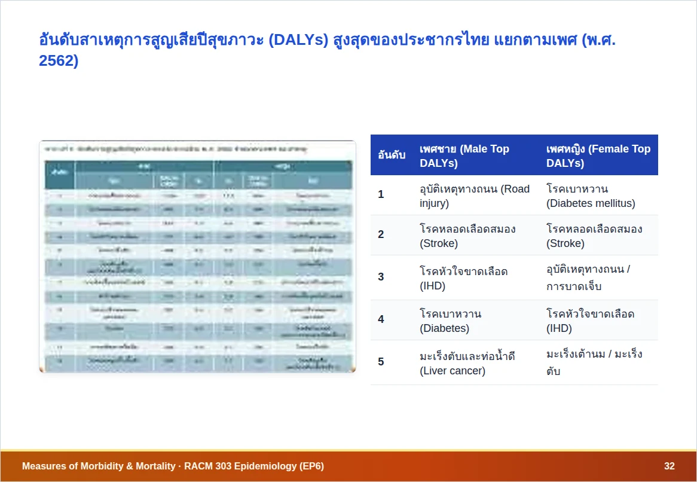

**1) Verbatim Quotation (คำพูดผู้สอนแบบคำต่อคำ):**
- **[46:10](https://www.youtube.com/watch?v=pPAfYlneRQA&t=2770s):** “พอมาทำ Ranking เราก็จะบอกได้ว่าปัญหาสุขภาพของคนไทยที่เราต้อง Concern และจัด Priority แก้ไขมีอะไรบ้าง: ในผู้ชายอันดับต้นๆ คือบาดเจ็บจากถนน (Road traffic injury), Stroke, เบาหวาน, Ischemic heart disease, Liver cancer ส่วนผู้หญิงอันดับ 1 คือเบาหวาน อันดับ 2 Stroke อันดับ 3 Injury แล้วก็ Heart disease, Breast cancer”

**2) Conceptualized Insight (การสังเคราะห์แนวคิดตาม Logical Flow):**
- **แก่นแนวคิดหลัก:** **การจัดอันดับด้วย DALYs ชี้เป้าความแตกต่างทางเพศภาวะอย่างชัดเจน: อุบัติเหตุทางถนนคร่าปีสุขภาวะชายวัยหนุ่มสาวเป็นอันดับ 1 (เพราะเสีย YLL ต่อรายสูงมาก) ขณะที่โรคเบาหวานและหลอดเลือดสมองเป็นภาระอันดับ 1–2 ในหญิงไทย**
- **สูตร / โครงสร้างตัวชี้วัด:** `ชายอันดับ 1: อุบัติเหตุทางถนน (ตามด้วย Stroke, IHD, DM, มะเร็งตับ)  |  หญิงอันดับ 1: เบาหวาน (ตามด้วย Stroke)`
- หากดูเพียงจำนวนผู้เสียชีวิต อุบัติเหตุในคนหนุ่มสาวอาจดูน้อยกว่าโรคในผู้สูงอายุ แต่เมื่อคิดเป็น DALYs อุบัติเหตุทางถนนพุ่งขึ้นอันดับ 1 ในชายไทยทันทีเพราะผู้เสียชีวิตอายุน้อยทำให้สูญเสียปีชีวิต (YLL) มหาศาลและผู้รอดชีวิตจำนวนมากพิการระยะยาว (YLD)
- **สะพานเชื่อมตรรกะ (Logical Flow):** *(รับช่วง)* ระบุรายชื่อโรคที่เป็นภาระสูงสุดของชายและหญิงไทยได้อย่างชัดเจน → *(ส่งต่อ)* แต่การป้องกันโรคระดับปฐมภูมิต้องแก้ที่ ‘ปัจจัยเสี่ยงต้นน้ำ’ สไลด์ถัดไปจึงวิเคราะห์ DALYs จำแนกตามปัจจัยเสี่ยง (Risk Factors)

### Slide 30/43 (หน้าสไลด์ 34 · [46:47 – 47:37](https://www.youtube.com/watch?v=pPAfYlneRQA&t=2807s)): ภาระโรคจำแนกตามปัจจัยเสี่ยงสุขภาพ (Risk Factor Attribution) ของคนไทย

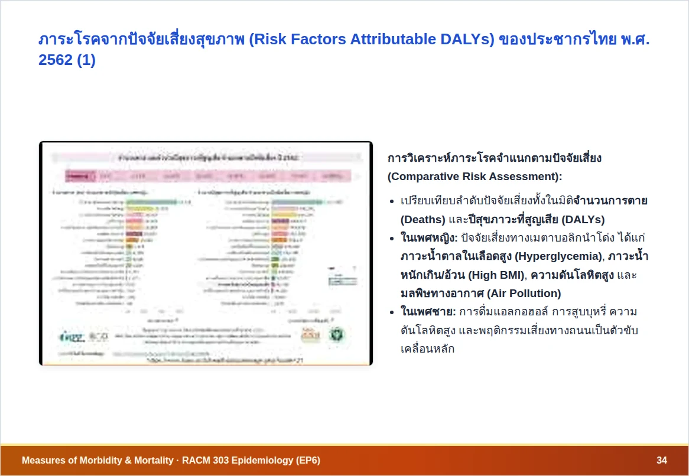

**1) Verbatim Quotation (คำพูดผู้สอนแบบคำต่อคำ):**
- **[46:50](https://www.youtube.com/watch?v=pPAfYlneRQA&t=2810s):** “เขาสามารถจำแนกตามปัจจัยเสี่ยง (Risk Factors) ด้วยนะ โดยคำนวณจาก DALYs แสดงคู่กันทั้งตามจำนวน Death และ DALYs... ปัจจัยเสี่ยงสำคัญในผู้หญิงไทยอันดับ 1 ก็คือเรื่องของ Hyperglycemia (น้ำตาลในเลือดสูง) รองลงมาเป็นโรคอ้วน ความดันโลหิตสูง แล้วก็ Air Pollution”

**2) Conceptualized Insight (การสังเคราะห์แนวคิดตาม Logical Flow):**
- **แก่นแนวคิดหลัก:** **การคำนวณ DALYs ที่เกิดจากปัจจัยเสี่ยง (Attributable Burden) แปลงรายชื่อโรคปลายน้ำให้กลายเป็นเป้าหมายการสร้างเสริมสุขภาพต้นน้ำ เช่น การคุมระดับน้ำตาล โรคอ้วน ความดันโลหิต แอลกอฮอล์ บุหรี่ และมลพิษทางอากาศ**
- **สูตร / โครงสร้างตัวชี้วัด:** `Top Metabolic & Environmental Risks: Hyperglycemia · High BMI · High BP · Air Pollution · Alcohol/Tobacco`
- สังเกตว่ามลพิษทางอากาศ (Air Pollution / PM2.5) ก้าวขึ้นมาติดกลุ่มปัจจัยเสี่ยงอันดับต้นๆ ของประชากรไทย เคียงคู่กับปัจจัยเสี่ยงทางเมตาบอลิก (น้ำตาล ความดัน อ้วน)
- **สะพานเชื่อมตรรกะ (Logical Flow):** *(รับช่วง)* เชื่อมจากภาระรายโรค (Disease ranking) มาสู่ปัจจัยเสี่ยงต้นเหตุ (Risk factor ranking) → *(ส่งต่อ)* ดูภาพเปรียบเทียบแนวโน้มการขยับอันดับปัจจัยเสี่ยงข้ามเวลาในสไลด์ 31 ก่อนสรุปประโยชน์เชิงนโยบาย

### Slide 31/43 (หน้าสไลด์ 35 · [47:37 – 47:47](https://www.youtube.com/watch?v=pPAfYlneRQA&t=2857s)): พลวัตการเปลี่ยนแปลงอันดับปัจจัยเสี่ยงของไทยข้ามช่วงเวลา

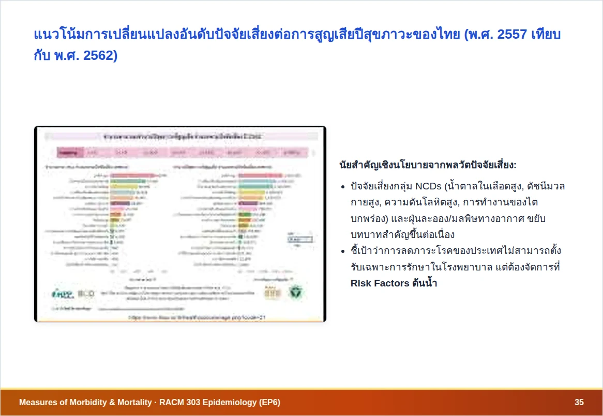

**1) Verbatim Quotation (คำพูดผู้สอนแบบคำต่อคำ):**
- **[47:38](https://www.youtube.com/watch?v=pPAfYlneRQA&t=2858s):** “อันนี้ก็แสดงแนวโน้มปัจจัยเสี่ยงต่อไปนะฮะ ทีนี้ประโยชน์ก็คือ เราคำนวณ DALY ไปทำไม เอาไปใช้ทำอะไรบ้าง”

**2) Conceptualized Insight (การสังเคราะห์แนวคิดตาม Logical Flow):**
- **แก่นแนวคิดหลัก:** **การติดตามอันดับปัจจัยเสี่ยงต่อเนื่องหลายปีช่วยให้ระบบสุขภาพเห็นทิศทางปัญหาที่กำลังทวีความรุนแรงขึ้นและปรับแผนป้องกันโรคได้ทันท่วงที**
- **สูตร / โครงสร้างตัวชี้วัด:** `Epidemiologic & Risk Transition: Behavioral + Metabolic + Environmental Risks`
- สะท้อนการเปลี่ยนผ่านทางระบาดวิทยาของไทยที่ปัจจัยเสี่ยงด้านเมตาบอลิกและสิ่งแวดล้อมเพิ่มบทบาทสูงขึ้นต่อเนื่อง
- **สะพานเชื่อมตรรกะ (Logical Flow):** *(รับช่วง)* เห็นหลักฐานเชิงประจักษ์ของทั้งภาระโรคและปัจจัยเสี่ยงของไทยครบถ้วน → *(ส่งต่อ)* สรุปรวมเป็น 5 ประโยชน์หลักของการวัดภาระโรคต่อการวางแผนบริการสุขภาพและงานวิจัยในสไลด์ 32

### Slide 32/43 (หน้าสไลด์ 36 · [47:47 – 48:37](https://www.youtube.com/watch?v=pPAfYlneRQA&t=2867s)): สรุป: ทำไมแพทย์และผู้กำหนดนโยบายต้องวัดภาระโรค (5 ประโยชน์หลัก)

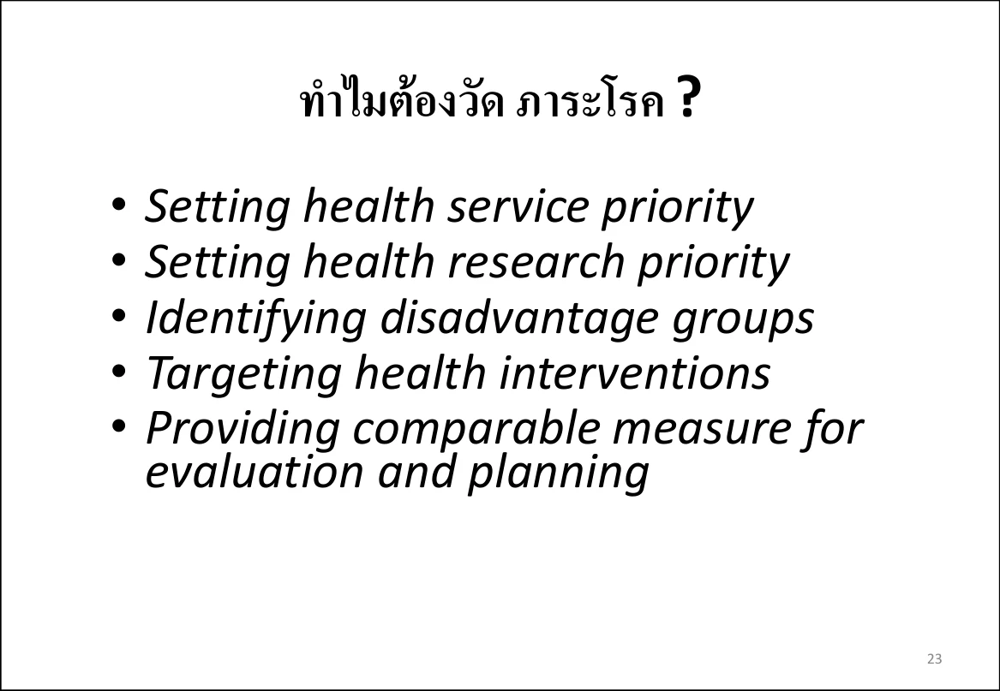

**1) Verbatim Quotation (คำพูดผู้สอนแบบคำต่อคำ):**
- **[47:49](https://www.youtube.com/watch?v=pPAfYlneRQA&t=2869s):** “ไม่ว่าคนทำนโยบายกระทรวงสาธารณสุข นายแพทย์ สสจ. ผู้อำนวยการโรงพยาบาล หรือแม้แต่หมอธรรมดา เราก็ต้องรู้ว่าปัญหา Burden ของประชากรที่เราดูแลเป็นยังไง เพื่อใช้ทำ Health Service Prioritization จัดลำดับความสำคัญบริการ ใช้กำหนดหัวข้อทำ Research และนำไปแก้ปัญหา”

**2) Conceptualized Insight (การสังเคราะห์แนวคิดตาม Logical Flow):**
- **แก่นแนวคิดหลัก:** **ข้อมูลภาระโรค (DALY) เป็นเข็มทิศจัดสรรทรัพยากรที่มีจำกัด ช่วยกำหนดลำดับความสำคัญของบริการสุขภาพ หัวข้อวิจัย กลุ่มเปราะบางที่ต้องช่วยเหลือเป็นพิเศษ และการประเมินผลแผนงานด้วยหน่วยวัดที่เปรียบเทียบกันได้**
- **สูตร / โครงสร้างตัวชี้วัด:** `Service Priority · Research Priority · Disadvantaged Groups · Targeting Interventions · Evaluation`
- เชื่อมกลับไปสู่วงจร 6 ขั้นตอนในสไลด์ที่ 4 อย่างสมบูรณ์: ไม่ใช่ความรู้สำหรับผู้บริหารระดับกระทรวงเท่านั้น แต่แพทย์ในโรงพยาบาลชุมชนก็ต้องใช้จัดลำดับปัญหาในพื้นที่รับผิดชอบ (รวมถึงการทำ Health Survey ภาคสนามปี 3)
- **สะพานเชื่อมตรรกะ (Logical Flow):** *(รับช่วง)* ปิดท้าย Stage 4 ด้วยการสังเคราะห์คุณค่าของการวัดภาระโรคต่อระบบสุขภาพ → *(ส่งต่อ)* ก้าวสู่องก์สุดท้าย (Stage 5): เมื่อเราต้องการ ‘เปรียบเทียบ’ อัตราตายหรือภาระโรคระหว่าง 2 พื้นที่หรือ 2 ประเทศ จะเปรียบเทียบอย่างไรไม่ให้ถูกโครงสร้างอายุหลอกตา?

## Stage 5 (48:37 – 62:00): การปรับมาตรฐานอัตรา (Standardization) เพื่อการเปรียบเทียบอย่างเป็นธรรม (Direct & Indirect Standardization, SMR & Choosing the Right Rate)

> **คำถามนำขององก์:** ทำไมจึงนำอัตราตายอย่างหยาบ (Crude Rate) ของสองประชากรที่มีโครงสร้างอายุต่างกันมาเทียบกันตรงๆ ไม่ได้ และเมื่อใดควรใช้ Direct vs. Indirect Standardization?
>
> **แก่นความคิดรวบยอด:** เมื่อโครงสร้างอายุต่างกัน Crude Rate จะถูกกวนด้วยสัดส่วนผู้สูงอายุ จึงต้องปรับด้วยประชากรมาตรฐานผ่าน Direct Standardization (เมื่อทราบอัตราตายจำเพาะกลุ่มอายุ) หรือ Indirect Standardization และ SMR (เมื่อไม่ทราบอัตราตายจำเพาะกลุ่มอายุหรือกลุ่มตัวอย่างเล็ก) โดยต้องรายงานคู่กันเสมอเพราะ Crude Rate คือขนาดปัญหาจริง ส่วน Adjusted Rate คือค่าสมมติเพื่อเปรียบเทียบ

### Slide 33/43 (หน้าสไลด์ 37 · [48:37 – 48:57](https://www.youtube.com/watch?v=pPAfYlneRQA&t=2917s)): บทนำสู่การปรับมาตรฐานอัตรา (Standardization): Direct vs. Indirect

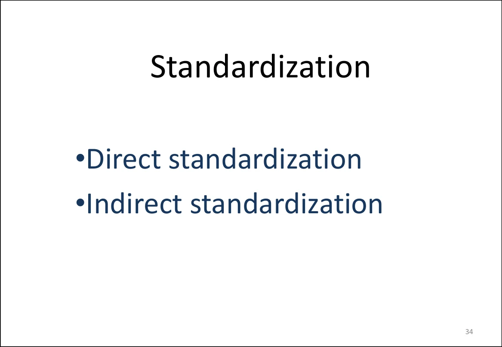

**1) Verbatim Quotation (คำพูดผู้สอนแบบคำต่อคำ):**
- **[48:38](https://www.youtube.com/watch?v=pPAfYlneRQA&t=2918s):** “เรื่องสุดท้ายของ Session นี้นะครับ คือเรื่อง Standardization การปรับมาตรฐาน ก็จะมีวิธีที่เป็น Direct กับ Indirect”

**2) Conceptualized Insight (การสังเคราะห์แนวคิดตาม Logical Flow):**
- **แก่นแนวคิดหลัก:** **การปรับมาตรฐานอัตรา (Standardization) คือเทคนิคทางระบาดวิทยาที่ใช้ขจัดอิทธิพลของตัวแปรกวนด้านโครงสร้างประชากร (โดยเฉพาะโครงสร้างอายุ) ก่อนนำอัตราการป่วยหรือการตายของสองประชากรมาเปรียบเทียบกัน**
- **สูตร / โครงสร้างตัวชี้วัด:** `Standardization: Removing Confounding by Population Structure (e.g., Age)`
- แบ่งเป็น 2 วิธีหลักตามความพร้อมของข้อมูลอัตราจำเพาะกลุ่มอายุในประชากรศึกษา ได้แก่ Direct Standardization และ Indirect Standardization
- **สะพานเชื่อมตรรกะ (Logical Flow):** *(รับช่วง)* เปิดประเด็นโจทย์การเปรียบเทียบตัวชี้วัดข้ามพื้นที่หรือข้ามประเทศ → *(ส่งต่อ)* สร้างสถานการณ์ปริศนา (Paradox) ระหว่างประชากร A และประชากร B เพื่อพิสูจน์ว่าทำไม Crude Death Rate จึงหลอกตาได้

### Slide 34/43 (หน้าสไลด์ 39 · [48:57 – 51:16](https://www.youtube.com/watch?v=pPAfYlneRQA&t=2937s)): กับดักของอัตราตายอย่างหยาบ (Crude Death Rate): ประชากร A (20%) แย่กว่า B (15%) จริงหรือ?

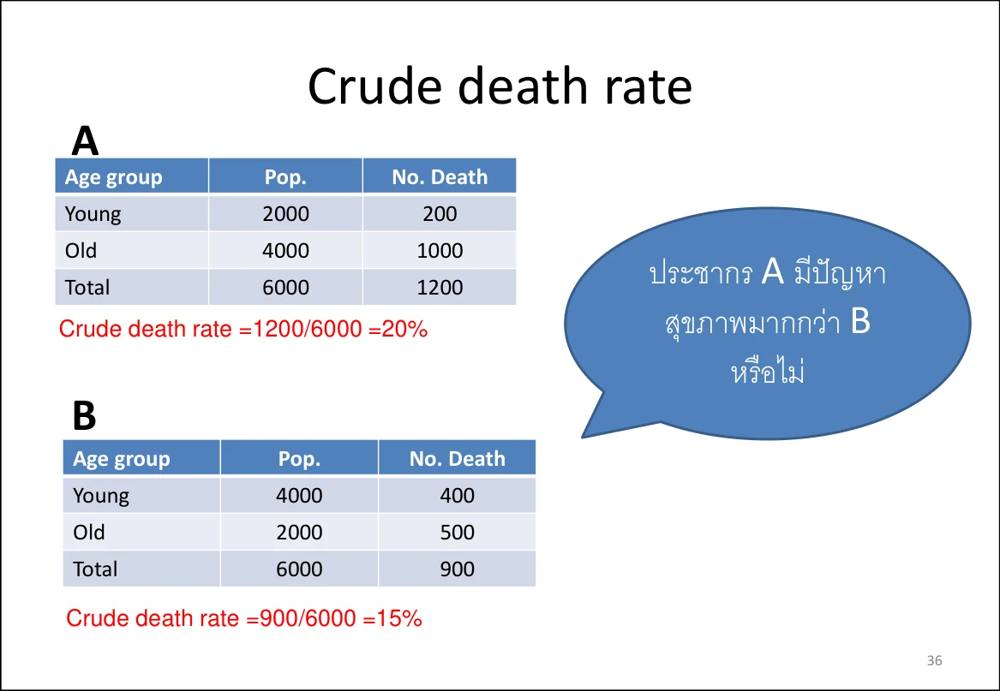

**1) Verbatim Quotation (คำพูดผู้สอนแบบคำต่อคำ):**
- **[49:45](https://www.youtube.com/watch?v=pPAfYlneRQA&t=2985s):** “เราจะเอา Death Rate ตรงๆ มาเปรียบเทียบกันได้ไหม? ยกตัวอย่าง Population A มี Death Rate 20% ส่วน Population B มี 15% พอมองปุ๊บบอกว่า A ปัญหาสุขภาพแย่กว่า B แน่เลย อันนี้สรุปได้ไหม?”
- **[50:25](https://www.youtube.com/watch?v=pPAfYlneRQA&t=3025s):** “ยังสรุปไม่ได้นะ! เพราะต้องไปดูโครงสร้างประชากร (Age structure) ก่อน จะเห็นว่า A มีผู้สูงอายุ (Old) ตั้ง 4,000 คน อายุน้อย 2,000 คน ส่วน B มีคนอายุน้อย 4,000 คน ผู้สูงอายุแค่ 2,000 คน คนอายุมากย่อมมีอัตราเสียชีวิตสูงกว่าเป็นธรรมดา”

**2) Conceptualized Insight (การสังเคราะห์แนวคิดตาม Logical Flow):**
- **แก่นแนวคิดหลัก:** **การนำ Crude Death Rate มาเปรียบเทียบกันโดยตรงอาจนำไปสู่ข้อสรุปที่ผิดพลาด เพราะโครงสร้างอายุทำหน้าที่เป็นตัวกวน (Confounder): ประชากรที่มีผู้สูงอายุสัดส่วนมากกว่าย่อมมี Crude Death Rate สูงกว่าแม้ความเสี่ยงรายกลุ่มอายุจะเท่ากันทุกประการ**
- **สูตร / โครงสร้างตัวชี้วัด:** `Pop A CDR = 1,200/6,000 = 20% (Old 4,000)  vs.  Pop B CDR = 900/6,000 = 15% (Old 2,000)`
- สังเกตในตารางอย่างละเอียด: ในวัยหนุ่มสาว (Young) ทั้ง A และ B ตาย 10% เท่ากัน (200/2,000 vs. 400/4,000) และในวัยสูงอายุ (Old) ทั้ง A และ B ก็ตาย 25% เท่ากัน (1,000/4,000 vs. 500/2,000)!
- ความต่าง 20% vs. 15% จึงไม่ได้เกิดจากระบบสุขภาพของ A แย่กว่า แต่เกิดจาก A มีผู้สูงอายุมากกว่า B ถึงสองเท่า
- **สะพานเชื่อมตรรกะ (Logical Flow):** *(รับช่วง)* พิสูจน์ให้เห็นกับตาว่า Crude Death Rate ถูกบิดเบือนด้วยโครงสร้างอายุอย่างไร → *(ส่งต่อ)* แสดงวิธีขจัดความลำเอียงนี้ด้วยการตั้ง ‘ประชากรมาตรฐาน (Standard Population)’ และคำนวณ Direct Standardized Rate

### Slide 35/43 (หน้าสไลด์ 41 · [51:16 – 51:46 และ 52:36 – 55:26](https://www.youtube.com/watch?v=pPAfYlneRQA&t=3076s)): การคำนวณ Direct Standardized Rate (Age-Adjusted Rate): พิสูจน์ความเท่ากันที่ 17.5%

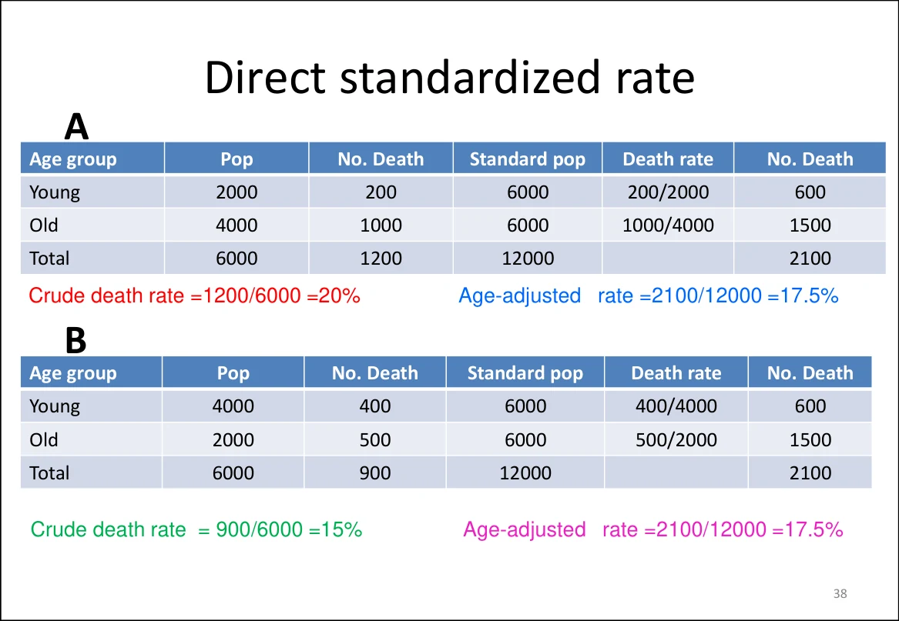

**1) Verbatim Quotation (คำพูดผู้สอนแบบคำต่อคำ):**
- **[52:42](https://www.youtube.com/watch?v=pPAfYlneRQA&t=3162s):** “สมมติ Standard Population มีกลุ่ม Young 6,000 คน กับ Old 6,000 คน รวมเป็น 12,000 คน แล้วเทียบบัญญัติไตรยางศ์เอา Age-specific death rate ของแต่ละกลุ่มไปคูณ: ใน A กลุ่ม Young ตาย (200/2,000)×6,000 = 600 คน กลุ่ม Old ตาย (1,000/4,000)×6,000 = 1,500 คน รวม Expected deaths = 2,100 หาร 12,000 ได้ Age-adjusted death rate = 17.5%”
- **[54:45](https://www.youtube.com/watch?v=pPAfYlneRQA&t=3285s):** “ส่วน B ใช้วิธีเดียวกัน: Young (400/4,000)×6,000 = 600, Old (500/2,000)×6,000 = 1,500 รวม 2,100 หาร 12,000 ออกมาเป็น 17.5% เท่ากันเป๊ะ! แฟร์ๆ กันเลยว่าถ้าเขามีโครงสร้างประชากรเหมือนกัน อัตราตายของ A กับ B จริงๆ ไม่ต่างกันเลย”

**2) Conceptualized Insight (การสังเคราะห์แนวคิดตาม Logical Flow):**
- **แก่นแนวคิดหลัก:** **Direct Standardization นำ ‘อัตราตายจำเพาะกลุ่มอายุจริงของแต่ละพื้นที่’ ไปคูณกับ ‘โครงสร้างประชากรมาตรฐานชุดเดียวกัน’ เพื่อตอบคำถามสมมติว่า หากทั้งสองพื้นที่มีโครงสร้างอายุเหมือนกันทุกประการ อัตราตายรวมของใครจะสูงกว่ากัน**
- **สูตร / โครงสร้างตัวชี้วัด:** `Age-Adjusted Rate = Σ (Age-Specific Rateᵢ × Standard Popᵢ) / Σ Standard Pop = 2,100 / 12,000 = 17.5%`
- ขั้นตอนคำนวณ 3 ขั้น: (1) หา Age-specific rate ของแต่ละพื้นที่ → (2) คูณกับจำนวนคนแต่ละกลุ่มอายุของ Standard population ได้จำนวนตายคาดหมาย → (3) รวมจำนวนตายคาดหมายทุกกลุ่มอายุแล้วหารด้วยขนาด Standard population ทั้งหมด
- ผลลัพธ์: จากเดิมที่ Crude rate ต่างกัน (20% vs. 15%) เมื่อปรับอายุแล้วได้ 17.5% เท่ากันทั้งคู่ พิสูจน์ว่าความเสี่ยงต่อการเสียชีวิตของทั้งสองประชากรไม่แตกต่างกัน
- **สะพานเชื่อมตรรกะ (Logical Flow):** *(รับช่วง)* แก้ปริศนาของสไลด์ 34 ด้วยการคำนวณ Direct Standardization จนเห็นผลลัพธ์ที่ปราศจากอคติโครงสร้างอายุ → *(ส่งต่อ)* ขยายความหลักการเลือก ‘ประชากรมาตรฐาน (Standard Population)’ 3 แนวทางที่ใช้จริงในงานวิจัยและระดับนานาชาติ

### Slide 36/43 (หน้าสไลด์ 40 · [51:46 – 52:36](https://www.youtube.com/watch?v=pPAfYlneRQA&t=3106s)): หลักการเลือกประชากรมาตรฐาน (Standard Population) 3 แนวทาง

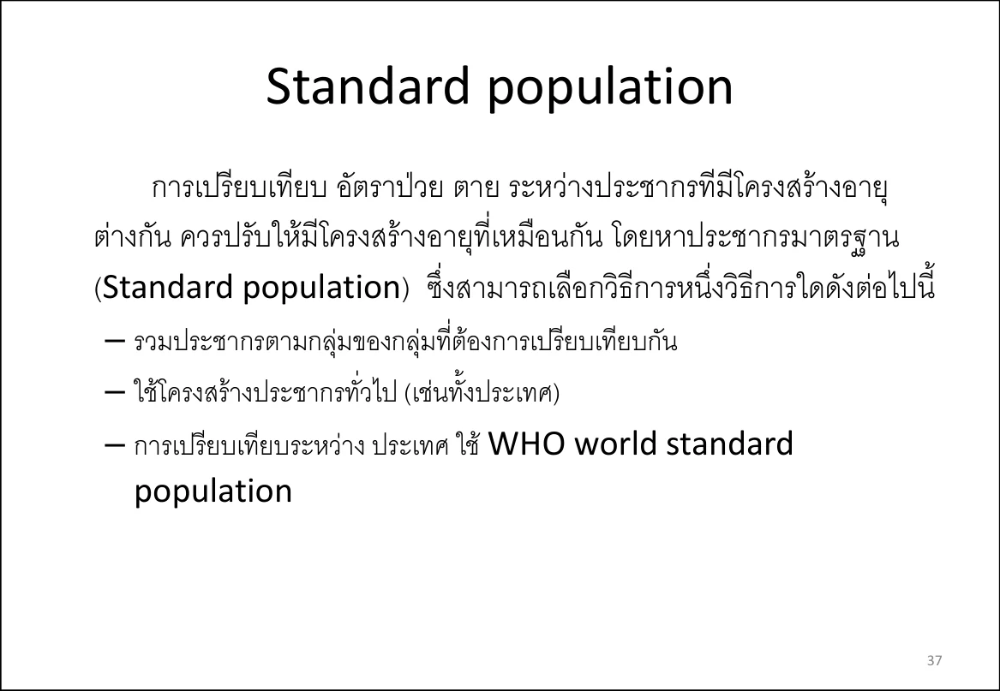

**1) Verbatim Quotation (คำพูดผู้สอนแบบคำต่อคำ):**
- **[51:50](https://www.youtube.com/watch?v=pPAfYlneRQA&t=3110s):** “เราต้องมี Standard Population เป็นตัวตั้งโครงสร้างประชากรก่อน อย่างถ้าเปรียบเทียบระหว่างประเทศ WHO เคยกำหนดไว้เลยว่า WHO World Standard Population มีสัดส่วนอายุทุกๆ 5 ปีเท่าไหร่ เวลาแต่ละประเทศจะเปรียบเทียบ Death rate ข้ามประเทศก็เอามาเทียบกับตัว Standard เดียวกันนี้”

**2) Conceptualized Insight (การสังเคราะห์แนวคิดตาม Logical Flow):**
- **แก่นแนวคิดหลัก:** **ประชากรมาตรฐานทำหน้าที่เป็น ‘ชุดน้ำหนักอายุกลาง (Common weights)’ ซึ่งเลือกได้ทั้งจากการนำประชากรสองกลุ่มที่เปรียบเทียบมารวมกัน การใช้โครงสร้างประชากรระดับประเทศ หรือการใช้ WHO World Standard Population สำหรับเปรียบเทียบข้ามประเทศ**
- **สูตร / โครงสร้างตัวชี้วัด:** `Standard Pop Options: 1) Pooled A+B  |  2) National Census  |  3) WHO World Standard Population`
- ดังตัวอย่างในสไลด์ 35 ที่ใช้ Young 6,000 + Old 6,000 = 12,000 คน ซึ่งเกิดจากการนำประชากรกลุ่ม A และ B ในแต่ละวัยมารวมกัน (Young: 2,000+4,000 = 6,000; Old: 4,000+2,000 = 6,000)
- **สะพานเชื่อมตรรกะ (Logical Flow):** *(รับช่วง)* อธิบายที่มาของตัวเลข 6,000 และ 6,000 ในตาราง Direct Standardization และมาตรฐานสากลของ WHO → *(ส่งต่อ)* ตั้งคำถามต่อ: แล้วถ้าในพื้นที่เล็กๆ (เช่น ชุมชนหรือโรงงาน) เรา ‘ไม่ทราบ’ อัตราตายจำเพาะกลุ่มอายุของพื้นที่นั้นล่ะ จะปรับมาตรฐานได้อย่างไร? นำไปสู่ Indirect Standardization

### Slide 37/43 (หน้าสไลด์ 42 · [55:26 – 55:36](https://www.youtube.com/watch?v=pPAfYlneRQA&t=3326s)): การปรับมาตรฐานทางอ้อม (Indirect Standardization): เมื่อข้อมูลจำเพาะกลุ่มอายุไม่สมบูรณ์

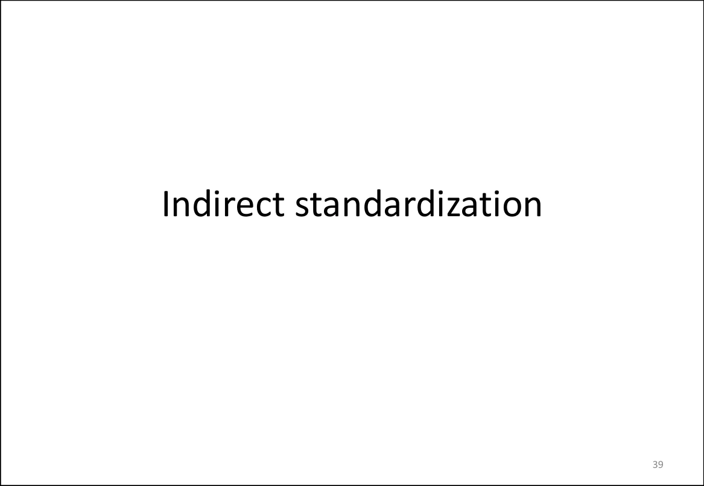

**1) Verbatim Quotation (คำพูดผู้สอนแบบคำต่อคำ):**
- **[55:27](https://www.youtube.com/watch?v=pPAfYlneRQA&t=3327s):** “อีกวิธีนึงคือ Indirect Standardization ใช้ในกรณีที่ข้อมูลกลุ่มย่อยไม่สมบูรณ์ หรือเราไม่รู้ Age-specific death rate ของพื้นที่ที่ศึกษา”

**2) Conceptualized Insight (การสังเคราะห์แนวคิดตาม Logical Flow):**
- **แก่นแนวคิดหลัก:** **Indirect Standardization เป็นทางออกเมื่อประชากรที่ศึกษามีขนาดเล็ก (เช่น โรงงาน นิคมอุตสาหกรรม หรือหมู่บ้าน) จนอัตราตายรายกลุ่มอายุแกว่งตัวสูง หรือทราบเพียงยอดผู้เสียชีวิตรวมแต่ไม่ทราบจำนวนตายแยกตามอายุ**
- **สูตร / โครงสร้างตัวชี้วัด:** `ใช้เมื่อ: ไม่ทราบ Age-Specific Rate ของกลุ่มศึกษา หรือประชากรกลุ่มย่อยมีขนาดเล็กเกินไป`
- แทนที่จะเอาอัตราตายของพื้นที่ไปคูณประชากรมาตรฐาน (แบบ Direct) เราจะพลิกกลับโดยเอา ‘อัตราตายจำเพาะกลุ่มอายุของประชากรมาตรฐาน’ มาคูณกับ ‘โครงสร้างอายุจริงของพื้นที่ศึกษา’ แทน!
- **สะพานเชื่อมตรรกะ (Logical Flow):** *(รับช่วง)* ชี้ข้อจำกัดด้านข้อมูลของ Direct Standardization เมื่อลงสู่พื้นที่ชุมชนหรือกลุ่มอาชีพขนาดเล็ก → *(ส่งต่อ)* เดินตามโจทย์คำนวณ Indirect Standardization ทีละขั้นในสไลด์ 38–41

### Slide 38/43 (หน้าสไลด์ 44 · [55:36 – 56:56](https://www.youtube.com/watch?v=pPAfYlneRQA&t=3336s)): โจทย์ Indirect Standardization (ขั้นที่ 1): ข้อมูลที่มีอยู่ในประชากรศึกษา A

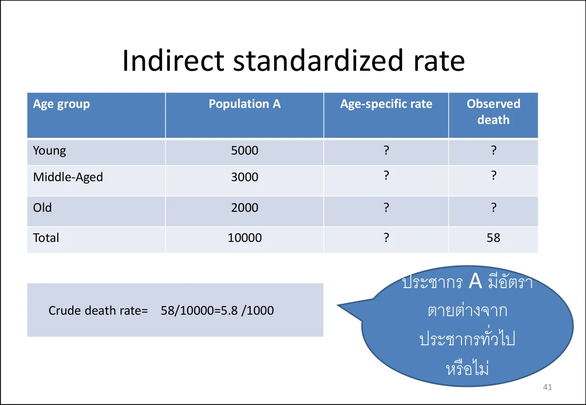

**1) Verbatim Quotation (คำพูดผู้สอนแบบคำต่อคำ):**
- **[55:55](https://www.youtube.com/watch?v=pPAfYlneRQA&t=3355s):** “สมมติในจังหวัดหนึ่ง ชุมชนหนึ่ง หรือในนิคมอุตสาหกรรมหนึ่ง มีคนตายรวม (Observed deaths) 58 ราย และรู้ว่าประชากรของเขามี 10,000 คน แบ่งเป็นแต่ละกลุ่มอายุเท่าไหร่ คิด Crude death rate ได้ 5.8 ต่อ 1,000 แต่เราไม่รู้ว่าใน 58 รายนี้ตายในแต่ละกลุ่มอายุกี่คน จึงทำ Direct ไม่ได้”

**2) Conceptualized Insight (การสังเคราะห์แนวคิดตาม Logical Flow):**
- **แก่นแนวคิดหลัก:** **ข้อมูลตั้งต้นเพียง 2 สิ่งที่ต้องมีของกลุ่มศึกษาในการทำ Indirect Standardization คือ (1) จำนวนประชากรแยกตามกลุ่มอายุของพื้นที่นั้น และ (2) จำนวนผู้เสียชีวิตรวมที่สังเกตได้จริง (Observed Deaths = 58 ราย)**
- **สูตร / โครงสร้างตัวชี้วัด:** `Pop A = 10,000 (Young 5,000 · Middle 3,000 · Old 2,000) · Observed Deaths = 58 (CDR = 5.8/1,000)`
- หากมองเผินๆ Crude death rate ของประชากร A เท่ากับ 5.8 ต่อ 1,000 ซึ่งดูต่ำกว่าประชากรทั่วไป (6.43 ต่อ 1,000 ในสไลด์ถัดไป) แต่เรายังสรุปไม่ได้จนกว่าจะตรวจโครงสร้างอายุ!
- **สะพานเชื่อมตรรกะ (Logical Flow):** *(รับช่วง)* กำหนดข้อมูลของชุมชน/นิคมอุตสาหกรรม A ที่ต้องการประเมินความเสี่ยงการตาย → *(ส่งต่อ)* ดึงตารางอัตราตายจำเพาะกลุ่มอายุของ ‘ประชากรทั่วไป (Standard Population)’ มาเป็นเกณฑ์อ้างอิงในสไลด์ 39

### Slide 39/43 (หน้าสไลด์ 45 · [56:56 – 57:16](https://www.youtube.com/watch?v=pPAfYlneRQA&t=3416s)): โจทย์ Indirect Standardization (ขั้นที่ 2): อัตราตายจำเพาะอายุของประชากรทั่วไป

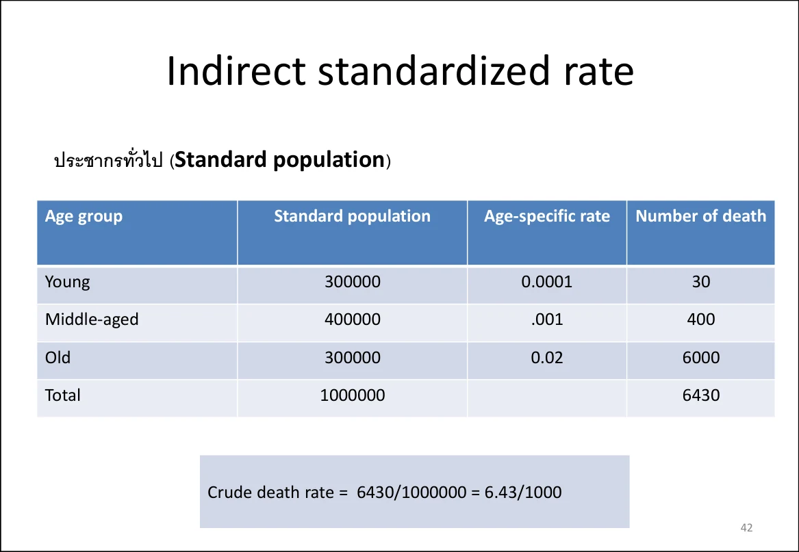

**1) Verbatim Quotation (คำพูดผู้สอนแบบคำต่อคำ):**
- **[56:57](https://www.youtube.com/watch?v=pPAfYlneRQA&t=3417s):** “อันนี้เป็นข้อมูลของประชากรทั่วไปซึ่งระดับประเทศมีข้อมูล Age-specific death rate อยู่แล้ว เราก็เอาตัว Age-specific rate มาตรฐานนี้ไปใช้คำนวณ”

**2) Conceptualized Insight (การสังเคราะห์แนวคิดตาม Logical Flow):**
- **แก่นแนวคิดหลัก:** **ในประชากรทั่วไปขนาดใหญ่ (เช่น ระดับประเทศ 1,000,000 คน) เรามีข้อมูลอัตราตายจำเพาะกลุ่มอายุที่มีความเสถียรสูง (0.0001, 0.001 และ 0.02) สำหรับนำมายืมใช้เป็นเกณฑ์มาตรฐานคาดหมาย**
- **สูตร / โครงสร้างตัวชี้วัด:** `Standard Rates: Young = 0.0001  |  Middle-Aged = 0.001  |  Old = 0.02  (General CDR = 6.43/1,000)`
- สังเกตโครงสร้างประชากรทั่วไป: มีผู้สูงอายุ 300,000 จาก 1,000,000 คน (30%) ขณะที่ประชากร A มีผู้สูงอายุเพียง 2,000 จาก 10,000 คน (20%)
- **สะพานเชื่อมตรรกะ (Logical Flow):** *(รับช่วง)* ได้อัตราตายมาตรฐานรายกลุ่มอายุจากประชากรทั่วไปครบทั้ง 3 ช่วงวัย → *(ส่งต่อ)* นำอัตราตายมาตรฐานทั้ง 3 ค่านี้ไปคูณกับจำนวนคนแต่ละวัยของประชากร A เพื่อหา ‘จำนวนตายที่คาดหมาย (Expected Deaths)’ ในสไลด์ 40

### Slide 40/43 (หน้าสไลด์ 46 · [57:16 – 58:16](https://www.youtube.com/watch?v=pPAfYlneRQA&t=3436s)): โจทย์ Indirect Standardization (ขั้นที่ 3): คำนวณจำนวนการตายคาดหมาย (Expected Deaths)

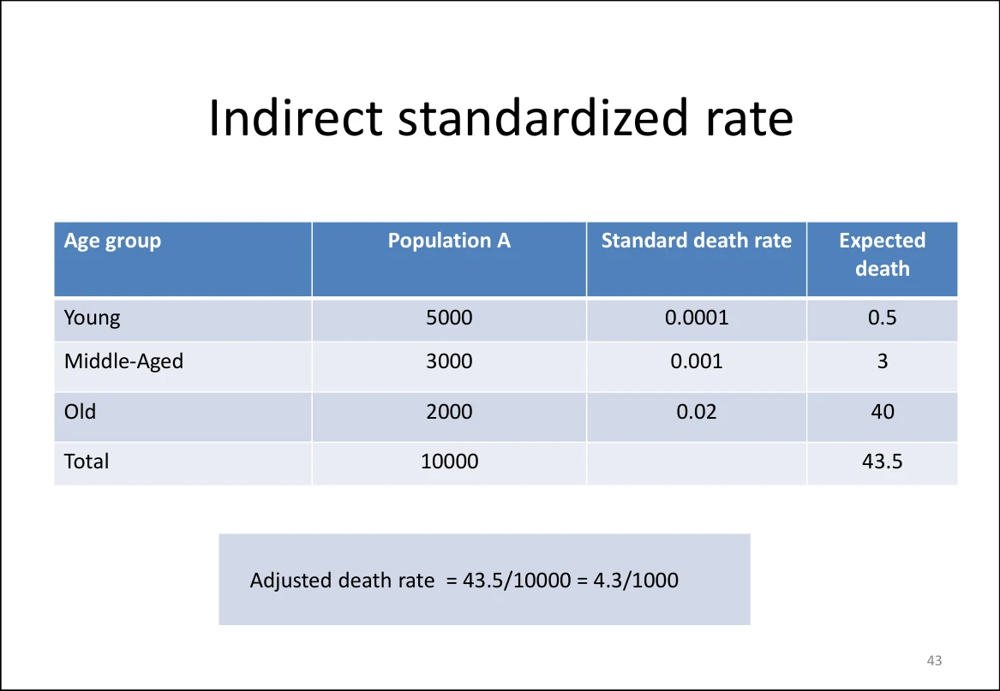

**1) Verbatim Quotation (คำพูดผู้สอนแบบคำต่อคำ):**
- **[57:18](https://www.youtube.com/watch?v=pPAfYlneRQA&t=3438s):** “เอา Age-specific rate ที่เป็น Standard ในแต่ละกลุ่มอายุ ไปคูณกับจำนวน Population A ก็จะได้ค่า Expected deaths ของแต่ละกลุ่มอายุแล้วเอามารวมกัน ได้ 43.5 ราย (หรือคิดเป็น 4.35 ต่อ 1,000)”
- **[57:54](https://www.youtube.com/watch?v=pPAfYlneRQA&t=3474s):** “ก็จะเห็นว่า Expected deaths (43.5 ราย) มันน้อยกว่า Observed ในของจริงที่ตาย 58 ราย! เราก็เอาสองตัวนี้มาเทียบ Relative กัน”

**2) Conceptualized Insight (การสังเคราะห์แนวคิดตาม Logical Flow):**
- **แก่นแนวคิดหลัก:** **จำนวนตายคาดหมาย (Expected Deaths = 43.5 ราย) ตอบคำถามว่า ‘หากคนในชุมชน A เสียชีวิตด้วยอัตราเดียวกับคนทั่วไปในวัยเดียวกัน ชุมชน A ควรมีผู้เสียชีวิตเพียง 43.5 รายเท่านั้น’ การที่ตายจริงถึง 58 รายจึงชี้ว่ามีความเสี่ยงส่วนเกินซ่อนอยู่!**
- **สูตร / โครงสร้างตัวชี้วัด:** `Expected Deaths = (5,000×0.0001) + (3,000×0.001) + (2,000×0.02) = 0.5 + 3 + 40 = 43.5 ราย`
- พลิกผลลัพธ์อย่างน่าทึ่ง: ตอนดู Crude rate ชุมชน A ดูเหมือนตายต่ำกว่าประเทศ (5.8 vs. 6.43 ต่อพัน) เพราะชุมชน A มีคนหนุ่มสาวเยอะ แต่พอคำนวณ Expected deaths แล้ว ชุมชน A กลับตายจริง (58) สูงกว่าที่ควรจะเป็น (43.5)!
- **สะพานเชื่อมตรรกะ (Logical Flow):** *(รับช่วง)* คำนวณยอดตายคาดหมาย (Expected = 43.5) เทียบกับยอดตายจริง (Observed = 58) → *(ส่งต่อ)* สรุปอัตราส่วนเปรียบเทียบระหว่าง Observed กับ Expected ออกมาเป็นดัชนีมาตรฐาน SMR ในสไลด์ 41

### Slide 41/43 (หน้าสไลด์ 47 · [58:16 – 58:56](https://www.youtube.com/watch?v=pPAfYlneRQA&t=3496s)): อัตราส่วนการตายมาตรฐาน (Standardized Mortality Ratio: SMR = 1.3)

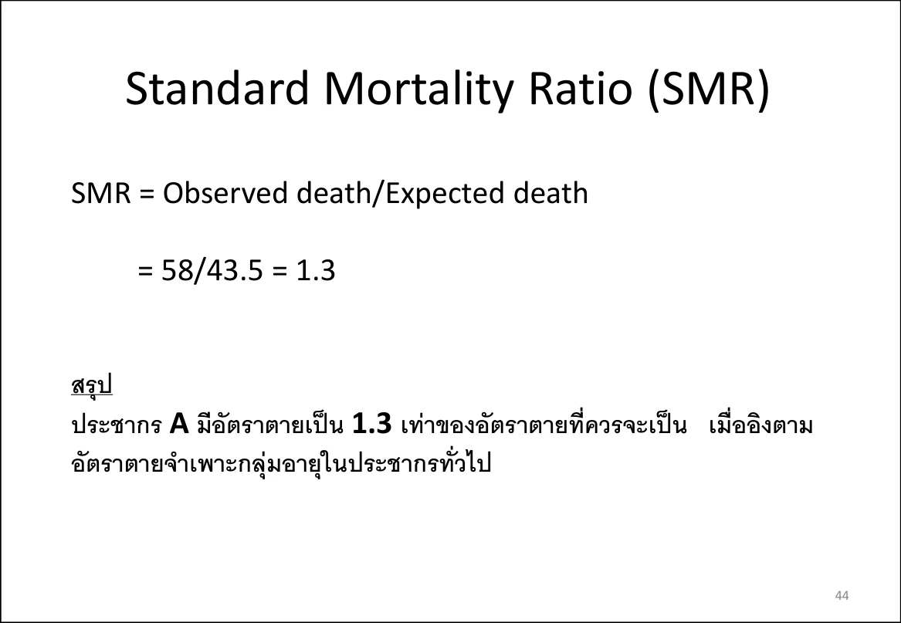

**1) Verbatim Quotation (คำพูดผู้สอนแบบคำต่อคำ):**
- **[58:20](https://www.youtube.com/watch?v=pPAfYlneRQA&t=3500s):** “เอา Observed หารด้วย Expected ก็จะเห็นว่าของจริงเป็น 1.3 เท่าของที่เราคาดว่าควรจะเป็นถ้ามีอัตราตายแบบประชากรทั่วไป แปลว่าอัตราตายในประชากร A สูงกว่าที่ควรจะเป็นเมื่อปรับตามโครงสร้างอายุแล้ว”

**2) Conceptualized Insight (การสังเคราะห์แนวคิดตาม Logical Flow):**
- **แก่นแนวคิดหลัก:** **ค่า SMR เปรียบเทียบจำนวนตายจริงต่อจำนวนตายคาดหมาย: หาก SMR = 1.0 แปลว่าไม่ต่างจากประชากรมาตรฐาน, SMR > 1.0 (เช่น 1.3) แปลว่าตายสูงกว่าเกณฑ์คาดหมายร้อยละ 30 และ SMR < 1.0 แปลว่าตายต่ำกว่าเกณฑ์คาดหมาย**
- **สูตร / โครงสร้างตัวชี้วัด:** `SMR = Observed Deaths / Expected Deaths = 58 / 43.5 = 1.33 (≈ 1.3 เท่า หรือสูงกว่าเกณฑ์ 30%)`
- นิยมใช้มากในอาชีวอนามัยและอนามัยสิ่งแวดล้อม เช่น การตรวจสอบว่าคนงานในนิคมอุตสาหกรรม (ซึ่งมักเป็นวัยหนุ่มสาวสุขภาพดี) มีอัตราตายจากมะเร็งสูงกว่าประชากรทั่วไปในวัยเดียวกันหรือไม่
- **สะพานเชื่อมตรรกะ (Logical Flow):** *(รับช่วง)* สรุปผลลัพธ์ของ Indirect Standardization ออกมาเป็นค่า SMR = 1.3 และการแปลผลที่ชัดเจน → *(ส่งต่อ)* เมื่อรู้จักครบทั้ง Crude Rate, Specific Rate และ Adjusted Rate แล้ว สไลด์ถัดไปจึงสังเคราะห์ข้อดี–ข้อจำกัดเพื่อเลือกใช้ให้ถูกวัตถุประสงค์

### Slide 42/43 (หน้าสไลด์ 48 · [58:56 – 60:26](https://www.youtube.com/watch?v=pPAfYlneRQA&t=3536s)): ตารางสังเคราะห์ข้อดี–ข้อจำกัด: Crude Rates vs. Specific Rates vs. Adjusted Rates

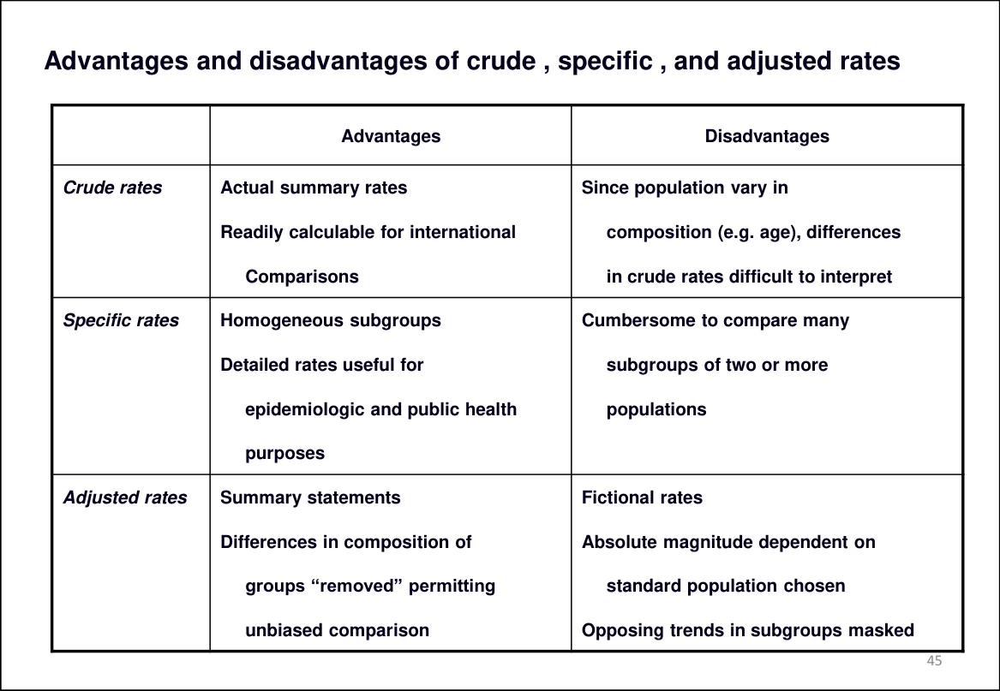

**1) Verbatim Quotation (คำพูดผู้สอนแบบคำต่อคำ):**
- **[59:12](https://www.youtube.com/watch?v=pPAfYlneRQA&t=3552s):** “เวลาเรานำเสนอ เราก็นำเสนอทั้ง 2 ตัวควบคู่กันนะ: ถ้าต้องการเปรียบเทียบระหว่าง Population ว่าใครมีปัญหามากกว่ากัน ต้องทำเป็น Standardized (Adjusted) rate”
- **[59:38](https://www.youtube.com/watch?v=pPAfYlneRQA&t=3578s):** “แต่ต้องแสดงคู่กับ Crude rate ด้วย เพราะ Crude rate มันเป็น ‘ของจริง’ ที่เกิดขึ้นในพื้นที่เพื่อเอาไปวางแผนแก้ปัญหา ส่วน Adjusted rate มัน ‘ไม่ใช่ของจริง (Fictional rate)’ เพราะเป็นการเทียบกับ Standard population เพื่อวัตถุประสงค์ในการเปรียบเทียบเท่านั้น ส่วน Specific rate ก็ละเอียดดีแต่ละกลุ่มอายุ แต่ดูภาพรวมยากเมื่อมีหลายกลุ่ม”

**2) Conceptualized Insight (การสังเคราะห์แนวคิดตาม Logical Flow):**
- **แก่นแนวคิดหลัก:** **ห้ามใช้ Adjusted Rate แทนค่าภาระงานจริงของโรงพยาบาล เพราะ Adjusted Rate เป็น ‘ค่าสมมติ (Fictional rate)’ ที่เปลี่ยนไปตามประชากรมาตรฐานที่เลือกใช้ หลักปฏิบัติที่ดีที่สุดจึงต้องรายงาน Crude Rate (ขนาดปัญหาจริง) คู่กับ Adjusted Rate (เพื่อเปรียบเทียบ) และตรวจสอบ Specific Rates เสมอ**
- **สูตร / โครงสร้างตัวชี้วัด:** `Crude = ขนาดปัญหาจริงในพื้นที่  |  Specific = เจาะลึกกลุ่มย่อย  |  Adjusted = ค่าสมมติเพื่อเปรียบเทียบอย่างเป็นธรรม`
- ข้อควรระวังสำคัญของ Adjusted Rate: หากแนวโน้มในคนอายุน้อยกับผู้สูงอายุสวนทางกัน (Opposing trends in subgroups) การยุบรวมเป็นค่าเฉลี่ยปรับมาตรฐานตัวเดียวอาจบดบังความแตกต่างที่สำคัญในกลุ่มย่อยได้
- **สะพานเชื่อมตรรกะ (Logical Flow):** *(รับช่วง)* ตกผลึกหลักการเลือกใช้และรายงานอัตราทั้ง 3 ประเภทในงานวิจัยและรายงานสาธารณสุข → *(ส่งต่อ)* เชื่อมโยงทุกแนวคิดตั้งแต่ต้นคาบเข้าสู่สไลด์สรุปภาพรวม (Conclusion) และการนำไปใช้ใน Health Survey ภาคสนาม

### Slide 43/43 (หน้าสไลด์ 49 · [60:26 – 62:00 (ช่วงถามตอบถึง 63:25)](https://www.youtube.com/watch?v=pPAfYlneRQA&t=3626s)): บทสรุปรวมทั้งคาบ (Conclusion) และการเชื่อมโยงสู่การทำ Health Survey ภาคสนาม

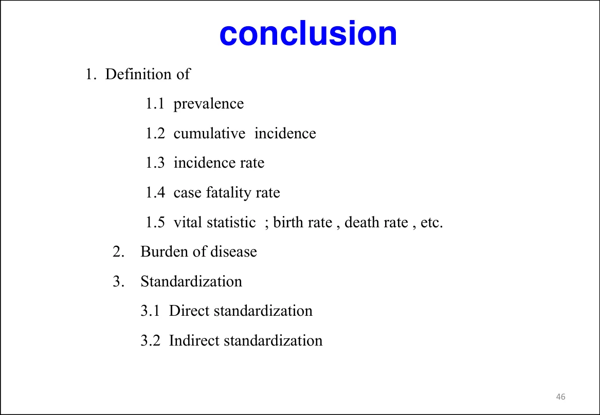

**1) Verbatim Quotation (คำพูดผู้สอนแบบคำต่อคำ):**
- **[60:28](https://www.youtube.com/watch?v=pPAfYlneRQA&t=3628s):** “จบแล้วนะฮะของ Session แรก เราก็เรียนเรื่อง Prevalence (Point กับ Period), Incidence ก็มี Cumulative Incidence ซึ่งตัวตั้งตัวหารเป็นคน บางทีเราเรียกว่าเป็น Risk หรือโอกาสของการเกิดโรค ต่อมาก็เป็น Incidence Rate หารด้วยจำนวนเวลาที่มีความเสี่ยง แล้วก็ Vital Statistics, DALY = YLL + YLD และสุดท้าย Standardization ซึ่งที่ใช้มากคือ Direct Standardization”
- **[62:59](https://www.youtube.com/watch?v=pPAfYlneRQA&t=3779s):** “ตอนที่เราไปทำ Health Survey ภาคสนามเนี่ย เราต้องใช้คำพวกนี้เยอะเลยนะฮะ เดี๋ยวอาจารย์จะไปเรื่องที่ 2 ต่อคือเรื่อง Health Survey”

**2) Conceptualized Insight (การสังเคราะห์แนวคิดตาม Logical Flow):**
- **แก่นแนวคิดหลัก:** **ตัวชี้วัดทั้งระบบในคาบนี้ทำหน้าที่ต่อเนื่องเป็นสายพานเดียว: วัดความชุกและอุบัติการณ์ของการป่วย → วัดความรุนแรงและสถิติชีพของการตาย → รวมความสูญเสียเป็น DALY → และปรับมาตรฐานด้วย Standardization เพื่อให้เปรียบเทียบและวางแผนแก้ไขปัญหาสุขภาพชุมชนได้อย่างเที่ยงตรง**
- **สูตร / โครงสร้างตัวชี้วัด:** `Prevalence (Point/Period) · Incidence (CI=Risk, IR=Velocity) · CFR & Vital Stats · DALY (YLL+YLD) · Standardization`
- เชื่อมต่อโดยตรงสู่คาบ EP7 (Health Survey) และการออกภาคสนาม RACM 303 ทั้ง 9 โรงพยาบาลชุมชน ซึ่งนักศึกษาจะต้องเลือกวัด Point/Period Prevalence ของปัญหาสุขภาพในชุมชนอย่างถูกต้องตามหลักระบาดวิทยา
- **สะพานเชื่อมตรรกะ (Logical Flow):** *(รับช่วง)* รวบยอดโครงข่ายความรู้ทั้ง 5 องก์ตั้งแต่สไลด์ที่ 1 ถึง 43 ให้เห็นภาพรวมที่เป็นเอกภาพ → *(ส่งต่อ)* ส่งไม้ต่อเข้าสู่คาบถัดไป (EP7: Health Survey) และการฝึกทำโจทย์ใน Exercise 5

## ตารางทบทวนสาระสำคัญ (Rapid Review Matrix · 15 ตัวชี้วัดหลัก)

| ตัวชี้วัด (Indicator) | สูตร / โครงสร้างเศษส่วน | ประเภท | แก่นแนวคิดและข้อควรระวังในการแปลผล |
|---|---|---|---|
| **Ratio (อัตราส่วน)** | `A / B` | Ratio | ตัวตั้งไม่ได้เป็นสับเซตของตัวหาร (เช่น ชาย : หญิง, ป่วย : ไม่ป่วย) |
| **Proportion (สัดส่วน)** | `A / (A + B)` | Proportion (0–1 หรือ %) | ตัวตั้งเป็นส่วนหนึ่งของตัวหารในช่วงเวลาเดียวกัน ไม่มีหน่วยเวลา |
| **Rate (อัตราแท้จริง)** | `Events / Σ Person-Time` | True Rate (ต่อคน-เวลา) | วัดความเร็ว (Velocity) ของการเกิดเหตุการณ์ต่อผลรวมเวลาเสี่ยงรายบุคคล |
| **Point Prevalence** | `ผู้ป่วยทั้งหมด ณ จุดเวลา t / ประชากรทั้งหมด ณ t` | Proportion | รวมผู้ป่วยเก่า+ใหม่ ณ จุดเวลาเดียว เหมาะใช้วางแผนภาระงานบริการและ Health Survey |
| **Period Prevalence** | `ผู้ป่วยเก่า ณ ต้นช่วง + รายใหม่ตลอดช่วง / ประชากร` | Proportion | วัดยอดผู้ที่เคยป่วยทุกคนในช่วงเวลาที่กำหนด (เช่น รอบ 1 ปี) |
| **Cumulative Incidence (CI)** | `ผู้ป่วยรายใหม่ในช่วงเวลา / ประชากรปลอดโรคเมื่อเริ่มศึกษา` | Proportion (Risk) | วัด ‘ความเสี่ยง (Risk)’ ของการเกิดโรคใหม่ ต้องตัดผู้ป่วยเดิมออกจากตัวหารเสมอ |
| **Incidence Rate (IR / ID)** | `ผู้ป่วยรายใหม่ / ผลรวมระยะเวลาปลอดโรค (Person-Years)` | True Rate | แม่นยำที่สุดเมื่อติดตามคนนานไม่เท่ากัน มีการตายหรือขาดการติดตาม (Loss to F/U) |
| **ความสัมพันธ์ P กับ I** | `Prevalence ≈ Incidence × Duration` | Steady-State Pool | โรคเรื้อรังที่ยารักษาดีขึ้นจนคนไข้ไม่ตาย (Duration ยาวขึ้น) จะทำให้ Prevalence สูงขึ้น |
| **Case Fatality Rate (CFR)** | `(ตายจากโรค X / ผู้ป่วยโรค X) × 100` | Proportion (%) | บอก ‘ความรุนแรงของโรค’ (เช่น พิษสุนัขบ้า ~100%) ต่างจาก Cause-specific DR ที่หารด้วยประชากรรวม |
| **CBR & CDR** | `(เกิดมีชีพ หรือ ตายทั้งหมด / ประชากรกลางปี) × 1,000` | Vital Statistics | ไทยปัจจุบัน CDR (~8/1,000) สูงกว่า CBR (~7/1,000) เข้าสู่สังคมสูงวัยและประชากรเริ่มลดลง |
| **IMR & MMR** | `ทารกตาย <1 ปี (หรือแม่ตาย) / เด็กเกิดมีชีพ × 1,000` | Vital Statistics | ดัชนีไวต่อคุณภาพระบบบริการอนามัยแม่และเด็กและปัจจัยกำหนดสุขภาพทางสังคม |
| **LE vs. HALE** | `eₓ = Tₓ / lₓ  |  Gap = LE − HALE` | Life Table | คนไทยอายุยืนขึ้น (หญิง ~78–80 ปี) แต่มีช่วงท้าย ~8–9 ปีที่อยู่กับโรคเรื้อรัง/ความพิการ |
| **DALY (ภาระโรค)** | `DALY = YLL (N × L) + YLD (P × DW)` | Composite Burden | 1 DALY = 1 ปีสุขภาวะดีที่สูญเสีย รวมทั้งการตายก่อนวัยอันควรและความพิการถ่วงน้ำหนัก DW |
| **Direct Standardization** | `Σ (Age-Specific Rateᵢ × Std Popᵢ) / Σ Std Pop` | Age-Adjusted Rate | ใช้เมื่อทราบอัตราตายจำเพาะอายุของกลุ่มศึกษา เป็นค่าสมมติเพื่อเปรียบเทียบอย่างเป็นธรรม |
| **Indirect & SMR** | `SMR = Observed Deaths / Σ (Std Rateᵢ × Pop Aᵢ)` | Ratio (SMR) | ใช้เมื่อไม่ทราบอัตราตายจำเพาะอายุของพื้นที่หรือกลุ่มเล็ก SMR > 1 แปลว่าตายสูงกว่าที่คาดหมาย |
