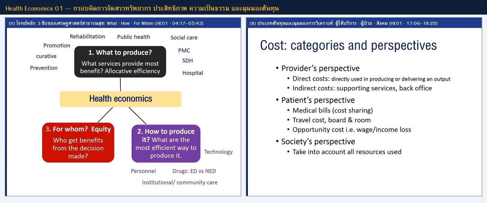
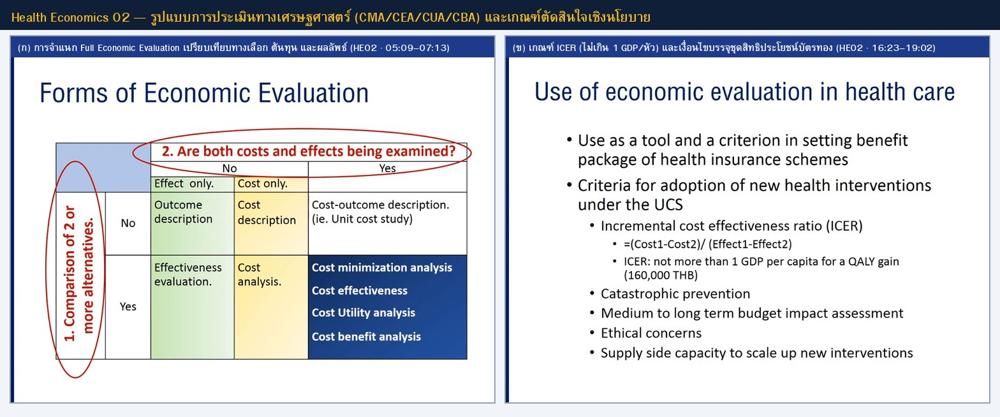

# HS3: หน้าที่ของระบบสุขภาพ (Functions of Health Systems) และคุณลักษณะของระบบบริการสุขภาพที่พึงประสงค์ (Desirable Characteristics of Health Services Systems)

ภูษิต ประคองสาย

ปวินท์ ศรีวิเชียร

ปรับปรุงจากฉบับของ ผศ.ดร.นพ. บวรศม ลีระพันธ์

## วัตถุประสงค์การเรียนรู้และคำถามนำ

| วัตถุประสงค์การเรียนรู้ | คำถามนำ |
| --- | --- |
| 1. **คุณลักษณะที่พึงประสงค์ในฐานะสัญญาณล่วงหน้า (desirable characteristics as early signals)** อธิบายความหมายของคุณลักษณะที่พึงประสงค์ของระบบบริการสุขภาพ ความเชื่อมโยงระหว่างองค์ประกอบของระบบบริการสุขภาพ คุณลักษณะที่พึงประสงค์ และเป้าหมายของระบบสุขภาพ ตลอดจนเหตุผลที่คุณลักษณะของกระบวนการทำหน้าที่เป็นสัญญาณล่วงหน้าของผลลัพธ์ตามตรรกะโครงสร้าง กระบวนการ และผลลัพธ์ | 1. เหตุใดคุณลักษณะของกระบวนการในระบบบริการสุขภาพจึงบอกล่วงหน้าได้ว่าระบบจะบรรลุเป้าหมายหรือไม่ (Why do the characteristics of health service processes signal in advance whether a system will achieve its goals?) |
| 2. **ความเป็นธรรมของระบบบริการสุขภาพและการเงินสุขภาพ (equity in health services and health financing)** แยกความแตกต่างระหว่างความเป็นธรรมกับความเท่าเทียม อธิบายแนวคิดพื้นฐานเรื่องความเป็นธรรมในการจัดสรรทรัพยากร จำแนกมิติของการเข้าถึงบริการสุขภาพ และวิเคราะห์ผลของกลไกการเงินด้านสุขภาพแต่ละแบบต่อความเป็นธรรมและการคุ้มครองทางการเงิน | 2. ระบบบริการสุขภาพที่เป็นธรรมมีลักษณะอย่างไร ความเป็นธรรมมีพื้นฐานมาจากหลักความเป็นธรรมใด และกลไกการเงินด้านสุขภาพส่งเสริมหรือบั่นทอนความเป็นธรรมได้อย่างไร (What makes a health services system equitable, which principles of justice underlie equity, and how can health financing mechanisms promote or undermine it?) |
| 3. **คุณภาพของบริการสุขภาพและความครอบคลุมอย่างมีประสิทธิผล (quality of care and effective coverage)** อธิบายพัฒนาการของแนวคิดคุณภาพบริการสุขภาพ วิเคราะห์มิติของคุณภาพตามกรอบความปลอดภัย ประสิทธิผล ความทันเวลา และการมีผู้ป่วยเป็นศูนย์กลาง และแปลผลความครอบคลุมอย่างมีประสิทธิผลโดยแยกความจำเป็น การได้รับบริการ และคุณภาพออกจากกัน | 3. บริการสุขภาพที่มีคุณภาพมีลักษณะอย่างไร แนวคิดคุณภาพพัฒนามาอย่างไร และการที่ประชาชนได้รับบริการแล้วเพียงพอหรือไม่ที่จะสรุปว่าบริการนั้นทำให้สุขภาพดีขึ้น (What defines quality in health services, how did the concept develop, and is service use sufficient evidence that care improves health?) |
| 4. **ประสิทธิภาพของระบบบริการสุขภาพและการประเมินเทคโนโลยีด้านสุขภาพ (efficiency and health technology assessment)** อธิบายแนวคิดพื้นฐานของประสิทธิภาพจากความขาดแคลน ต้นทุนค่าเสียโอกาส มุมมองต้นทุน และประสิทธิภาพแบบพาเรโต เปรียบเทียบประสิทธิภาพเชิงเทคนิค ประสิทธิภาพเชิงการผลิต และประสิทธิภาพในการจัดสรรทรัพยากร และอธิบายบทบาทของการประเมินทางเศรษฐศาสตร์และการประเมินเทคโนโลยีด้านสุขภาพในการลดความสูญเปล่าโดยไม่กระทบต่อความเป็นธรรมและความปลอดภัยของผู้ป่วย | 4. เหตุใดระบบบริการสุขภาพจึงต้องเลือกวิธีใช้ทรัพยากรที่มีจำกัด และจะใช้ทรัพยากรนั้นให้เกิดประโยชน์สูงสุดโดยไม่กระทบความปลอดภัยและความเป็นธรรมได้อย่างไร (Why must a health services system choose how to use scarce resources, and how can it obtain the greatest benefit without compromising safety and equity?) |
| 5. **ธรรมาภิบาล ภาระรับผิดชอบต่อสังคม และความสอดคล้องกับบริบท (good governance, social accountability, and relevance)** อธิบายความหมายและที่มาของการอภิบาล ภาระรับผิดชอบ และการกำกับดูแลระบบอย่างรับผิดชอบต่อส่วนรวม วิเคราะห์หลักธรรมาภิบาลของระบบบริการสุขภาพโดยเฉพาะภาระรับผิดชอบต่อสังคมและความสอดคล้องกับปัญหาสุขภาพตามบริบทของสังคม และยกตัวอย่างกลไกที่ทำให้สังคมตรวจสอบระบบบริการสุขภาพได้ | 5. การอภิบาลระบบบริการสุขภาพที่ดีมีลักษณะอย่างไร แนวคิดภาระรับผิดชอบมีที่มาอย่างไร และระบบบริการสุขภาพต้องรับผิดชอบต่อสังคมในเรื่องใด (What characterizes good governance of a health services system, where does the idea of accountability come from, and for what is the system accountable to society?) |
| 6. **ความยืดหยุ่นและความสามารถในการปรับตัวของระบบสุขภาพ (health system resilience)** อธิบายที่มาของแนวคิดความยืดหยุ่นจากนิเวศวิทยาและระบบความเชื่อมโยงระหว่างสังคมกับสิ่งแวดล้อม วิเคราะห์ความสามารถในการรองรับวิกฤตเบื้องต้น การปรับวิธีทำงาน และการปฏิรูปโครงสร้างระบบ และระบุปัจจัยที่ช่วยให้ระบบคงบริการพื้นฐานไว้ได้ในภาวะวิกฤตโดยไม่ผลักภาระเกินควรแก่บุคลากรด่านหน้า | 6. แนวคิดความสามารถในการปรับตัวของระบบมีที่มาอย่างไร และระบบสุขภาพจะรักษาบริการที่จำเป็นไว้ได้อย่างไรเมื่อเผชิญวิกฤต รวมทั้งเรียนรู้จากวิกฤตเพื่อรับมือกับอนาคต (Where does the concept of resilience come from, and how can a health system sustain essential services during a crisis and learn from it to prepare for the future?) |
| 7. **บริบทระบบสุขภาพไทยและการประเมินด้วยหลายเกณฑ์ร่วมกัน (Thai health system context and multi-criteria assessment)** อธิบายฐานคุณค่าของแนวคิดระบบสุขภาพไทยและธรรมนูญว่าด้วยระบบสุขภาพแห่งชาติ วิเคราะห์ความครอบคลุมของคุณลักษณะที่พึงประสงค์ในธรรมนูญฯ และประยุกต์ใช้คุณลักษณะทั้งหกประการตามกรอบ EQESaRR ร่วมกันในการตั้งคำถามและชั่งน้ำหนักแลกเปลี่ยนเมื่อประเมินระบบบริการสุขภาพจริง | 7. แนวคิดระบบสุขภาพของไทยตั้งอยู่บนฐานคุณค่าใด ธรรมนูญว่าด้วยระบบสุขภาพแห่งชาติครอบคลุมคุณลักษณะของระบบบริการสุขภาพเพียงใด และจะตัดสินได้อย่างไรว่าระบบบริการสุขภาพทำงานได้ดีเพียงใด (On which values does the Thai concept of the health system rest, how fully does the National Health Charter cover desirable characteristics, and how can one judge how well a health services system performs?) |

คำถามนำแต่ละข้อเปิดหัวข้อหลักที่มีเลขเดียวกันในเนื้อหา และแยกเป็นคำถามย่อยซึ่งเปิดหัวข้อย่อยที่มีเลขเดียวกัน ดังนี้

1. คุณลักษณะที่พึงประสงค์ในฐานะสัญญาณล่วงหน้า (desirable characteristics as early signals)
  1. คุณลักษณะของระบบบริการสุขภาพที่พึงประสงค์คืออะไร และเชื่อมโยงองค์ประกอบหลักของระบบเข้ากับเป้าหมายสุดท้ายของระบบสุขภาพผ่านกรอบ EQESaRR อย่างไร (What are the desirable characteristics of a health services system, and how do they link system building blocks to ultimate goals through the EQESaRR framework?)
  2. กรอบแนวคิดเรื่องโครงสร้าง-กระบวนการ-ผลลัพธ์ เป้าหมายระยะกลาง และการคิดเชิงระบบ อธิบายบทบาทของคุณลักษณะที่พึงประสงค์ในฐานะสัญญาณเตือนล่วงหน้าได้อย่างไร (How do structure–process–outcome logic, intermediate goals, and systems thinking explain desirable characteristics as early warning signals?)
2. ความเป็นธรรมของระบบบริการสุขภาพและการเงินสุขภาพ (equity in health services and health financing)
  1. ความเป็นธรรมแตกต่างจากความเท่าเทียมอย่างไร และสำนักปรัชญาความยุติธรรมวางหลักคิดเรื่องการจัดสรรบริการและการเงินสุขภาพอย่างไร (How does equity differ from equality, and how do theories of distributive justice ground health service allocation and health financing?)
  2. เราสามารถประเมินความเป็นธรรมของระบบบริการสุขภาพผ่านมิติของการเข้าถึงบริการและการเฝ้าระวังความเหลื่อมล้ำได้อย่างไร (How can health system equity be assessed through dimensions of accessibility and disparity surveillance?)
  3. ความเป็นธรรมในการเงินด้านสุขภาพวางอยู่บนหลักการใด และกลไกการคลังแต่ละรูปแบบส่งผลต่อความเป็นธรรมและการบรรลุหลักประกันสุขภาพถ้วนหน้าอย่างไร (Which principles govern equity in health care financing, and how do different financing mechanisms affect equity and universal health coverage?)
3. คุณภาพของบริการสุขภาพและความครอบคลุมอย่างมีประสิทธิผล (quality of care and effective coverage)
  1. แนวคิดคุณภาพบริการสุขภาพพัฒนามาอย่างไรตั้งแต่การติดตามผลลัพธ์รายบุคคลของคอดแมน กรอบของโดนาบีเดียน รายงานของสถาบันการแพทย์แห่งสหรัฐอเมริกา ไปจนถึงลำดับขั้นความครอบคลุมของทานาฮาชิ (How did the concept of health care quality evolve from Codman's end-result idea and Donabedian's triad to the Institute of Medicine reports and Tanahashi's coverage cascade?)
  2. ระบบบริการสุขภาพที่มีคุณภาพตามกรอบ STEP มีองค์ประกอบใด และแต่ละมิตินำไปสู่การพัฒนาการจัดบริการในเวชปฏิบัติได้อย่างไร (What are the dimensions of quality under the STEP framework, and how does each dimension guide service improvement in practice?)
  3. ความครอบคลุมอย่างมีประสิทธิผลเชื่อมโยงความจำเป็น การใช้บริการ และคุณภาพเข้าด้วยกันอย่างไร และมีความสำคัญต่อการประเมินระบบสุขภาพอย่างไร (How does effective coverage integrate need, service use, and quality, and why is it essential for evaluating health systems?)
4. ประสิทธิภาพของระบบบริการสุขภาพและการประเมินเทคโนโลยีด้านสุขภาพ (efficiency and health technology assessment)
  1. แนวคิดความขาดแคลน ต้นทุนค่าเสียโอกาส มุมมองต้นทุน ประสิทธิภาพแบบพาเรโต และการมุ่งวัดผลลัพธ์ด้านสุขภาพโดยตรงแทนความพึงพอใจตามกำลังซื้อ วางรากฐานให้แก่การวิเคราะห์ประสิทธิภาพในระบบสุขภาพอย่างไร (How do scarcity, opportunity cost, cost perspectives, Pareto efficiency, and extra-welfarism ground efficiency analysis in health systems?)
  2. ประสิทธิภาพเชิงเทคนิค ประสิทธิภาพเชิงการผลิต และประสิทธิภาพในการจัดสรรทรัพยากรแตกต่างกันอย่างไรในการพัฒนาระบบบริการสุขภาพ (How do technical efficiency, productive efficiency, and allocative efficiency differ in improving health services systems?)
  3. การประเมินทางเศรษฐศาสตร์สุขภาพและการประเมินเทคโนโลยีด้านสุขภาพช่วยลดความสูญเปล่าของทรัพยากรและรักษาสมดุลกับความเป็นธรรมและความปลอดภัยของผู้ป่วยได้อย่างไร (How do health economic evaluation and health technology assessment reduce resource waste while balancing equity and patient safety?)
5. ธรรมาภิบาล ภาระรับผิดชอบต่อสังคม และความสอดคล้องกับบริบท (good governance, social accountability, and relevance)
  1. แนวคิดการอภิบาล ธรรมาภิบาลที่ดีพอ ความสัมพันธ์ระหว่างผู้มอบหมายกับผู้รับมอบหมายหน้าที่ และการกำกับดูแลระบบอย่างรับผิดชอบต่อส่วนรวม อธิบายการใช้และการตรวจสอบอำนาจในระบบสุขภาพอย่างไร (How do governance, good enough governance, principal–agent theory, and stewardship explain the exercise and oversight of authority in health systems?)
  2. หลักธรรมาภิบาลในมิติด้านภาระรับผิดชอบต่อสังคมและความสอดคล้องกับปัญหาสุขภาพตามบริบทของสังคมมีความหมายและแนวทางปฏิบัติอย่างไร (What do social accountability and contextual relevance mean, and how are they operationalized in health system governance?)
6. ความยืดหยุ่นและความสามารถในการปรับตัวของระบบสุขภาพ (health system resilience)
  1. แนวคิดความยืดหยุ่นเดินทางจากนิเวศวิทยาและระบบความเชื่อมโยงระหว่างสังคมกับสิ่งแวดล้อมมาสู่การวิเคราะห์ระบบสุขภาพหลังวิกฤตโรคระบาดได้อย่างไร และมีข้อวิพากษ์สำคัญอะไรบ้าง (How did resilience travel from ecology and social-ecological systems to health systems analysis after epidemic crises, and what are its key critiques?)
  2. ความสามารถในการรองรับวิกฤตเบื้องต้น การปรับวิธีทำงาน และการปฏิรูปโครงสร้างระบบ ร่วมกับมิติการอภิบาลและปัจจัยเอื้อ ช่วยให้ระบบบริการสุขภาพรับมือวิกฤตได้อย่างยั่งยืนอย่างไร (How do absorptive, adaptive, and transformative capacities, together with governance dimensions and system enablers, sustain health services through crises?)
7. บริบทระบบสุขภาพไทยและการประเมินด้วยหลายเกณฑ์ร่วมกัน (Thai health system context and multi-criteria assessment)
  1. สุขภาพแบบองค์รวมสี่มิติ ระบบความสัมพันธ์ทั้งมวล และปรัชญาของเศรษฐกิจพอเพียง วางรากฐานคุณค่าให้แก่ระบบสุขภาพไทยอย่างไร (How do four-dimensional holistic health, the total web of health relationships, and the sufficiency economy philosophy ground the Thai health system?)
  2. ธรรมนูญว่าด้วยระบบสุขภาพแห่งชาติกำหนดคุณลักษณะที่พึงประสงค์ของระบบสุขภาพไว้อย่างไร และยังมีช่องว่างใดเมื่อเทียบกับคุณลักษณะของระบบบริการสุขภาพ (How does the National Health Charter specify desirable characteristics of the health system, and what gaps remain regarding the health services system?)
  3. ผู้เรียนสามารถใช้คุณลักษณะที่พึงประสงค์ทั้งหกประการตามกรอบ EQESaRR ร่วมกันเพื่อตั้งคำถามและชั่งน้ำหนักแลกเปลี่ยนเมื่อประเมินระบบบริการสุขภาพในเวชปฏิบัติได้อย่างไร (How can learners apply the six desirable characteristics in the EQESaRR framework together to question and balance trade-offs when evaluating real-world health services?)

## (1) คุณลักษณะที่พึงประสงค์ของกระบวนการในระบบบริการสุขภาพทำหน้าที่เป็นสัญญาณเตือนล่วงหน้าว่าการทำงานขององค์ประกอบระบบมีแนวโน้มบรรลุเป้าหมายสุดท้ายของระบบสุขภาพหรือไม่ (desirable characteristics of health service processes as early warning signals of system goals)

> คำถามนำของหัวข้อนี้คือ เหตุใดคุณลักษณะของกระบวนการในระบบบริการสุขภาพจึงบอกล่วงหน้าได้ว่าระบบจะบรรลุเป้าหมายหรือไม่ (Why do the characteristics of health service processes signal in advance whether a system will achieve its goals?)

การประเมินระบบบริการสุขภาพไม่อาจรอดูเพียงอายุคาดเฉลี่ยหรืออัตราตายของประชากรซึ่งใช้เวลาหลายปีกว่าจะเปลี่ยน หัวข้อนี้ชวนผู้เรียนใช้กรอบ **EQESaRR** สังเกตกระบวนการทำงานของระบบในฐานะสัญญาณเตือนล่วงหน้าบนรากฐานแนวคิดหลักสามด้านที่เชื่อมโครงสร้าง กระบวนการ และเป้าหมายเข้าด้วยกัน

### 1.1 คุณลักษณะที่พึงประสงค์ของระบบบริการสุขภาพเชื่อมโยงองค์ประกอบหลักของระบบเข้ากับเป้าหมายสุดท้ายผ่านกรอบแนวคิด EQESaRR (desirable characteristics linking system building blocks to ultimate goals via the EQESaRR framework)

> คำถามย่อยของหัวข้อนี้คือ คุณลักษณะของระบบบริการสุขภาพที่พึงประสงค์คืออะไร และเชื่อมโยงองค์ประกอบหลักของระบบเข้ากับเป้าหมายสุดท้ายของระบบสุขภาพผ่านกรอบ EQESaRR อย่างไร (What are the desirable characteristics of a health services system, and how do they link system building blocks to ultimate goals through the EQESaRR framework?)

> หากเปรียบระบบบริการสุขภาพเป็นทีมดูแลผู้ป่วยวิกฤต เหตุใดแพทย์จึงต้องติดตามสัญญาณชีพและกระบวนการรักษาอย่างต่อเนื่อง แทนที่จะรอดูเพียงว่าผู้ป่วยรอดชีวิตเมื่อสิ้นสุดการรักษาหรือไม่

**คุณลักษณะของระบบบริการสุขภาพที่พึงประสงค์ (desirable characteristics of health services systems)** หมายถึง คุณสมบัติของกระบวนการทำงานและการอภิบาลภายในระบบบริการสุขภาพที่ส่งสัญญาณล่วงหน้าว่า การทำงานร่วมกันขององค์ประกอบหลักมีแนวโน้มจะบรรลุเป้าหมายสุดท้ายของระบบสุขภาพได้หรือไม่ ดังสรุปประเด็นสำคัญต่อไปนี้

- **สะพานเชื่อมจากองค์ประกอบระบบสู่เป้าหมายสุดท้าย (Linking Building Blocks to Ultimate Goals):** องค์ประกอบหลักหกด้านของระบบบริการสุขภาพขับเคลื่อนกระบวนการจัดบริการและการอภิบาลที่มีคุณลักษณะตามกรอบ **EQESaRR** เพื่อมุ่งสู่เป้าหมายสุดท้ายสามด้าน คือ สุขภาพที่ดีและเป็นธรรม การตอบสนองต่อความคาดหวังที่ไม่ใช่การแพทย์ และการคุ้มครองความเสี่ยงทางการเงิน ดังแสดงในภาพที่ 1 ([World Health Organization, 2000](https://cdn.who.int/media/docs/default-source/health-financing/whr-2000.pdf); [Roberts et al., 2004](https://doi.org/10.1093/acprof:oso/9780195371505.001.0001); [World Health Organization, 2007](https://iris.who.int/handle/10665/43918))
- **ที่มาและการต่อยอดสู่คำย่อ EQESaRR (Evolution from Boelen & Heck's Four Values):** กรอบนี้ต่อยอดจากเกณฑ์ความรับผิดชอบต่อสังคมของโรงเรียนแพทย์สี่ด้านของโบเลนและเฮ็ก ได้แก่ ความสอดคล้องกับความต้องการ (relevance) คุณภาพ (quality) ความคุ้มค่า (cost-effectiveness) และความเป็นธรรม (equity) ([Boelen & Heck, 1995](https://iris.who.int/handle/10665/59441)) โดยขยายความคุ้มค่าเป็น **ประสิทธิภาพ (efficiency)** และเพิ่มเติม **ภาระรับผิดชอบต่อสังคม (social accountability)** กับ **ความยืดหยุ่นของระบบ (resilience)** เพื่อให้ครอบคลุมทั้งการจัดบริการ (service delivery) การอภิบาล (good governance) และการรับมือภาวะวิกฤต
- **ข้อจำกัดของดัชนีรวมตัวเดียวและความจำเป็นในการประเมินแยกมิติ (Limits of Single Composite Indices):** รายงานอนามัยโลก ค.ศ. 2000 เคยพยายามรวมคะแนนระบบสุขภาพของแต่ละประเทศเป็นดัชนีรวมตัวเดียว (composite measure) แต่ถูกวิพากษ์หนักเรื่องระเบียบวิธีการถ่วงน้ำหนักคุณค่าและการละเลยบริบทพื้นที่ ([World Health Organization, 2000](https://cdn.who.int/media/docs/default-source/health-financing/whr-2000.pdf); [Karlberg, 2004](https://pmc.ncbi.nlm.nih.gov/articles/PMC1393275/)) อีกทั้งการยกระดับมิติหนึ่งอาจต้องแลกเปลี่ยน (trade-off) กับอีกมิติหนึ่ง แพทย์และผู้บริหารจึงต้องประเมินแต่ละคุณลักษณะแยกกันอย่างรอบด้าน ([Institute of Medicine, 2001](https://doi.org/10.17226/10027); [บวรศม ลีระพันธ์ และคณะ, 2556](https://hdl.handle.net/11228/3865))
- **เหตุผลที่ไม่ควรรอวัดเฉพาะผลลัพธ์ปลายทาง (Timeliness Over Lagging Ultimate Outcomes):** สถานะสุขภาพระดับประชากรเป็นผลลัพธ์ปลายทาง (ultimate outcomes) ที่ใช้เวลาสะสมหลายปีกว่าจะสังเกตเห็น การเฝ้าระวังกระบวนการตามกรอบ EQESaRR จึงช่วยให้ตรวจพบความบกพร่องและเข้าไปแก้ไขได้ทันท่วงทีเสมือนการเฝ้าดูสัญญาณชีพข้างเตียงผู้ป่วยวิกฤต ([World Health Organization, 2000](https://cdn.who.int/media/docs/default-source/health-financing/whr-2000.pdf); [บวรศม ลีระพันธ์ และคณะ, 2556](https://hdl.handle.net/11228/3865))

**ภาพที่ 1 กรอบแนวคิดความสัมพันธ์ระหว่างองค์ประกอบของระบบบริการสุขภาพ คุณลักษณะที่พึงประสงค์ตามกรอบ EQESaRR และเป้าหมายสุดท้ายของระบบสุขภาพ** (*ที่มา: ดัดแปลงจาก [World Health Organization (2000)](https://cdn.who.int/media/docs/default-source/health-financing/whr-2000.pdf), [Roberts et al. (2004)](https://doi.org/10.1093/acprof:oso/9780195371505.001.0001) และ [World Health Organization (2007)](https://iris.who.int/handle/10665/43918)*)

| อักษรในคำย่อ EQESaRR | คุณลักษณะที่พึงประสงค์ | ความหมายหลักในการวิเคราะห์ระบบบริการสุขภาพ | หัวข้อในบทเรียนนี้ |
| --- | --- | --- | --- |
| **E** | ความเป็นธรรม (equity) | การกระจายโอกาสเข้าถึงบริการสุขภาพตามความจำเป็นและการร่วมจ่ายตามความสามารถในการจ่าย | [หัวข้อที่ (2) ความเป็นธรรม](#hs3-sec-6) |
| **Q** | คุณภาพ (quality) | การจัดบริการที่ปลอดภัย ได้ประสิทธิผล ทันเวลา และมีผู้ป่วยเป็นศูนย์กลาง จนเกิดประโยชน์ด้านสุขภาพจริง | [หัวข้อที่ (3) คุณภาพและความครอบคลุมอย่างมีประสิทธิผล](#hs3-sec-10) |
| **E** | ประสิทธิภาพ (efficiency) | การผลิตและจัดสรรทรัพยากรที่มีจำกัดให้เกิดคุณค่าทางสุขภาพสูงสุดและลดความสูญเปล่า | [หัวข้อที่ (4) ประสิทธิภาพและการประเมินเทคโนโลยีด้านสุขภาพ](#hs3-sec-14) |
| **Sa** | ภาระรับผิดชอบต่อสังคม (social accountability) | การมีกลไกกำกับ ชี้แจง และเปิดให้สังคมตรวจสอบการใช้อำนาจและทรัพยากรของระบบบริการสุขภาพ | [หัวข้อที่ (5) ธรรมาภิบาล](#hs3-sec-18) ([หัวข้อย่อย 5.2](#hs3-sec-20)) |
| **R** | ความสอดคล้องกับปัญหาสุขภาพตามบริบท (relevance) | การจัดลำดับความสำคัญและจัดบริการให้ตอบสนองต่อปัญหาสุขภาพจำเพาะของพื้นที่และช่วงเวลา | [หัวข้อที่ (5) ธรรมาภิบาล](#hs3-sec-18) ([หัวข้อย่อย 5.2](#hs3-sec-20)) |
| **R** | ความสามารถในการปรับตัวของระบบ (resilience) | ความสามารถในการรองรับวิกฤตเบื้องต้น ปรับวิธีทำงาน และปฏิรูปโครงสร้างระบบเพื่อคงบริการหลักยามวิกฤต | [หัวข้อที่ (6) ความสามารถในการปรับตัวของระบบ](#hs3-sec-21) |

> ประเด็นสำคัญของหัวข้อย่อยนี้คือ คุณลักษณะที่พึงประสงค์ของระบบบริการสุขภาพทั้งหกประการตามกรอบ EQESaRR เป็นคุณสมบัติของกระบวนการทำงานและการอภิบาลที่ต้องประเมินแยกกัน เพื่อใช้เป็นสัญญาณบ่งชี้ล่วงหน้าว่าระบบบริการสุขภาพมีแนวโน้มบรรลุเป้าหมายสุดท้ายด้านสุขภาวะ ความเป็นธรรมทางการเงิน และการตอบสนองต่อประชาชนหรือไม่

### 1.2 กรอบแนวคิดเรื่องโครงสร้าง-กระบวนการ-ผลลัพธ์ เป้าหมายระยะกลาง และการคิดเชิงระบบ อธิบายเหตุผลที่คุณลักษณะของกระบวนการเป็นสัญญาณเตือนล่วงหน้าของเป้าหมายระบบ (theoretical roots of desirable process characteristics as early signals)

> คำถามย่อยของหัวข้อนี้คือ กรอบแนวคิดเรื่องโครงสร้าง-กระบวนการ-ผลลัพธ์ เป้าหมายระยะกลาง และการคิดเชิงระบบ อธิบายบทบาทของคุณลักษณะที่พึงประสงค์ในฐานะสัญญาณเตือนล่วงหน้าได้อย่างไร (How do structure–process–outcome logic, intermediate goals, and systems thinking explain desirable characteristics as early warning signals?)

การใช้คุณลักษณะของกระบวนการเป็นสัญญาณเตือนล่วงหน้าอาศัยรากฐานทฤษฎีสามแนวทางที่เสริมกัน เพื่อแก้ปัญหาความล่าช้าของผลลัพธ์ปลายทางและปัจจัยกวนนอกระบบบริการ ดังสังเคราะห์ภาพรวมในตารางต่อไปนี้ก่อนเจาะลึกในแต่ละหัวข้อย่อย

| กรอบแนวคิดหลัก | กลไกอธิบายบทบาทสัญญาณเตือนล่วงหน้า | นัยต่อการกำกับและพัฒนาระบบบริการสุขภาพ |
| --- | --- | --- |
| **ตรรกะโครงสร้าง–กระบวนการ–ผลลัพธ์ (structure–process–outcome)** ([Donabedian, 1966/2005](https://doi.org/10.1111/j.1468-0009.2005.00397.x); [Donabedian, 1988](https://doi.org/10.1001/jama.1988.03410120089033)) | โครงสร้างที่ดีเพิ่มความน่าจะเป็นที่จะเกิดกระบวนการดูแลที่ดี และกระบวนการที่ดีเพิ่มความน่าจะเป็นของผลลัพธ์สุขภาพที่ดี ([Kourtis & Burns, 2019](https://doi.org/10.1002/ped4.12134)) ตัวชี้วัดกระบวนการจึงไวต่อการเปลี่ยนแปลงและไม่ต้องปรับความเสี่ยงผู้ป่วยซับซ้อนเท่าอัตราตาย ([Mant, 2001](https://doi.org/10.1093/intqhc/13.6.475)) | ช่วยชี้เป้าได้ทันทีว่าปัญหาอยู่ที่การเข้าถึง ความปลอดภัย หรือการไม่ปฏิบัติตามมาตรฐาน ก่อนที่ภาวะแทรกซ้อนระดับประชากรจะสะสมจนแก้ไขยาก |
| **เป้าหมายที่มีคุณค่าในตัวเองและตัววัดสมรรถนะระยะกลาง (intrinsic vs. intermediate performance measures)** ([World Health Organization, 2000](https://cdn.who.int/media/docs/default-source/health-financing/whr-2000.pdf); [Roberts et al., 2004](https://doi.org/10.1093/acprof:oso/9780195371505.001.0001)) | มาตรการเชิงนโยบายไม่อาจกระโดดไปเปลี่ยนเป้าหมายสุดท้ายได้โดยตรง แต่ต้องส่งผลผ่านตัววัดสมรรถนะระยะกลาง ได้แก่ ประสิทธิภาพ คุณภาพ และการเข้าถึงอย่างเป็นธรรมเสียก่อน ([Katoue et al., 2022](https://doi.org/10.3389/fpubh.2022.1045739); [บวรศม ลีระพันธ์ และคณะ, 2556](https://hdl.handle.net/11228/3865)) | ป้องกันความสับสนระหว่างการนับทรัพยากรนำเข้า (เช่น จำนวนเตียง) กับผลลัพธ์จริง และเชื่อมโยงการปฏิรูปการคลังหรือการจัดองค์กรเข้ากับผลทางคลินิก |
| **การคิดเชิงระบบและผลลัพธ์ร่วมจากการประสานงาน (systems thinking & emergent properties)** ([World Health Organization, 2007](https://iris.who.int/handle/10665/43918); [de Savigny & Adam, 2009](https://iris.who.int/handle/10665/44204); [Adam & de Savigny, 2012](https://doi.org/10.1093/heapol/czs084)) | คุณลักษณะที่พึงประสงค์เป็นผลลัพธ์ร่วมจากปฏิสัมพันธ์ของทุกองค์ประกอบภายใต้ความซับซ้อนที่แต่ละส่วนปรับตัวและส่งผลถึงกันตลอดเวลาพร้อมความล่าช้าของเวลา ([Sterman, 2006](https://doi.org/10.2105/AJPH.2005.066043)) | แยกแยะการพยุงระบบชั่วคราวออกจากการสร้างความเข้มแข็งของระบบอย่างยั่งยืน ([Chee et al., 2013](https://doi.org/10.1002/hpm.2122)) และเตือนให้ระวังผลข้างเคียงข้ามองค์ประกอบเมื่อปรับนโยบาย ([Ridde et al., 2012](https://doi.org/10.1186/1471-2458-12-289)) |

#### 1.2.1 ตรรกะโครงสร้าง กระบวนการ และผลลัพธ์ของโดนาบีเดียนเชื่อมโยงกระบวนการกับผลลัพธ์ด้วยความน่าจะเป็น (Donabedian's structure–process–outcome logic)

> เพราะเหตุใดการที่ผู้ป่วยรายหนึ่งอาการดีขึ้นหรือแย่ลงหลังออกจากโรงพยาบาล จึงไม่อาจใช้ตัดสินคุณภาพการรักษาของแพทย์ได้โดยตรงเสมอไป หากไม่พิจารณากระบวนการดูแลที่ผู้ป่วยได้รับ

**กรอบโครงสร้าง กระบวนการ และผลลัพธ์ (structure–process–outcome framework)** ของอาเวดิส โดนาบีเดียน เป็นเสาหลักของการประเมินคุณภาพบริการสุขภาพสมัยใหม่ที่แยกแยะองค์ประกอบของการดูแลออกเป็นสามระยะที่เชื่อมโยงกันด้วยความน่าจะเป็น

- **ความหมายของสามมิติในการประเมินบริการ (Structure, Process, and Outcome Defined):** **โครงสร้าง (structure)** คือทรัพยากรและเงื่อนไขรองรับบริการ เช่น อาคาร เครื่องมือ กำลังคน และการจัดองค์กร **กระบวนการ (process)** คือกิจกรรมการตรวจวินิจฉัยและรักษาที่แพทย์และทีมสุขภาพปฏิบัติจริงต่อผู้ป่วย และ **ผลลัพธ์ (outcome)** คือการเปลี่ยนแปลงสถานะสุขภาพและสุขภาวะของผู้ป่วยที่ตามมา ([Donabedian, 1966/2005](https://doi.org/10.1111/j.1468-0009.2005.00397.x); [Kourtis & Burns, 2019](https://doi.org/10.1002/ped4.12134))
- **ความสัมพันธ์เชิงความน่าจะเป็นและปัจจัยนอกระบบบริการ (Probabilistic Link and External Determinants):** โครงสร้างที่ดีเพิ่มโอกาสให้เกิดกระบวนการที่ดี และกระบวนการที่ดีเพิ่มโอกาสให้เกิดผลลัพธ์ที่ดี ([Donabedian, 1988](https://doi.org/10.1001/jama.1988.03410120089033)) แต่ความเชื่อมโยงนี้เป็น **ความสัมพันธ์เชิงความน่าจะเป็น (probabilistic relationship)** ไม่ใช่สูตรตายตัว เพราะผลลัพธ์สุขภาพยังขึ้นกับอายุ ความรุนแรงของโรคเดิม โภชนาการ สิ่งแวดล้อม และฐานะทางเศรษฐกิจของผู้ป่วยด้วย
- **ความได้เปรียบด้านความไวของตัวชี้วัดกระบวนการ (Superior Sensitivity of Process Indicators):** ผลลัพธ์ทางสุขภาพจำนวนมากใช้เวลาหลายปีกว่าจะปรากฏและไม่อาจชี้ชัดว่าความผิดพลาดเกิดที่จุดใด การวัดกระบวนการ (เช่น สัดส่วนผู้ป่วยกล้ามเนื้อหัวใจขาดเลือดที่ได้รับยาละลายลิ่มเลือดทันเวลา) จึงมีความไว (sensitivity) ในการตรวจจับปัญหาการดูแลได้เร็วและตรงจุดกว่าการรอดูอัตราตายปลายทาง ([Donabedian, 1966/2005](https://doi.org/10.1111/j.1468-0009.2005.00397.x); [Mant, 2001](https://doi.org/10.1093/intqhc/13.6.475))

> ประเด็นสำคัญของหัวข้อย่อยนี้คือ กรอบโครงสร้าง กระบวนการ และผลลัพธ์ของโดนาบีเดียนอธิบายว่าโครงสร้างและกระบวนการที่ดีช่วยเพิ่มความน่าจะเป็นที่จะเกิดผลลัพธ์ทางสุขภาพที่ดี ทำให้การวัดกระบวนการเป็นเครื่องมือที่ไวและทันการณ์ในการตรวจจับข้อบกพร่องของระบบ

#### 1.2.2 การแยกเป้าหมายระยะกลางออกจากเป้าหมายสุดท้ายช่วยให้เห็นว่าคุณลักษณะที่พึงประสงค์เป็นทางผ่านไปสู่คุณค่าที่สังคมต้องการ (intermediate versus intrinsic goals)

> หากการเข้าถึงบริการสุขภาพเป็นสิ่งสำคัญ เหตุใดองค์การอนามัยโลกจึงไม่จัดให้การเข้าถึงบริการเป็นเป้าหมายสุดท้ายของระบบสุขภาพ

การวิเคราะห์นโยบายสุขภาพต้องแยกแยะให้ชัดเจนระหว่างคุณค่าปลายทางที่สังคมต้องการในตัวเอง กับกลไกระยะกลางที่เป็นสะพานขับเคลื่อนระบบไปสู่คุณค่าดังกล่าว

- **เป้าหมายที่มีคุณค่าในตัวเองเทียบกับเป้าหมายเชิงเครื่องมือ (Intrinsic vs. Instrumental Goals):** รายงานอนามัยโลก ค.ศ. 2000 แยก **เป้าหมายที่มีคุณค่าในตัวเอง (intrinsic goals)** สามด้าน—คือ สุขภาพที่ดีของประชากร (ทั้งค่าเฉลี่ยและการกระจายที่เป็นธรรม) การตอบสนองต่อความคาดหวังอันชอบธรรมที่ไม่ใช่การแพทย์ (responsiveness) และความเป็นธรรมในการร่วมจ่ายเงินด้านสุขภาพ—ออกจาก **เป้าหมายเชิงเครื่องมือ (instrumental goals)** เช่น การเข้าถึงบริการ ซึ่งมีคุณค่าเพราะเป็นทางผ่านไปทำให้สุขภาพดีขึ้น ([World Health Organization, 2000](https://cdn.who.int/media/docs/default-source/health-financing/whr-2000.pdf))
- **ตัววัดสมรรถนะระยะกลางในกรอบปุ่มควบคุมระบบสุขภาพ (Intermediate Performance Measures in Control Knobs Framework):** โรเบิร์ตส์และคณะเสนอ **กรอบปุ่มควบคุมระบบสุขภาพ (control knobs framework)** โดยชี้ว่าการปรับกลไกนโยบาย (เช่น การคลัง การจ่ายเงิน หรือการจัดองค์กร) จะส่งผลต่อเป้าหมายสุดท้ายได้ต้องผ่าน **ตัววัดผลการดำเนินงานระยะกลาง (intermediate performance measures)** สามประการ คือ ประสิทธิภาพ (efficiency) การเข้าถึงบริการ (access) และคุณภาพ (quality) ([Roberts et al., 2004](https://doi.org/10.1093/acprof:oso/9780195371505.001.0001); [Katoue et al., 2022](https://doi.org/10.3389/fpubh.2022.1045739))
- **การประยุกต์ใช้เป็นตัวชี้วัดกำกับระบบบริการไทย (Application to Thai Health System Monitoring):** งานวิเคราะห์ในบริบทประเทศไทยชี้ว่า การใช้คุณภาพ ประสิทธิภาพ และความเป็นธรรมเป็นตัวชี้วัดระยะกลางช่วยให้ผู้กำหนดนโยบายติดตามผลและอธิบายกลไกความสำเร็จหรือความล้มเหลวของระบบบริการสุขภาพได้ก่อนที่ผลลัพธ์ปลายทางจะปรากฏ ([บวรศม ลีระพันธ์ และคณะ, 2556](https://hdl.handle.net/11228/3865))

> ประเด็นสำคัญของหัวข้อย่อยนี้คือ การจำแนกตัววัดผลการดำเนินงานระยะกลางออกจากเป้าหมายสุดท้ายของระบบสุขภาพ ช่วยให้เข้าใจว่าคุณลักษณะที่พึงประสงค์ด้านการเข้าถึง คุณภาพ และประสิทธิภาพเป็นกลไกทางผ่านที่เป็นเหตุเป็นผลในการขับเคลื่อนระบบไปสู่สุขภาวะและการคุ้มครองทางการเงินของประชาชน

#### 1.2.3 การคิดเชิงระบบมองคุณลักษณะที่พึงประสงค์เป็นผลลัพธ์ร่วมที่เกิดจากการทำงานประสานกันของระบบที่เกิดจากปฏิสัมพันธ์ระหว่างองค์ประกอบของระบบ (systems thinking and emergent properties)

> เหตุใดการทุ่มงบประมาณซื้อเครื่องมือแพทย์ที่ทันสมัยที่สุดเพียงอย่างเดียว จึงไม่อาจสร้างบริการสุขภาพที่มีคุณภาพและเป็นธรรมได้ หากขาดกำลังคน ระบบข้อมูล และการอภิบาลที่สอดประสานกัน

**การคิดเชิงระบบ (systems thinking)** คือแนวทางการทำความเข้าใจระบบโดยวิเคราะห์ความสัมพันธ์ ปฏิสัมพันธ์ และวงจรป้อนกลับระหว่างองค์ประกอบต่าง ๆ แทนการแยกมองทีละชิ้นส่วนอย่างโดดเดี่ยว ([Adam & de Savigny, 2012](https://doi.org/10.1093/heapol/czs084))

- **คุณลักษณะที่พึงประสงค์ในฐานะสมบัติอุบัติใหม่ของระบบ (Emergent Properties Across Six Building Blocks):** องค์ประกอบหลักหกประการของระบบสุขภาพ (การจัดบริการ กำลังคน สารสนเทศ ยาและเทคโนโลยี การคลัง และภาวะผู้นำ/การอภิบาล) จะสร้างบริการที่มีคุณภาพ เป็นธรรม และคุ้มค่าได้ก็ต่อเมื่อเกิดปฏิสัมพันธ์ประสานกัน คุณลักษณะตามกรอบ EQESaRR จึงเป็น **ผลลัพธ์ร่วมที่เกิดจากการทำงานประสานกันของระบบ (emergent properties)** มิใช่ผลงานของตึกหรือเครื่องมือชิ้นใดชิ้นหนึ่ง ([World Health Organization, 2007](https://iris.who.int/handle/10665/43918); [de Savigny & Adam, 2009](https://iris.who.int/handle/10665/44204))
- **การพยุงระบบชั่วคราวเทียบกับการสร้างความเข้มแข็งอย่างยั่งยืน (Health System Support vs. Strengthening):** การอัดฉีดวัสดุหรือเงินเฉพาะจุดเป็นเพียงการพยุงระบบชั่วคราว (health system support) ในขณะที่การสร้างความเข้มแข็งของระบบอย่างยั่งยืน (health system strengthening) ต้องปรับปรุงความสัมพันธ์และกติกาการทำงานข้ามองค์ประกอบ ตัวอย่างเช่น หากรัฐประกาศยกเลิกค่าธรรมเนียมบริการเพื่อเพิ่มการเข้าถึง แต่ไม่เตรียมระบบกระจายยาและกำลังคนรองรับ ก็จะเกิดปัญหาคิวยาว ยาขาดคราว และคุณภาพบริการตกต่ำตามมา ([Ridde et al., 2012](https://doi.org/10.1186/1471-2458-12-289); [Chee et al., 2013](https://doi.org/10.1002/hpm.2122))
- **การรับมือความซับซ้อนเชิงพลวัตและความล่าช้าของเวลา (Dynamic Complexity and Time Delays):** ระบบสุขภาพมี **ความซับซ้อนเชิงพลวัต (dynamic complexity)** คือแต่ละส่วนปรับตัวตอบโต้กันตลอดเวลาและผลของการแทรกแซงมักปรากฏล่าช้าหรือเกิดห่างจากจุดที่เข้าไปแก้ ([Sterman, 2006](https://doi.org/10.2105/AJPH.2005.066043)) ทั้งนี้เนื่องจากกระบวนการที่ดีไม่ได้รับประกันผลลัพธ์เต็มร้อยและอาจเกิดผลกระทบข้ามมิติ ผู้เรียนจึงต้องติดตามทั้งคุณลักษณะระยะกลางและผลลัพธ์สุดท้ายควบคู่กันเสมอ ([Institute of Medicine, 2001](https://doi.org/10.17226/10027); [บวรศม ลีระพันธ์ และคณะ, 2556](https://hdl.handle.net/11228/3865))

> ประเด็นสำคัญของหัวข้อย่อยนี้คือ การคิดเชิงระบบชี้ว่าคุณลักษณะที่พึงประสงค์ไม่ได้เกิดจากองค์ประกอบใดองค์ประกอบหนึ่งตามลำพัง แต่เกิดจากปฏิสัมพันธ์ระหว่างองค์ประกอบทั้งหกของระบบบริการสุขภาพ และการเฝ้าระวังคุณลักษณะเหล่านี้ช่วยให้จัดการกับความล่าช้าของผลลัพธ์ในระบบที่ซับซ้อนได้อย่างทันท่วงที

## (2) ความเป็นธรรมของระบบบริการสุขภาพมุ่งกระจายโอกาสในการเข้าถึงบริการตามความจำเป็นทางสุขภาพ และจัดเก็บทรัพยากรตามความสามารถในการจ่ายเพื่อคุ้มครองครัวเรือนจากความเสี่ยงทางการเงิน (equity in health services systems and health care financing)

> คำถามนำของหัวข้อนี้คือ ระบบบริการสุขภาพที่เป็นธรรมมีลักษณะอย่างไร ความเป็นธรรมมีพื้นฐานมาจากหลักความเป็นธรรมใด และกลไกการเงินด้านสุขภาพส่งเสริมหรือบั่นทอนความเป็นธรรมได้อย่างไร (What makes a health services system equitable, which principles of justice underlie equity, and how can health financing mechanisms promote or undermine it?)

หัวข้อนี้พาผู้เรียนสำรวจรากฐานปรัชญาความเป็นธรรมในการจัดสรรทรัพยากรตั้งแต่อริสโตเติล รอลส์ แดเนียลส์ จนถึงเซน จากนั้นเชื่อมสู่การประเมินการเข้าถึงบริการสี่มิติและการออกแบบกลไกการคลังสุขภาพที่เก็บเงินตามกำลังทรัพย์แต่จัดบริการตามความจำเป็น

### 2.1 ความเป็นธรรมแตกต่างจากความเท่าเทียม และมีแนวคิดพื้นฐานเรื่องความเป็นธรรมในการจัดสรรทรัพยากรที่ให้เหตุผลเรื่องการจัดสรรทรัพยากรตามความจำเป็น (equity versus equality and philosophical roots in distributive justice)

> คำถามย่อยของหัวข้อนี้คือ ความเป็นธรรมแตกต่างจากความเท่าเทียมอย่างไร และสำนักปรัชญาความยุติธรรมวางหลักคิดเรื่องการจัดสรรบริการและการเงินสุขภาพอย่างไร (How does equity differ from equality, and how do theories of distributive justice ground health service allocation and health financing?)

**ระบบบริการสุขภาพที่มีความเป็นธรรม (equitable health services system)** มุ่งกระจายโอกาสเข้าถึงบริการสุขภาพที่มีคุณภาพตามความจำเป็นทางสุขภาพของแต่ละคน บนรากฐานของปรัชญา **ความเป็นธรรมในการจัดสรรทรัพยากร (distributive justice)** ดังสรุปความแตกต่างหลักและตารางเปรียบเทียบสำนักคิดสำคัญต่อไปนี้

- **ความแตกต่างระหว่างความเป็นธรรมกับความเท่าเทียม (Equity vs. Equality):** **ความเท่าเทียม (equality)** คือการแจกจ่ายทรัพยากรหรือบริการให้ทุกคนในรูปแบบและปริมาณที่เหมือนกันทั้งหมดโดยไม่ดูจุดตั้งต้นที่ต่างกัน ส่วน **ความเป็นธรรม (equity)** คือการจัดสรรตามสัดส่วนความจำเป็นและบริบทที่ต่างกัน—ผู้ที่มีความจำเป็นเท่ากันได้รับบริการเท่ากัน และผู้ที่มีความจำเป็นมากกว่าได้รับการดูแลมากกว่า (equal services for equal needs and unequal services for unequal needs)—เพื่อขจัดความเสียเปรียบทางสังคม ([Whitehead, 1991](https://doi.org/10.1093/heapro/6.3.217); [Whitehead, 1992](https://doi.org/10.2190/986L-LHQ6-2VTE-YRRN); [Culyer & Wagstaff, 1993](https://doi.org/10.1016/0167-6296%2893%2990004-X); [Blackwood & Currie, 2016](https://www.healthknowledge.org.uk/public-health-textbook/research-methods/1c-health-care-evaluation-health-care-assessment/equity-health-care))
- **โจทย์หลักของปรัชญาความเป็นธรรมในการจัดสรรทรัพยากร (Core Question of Distributive Justice):** สำนักปรัชญาการเมืองและจริยศาสตร์ตั้งคำถามว่าสังคมควรใช้เกณฑ์ทางศีลธรรมใดในการแบ่งปันสิทธิ ประโยชน์ และภาระร่วมกัน เช่น รายได้ โอกาส และบริการรักษาพยาบาล จึงจะเป็นที่ยอมรับร่วมกันของสมาชิกในสังคม ([Lamont & Favor, 2017](https://plato.stanford.edu/entries/justice-distributive/); [Gosepath, 2021](https://plato.stanford.edu/entries/equality/))

| แนวคิดหลักเรื่องความเป็นธรรมในการจัดสรรทรัพยากร | แนวคิดแกนกลางและการอธิบายความหมาย | การประยุกต์สู่ความเป็นธรรมในระบบบริการและการเงินสุขภาพ |
| --- | --- | --- |
| **หลักการดูแลให้เหมาะสมตามความต่างของอริสโตเติล (Aristotle's proportional equality)** ([Gosepath, 2021](https://plato.stanford.edu/entries/equality/); [LeBar, 2025](https://plato.stanford.edu/entries/justice-virtue/)) | แยกการแบ่งให้เท่ากันเป็นตัวเลข ออกจากหลักการปฏิบัติเท่ากันต่อกรณีที่เหมือนกัน และปฏิบัติต่างกันตามสัดส่วนของความต่างที่เกี่ยวข้อง | เป็นรากฐานของ **ความเป็นธรรมแนวราบ (horizontal equity)** และ **ความเป็นธรรมแนวดิ่ง (vertical equity)** ทั้งในฝั่งรับบริการตามความจำเป็นและฝั่งจ่ายเงินสมทบตามกำลังทรัพย์ ([Wagstaff & van Doorslaer, 1992](https://doi.org/10.1016/0167-6296%2892%2990012-P)) |
| **ความยุติธรรมในฐานะความเป็นธรรมของรอลส์ และการคุ้มครองโอกาสของแดเนียลส์ (Rawls & Daniels)** ([Rawls, 1999](https://doi.org/10.4159/9780674042582); [Daniels, 2008](https://doi.org/10.1017/CBO9780511809514); [Wenar, 2025](https://plato.stanford.edu/entries/rawls/)) | ออกแบบกติกาภายใต้เงื่อนไขสมมติที่ไม่รู้สถานะของตนล่วงหน้า จึงมุ่งคุ้มครองความเท่าเทียมของโอกาสและยกระดับผู้เสียเปรียบที่สุดก่อน โดยมองสุขภาพเป็นเงื่อนไขปกป้องขอบเขตโอกาสชีวิต | วางรากฐานหลักประกันสุขภาพถ้วนหน้า และใช้กระบวนการจัดลำดับสิทธิประโยชน์ที่โปร่งใส มีเหตุผล และอุทธรณ์ได้ (accountability for reasonableness: A4R) ([Daniels, 2001](https://doi.org/10.1162/152651601300168834); [Daniels, 2017](https://plato.stanford.edu/entries/justice-healthcareaccess/)) |
| **แนวทางความสามารถของเซน (Sen's capability approach)** ([Sen, 1999](https://books.google.com/books/about/Development_as_Freedom.html?id=Qm8HtpFHYecC); [Sen, 2002](https://doi.org/10.1002/hec.762); [Robeyns & Byskov, 2025](https://plato.stanford.edu/entries/capability-approach/)) | แยกสิทธิหรือทรัพยากรบนกระดาษออกจากเสรีภาพและความสามารถจริง (capabilities) เพราะแต่ละคนมีปัจจัยแปลงทรัพยากรให้เกิดประโยชน์จริง (conversion factors) ต่างกัน | เตือนว่าการให้สิทธิรักษาฟรีเท่ากันยังไม่พอ ระบบต้องขจัดอุปสรรคด้านร่างกาย สังคม และระยะทาง เพื่อให้กลุ่มเปราะบางแปลงสิทธิเป็นสุขภาพที่ดีได้จริง ([Levesque et al., 2013](https://doi.org/10.1186/1475-9276-12-18)) |
| **ประโยชน์นิยมและแนวคิดตลาดเสรีของโนซิก (Utilitarianism & Nozick's libertarianism)** ([Nozick, 1974](https://archive.org/details/anarchystateutop00nozi); [Mack, 2026](https://plato.stanford.edu/entries/nozick-political/)) | ประโยชน์นิยมมุ่งเพิ่มผลรวมอรรถประโยชน์สูงสุดของสังคม ส่วนแนวคิดตลาดเสรีของโนซิกยึดสิทธิในทรัพย์สินส่วนบุคคลและคัดค้านการเก็บภาษีไปกระจายซ้ำ | ชี้ข้อจำกัดของการดูแต่ผลรวมสุขภาพโดยละเลยผู้ด้อยโอกาส และการปล่อยให้บริการสุขภาพเป็นสินค้าตลาดล้วนซึ่งนำไปสู่การทอดทิ้งผู้ยากไร้ ([Tudor Hart, 1971](https://doi.org/10.1016/S0140-6736%2871%2992410-X)) |

#### 2.1.1 อริสโตเติลวางหลักการดูแลให้เหมาะสมตามความต่างของความจำเป็นซึ่งเศรษฐศาสตร์สุขภาพนำมาต่อยอดเป็นความเป็นธรรมตามความจำเป็นและกำลังจ่าย (Aristotle's proportional equality and horizontal versus vertical equity)

> หากเรามอบยาลดความดันโลหิตให้ประชาชนทุกคนในหมู่บ้านคนละหนึ่งแผงเท่ากัน การกระทำดังกล่าวถือว่าเท่าเทียมหรือเป็นธรรม เพราะเหตุใด

เศรษฐศาสตร์สุขภาพนำตรรกะ **หลักความเท่าเทียมเชิงรูปแบบ (formal equality)** ของอริสโตเติลมาใช้โดยกำหนดให้ความจำเป็นทางสุขภาพและกำลังจ่ายเป็นเกณฑ์แบ่งความเป็นธรรมออกเป็นสองมิติคู่ขนาน

- **ความเท่าเทียมเชิงจำนวนเทียบกับการจัดสรรตามสัดส่วนความต่าง (Numerical vs. Proportional Equality):** อริสโตเติลแยก **ความเท่าเทียมเชิงจำนวน (numerical equality)** ที่แจกของสิ่งเดียวกันในปริมาณเท่ากันให้ทุกคน ออกจาก **หลักการดูแลให้เหมาะสมตามความต่าง (proportional equality)** ที่ปฏิบัติต่อกรณีที่เหมือนกันอย่างเท่าเทียมและปฏิบัติต่อกรณีที่ต่างกันตามสัดส่วนของความต่าง แม้เกณฑ์เดิมของอริสโตเติลจะอิงคุณงามความดีทางการเมือง แต่เศรษฐศาสตร์สุขภาพได้เปลี่ยนมาใช้ **ความจำเป็นทางสุขภาพ (health need)** เป็นเกณฑ์ทางศีลธรรมแทน ([Gosepath, 2021](https://plato.stanford.edu/entries/equality/); [LeBar, 2025](https://plato.stanford.edu/entries/justice-virtue/))
- **ความเป็นธรรมแนวราบหรือระหว่างผู้ที่มีความจำเป็นเท่ากัน (Horizontal Equity):** หมายถึงการปฏิบัติเท่าเทียมกันต่อผู้ที่มีสถานะเกี่ยวข้องเท่ากัน (equal treatment of equals) เช่น ผู้ป่วยโรคหลอดเลือดสมองรุนแรงเท่ากันย่อมได้รับการรักษาเร่งด่วนมาตรฐานเดียวกันไม่ว่าจะใช้สิทธิใด และครัวเรือนที่มีรายได้เท่ากันย่อมร่วมจ่ายเงินสมทบเท่ากัน ([Wagstaff & van Doorslaer, 1992](https://doi.org/10.1016/0167-6296%2892%2990012-P); [Blackwood & Currie, 2016](https://www.healthknowledge.org.uk/public-health-textbook/research-methods/1c-health-care-evaluation-health-care-assessment/equity-health-care))
- **ความเป็นธรรมแนวดิ่งหรือตามระดับความจำเป็นและกำลังจ่ายที่ต่างกัน (Vertical Equity):** หมายถึงการปฏิบัติแตกต่างกันอย่างได้สัดส่วนต่อผู้ที่มีความจำเป็นหรือกำลังทรัพย์ต่างกัน (unequal treatment of unequals) เช่น ผู้ป่วยโรคเรื้อรังซับซ้อนและเปราะบางได้รับการติดตามเยี่ยมบ้านเข้มข้นกว่าผู้ป่วยอาการเล็กน้อย และผู้มีรายได้สูงร่วมจ่ายภาษีเข้ากองทุนสุขภาพในสัดส่วนที่สูงกว่าผู้มีรายได้น้อย ([Wagstaff & van Doorslaer, 1992](https://doi.org/10.1016/0167-6296%2892%2990012-P); [Blackwood & Currie, 2016](https://www.healthknowledge.org.uk/public-health-textbook/research-methods/1c-health-care-evaluation-health-care-assessment/equity-health-care))

> ประเด็นสำคัญของหัวข้อย่อยนี้คือ เศรษฐศาสตร์สุขภาพประยุกต์หลักการดูแลให้เหมาะสมตามความต่างของอริสโตเติลโดยยึดความจำเป็นทางสุขภาพเป็นเกณฑ์สำคัญ ก่อให้เกิดหลักความเป็นธรรมระหว่างผู้ที่มีความจำเป็นเท่ากันที่ดูแลผู้มีความจำเป็นเท่ากันอย่างเสมอภาค และความเป็นธรรมตามระดับความจำเป็นหรือกำลังจ่ายที่ต่างกันที่จัดบริการเพิ่มเติมให้แก่ผู้มีความจำเป็นมากกว่า

#### 2.1.2 รอลส์และแดเนียลส์เชื่อมโยงเงื่อนไขสมมติที่ไม่รู้สถานะของตนล่วงหน้าเข้ากับการคุ้มครองโอกาสในการดำเนินชีวิตและกระบวนการจัดลำดับความสำคัญที่เป็นธรรม (Rawls's veil of ignorance, Daniels's fair equality of opportunity, and accountability for reasonableness)

> หากผู้เรียนต้องร่วมร่างกติกาการเงินของระบบสุขภาพโดยไม่รู้เลยว่าเมื่อเปิดม่านออกมา ตนจะเกิดในครอบครัวที่มั่งคั่งหรือยากจน และจะสุขภาพแข็งแรงหรือป่วยเป็นโรคเรื้อรังค่าใช้จ่ายสูง ผู้เรียนจะออกแบบกติกาอย่างไรเพื่อคุ้มครองตนเอง

แนวคิดของจอห์น รอลส์ และนอร์แมน แดเนียลส์ อธิบายเหตุผลทางศีลธรรมว่าเหตุใดสังคมจึงต้องจัดระบบหลักประกันสุขภาพถ้วนหน้า และควรตัดสินใจจัดลำดับชุดสิทธิประโยชน์อย่างไรเมื่องบประมาณมีจำกัด

- **เงื่อนไขสมมติที่ไม่รู้สถานะของตนล่วงหน้าและหลักยกระดับผู้เสียเปรียบที่สุดของรอลส์ (Rawls's Veil of Ignorance and Difference Principle):** ในกรอบ **ความยุติธรรมในฐานะความเป็นธรรม (justice as fairness)** รอลส์ชวนจินตนาการถึง **ฐานะดั้งเดิม (original position)** ที่ทุกคนร่วมร่างกติกาสังคมหลัง **ม่านแห่งความไม่รู้หรือเงื่อนไขสมมติที่ไม่รู้สถานะของตนล่วงหน้า (veil of ignorance)** คือไม่รู้ว่าตนจะเกิดมารวยหรือจน แข็งแรงหรือพิการ ผู้มีเหตุผลจึงย่อมเลือกระบบที่รับประกันเสรีภาพพื้นฐาน คุ้มครอง **ความเท่าเทียมของโอกาสอย่างเป็นธรรม (fair equality of opportunity)** และยึด **หลักการให้ความสำคัญกับการยกระดับผู้เสียเปรียบที่สุดก่อน (difference principle)** เช่น ระบบที่ทุกคนจ่ายล่วงหน้าตามกำลังและรับการรักษาตามความจำเป็น ([Rawls, 1999](https://doi.org/10.4159/9780674042582); [Freeman, 2023](https://plato.stanford.edu/entries/original-position/); [Wenar, 2025](https://plato.stanford.edu/entries/rawls/))
- **สุขภาพในฐานะเงื่อนไขปกป้องขอบเขตโอกาสชีวิตของแดเนียลส์ (Daniels's Normal Functioning and Opportunity Range):** แดเนียลส์ขยายกรอบของรอลส์สู่หนังสือ *Just Health* โดยชี้ว่าสุขภาพคือการทำหน้าที่ตามปกติของกายและใจ (normal functioning) ซึ่งเป็นรากฐานปกป้องขอบเขตของโอกาส (opportunity range) ในการเรียน ทำงาน และใช้ชีวิต บริการสุขภาพและการจัดการปัจจัยสังคมกำหนดสุขภาพจึงมีความสำคัญทางศีลธรรมเป็นพิเศษ ([Daniels, 2001](https://doi.org/10.1162/152651601300168834); [Daniels, 2008](https://doi.org/10.1017/CBO9780511809514); [Daniels, 2017](https://plato.stanford.edu/entries/justice-healthcareaccess/))
- **ความยุติธรรมเชิงกระบวนการเมื่อต้องจัดลำดับสิทธิประโยชน์ (Accountability for Reasonableness: A4R):** เมื่องบประมาณมีจำกัดและผู้คนยังเห็นต่างกันว่าควรบรรจุบริการใดเข้าชุดสิทธิประโยชน์ก่อน แดเนียลส์เสนอหลัก **ความรับผิดชอบต่อความมีเหตุผล (accountability for reasonableness)** สี่เงื่อนไข คือ เปิดเผยเหตุผลต่อสาธารณะ (publicity) ใช้หลักฐานและเหตุผลที่เกี่ยวข้องและยอมรับร่วมกันได้ (relevance) มีช่องทางอุทธรณ์และทบทวนเมื่อมีข้อมูลใหม่ (revision and appeals) และมีกลไกกำกับให้ปฏิบัติจริง (regulation) ([Daniels, 2008](https://doi.org/10.1017/CBO9780511809514); [Blackwood & Currie, 2016](https://www.healthknowledge.org.uk/public-health-textbook/research-methods/1c-health-care-evaluation-health-care-assessment/equity-health-care); [Daniels, 2017](https://plato.stanford.edu/entries/justice-healthcareaccess/))

> ประเด็นสำคัญของหัวข้อย่อยนี้คือ แนวคิดเงื่อนไขสมมติที่ไม่รู้สถานะของตนล่วงหน้าของรอลส์และการขยายกรอบสู่สุขภาพของแดเนียลส์ชี้ว่า บริการสุขภาพมีคุณค่าทางศีลธรรมเพราะช่วยคุ้มครองความเท่าเทียมของโอกาสในการดำเนินชีวิต และเมื่อต้องจัดลำดับความสำคัญภายใต้งบประมาณจำกัด สังคมจำเป็นต้องอาศัยกระบวนการตัดสินใจที่โปร่งใส มีเหตุผล และทบทวนได้

#### 2.1.3 แนวคิดของเซน ข้อถกเถียงเรื่องผลประโยชน์รวมกับตลาดเสรี และภาวะที่คนยิ่งจำเป็นมากกลับได้รับบริการน้อย ชี้ให้เห็นว่าความเป็นธรรมทางสุขภาพต้องวัดจากโอกาสและความสามารถที่เกิดขึ้นจริงของประชาชน (Sen's capability approach, utilitarian/libertarian debates, Whitehead's definition, and the inverse care law)

> ผู้ป่วยโรคไตเรื้อรังสองคนที่มีสิทธิรักษาพยาบาลฟรีเหมือนกันทุกประการ แต่คนหนึ่งอาศัยอยู่ในหมู่บ้านบนดอยสูงที่ไม่มีค่าเดินทางไปฟอกเลือด จะถือว่าทั้งสองคนมีโอกาสทางสุขภาพที่เป็นธรรมเท่ากันหรือไม่

การมองความเป็นธรรมให้ครบถ้วนต้องก้าวพ้นการดูเพียงสิทธิบนกระดาษ ไปพิจารณาความสามารถจริงของประชาชนในการแปลงทรัพยากรเป็นสุขภาพที่ดี ตลอดจนเข้าใจปรากฏการณ์ที่กลไกตลาดทำให้คนเปราะบางตกหล่น

- **แนวทางความสามารถและปัจจัยแปลงสิทธิให้เกิดประโยชน์จริงของเซน (Sen's Capability Approach and Conversion Factors):** อมรรตยะ เซน แยก **ความสามารถ (capabilities)**—คือเสรีภาพและโอกาสจริงที่จะเลือกใช้ชีวิตที่มีคุณค่า—ออกจาก **สภาวะที่บรรลุแล้ว (functionings)** เช่น การมีสุขภาพแข็งแรง โดยชี้ว่าสิทธิรักษาฟรีที่เท่ากันไม่ก่อให้เกิดสุขภาพเท่ากันเสมอไป เพราะแต่ละคนมี **เงื่อนไขในการเปลี่ยนทรัพยากรให้เป็นประโยชน์จริง (conversion factors)** ต่างกัน ทั้งด้านส่วนบุคคล (ความพิการ ความรอบรู้) ด้านสังคม (บทบาททางเพศ การเลือกปฏิบัติ) และด้านภูมิศาสตร์ (ระยะทางและระบบคมนาคม) ([Sen, 1999](https://books.google.com/books/about/Development_as_Freedom.html?id=Qm8HtpFHYecC); [Sen, 2002](https://doi.org/10.1002/hec.762); [Levesque et al., 2013](https://doi.org/10.1186/1475-9276-12-18); [Robeyns & Byskov, 2025](https://plato.stanford.edu/entries/capability-approach/))
- **ข้อถกเถียงจากประโยชน์นิยมและแนวคิดตลาดเสรี (Utilitarian vs. Libertarian Critiques):** **ประโยชน์นิยม (utilitarianism)** มุ่งเพิ่มผลรวมอรรถประโยชน์ของสังคมสูงสุดแต่เสี่ยงทอดทิ้งหลักประกันขั้นต่ำของผู้ด้อยโอกาส ([Lamont & Favor, 2017](https://plato.stanford.edu/entries/justice-distributive/); [Freeman, 2023](https://plato.stanford.edu/entries/original-position/)) ส่วน **แนวคิดตลาดเสรี (libertarianism)** ตาม **ทฤษฎีสิทธิในการถือครอง (entitlement theory)** ของโนซิกยึดกรรมสิทธิ์ทรัพย์สินจากการแลกเปลี่ยนสมัครใจและคัดค้านการเก็บภาษีไปจัดสวัสดิการสุขภาพ ซึ่งสะท้อนว่าความเป็นธรรมเป็นทางเลือกเชิงคุณค่าที่สังคมต้องถกเถียงร่วมกัน ([Nozick, 1974](https://archive.org/details/anarchystateutop00nozi); [Daniels, 2017](https://plato.stanford.edu/entries/justice-healthcareaccess/); [Mack, 2026](https://plato.stanford.edu/entries/nozick-political/))
- **การแยกความไม่เท่าเทียมทางชีววิทยาออกจากความไม่เป็นธรรมทางสังคม (Health Inequality vs. Health Inequity):** **ความไม่เท่าเทียมทางสุขภาพ (health inequality)** เป็นเพียงความแตกต่างทางสุขภาพที่วัดได้เชิงสถิติ (เช่น ผู้สูงอายุป่วยมากกว่าคนหนุ่มสาว) ส่วน **ความไม่เป็นธรรมทางสุขภาพ (health inequity)** ตามนิยามของไวท์เฮดและบราฟแมนคือความแตกต่างทางสุขภาพที่ *ไม่จำเป็น หลีกเลี่ยงได้ และไม่ยุติธรรม* อันเกิดอย่างเป็นระบบระหว่างกลุ่มที่มีความได้เปรียบเสียเปรียบทางเศรษฐกิจและอำนาจต่างกัน ([Whitehead, 1991](https://doi.org/10.1093/heapro/6.3.217); [Whitehead, 1992](https://doi.org/10.2190/986L-LHQ6-2VTE-YRRN); [Braveman & Gruskin, 2003](https://doi.org/10.1136/jech.57.4.254); [MacKay & Sreenivasan, 2021](https://plato.stanford.edu/entries/justice-inequality-health/))
- **กฎการดูแลที่ผกผันกับความจำเป็นของทิวดอร์ ฮาร์ต (Tudor Hart's Inverse Care Law):** ทิวดอร์ ฮาร์ต ชี้ให้เห็นว่าความพร้อมของบริการทางการแพทย์ที่มีคุณภาพมักแปรผกผันกับความจำเป็นทางสุขภาพของประชากร—กล่าวคือกลุ่มคนที่ยากจนและเจ็บป่วยหนักที่สุดกลับเข้าถึงบริการที่ดีได้น้อยที่สุด—และปรากฏการณ์นี้จะยิ่งรุนแรงขึ้นเมื่อปล่อยให้กลไกตลาดเสรีเป็นตัวจัดสรรบริการทางการแพทย์ ([Tudor Hart, 1971](https://doi.org/10.1016/S0140-6736%2871%2992410-X); [Blackwood & Currie, 2016](https://www.healthknowledge.org.uk/public-health-textbook/research-methods/1c-health-care-evaluation-health-care-assessment/equity-health-care))

> ประเด็นสำคัญของหัวข้อย่อยนี้คือ แนวคิดของเซนที่มุ่งเน้นโอกาสจริงในการใช้ชีวิต นิยามของไวท์เฮด และหลักของทิวดอร์ ฮาร์ตที่ว่าคนยิ่งต้องการการดูแลมากกลับเข้าถึงบริการที่ดีได้น้อย (inverse care law) ชี้ให้เห็นว่าการมีสิทธิในกระดาษไม่เท่ากับความเป็นธรรมจริง หากปัจจัยส่วนบุคคล สังคม และภูมิศาสตร์ยังขัดขวางไม่ให้กลุ่มเปราะบางแปลงสิทธินั้นเป็นการเข้าถึงบริการที่มีคุณภาพและสุขภาพที่ดีได้

### 2.2 ความเป็นธรรมของระบบบริการสุขภาพประเมินได้จากมิติการเข้าถึงบริการทั้งสี่ด้านและการเฝ้าระวังความเหลื่อมล้ำระหว่างกลุ่มประชากร (assessing equity through dimensions of accessibility and disparity surveillance)

> คำถามย่อยของหัวข้อนี้คือ เราสามารถประเมินความเป็นธรรมของระบบบริการสุขภาพผ่านมิติของการเข้าถึงบริการและการเฝ้าระวังความเหลื่อมล้ำได้อย่างไร (How can health system equity be assessed through dimensions of accessibility and disparity surveillance?)

> หากโรงพยาบาลชุมชนตั้งอยู่หน้าหมู่บ้านและรักษาฟรีตามสิทธิ แต่บุคลากรพูดจาดูแคลนวิถีชีวิตของผู้ป่วยกลุ่มชาติพันธุ์จนผู้ป่วยไม่กล้ามาโรงพยาบาล ระบบบริการแห่งนี้ขาดการเข้าถึงในมิติใด

ในทางปฏิบัติ แพทย์และผู้บริหารแปลงแนวคิดความเป็นธรรมที่เป็นนามธรรมมาตรวจวัดได้ผ่าน **การเข้าถึงบริการสุขภาพที่เหมาะสม (accessibility)** ตามกรอบสิทธิมนุษยชนแห่งสหประชาชาติและตัวแบบการเข้าถึงที่ยึดผู้ป่วยเป็นศูนย์กลางของเลอเวสก์และคณะ ดังแสดงในภาพที่ 2

- **การเข้าถึงทางกายภาพ (Physical Accessibility):** ประชาชนทุกกลุ่มรวมถึงผู้พิการ ผู้สูงอายุ และผู้อาศัยในพื้นที่ห่างไกลสามารถเดินทางไปยังหน่วยบริการได้อย่างปลอดภัยและทันการณ์ ทั้งจากการกระจายสถานพยาบาลใกล้ชุมชนและการจัดระบบส่งต่อที่ลดอุปสรรคภูมิศาสตร์ ([Committee on Economic, Social and Cultural Rights, 2000](https://www.ohchr.org/sites/default/files/Documents/Issues/Women/WRGS/Health/GC14.pdf); [Levesque et al., 2013](https://doi.org/10.1186/1475-9276-12-18))
- **การเข้าถึงทางจิตใจและการยอมรับได้ทางวัฒนธรรม (Psychological Accessibility / Cultural Acceptability):** บริการต้องเคารพศักดิ์ศรี ความลับ วิถีชีวิต ภาษา และวัฒนธรรมของผู้ป่วย เพื่อให้ผู้รับบริการรู้สึกปลอดภัยและไว้วางใจโดยไม่กลัวการถูกตีตราหรือเลือกปฏิบัติ ([Committee on Economic, Social and Cultural Rights, 2000](https://www.ohchr.org/sites/default/files/Documents/Issues/Women/WRGS/Health/GC14.pdf); [Levesque et al., 2013](https://doi.org/10.1186/1475-9276-12-18))
- **การเข้าถึงทางการเงินหรือความสามารถในการจ่ายได้ (Financial Accessibility / Affordability):** ขจัดกำแพงค่ารักษา ณ จุดรับบริการและดูแลค่าใช้จ่ายแฝง (เช่น ค่าเดินทางหรือการขาดรายได้รายวัน) เพื่อมิให้ผู้ยากจนต้องเลื่อนหรืองดรับการรักษาที่จำเป็น ([Committee on Economic, Social and Cultural Rights, 2000](https://www.ohchr.org/sites/default/files/Documents/Issues/Women/WRGS/Health/GC14.pdf); [Levesque et al., 2013](https://doi.org/10.1186/1475-9276-12-18))
- **การเข้าถึงทางข้อมูลข่าวสาร (Information Accessibility):** ประชาชนมีสิทธิและช่องทางในการรับรู้ ค้นหา และทำความเข้าใจข้อมูลสุขภาพ สิทธิการรักษา และทางเลือกทางคลินิกในภาษาที่สอดคล้องกับระดับความรอบรู้ด้านสุขภาพของตน ([Committee on Economic, Social and Cultural Rights, 2000](https://www.ohchr.org/sites/default/files/Documents/Issues/Women/WRGS/Health/GC14.pdf); [Levesque et al., 2013](https://doi.org/10.1186/1475-9276-12-18))
- **การเฝ้าระวังความเหลื่อมล้ำด้วยข้อมูลแยกย่อย (Equity and Disparity Surveillance):** ค่าเฉลี่ยระดับโรงพยาบาลหรือระดับประเทศมักบดบังความทุกข์ของกลุ่มเปราะบาง ระบบสารสนเทศจึงต้องแยกวิเคราะห์การรับบริการและผลลัพธ์ทางคลินิกตามเพศ ชาติพันธุ์ พื้นที่ เศรษฐฐานะ และสิทธิประกันสุขภาพ เพื่อชี้เป้าแก้ไขกลุ่มที่ได้ผลลัพธ์แย่กว่าอย่างตรงจุด ([Whitehead, 1992](https://doi.org/10.2190/986L-LHQ6-2VTE-YRRN); [Braveman & Gruskin, 2003](https://doi.org/10.1136/jech.57.4.254))

**ภาพที่ 2 ความเป็นธรรมทางสุขภาพ แนวคิดพื้นฐานเรื่องความเป็นธรรมในการจัดสรรทรัพยากร และมิติการเข้าถึงบริการสุขภาพสี่ด้าน** (*ที่มา: สังเคราะห์จาก [Tudor Hart (1971)](https://doi.org/10.1016/S0140-6736%2871%2992410-X), [Wagstaff & van Doorslaer (1992)](https://doi.org/10.1016/0167-6296%2892%2990012-P), [Committee on Economic, Social and Cultural Rights (2000)](https://www.ohchr.org/sites/default/files/Documents/Issues/Women/WRGS/Health/GC14.pdf), [Sen (2002)](https://doi.org/10.1002/hec.762), [Daniels (2008)](https://doi.org/10.1017/CBO9780511809514) และ [Levesque et al. (2013)](https://doi.org/10.1186/1475-9276-12-18)*)

> ประเด็นสำคัญของหัวข้อย่อยนี้คือ การประเมินความเป็นธรรมของระบบบริการสุขภาพในทางปฏิบัติต้องพิจารณาความพร้อมของการเข้าถึงบริการครบทั้งสี่มิติ ได้แก่ ทางกายภาพ ทางจิตใจและวัฒนธรรม ทางการเงิน และทางข้อมูลข่าวสาร ควบคู่กับการใช้ระบบข้อมูลเฝ้าระวังความเหลื่อมล้ำระหว่างกลุ่มประชากรเพื่อแก้ไขจุดบกพร่องอย่างตรงเป้า

### 2.3 ความเป็นธรรมในการเงินด้านสุขภาพยึดหลักการจ่ายตามความสามารถและการรับบริการตามความจำเป็น เพื่อคุ้มครองทางการเงินและบรรลุหลักประกันสุขภาพถ้วนหน้า (equity in health care financing and financial protection for universal health coverage)

> คำถามย่อยของหัวข้อนี้คือ ความเป็นธรรมในการเงินด้านสุขภาพวางอยู่บนหลักการใด และกลไกการคลังแต่ละรูปแบบส่งผลต่อความเป็นธรรมและการบรรลุหลักประกันสุขภาพถ้วนหน้าอย่างไร (Which principles govern equity in health care financing, and how do different financing mechanisms affect equity and universal health coverage?)

หัวใจของการคลังสุขภาพที่เป็นธรรมคือการตัดสายสัมพันธ์ระหว่างเงินในกระเป๋ากับสิทธิในการรอดชีวิต โดยแยกฝั่งการระดมทุนออกจากฝั่งการรับบริการอย่างเป็นระบบ

#### 2.3.1 หลักความสามารถในการจ่าย ความจำเป็นทางสุขภาพ ความเป็นธรรมระหว่างผู้ที่มีความจำเป็นเท่ากัน-แนวดิ่ง และการคุ้มครองทางการเงิน เป็นเสาหลักของการคลังสุขภาพที่เป็นธรรม (core principles of equitable health financing)

> เหตุใดการเก็บค่ารักษาพยาบาลตามความรุนแรงของโรคที่ผู้ป่วยเป็น จึงขัดต่อหลักความเป็นธรรมในการเงินด้านสุขภาพอย่างรุนแรง

**ความเป็นธรรมในการเงินด้านสุขภาพ (equity in health care financing)** กำหนดให้ประชาชนร่วมจ่ายเงินเข้าสู่ระบบตาม **ความสามารถในการจ่าย (ability to pay)** และได้รับบริการเมื่อเจ็บป่วยตาม **ความจำเป็นทางสุขภาพ (health care needs)** ดังแสดงกลไกสำคัญในภาพที่ 3

- **การระดมทุนอัตราก้าวหน้าเทียบกับอัตราถดถอยและดัชนีคากวานี (Progressive vs. Regressive Financing and Kakwani Index):** แหล่งเงินทุนที่มี **อัตราก้าวหน้า (progressive financing)** หมายถึงคนรายได้สูงจ่ายเงินสมทบคิดเป็นสัดส่วนร้อยละของรายได้มากกว่าคนรายได้น้อย ส่วน **อัตราถดถอย (regressive financing)** หมายถึงคนจนต้องแบกรับภาระคิดเป็นร้อยละของรายได้สูงกว่าคนรวย นักเศรษฐศาสตร์วัดความก้าวหน้านี้ด้วย **ดัชนีคากวานี (Kakwani index)** (เทียบการกระจุกตัวของการจ่ายเงินสุขภาพกับความเหลื่อมล้ำของรายได้ โดยค่าบวกแปลว่าก้าวหน้า ค่าลบแปลว่าถดถอย) คู่กับดัชนีการกระจุกตัวตามเศรษฐานะ (concentration index) ([Wagstaff & van Doorslaer, 1992](https://doi.org/10.1016/0167-6296%2892%2990012-P); [O'Donnell et al., 2008](https://www.worldbank.org/content/dam/Worldbank/document/HDN/Health/HealthEquityCh16.pdf); [Munge & Briggs, 2014](https://doi.org/10.1093/heapol/czt073); [Luyten & Tubeuf, 2025](https://doi.org/10.1016/j.healthpol.2024.105218))
- **เกณฑ์ที่สมควรและไม่สมควรใช้จัดลำดับความสำคัญทางคลินิก (Morally Relevant vs. Irrelevant Factors):** ในการจัดสรรบริการภายใต้งบประมาณจำกัด ระบบควรแยกแยะผู้ป่วยตาม **ปัจจัยที่มีเหตุผลอันสมควรทางจริยธรรม (morally relevant factors)** เช่น ความรุนแรงเร่งด่วนของโรค และขีดความสามารถที่จะได้รับประโยชน์จากการรักษา (capacity to benefit) โดยห้ามเลือกปฏิบัติด้วย **ปัจจัยที่ไม่เกี่ยวข้อง (morally irrelevant factors)** เช่น รายได้ ชนชั้น เชื้อชาติ ความพิการ หรืออายุ/เพศ (เว้นแต่อายุหรือเพศส่งผลโดยตรงทางคลินิกต่อผลลัพธ์การรักษา) ([Daniels, 2008](https://doi.org/10.1017/CBO9780511809514); [Blackwood & Currie, 2016](https://www.healthknowledge.org.uk/public-health-textbook/research-methods/1c-health-care-evaluation-health-care-assessment/equity-health-care))
- **การคุ้มครองความเสี่ยงทางการเงินจากรายจ่ายวิบัติและความยากจน (Financial Protection Against Catastrophic and Impoverishing Spending):** **การคุ้มครองทางการเงิน (financial protection)** มุ่งป้องกันสองภาวะวิกฤตของครัวเรือนภายใต้ **หลักประกันสุขภาพถ้วนหน้า (universal health coverage: UHC)** คือ (1) **รายจ่ายสุขภาพวิบัติหรือค่ารักษาที่สูงเกินกำลังจนกระทบการดำรงชีพพื้นฐาน (catastrophic health expenditure / spending)** ซึ่งตัวชี้วัด SDG 3.8.2 วัดจากการควักกระเป๋าจ่ายเกินร้อยละ 10 หรือ 25 ของรายจ่ายบริโภคทั้งหมดของครัวเรือน ([Wagstaff et al., 2018](https://doi.org/10.1016/S2214-109X%2817%2930429-1)) หรือตามเกณฑ์องค์การอนามัยโลกคือตั้งแต่ร้อยละ 40 ของความสามารถในการจ่ายหลังหักค่าอาหารยังชีพ ([Xu et al., 2003](https://doi.org/10.1016/S0140-6736%2803%2913861-5)) และ (2) **รายจ่ายด้านสุขภาพที่ผลักให้ยากจนลง (impoverishing health spending)** จนตกใต้เส้นความยากจน ([Boerma et al., 2014](https://doi.org/10.1371/journal.pmed.1001731); [World Health Organization, 2025](https://www.who.int/news-room/fact-sheets/detail/universal-health-coverage-%28uhc%29); [Nimubona et al., 2025](https://doi.org/10.1186/s12939-025-02404-7))

**ภาพที่ 3 ความเป็นธรรมในการเงินด้านสุขภาพ ตัวชี้วัดภาวะวิกฤตทางการเงิน และการเปรียบเทียบกลไกการคลังสุขภาพ** (*ที่มา: สังเคราะห์จาก [Xu et al. (2003)](https://doi.org/10.1016/S0140-6736%2803%2913861-5), [O'Donnell et al. (2008)](https://www.worldbank.org/content/dam/Worldbank/document/HDN/Health/HealthEquityCh16.pdf), [Bambra et al. (2014)](https://doi.org/10.2190/HS.44.3.c), [Wagstaff et al. (2018)](https://doi.org/10.1016/S2214-109X%2817%2930429-1) และ [Luyten & Tubeuf (2025)](https://doi.org/10.1016/j.healthpol.2024.105218)*)

> ประเด็นสำคัญของหัวข้อย่อยนี้คือ ความเป็นธรรมในการเงินด้านสุขภาพยึดหลักการระดมทุนแบบก้าวหน้าตามความสามารถในการจ่ายและการจัดสรรบริการตามความจำเป็นทางสุขภาพ เพื่อคุ้มครองครัวเรือนไม่ให้ล้มละลายหรือยากจนลงจากการจ่ายค่ารักษาพยาบาล

#### 2.3.2 กลไกการคลังสุขภาพแต่ละรูปแบบส่งผลต่อความก้าวหน้าของการจ่ายเงินและความเป็นธรรมในการเข้าถึงบริการแตกต่างกัน (impacts of health financing mechanisms on equity and universal health coverage)

> เพราะเหตุใดประเทศที่พึ่งพาภาษีมูลค่าเพิ่มเป็นรายได้หลักของรัฐ หรือกำหนดเพดานเงินเดือนสูงสุดในการคำนวณเงินสมทบประกันสังคม จึงอาจมีโครงสร้างการเงินสุขภาพที่กินแรงคนจนมากกว่าคนรวยโดยไม่ตั้งใจ

กลไกการระดมทุนและรวมกองทุนด้านสุขภาพสี่รูปแบบหลักส่งผลต่อการเฉลี่ยความเสี่ยงและความก้าวหน้าทางการเงินต่างกันอย่างมาก ดังเปรียบเทียบในตารางและประเด็นวิเคราะห์เชิงระบบต่อไปนี้

| กลไกการคลังสุขภาพ | ลักษณะการระดมทุนและการเฉลี่ยความเสี่ยง | ผลกระทบต่อความเป็นธรรมและข้อพึงระวังเชิงระบบ |
| --- | --- | --- |
| **ระบบที่ใช้ภาษีเป็นฐาน (tax-based financing)** ([O'Donnell et al., 2008](https://www.worldbank.org/content/dam/Worldbank/document/HDN/Health/HealthEquityCh16.pdf); [Bambra et al., 2014](https://doi.org/10.2190/HS.44.3.c)) | ระดมรายได้จากภาษีทั่วไปเข้ากองทุนกลางขนาดใหญ่เพื่อคุ้มครองประชากรทุกคนโดยไม่ผูกกับการจ้างงาน (เช่น ระบบบัตรทองของไทย) | **มีศักยภาพก้าวหน้าสูงสุด** หากพึ่งภาษีทางตรง (ภาษีเงินได้และนิติบุคคล) แต่อาจกลับถดถอยหากรัฐพึ่งภาษีทางอ้อม เช่น ภาษีมูลค่าเพิ่ม (VAT) ในสัดส่วนสูงเกินไป ([Munge & Briggs, 2014](https://doi.org/10.1093/heapol/czt073); [Luyten & Tubeuf, 2025](https://doi.org/10.1016/j.healthpol.2024.105218)) |
| **ระบบประกันสุขภาพสังคม (social health insurance: SHI)** ([Wagstaff & van Doorslaer, 1992](https://doi.org/10.1016/0167-6296%2892%2990012-P); [Luyten & Tubeuf, 2025](https://doi.org/10.1016/j.healthpol.2024.105218)) | หักเงินสมทบตามสัดส่วนค่าจ้างจากลูกจ้างและนายจ้าง (และรัฐบาลร่วมสมทบ) เข้ากองทุนประกันสังคม | เป็นธรรมในกลุ่มแรงงานในระบบ แต่จะกลายเป็นอัตราถดถอยทันทีหากตั้ง **เพดานเงินเดือนสูงสุดในการคำนวณเงินสมทบ (contribution ceiling)** และมักตกหล่นแรงงานนอกระบบ ([Munge & Briggs, 2014](https://doi.org/10.1093/heapol/czt073)) |
| **การจ่ายเงินสด ณ จุดรับบริการ (out-of-pocket payments: OOP)** ([Xu et al., 2003](https://doi.org/10.1016/S0140-6736%2803%2913861-5); [Wagstaff et al., 2018](https://doi.org/10.1016/S2214-109X%2817%2930429-1)) | ผู้ป่วยควักเงินจ่ายเองโดยตรงขณะเจ็บป่วยโดยไม่มีการจ่ายล่วงหน้าหรือการรวมความเสี่ยงร่วมกับผู้อื่น | **ถดถอยและไม่เป็นธรรมที่สุด** เพราะกีดกันคนยากจนไม่ให้รับการรักษาที่จำเป็น และเป็นต้นเหตุหลักของรายจ่ายสุขภาพวิบัติและความยากจนจากการรักษา ([Luyten & Tubeuf, 2025](https://doi.org/10.1016/j.healthpol.2024.105218)) |
| **ประกันสุขภาพเอกชนสมัครใจ (voluntary private health insurance)** ([Bambra et al., 2014](https://doi.org/10.2190/HS.44.3.c); [Goudge et al., 2018](https://doi.org/10.1186/s12939-017-0710-z)) | คิดเบี้ยประกันตามความเสี่ยงสุขภาพรายบุคคลและกำลังซื้อ โดยไม่มีการอุดหนุนข้ามชนชั้นรายได้ | มักคัดเลือกเฉพาะคนแข็งแรงมีกำลังจ่าย (cream skimming) และสร้าง **ระบบบริการสองชนชั้น (two-tier system)** ที่ดึงแพทย์และทรัพยากรออกจากโรงพยาบาลรัฐ |

- **หลุมพรางความเข้าใจผิดเรื่องความเป็นธรรมทางการคลัง (Misconceptions in Health Financing Equity):** การดูเพียงว่าประชาชนมีบัตรประกันสุขภาพแล้วยังไม่เพียงพอที่จะสรุปว่าระบบเป็นธรรม หากแหล่งภาษีต้นทางยังกินแรงคนจนผ่านภาษีการบริโภค หรือมีเพดานสมทบประกันสังคมที่ทำให้ผู้บริหารเงินเดือนสูงจ่ายคิดเป็นสัดส่วนรายได้น้อยกว่าพนักงานระดับล่าง ([Ataguba & Kabaniha, 2022](https://doi.org/10.1093/heapol/czac041); [Luyten & Tubeuf, 2025](https://doi.org/10.1016/j.healthpol.2024.105218))
- **บทเรียนระบบบริการสองชนชั้นจากโครงการ GEMS ในแอฟริกาใต้ (Lesson from South Africa's GEMS Two-Tier System):** โครงการสวัสดิการข้าราชการของแอฟริกาใต้ (Government Employees Medical Scheme: GEMS) ที่รัฐใช้งบภาษีอุดหนุนให้ข้าราชการซื้อประกันและไปรับบริการในภาคเอกชน แม้จะเพิ่มความครอบคลุมในกลุ่มข้าราชการชั้นผู้น้อย แต่กลับถ่างช่องว่างระหว่างผู้มีประกันที่ใช้บริการเอกชนกับประชาชนส่วนใหญ่ที่พึ่งพาโรงพยาบาลรัฐซึ่งขาดแคลนทรัพยากร ทั้งยังเกิดความเหลื่อมล้ำระหว่างแผนสิทธิประโยชน์สูงกับต่ำภายในโครงการเอง ([Goudge et al., 2018](https://doi.org/10.1186/s12939-017-0710-z))
- **ทิศทางหลักในการบรรลุหลักประกันสุขภาพถ้วนหน้า (Pathway to Universal Health Coverage):** องค์การอนามัยโลกและพันธสัญญาสากลจึงเน้นย้ำให้ทุกประเทศลดการพึ่งพิงการจ่ายเงินสด ณ จุดรับบริการ (OOP) แล้วเปลี่ยนมาใช้กลไกรวมกองทุนขนาดใหญ่ที่จ่ายล่วงหน้า (prepayment and risk pooling) จากภาษีหรือเงินสมทบอัตราก้าวหน้า เพื่อเฉลี่ยความเสี่ยงจากคนแข็งแรงสู่คนป่วยและจากคนมั่งคั่งสู่คนยากจน ([World Health Organization, 2025](https://www.who.int/news-room/fact-sheets/detail/universal-health-coverage-%28uhc%29); [Nimubona et al., 2025](https://doi.org/10.1186/s12939-025-02404-7))

> ประเด็นสำคัญของหัวข้อย่อยนี้คือ กลไกการคลังที่พึ่งพาการจ่ายเงินสด ณ จุดรับบริการและประกันเอกชนแบบแยกส่วนมีแนวโน้มถดถอยและสร้างระบบสองชนชั้น ในขณะที่การรวมกองทุนจ่ายล่วงหน้าด้วยภาษีหรือประกันสังคมที่ออกแบบอย่างก้าวหน้าเป็นหัวใจของการสร้างความเป็นธรรมและการบรรลุหลักประกันสุขภาพถ้วนหน้า

## (3) คุณภาพของระบบบริการสุขภาพประกอบด้วยความปลอดภัย ประสิทธิผล ความทันเวลา และการมีผู้ป่วยเป็นศูนย์กลาง ซึ่งต้องเชื่อมโยงกับการเข้าถึงบริการให้เกิดความครอบคลุมอย่างมีประสิทธิผล (quality of health services and effective coverage)

> คำถามนำของหัวข้อนี้คือ บริการสุขภาพที่มีคุณภาพมีลักษณะอย่างไร แนวคิดคุณภาพพัฒนามาอย่างไร และการที่ประชาชนได้รับบริการแล้วเพียงพอหรือไม่ที่จะสรุปว่าบริการนั้นทำให้สุขภาพดีขึ้น (What defines quality in health services, how did the concept develop, and is service use sufficient evidence that care improves health?)

หัวข้อนี้ติดตามพัฒนาการของแนวคิดคุณภาพบริการสุขภาพตั้งแต่ข้างเตียงผู้ป่วยสู่การจัดการความปลอดภัยเชิงระบบตามกรอบ **STEP** และชี้ให้เห็นว่าตัวเลขผู้มารับบริการเพียงอย่างเดียวไม่พอ หากไม่วัดความครอบคลุมอย่างมีประสิทธิผลที่รวมคุณภาพเข้าไว้ด้วย

### 3.1 แนวคิดเรื่องคุณภาพบริการสุขภาพพัฒนาจากการติดตามผลลัพธ์รายบุคคลของคอดแมนและกรอบของโดนาบีเดียน สู่การมองความผิดพลาดเชิงระบบและลำดับขั้นความครอบคลุมของทานาฮาชิ (theoretical roots of health care quality and coverage cascade)

> คำถามย่อยของหัวข้อนี้คือ แนวคิดคุณภาพบริการสุขภาพพัฒนามาอย่างไรตั้งแต่การติดตามผลลัพธ์รายบุคคลของคอดแมน กรอบของโดนาบีเดียน รายงานของสถาบันการแพทย์แห่งสหรัฐอเมริกา ไปจนถึงลำดับขั้นความครอบคลุมของทานาฮาชิ (How did the concept of health care quality evolve from Codman's end-result idea and Donabedian's triad to the Institute of Medicine reports and Tanahashi's coverage cascade?)

คุณภาพของบริการสุขภาพเป็นแนวคิดเชิงคุณค่าที่ขยายขอบเขตตามยุคสมัย ([Donabedian, 1980](https://books.google.com/books/about/Explorations_in_Quality_Assessment_and_M.html?id=RTs_xgEACAAJ)) โดยหลอมรวมรากฐานทางคลินิก วิศวกรรมความปลอดภัยเชิงระบบ เวชศาสตร์ครอบครัว และระบาดวิทยาระบบบริการเข้าด้วยกันดังหัวข้อย่อยต่อไปนี้

#### 3.1.1 คอดแมน โดนาบีเดียน และสถาบันการแพทย์แห่งสหรัฐอเมริกา วางรากฐานการวัดผลลัพธ์และการยกระดับคุณภาพเป็นเป้าหมายของระบบตามกรอบ STEP (Codman's end-result idea, Donabedian's definition, and the IOM six aims)

> เหตุใดการที่ศัลยแพทย์กล้าบันทึกและเปิดเผยความผิดพลาดจากการรักษาผู้ป่วยของตนเองเมื่อกว่าร้อยปีก่อน จึงกลายเป็นจุดเริ่มต้นของการพัฒนาคุณภาพโรงพยาบาลสมัยใหม่

การวัดและพัฒนาคุณภาพบริการสุขภาพก้าวจากความกล้าหาญในการทบทวนผลการรักษารายบุคคลขึ้นเป็นวาระการปฏิรูประบบบริการสุขภาพระดับชาติผ่านสามหมุดหมายสำคัญ

- **แนวคิดผลลัพธ์ปลายทางของคอดแมน (Codman's End-Result Idea):** ในช่วง ค.ศ. 1911–1916 ศัลยแพทย์เออร์เนสต์ อมอรีย์ คอดแมน เสนอให้โรงพยาบาลติดตามผลการรักษาระยะยาวของผู้ป่วยทุกรายและสืบค้นสาเหตุเมื่อการรักษาล้มเหลว โดยเขาได้บันทึกและเปิดเผยความผิดพลาดทางการแพทย์ 123 รายการจากผู้ป่วยจำหน่าย 337 รายต่อสาธารณะ อันเป็นจุดกำเนิดของการทบทวนอุบัติการณ์และความปลอดภัยผู้ป่วย ([Neuhauser, 2002](https://doi.org/10.1136/qhc.11.1.104))
- **นิยามคุณภาพจากการชั่งน้ำหนักประโยชน์และอันตรายของโดนาบีเดียน (Donabedian's Benefit–Harm Balance):** โดนาบีเดียนนิยามการดูแลที่มีคุณภาพว่าเป็นการดูแลที่คาดว่าจะเพิ่มสุขภาวะของผู้ป่วยได้สูงสุดหลังจากชั่งน้ำหนักระหว่างประโยชน์และอันตรายในทุกขั้นตอน พร้อมวางกรอบโครงสร้าง–กระบวนการ–ผลลัพธ์ดังที่ได้ศึกษาใน[หัวข้อที่ 1](#hs3-sec-3) ([Donabedian, 1980](https://books.google.com/books/about/Explorations_in_Quality_Assessment_and_M.html?id=RTs_xgEACAAJ); [Donabedian, 1988](https://doi.org/10.1001/jama.1988.03410120089033))
- **จุดเปลี่ยนระดับนโยบายของสถาบันการแพทย์สหรัฐฯ สู่คำย่อ STEP (IOM Reports and the STEP Framework):** รายงาน *To Err Is Human* (ค.ศ. 2000) เปิดเผยว่ามีผู้ป่วยในโรงพยาบาลสหรัฐฯ เสียชีวิตจากความผิดพลาดทางการแพทย์ที่ป้องกันได้สูงถึง 44,000–98,000 รายต่อปี ([Institute of Medicine, 2000](https://nap.nationalacademies.org/catalog/9728)) ตามด้วยรายงาน *Crossing the Quality Chasm* (ค.ศ. 2001) ที่กำหนดเป้าหมายคุณภาพหกประการ ซึ่งรายวิชานี้คัดสี่มิติทางคลินิกมารวมเป็นกรอบ **STEP** (Safety, Timeliness, Effectiveness, Patient-centeredness) และแยกความเป็นธรรมกับประสิทธิภาพออกมาเป็นคุณลักษณะหลักของระบบ ([Institute of Medicine, 2001](https://doi.org/10.17226/10027); [Institute of Medicine, 2004](https://www.ncbi.nlm.nih.gov/books/NBK215517/); [บวรศม ลีระพันธ์ และคณะ, 2556](https://hdl.handle.net/11228/3865))

> ประเด็นสำคัญของหัวข้อย่อยนี้คือ แนวคิดคุณภาพพัฒนาจากการติดตามผลลัพธ์รายบุคคลของคอดแมนและกรอบการประเมินของโดนาบีเดียน สู่การกำหนดเป้าหมายคุณภาพระดับระบบของสถาบันการแพทย์แห่งสหรัฐอเมริกา ซึ่งเป็นที่มาของกรอบ STEP ที่ใช้ประเมินคุณภาพการดูแลผู้ป่วยในปัจจุบัน

#### 3.1.2 แบบจำลองแผ่นเนยแข็งสวิสของรีซันและแนวคิดเวชศาสตร์ที่มีผู้ป่วยเป็นศูนย์กลางของบาลินท์ เอนเกล และสจ๊วต ปรับมุมมองด้านความปลอดภัยและศักดิ์ศรีของผู้ป่วย (Reason's Swiss cheese model and patient-centered medicine of Balint, Engel, and Stewart)

> เมื่อพยาบาลฉีดยาผิดขนาดให้ผู้ป่วยเพราะหลอดยาสองชนิดมีฉลากหน้าตาเหมือนกันและวางอยู่ในลิ้นชักเดียวกัน การลงโทษพยาบาลผู้นั้นเพียงอย่างเดียวจะป้องกันไม่ให้ผู้ป่วยรายต่อไปได้รับยาผิดได้หรือไม่

คุณภาพบริการสุขภาพยุคใหม่ปรับเปลี่ยนวิธีคิดสำคัญสองด้านพร้อมกัน คือเปลี่ยนจากการหาคนผิดมาเป็นการสร้างปราการป้องกันเชิงระบบ และเปลี่ยนจากการมองเฉพาะอวัยวะที่ป่วยมาเป็นการเข้าใจผู้ป่วยทั้งชีวิต ดังสรุปในภาพที่ 4

- **การเปลี่ยนผ่านจากการตำหนิตัวบุคคลสู่วิธีคิดเชิงระบบ (Person Approach vs. System Approach):** เจมส์ รีซัน และลูเชียน ลีป ชี้ว่า **แนวทางที่มุ่งตำหนิตัวบุคคล (person approach)** ซึ่งลงโทษผู้ปฏิบัติงานว่าประมาทเลินเล่อ รังแต่จะสร้างความกลัวและทำให้บุคลากรปกปิดความผิดพลาด ในขณะที่ **แนวทางเชิงระบบ (system approach)** ยอมรับว่ามนุษย์ย่อมพลั้งเผลอได้ จึงมุ่งออกแบบปราการระบบให้รัดกุมเพื่อสกัดกั้นความผิดพลาดไม่ให้ถึงตัวผู้ป่วย ([Leape, 1994](https://doi.org/10.1001/jama.1994.03520230061039); [Institute of Medicine, 2000](https://nap.nationalacademies.org/catalog/9728); [Reason, 2000](https://doi.org/10.1136/bmj.320.7237.768))
- **แบบจำลองแผ่นเนยแข็งสวิสและการเรียนรู้จากเหตุการณ์เกือบพลาด (Swiss Cheese Model and Near Misses):** **แบบจำลองแผ่นเนยแข็งสวิส (Swiss cheese model)** เปรียบปราการป้องกันแต่ละชั้นเหมือนแผ่นเนยแข็งที่มีรูพรุน ทั้งจาก **จุดอ่อนแฝงในระบบงาน (latent conditions)** เช่น ภาระงานล้นหรือการจัดซื้อยาฉลากคล้ายกัน และ **ความพลั้งพลาดหน้างาน (active failures)** อันตรายจะเกิดเมื่อรูพรุนทุกแผ่นเรียงตรงกันพอดี การส่งเสริมให้รายงาน **เหตุการณ์เกือบพลาด (near miss)**—คือความคลาดเคลื่อนที่ตรวจพบและยับยั้งได้ทันก่อนเกิดอันตรายต่อผู้ป่วย—จึงช่วยให้องค์กรซ่อมรูรั่วได้โดยไม่ต้องรอให้เกิดความสูญเสียจริง ([Barach & Small, 2000](https://doi.org/10.1136/bmj.320.7237.759); [Reason, 2000](https://doi.org/10.1136/bmj.320.7237.768))
- **รากฐานเวชศาสตร์ที่มีผู้ป่วยเป็นศูนย์กลางและแบบจำลองชีวะ–จิต–สังคม (Biopsychosocial and Patient-Centered Medicine):** เอนิดและไมเคิล บาลินท์ ริเริ่มแนวคิดให้แพทย์เข้าใจผู้ป่วยในฐานะมนุษย์ที่มีเอกลักษณ์เฉพาะตัว (ค.ศ. 1969) ต่อมาจอร์จ เอนเกล เสนอ **แบบจำลองชีวะ–จิต–สังคม (biopsychosocial model)** แทนแบบจำลองชีวการแพทย์ที่มองแยกส่วนเฉพาะตัวโรค ([Engel, 1977](https://doi.org/10.1126/science.847460)) และมอยรา สจ๊วต พัฒนาวิธีแสวงหาจุดร่วม (finding common ground) ระหว่างวาระของแพทย์กับความกังวลและคุณค่าของผู้ป่วย โดยให้ผู้ป่วยเป็นผู้ประเมินคุณภาพความสัมพันธ์และยกระดับขึ้นเป็นมาตรฐานของระบบบริการทั้งระบบ ([Institute of Medicine, 2001](https://doi.org/10.17226/10027); [Stewart, 2001](https://doi.org/10.1136/bmj.322.7284.444); [Beach & Inui, 2006](https://doi.org/10.1111/j.1525-1497.2006.00302.x); [Illingworth, 2010](https://doi.org/10.1111/j.1743-498X.2010.00367.x); [Epstein & Street, 2011](https://doi.org/10.1370/afm.1239); [Hudon et al., 2011](https://pmc.ncbi.nlm.nih.gov/articles/PMC3056864/))

**ภาพที่ 4 คุณภาพของบริการสุขภาพตามกรอบ STEP และแบบจำลองแผ่นเนยแข็งสวิสของการจัดการความปลอดภัยเชิงระบบ** (*ที่มา: สังเคราะห์จาก [Institute of Medicine (2000)](https://nap.nationalacademies.org/catalog/9728), [Reason (2000)](https://doi.org/10.1136/bmj.320.7237.768), [Institute of Medicine (2001)](https://doi.org/10.17226/10027), [Stewart (2001)](https://doi.org/10.1136/bmj.322.7284.444) และ [Neuhauser (2002)](https://doi.org/10.1136/qhc.11.1.104)*)

> ประเด็นสำคัญของหัวข้อย่อยนี้คือ แบบจำลองแผ่นเนยแข็งสวิสของรีซันเปลี่ยนการจัดการความปลอดภัยจากการตำหนิบุคคลมาสู่การซ่อมแซมช่องโหว่ของระบบ ขณะที่แนวคิดชีวะ-จิต-สังคมและเวชศาสตร์ที่มีผู้ป่วยเป็นศูนย์กลางเปลี่ยนเป้าหมายการดูแลจากการมุ่งแก้เฉพาะตัวโรคมาสู่การเคารพคุณค่าและประสบการณ์ของผู้ป่วยในฐานะมนุษย์ทั้งคน

#### 3.1.3 ลำดับขั้นความครอบคลุมของทานาฮาชิวางรากฐานให้แก่การวัดความครอบคลุมอย่างมีประสิทธิผล (Tanahashi's coverage cascade as the root of effective coverage)

> หากรายงานประจำปีระบุว่ามีผู้ป่วยโรคความดันโลหิตสูงมารับยาที่โรงพยาบาลครบทุกคน แต่เมื่อตรวจวัดความดันโลหิตจริงกลับพบว่าผู้ป่วยเกือบครึ่งหนึ่งยังมีความดันโลหิตสูงเกินเกณฑ์ ช่องว่างดังกล่าวเกิดขึ้นในขั้นตอนใดของระบบบริการ

เมื่อขยายมุมมองคุณภาพจากผู้ป่วยรายคนขึ้นสู่ระดับประชากร ทากาฮิโระ ทานาฮาชิ แห่งองค์การอนามัยโลกได้ชี้ให้เห็นว่า ประชากรจะได้รับประโยชน์ทางสุขภาพจริงต้องผ่านด่านคอขวดหลายขั้นต่อเนื่องกัน

- **ลำดับขั้นความครอบคลุมห้าขั้นของทานาฮาชิ (Tanahashi's Five-Stage Coverage Model):** กว่าประชาชนจะหายป่วยหรือควบคุมโรคได้ต้องผ่านห้าขั้นตามลำดับ คือ ความพร้อมของทรัพยากรบริการ (availability coverage) การเดินทางเข้าถึงได้ (accessibility coverage) การยอมรับบริการ (acceptability coverage) การได้มาสัมผัสหรือใช้บริการจริง (contact coverage) และขั้นสูงสุดคือ **ความครอบคลุมที่ได้ผล (effectiveness coverage)** ซึ่งนับเฉพาะผู้ที่ได้รับบริการได้มาตรฐานจนแก้ปัญหาสุขภาพได้จริง ([Tanahashi, 1978](https://pmc.ncbi.nlm.nih.gov/articles/PMC2395571/); [McCollum et al., 2019](https://doi.org/10.1186/s12939-019-0967-5); [Karim & de Savigny, 2023](https://doi.org/10.3390/diseases11010035))
- **การพัฒนาสู่มาตรวัดความครอบคลุมอย่างมีประสิทธิผลและลำดับขั้นการดูแลร่วมสมัย (Modern Effective Coverage and Care Cascade):** เชงเกเลียและคณะ และเอ็นจีและคณะ ได้พัฒนาแนวคิดนี้เป็นสูตรวัดเชิงปริมาณของ **ความครอบคลุมอย่างมีประสิทธิผล (effective coverage)** ที่ผสานความจำเป็น การใช้บริการ และคุณภาพเข้าด้วยกัน ([Shengelia et al., 2005](https://doi.org/10.1016/j.socscimed.2004.11.055); [Ng et al., 2014](https://doi.org/10.1371/journal.pmed.1001730)) และต่อมาองค์การอนามัยโลกกับยูนิเซฟได้ขยายเป็น **ลำดับขั้นของการดูแล (care cascade)** ที่ติดตามตั้งแต่กลุ่มเป้าหมาย การสัมผัสบริการ ความพร้อมของปัจจัยนำเข้า การดูแลตามมาตรฐาน ความร่วมมือในการรักษา ไปจนถึงความครอบคลุมที่ปรับด้วยผลลัพธ์สุขภาพ (outcome-adjusted coverage) ([Marsh et al., 2020](https://doi.org/10.1016/S2214-109X%2820%2930104-2))

> ประเด็นสำคัญของหัวข้อย่อยนี้คือ กรอบลำดับขั้นความครอบคลุมของทานาฮาชิชี้ให้เห็นว่า การมีหน่วยบริการและการที่ประชาชนมาสัมผัสบริการเป็นเพียงทางผ่านขั้นต้น แต่ความสำเร็จของระบบต้องวัดที่ขั้นสุดท้ายคือความครอบคลุมอย่างมีประสิทธิผล ซึ่งสะท้อนว่าผู้มีความจำเป็นได้รับบริการที่มีคุณภาพจนเกิดผลลัพธ์สุขภาพที่ดีจริง

### 3.2 ระบบบริการสุขภาพที่มีคุณภาพตามกรอบ STEP ประกอบด้วยความปลอดภัย ประสิทธิผล ความทันเวลา และการมีผู้ป่วยเป็นศูนย์กลาง (the four dimensions of quality under the STEP framework)

> คำถามย่อยของหัวข้อนี้คือ ระบบบริการสุขภาพที่มีคุณภาพตามกรอบ STEP มีองค์ประกอบใด และแต่ละมิตินำไปสู่การพัฒนาการจัดบริการในเวชปฏิบัติได้อย่างไร (What are the dimensions of quality under the STEP framework, and how does each dimension guide service improvement in practice?)

> ลองนึกถึงคลินิกผู้ป่วยนอกที่มีผู้ป่วยเบาหวานมารอรับยาตั้งแต่ตีห้า ได้พบแพทย์เพียงสองนาทีโดยไม่มีโอกาสซักถาม และยังคงได้รับยารุ่นเก่าทั้งที่มีแนวทางเวชปฏิบัติใหม่ที่ได้ผลดีกว่า คลินิกแห่งนี้มีช่องว่างคุณภาพในมิติใดบ้างตามกรอบ STEP

**ระบบบริการสุขภาพที่มีคุณภาพ (health services system with quality)** ตามกรอบ **STEP** ขับเคลื่อนสี่มิติทางคลินิกควบคู่กัน ([Institute of Medicine, 2001](https://doi.org/10.17226/10027); [บวรศม ลีระพันธ์ และคณะ, 2556](https://hdl.handle.net/11228/3865)) ดังสรุปเปรียบเทียบในตารางและเจาะลึกคำสำคัญที่ผู้เรียนต้องใช้ในเวชปฏิบัติต่อไปนี้

| มิติคุณภาพตามกรอบ STEP | ความหมายเชิงระบบและเป้าหมายหลัก | ตัวอย่างการแปลงสู่การจัดบริการทางคลินิก |
| --- | --- | --- |
| **S – ความปลอดภัย (Safety)** ([Institute of Medicine, 2000](https://nap.nationalacademies.org/catalog/9728); [Reason, 2000](https://doi.org/10.1136/bmj.320.7237.768)) | ป้องกันความผิดพลาดทางการแพทย์และอันตรายที่เกิดจากการรักษาพยาบาล โดยแก้ไขรากสาเหตุเชิงระบบและเฝ้าระวังเหตุการณ์เกือบพลาด | ระบบแยกเก็บและติดฉลากเตือนยาความเสี่ยงสูง บัญชีตรวจสอบความปลอดภัยก่อนผ่าตัด และการทบทวนอุบัติการณ์โดยไม่มุ่งหาคนผิด ([Barach & Small, 2000](https://doi.org/10.1136/bmj.320.7237.759)) |
| **T – ความทันเวลา (Timeliness)** ([Institute of Medicine, 2001](https://doi.org/10.17226/10027)) | ลดระยะเวลารอคอยและความล่าช้าที่อาจก่ออันตรายหรือความสูญเสียต่อทั้งผู้ป่วยและผู้ให้บริการ | การจัดรถฉุกเฉินรับผู้ป่วยโรคหลอดเลือดสมองหรือหัวใจขาดเลือด ณ จุดเกิดเหตุ การปรับระบบคัดกรองห้องฉุกเฉิน และการลดคิวรอผ่าตัดเร่งด่วน ([บวรศม ลีระพันธ์ และคณะ, 2556](https://hdl.handle.net/11228/3865)) |
| **E – ประสิทธิผล (Effectiveness)** ([Donabedian, 1988](https://doi.org/10.1001/jama.1988.03410120089033); [Institute of Medicine, 2001](https://doi.org/10.17226/10027)) | จัดบริการตามหลักฐานทางวิทยาศาสตร์และแนวทางเวชปฏิบัติ (CPGs) โดยหลีกเลี่ยงทั้งการให้รักษาน้อยไป มากไป หรือผิดวิธี | การปรับระบบสื่อสารและตัววัดสมรรถนะคลินิกเพื่อให้แพทย์เปลี่ยนจากยาเบาหวาน A มาสั่งใช้ยา B ที่มีหลักฐานชัดเจนว่าลดภาวะแทรกซ้อนได้ดีกว่า |
| **P – การมีผู้ป่วยเป็นศูนย์กลาง (Patient-centeredness)** ([Stewart, 2001](https://doi.org/10.1136/bmj.322.7284.444); [Epstein & Street, 2011](https://doi.org/10.1370/afm.1239)) | เคารพศักดิ์ศรี ความเชื่อ และเป้าหมายชีวิตของผู้ป่วย โดยเปิดให้ผู้ป่วยและครอบครัวร่วมตัดสินใจเลือกแนวทางรักษาของตนเอง | ในผู้ป่วยมะเร็งระยะท้าย แพทย์สร้างทางเลือกให้ผู้ป่วยร่วมตัดสินใจเลือกการดูแลแบบประคับประคองเพื่อลดปวดและรักษาคุณภาพชีวิตแทนหัตถการยื้อชีวิตที่รุกล้ำ |

- **การป้องกันการบาดเจ็บจากการรักษาด้วย RCA และวัฒนธรรมความปลอดภัย (Preventing Iatrogenic Injury via Root Cause Analysis and Safety Culture):** เป้าหมายของความปลอดภัยคือหลีกเลี่ยง **การบาดเจ็บอันเกิดจากการรักษาพยาบาล (iatrogenic injuries)**—คืออันตรายที่ไม่ได้เกิดจากโรคเดิมของผู้ป่วยแต่เกิดแทรกซ้อนจากกระบวนการตรวจรักษา เช่น การให้ยาแพ้ซ้ำหรือการติดเชื้อในโรงพยาบาล—โดยใช้ **การวิเคราะห์รากสาเหตุเชิงระบบ (root cause analysis: RCA)** สืบค้นจุดอ่อนของขั้นตอนงาน และสร้าง **วัฒนธรรมความปลอดภัย (safety culture)** แทน **วัฒนธรรมการตำหนิ (blame culture)** เพื่อให้บุคลากรกล้ารายงานเหตุการณ์เกือบพลาด ([Leape, 1994](https://doi.org/10.1001/jama.1994.03520230061039); [Barach & Small, 2000](https://doi.org/10.1136/bmj.320.7237.759); [Institute of Medicine, 2000](https://nap.nationalacademies.org/catalog/9728))
- **การแยกแยะ Underuse, Overuse, Misuse และการปิดช่องว่างการนำไปปฏิบัติ (Closing the Implementation Gap in Effectiveness):** ประสิทธิผลมุ่งป้องกันปัญหาสามแบบ คือ **การให้บริการต่ำกว่าที่ควร (underuse)** แก่ผู้ที่จะได้ประโยชน์ (เช่น ผู้ป่วยหัวใจล้มเหลวไม่ได้รับยามาตรฐานที่ช่วยลดอัตราตาย) **การให้บริการเกินความจำเป็น (overuse)** ที่ไม่เกิดประโยชน์หรือเสี่ยงอันตรายมากกว่าดี (เช่น การจ่ายยาปฏิชีวนะในไข้หวัดไวรัส) และ **การใช้บริการอย่างผิดพลาด (misuse)** จนเกิดภาวะแทรกซ้อนที่ป้องกันได้ ทั้งนี้หากมาตรฐานบนกระดาษ (design) ไม่เกิดจริงในห้องตรวจ (implementation) ผู้บริหารต้องใช้ระบบสนับสนุนทางคลินิกเข้ามาปิด **ช่องว่างของการนำไปปฏิบัติ (implementation gap)** ([Donabedian, 1988](https://doi.org/10.1001/jama.1988.03410120089033); [Institute of Medicine, 2001](https://doi.org/10.17226/10027))
- **การก้าวพ้นการยึดตัวโรคหรือความสะดวกของผู้ให้บริการเป็นศูนย์กลาง (Beyond Disease-Centered and Provider-Centered Care):** การดูแลที่ทันเวลาและยึดผู้ป่วยเป็นศูนย์กลางต้องปรับระบบตอบสนองของโรงพยาบาล (systems responsiveness) และประสบการณ์ผู้ป่วย (patient experience) มิใช่ออกแบบตารางนัดหรือแผนการรักษาโดยยึดแต่ตัวโรค (disease-centeredness) หรือความสะดวกของเจ้าหน้าที่ (provider-centeredness) เป็นหลัก ([Institute of Medicine, 2001](https://doi.org/10.17226/10027); [Epstein & Street, 2011](https://doi.org/10.1370/afm.1239); [บวรศม ลีระพันธ์ และคณะ, 2556](https://hdl.handle.net/11228/3865))

> ประเด็นสำคัญของหัวข้อย่อยนี้คือ กรอบ STEP แปลงแนวคิดคุณภาพออกเป็นสี่แนวทางปฏิบัติที่วัดผลได้ ได้แก่ การสร้างวัฒนธรรมความปลอดภัยและป้องกันความผิดพลาดเชิงระบบ การลดช่องว่างระหว่างเวชปฏิบัติจริงกับมาตรฐานตามหลักฐานเชิงประจักษ์ การลดความล่าช้าในการเข้าถึงและรับบริการ และการเคารพคุณค่าและทางเลือกของผู้ป่วย

### 3.3 ความครอบคลุมอย่างมีประสิทธิผลผสานความจำเป็น การใช้บริการ และคุณภาพ เพื่อวัดสัดส่วนของประโยชน์ทางสุขภาพที่ประชากรได้รับจริง (effective coverage integrating need, use, and quality)

> คำถามย่อยของหัวข้อนี้คือ ความครอบคลุมอย่างมีประสิทธิผลเชื่อมโยงความจำเป็น การใช้บริการ และคุณภาพเข้าด้วยกันอย่างไร และมีความสำคัญต่อการประเมินระบบสุขภาพอย่างไร (How does effective coverage integrate need, service use, and quality, and why is it essential for evaluating health systems?)

> หากจังหวัดหนึ่งรายงานว่าหญิงตั้งครรภ์มาฝากครรภ์ครบร้อยละ 95 แต่ทารกแรกเกิดจำนวนมากยังติดเชื้อซิฟิลิสแต่กำเนิดเพราะคลินิกฝากครรภ์ไม่ได้เจาะเลือดคัดกรองและรักษาตามมาตรฐาน ตัวเลขการฝากครรภ์ร้อยละ 95 บอกอะไรเรา และปกปิดปัญหาอะไรไว้

**ความครอบคลุมอย่างมีประสิทธิผล (effective coverage)** วัดสัดส่วนของผู้มีความจำเป็นทางสุขภาพที่ได้รับบริการที่มีคุณภาพจนเกิดผลลัพธ์สุขภาพที่ดีขึ้นจริง (มีค่า 0 ถึง 1 หรือร้อยละ 0–100) แตกต่างจากความครอบคลุมเบื้องต้นที่นับเพียงจำนวนผู้มาสัมผัสบริการ ดังแสดงในภาพที่ 5

- **องค์ประกอบสามชั้นและช่องว่างคอขวดสองช่วง (Need–Use–Quality and Access vs. Quality Gaps):** (1) **ความจำเป็น (need)** คือประชากรที่ควรได้รับบริการตามเกณฑ์ระบาดวิทยา โดยผู้ที่ตกหล่นไม่ได้มารับบริการเลยถือเป็น **ความจำเป็นที่ไม่ได้รับการตอบสนอง (unmet need / access gap)** (2) **การได้รับบริการ (use / crude coverage)** คือสัดส่วนผู้มีความจำเป็นที่ได้มารับบริการจริงแต่ยังไม่คิดคุณภาพ และ (3) **คุณภาพและผลลัพธ์ (quality / effective coverage)** คือผู้ที่ได้รับบริการได้มาตรฐานจนสุขภาพดีขึ้นจริง เช่น วัคซีนคงลูกโซ่ความเย็นจนเกิดภูมิคุ้มกัน โดยส่วนต่างระหว่างผู้มารับบริการกับผู้ที่ควบคุมโรคได้จริงคือ **ช่องว่างด้านคุณภาพบริการ (quality gap)** ([Shengelia et al., 2005](https://doi.org/10.1016/j.socscimed.2004.11.055); [Ng et al., 2014](https://doi.org/10.1371/journal.pmed.1001730); [Marsh et al., 2020](https://doi.org/10.1016/S2214-109X%2820%2930104-2))
- **หลักฐานจากงานอนามัยแม่และเด็กในต่างประเทศ (Global Maternal and Newborn Care Evidence):** งานวิจัยในเอธิโอเปีย ไนจีเรีย และอินเดียยืนยันว่า ตัวเลขการมาฝากครรภ์หรือคลอดกับบุคลากรเพียงอย่างเดียวสูงกว่าสัดส่วนสตรีที่ได้รับหัตถการคัดกรองและป้องกันโรคครบตามมาตรฐานอย่างมาก จึงต้องวัดเนื้อหาคุณภาพของการสัมผัสบริการควบคู่กันเสมอ ([Marchant et al., 2016](https://doi.org/10.7189/jogh.06.010506))
- **หลักฐานลำดับขั้นการดูแลโรคเบาหวานและความดันโลหิตสูงในระบบบัตรทองของไทย (Thai UCS Diabetes and Hypertension Care Cascade):** การวิเคราะห์ฐานข้อมูลผู้มีสิทธิหลักประกันสุขภาพแห่งชาติ (บัตรทอง) นอกเขตกรุงเทพมหานคร พ.ศ. 2562 พบว่า ผู้ป่วยเบาหวานเข้าถึงการวินิจฉัยและรับบริการ (crude coverage) ร้อยละ 49.8 แต่มีความครอบคลุมอย่างมีประสิทธิผลที่ควบคุมน้ำตาลสะสม `HbA1c < 7%` ได้จริงเพียง **ร้อยละ 11.7** ขณะที่ผู้ป่วยความดันโลหิตสูงรับบริการร้อยละ 29.2 แต่ควบคุมความดันโลหิต `BP < 140/90 mmHg` ได้จริงเพียง **ร้อยละ 15.7** ชี้เป้าว่าคอขวดใหญ่ของระบบไทยอยู่ที่คุณภาพการดูแลต่อเนื่องในระดับปฐมภูมิ ([Rajatanavin et al., 2022](https://doi.org/10.1136/bmjopen-2022-066289))
- **ตัวชี้วัดหลักของการกำกับหลักประกันสุขภาพถ้วนหน้า (Core Metric for Monitoring UHC):** องค์การอนามัยโลกและนักวิชาการสากลจึงกำหนดให้ความครอบคลุมอย่างมีประสิทธิผลเป็นเสาหลักคู่กับการคุ้มครองทางการเงินในการติดตามความก้าวหน้าของ UHC เพื่อแยกแยะให้ชัดว่าควรลงทุนแก้คอขวดด้านการเข้าถึงหรือด้านคุณภาพ ([Boerma et al., 2014](https://doi.org/10.1371/journal.pmed.1001731); [Ng et al., 2014](https://doi.org/10.1371/journal.pmed.1001730))

**ภาพที่ 5 แผนภาพความครอบคลุมอย่างมีประสิทธิผลตามกรอบ Need–Use–Quality และหลักฐานเชิงประจักษ์โรคไม่ติดต่อเรื้อรังในระบบบัตรทองของไทย** (*ที่มา: ดัดแปลงจาก [Tanahashi (1978)](https://pmc.ncbi.nlm.nih.gov/articles/PMC2395571/), [Shengelia et al. (2005)](https://doi.org/10.1016/j.socscimed.2004.11.055), [Ng et al. (2014)](https://doi.org/10.1371/journal.pmed.1001730) และข้อมูลประเทศไทยจาก [Rajatanavin et al. (2022)](https://doi.org/10.1136/bmjopen-2022-066289)*)

> ประเด็นสำคัญของหัวข้อย่อยนี้คือ ความครอบคลุมอย่างมีประสิทธิผลผสานความจำเป็น การใช้บริการ และคุณภาพเข้าด้วยกัน ทำให้ผู้กำหนดนโยบายมองทะลุตัวเลขการมารับบริการที่สูงในเชิงปริมาณไปเห็นช่องว่างด้านคุณภาพและผลลัพธ์ทางสุขภาพที่เกิดขึ้นจริงกับประชาชน

## (4) ประสิทธิภาพของระบบบริการสุขภาพมุ่งใช้ทรัพยากรที่มีจำกัดให้เกิดคุณค่าทางสุขภาพสูงสุดและลดความสูญเปล่า โดยอาศัยการประเมินเทคโนโลยีด้านสุขภาพและไม่ลดทอนความปลอดภัยหรือความเป็นธรรม (efficiency of health services systems and health technology assessment)

> คำถามนำของหัวข้อนี้คือ เหตุใดระบบบริการสุขภาพจึงต้องเลือกวิธีใช้ทรัพยากรที่มีจำกัด และจะใช้ทรัพยากรนั้นให้เกิดประโยชน์สูงสุดโดยไม่กระทบความปลอดภัยและความเป็นธรรมได้อย่างไร (Why must a health services system choose how to use scarce resources, and how can it obtain the greatest benefit without compromising safety and equity?)

หัวข้อนี้ปูพื้นฐานเศรษฐศาสตร์สุขภาพตั้งแต่ความขาดแคลน ต้นทุนค่าเสียโอกาส มุมมองต้นทุน และปีสุขภาวะ (`QALY`/`DALY`) ไปสู่การแยกประสิทธิภาพสามระดับ การประเมินทางเศรษฐศาสตร์ (`CEA`/`CUA`/`CBA` และ `ICER`) และการประเมินเทคโนโลยีด้านสุขภาพ (`HTA`)

### 4.1 แนวคิดพื้นฐานของประสิทธิภาพมาจากเศรษฐศาสตร์ว่าด้วยความขาดแคลน ต้นทุนค่าเสียโอกาส และความตึงเครียดระหว่างการทำให้ผลรวมสูงสุดกับการกระจายที่เป็นธรรม (economic roots of efficiency: scarcity, opportunity cost, extra-welfarism, and equity–efficiency trade-offs)

> คำถามย่อยของหัวข้อนี้คือ แนวคิดความขาดแคลน ต้นทุนค่าเสียโอกาส ประสิทธิภาพแบบพาเรโต และการมุ่งวัดผลลัพธ์ด้านสุขภาพโดยตรงแทนความพึงพอใจตามกำลังซื้อ วางรากฐานให้แก่การวิเคราะห์ประสิทธิภาพในระบบสุขภาพอย่างไร (How do scarcity, opportunity cost, Pareto efficiency, and extra-welfarism ground efficiency analysis in health systems?)

**ระบบบริการสุขภาพที่มีประสิทธิภาพ (efficient health services system)** คือระบบที่ผลิตและจัดสรรทรัพยากรที่มีจำกัดให้เกิดประโยชน์ทางสุขภาพสูงสุดแก่สังคมและสูญเปล่าน้อยที่สุด—ได้ผลลัพธ์เท่าเดิมด้วยทรัพยากรน้อยลง หรือได้ผลลัพธ์มากขึ้นด้วยทรัพยากรเท่าเดิม ([Palmer & Torgerson, 1999](https://doi.org/10.1136/bmj.318.7191.1136); [Chisholm & Evans, 2010](https://cdn.who.int/media/docs/default-source/health-financing/technical-briefs-background-papers/whr-2010-background-paper-28.pdf))

#### 4.1.1 ความขาดแคลนทำให้ทุกการตัดสินใจใช้ทรัพยากรมีต้นทุนค่าเสียโอกาส และประสิทธิภาพแบบพาเรโตไม่อาจตัดสินความเป็นธรรมได้ (scarcity, opportunity cost, and limits of Pareto efficiency)

> เมื่อโรงพยาบาลทุ่มงบประมาณส่วนใหญ่ซื้อหุ่นยนต์ผ่าตัดราคาแพงที่ใช้กับผู้ป่วยได้เพียงไม่กี่ราย จนไม่มีงบประมาณจ้างพยาบาลเยี่ยมบ้านสำหรับผู้ป่วยติดเตียงหลายร้อยคน ต้นทุนที่แท้จริงของหุ่นยนต์ผ่าตัดเครื่องนี้คืออะไร

ทุกการตัดสินใจทางการแพทย์และนโยบายสุขภาพตั้งอยู่บนความจริงเรื่องทรัพยากรที่มีจำกัด ทำให้แพทย์ต้องเข้าใจความหมายของต้นทุนทางเศรษฐศาสตร์ มุมมองการวัดต้นทุน และขอบเขตของเกณฑ์ประสิทธิภาพ

- **ความขาดแคลนและต้นทุนค่าเสียโอกาสในทางคลินิก (Scarcity and Opportunity Cost):** **ความขาดแคลน (scarcity)** คือสภาวะที่งบประมาณ เวลาบุคลากร และเตียงผู้ป่วยมีจำกัดไม่พอกับความต้องการทั้งหมด ([Robbins, 1932](https://books.google.com/books/about/An_Essay_on_the_Nature_and_Significance.html?id=nySoIkOgWQ4C); [Palmer & Torgerson, 1999](https://doi.org/10.1136/bmj.318.7191.1136)) ทุกทางเลือกจึงมี **ต้นทุนค่าเสียโอกาส (opportunity cost)** คือคุณค่าทางสุขภาพของทางเลือกที่ดีที่สุดลำดับถัดไปที่สังคมต้องสละไป (ไม่ใช่แค่ตัวเลขเงินทางบัญชี) ดังงานคลาสสิกของอลัน วิลเลียมส์ ที่เทียบต้นทุนและผลได้ของการผ่าตัดทางเบี่ยงหลอดเลือดหัวใจ (CABG) กับบริการอื่นที่ต้องแย่งใช้งบก้อนเดียวกัน ([Williams, 1985](https://doi.org/10.1136/bmj.291.6491.326); [Cookson et al., 2017](https://doi.org/10.1016/j.jval.2016.11.027))
- **องค์ประกอบของต้นทุนทางตรง–ทางอ้อม และมุมมองการวิเคราะห์สามระดับ (Direct/Indirect Costs and Provider, Patient, and Societal Perspectives):** ในการประเมินทางเศรษฐศาสตร์สุขภาพ ต้นทุนแบ่งเป็น **ต้นทุนทางตรงทางการแพทย์ (direct medical costs)** เช่น ค่ายา ค่าผ่าตัด ค่าแรงบุคลากร **ต้นทุนทางตรงที่ไม่ใช่การแพทย์ (direct non-medical costs)** เช่น ค่าเดินทาง ค่าอาหารและที่พักของผู้ป่วยและญาติ และ **ต้นทุนทางอ้อม (indirect costs)** คือมูลค่าเวลาทำงานหรือผลผลิตที่สูญเสียไปจากการป่วยหรือตายก่อนวัย ซึ่งขอบเขตการนับจะขึ้นกับ **มุมมองการวิเคราะห์ (analytical perspective)** ได้แก่ *มุมมองผู้ให้บริการ (provider perspective)* ที่นับเฉพาะงบของโรงพยาบาลหรือกองทุน *มุมมองผู้ป่วย (patient perspective)* ที่นับภาระของครัวเรือน และ *มุมมองทางสังคม (societal perspective)* ที่นับต้นทุนและต้นทุนค่าเสียโอกาสของทุกฝ่ายรวมกันเพื่อไม่ให้โรงพยาบาลประหยัดงบตนเองด้วยการผลักค่าใช้จ่ายไปให้ครอบครัวผู้ป่วย ([Drummond et al., 2015](https://books.google.com/books/about/Methods_for_the_Economic_Evaluation_of_H.html?id=yzZSCwAAQBAJ); [Husereau et al., 2022](https://doi.org/10.1177/23814683211061097))
- **ข้อจำกัดของเกณฑ์ประสิทธิภาพแบบพาเรโตต่อความเป็นธรรม (Limits of Pareto Efficiency):** **ประสิทธิภาพแบบพาเรโต (Pareto efficiency)** หมายถึงภาวะที่ไม่อาจจัดสรรให้ใครคนหนึ่งดีขึ้นได้โดยไม่ทำให้อีกคนหนึ่งแย่ลง แต่เกณฑ์นี้บอกได้เพียงว่าไม่มีทรัพยากรเหลือทิ้งเปล่า ๆ โดยไม่บอกเลยว่าการกระจายนั้นเป็นธรรมหรือไม่—เช่น สังคมที่คนส่วนใหญ่อดอยากแต่ทรัพยากรทั้งหมดตกอยู่ในมือคนรวยกลุ่มน้อยอย่างเต็มที่ก็ยังนับว่ามีประสิทธิภาพแบบพาเรโตได้ จึงต้องพิจารณาความเป็นธรรมควบคู่กันเสมอ ([Hausman, 2018](https://plato.stanford.edu/entries/economics/))

> ประเด็นสำคัญของหัวข้อย่อยนี้คือ ความขาดแคลนของทรัพยากรทำให้ทุกการใช้จ่ายในระบบสุขภาพมีต้นทุนค่าเสียโอกาสในรูปของผลลัพธ์สุขภาพที่ผู้ป่วยกลุ่มอื่นต้องสูญเสียไป และลำพังเกณฑ์ประสิทธิภาพแบบพาเรโตไม่อาจรับประกันความเป็นธรรมของการกระจายทรัพยากรได้

#### 4.1.2 การมุ่งวัดผลลัพธ์ด้านสุขภาพโดยตรงแทนความพึงพอใจตามกำลังซื้อใช้ปีสุขภาวะเป็นมาตรวัดผลได้ ขณะที่การวิเคราะห์ต้นทุนประสิทธิผลที่คำนึงถึงการกระจายช่วยชั่งน้ำหนักระหว่างประสิทธิภาพกับความเป็นธรรม (extra-welfarism, QALYs, and the equity–efficiency trade-off)

> หากโครงการคัดกรองโรคในเขตเมืองใหญ่ใช้งบประมาณต่อคนต่ำและสร้างจำนวนปีสุขภาวะรวมได้มากกว่า แต่โครงการหน่วยแพทย์เคลื่อนที่ในพื้นที่ชนบทห่างไกลใช้งบประมาณสูงกว่าเพื่อช่วยกลุ่มเปราะบางที่สุด ผู้กำหนดนโยบายควรชั่งน้ำหนักสองทางเลือกนี้อย่างไร

เศรษฐศาสตร์สุขภาพก้าวพ้นการวัดความพึงพอใจตามกำลังซื้อในตลาดทั่วไป มาสู่การวัดผลลัพธ์เป็นปีสุขภาวะโดยตรง พร้อมพัฒนาเครื่องมือชั่งน้ำหนักระหว่างความคุ้มค่ารวมกับการลดความเหลื่อมล้ำ

- **การเปลี่ยนผ่านจากสวัสดิการนิยมสู่การมุ่งวัดผลลัพธ์สุขภาพโดยตรง (Welfarism vs. Extra-Welfarism):** **สวัสดิการนิยม (welfarism)** วัดคุณค่านโยบายจากความพึงพอใจส่วนบุคคล (individual utility) ตามกำลังซื้อ ส่วน **แนวคิดเศรษฐศาสตร์สุขภาพที่มุ่งวัดผลลัพธ์ด้านสุขภาพโดยตรง (extra-welfarism)** ของแอนโทนี คัลเยอร์ ต่อยอดแนวคิดความสามารถของเซน โดยใช้สถานะสุขภาพ ขีดความสามารถในการใช้ชีวิต และน้ำหนักความเป็นธรรมเป็นเกณฑ์ตัดสินการจัดสรรทรัพยากรโดยตรง ([Culyer, 1989](https://doi.org/10.1093/oxrep/5.1.34); [Brouwer et al., 2008](https://doi.org/10.1016/j.jhealeco.2007.07.003); [Sakowsky, 2021](https://doi.org/10.1002/hec.4382))
- **มาตรวัดปีสุขภาวะ QALY และ DALY สำหรับเปรียบเทียบข้ามโรค (Unpacking QALY and DALY):** มาตรวัดผลได้มาตรฐานคือ **ปีสุขภาวะที่ปรับด้วยคุณภาพชีวิต (quality-adjusted life year: QALY)** ซึ่งคูณจำนวนปีที่มีชีวิตยืนยาวขึ้นด้วยค่าน้ำหนักคุณภาพชีวิต (ตั้งแต่ `0` = เสียชีวิต ถึง `1` = สุขภาพสมบูรณ์ ยิ่งได้ QALY เพิ่มมากยิ่งดี) เคียงคู่กับมาตรวัดภาระโรคคือ **ปีสุขภาวะที่สูญเสียจากโรคและความพิการ (disability-adjusted life year: DALY)** ซึ่งรวมปีที่สูญเสียจากการตายก่อนวัยกับปีที่อยู่กับความพิการ (ยิ่งลด DALY ได้มากยิ่งดี) ดังงานของวิลเลียมส์ที่ชี้ว่าต้นทุนต่อ 1 QALY ของหัตถการเดียวกันจะต่างกันมากตามความรุนแรงโรคของผู้ป่วย ([Williams, 1985](https://doi.org/10.1136/bmj.291.6491.326); [Brouwer et al., 2008](https://doi.org/10.1016/j.jhealeco.2007.07.003); [Drummond et al., 2015](https://books.google.com/books/about/Methods_for_the_Economic_Evaluation_of_H.html?id=yzZSCwAAQBAJ))
- **การแลกได้แลกเสียครั้งใหญ่ของโอคุนและเครื่องมือ DCEA (Okun's Big Tradeoff and Distributional Cost-Effectiveness Analysis):** อาร์เธอร์ โอคุน เปรียบความตึงเครียดระหว่างความเท่าเทียมกับประสิทธิภาพว่าเหมือนการตักน้ำด้วยถังรั่ว (leaky bucket) เพราะการจัดบริการให้ชุมชนบนเกาะหรือภูเขาห่างไกลมักมีต้นทุนต่อหัวสูงกว่าในเมือง ([Okun, 1975](https://archive.org/details/equalityefficien0000okun); [Fulton et al., 2011](https://doi.org/10.1186/1478-4491-9-1)) ปัจจุบันจึงใช้ **การวิเคราะห์ต้นทุนประสิทธิผลที่คำนึงถึงการกระจายผลลัพธ์ (distributional cost-effectiveness analysis: DCEA)** แจกแจงให้เห็นโปร่งใสว่าแต่ละทางเลือกกระจายผลได้ทางสุขภาพแก่กลุ่มเศรษฐานะใด และต้องยอมแลกผลรวม QALY เพียงใดหากมุ่งลดความเหลื่อมล้ำให้กลุ่มเปราะบาง ([Cookson et al., 2017](https://doi.org/10.1016/j.jval.2016.11.027); [Teerawattananon et al., 2023](https://doi.org/10.1080/23288604.2024.2330974))

> ประเด็นสำคัญของหัวข้อย่อยนี้คือ การวิเคราะห์ประสิทธิภาพในระบบสุขภาพมุ่งเพิ่มผลลัพธ์ทางสุขภาพของประชากรซึ่งวัดด้วยปีสุขภาวะ (QALY) แต่เนื่องจากทางเลือกที่ให้ผลรวมสูงสุดอาจไม่เป็นธรรมต่อกลุ่มเปราะบาง ผู้กำหนดนโยบายจึงต้องชั่งน้ำหนักระหว่างประสิทธิภาพกับความเป็นธรรมอย่างโปร่งใส

### 4.2 ประสิทธิภาพเชิงเทคนิค ประสิทธิภาพเชิงการผลิต และประสิทธิภาพในการจัดสรรทรัพยากร แตกต่างกันตามระดับของการใช้ปัจจัยนำเข้าและการเลือกส่วนผสมของบริการ (technical, productive, and allocative efficiency)

> คำถามย่อยของหัวข้อนี้คือ ประสิทธิภาพเชิงเทคนิค ประสิทธิภาพเชิงการผลิต และประสิทธิภาพในการจัดสรรทรัพยากรแตกต่างกันอย่างไรในการพัฒนาระบบบริการสุขภาพ (How do technical efficiency, productive efficiency, and allocative efficiency differ in improving health services systems?)

> การปรับให้เจ้าหน้าที่ธุรการทำหน้าที่บันทึกเอกสารแทนแพทย์และพยาบาล กับการย้ายงบประมาณจากการซื้อยาที่มีราคาแพงเกินจำเป็นไปลงทุนในโครงการคัดกรองโรคความดันโลหิตสูงในชุมชน เป็นการเพิ่มประสิทธิภาพในระดับเดียวกันหรือไม่

นับจากงานวางรากฐานของฟาร์เรลล์ (ค.ศ. 1957) เศรษฐศาสตร์สุขภาพจำแนกประสิทธิภาพออกเป็นสามระดับตามขอบเขตของการตัดสินใจใช้ทรัพยากร ดังแสดงในภาพที่ 6 และเปรียบเทียบในตารางต่อไปนี้

| ระดับของประสิทธิภาพ | คำถามหลักและความหมายทางเศรษฐศาสตร์สุขภาพ | ตัวอย่างการปรับปรุงในระบบบริการสุขภาพ |
| --- | --- | --- |
| **ประสิทธิภาพเชิงเทคนิค (technical efficiency)** ([Farrell, 1957](https://doi.org/10.2307/2343100); [Palmer & Torgerson, 1999](https://doi.org/10.1136/bmj.318.7191.1136)) | *"ทำขั้นตอนงานโดยไม่สูญเปล่าหรือไม่"* — ได้ผลผลิตสูงสุดจากปัจจัยนำเข้าทางกายภาพชุดเดิม หรือใช้ปัจจัยนำเข้าน้อยที่สุดเพื่อให้ได้ผลลัพธ์ที่กำหนด | ลดการส่งตรวจทางห้องปฏิบัติการซ้ำซ้อน ใช้เครื่องมือแพทย์เต็มศักยภาพไม่ปล่อยทิ้งร้าง และลดวันนอนโรงพยาบาลที่ไม่จำเป็น ([Chisholm & Evans, 2010](https://cdn.who.int/media/docs/default-source/health-financing/technical-briefs-background-papers/whr-2010-background-paper-28.pdf)) |
| **ประสิทธิภาพเชิงการผลิต (productive efficiency)** ([Palmer & Torgerson, 1999](https://doi.org/10.1136/bmj.318.7191.1136); [Fulton et al., 2011](https://doi.org/10.1186/1478-4491-9-1)) | *"เลือกส่วนผสมของทรัพยากรและทักษะด้วยต้นทุนต่ำสุดหรือไม่"* — ปรับสัดส่วนปัจจัยนำเข้าโดยคำนึงถึงราคาและทักษะเพื่อให้ได้คุณภาพเดิมด้วยต้นทุนรวมต่ำสุด | การจัด **ส่วนผสมทักษะบุคลากร (skill mix)** และ **การถ่ายโอนภาระงาน (task shifting)** เช่น ให้เจ้าหน้าที่ธุรการทำเอกสารแทนแพทย์และพยาบาล หรือใช้ยาสามัญคุณภาพทัดเทียมยาต้นแบบ ([World Health Organization, 2008](https://iris.who.int/server/api/core/bitstreams/2a6ad716-4aba-425c-9a11-47d1949dfb86/content)) |
| **ประสิทธิภาพในการจัดสรรทรัพยากร (allocative efficiency)** ([Palmer & Torgerson, 1999](https://doi.org/10.1136/bmj.318.7191.1136); [Chisholm & Evans, 2010](https://cdn.who.int/media/docs/default-source/health-financing/technical-briefs-background-papers/whr-2010-background-paper-28.pdf)) | *"เลือกลงทุนในแผนงานที่สร้างคุณค่าต่อสังคมสูงสุดหรือไม่"* — กระจายงบประมาณระหว่างบริการหรือแผนงานต่าง ๆ ให้สร้างผลลัพธ์ทางสุขภาพแก่ประชากรสูงสุด | ปรับสมดุลงบประมาณระหว่างการรักษาขั้นตติยภูมิราคาแพงกับการลงทุนสร้างเสริมสุขภาพ ป้องกันโรคปฐมภูมิ และคัดกรองโรคระยะเริ่มต้นตามภาระโรคจริง |

- **การเชื่อมโยงโจทย์ทางเศรษฐศาสตร์ระหว่างการทำสิ่งให้ถูกวิธีกับการเลือกทำสิ่งที่ถูก (Doing Things Right vs. Doing the Right Things):** ประสิทธิภาพเชิงเทคนิคและเชิงการผลิตตอบโจทย์ *"จะจัดบริการอย่างไรให้คุ้มทรัพยากรที่สุด (How to produce?)"* ส่วนประสิทธิภาพในการจัดสรรทรัพยากรตอบโจทย์ระดับนโยบายว่า *"ควรจัดบริการอะไรให้ประชากร (What to produce?)"* เพราะต่อให้โรงพยาบาลผ่าตัดโรคหายากได้ไร้ความสูญเปล่าทางเทคนิค แต่หากละเลยวัคซีนและการป้องกันโรคหลักของชุมชน ระบบก็ยังขาดประสิทธิภาพในการจัดสรร ([Farrell, 1957](https://doi.org/10.2307/2343100); [Chisholm & Evans, 2010](https://cdn.who.int/media/docs/default-source/health-financing/technical-briefs-background-papers/whr-2010-background-paper-28.pdf); [Galindro et al., 2019](https://arxiv.org/abs/1903.05516))
- **ความละเอียดอ่อนทางคำศัพท์ของ Skill Mix และ Task Shifting ในสองมุมมอง (Terminology Nuance Between Health Economics and Hospital Management):** การย้ายงานธุรการที่แพทย์และพยาบาลไม่ถนัดไปให้เจ้าหน้าที่บริหารทำแทน ในทางเศรษฐศาสตร์สุขภาพจัดเป็น **ประสิทธิภาพเชิงการผลิต (productive efficiency)** เพราะเป็นการปรับส่วนผสมปัจจัยนำเข้าตามต้นทุนค่าแรงและทักษะ แต่ในตำราบริหารโรงพยาบาลบางเล่มอาจเรียกในระดับองค์กรว่าเป็นการจัดสรรทรัพยากรบุคคลภายในโรงพยาบาลไปยังจุดที่ถนัดที่สุด การเข้าใจทั้งสองกรอบจะช่วยให้ผู้เรียนอ่านวรรณกรรมต่างสาขาได้โดยไม่สับสน ([Palmer & Torgerson, 1999](https://doi.org/10.1136/bmj.318.7191.1136); [World Health Organization, 2008](https://iris.who.int/server/api/core/bitstreams/2a6ad716-4aba-425c-9a11-47d1949dfb86/content); [Fulton et al., 2011](https://doi.org/10.1186/1478-4491-9-1))

**ภาพที่ 6 ประสิทธิภาพทางเศรษฐศาสตร์สุขภาพสามระดับ กระบวนการประเมินเทคโนโลยีด้านสุขภาพ และหลักประกันความปลอดภัยและความเป็นธรรม** (*ที่มา: สังเคราะห์จาก [Farrell (1957)](https://doi.org/10.2307/2343100), [Palmer & Torgerson (1999)](https://doi.org/10.1136/bmj.318.7191.1136), [Chisholm & Evans (2010)](https://cdn.who.int/media/docs/default-source/health-financing/technical-briefs-background-papers/whr-2010-background-paper-28.pdf), [Cookson et al. (2017)](https://doi.org/10.1016/j.jval.2016.11.027), [O'Rourke et al. (2020)](https://doi.org/10.1017/S0266462320000215) และ [Teerawattananon et al. (2023)](https://doi.org/10.1080/23288604.2024.2330974)*)

> ประเด็นสำคัญของหัวข้อย่อยนี้คือ ประสิทธิภาพเชิงเทคนิคมุ่งลดความสูญเปล่าในกระบวนการผลิต ประสิทธิภาพเชิงการผลิตมุ่งจัดส่วนผสมของบุคลากรและปัจจัยนำเข้าให้มีต้นทุนต่ำที่สุด และประสิทธิภาพในการจัดสรรทรัพยากรมุ่งเลือกส่วนผสมของบริการและแผนงานที่สร้างผลลัพธ์ทางสุขภาพสูงสุดให้แก่ประชากร

### 4.3 การประเมินเทคโนโลยีด้านสุขภาพช่วยลดการสูญเปล่าของทรัพยากร โดยต้องไม่ลดทอนความปลอดภัยของผู้ป่วยและความเป็นธรรมของระบบ (health technology assessment for waste reduction without compromising safety and equity)

> คำถามย่อยของหัวข้อนี้คือ การประเมินเทคโนโลยีด้านสุขภาพช่วยลดความสูญเปล่าของทรัพยากรและรักษาสมดุลกับความเป็นธรรมและความปลอดภัยของผู้ป่วยได้อย่างไร (How does health technology assessment reduce resource waste while balancing equity and patient safety?)

> หากโรงพยาบาลต้องการลดต้นทุนด้วยการเปลี่ยนการผ่าตัดแบบนอนโรงพยาบาลทั้งหมดให้เป็นการผ่าตัดแบบไปกลับในวันเดียว (day surgery) โดยไม่คัดกรองความเสี่ยงของผู้ป่วยสูงอายุที่อยู่บ้านคนเดียว การประหยัดงบประมาณดังกล่าวถือเป็นการเพิ่มประสิทธิภาพที่พึงประสงค์หรือไม่

เพื่อตัดสินใจเลือกนวัตกรรมอย่างโปร่งใส ระบบสุขภาพใช้การประเมินทางเศรษฐศาสตร์สุขภาพเต็มรูปแบบควบคู่กับกระบวนการ **การประเมินเทคโนโลยีด้านสุขภาพ (health technology assessment: HTA)** ดังสรุปรูปแบบการประเมินและเกณฑ์ตัดสินใจต่อไปนี้

| ประเภทการประเมินทางเศรษฐศาสตร์ | เงื่อนไขและหน่วยวัดผลลัพธ์ทางสุขภาพ | การนำไปใช้ตัดสินใจทางคลินิกและนโยบาย |
| --- | --- | --- |
| **การประเมินแบบบางส่วน (partial economic evaluation)** ([Drummond et al., 2015](https://books.google.com/books/about/Methods_for_the_Economic_Evaluation_of_H.html?id=yzZSCwAAQBAJ)) | พิจารณาทางเลือกเดียวโดยไม่มีตัวเปรียบเทียบ หรือวัดเฉพาะต้นทุน/ผลลัพธ์เพียงด้านเดียว (เช่น การศึกษาต้นทุนการเจ็บป่วย) | ช่วยประมาณภาระงบประมาณของโรค แต่ยังตัดสินความคุ้มค่าเพื่อเลือกบรรจุเข้าสิทธิประโยชน์ไม่ได้ |
| **การวิเคราะห์ต้นทุนต่ำสุด (cost-minimization analysis: CMA)** ([Drummond et al., 2015](https://books.google.com/books/about/Methods_for_the_Economic_Evaluation_of_H.html?id=yzZSCwAAQBAJ)) | เปรียบเทียบตั้งแต่ 2 ทางเลือกขึ้นไปที่มีหลักฐานยืนยันว่าผลลัพธ์ทางคลินิกและความปลอดภัยเท่ากันทุกประการ | เลือกทางเลือกที่มีต้นทุนรวมต่ำที่สุด เช่น การเปรียบเทียบยาสามัญที่ชีวสมมูลกับยาต้นแบบ |
| **การวิเคราะห์ต้นทุนประสิทธิผล (cost-effectiveness analysis: CEA)** ([Drummond et al., 2015](https://books.google.com/books/about/Methods_for_the_Economic_Evaluation_of_H.html?id=yzZSCwAAQBAJ); [Husereau et al., 2022](https://doi.org/10.1177/23814683211061097)) | เปรียบเทียบทั้งต้นทุนและผลลัพธ์ โดยวัดผลลัพธ์เป็น **หน่วยธรรมชาติทางคลินิก** เช่น ระดับ `HbA1c` ที่ลดลง หรือจำนวนปีชีวิตที่เพิ่มขึ้น | เหมาะสำหรับเปรียบเทียบทางเลือกภายในกลุ่มโรคเดียวกัน แต่เปรียบเทียบข้ามโรคที่มีหน่วยวัดต่างกันไม่ได้ |
| **การวิเคราะห์ต้นทุนอรรถประโยชน์ (cost-utility analysis: CUA)** ([Williams, 1985](https://doi.org/10.1136/bmj.291.6491.326); [Drummond et al., 2015](https://books.google.com/books/about/Methods_for_the_Economic_Evaluation_of_H.html?id=yzZSCwAAQBAJ)) | เปรียบเทียบทั้งต้นทุนและผลลัพธ์ โดยแปลงผลลัพธ์เป็นหน่วยสุขภาพมาตรฐานที่รวมอายุขัยและคุณภาพชีวิต เช่น **`QALY`** หรือ **`DALY`** | เป็นมาตรฐานหลักของ HTA ในการจัดลำดับชุดสิทธิประโยชน์ข้ามกลุ่มโรค (เช่น เทียบวัคซีนเด็กกับยามะเร็ง) |
| **การวิเคราะห์ต้นทุนผลได้ (cost-benefit analysis: CBA)** ([Drummond et al., 2015](https://books.google.com/books/about/Methods_for_the_Economic_Evaluation_of_H.html?id=yzZSCwAAQBAJ)) | แปลงทั้งต้นทุนและผลลัพธ์ทางสุขภาพให้เป็น **หน่วยเงินตรา** เดียวกันทั้งหมด | ใช้วิเคราะห์การลงทุนระดับมหภาคข้ามกระทรวง (เช่น เทียบโครงการสุขภาพกับโครงการคมนาคม) แต่มีข้อถกเถียงจริยธรรมในการตีค่าชีวิตเป็นเงิน |

- **การแปลผลอัตราส่วนต้นทุนประสิทธิผลส่วนเพิ่ม (Incremental Cost-Effectiveness Ratio: ICER):** เมื่อเทคโนโลยีใหม่ได้ผลดีกว่าแต่แพงกว่ามาตรฐานเดิม นักวิจัยจะคำนวณค่า **`ICER`** จากสูตรส่วนต่างของต้นทุนหารด้วยส่วนต่างของผลลัพธ์สุขภาพ (`ΔCost ÷ ΔQALY`) เพื่อดูว่าต้องจ่ายเงินเพิ่มกี่บาทเพื่อให้ได้สุขภาพเพิ่มขึ้น 1 QALY โดยประเทศไทยใช้เกณฑ์ความคุ้มค่าเบื้องต้นไม่เกิน **1 เท่าของผลิตภัณฑ์มวลรวมในประเทศต่อหัวประชากร (1 GDP per capita) ต่อ 1 QALY** ควบคู่กับการประเมินภาระงบประมาณรวม การป้องกันรายจ่ายหายนะของครัวเรือน (เช่น การล้างไต) และศักยภาพหน่วยบริการ ([Drummond et al., 2015](https://books.google.com/books/about/Methods_for_the_Economic_Evaluation_of_H.html?id=yzZSCwAAQBAJ); [Kingkaew et al., 2022](https://doi.org/10.1017/S0266462322000277); [Teerawattananon et al., 2023](https://doi.org/10.1080/23288604.2024.2330974))
- **นิยามสากลของ HTA และบทบาทการลดความสูญเปล่า (HTA Definition and Waste Reduction):** ตามนิยามสากลร่วม ค.ศ. 2020 **การประเมินเทคโนโลยีด้านสุขภาพ (HTA)** คือกระบวนการสหสาขาวิชาชีพที่ประเมินประสิทธิผลทางคลินิก ความปลอดภัย ความคุ้มค่า และผลกระทบด้านจริยธรรม องค์กร และสังคมของยา วัคซีน เครื่องมือแพทย์ และการจัดบริการตลอดวงจรชีวิตอย่างโปร่งใส เช่น ช่วยคัดกรองยาใหม่ราคาแพงที่ให้ผลไม่ต่างจากยาเดิมออกจากการจัดซื้อ หรือส่งเสริมการผ่าตัดแบบวันเดียวกลับ (day surgery) เมื่อพิสูจน์แล้วว่าปลอดภัยเท่าเทียมการนอนโรงพยาบาลหลายวันแต่ประหยัดทรัพยากรกว่า ([Chisholm & Evans, 2010](https://cdn.who.int/media/docs/default-source/health-financing/technical-briefs-background-papers/whr-2010-background-paper-28.pdf); [O'Rourke et al., 2020](https://doi.org/10.1017/S0266462320000215))
- **ประสบการณ์ของ HITAP ในการพัฒนาชุดสิทธิประโยชน์ของประเทศไทย (Thailand's HITAP Experience):** โครงการประเมินเทคโนโลยีและนโยบายด้านสุขภาพ (HITAP) ซึ่งก่อตั้งเมื่อ พ.ศ. 2550 ได้ผลิตงานวิจัย HTA สนับสนุนการคัดเลือกยาเข้าบัญชียาหลักแห่งชาติและชุดสิทธิประโยชน์บัตรทอง ซึ่งแบบจำลองทางเศรษฐศาสตร์ชี้ว่าช่วยประหยัดงบประมาณและสร้างผลลัพธ์สุขภาพรวมได้สูงกว่าการอนุมัติตามลำดับคำขอโดยไม่ประเมินอย่างมีนัยสำคัญ ([Kingkaew et al., 2022](https://doi.org/10.1017/S0266462322000277); [Teerawattananon et al., 2023](https://doi.org/10.1080/23288604.2024.2330974))
- **หลักประกันเด็ดขาดว่าประสิทธิภาพต้องไม่ทำลายความปลอดภัยและความเป็นธรรม (Safety and Equity Guardrails):** การลดต้นทุนที่ลดทอนความปลอดภัยหรือผลักความเสี่ยงให้ผู้ป่วยไม่ใช่ประสิทธิภาพที่แท้จริง—เช่น การผ่าตัดแบบวันเดียวกลับจะทำได้เฉพาะเมื่อคัดกรองความพร้อมของผู้ป่วยและมีระบบดูแลหลังจำหน่ายที่ปลอดภัย และการถ่ายโอนงาน (task shifting) ต้องมีระบบฝึกอบรมและกำกับดูแลที่ไม่ทำให้คุณภาพลดลง ([Chisholm & Evans, 2010](https://cdn.who.int/media/docs/default-source/health-financing/technical-briefs-background-papers/whr-2010-background-paper-28.pdf); [Fulton et al., 2011](https://doi.org/10.1186/1478-4491-9-1))

> ประเด็นสำคัญของหัวข้อย่อยนี้คือ การประเมินเทคโนโลยีด้านสุขภาพ (HTA) ช่วยคัดกรองทางเลือกที่มีความคุ้มค่าและลดความสูญเปล่าของงบประมาณสาธารณะได้ตามหลักฐานเชิงประจักษ์ โดยมีเงื่อนไขสำคัญว่าการลดต้นทุนหรือปรับกระบวนการต้องไม่ก่อให้เกิดอันตรายต่อผู้ป่วยหรือเพิ่มความเหลื่อมล้ำในการเข้าถึงบริการ

> **🎥 เชื่อมโยงวิดีโอบรรยายประกอบคำสอน (หมวดที่ 4 — Health Economics 01 & 02: ต้นทุน ประสิทธิภาพ และการประเมินทางเศรษฐศาสตร์)**
> - [▶ `HE01 · 01:18 – 05:43` ความขาดแคลน ต้นทุนค่าเสียโอกาส และโจทย์ 3 ข้อ (What = Allocative · How = Technical/Productive · For Whom = Equity)](https://drive.google.com/file/d/1hy8GbsNMmw2rUZOJoxQ7SJuFkfR_ZV7t/view?t=78s) · [▶ `HE01 · 08:56 – 18:22` แนวคิดต้นทุน (Total, Unit, Incremental, Marginal Cost) และมุมมองการวิเคราะห์ 3 ระดับ](https://drive.google.com/file/d/1hy8GbsNMmw2rUZOJoxQ7SJuFkfR_ZV7t/view?t=536s) · [▶ `HE01 · 18:22 – 23:33` แบบฝึกหัดเปรียบเทียบต้นทุนรักษาวัณโรคในชุมชนโดย อสม. เทียบกับโรงพยาบาล](https://drive.google.com/file/d/1hy8GbsNMmw2rUZOJoxQ7SJuFkfR_ZV7t/view?t=1102s)
> - [▶ `HE02 · 01:40 – 11:45` รูปแบบการประเมินทางเศรษฐศาสตร์ (CMA · CEA · CUA/QALY · CBA)](https://drive.google.com/file/d/1n9ypS2_ybWH8s9j2hTc-qevXpO15aLGU/view?t=100s) · [▶ `HE02 · 15:26 – 19:02` เกณฑ์ ICER ไม่เกิน 1 GDP/หัว การป้องกันรายจ่ายหายนะ (เช่น ล้างไต) และภาระงบประมาณ](https://drive.google.com/file/d/1n9ypS2_ybWH8s9j2hTc-qevXpO15aLGU/view?t=926s) · [▶ `HE02 · 19:02 – 27:21` แบบฝึกหัดคำนวณ ICER และผลกระทบงบประมาณของยารักษาเบาหวาน](https://drive.google.com/file/d/1n9ypS2_ybWH8s9j2hTc-qevXpO15aLGU/view?t=1142s)

**ภาพประกอบวิดีโอที่ 4.1 โจทย์หลัก 3 ข้อของเศรษฐศาสตร์สาธารณสุขและมุมมองการวิเคราะห์ต้นทุน** (ก) ความเชื่อมโยงระหว่างประสิทธิภาพการจัดสรร (`What to produce?`) ประสิทธิภาพการผลิต/เทคนิค (`How to produce it?`) และความเป็นธรรม (`For whom?`) (`HE01 · 04:17–05:43`) และ (ข) การจำแนกต้นทุนตามมุมมองผู้ให้บริการ ผู้ป่วย และสังคมซึ่งรวมต้นทุนค่าเสียโอกาส (`HE01 · 17:06–18:22`)

**ภาพประกอบวิดีโอที่ 4.2 การจำแนกรูปแบบการประเมินทางเศรษฐศาสตร์เต็มรูปแบบและเกณฑ์ตัดสินใจชุดสิทธิประโยชน์ในไทย** (ก) เมทริกซ์แสดงว่า `Full Economic Evaluation` (`CMA`, `CEA`, `CUA`, `CBA`) ต้องเปรียบเทียบตั้งแต่ 2 ทางเลือกขึ้นไปและวัดทั้งต้นทุนและผลลัพธ์ (`HE02 · 05:09–07:13`) และ (ข) เกณฑ์ `ICER` ไม่เกิน `1 GDP ต่อหัวประชากรต่อ 1 QALY` ควบคู่กับการป้องกันรายจ่ายหายนะ ภาระงบประมาณ จริยธรรม และศักยภาพหน่วยบริการ (`HE02 · 16:23–19:02`)

## (5) ธรรมาภิบาลของระบบบริการสุขภาพยึดหลักการใช้อำนาจสาธารณะอย่างโปร่งใส โดยมีภาระรับผิดชอบต่อสังคมและตอบสนองต่อปัญหาสุขภาพตามบริบทของพื้นที่ (good governance, social accountability, and relevance in health services systems)

> คำถามนำของหัวข้อนี้คือ การอภิบาลระบบบริการสุขภาพที่ดีมีลักษณะอย่างไร แนวคิดภาระรับผิดชอบมีที่มาอย่างไร และระบบบริการสุขภาพต้องรับผิดชอบต่อสังคมในเรื่องใด (What characterizes good governance of a health services system, where does the idea of accountability come from, and for what is the system accountable to society?)

หัวข้อนี้ขยายมุมมองจากการจัดบริการข้างเตียงไปสู่ภาวะผู้นำและการอภิบาลระบบ โดยสำรวจทฤษฎีการใช้อำนาจสาธารณะและเจาะลึกสองคุณลักษณะหลักในกรอบ EQESaRR คือ **ภาระรับผิดชอบต่อสังคม (social accountability)** และ **ความสอดคล้องกับบริบท (relevance)**

### 5.1 แนวคิดพื้นฐานของธรรมาภิบาลมาจากหลักการอภิบาล แนวคิดความสัมพันธ์ระหว่างผู้มอบหมายกับผู้รับมอบหมายหน้าที่ และการกำกับดูแลระบบอย่างรับผิดชอบต่อส่วนรวม ซึ่งกำหนดการใช้และตรวจสอบอำนาจเพื่อประโยชน์ส่วนรวม (theoretical roots of good governance, principal–agent accountability, and stewardship)

> คำถามย่อยของหัวข้อนี้คือ แนวคิดการอภิบาล ธรรมาภิบาลที่ดีพอ ความสัมพันธ์ระหว่างผู้มอบหมายกับผู้รับมอบหมายหน้าที่ และการกำกับดูแลระบบอย่างรับผิดชอบต่อส่วนรวม อธิบายการใช้และการตรวจสอบอำนาจในระบบสุขภาพอย่างไร (How do governance, good enough governance, principal–agent theory, and stewardship explain the exercise and oversight of authority in health systems?)

คุณลักษณะที่พึงประสงค์ของระบบบริการสุขภาพไม่อาจเกิดขึ้นได้หากขาดกลไกภาวะผู้นำและการอภิบาล (leadership and governance) ที่กำกับการใช้อำนาจและทรัพยากรของส่วนรวมอย่างโปร่งใส

#### 5.1.1 การอภิบาลมีความหมายกว้างกว่ารัฐบาล และแนวคิดธรรมาภิบาลที่ดีพอเตือนให้ปรับหลักการสากลให้เข้ากับบริบทและความสัมพันธ์เชิงอำนาจจริง (governance versus government and good enough governance)

> เหตุใดการออกระเบียบสั่งการจากกระทรวงสาธารณสุขเพียงฝ่ายเดียว จึงไม่อาจแก้ปัญหาสุขภาพที่ซับซ้อนในชุมชนได้ หากขาดกลไกความร่วมมือกับองค์กรปกครองส่วนท้องถิ่น วิชาชีพ และภาคประชาสังคม

การทำความเข้าใจธรรมาภิบาลเริ่มต้นจากการแยกแยะกระบวนการอภิบาลร่วมกันของหลายภาคส่วนออกจากการสั่งการของภาครัฐเพียงฝ่ายเดียว และรู้จักจัดลำดับการปฏิรูปให้สอดคล้องกับบริบทจริง

- **การอภิบาลกว้างกว่ารัฐบาล (Governance vs. Government):** **รัฐบาล (government)** หมายถึงองค์กรของรัฐผู้ถืออำนาจตามกฎหมาย ส่วน **การอภิบาล (governance)** หมายถึงกระบวนการ กติกา และความสัมพันธ์ที่ภาครัฐ ภาคเอกชน องค์กรวิชาชีพ และภาคประชาสังคมใช้ตัดสินใจและจัดการทรัพยากรร่วมกันในทุกระดับ ([Rhodes, 1996](https://doi.org/10.1111/j.1467-9248.1996.tb01747.x); [United Nations Development Programme, 1997](https://digitallibrary.un.org/record/492551); [Brinkerhoff & Bossert, 2014](https://doi.org/10.1093/heapol/czs132))
- **มาตรฐานธรรมาภิบาลสากลเพื่อการพัฒนามนุษย์ (International Good Governance Standards):** องค์กรระหว่างประเทศ (World Bank, UNDP, UNESCAP) ได้ผลักดันแนวคิด **ธรรมาภิบาล (good governance)** ที่ยึดการมีส่วนร่วม นิติธรรม ความโปร่งใส การตอบสนองต่อผู้มีส่วนได้ส่วนเสีย และการรับฟังเสียงของกลุ่มเปราะบางที่สุดในการใช้อำนาจสาธารณะ ([World Bank, 1992](https://doi.org/10.1596/0-8213-2094-7); [United Nations Development Programme, 1997](https://digitallibrary.un.org/record/492551); [United Nations Economic and Social Commission for Asia and the Pacific, n.d.](https://www.unescap.org/sites/default/files/good-governance.pdf))
- **แนวคิดธรรมาภิบาลที่ดีพอและพลวัตเชิงอำนาจจริง (Good Enough Governance and Power Dynamics):** เมอริลี กรินเดิล เสนอแนวคิด **ธรรมาภิบาลที่ดีพอ (good enough governance)** เพื่อเตือนว่าไม่ควรลอกรายการปฏิรูปในอุดมคติมายาวเหยียดเกินกำลังทำจริง แต่ควรเลือกลำดับแก้คอขวดสำคัญที่สอดคล้องกับทรัพยากรและเงื่อนไขการเมืองของพื้นที่ก่อน โดยต้องวิเคราะห์ความไม่สมดุลของอำนาจ (power dynamics) และแนวปฏิบัติจริงที่ไม่เป็นทางการควบคู่กับระเบียบบนกระดาษเสมอ ([Grindle, 2004](https://doi.org/10.1111/j.0952-1895.2004.00256.x); [Siddiqi et al., 2009](https://doi.org/10.1016/j.healthpol.2008.08.005); [Brinkerhoff & Bossert, 2014](https://doi.org/10.1093/heapol/czs132))

> ประเด็นสำคัญของหัวข้อย่อยนี้คือ การอภิบาลระบบสุขภาพครอบคลุมความสัมพันธ์ของผู้เกี่ยวข้องทุกภาคส่วนนอกเหนือจากภาครัฐ และแนวคิดธรรมาภิบาลที่ดีพอเตือนให้การออกแบบกลไกธรรมาภิบาลคำนึงถึงขีดความสามารถจริงและพลวัตเชิงอำนาจในแต่ละพื้นที่

#### 5.1.2 แนวคิดความสัมพันธ์ระหว่างผู้มอบหมายกับผู้รับมอบหมายหน้าที่ การกำกับดูแลระบบอย่างรับผิดชอบต่อส่วนรวม และภาระรับผิดชอบต่อสังคมของสถาบันสุขภาพ อธิบายกลไกการชี้แจงและการกำกับดูแลทั้งระบบ (principal–agent theory, stewardship, and social accountability of health institutions)

> เพราะเหตุใดผู้ป่วยและประชาชนทั่วไปจึงตรวจสอบคุณภาพและความคุ้มค่าของการรักษาพยาบาลได้ยากกว่าการซื้อสินค้าทั่วไป และรัฐต้องเข้ามาทำหน้าที่ใดเพื่อคุ้มครองประชาชนในความสัมพันธ์ที่ไม่สมดุลนี้

เนื่องจากความรู้ทางการแพทย์มีความซับซ้อนสูงจนประชาชนตรวจสอบเองได้ยาก เศรษฐศาสตร์สถาบันและนโยบายสุขภาพจึงอธิบายกลไกคุ้มครองสังคมผ่านสามแนวคิดหลัก

- **ความไม่สมดุลของข้อมูลและองค์ประกอบคู่ของภาระรับผิดชอบ (Principal–Agent Theory, Information Asymmetry, and Accountability):** ตาม **ทฤษฎีความสัมพันธ์ระหว่างผู้มอบหมายกับผู้รับมอบหมายหน้าที่ (principal–agent theory)** ประชาชนและผู้ป่วยในฐานะตัวการ (principals) มอบภาษีและอำนาจให้รัฐบาล กองทุน และสถานพยาบาลในฐานะตัวแทน (agents) ดูแลสุขภาพแทนตน แต่เพราะตัวแทนมีความรู้เชี่ยวชาญเหนือกว่ามากหรือเกิด **ความไม่สมดุลของข้อมูล (information asymmetry)** และอาจมีแรงจูงใจต่างจากประโยชน์ผู้ป่วย ระบบจึงต้องมี **ภาระรับผิดชอบ (accountability)** ที่ครบสองส่วนเสมอ คือ **หน้าที่ต้องชี้แจงข้อมูลและเหตุผล (answerability)** และ **มาตรการบังคับใช้หรือผลตามมา (sanctions / enforcement)** ทั้งด้านการเงิน วิชาชีพ และการเมือง ([Brinkerhoff, 2004](https://doi.org/10.1093/heapol/czh052); [Brinkerhoff & Bossert, 2014](https://doi.org/10.1093/heapol/czs132))
- **การกำกับดูแลระบบอย่างรับผิดชอบต่อส่วนรวมในระดับมหภาค (Stewardship of the State):** รายงานอนามัยโลก ค.ศ. 2000 เรียกหน้าที่อภิบาลสูงสุดของรัฐว่า **การกำกับดูแลระบบอย่างรับผิดชอบต่อส่วนรวม (stewardship)** คือการดูแลสุขภาวะของประชากรอย่างรอบคอบและมีจริยธรรมเสมือนผู้พิทักษ์ทรัพย์สินส่วนรวม ทั้งการกำหนดวิสัยทัศน์ การวางกติกากำกับภาครัฐและเอกชน และการใช้ข้อมูลข่าวกรองเชิงยุทธศาสตร์คุ้มครองประชาชน ([Saltman & Ferroussier-Davis, 2000](https://pmc.ncbi.nlm.nih.gov/articles/PMC2560782/); [World Health Organization, 2000](https://cdn.who.int/media/docs/default-source/health-financing/whr-2000.pdf))
- **ภาระรับผิดชอบต่อสังคมของสถาบันสุขภาพและโรงเรียนแพทย์ (Social Accountability of Health Institutions):** ในระดับสถาบัน โบเลนและคณะนิยาม **ภาระรับผิดชอบต่อสังคม (social accountability)** ว่าเป็นพันธะของสถานพยาบาลและสถาบันผลิตแพทย์ที่ต้องมุ่งการเรียนการสอน การวิจัย และการจัดบริการไปแก้ปัญหาสุขภาพลำดับต้นของชุมชนบนคุณค่าสี่ด้าน (ความสอดคล้อง คุณภาพ ความคุ้มค่า และความเป็นธรรม) พร้อมพิสูจน์ผลกระทบต่อสุขภาพชุมชนร่วมกับผู้มีส่วนได้ส่วนเสียทุกฝ่าย ([Boelen & Heck, 1995](https://iris.who.int/handle/10665/59441); [Boelen & Woollard, 2009](https://doi.org/10.1111/j.1365-2923.2009.03413.x); [Boelen et al., 2016](https://doi.org/10.1080/0142159X.2016.1219029); [Philibert & Blouin, 2020](https://doi.org/10.1186/s12909-020-02125-1))

> ประเด็นสำคัญของหัวข้อย่อยนี้คือ แนวคิดความสัมพันธ์ระหว่างผู้มอบหมายกับผู้รับมอบหมายหน้าที่และการกำกับดูแลระบบอย่างรับผิดชอบต่อส่วนรวมอธิบายว่า เหตุใดระบบสุขภาพจึงต้องมีกลไกการชี้แจงและการตรวจสอบเพื่อแก้ไขความไม่สมดุลของข้อมูลและอำนาจ โดยวัดความสำเร็จสุดท้ายจากการที่สถาบันสุขภาพตอบสนองต่อปัญหาสำคัญของชุมชนได้อย่างเป็นรูปธรรม

### 5.2 หลักธรรมาภิบาลในระบบบริการสุขภาพมุ่งเน้นการตอบสนองต่อภาระรับผิดชอบต่อสังคมและความสอดคล้องกับปัญหาสุขภาพตามบริบทของสังคม (principles of good governance: social accountability and contextual relevance)

> คำถามย่อยของหัวข้อนี้คือ หลักธรรมาภิบาลในมิติด้านภาระรับผิดชอบต่อสังคมและความสอดคล้องกับปัญหาสุขภาพตามบริบทของสังคมมีความหมายและแนวทางปฏิบัติอย่างไร (What do social accountability and contextual relevance mean, and how are they operationalized in health system governance?)

> หากโรงพยาบาลศูนย์แห่งหนึ่งเปิดเผยงบการเงินต่อสาธารณะอย่างครบถ้วน แต่ใช้งบประมาณเกือบทั้งหมดไปกับการจัดซื้อเครื่องมือตรวจสุขภาพราคาแพงสำหรับกลุ่มคนทำงานรายได้สูง ในขณะที่ชุมชนรอบโรงพยาบาลกำลังเผชิญปัญหาการระบาดของวัณโรคและฝุ่นควันพิษ โรงพยาบาลแห่งนี้มีธรรมาภิบาลครบถ้วนตามกรอบ EQESaRR หรือไม่

แม้กรอบสากลของ UNESCAP จะระบุหลักธรรมาภิบาลไว้แปดประการ แต่กรอบ EQESaRR คัดเลือกสองคุณลักษณะที่เป็นหัวใจของการเชื่อมโยงระบบบริการสุขภาพเข้ากับสังคมโดยตรง ดังแสดงในฝั่งซ้ายของภาพที่ 7

- **การคัดกรองจากหลักธรรมาภิบาลสากลสู่สองคุณลักษณะหลัก (Focusing UNESCAP's Eight Principles onto Sa and R):** จากหลักแปดด้านของ UNESCAP (การมีส่วนร่วม นิติธรรม ความโปร่งใส การตอบสนอง การมุ่งฉันทามติ ความเป็นธรรม/ไม่ทอดทิ้งใคร ประสิทธิผล/ประสิทธิภาพ และภาระรับผิดชอบ) การวิเคราะห์ระบบบริการสุขภาพเจาะจงที่ภาระรับผิดชอบต่อสังคมและความสอดคล้องกับบริบท เพราะมิติคุณภาพ ความเป็นธรรม และประสิทธิภาพได้แยกวิเคราะห์ไว้อย่างชัดเจนแล้ว ([United Nations Economic and Social Commission for Asia and the Pacific, n.d.](https://www.unescap.org/sites/default/files/good-governance.pdf); [บวรศม ลีระพันธ์ และคณะ, 2556](https://hdl.handle.net/11228/3865))
- **ภาระรับผิดชอบต่อสังคมในทางปฏิบัติ (Operationalizing Social Accountability: Sa):** หมายถึงการวางกลยุทธ์และกติกากำกับมาตรฐานวิชาชีพ มีระบบภาระรับผิดชอบที่กำหนดผลตามมาเมื่อไม่บรรลุเป้าหมาย (accountability systems) มีระบบความโปร่งใส (transparency systems) ที่เปิดเผยข้อมูลคุณภาพ ความเป็นธรรม และงบประมาณต่อสาธารณะ และเปิดช่องทางรับฟังข้อร้องเรียนและให้ตัวแทนชุมชนร่วมตรวจสอบได้จริง ([Brinkerhoff, 2004](https://doi.org/10.1093/heapol/czh052); [Boelen & Woollard, 2009](https://doi.org/10.1111/j.1365-2923.2009.03413.x); [บวรศม ลีระพันธ์ และคณะ, 2556](https://hdl.handle.net/11228/3865))
- **ความสอดคล้องกับปัญหาสุขภาพตามบริบทจำเพาะของสังคม (Operationalizing Contextual Relevance: R):** หมายถึงการจัดลำดับความสำคัญ กำลังคน และรูปแบบบริการให้ตอบโจทย์ภาระโรค โครงสร้างประชากร และวิถีชีวิตจำเพาะของพื้นที่และช่วงเวลานั้นแทนการวิ่งตามเทคโนโลยีราคาแพงตามกระแส เช่น โรงพยาบาลในพื้นที่เกษตรกรรมที่มีผู้ป่วยโรคไตเรื้อรังและพิษสารเคมีกำจัดศัตรูพืชสูง ย่อมต้องจัดระบบอาชีวอนามัยและคลินิกชะลอไตเสื่อมเชิงรุกในชุมชนเป็นภารกิจหลัก ([Boelen & Heck, 1995](https://iris.who.int/handle/10665/59441); [Siddiqi et al., 2009](https://doi.org/10.1016/j.healthpol.2008.08.005); [บวรศม ลีระพันธ์ และคณะ, 2556](https://hdl.handle.net/11228/3865))

**ภาพที่ 7 ธรรมาภิบาลในมิติภาระรับผิดชอบต่อสังคมและความสอดคล้องกับบริบท ควบคู่กับขีดความสามารถสามระดับของความยืดหยุ่นของระบบสุขภาพ** (*ที่มา: สังเคราะห์จาก [Boelen & Heck (1995)](https://iris.who.int/handle/10665/59441), [Brinkerhoff (2004)](https://doi.org/10.1093/heapol/czh052), [Blanchet et al. (2017)](https://doi.org/10.15171/ijhpm.2017.36) และ [Topp (2020)](https://doi.org/10.1136/bmjgh-2020-002891)*)

> ประเด็นสำคัญของหัวข้อย่อยนี้คือ ธรรมาภิบาลของระบบบริการสุขภาพในกรอบ EQESaRR เน้นสองมิติที่ทำงานคู่กัน คือ การมีระบบความโปร่งใสและภาระรับผิดชอบที่สังคมตรวจสอบได้จริง (social accountability) และการจัดลำดับความสำคัญของบริการให้ตรงกับปัญหาสุขภาพจำเพาะของชุมชนในแต่ละพื้นที่และช่วงเวลา (relevance)

## (6) ความสามารถในการปรับตัวของระบบบริการสุขภาพช่วยให้ระบบดูดซับแรงกระแทก ปรับตัว และเปลี่ยนแปลงเชิงโครงสร้าง เพื่อคงบริการที่จำเป็นไว้ในยามวิกฤตและเรียนรู้เพื่อรับมือกับอนาคต (health system resilience: absorptive, adaptive, and transformative capacities)

> คำถามนำของหัวข้อนี้คือ แนวคิดความสามารถในการปรับตัวของระบบมีที่มาอย่างไร และระบบสุขภาพจะรักษาบริการที่จำเป็นไว้ได้อย่างไรเมื่อเผชิญวิกฤต รวมทั้งเรียนรู้จากวิกฤตเพื่อรับมือกับอนาคต (Where does the concept of resilience come from, and how can a health system sustain essential services during a crisis and learn from it to prepare for the future?)

หัวข้อนี้ติดตามแนวคิด **ความยืดหยุ่นหรือความสามารถในการปรับตัวของระบบ (resilience)** จากนิเวศวิทยาสู่บทเรียนหลังวิกฤตอีโบลาและโควิด-19 พร้อมข้อวิพากษ์เรื่องภาระของคนหน้างานและขีดความสามารถสามระดับในการรับมือวิกฤต

### 6.1 แนวคิดความยืดหยุ่นมีที่มาจากวิชานิเวศวิทยาและระบบความเชื่อมโยงระหว่างสังคมกับสิ่งแวดล้อม ก่อนถูกนำมาใช้วิเคราะห์ระบบสุขภาพหลังวิกฤตโรคระบาดพร้อมข้อวิพากษ์เรื่องภาระของบุคลากรด่านหน้า (ecological and social-ecological roots of health system resilience and critical perspectives)

> คำถามย่อยของหัวข้อนี้คือ แนวคิดความยืดหยุ่นเดินทางจากนิเวศวิทยาและระบบความเชื่อมโยงระหว่างสังคมกับสิ่งแวดล้อมมาสู่การวิเคราะห์ระบบสุขภาพหลังวิกฤตโรคระบาดได้อย่างไร และมีข้อวิพากษ์สำคัญอะไรบ้าง (How did resilience travel from ecology and social-ecological systems to health systems analysis after epidemic crises, and what are its key critiques?)

แนวคิดความยืดหยุ่นไม่ได้ถือกำเนิดในวงการแพทย์โดยตรง แต่มีรากฐานจากนิเวศวิทยาและทฤษฎีระบบซับซ้อนก่อนถูกนำมาอธิบายการอยู่รอดและการปรับตัวของระบบบริการสุขภาพยามเผชิญภัยคุกคาม

#### 6.1.1 นิเวศวิทยาของฮอลลิงและมุมมองระบบความเชื่อมโยงระหว่างสังคมกับสิ่งแวดล้อมของโฟลเกอเปลี่ยนความหมายของความยืดหยุ่นจากการกลับคืนสู่จุดเดิมไปสู่การเรียนรู้และการจัดระเบียบใหม่ (Holling's ecological resilience and Folke's social-ecological resilience)

> หากโรงพยาบาลแห่งหนึ่งที่มีปัญหาความแออัดและการกระจายทรัพยากรไม่เป็นธรรมอยู่เดิม สามารถกลับคืนสู่สภาพเดิมทุกประการหลังน้ำท่วมลดลง การฟื้นคืนกลับสู่สภาพเดิมที่มีข้อบกพร่องนั้นคือเป้าหมายสูงสุดของความยืดหยุ่นหรือไม่

พัฒนาการทางทฤษฎีของความยืดหยุ่นเปลี่ยนมุมมองจากการดีดตัวกลับสู่สภาพเดิมแบบเครื่องจักร ไปสู่การเรียนรู้และจัดระเบียบโครงสร้างใหม่ที่ดีกว่าเดิม

- **ความยืดหยุ่นเชิงวิศวกรรมเทียบกับความยืดหยุ่นเชิงนิเวศของฮอลลิง (Engineering vs. Ecological Resilience):** ซี. เอส. ฮอลลิง (ค.ศ. 1973) แยก **ความยืดหยุ่นเชิงวิศวกรรมหรือเสถียรภาพ (engineering resilience / stability)**—ซึ่งวัดความเร็วในการดีดกลับสู่จุดสมดุลเดิมแบบเครื่องจักร—ออกจาก **ความยืดหยุ่นเชิงนิเวศ (ecological resilience)** คือความสามารถของระบบในการดูดซับแรงรบกวนโดยยังรักษาความสัมพันธ์และหน้าที่หลักไว้ได้แม้สถานะจะเปลี่ยนไปจากเดิม ([Holling, 1973](https://doi.org/10.1146/annurev.es.04.110173.000245); [Pęciłło, 2016](https://doi.org/10.1080/10803548.2015.1126142); [Barasa et al., 2018](https://doi.org/10.15171/ijhpm.2018.06))
- **การจัดระเบียบตนเองและการเรียนรู้ในระบบสังคม–สิ่งแวดล้อมของโฟลเกอ (Folke's Social-Ecological Systems):** คาร์ล โฟลเกอ ขยายแนวคิดสู่ **ระบบความเชื่อมโยงระหว่างผู้คน สังคม และสิ่งแวดล้อม (social-ecological systems)** โดยชี้ว่าความยืดหยุ่นของระบบที่มีมนุษย์เกี่ยวข้องไม่ได้แปลว่าทนรับแรงกระแทกอย่างเดียว แต่รวมถึงการจัดระเบียบตนเองใหม่ (self-organization) การเรียนรู้ และการเปลี่ยนผ่านสู่โครงสร้างใหม่ที่ดีกว่าเมื่อบริบทเดิมไม่ยั่งยืน ([Folke, 2006](https://doi.org/10.1016/j.gloenvcha.2006.04.002); [Blanchet et al., 2017](https://doi.org/10.15171/ijhpm.2017.36))

> ประเด็นสำคัญของหัวข้อย่อยนี้คือ แนวคิดจากวิชานิเวศวิทยาและระบบความเชื่อมโยงระหว่างสังคมกับสิ่งแวดล้อมเปลี่ยนความเข้าใจเรื่องความยืดหยุ่นจากการมุ่งกลับคืนสู่จุดสมดุลเดิมแบบเครื่องจักร ไปสู่ความสามารถในการรองรับวิกฤตเบื้องต้นแรงรบกวน คงหน้าที่หลัก และเรียนรู้เพื่อจัดระเบียบระบบใหม่

#### 6.1.2 บทเรียนจากการระบาดของโรคอีโบลาและโควิด-19 นำไปสู่การนิยามความยืดหยุ่นของระบบสุขภาพและข้อวิพากษ์เรื่องความยืดหยุ่นในชีวิตประจำวันและอำนาจ (Ebola and COVID-19 transfer to health systems and critiques on everyday resilience and power)

> เมื่อโรงพยาบาลขาดแคลนงบประมาณและอัตรากำลังเรื้อรัง แต่ยังเปิดบริการอยู่ได้เพราะแพทย์และพยาบาลยอมควักเงินส่วนตัวซื้อเวชภัณฑ์และอยู่เวรติดต่อกันโดยไม่พักผ่อน ระบบบริการเช่นนี้ถือว่ามีความยืดหยุ่นที่ยั่งยืนหรือไม่ และใครเป็นผู้แบกรับต้นทุนที่แท้จริง

วิกฤตโรคระบาดใหญ่ผลักดันให้ความยืดหยุ่นกลายเป็นคุณลักษณะหลักของระบบสุขภาพโลก พร้อมกับก่อให้เกิดข้อวิพากษ์สำคัญเพื่อป้องกันการผลักภาระความขาดแคลนไปให้บุคลากรด่านหน้า

- **บทเรียนจากวิกฤตอีโบลาและการรักษาบริการพื้นฐานไม่ให้หยุดชะงัก (Ebola Crisis and Sustaining Essential Services):** การระบาดของอีโบลาในแอฟริกาตะวันตก (ค.ศ. 2014–2016) ทำให้มีผู้เสียชีวิตทางอ้อมจำนวนมหาศาลเพราะบริการพื้นฐาน เช่น การคลอดบุตร การรักษามาลาเรีย และการฉีดวัคซีนหยุดชะงัก มาร์กาเร็ต ครุก และคณะจึงนิยาม **ความยืดหยุ่นของระบบสุขภาพ (health system resilience)** ว่าเป็นขีดความสามารถของตัวแสดง สถาบัน และประชากรในการเตรียมพร้อมและตอบสนองต่อวิกฤต คงหน้าที่บริการหลักไว้ได้ระหว่างเกิดวิกฤต และเรียนรู้เพื่อจัดโครงสร้างใหม่เมื่อเงื่อนไขเปลี่ยนไป ([Kruk et al., 2015](https://doi.org/10.1016/S0140-6736%2815%2960755-3); [Blanchet et al., 2017](https://doi.org/10.15171/ijhpm.2017.36); [Thomas et al., 2020](https://www.ncbi.nlm.nih.gov/books/NBK559803/); [Rohova & Koeva, 2021](https://doi.org/10.5272/jimab.2021274.4060); [Binagwaho et al., 2022](https://doi.org/10.9745/GHSP-D-22-00076))
- **บทเรียนจากการรับมือโควิด-19 ใน 28 ประเทศ (COVID-19 Comparative Lessons):** การศึกษาเปรียบเทียบ 28 ประเทศของฮัลเดนและคณะพบว่า แม้ประเทศที่เคยได้คะแนนความมั่นคงทางสุขภาพสูงก็ยังสะดุดได้หากขาดความเป็นธรรม และชี้ว่าการมีส่วนร่วมของชุมชน ระบบปฐมภูมิ และการประสานงานข้ามภาคส่วนโดยยึดความเป็นธรรมเป็นแกนกลางที่แท้จริงของความยืดหยุ่น ([Haldane et al., 2021](https://doi.org/10.1038/s41591-021-01381-y))
- **ข้อวิพากษ์เรื่องการกลับสู่ความเหลื่อมล้ำเดิมและความเครียดเรื้อรังรายวัน (Critique on Bouncing Back and Everyday Resilience):** บาราซาและคณะเตือนว่า หากความยืดหยุ่นหมายถึงแค่การฟื้นกลับสู่จุดเดิม (bouncing back) ระบบก็จะย้อนกลับไปสู่โครงสร้างที่อ่อนแอและไม่เป็นธรรมเหมือนเดิม อีกทั้งระบบยังต้องมี **ความยืดหยุ่นต่อแรงกดดันเรื้อรังในชีวิตประจำวัน (everyday resilience)** เช่น งบประมาณล่าช้าหรือบุคลากรลาออก มิใช่เตรียมรับเฉพาะภัยพิบัติเฉียบพลัน ([Barasa et al., 2018](https://doi.org/10.15171/ijhpm.2018.06))
- **ข้อวิพากษ์เชิงอำนาจและการไม่ผลักภาระให้คนหน้างานหมดไฟ (Topp's Critique on Power, Burnout, and Moral Injury):** สเตฟานี ทอปป์ เตือนว่าการยกย่องว่าระบบยืดหยุ่นอาจกลายเป็นวาทกรรมปัดความรับผิดชอบของรัฐ หากความอยู่รอดนั้นแลกมาด้วยการบีบให้แพทย์ พยาบาล อสม. และชุมชนอดทนรับภาระงานหนักเกินกำลังจนหมดไฟและเกิดบาดแผลทางจริยธรรม (moral injury) จึงต้องตั้งคำถามเสมอว่าเป็นความยืดหยุ่นของใคร ต่อแรงกดดันใด และใครเป็นผู้จ่ายต้นทุนที่แท้จริง ([Topp, 2020](https://doi.org/10.1136/bmjgh-2020-002891))

> ประเด็นสำคัญของหัวข้อย่อยนี้คือ บทเรียนจากอีโบลาและโควิด-19 ทำให้ความยืดหยุ่นของระบบสุขภาพมุ่งเน้นที่การรักษาบริการพื้นฐานควบคู่กับการรับมือวิกฤตและการเรียนรู้เพื่อปรับโครงสร้างใหม่ โดยมีข้อพึงระวังสำคัญคือต้องไม่ใช้คำว่าความยืดหยุ่นเป็นข้ออ้างในการผลักภาระให้บุคลากรด่านหน้าแบกรับความขาดแคลนเรื้อรังแทนการปฏิรูประบบ

### 6.2 ความสามารถในการปรับตัวของระบบสุขภาพอาศัยความสามารถในการรองรับวิกฤตเบื้องต้น การปรับวิธีทำงาน และการปฏิรูปโครงสร้างระบบ ร่วมกับมิติการอภิบาลสี่ด้านและปัจจัยเอื้อ (absorptive, adaptive, and transformative capacities, governance dimensions, and enablers)

> คำถามย่อยของหัวข้อนี้คือ ความสามารถในการรองรับวิกฤตเบื้องต้น การปรับวิธีทำงาน และการปฏิรูปโครงสร้างระบบ ร่วมกับมิติการอภิบาลและปัจจัยเอื้อ ช่วยให้ระบบบริการสุขภาพรับมือวิกฤตได้อย่างยั่งยืนอย่างไร (How do absorptive, adaptive, and transformative capacities, together with governance dimensions and system enablers, sustain health services through crises?)

> ในช่วงการระบาดของโควิด-19 การนำเตียงสำรองออกมาใช้ในสัปดาห์แรก การปรับคลินิกผู้ป่วยนอกเป็นระบบพบแพทย์ทางไกลและส่งยาทางไปรษณีย์ในเดือนถัดมา และการปฏิรูปกฎหมายงบประมาณและการกระจายอำนาจสู่หน่วยบริการปฐมภูมิหลังวิกฤต สะท้อนขีดความสามารถในการปรับตัวระดับใดบ้าง

กรอบของบลานเชต์และคณะจำแนกขีดความสามารถในการรับมือวิกฤตออกเป็นสามระดับตามความรุนแรงของแรงกระแทก (ดังฝั่งขวาของภาพที่ 7 และตารางด้านล่าง) โดยขับเคลื่อนผ่านสมรรถนะการอภิบาลสี่ด้านและปัจจัยเอื้อเชิงโครงสร้าง

| ระดับขีดความสามารถของความยืดหยุ่น | กลไกการตอบสนองต่อภาวะวิกฤต | ตัวอย่างรูปธรรมในระบบบริการสุขภาพ |
| --- | --- | --- |
| **ความสามารถในการรองรับวิกฤตเบื้องต้น (absorptive capacity)** ([Blanchet et al., 2017](https://doi.org/10.15171/ijhpm.2017.36); [Barasa et al., 2018](https://doi.org/10.15171/ijhpm.2018.06)) | รับมือและลดผลกระทบระยะแรกด้วยทรัพยากรสำรอง (surge capacity) และโครงสร้างเดิมที่มีอยู่ โดยบริการหลักไม่สะดุด | การนำยา เวชภัณฑ์ป้องกันส่วนบุคคล และเตียงสำรองออกมาใช้ตามแผนรับมืออุบัติเหตุหมู่หรือน้ำท่วมในสัปดาห์แรก |
| **ความสามารถในการปรับวิธีทำงานอย่างยืดหยุ่น (adaptive capacity)** ([Blanchet et al., 2017](https://doi.org/10.15171/ijhpm.2017.36); [Haldane et al., 2021](https://doi.org/10.1038/s41591-021-01381-y)) | เมื่อวิกฤตเกินกำลังสำรองปกติ ระบบปรับขั้นตอนการทำงาน โยกย้ายทรัพยากร หรือเปลี่ยนรูปแบบบริการโดยยังไม่ต้องรื้อโครงสร้างหลัก | การปรับหอผู้ป่วยเป็นหอแยกโรคชั่วคราว และใช้การแพทย์ทางไกล (telemedicine) คู่กับส่งยาทางไปรษณีย์ดูแลผู้ป่วยโรคเรื้อรังช่วงล็อกดาวน์ |
| **ความสามารถในการปฏิรูปโครงสร้างระบบระยะยาว (transformative capacity)** ([Blanchet et al., 2017](https://doi.org/10.15171/ijhpm.2017.36); [Rohova & Koeva, 2021](https://doi.org/10.5272/jimab.2021274.4060); [Binagwaho et al., 2022](https://doi.org/10.9745/GHSP-D-22-00076)) | เมื่อบริบทเปลี่ยนถาวรจนโครงสร้างเดิมรับมือไม่ได้ ระบบถอดบทเรียนเพื่อปฏิรูปกติกา กฎหมาย และสถาบันขึ้นใหม่ให้เป็นธรรมและเข้มแข็งกว่าเดิม | การปฏิรูปกฎหมายงบประมาณฉุกเฉิน ระบบเฝ้าระวังโรคระบาด และการกระจายอำนาจยกระดับระบบสุขภาพปฐมภูมิหลังผ่านพ้นวิกฤต |

- **สมรรถนะการอภิบาลสี่มิติที่หล่อเลี้ยงความยืดหยุ่น (Four Governance Dimensions for Managing Resilience):** การขับเคลื่อนขีดความสามารถทั้งสามระดับต้องอาศัย (1) **การจัดการความรู้ (knowledge)** เพื่อสังเคราะห์ข้อมูลระบาดวิทยาและศักยภาพโรงพยาบาลจากหลายแหล่งแบบทันเวลา (2) **การรับมือความไม่แน่นอน (uncertainties)** ด้วยการตัดสินใจที่ยืดหยุ่นภายใต้ข้อมูลที่ไม่สมบูรณ์ (3) **การจัดการความพึ่งพาอาศัยกันข้ามภาคส่วน (interdependence)** ระหว่างระบบสุขภาพกับกระทรวงอื่น ท้องถิ่น และเอกชน และ (4) **ความชอบธรรมของสถาบัน (legitimacy)** ที่สร้างความไว้วางใจทางสังคมจนประชาชนร่วมมือโดยไม่ต้องบังคับขู่เข็ญ ([Blanchet et al., 2017](https://doi.org/10.15171/ijhpm.2017.36); [Rohova & Koeva, 2021](https://doi.org/10.5272/jimab.2021274.4060))
- **ปัจจัยเอื้อเชิงโครงสร้างที่ต้องลงทุนไว้ตั้งแต่ยามปกติ (Structural Enablers Invested Before Crises):** ความยืดหยุ่นไม่อาจเสกขึ้นกะทันหันในวันเกิดภัยพิบัติ แต่ต้องลงทุนล่วงหน้าในกำลังคนที่เพียงพอและได้รับการคุ้มครองสวัสดิภาพ ระบบการคลังที่มั่นคงและคล่องตัว เครือข่ายความร่วมมือชุมชนที่เข้มแข็ง และการกระจายอำนาจการตัดสินใจให้หน่วยบริการหน้างานแก้ไขปัญหาได้ทันท่วงที ([Thomas et al., 2020](https://www.ncbi.nlm.nih.gov/books/NBK559803/); [Rohova & Koeva, 2021](https://doi.org/10.5272/jimab.2021274.4060); [Binagwaho et al., 2022](https://doi.org/10.9745/GHSP-D-22-00076))

> ประเด็นสำคัญของหัวข้อย่อยนี้คือ ระบบบริการสุขภาพที่ยืดหยุ่นต้องผสานความสามารถในการรองรับวิกฤตเบื้องต้น การปรับวิธีทำงาน และการปฏิรูปโครงสร้างระบบ เข้ากับการอภิบาลที่ตั้งอยู่บนความรู้และการได้รับความไว้วางใจจากสังคม เพื่อรักษาบริการที่จำเป็นในยามวิกฤตและยกระดับระบบให้พร้อมรับอนาคต

## (7) แนวคิดระบบสุขภาพไทยวางอยู่บนฐานสุขภาพแบบองค์รวมและธรรมาภิบาลตามธรรมนูญว่าด้วยระบบสุขภาพแห่งชาติ และการตัดสินผลการดำเนินงานของระบบบริการสุขภาพต้องใช้เกณฑ์ EQESaRR ทั้งหกประการร่วมกัน (Thai health system context and multi-criteria assessment with EQESaRR)

> คำถามนำของหัวข้อนี้คือ แนวคิดระบบสุขภาพของไทยตั้งอยู่บนฐานคุณค่าใด ธรรมนูญว่าด้วยระบบสุขภาพแห่งชาติครอบคลุมคุณลักษณะของระบบบริการสุขภาพเพียงใด และจะตัดสินได้อย่างไรว่าระบบบริการสุขภาพทำงานได้ดีเพียงใด (On which values does the Thai concept of the health system rest, how fully does the National Health Charter cover desirable characteristics, and how can one judge how well a health services system performs?)

หัวข้อสุดท้ายนำกรอบสากลกลับมาเชื่อมกับบริบทกฎหมายและธรรมนูญว่าด้วยระบบสุขภาพแห่งชาติของไทย วิเคราะห์ช่องว่างตัวชี้วัดระดับระบบบริการ และฝึกใช้เกณฑ์ **EQESaRR** ทั้งหกด้านชั่งน้ำหนักแลกเปลี่ยนในเวชปฏิบัติจริง

### 7.1 แนวคิดพื้นฐานของระบบสุขภาพไทยตั้งอยู่บนสุขภาพแบบองค์รวมสี่มิติ ระบบความสัมพันธ์ทั้งมวล และปรัชญาของเศรษฐกิจพอเพียง (value roots of the Thai health system: four-dimensional holistic health, shared responsibility, and sufficiency economy)

> คำถามย่อยของหัวข้อนี้คือ สุขภาพแบบองค์รวมสี่มิติ ระบบความสัมพันธ์ทั้งมวล และปรัชญาของเศรษฐกิจพอเพียง วางรากฐานคุณค่าให้แก่ระบบสุขภาพไทยอย่างไร (How do four-dimensional holistic health, the total web of health relationships, and the sufficiency economy philosophy ground the Thai health system?)

> เหตุใดกฎหมายสุขภาพของไทยจึงเลือกใช้คำว่า "สุขภาวะทางปัญญา" เป็นมิติที่สี่ของสุขภาพ และเหตุใดการรณรงค์ให้ประชาชน "พึ่งตนเองด้านสุขภาพ" จึงต้องระมัดระวังไม่ให้กลายเป็นข้ออ้างในการลดความรับผิดชอบของรัฐต่อกลุ่มเปราะบาง

ขบวนการปฏิรูประบบสุขภาพของประเทศไทยได้หลอมรวมแนวคิดสุขภาพองค์รวม การมีส่วนร่วมของพลเมือง และฐานคุณค่าทางสังคมวัฒนธรรมไทยเข้าเป็นเสาหลักทางกฎหมายและนโยบายสามประการ

- **สุขภาพแบบองค์รวมสี่มิติและที่มาของคำว่าสุขภาวะทางปัญญา (Four-Dimensional Holistic Health):** พระราชบัญญัติสุขภาพแห่งชาติ พ.ศ. 2550 มาตรา 3 นิยาม "สุขภาพ" ว่าเป็นภาวะของมนุษย์ที่สมบูรณ์ทั้งทางกาย ทางจิต ทางปัญญา และทางสังคม เชื่อมโยงกันเป็นองค์รวมอย่างสมดุล โดยเลือกใช้คำว่า "ทางปัญญา" (ความรู้ทั่ว รู้เท่าทันเหตุผลความดีความชั่ว นำไปสู่จิตอันดีงามและเอื้อเฟื้อเผื่อแผ่) แทนคำว่า "ทางจิตวิญญาณ" (spiritual well-being) หลังองค์กรพุทธศาสนาบางส่วนท้วงติงถ้อยคำเดิม ทั้งนี้ขอบเขตของสุขภาวะทางปัญญายังเปิดให้ตีความหลากหลายและซ้อนทับบางส่วนกับสุขภาวะทางจิตในวรรณกรรมสากล ([พระราชบัญญัติสุขภาพแห่งชาติ พ.ศ. 2550, 2550](https://ratchakitcha.soc.go.th/documents/211416.pdf); [วิชัย โชควิวัฒน, 2552](https://hdl.handle.net/11228/2861))
- **ระบบสุขภาพในฐานะระบบความสัมพันธ์ทั้งมวลและกลไกสามเหลี่ยมเขยื้อนภูเขา (Total Web of Relationships and Participatory Governance):** กฎหมายนิยาม "ระบบสุขภาพ" กว้างกว่าระบบรักษาพยาบาลของรัฐ โดยครอบคลุมระบบความสัมพันธ์ทั้งมวลที่เกี่ยวข้องกับสุขภาพ และให้บุคคลกับชุมชนมีสิทธิและหน้าที่ร่วมกับรัฐ สืบทอดสู่ธรรมนูญว่าด้วยระบบสุขภาพแห่งชาติ ฉบับที่ 2 พ.ศ. 2559 และฉบับที่ 3 พ.ศ. 2565 ที่ขับเคลื่อนผ่านการมีส่วนร่วมของภาครัฐ ภาควิชาการ และภาคประชาสังคม หรือยุทธศาสตร์สามเหลี่ยมเขยื้อนภูเขา ([พระราชบัญญัติสุขภาพแห่งชาติ พ.ศ. 2550, 2550](https://ratchakitcha.soc.go.th/documents/211416.pdf); [คณะกรรมการสุขภาพแห่งชาติ, 2559](https://infocenter.nationalhealth.or.th/files_infocenter/%E0%B8%98%E0%B8%A3%E0%B8%A3%E0%B8%A1%E0%B8%99%E0%B8%B9%E0%B8%8D%E0%B8%A3%E0%B8%B0%E0%B8%9A%E0%B8%9A%E0%B8%AA%E0%B8%B8%E0%B8%82%E0%B8%A0%E0%B8%B2%E0%B8%9E_%E0%B8%9B%E0%B8%A3%E0%B8%B0%E0%B8%81%E0%B8%B2%E0%B8%A8%E0%B8%A3%E0%B8%B2%E0%B8%8A%E0%B8%81%E0%B8%B4%E0%B8%88%E0%B8%88%E0%B8%B2%E0%B8%AF.PDF); [คณะกรรมการสุขภาพแห่งชาติ, 2566](https://old.nationalhealth.or.th/sites/default/files/upload_files/ChaterT3_final.pdf))
- **พัฒนาการของธรรมนูญว่าด้วยระบบสุขภาพแห่งชาติทั้งสามฉบับและระดับตำบล (Evolution of National and Local Health Charters):** ธรรมนูญฯ เป็นกรอบนโยบายที่คณะรัฐมนตรีให้ความเห็นชอบเพื่อผูกพันหน่วยงานรัฐ (แม้ไม่มีโทษอาญาบังคับโดยตรง) ([ไพศาล ลิ้มสถิตย์, 2550](https://hdl.handle.net/11228/1764)) เริ่มจากฉบับที่ 1 พ.ศ. 2552 ที่วางหลักคุณธรรม ธรรมาภิบาล และการพึ่งตนเอง รวมถึงขยายสู่ธรรมนูญสุขภาพระดับท้องถิ่น เช่น ตำบลสิงโตทอง ([ธรรมนูญว่าด้วยระบบสุขภาพแห่งชาติ พ.ศ. 2552, 2552](https://infocenter.nationalhealth.or.th/sites/default/files/NHCO_charter_1.pdf); [คณะกรรมการจัดทำธรรมนูญสุขภาพตำบลสิงโตทอง, 2554](https://old.nationalhealth.or.th/sites/default/files/upload_files/Chachoengsao_SingToThong.pdf)) ต่อมาฉบับที่ 2 พ.ศ. 2559 แยกนิยาม "ความเป็นธรรม" (การไม่มีความต่างที่หลีกเลี่ยงได้) ออกจาก "ความเท่าเทียม" (ความเสมอหน้า) อย่างชัดเจน ([คณะกรรมการสุขภาพแห่งชาติ, 2559](https://infocenter.nationalhealth.or.th/files_infocenter/%E0%B8%98%E0%B8%A3%E0%B8%A3%E0%B8%A1%E0%B8%99%E0%B8%B9%E0%B8%8D%E0%B8%A3%E0%B8%B0%E0%B8%9A%E0%B8%9A%E0%B8%AA%E0%B8%B8%E0%B8%82%E0%B8%A0%E0%B8%B2%E0%B8%9E_%E0%B8%9B%E0%B8%A3%E0%B8%B0%E0%B8%81%E0%B8%B2%E0%B8%A8%E0%B8%A3%E0%B8%B2%E0%B8%8A%E0%B8%81%E0%B8%B4%E0%B8%88%E0%B8%88%E0%B8%B2%E0%B8%AF.PDF)) และฉบับที่ 3 พ.ศ. 2565 มุ่งสู่ระบบสุขภาพที่เป็นธรรม มีประสิทธิผล และมีประสิทธิภาพ ([คณะกรรมการสุขภาพแห่งชาติ, 2566](https://old.nationalhealth.or.th/sites/default/files/upload_files/ChaterT3_final.pdf))
- **ปรัชญาของเศรษฐกิจพอเพียงและข้อควรระวังเรื่องความไม่สมดุลของอำนาจ (Sufficiency Economy Philosophy and Power Imbalance Caveat):** ธรรมนูญฯ อ้างอิงความพอประมาณ ความมีเหตุผล และการสร้างภูมิคุ้มกันเป็นฐานคิดของการพึ่งตนเอง อย่างไรก็ดี งานมานุษยวิทยาการเมืองของเอลินอฟฟ์เตือนว่า ถ้อยคำเรื่องความพอประมาณและการพึ่งตนเองอาจถูกตีความเพื่อลดทอนสิทธิเรียกร้องของคนยากจนให้จำนนต่อความขาดแคลน หรือใช้เรียกร้องความเป็นธรรมจากรัฐก็ได้ จึงต้องระวังความไม่สมดุลของอำนาจ (power imbalance) เพื่อไม่ให้ผลักภาระการดูแลสุขภาพไปให้กลุ่มเปราะบางตามลำพัง ([คณะกรรมการสุขภาพแห่งชาติ, 2559](https://infocenter.nationalhealth.or.th/files_infocenter/%E0%B8%98%E0%B8%A3%E0%B8%A3%E0%B8%A1%E0%B8%99%E0%B8%B9%E0%B8%8D%E0%B8%A3%E0%B8%B0%E0%B8%9A%E0%B8%9A%E0%B8%AA%E0%B8%B8%E0%B8%82%E0%B8%A0%E0%B8%B2%E0%B8%9E_%E0%B8%9B%E0%B8%A3%E0%B8%B0%E0%B8%81%E0%B8%B2%E0%B8%A8%E0%B8%A3%E0%B8%B2%E0%B8%8A%E0%B8%81%E0%B8%B4%E0%B8%88%E0%B8%88%E0%B8%B2%E0%B8%AF.PDF); [Elinoff, 2014](https://doi.org/10.1111/plar.12052))

> ประเด็นสำคัญของหัวข้อย่อยนี้คือ ระบบสุขภาพไทยวางอยู่บนฐานคิดเรื่องสุขภาพแบบองค์รวมสี่มิติและการมีส่วนร่วมของทุกภาคส่วนตามธรรมนูญว่าด้วยระบบสุขภาพแห่งชาติ โดยมีข้อพึงระวังว่าการส่งเสริมการพึ่งตนเองต้องดำเนินควบคู่กับการลดความเหลื่อมล้ำเชิงโครงสร้างเพื่อไม่ให้ผลักภาระแก่กลุ่มเปราะบาง

### 7.2 ธรรมนูญว่าด้วยระบบสุขภาพแห่งชาติกำหนดคุณลักษณะที่พึงประสงค์ของระบบสุขภาพโดยรวมโดยเน้นธรรมาภิบาล จึงต้องเสริมด้วยตัวชี้วัดด้านคุณภาพ ประสิทธิภาพ และความเป็นธรรมของระบบบริการสุขภาพ (desirable characteristics in the National Health Charter and service-level gaps)

> คำถามย่อยของหัวข้อนี้คือ ธรรมนูญว่าด้วยระบบสุขภาพแห่งชาติกำหนดคุณลักษณะที่พึงประสงค์ของระบบสุขภาพไว้อย่างไร และยังมีช่องว่างใดเมื่อเทียบกับคุณลักษณะของระบบบริการสุขภาพ (How does the National Health Charter specify desirable characteristics of the health system, and what gaps remain regarding the health services system?)

> เพราะเหตุใดการที่ธรรมนูญว่าด้วยระบบสุขภาพแห่งชาติกำหนดหลักคุณธรรมและธรรมาภิบาลของระบบสุขภาพในภาพรวมไว้เป็นอย่างดี จึงยังไม่เพียงพอที่จะใช้เป็นเกณฑ์กำกับติดตามคุณภาพและความปลอดภัยของการรักษาพยาบาลในโรงพยาบาลโดยตรง

การทบทวนตัวบทกฎหมายและธรรมนูญสุขภาพไทยชี้ให้เห็นทั้งจุดแข็งด้านธรรมาภิบาลระดับมหภาค และช่องว่างที่ต้องเติมเต็มด้วยตัวชี้วัดสมรรถนะของระบบบริการสุขภาพโดยตรง

- **คุณลักษณะของระบบสุขภาพภาพรวมในธรรมนูญฯ พ.ศ. 2552 (System-Wide Characteristics in the First Charter):** ตัวบทกฎหมายใช้คำว่า "ระบบบริการสาธารณสุข" เป็นส่วนหนึ่งของระบบสุขภาพ แต่ธรรมนูญฯ พ.ศ. 2552 ไม่ได้แยกกำหนดคุณลักษณะเฉพาะของระบบบริการสุขภาพไว้ต่างหาก โดยกำหนดคุณลักษณะของระบบสุขภาพโดยรวมบนหลักคุณธรรม จริยธรรม มนุษยธรรม ธรรมาภิบาล ความรู้ปัญญา ความสอดคล้องกับวิถีชุมชน เศรษฐกิจพอเพียง และการเอื้ออำนวยสิทธิและหน้าที่ด้านสุขภาพ ([ธรรมนูญว่าด้วยระบบสุขภาพแห่งชาติ พ.ศ. 2552, 2552](https://infocenter.nationalhealth.or.th/sites/default/files/NHCO_charter_1.pdf); [บวรศม ลีระพันธ์ และคณะ, 2556](https://hdl.handle.net/11228/3865))
- **ช่องว่างระดับการจัดบริการและข้อเสนอแนะเชิงนโยบาย (Service-Delivery Indicator Gaps and Policy Recommendations):** งานวิเคราะห์ของบวรศม ลีระพันธ์ และคณะชี้ว่า ถ้อยคำในธรรมนูญฯ ฉบับแรกเน้นธรรมาภิบาลและการมีส่วนร่วมภาพรวมเป็นหลัก แต่ยังขาดตัวชี้วัดระยะกลางที่จำเพาะต่อการจัดบริการ จึงเสนอให้ระบุเป้าหมายสุดท้ายสามด้าน (สุขภาวะ การคุ้มครองความเสี่ยงทางการเงิน/สังคม และการตอบสนองต่อประชาชน) ให้ชัดเจน พร้อมเพิ่มเกณฑ์ **คุณภาพ (quality)** **ประสิทธิภาพ (efficiency)** และ **ความเป็นธรรม (equity)** สำหรับกำกับระบบบริการสุขภาพโดยตรง ([บวรศม ลีระพันธ์ และคณะ, 2556](https://hdl.handle.net/11228/3865))
- **พัฒนาการที่ขยับเข้าใกล้กรอบสากลในธรรมนูญฯ ฉบับที่ 3 (Convergence in the Third National Health Charter):** ต่อมาในธรรมนูญว่าด้วยระบบสุขภาพแห่งชาติ ฉบับที่ 3 พ.ศ. 2565 ได้ปรับปรุงเป้าหมายให้ระบุชัดขึ้นว่าระบบสุขภาพไทยต้องมีความเป็นธรรม มีประสิทธิผล และมีประสิทธิภาพ สอดรับกับการใช้กรอบ EQESaRR ประกบคู่กับฐานคุณค่าของไทย ([คณะกรรมการสุขภาพแห่งชาติ, 2566](https://old.nationalhealth.or.th/sites/default/files/upload_files/ChaterT3_final.pdf))

> ประเด็นสำคัญของหัวข้อย่อยนี้คือ คุณลักษณะที่พึงประสงค์ตามธรรมนูญว่าด้วยระบบสุขภาพแห่งชาติฉบับแรกมุ่งเน้นมิติธรรมาภิบาลของระบบสุขภาพในภาพรวมเป็นหลัก การกำกับและพัฒนาระบบบริการสุขภาพของไทยให้สมบูรณ์จึงจำเป็นต้องผสานตัวชี้วัดด้านคุณภาพ ประสิทธิภาพ และความเป็นธรรมของการจัดบริการเข้ามาใช้ควบคู่กัน

### 7.3 การประเมินว่าระบบบริการสุขภาพทำงานได้ดีเพียงใดต้องใช้คุณลักษณะที่พึงประสงค์ทั้งหกประการตามกรอบ EQESaRR ร่วมกันเพื่อชั่งน้ำหนักแลกเปลี่ยนอย่างรอบด้าน (multi-criteria assessment of health services performance using the EQESaRR framework)

> คำถามย่อยของหัวข้อนี้คือ ผู้เรียนสามารถใช้คุณลักษณะที่พึงประสงค์ทั้งหกประการตามกรอบ EQESaRR ร่วมกันเพื่อตั้งคำถามและชั่งน้ำหนักแลกเปลี่ยนเมื่อประเมินระบบบริการสุขภาพในเวชปฏิบัติได้อย่างไร (How can learners apply the six desirable characteristics in the EQESaRR framework together to question and balance trade-offs when evaluating real-world health services?)

> หากจังหวัดหนึ่งตัดสินใจยุบรวมคลินิกผ่าตัดเฉพาะทางจากโรงพยาบาลชุมชนทุกแห่งเข้ามาไว้ที่โรงพยาบาลศูนย์ประจำจังหวัดเพียงแห่งเดียว เพื่อให้ศัลยแพทย์มีปริมาณผู้ป่วยมากพอจนเกิดความชำนาญสูงสุดและลดต้นทุนเครื่องมือซ้ำซ้อน การตัดสินใจนี้ส่งผลดีต่อคุณลักษณะใด และอาจบั่นทอนคุณลักษณะใดในกรอบ EQESaRR

ในโลกความเป็นจริง ไม่มีนโยบายหรือการจัดบริการใดได้คะแนนเต็มทุกด้านพร้อมกัน ผู้เรียนและแพทย์จึงต้องใช้กรอบ **EQESaRR** ทั้งหกเกณฑ์ตั้งคำถามและชั่งน้ำหนักการแลกเปลี่ยน (trade-offs) อย่างเป็นระบบ ดังแสดงในภาพที่ 8 และตารางตรวจสอบด้านล่าง

- **ความหลีกเลี่ยงไม่ได้ของการแลกได้แลกเสียข้ามคุณลักษณะ (Inevitable Trade-Offs in Real-World Health Services):** ตัวอย่างคลาสสิกคือการรวมศูนย์ผ่าตัดเฉพาะทางไว้ที่โรงพยาบาลขนาดใหญ่เพื่อเพิ่มปริมาณหัตถการ (volume) ซึ่งช่วยยกระดับ **คุณภาพทางคลินิก (`Q`)** และ **ประสิทธิภาพเชิงเทคนิค (`E`)** จากการใช้เครื่องมือราคาแพงร่วมกัน แต่อาจสร้างภาระค่าเดินทางจนบั่นทอน **ความเป็นธรรมในการเข้าถึง (`E`)** ของคนชนบทห่างไกล และหากทุ่มงบกับโรคหายากจนละเลยโรคหลักในพื้นที่ก็จะบกพร่องด้าน **ความสอดคล้องกับบริบท (`R`)** และ **ประสิทธิภาพในการจัดสรรทรัพยากร (`E`)** ([Institute of Medicine, 2001](https://doi.org/10.17226/10027); [บวรศม ลีระพันธ์ และคณะ, 2556](https://hdl.handle.net/11228/3865); [Cookson et al., 2017](https://doi.org/10.1016/j.jval.2016.11.027))
- **การใช้ชุดคำถามหกมิติเป็นสัญญาณเตือนล่วงหน้าในเวชปฏิบัติ (Using the Six-Criteria Checklist as Early Warning Signals):** เมื่อผลการประเมินทั้งหกเกณฑ์ชี้ไปคนละทิศทาง (เช่น คุณภาพคลินิกดีเยี่ยมแต่ขาดความเป็นธรรมหรือเปราะบางยามวิกฤต) กรอบ EQESaRR จะทำหน้าที่ชี้เป้าให้ทีมสหวิชาชีพและผู้บริหารเข้าไปออกแบบมาตรการชดเชย—เช่น จัดรถรับส่งผู้ป่วยหรือระบบดูแลต่อเนื่องร่วมกับโรงพยาบาลชุมชน—ได้อย่างทันการณ์ก่อนเกิดความเสียหายต่อสุขภาพประชากร ([Roberts et al., 2004](https://doi.org/10.1093/acprof:oso/9780195371505.001.0001); [บวรศม ลีระพันธ์ และคณะ, 2556](https://hdl.handle.net/11228/3865))

**ภาพที่ 8 ฐานคุณค่าธรรมนูญสุขภาพไทยและการชั่งน้ำหนักแลกเปลี่ยนหลายเกณฑ์ร่วมกันตามกรอบ EQESaRR** (*ที่มา: สังเคราะห์จาก [พระราชบัญญัติสุขภาพแห่งชาติ พ.ศ. 2550 (2550)](https://ratchakitcha.soc.go.th/documents/211416.pdf), [Roberts et al. (2004)](https://doi.org/10.1093/acprof:oso/9780195371505.001.0001), [บวรศม ลีระพันธ์ และคณะ (2556)](https://hdl.handle.net/11228/3865), [Elinoff (2014)](https://doi.org/10.1111/plar.12052) และ [คณะกรรมการสุขภาพแห่งชาติ (2566)](https://old.nationalhealth.or.th/sites/default/files/upload_files/ChaterT3_final.pdf)*)

| คุณลักษณะที่พึงประสงค์ (EQESaRR) | คำถามสำคัญที่ผู้เรียนใช้ตรวจสอบระบบบริการสุขภาพในการฝึกปฏิบัติ |
| --- | --- |
| **E – ความเป็นธรรม (Equity)** | ผู้ที่มีความจำเป็นทางสุขภาพเท่ากันเข้าถึงบริการนี้ได้ครบทั้งทางกายภาพ วัฒนธรรม การเงิน และข้อมูลหรือไม่ มีกลุ่มเปราะบางตกหล่นตามกฎการดูแลผกผัน (inverse care law) หรือไม่ และครัวเรือนได้รับการคุ้มครองจากรายจ่ายสุขภาพวิบัติเพียงใด ([Tudor Hart, 1971](https://doi.org/10.1016/S0140-6736%2871%2992410-X); [Levesque et al., 2013](https://doi.org/10.1186/1475-9276-12-18); [Wagstaff et al., 2018](https://doi.org/10.1016/S2214-109X%2817%2930429-1)) |
| **Q – คุณภาพ (Quality)** | บริการมีความปลอดภัยเชิงระบบ ทันเวลา ได้ประสิทธิผลตามหลักฐานเชิงประจักษ์ และยึดคุณค่าของผู้ป่วยเป็นศูนย์กลาง (STEP) หรือไม่ และผู้มารับบริการสามารถควบคุมโรคได้จริงตามความครอบคลุมอย่างมีประสิทธิผลเพียงใด ([Reason, 2000](https://doi.org/10.1136/bmj.320.7237.768); [Institute of Medicine, 2001](https://doi.org/10.17226/10027); [Rajatanavin et al., 2022](https://doi.org/10.1136/bmjopen-2022-066289)) |
| **E – ประสิทธิภาพ (Efficiency)** | ทรัพยากรและงบประมาณที่ใช้สร้างผลลัพธ์ทางสุขภาพได้คุ้มค่าเมื่อเทียบกับต้นทุนค่าเสียโอกาสและมุมมองทางสังคมหรือไม่ มีการจัดส่วนผสมบุคลากร (skill mix) และใช้หลักฐาน HTA โดยไม่กระทบความปลอดภัยและความเป็นธรรมหรือไม่ ([Palmer & Torgerson, 1999](https://doi.org/10.1136/bmj.318.7191.1136); [Cookson et al., 2017](https://doi.org/10.1016/j.jval.2016.11.027); [O'Rourke et al., 2020](https://doi.org/10.1017/S0266462320000215)) |
| **Sa – ภาระรับผิดชอบต่อสังคม (Social accountability)** | หน่วยบริการเปิดเผยข้อมูลคุณภาพและงบประมาณอย่างโปร่งใส มีกลไกชี้แจงเหตุผลพร้อมรับผลตามมา (answerability & sanctions) และเปิดช่องทางให้ชุมชนร่วมตรวจสอบได้จริงหรือไม่ ([Boelen & Heck, 1995](https://iris.who.int/handle/10665/59441); [Brinkerhoff, 2004](https://doi.org/10.1093/heapol/czh052)) |
| **R – ความสอดคล้องกับบริบท (Relevance)** | การจัดลำดับความสำคัญและรูปแบบของบริการตอบสนองต่อปัญหาสุขภาพและภาระโรคที่สำคัญลำดับต้นในบริบทจำเพาะของพื้นที่และช่วงเวลานั้นจริงหรือไม่ ([Boelen et al., 2016](https://doi.org/10.1080/0142159X.2016.1219029); [Philibert & Blouin, 2020](https://doi.org/10.1186/s12909-020-02125-1)) |
| **R – ความสามารถในการปรับตัวของระบบ (Resilience)** | เมื่อเกิดโรคระบาด ภัยพิบัติ หรือภาวะขาดแคลนเรื้อรัง ระบบสามารถรองรับวิกฤตเบื้องต้น ปรับวิธีทำงาน และคงบริการพื้นฐานไว้ได้โดยไม่ผลักภาระเกินควรแก่บุคลากรด่านหน้าหรือไม่ และได้เรียนรู้ปฏิรูปโครงสร้างรองรับอนาคตหรือไม่ ([Blanchet et al., 2017](https://doi.org/10.15171/ijhpm.2017.36); [Topp, 2020](https://doi.org/10.1136/bmjgh-2020-002891); [Haldane et al., 2021](https://doi.org/10.1038/s41591-021-01381-y)) |

> ประเด็นสำคัญของหัวข้อย่อยนี้คือ การตัดสินว่าระบบบริการสุขภาพทำงานได้ดีเพียงใดไม่อาจดูเพียงมิติเดียว แต่ต้องใช้คุณลักษณะทั้งหกประการตามกรอบ EQESaRR ตั้งคำถามร่วมกัน เพื่อมองเห็นการแลกได้แลกเสียระหว่างคุณลักษณะและชี้จุดที่ต้องพัฒนาระบบได้อย่างสมดุลและทันการณ์

## บทสรุป: คุณลักษณะที่พึงประสงค์ทั้งหกประการตามกรอบ EQESaRR เป็นสัญญาณเตือนล่วงหน้าและเกณฑ์ตัดสินระบบบริการสุขภาพอย่างรอบด้าน (synthesis of desirable characteristics of health services systems)

> ก่อนอ่านบทสรุป ขอให้ผู้เรียนลองทบทวนด้วยตนเองว่า หากต้องอธิบายให้เพื่อนนักศึกษาแพทย์ฟังภายในหนึ่งนาทีว่าเหตุใดเราจึงต้องประเมินระบบบริการสุขภาพด้วยกรอบ EQESaRR พร้อมกันแทนการดูเพียงผลการรักษาในห้องตรวจ ผู้เรียนจะเชื่อมโยงสัญญาณเตือนล่วงหน้า ความเป็นธรรม คุณภาพ ประสิทธิภาพ ธรรมาภิบาล และความยืดหยุ่นเข้าด้วยกันอย่างไร

- **คุณลักษณะของกระบวนการทำงานในระบบบริการสุขภาพทำหน้าที่เป็นสัญญาณเตือนล่วงหน้าที่ไวและชี้จุดแก้ไขได้ตรงกว่าการรอวัดผลลัพธ์ปลายทางระดับประชากร:** เนื่องจากสถานะสุขภาพปลายทางใช้เวลานานกว่าจะปรากฏและได้รับอิทธิพลจากปัจจัยนอกระบบบริการ การเฝ้าระวังกระบวนการและปฏิสัมพันธ์ระหว่างองค์ประกอบของระบบตามตรรกะโครงสร้าง–กระบวนการ–ผลลัพธ์ของโดนาบีเดียนและกรอบปุ่มควบคุมจึงช่วยให้ตรวจจับปัญหาและปรับปรุงระบบได้ทันการณ์
- **ความเป็นธรรมไม่ใช่การแจกจ่ายบริการเท่ากันแบบเหมารวม แต่คือการจัดสรรบริการตามความจำเป็นทางสุขภาพและเก็บเงินสมทบตามความสามารถในการจ่าย:** บนรากฐานปรัชญาของอริสโตเติล รอลส์ แดเนียลส์ และเซน ระบบต้องดูแลการเข้าถึงครบทั้งทางกายภาพ วัฒนธรรม การเงิน และข้อมูลข่าวสาร พร้อมใช้กลไกรวมกองทุนจ่ายล่วงหน้าที่มีอัตราก้าวหน้าแทนการจ่ายเงินสดหน้างาน เพื่อป้องกันรายจ่ายสุขภาพวิบัติและระบบบริการสองชนชั้น
- **คุณภาพบริการสุขภาพต้องผสานความปลอดภัยเชิงระบบ ความทันเวลา ประสิทธิผลตามหลักฐาน และการยึดคุณค่าของผู้ป่วยเป็นศูนย์กลาง เข้ากับการวัดความครอบคลุมอย่างมีประสิทธิผล:** การสร้างวัฒนธรรมความปลอดภัยตามแบบจำลองแผ่นเนยแข็งสวิสและการลดทั้ง underuse, overuse และ misuse ในกรอบ STEP ต้องเดินคู่กับการวัดสัดส่วนผู้มีความจำเป็นที่ได้รับบริการจนควบคุมโรคได้จริง (Need–Use–Quality) เพื่อไม่ให้ตัวเลขผู้มารับบริการเบื้องต้นบดบังช่องว่างด้านคุณภาพ
- **การใช้ทรัพยากรสุขภาพอย่างมีประสิทธิภาพต้องคำนึงถึงต้นทุนค่าเสียโอกาสและมุมมองทางสังคม โดยลดความสูญเปล่าผ่านการประเมินเทคโนโลยีด้านสุขภาพโดยไม่ลดทอนความปลอดภัยหรือความเป็นธรรม:** ระบบบริการต้องยกระดับทั้งประสิทธิภาพเชิงเทคนิค เชิงการผลิต (เช่น skill mix และ task shifting) และการจัดสรรทรัพยากร โดยอาศัยการประเมินทางเศรษฐศาสตร์เต็มรูปแบบ (CMA, CEA, CUA/QALY, CBA และเกณฑ์ ICER) ร่วมกับ DCEA เพื่อไม่ทอดทิ้งกลุ่มเปราะบาง
- **ความไม่สมดุลของข้อมูลทางการแพทย์ทำให้ระบบบริการสุขภาพต้องมีธรรมาภิบาลที่เปิดให้สังคมตรวจสอบได้จริงและจัดลำดับความสำคัญให้ตรงกับปัญหาหลักของพื้นที่:** รัฐทำหน้าที่กำกับดูแลระบบอย่างรับผิดชอบต่อส่วนรวม (stewardship) ควบคู่กับกลไกภาระรับผิดชอบที่มีทั้งการชี้แจงข้อมูลและผลตามมา เพื่อขับเคลื่อนภาระรับผิดชอบต่อสังคม (social accountability) และความสอดคล้องกับบริบทพื้นที่ (relevance) อย่างเหมาะกับขีดความสามารถจริง
- **ความยืดหยุ่นของระบบสุขภาพที่ยั่งยืนเกิดจากการเตรียมขีดความสามารถในการรองรับวิกฤตเบื้องต้น ปรับวิธีทำงาน และปฏิรูปโครงสร้างใหม่ให้เป็นธรรมยิ่งขึ้น มิใช่การผลักภาระให้บุคลากรด่านหน้าแบกรับความขาดแคลนเรื้อรัง:** การจัดการความรู้ ความไม่แน่นอน ความพึ่งพาข้ามภาคส่วน และความไว้วางใจทางสังคมช่วยให้ระบบรักษาบริการพื้นฐานไว้ได้ในยามวิกฤตโดยไม่ทำลายขวัญและสุขภาพของคนทำงานหน้างาน
- **การประเมินระบบบริการสุขภาพไทยต้องนำเกณฑ์ EQESaRR ทั้งหกประการมาตั้งคำถามและชั่งน้ำหนักแลกเปลี่ยนร่วมกับฐานคุณค่าสุขภาพองค์รวมของธรรมนูญสุขภาพแห่งชาติเสมอ:** เพราะการมุ่งเน้นคุณลักษณะเพียงด้านเดียว (เช่น การรวมศูนย์เพื่อเพิ่มคุณภาพและประสิทธิภาพเชิงเทคนิค) มักก่อผลกระทบแลกเปลี่ยนต่อความเป็นธรรมหรือความสอดคล้องกับบริบทในอีกด้านหนึ่งอย่างหลีกเลี่ยงไม่ได้

### ตารางทบทวนสาระสำคัญ (Rapid Review)

| ประเด็น | สาระสำคัญ | ตัวอย่างในบท | แหล่งอ้างอิง |
| --- | --- | --- | --- |
| **คุณลักษณะที่พึงประสงค์ในฐานะสัญญาณล่วงหน้า (Early warning signals)** | โครงสร้างและกระบวนการที่ดีเพิ่มความน่าจะเป็นที่จะเกิดผลลัพธ์ทางสุขภาพที่ดี การวัดคุณลักษณะของกระบวนการจึงเป็นตัววัดระยะกลางที่ไวและทันการณ์กว่าการรอผลลัพธ์ปลายทาง | การใช้กรอบ EQESaRR ติดตามการทำงานขององค์ประกอบระบบบริการสุขภาพ และระวังผลข้างเคียงของการยกเลิกค่าธรรมเนียมโดยไม่เตรียมยาและกำลังคนรองรับ | [Donabedian (1988)](https://doi.org/10.1001/jama.1988.03410120089033); [World Health Organization (2000)](https://cdn.who.int/media/docs/default-source/health-financing/whr-2000.pdf); [Roberts et al. (2004)](https://doi.org/10.1093/acprof:oso/9780195371505.001.0001); [Ridde et al. (2012)](https://doi.org/10.1186/1471-2458-12-289) |
| **ความเป็นธรรมในการเข้าถึงและการเงินสุขภาพ (Equity in access & financing)** | กระจายบริการตามความจำเป็น (ความเป็นธรรมแนวราบ–แนวดิ่ง) เก็บเงินตามกำลังจ่ายอัตราก้าวหน้า (ดัชนีคากวานีเป็นบวก) และสร้างการเข้าถึงครบ 4 มิติ | การลดการจ่ายเงินสด ณ จุดรับบริการ (OOP) เพื่อป้องกันรายจ่ายสุขภาพวิบัติ และบทเรียนระบบสองชนชั้นจากโครงการ GEMS ในแอฟริกาใต้ | [Whitehead (1992)](https://doi.org/10.2190/986L-LHQ6-2VTE-YRRN); [Wagstaff & van Doorslaer (1992)](https://doi.org/10.1016/0167-6296%2892%2990012-P); [Goudge et al. (2018)](https://doi.org/10.1186/s12939-017-0710-z) |
| **คุณภาพของบริการสุขภาพตามกรอบ STEP (Quality: STEP)** | บริการที่มีคุณภาพต้องปลอดภัย (แก้รากสาเหตุเชิงระบบ RCA และเฝ้าระวัง near miss) ได้ประสิทธิผลตามหลักฐาน (ลด underuse/overuse และ implementation gap) ทันเวลา และยึดผู้ป่วยเป็นศูนย์กลาง | การส่งเสริมให้แพทย์เปลี่ยนมาใช้ยาเบาหวานชนิดใหม่ที่ได้ผลดีกว่าตาม CPG และการให้ผู้ป่วยมะเร็งระยะท้ายร่วมเลือกแผนการดูแลแบบประคับประคองตามคุณค่าชีวิต | [Reason (2000)](https://doi.org/10.1136/bmj.320.7237.768); [Institute of Medicine (2001)](https://doi.org/10.17226/10027); [Stewart (2001)](https://doi.org/10.1136/bmj.322.7284.444) |
| **ความครอบคลุมอย่างมีประสิทธิผล (Effective coverage)** | วัดสัดส่วนของผู้มีความจำเป็น (need) ที่ได้รับบริการจริง (use) และได้รับบริการที่มีคุณภาพจนเกิดผลลัพธ์สุขภาพที่ดีขึ้นจริง (quality) | ผู้มีสิทธิบัตรทองในไทยเข้าถึงบริการเบาหวานร้อยละ 49.8 และความดันโลหิตสูงร้อยละ 29.2 แต่ควบคุมระดับน้ำตาลและความดันได้ตามเกณฑ์เพียงร้อยละ 11.7 และ 15.7 | [Tanahashi (1978)](https://pmc.ncbi.nlm.nih.gov/articles/PMC2395571/); [Ng et al. (2014)](https://doi.org/10.1371/journal.pmed.1001730); [Rajatanavin et al. (2022)](https://doi.org/10.1136/bmjopen-2022-066289) |
| **ประสิทธิภาพและการประเมินเทคโนโลยีด้านสุขภาพ (Efficiency & HTA)** | ใช้ทรัพยากรที่มีจำกัดโดยคำนึงถึงต้นทุนค่าเสียโอกาสและมุมมองทางสังคม ทั้งในระดับเทคนิค การผลิต (skill mix / task shifting) และการจัดสรร โดยใช้ CEA/CUA/ICER และ HTA ลดความสูญเปล่าโดยไม่กระทบความปลอดภัย | การย้ายงานธุรการจากแพทย์และพยาบาลไปให้นักบริหารทำแทน และการประเมินเปรียบเทียบการผ่าตัดแบบวันเดียวกลับ (day surgery) และชุดสิทธิประโยชน์โดย HITAP | [Farrell (1957)](https://doi.org/10.2307/2343100); [Palmer & Torgerson (1999)](https://doi.org/10.1136/bmj.318.7191.1136); [O'Rourke et al. (2020)](https://doi.org/10.1017/S0266462320000215); [Teerawattananon et al. (2023)](https://doi.org/10.1080/23288604.2024.2330974) |
| **ธรรมาภิบาล: ภาระรับผิดชอบต่อสังคมและความสอดคล้องกับบริบท (Good governance: Sa & R)** | ใช้อำนาจสาธารณะดูแลผลประโยชน์ของประชาชนอย่างรับผิดชอบ มีกลไกชี้แจงและตรวจสอบความโปร่งใสโดยสังคม (social accountability) และจัดบริการให้ตรงกับปัญหาสำคัญของพื้นที่ (relevance) | การเปิดเผยข้อมูลคุณภาพและงบประมาณให้ชุมชนตรวจสอบ และการจัดคลินิกอาชีวอนามัยและชะลอไตเสื่อมให้ตรงกับภาระโรคของชุมชนเกษตรกรรม | [Boelen & Heck (1995)](https://iris.who.int/handle/10665/59441); [Brinkerhoff (2004)](https://doi.org/10.1093/heapol/czh052); [Siddiqi et al. (2009)](https://doi.org/10.1016/j.healthpol.2008.08.005) |
| **ความสามารถในการปรับตัวของระบบสุขภาพ (Health system resilience)** | ความสามารถในการรองรับวิกฤตเบื้องต้น ปรับวิธีทำงาน และปฏิรูปโครงสร้างระบบ เพื่อรักษาบริการพื้นฐานยามวิกฤตและเรียนรู้รับมืออนาคต โดยไม่ผลักภาระเกินควรแก่บุคลากรด่านหน้า | การคงบริการแม่และเด็กและการดูแลผู้ป่วยโรคเรื้อรังผ่านการแพทย์ทางไกลระหว่างการระบาดของอีโบลาและโควิด-19 ควบคู่กับการปฏิรูประบบบริการปฐมภูมิหลังวิกฤต | [Kruk et al. (2015)](https://doi.org/10.1016/S0140-6736%2815%2960755-3); [Blanchet et al. (2017)](https://doi.org/10.15171/ijhpm.2017.36); [Topp (2020)](https://doi.org/10.1136/bmjgh-2020-002891) |
| **บริบทธรรมนูญสุขภาพไทยและการประเมินหลายเกณฑ์ (Thai Charter & EQESaRR trade-offs)** | ระบบสุขภาพไทยยึดสุขภาพองค์รวม 4 มิติและธรรมาภิบาลตามธรรมนูญฯ จึงต้องเสริมด้วยเกณฑ์คุณภาพ ประสิทธิภาพ และความเป็นธรรม และชั่งน้ำหนักแลกเปลี่ยนครบทั้ง 6 เกณฑ์ | การรวมศูนย์ผ่าตัดเฉพาะทางไว้ที่โรงพยาบาลศูนย์ช่วยเพิ่มคุณภาพและประสิทธิภาพเชิงเทคนิค แต่อาจลดความเป็นธรรมในการเข้าถึงของผู้ป่วยชนบทห่างไกล | [พระราชบัญญัติสุขภาพแห่งชาติ พ.ศ. 2550 (2550)](https://ratchakitcha.soc.go.th/documents/211416.pdf); [บวรศม ลีระพันธ์ และคณะ (2556)](https://hdl.handle.net/11228/3865); [คณะกรรมการสุขภาพแห่งชาติ (2566)](https://old.nationalhealth.or.th/sites/default/files/upload_files/ChaterT3_final.pdf) |

### คำศัพท์สำคัญ

| คำศัพท์ | ความหมาย |
| --- | --- |
| **คุณลักษณะของระบบบริการสุขภาพที่พึงประสงค์ (desirable characteristics of health services systems)** | คุณสมบัติของกระบวนการทำงานและการอภิบาลภายในระบบบริการสุขภาพ (สรุปด้วยคำย่อ EQESaRR) ซึ่งทำหน้าที่เป็นสัญญาณบ่งชี้ล่วงหน้าว่าระบบมีแนวโน้มจะบรรลุเป้าหมายสุดท้ายของระบบสุขภาพหรือไม่ |
| **กรอบโครงสร้าง กระบวนการ และผลลัพธ์ (structure–process–outcome framework)** | กรอบการประเมินคุณภาพของโดนาบีเดียนที่เชื่อมโยงทรัพยากรและเงื่อนไขของระบบ (โครงสร้าง) เข้ากับการดูแลที่ปฏิบัติจริง (กระบวนการ) และการเปลี่ยนแปลงสถานะสุขภาพของผู้ป่วย (ผลลัพธ์) ด้วยความสัมพันธ์เชิงความน่าจะเป็น |
| **ความเป็นธรรมแนวราบและแนวดิ่ง (horizontal and vertical equity)** | การปฏิบัติเท่าเทียมกันต่อผู้ที่มีความจำเป็นทางสุขภาพหรือกำลังจ่ายเท่ากัน (แนวราบ) และการปฏิบัติแตกต่างกันอย่างได้สัดส่วนต่อผู้ที่มีความจำเป็นมากกว่าหรือมีรายได้สูงกว่า (แนวดิ่ง) |
| **ความรับผิดชอบต่อความมีเหตุผล (accountability for reasonableness: A4R)** | กรอบความยุติธรรมเชิงกระบวนการของแดเนียลส์สำหรับการจัดลำดับชุดสิทธิประโยชน์ภายใต้งบจำกัด ประกอบด้วยการเปิดเผยเหตุผล การใช้หลักฐานที่เกี่ยวข้อง ช่องทางอุทธรณ์ทบทวน และกลไกกำกับ |
| **กฎการดูแลที่ผกผันกับความจำเป็น (inverse care law)** | ข้อสังเกตของทิวดอร์ ฮาร์ต ที่ชี้ว่าความพร้อมของบริการทางการแพทย์ที่มีคุณภาพมักแปรผกผันกับความจำเป็นด้านสุขภาพของประชากร โดยเฉพาะเมื่อปล่อยให้กลไกตลาดจัดสรรบริการตามกำลังซื้อ |
| **การระดมทุนอัตราก้าวหน้าและอัตราถดถอย (progressive vs. regressive financing)** | อัตราก้าวหน้าคือผู้มีรายได้สูงจ่ายสมทบคิดเป็นร้อยละของรายได้สูงกว่าคนจน (ดัชนีคากวานีเป็นบวก) ส่วนอัตราถดถอยคือคนจนต้องแบกรับภาระคิดเป็นร้อยละของรายได้สูงกว่าคนรวย (ดัชนีคากวานีเป็นลบ) |
| **การคุ้มครองทางการเงินและรายจ่ายสุขภาพวิบัติ (financial protection & catastrophic health expenditure)** | การป้องกันไม่ให้ครัวเรือนต้องเผชิญค่ารักษาพยาบาลที่สูงเกินกำลังจนกระทบการดำรงชีพอย่างรุนแรง (เช่น เกินร้อยละ 10 หรือ 25 ของรายจ่ายครัวเรือน) หรือผลักให้ครัวเรือนตกใต้เส้นความยากจน |
| **การบาดเจ็บจากการรักษา แบบจำลองเนยแข็งสวิส และเหตุการณ์เกือบพลาด (iatrogenic injury, Swiss cheese model, & near miss)** | อันตรายต่อผู้ป่วยที่เกิดแทรกซ้อนจากกระบวนการดูแลรักษา ซึ่งป้องกันได้ด้วยการวิเคราะห์รากสาเหตุเชิงระบบ (RCA) เพื่อซ่อมแซมรูรั่วของปราการระบบจากรายงานเหตุการณ์เกือบพลาดที่ดักจับได้ทันก่อนเกิดอันตรายจริง |
| **ความครอบคลุมอย่างมีประสิทธิผล (effective coverage)** | สัดส่วนของประชากรที่มีความจำเป็นทางสุขภาพ (need) ซึ่งได้เข้ารับบริการจริง (use) และได้รับบริการที่มีคุณภาพตามมาตรฐานจนเกิดผลลัพธ์สุขภาพที่ดีขึ้นจริง (quality) |
| **ต้นทุนค่าเสียโอกาสและมุมมองทางสังคม (opportunity cost & societal perspective)** | คุณค่าทางสุขภาพของทางเลือกที่ดีที่สุดลำดับถัดไปที่สังคมต้องสละไปเมื่อนำทรัพยากรจำกัดไปใช้ในทางเลือกปัจจุบัน โดยมุมมองทางสังคมจะนับรวมต้นทุนทางตรงและทางอ้อมของทุกฝ่ายไม่ผลักภาระให้ครัวเรือน |
| **ปีสุขภาวะ QALY และ DALY (quality-adjusted & disability-adjusted life years)** | QALY คือหน่วยวัดผลได้ที่คูณจำนวนปีชีวิตด้วยน้ำหนักคุณภาพชีวิต (0 ถึง 1) ส่วน DALY คือหน่วยวัดภาระโรคที่รวมปีชีวิตที่สูญเสียจากการตายก่อนวัยและปีที่อยู่กับความพิการ |
| **ประสิทธิภาพเชิงเทคนิค เชิงการผลิต และการจัดสรรทรัพยากร (technical, productive, & allocative efficiency)** | การได้ผลผลิตสูงสุดโดยไร้ความสูญเปล่าในขั้นตอน (เทคนิค) การจัดส่วนผสมทักษะและปัจจัยนำเข้าด้วยต้นทุนต่ำสุด (การผลิต) และการกระจายงบประมาณข้ามแผนงานเพื่อสร้างคุณค่าสุขภาพสูงสุดแก่สังคม (การจัดสรร) |
| **การประเมินทางเศรษฐศาสตร์เต็มรูปแบบ อัตราส่วน ICER และ HTA (CEA/CUA/CBA, ICER, & HTA)** | การเปรียบเทียบต้นทุนและผลลัพธ์ของทางเลือกตั้งแต่ 2 ทางขึ้นไป โดยคำนวณต้นทุนส่วนเพิ่มต่อหน่วยผลลัพธ์ที่เพิ่มขึ้น (ICER) ภายใต้กระบวนการสหสาขาวิชาชีพ (HTA) เพื่อคัดเลือกเทคโนโลยีเข้าสู่ชุดสิทธิประโยชน์อย่างโปร่งใส |
| **ภาระรับผิดชอบต่อสังคมและความสอดคล้องกับบริบท (social accountability & relevance)** | พันธะและกลไกที่ทำให้ระบบบริการต้องชี้แจงข้อมูลอย่างโปร่งใส รับผลตามมา และเปิดให้ชุมชนตรวจสอบได้จริง (Sa) ควบคู่กับการมุ่งแก้ปัญหาสุขภาพลำดับต้นตามบริบทจำเพาะของพื้นที่ (R) |
| **ความสามารถในการปรับตัวหรือความยืดหยุ่นของระบบสุขภาพ (health system resilience)** | ความสามารถของระบบในการรองรับวิกฤตเบื้องต้น (absorptive) ปรับวิธีทำงาน (adaptive) และปฏิรูปโครงสร้างระยะยาว (transformative) เพื่อคงบริการพื้นฐานยามวิกฤตโดยไม่ผลักภาระให้บุคลากรด่านหน้า |

### แบบทบทวนความรู้ด้วยตนเอง

1. เหตุใดผู้บริหารและผู้กำหนดนโยบายสุขภาพจึงไม่สามารถรอใช้เพียงตัวชี้วัดผลลัพธ์ปลายทาง (ultimate outcomes) เช่น อายุคาดเฉลี่ยหรืออัตราตายของประชากร ในการกำกับและพัฒนาระบบบริการสุขภาพ และตรรกะโครงสร้าง-กระบวนการ-ผลลัพธ์ของโดนาบีเดียนช่วยอธิบายบทบาทของคุณลักษณะที่พึงประสงค์ในฐานะสัญญาณเตือนล่วงหน้าได้อย่างไร
2. จงอธิบายความแตกต่างระหว่าง "ความเป็นธรรม (equity)" กับ "ความเท่าเทียม (equality)" พร้อมทั้งเชื่อมโยงหลักการดูแลให้เหมาะสมตามความต่างของอริสโตเติลเข้ากับแนวคิดความเป็นธรรมระหว่างผู้ที่มีความจำเป็นเท่ากัน (horizontal equity) และความเป็นธรรมตามระดับความจำเป็นหรือกำลังจ่ายที่ต่างกัน (vertical equity) ในการจัดบริการและการเงินด้านสุขภาพ
3. แนวคิดเงื่อนไขสมมติที่ไม่รู้สถานะของตนล่วงหน้า (veil of ignorance) ของรอลส์ แนวคิดการคุ้มครองโอกาสและกระบวนการตัดสินใจที่เป็นธรรม (accountability for reasonableness) ของแดเนียลส์ และแนวทางความสามารถ (capability approach) ของเซน ช่วยให้เราเข้าใจความเป็นธรรมในการเข้าถึงบริการและการจัดลำดับความสำคัญในชุดสิทธิประโยชน์อย่างไร
4. จงเปรียบเทียบผลกระทบของกลไกการคลังสุขภาพทั้งสี่รูปแบบ (ระบบภาษี ระบบประกันสังคม การจ่ายเงินสด ณ จุดรับบริการ และประกันเอกชน) ต่อความเป็นธรรมทางการเงิน และอธิบายว่าเหตุใดการพึ่งพิงการจ่ายเงินสด ณ จุดรับบริการและการสร้างระบบสองชนชั้นจึงเป็นอุปสรรคต่อการบรรลุหลักประกันสุขภาพถ้วนหน้า (UHC)
5. แบบจำลองแผ่นเนยแข็งสวิส (Swiss cheese model) ของรีซันแตกต่างจากแนวทางที่มุ่งตำหนิตัวบุคคล (person approach) อย่างไร และเหตุใดการสร้างวัฒนธรรมความปลอดภัยและการรายงานเหตุการณ์เกือบพลาด (near misses) จึงช่วยยกระดับมิติความปลอดภัยในกรอบ STEP ได้อย่างยั่งยืนกว่าการลงโทษผู้ปฏิบัติงาน
6. เหตุใดตัวเลขความครอบคลุมของการมารับบริการ (crude coverage) ที่สูงจึงยังไม่เพียงพอที่จะสรุปว่าระบบบริการสุขภาพมีคุณภาพ และแนวคิดความครอบคลุมอย่างมีประสิทธิผล (effective coverage) ตามแผนภาพ Need–Use–Quality ช่วยชี้จุดบกพร่องของระบบดูแลโรคไม่ติดต่อเรื้อรังในประเทศไทยได้อย่างไร
7. จงอธิบายความหมายของต้นทุนค่าเสียโอกาส (opportunity cost) และเปรียบเทียบความแตกต่างระหว่างประสิทธิภาพเชิงเทคนิค ประสิทธิภาพเชิงการผลิต และประสิทธิภาพในการจัดสรรทรัพยากร พร้อมทั้งระบุว่าการย้ายงานธุรการจากแพทย์และพยาบาลไปให้นักบริหารดำเนินการแทนจัดอยู่ในประสิทธิภาพระดับใดตามกรอบเศรษฐศาสตร์สุขภาพและตามการบริหารระบบบริการ
8. การประเมินเทคโนโลยีด้านสุขภาพ (HTA) ช่วยลดความสูญเปล่าของทรัพยากรสุขภาพได้อย่างไร และเหตุใดการเพิ่มประสิทธิภาพ (เช่น การลดวันนอนโรงพยาบาลหรือการผ่าตัดแบบไม่ต้องนอนโรงพยาบาล) จึงต้องพิจารณาควบคู่กับความปลอดภัยของผู้ป่วยและความเป็นธรรมเสมอ
9. ทฤษฎีความสัมพันธ์ระหว่างผู้มอบหมายกับผู้รับมอบหมายหน้าที่ (principal–agent theory) และแนวคิดการกำกับดูแลระบบอย่างรับผิดชอบต่อส่วนรวม (stewardship) อธิบายความจำเป็นของภาระรับผิดชอบต่อสังคม (social accountability) และความสอดคล้องกับปัญหาสุขภาพตามบริบทของสังคม (relevance) อย่างไร และแนวคิดธรรมาภิบาลที่ดีพอ (good enough governance) เตือนสติผู้ปฏิรูประบบสุขภาพในเรื่องใด
10. ความสามารถในการรองรับวิกฤตเบื้องต้น การปรับวิธีทำงาน และการปฏิรูปโครงสร้างระบบของระบบสุขภาพที่มีความยืดหยุ่น (resilience) แตกต่างกันอย่างไร และเมื่อพิจารณาบริบทธรรมนูญว่าด้วยระบบสุขภาพแห่งชาติของไทย เหตุใดผู้เรียนจึงต้องใช้เกณฑ์ EQESaRR ทั้งหกประการร่วมกันในการประเมินระบบบริการสุขภาพแทนการดูเพียงมิติธรรมาภิบาลหรือมิติใดมิติหนึ่งเพียงอย่างเดียว

## แนวคำตอบ

แนวคำตอบต่อไปนี้เป็นแนวคำตอบหนึ่งที่สมเหตุสมผลสำหรับแบบทบทวนความรู้ด้วยตนเอง ขอให้ผู้เรียนลองคิดและร่างคำตอบด้วยตนเองก่อนตรวจสอบ

1. แนวคำตอบหนึ่งที่สมเหตุสมผลคือ การเปลี่ยนแปลงของผลลัพธ์ปลายทางด้านสุขภาพในระดับประชากรต้องใช้เวลานานหลายปีจึงจะปรากฏชัดเจน ได้รับอิทธิพลจากปัจจัยกำหนดสุขภาพนอกระบบบริการ (เช่น เศรษฐกิจ โภชนาการ สิ่งแวดล้อม) และไม่สามารถชี้เฉพาะได้ว่าความบกพร่องเกิดขึ้นที่ขั้นตอนใดของระบบ ตามตรรกะโครงสร้าง–กระบวนการ–ผลลัพธ์ของโดนาบีเดียน โครงสร้างที่ดีเพิ่มความน่าจะเป็นที่จะเกิดกระบวนการดูแลที่ดี และกระบวนการที่ดีเพิ่มความน่าจะเป็นที่จะเกิดผลลัพธ์ทางสุขภาพที่ดี การติดตามคุณลักษณะที่พึงประสงค์ของกระบวนการทำงาน (ตัววัดระยะกลางตามกรอบ EQESaRR) จึงมีความไวและทันการณ์กว่าในการส่งสัญญาณเตือนให้ปรับปรุงระบบก่อนเกิดความเสียหายต่อประชาชน
2. แนวคำตอบหนึ่งที่สมเหตุสมผลคือ ความเท่าเทียม (equality) คือการจัดสรรทรัพยากรหรือบริการให้ทุกคนในปริมาณและรูปแบบที่เหมือนกันทั้งหมดโดยไม่คำนึงถึงความต้องการที่ต่างกัน ส่วนความเป็นธรรม (equity) คือการจัดสรรโอกาสและทรัพยากรให้สอดคล้องกับความจำเป็นและบริบทที่แตกต่างกัน เศรษฐศาสตร์สุขภาพประยุกต์หลักการดูแลให้เหมาะสมตามความต่างของอริสโตเติลโดยใช้ความจำเป็นทางสุขภาพและความสามารถในการจ่ายเป็นเกณฑ์ แบ่งเป็น (1) ความเป็นธรรมแนวราบ (horizontal equity) คือผู้มีความจำเป็นทางสุขภาพเท่ากันได้รับบริการระดับเดียวกัน และผู้มีกำลังจ่ายเท่ากันร่วมจ่ายเท่ากัน และ (2) ความเป็นธรรมแนวดิ่ง (vertical equity) คือผู้ป่วยหนักหรือซับซ้อนกว่าได้รับการดูแลมากกว่า และผู้มีรายได้สูงกว่าจ่ายเงินสมทบเป็นสัดส่วนต่อรายได้มากกว่า (อัตราก้าวหน้า)
3. แนวคำตอบหนึ่งที่สมเหตุสมผลคือ เงื่อนไขสมมติที่ไม่รู้สถานะของตนล่วงหน้าของรอลส์ชี้ว่า หากต้องออกแบบกติกาโดยไม่รู้ว่าตนจะรวยหรือจน แข็งแรงหรือป่วยเรื้อรัง ผู้มีเหตุผลย่อมเลือกระบบที่ทุกคนจ่ายล่วงหน้าตามกำลังและรับบริการตามความจำเป็นเพื่อคุ้มครองผู้เสียเปรียบที่สุด แดเนียลส์ขยายต่อว่าสุขภาพคือการทำหน้าที่ปกติของกายและใจซึ่งปกป้องขอบเขตโอกาสชีวิต และเมื่อต้องจัดลำดับสิทธิประโยชน์ภายใต้งบจำกัดต้องใช้กระบวนการตัดสินใจที่เป็นธรรม (accountability for reasonableness: A4R) ที่เปิดเผยเหตุผล ใช้หลักฐานที่เกี่ยวข้อง อุทธรณ์ทบทวนได้ และมีกลไกกำกับ ส่วนแนวทางความสามารถของเซนเตือนว่าสิทธิรักษาฟรีบนกระดาษยังไม่พอ เพราะแต่ละคนมีปัจจัยแปลงสิทธิให้เป็นประโยชน์จริงต่างกัน ระบบจึงต้องขจัดอุปสรรคการเข้าถึงทั้งทางกายภาพ วัฒนธรรม การเงิน และข้อมูลข่าวสารควบคู่กัน
4. แนวคำตอบหนึ่งที่สมเหตุสมผลคือ (1) ระบบภาษีมีศักยภาพก้าวหน้าสูงหากพึ่งภาษีทางตรงอัตราก้าวหน้า แต่อาจถดถอยหากพึ่งภาษีทางอ้อมเช่น VAT มากเกินไป (2) ระบบประกันสังคมเก็บตามสัดส่วนค่าจ้างแต่จะถดถอยหากตั้งเพดานเงินเดือนคำนวณเงินสมทบ (contribution ceiling) และมักตกหล่นแรงงานนอกระบบ (3) การจ่ายเงินสด ณ จุดรับบริการ (OOP) ถดถอยและไม่เป็นธรรมที่สุด เพราะผูกโอกาสการรักษากับเงินสดในมือ ก่อให้เกิดรายจ่ายสุขภาพวิบัติ (เกินร้อยละ 10 หรือ 25 ของรายจ่ายครัวเรือน) และผลักครัวเรือนสู่ความยากจน (4) ประกันเอกชนสมัครใจมักคัดคนแข็งแรงมีกำลังจ่ายและสร้างระบบสองชนชั้นที่ดึงทรัพยากรออกจากภาครัฐ ดังกรณีโครงการ GEMS ในแอฟริกาใต้ การบรรลุ UHC จึงต้องลด OOP และรวมกองทุนจ่ายล่วงหน้าแบบก้าวหน้า
5. แนวคำตอบหนึ่งที่สมเหตุสมผลคือ แนวทางที่มุ่งตำหนิตัวบุคคล (person approach) มองความผิดพลาดว่าเกิดจากความประมาทส่วนบุคคลและแก้ด้วยการลงโทษ ซึ่งสร้างวัฒนธรรมการตำหนิที่ทำให้บุคลากรกลัวและปกปิดข้อมูล ในทางกลับกัน แบบจำลองแผ่นเนยแข็งสวิสของรีซันมองเชิงระบบว่าอันตรายต่อผู้ป่วยเกิดเมื่อรูรั่วของปราการหลายชั้น (ทั้งจุดอ่อนแฝงในระบบและความพลั้งพลาดหน้างาน) เรียงตรงกัน การสร้างวัฒนธรรมความปลอดภัยและการรายงานเหตุการณ์เกือบพลาด (near misses) จึงช่วยให้ทีมงานวิเคราะห์รากสาเหตุเชิงระบบ (RCA) และซ่อมแซมปราการป้องกันได้ก่อนที่จะเกิดการบาดเจ็บจากการรักษาจริงต่อผู้ป่วย
6. แนวคำตอบหนึ่งที่สมเหตุสมผลคือ สัดส่วนผู้มารับบริการเบื้องต้น (crude coverage) นับเพียงผู้มีความจำเป็นที่ได้มาสัมผัสบริการ (use) แต่ไม่ได้ยืนยันว่าได้รับการรักษาตามมาตรฐานจนเกิดผลลัพธ์สุขภาพที่ดีจริง แนวคิดความครอบคลุมอย่างมีประสิทธิผล (effective coverage) จึงผสานความจำเป็น (need) การได้รับบริการ (use) และคุณภาพ (quality) เข้าด้วยกัน ดังข้อมูลผู้มีสิทธิบัตรทองในไทย พ.ศ. 2562 ที่พบว่าผู้ป่วยเบาหวานและความดันโลหิตสูงเข้าถึงบริการร้อยละ 49.8 และ 29.2 แต่ควบคุมระดับน้ำตาลสะสม (`HbA1c < 7%`) และความดันโลหิต (`BP < 140/90 mmHg`) ได้จริงเพียงร้อยละ 11.7 และ 15.7 สะท้อนว่าคอขวดสำคัญอยู่ที่ช่องว่างด้านคุณภาพการรักษาและการดูแลต่อเนื่องในระบบบริการปฐมภูมิ
7. แนวคำตอบหนึ่งที่สมเหตุสมผลคือ ต้นทุนค่าเสียโอกาส (opportunity cost) คือคุณค่าหรือประโยชน์ทางสุขภาพของทางเลือกที่ดีที่สุดลำดับถัดไปที่สังคมต้องสละไปเมื่อนำทรัพยากรจำกัดไปใช้ในทางเลือกหนึ่ง ส่วนระดับประสิทธิภาพแบ่งเป็น (1) ประสิทธิภาพเชิงเทคนิค คือลดความสูญเปล่าในขั้นตอนเพื่อให้ได้ผลผลิตสูงสุดจากปัจจัยนำเข้าชุดเดิม (2) ประสิทธิภาพเชิงการผลิต คือเลือกส่วนผสมปัจจัยนำเข้าตามราคาและทักษะให้มีต้นทุนรวมต่ำสุด และ (3) ประสิทธิภาพในการจัดสรรทรัพยากร คือกระจายงบประมาณข้ามบริการหรือแผนงานให้สร้างคุณค่าสุขภาพแก่สังคมสูงสุด กรณีการย้ายงานธุรการจากแพทย์และพยาบาลไปให้นักบริหารทำแทน ในทางเศรษฐศาสตร์สุขภาพจัดเป็นการปรับ skill mix และ task shifting เพื่อเพิ่มประสิทธิภาพเชิงการผลิต ส่วนในมุมบริหารจัดการภายในโรงพยาบาลถือเป็นการจัดสรรบุคลากรไปยังงานที่ถนัดที่สุดเพื่อยกระดับประสิทธิภาพรวมขององค์กร
8. แนวคำตอบหนึ่งที่สมเหตุสมผลคือ HTA ใช้การประเมินทางเศรษฐศาสตร์เต็มรูปแบบ (เช่น CUA ที่วัดค่า ICER เป็นต้นทุนส่วนเพิ่มต่อ 1 QALY เทียบกับเกณฑ์ความคุ้มค่าและภาระงบประมาณ) เปรียบเทียบประสิทธิผล ความปลอดภัย และต้นทุนของเทคโนโลยีใหม่กับมาตรฐานเดิม ช่วยคัดกรองยาใหม่ราคาแพงที่ให้ผลไม่ต่างจากยาเดิมออกจากการจัดซื้อ หรือส่งเสริมการผ่าตัดแบบวันเดียวกลับ (day surgery) ที่ได้ผลเท่าเดิมแต่ประหยัดทรัพยากรกว่า อย่างไรก็ดี การเพิ่มประสิทธิภาพต้องไม่ลดทอนความปลอดภัยของผู้ป่วย (ต้องคัดกรองความพร้อมและมีระบบติดตามหลังจำหน่ายที่ปลอดภัย ไม่ผลักต้นทุนและความเสี่ยงไปให้ครัวเรือนในมุมมองทางสังคม) และต้องชั่งน้ำหนักการกระจายผลลัพธ์ (เช่น ใช้ DCEA) เพื่อไม่ทอดทิ้งกลุ่มเปราะบางที่มีต้นทุนการจัดบริการสูงกว่า
9. แนวคำตอบหนึ่งที่สมเหตุสมผลคือ ทฤษฎีความสัมพันธ์ระหว่างผู้มอบหมายกับผู้รับมอบหมายหน้าที่ชี้ว่าประชาชนมอบภาษีและอำนาจให้รัฐและวิชาชีพสุขภาพซึ่งมีความรู้เหนือกว่ามาก (information asymmetry) จึงต้องมีกลไกภาระรับผิดชอบที่ครบทั้งหน้าที่ชี้แจงเหตุผล (answerability) และมาตรการบังคับใช้ (sanctions) ควบคู่กับการกำกับดูแลระบบอย่างรับผิดชอบต่อส่วนรวม (stewardship) ของรัฐ เพื่อกำกับให้หน่วยบริการเปิดเผยข้อมูลให้สังคมตรวจสอบได้จริง (social accountability) และจัดลำดับบริการให้ตรงภาระโรคลำดับต้นของพื้นที่ (relevance) ทั้งนี้ แนวคิดธรรมาภิบาลที่ดีพอของกรินเดิลเตือนว่าไม่ควรลอกรายการปฏิรูปสากลมายาวเหยียดเกินขีดความสามารถจริง แต่ต้องจัดลำดับแก้คอขวดสำคัญที่สอดคล้องกับบริบทและพลวัตเชิงอำนาจของพื้นที่
10. แนวคำตอบหนึ่งที่สมเหตุสมผลคือ ความยืดหยุ่นของระบบสุขภาพแบ่งเป็น (1) ความสามารถในการรองรับวิกฤตเบื้องต้น (absorptive) คือรับมือด้วยทรัพยากรสำรองเดิมโดยบริการหลักไม่สะดุด (2) การปรับวิธีทำงาน (adaptive) คือปรับขั้นตอนหรือรูปแบบบริการเช่นการแพทย์ทางไกลเมื่อวิกฤตเกินกำลังปกติ และ (3) การปฏิรูปโครงสร้างระยะยาว (transformative) คือถอดบทเรียนมาปรับกติกาและสถาบันใหม่ให้เป็นธรรมกว่าเดิม โดยต้องไม่ผลักภาระความขาดแคลนเรื้อรังให้บุคลากรด่านหน้าแบกรับจนหมดไฟ สำหรับบริบทไทย แม้ธรรมนูญว่าด้วยระบบสุขภาพแห่งชาติจะวางฐานสุขภาพองค์รวม 4 มิติและธรรมาภิบาลไว้เข้มแข็ง แต่ยังขาดตัวชี้วัดจำเพาะระดับการจัดบริการ และเนื่องจากนโยบายจริงมักเกิดการแลกได้แลกเสียข้ามมิติ (เช่น รวมศูนย์ผ่าตัดเพิ่มคุณภาพแต่ลดความเป็นธรรมในการเข้าถึงของคนชนบท) ผู้เรียนจึงต้องใช้เกณฑ์ EQESaRR ทั้งหกประการตั้งคำถามและชั่งน้ำหนักร่วมกันเสมอ

## เอกสารอ้างอิง

คณะกรรมการจัดทำธรรมนูญสุขภาพตำบลสิงโตทอง. (2554). *ธรรมนูญว่าด้วยระบบสุขภาพตำบลสิงโตทอง พ.ศ. 2554* [เอกสารเผยแพร่ทางเว็บไซต์สำนักงานคณะกรรมการสุขภาพแห่งชาติ]. [https://old.nationalhealth.or.th/sites/default/files/upload_files/Chachoengsao_SingToThong.pdf](https://old.nationalhealth.or.th/sites/default/files/upload_files/Chachoengsao_SingToThong.pdf)

คณะกรรมการสุขภาพแห่งชาติ. (2559). ประกาศคณะกรรมการสุขภาพแห่งชาติ เรื่อง ธรรมนูญว่าด้วยระบบสุขภาพแห่งชาติ ฉบับที่ 2 พ.ศ. 2559. *ราชกิจจานุเบกษา, 133*(ตอนพิเศษ 284 ง), 11. [https://infocenter.nationalhealth.or.th/files_infocenter/%E0%B8%98%E0%B8%A3%E0%B8%A3%E0%B8%A1%E0%B8%99%E0%B8%B9%E0%B8%8D%E0%B8%A3%E0%B8%B0%E0%B8%9A%E0%B8%9A%E0%B8%AA%E0%B8%B8%E0%B8%82%E0%B8%A0%E0%B8%B2%E0%B8%9E_%E0%B8%9B%E0%B8%A3%E0%B8%B0%E0%B8%81%E0%B8%B2%E0%B8%A8%E0%B8%A3%E0%B8%B2%E0%B8%8A%E0%B8%81%E0%B8%B4%E0%B8%88%E0%B8%88%E0%B8%B2%E0%B8%AF.PDF](https://infocenter.nationalhealth.or.th/files_infocenter/%E0%B8%98%E0%B8%A3%E0%B8%A3%E0%B8%A1%E0%B8%99%E0%B8%B9%E0%B8%8D%E0%B8%A3%E0%B8%B0%E0%B8%9A%E0%B8%9A%E0%B8%AA%E0%B8%B8%E0%B8%82%E0%B8%A0%E0%B8%B2%E0%B8%9E_%E0%B8%9B%E0%B8%A3%E0%B8%B0%E0%B8%81%E0%B8%B2%E0%B8%A8%E0%B8%A3%E0%B8%B2%E0%B8%8A%E0%B8%81%E0%B8%B4%E0%B8%88%E0%B8%88%E0%B8%B2%E0%B8%AF.PDF)

คณะกรรมการสุขภาพแห่งชาติ. (2566). *ธรรมนูญว่าด้วยระบบสุขภาพแห่งชาติ ฉบับที่ 3 พ.ศ. 2565*. สำนักงานคณะกรรมการสุขภาพแห่งชาติ. [https://old.nationalhealth.or.th/sites/default/files/upload_files/ChaterT3_final.pdf](https://old.nationalhealth.or.th/sites/default/files/upload_files/ChaterT3_final.pdf)

ธรรมนูญว่าด้วยระบบสุขภาพแห่งชาติ พ.ศ. 2552. (2552). สำนักงานคณะกรรมการสุขภาพแห่งชาติ. [https://infocenter.nationalhealth.or.th/sites/default/files/NHCO_charter_1.pdf](https://infocenter.nationalhealth.or.th/sites/default/files/NHCO_charter_1.pdf)

บวรศม ลีระพันธ์, อัครินทร์ นิมมานนิตย์, และ ดาริน จตุรภัทรพร. (2556). *การทบทวนสถานการณ์ระบบบริการสาธารณสุขและการควบคุมคุณภาพตามธรรมนูญว่าด้วยระบบสุขภาพแห่งชาติ พ.ศ. 2552* (รายงานวิจัยฉบับสมบูรณ์). สถาบันวิจัยระบบสาธารณสุข. [https://hdl.handle.net/11228/3865](https://hdl.handle.net/11228/3865)

พระราชบัญญัติสุขภาพแห่งชาติ พ.ศ. 2550. (2550, 19 มีนาคม). *ราชกิจจานุเบกษา, 124*(ตอนที่ 16 ก), 1–18. [https://ratchakitcha.soc.go.th/documents/211416.pdf](https://ratchakitcha.soc.go.th/documents/211416.pdf)

ไพศาล ลิ้มสถิตย์. (2550). *ธรรมนูญว่าด้วยระบบสุขภาพแห่งชาติ: มิติทางกฎหมาย*. สถาบันวิจัยระบบสาธารณสุข. [https://hdl.handle.net/11228/1764](https://hdl.handle.net/11228/1764)

วิชัย โชควิวัฒน. (2552). การศึกษาว่าด้วยมิติทั้ง 4 ของสุขภาพ. *วารสารวิจัยระบบสาธารณสุข, 3*(3), 323–335. [https://hdl.handle.net/11228/2861](https://hdl.handle.net/11228/2861)

Adam, T., & de Savigny, D. (2012). Systems thinking for strengthening health systems in LMICs: Need for a paradigm shift. *Health Policy and Planning, 27*(Suppl. 4), iv1–iv3. [https://doi.org/10.1093/heapol/czs084](https://doi.org/10.1093/heapol/czs084)

Ataguba, J. E., & Kabaniha, G. A. (2022). Characterizing key misconceptions of equity in health financing for universal health coverage. *Health Policy and Planning, 37*(7), 928–931. [https://doi.org/10.1093/heapol/czac041](https://doi.org/10.1093/heapol/czac041)

Bambra, C., Garthwaite, K., & Hunter, D. (2014). All things being equal: Does it matter for equity how you organize and pay for health care? A review of the international evidence. *International Journal of Health Services, 44*(3), 457–477. [https://doi.org/10.2190/HS.44.3.c](https://doi.org/10.2190/HS.44.3.c)

Barach, P., & Small, S. D. (2000). Reporting and preventing medical mishaps: Lessons from non-medical near miss reporting systems. *BMJ, 320*(7237), 759–763. [https://doi.org/10.1136/bmj.320.7237.759](https://doi.org/10.1136/bmj.320.7237.759)

Barasa, E., Mbau, R., & Gilson, L. (2018). What is resilience and how can it be nurtured? A systematic review of empirical literature on organizational resilience. *International Journal of Health Policy and Management, 7*(6), 491–503. [https://doi.org/10.15171/ijhpm.2018.06](https://doi.org/10.15171/ijhpm.2018.06)

Beach, M. C., Inui, T., & Relationship-Centered Care Research Network. (2006). Relationship-centered care: A constructive reframing. *Journal of General Internal Medicine, 21*(Suppl. 1), S3–S8. [https://doi.org/10.1111/j.1525-1497.2006.00302.x](https://doi.org/10.1111/j.1525-1497.2006.00302.x)

Binagwaho, A., Hirwe, D., & Mathewos, K. (2022). Health system resilience: Withstanding shocks and maintaining progress. *Global Health: Science and Practice, 10*(Suppl. 1), Article e2200076. [https://doi.org/10.9745/GHSP-D-22-00076](https://doi.org/10.9745/GHSP-D-22-00076)

Blackwood, R., & Currie, C. (2016). *Equity in health care*. Health Knowledge, Faculty of Public Health. [https://www.healthknowledge.org.uk/public-health-textbook/research-methods/1c-health-care-evaluation-health-care-assessment/equity-health-care](https://www.healthknowledge.org.uk/public-health-textbook/research-methods/1c-health-care-evaluation-health-care-assessment/equity-health-care)

Blanchet, K., Nam, S. L., Ramalingam, B., & Pozo-Martin, F. (2017). Governance and capacity to manage resilience of health systems: Towards a new conceptual framework. *International Journal of Health Policy and Management, 6*(8), 431–435. [https://doi.org/10.15171/ijhpm.2017.36](https://doi.org/10.15171/ijhpm.2017.36)

Boelen, C., & Heck, J. E. (1995). *Defining and measuring the social accountability of medical schools* (Document WHO/HRH/95.7). World Health Organization. [https://iris.who.int/handle/10665/59441](https://iris.who.int/handle/10665/59441)

Boelen, C., Pearson, D., Kaufman, A., Rourke, J., Woollard, R., Marsh, D. C., & Gibbs, T. (2016). Producing a socially accountable medical school: AMEE Guide No. 109. *Medical Teacher, 38*(11), 1078–1091. [https://doi.org/10.1080/0142159X.2016.1219029](https://doi.org/10.1080/0142159X.2016.1219029)

Boelen, C., & Woollard, B. (2009). Social accountability and accreditation: A new frontier for educational institutions. *Medical Education, 43*(9), 887–894. [https://doi.org/10.1111/j.1365-2923.2009.03413.x](https://doi.org/10.1111/j.1365-2923.2009.03413.x)

Boerma, T., Eozenou, P., Evans, D., Evans, T., Kieny, M.-P., & Wagstaff, A. (2014). Monitoring progress towards universal health coverage at country and global levels. *PLOS Medicine, 11*(9), Article e1001731. [https://doi.org/10.1371/journal.pmed.1001731](https://doi.org/10.1371/journal.pmed.1001731)

Braveman, P., & Gruskin, S. (2003). Defining equity in health. *Journal of Epidemiology and Community Health, 57*(4), 254–258. [https://doi.org/10.1136/jech.57.4.254](https://doi.org/10.1136/jech.57.4.254)

Brinkerhoff, D. W. (2004). Accountability and health systems: Toward conceptual clarity and policy relevance. *Health Policy and Planning, 19*(6), 371–379. [https://doi.org/10.1093/heapol/czh052](https://doi.org/10.1093/heapol/czh052)

Brinkerhoff, D. W., & Bossert, T. J. (2014). Health governance: Principal–agent linkages and health system strengthening. *Health Policy and Planning, 29*(6), 685–693. [https://doi.org/10.1093/heapol/czs132](https://doi.org/10.1093/heapol/czs132)

Brouwer, W. B. F., Culyer, A. J., van Exel, N. J. A., & Rutten, F. F. H. (2008). Welfarism vs. extra-welfarism. *Journal of Health Economics, 27*(2), 325–338. [https://doi.org/10.1016/j.jhealeco.2007.07.003](https://doi.org/10.1016/j.jhealeco.2007.07.003)

Chee, G., Pielemeier, N., Lion, A., & Connor, C. (2013). Why differentiating between health system support and health system strengthening is needed. *The International Journal of Health Planning and Management, 28*(1), 85–94. [https://doi.org/10.1002/hpm.2122](https://doi.org/10.1002/hpm.2122)

Chisholm, D., & Evans, D. B. (2010). *Improving health system efficiency as a means of moving towards universal coverage* (World Health Report 2010 Background Paper No. 28). World Health Organization. [https://cdn.who.int/media/docs/default-source/health-financing/technical-briefs-background-papers/whr-2010-background-paper-28.pdf](https://cdn.who.int/media/docs/default-source/health-financing/technical-briefs-background-papers/whr-2010-background-paper-28.pdf)

Committee on Economic, Social and Cultural Rights. (2000). *General comment No. 14: The right to the highest attainable standard of health (Art. 12)* (Document E/C.12/2000/4). United Nations. [https://www.ohchr.org/sites/default/files/Documents/Issues/Women/WRGS/Health/GC14.pdf](https://www.ohchr.org/sites/default/files/Documents/Issues/Women/WRGS/Health/GC14.pdf)

Cookson, R., Mirelman, A. J., Griffin, S., Asaria, M., Dawkins, B., Norheim, O. F., Verguet, S., & Culyer, A. J. (2017). Using cost-effectiveness analysis to address health equity concerns. *Value in Health, 20*(2), 206–212. [https://doi.org/10.1016/j.jval.2016.11.027](https://doi.org/10.1016/j.jval.2016.11.027)

Culyer, A. J. (1989). The normative economics of health care finance and provision. *Oxford Review of Economic Policy, 5*(1), 34–58. [https://doi.org/10.1093/oxrep/5.1.34](https://doi.org/10.1093/oxrep/5.1.34)

Culyer, A. J., & Wagstaff, A. (1993). Equity and equality in health and health care. *Journal of Health Economics, 12*(4), 431–457. [https://doi.org/10.1016/0167-6296(93)90004-X](https://doi.org/10.1016/0167-6296%2893%2990004-X)

Daniels, N. (2001). Justice, health, and healthcare. *The American Journal of Bioethics, 1*(2), 2–16. [https://doi.org/10.1162/152651601300168834](https://doi.org/10.1162/152651601300168834)

Daniels, N. (2008). *Just health: Meeting health needs fairly*. Cambridge University Press. [https://doi.org/10.1017/CBO9780511809514](https://doi.org/10.1017/CBO9780511809514)

Daniels, N. (2017). Justice and access to health care. In E. N. Zalta (Ed.), *The Stanford encyclopedia of philosophy*. Stanford University. [https://plato.stanford.edu/entries/justice-healthcareaccess/](https://plato.stanford.edu/entries/justice-healthcareaccess/)

de Savigny, D., & Adam, T. (Eds.). (2009). *Systems thinking for health systems strengthening*. Alliance for Health Policy and Systems Research, World Health Organization. [https://iris.who.int/handle/10665/44204](https://iris.who.int/handle/10665/44204)

Donabedian, A. (1980). *Explorations in quality assessment and monitoring: Vol. 1. The definition of quality and approaches to its assessment*. Health Administration Press. [https://books.google.com/books/about/Explorations_in_Quality_Assessment_and_M.html?id=RTs_xgEACAAJ](https://books.google.com/books/about/Explorations_in_Quality_Assessment_and_M.html?id=RTs_xgEACAAJ)

Donabedian, A. (1988). The quality of care: How can it be assessed? *JAMA, 260*(12), 1743–1748. [https://doi.org/10.1001/jama.1988.03410120089033](https://doi.org/10.1001/jama.1988.03410120089033)

Donabedian, A. (2005). Evaluating the quality of medical care. *The Milbank Quarterly, 83*(4), 691–729. [https://doi.org/10.1111/j.1468-0009.2005.00397.x](https://doi.org/10.1111/j.1468-0009.2005.00397.x) (Original work published 1966)

Drummond, M. F., Sculpher, M. J., Claxton, K., Stoddart, G. L., & Torrance, G. W. (2015). *Methods for the economic evaluation of health care programmes* (4th ed.). Oxford University Press. [https://books.google.com/books/about/Methods_for_the_Economic_Evaluation_of_H.html?id=yzZSCwAAQBAJ](https://books.google.com/books/about/Methods_for_the_Economic_Evaluation_of_H.html?id=yzZSCwAAQBAJ)

Elinoff, E. (2014). Sufficient citizens: Moderation and the politics of sustainable development in Thailand. *PoLAR: Political and Legal Anthropology Review, 37*(1), 89–108. [https://doi.org/10.1111/plar.12052](https://doi.org/10.1111/plar.12052)

Engel, G. L. (1977). The need for a new medical model: A challenge for biomedicine. *Science, 196*(4286), 129–136. [https://doi.org/10.1126/science.847460](https://doi.org/10.1126/science.847460)

Epstein, R. M., & Street, R. L., Jr. (2011). The values and value of patient-centered care. *Annals of Family Medicine, 9*(2), 100–103. [https://doi.org/10.1370/afm.1239](https://doi.org/10.1370/afm.1239)

Farrell, M. J. (1957). The measurement of productive efficiency. *Journal of the Royal Statistical Society. Series A (General), 120*(3), 253–290. [https://doi.org/10.2307/2343100](https://doi.org/10.2307/2343100)

Folke, C. (2006). Resilience: The emergence of a perspective for social–ecological systems analyses. *Global Environmental Change, 16*(3), 253–267. [https://doi.org/10.1016/j.gloenvcha.2006.04.002](https://doi.org/10.1016/j.gloenvcha.2006.04.002)

Freeman, S. (2023). Original position. In E. N. Zalta & U. Nodelman (Eds.), *The Stanford encyclopedia of philosophy*. Stanford University. [https://plato.stanford.edu/entries/original-position/](https://plato.stanford.edu/entries/original-position/)

Fulton, B. D., Scheffler, R. M., Sparkes, S. P., Auh, E. Y., Vujicic, M., & Soucat, A. (2011). Health workforce skill mix and task shifting in low income countries: A review of recent evidence. *Human Resources for Health, 9*, Article 1. [https://doi.org/10.1186/1478-4491-9-1](https://doi.org/10.1186/1478-4491-9-1)

Galindro, A., Santos, M., Torres, D. F. M., & Marta-Costa, A. (2019). *A new mathematical model for the efficiency calculation* [Preprint]. arXiv. [https://arxiv.org/abs/1903.05516](https://arxiv.org/abs/1903.05516)

Gosepath, S. (2021). Equality. In E. N. Zalta (Ed.), *The Stanford encyclopedia of philosophy*. Stanford University. [https://plato.stanford.edu/entries/equality/](https://plato.stanford.edu/entries/equality/)

Goudge, J., Alaba, O. A., Govender, V., Harris, B., Nxumalo, N., & Chersich, M. F. (2018). Social health insurance contributes to universal coverage in South Africa, but generates inequities: Survey evidence from householders and health care workers. *International Journal for Equity in Health, 17*, Article 1. [https://doi.org/10.1186/s12939-017-0710-z](https://doi.org/10.1186/s12939-017-0710-z)

Grindle, M. S. (2004). Good enough governance: Poverty reduction and reform in developing countries. *Governance, 17*(4), 525–548. [https://doi.org/10.1111/j.0952-1895.2004.00256.x](https://doi.org/10.1111/j.0952-1895.2004.00256.x)

Haldane, V., De Foo, C., Abdalla, S. M., Jung, A.-S., Tan, M., Wu, S., Chua, A., Verma, M., Shrestha, P., Singh, S., Perez, T., Tan, S. M., Bartos, M., Mabuchi, S., Bonk, M., McNab, C., Werner, G. K., Panjabi, R., Nordström, A., & Legido-Quigley, H. (2021). Health systems resilience in managing the COVID-19 pandemic: Lessons from 28 countries. *Nature Medicine, 27*(6), 964–980. [https://doi.org/10.1038/s41591-021-01381-y](https://doi.org/10.1038/s41591-021-01381-y)

Hausman, D. M. (2018). Philosophy of economics. In E. N. Zalta (Ed.), *The Stanford encyclopedia of philosophy*. Stanford University. [https://plato.stanford.edu/entries/economics/](https://plato.stanford.edu/entries/economics/)

Holling, C. S. (1973). Resilience and stability of ecological systems. *Annual Review of Ecology and Systematics, 4*, 1–23. [https://doi.org/10.1146/annurev.es.04.110173.000245](https://doi.org/10.1146/annurev.es.04.110173.000245)

Hudon, C., Fortin, M., Haggerty, J. L., Lambert, M., & Poitras, M.-E. (2011). Measuring patients' perceptions of patient-centered care: A systematic review of tools for family medicine. *Annals of Family Medicine, 9*(2), 155–164. [https://pmc.ncbi.nlm.nih.gov/articles/PMC3056864/](https://pmc.ncbi.nlm.nih.gov/articles/PMC3056864/)

Husereau, D., Drummond, M., Augustovski, F., de Bekker-Grob, E., Briggs, A. H., Carswell, C., Caulley, L., Chaiyakunapruk, N., Greenberg, D., Loder, E., Mauskopf, J., Mullins, C. D., Petrou, S., Pwu, R.-F., & Staniszewska, S. (2022). Consolidated Health Economic Evaluation Reporting Standards 2022 (CHEERS 2022) statement: Updated reporting guidance for health economic evaluations. *MDM Policy & Practice, 7*(1), Article 23814683211061097. [https://doi.org/10.1177/23814683211061097](https://doi.org/10.1177/23814683211061097)

Illingworth, R. (2010). What does 'patient-centred' mean in relation to the consultation? *The Clinical Teacher, 7*(2), 116–120. [https://doi.org/10.1111/j.1743-498X.2010.00367.x](https://doi.org/10.1111/j.1743-498X.2010.00367.x)

Institute of Medicine. (2000). *To err is human: Building a safer health system* (L. T. Kohn, J. M. Corrigan, & M. S. Donaldson, Eds.). National Academy Press. [https://nap.nationalacademies.org/catalog/9728](https://nap.nationalacademies.org/catalog/9728)

Institute of Medicine. (2001). *Crossing the quality chasm: A new health system for the 21st century*. National Academy Press. [https://doi.org/10.17226/10027](https://doi.org/10.17226/10027)

Institute of Medicine. (2004). *1st annual Crossing the Quality Chasm summit: A focus on communities*. National Academies Press. [https://www.ncbi.nlm.nih.gov/books/NBK215517/](https://www.ncbi.nlm.nih.gov/books/NBK215517/)

Karim, A., & de Savigny, D. (2023). Effective coverage in health systems: Evolution of a concept. *Diseases, 11*(1), Article 35. [https://doi.org/10.3390/diseases11010035](https://doi.org/10.3390/diseases11010035)

Karlberg, J. P. E. (2004). Devolution of power in global health: The WHO's World Health Report 2000. *Journal of the Royal Society of Medicine, 97*(4), 159–161. [https://pmc.ncbi.nlm.nih.gov/articles/PMC1393275/](https://pmc.ncbi.nlm.nih.gov/articles/PMC1393275/)

Katoue, M. G., Cerda, A. A., García, L. Y., & Jakovljevic, M. (2022). Healthcare system development in the Middle East and North Africa region: Challenges, endeavors and prospective opportunities. *Frontiers in Public Health, 10*, Article 1045739. [https://doi.org/10.3389/fpubh.2022.1045739](https://doi.org/10.3389/fpubh.2022.1045739)

Kingkaew, P., Budtarad, N., Khuntha, S., Barlow, E., Morton, A., Isaranuwatchai, W., Teerawattananon, Y., & Painter, C. (2022). A model-based study to estimate the health and economic impact of health technology assessment in Thailand. *International Journal of Technology Assessment in Health Care, 38*(1), Article e45. [https://doi.org/10.1017/S0266462322000277](https://doi.org/10.1017/S0266462322000277)

Kourtis, S. A., & Burns, J. P. (2019). Frameworks for quality improvement in pediatric intensive care: A concise review. *Pediatric Investigation, 3*(2), 117–121. [https://doi.org/10.1002/ped4.12134](https://doi.org/10.1002/ped4.12134)

Kruk, M. E., Myers, M., Varpilah, S. T., & Dahn, B. T. (2015). What is a resilient health system? Lessons from Ebola. *The Lancet, 385*(9980), 1910–1912. [https://doi.org/10.1016/S0140-6736(15)60755-3](https://doi.org/10.1016/S0140-6736%2815%2960755-3)

Lamont, J., & Favor, C. (2017). Distributive justice. In E. N. Zalta (Ed.), *The Stanford encyclopedia of philosophy*. Stanford University. [https://plato.stanford.edu/entries/justice-distributive/](https://plato.stanford.edu/entries/justice-distributive/)

Leape, L. L. (1994). Error in medicine. *JAMA, 272*(23), 1851–1857. [https://doi.org/10.1001/jama.1994.03520230061039](https://doi.org/10.1001/jama.1994.03520230061039)

LeBar, M. (2025). Justice as a virtue. In E. N. Zalta & U. Nodelman (Eds.), *The Stanford encyclopedia of philosophy*. Stanford University. [https://plato.stanford.edu/entries/justice-virtue/](https://plato.stanford.edu/entries/justice-virtue/)

Levesque, J.-F., Harris, M. F., & Russell, G. (2013). Patient-centred access to health care: Conceptualising access at the interface of health systems and populations. *International Journal for Equity in Health, 12*, Article 18. [https://doi.org/10.1186/1475-9276-12-18](https://doi.org/10.1186/1475-9276-12-18)

Luyten, E., & Tubeuf, S. (2025). Equity in healthcare financing: A review of evidence. *Health Policy, 152*, Article 105218. [https://doi.org/10.1016/j.healthpol.2024.105218](https://doi.org/10.1016/j.healthpol.2024.105218)

Mack, E. (2026). Robert Nozick's political philosophy. In E. N. Zalta & U. Nodelman (Eds.), *The Stanford encyclopedia of philosophy*. Stanford University. [https://plato.stanford.edu/entries/nozick-political/](https://plato.stanford.edu/entries/nozick-political/)

MacKay, D., & Sreenivasan, G. (2021). Justice, inequality, and health. In E. N. Zalta (Ed.), *The Stanford encyclopedia of philosophy*. Stanford University. [https://plato.stanford.edu/entries/justice-inequality-health/](https://plato.stanford.edu/entries/justice-inequality-health/)

Mant, J. (2001). Process versus outcome indicators in the assessment of quality of health care. *International Journal for Quality in Health Care, 13*(6), 475–480. [https://doi.org/10.1093/intqhc/13.6.475](https://doi.org/10.1093/intqhc/13.6.475)

Marchant, T., Tilley-Gyado, R. D., Tessema, T., Singh, K., Gautham, M., Umar, N., Berhanu, D., Cousens, S., & Armstrong Schellenberg, J. R. M. (2016). Adding content to contacts: Measurement of high quality contacts for maternal and newborn health in Ethiopia, north east Nigeria, and Uttar Pradesh, India. *Journal of Global Health, 6*(1), Article 010506. [https://doi.org/10.7189/jogh.06.010506](https://doi.org/10.7189/jogh.06.010506)

Marsh, A. D., Muzigaba, M., Diaz, T., Requejo, J., Jackson, D., Chou, D., Cresswell, J. A., Guthold, R., Moran, A. C., Strong, K. L., Banerjee, A., & Soucat, A. (2020). Effective coverage measurement in maternal, newborn, child, and adolescent health and nutrition: Progress, future prospects, and implications for quality health systems. *The Lancet Global Health, 8*(5), e730–e736. [https://doi.org/10.1016/S2214-109X(20)30104-2](https://doi.org/10.1016/S2214-109X%2820%2930104-2)

McCollum, R., Taegtmeyer, M., Otiso, L., Mireku, M., Muturi, N., Martineau, T., & Theobald, S. (2019). Healthcare equity analysis: Applying the Tanahashi model of health service coverage to community health systems following devolution in Kenya. *International Journal for Equity in Health, 18*, Article 65. [https://doi.org/10.1186/s12939-019-0967-5](https://doi.org/10.1186/s12939-019-0967-5)

Munge, K., & Briggs, A. H. (2014). The progressivity of health-care financing in Kenya. *Health Policy and Planning, 29*(7), 912–920. [https://doi.org/10.1093/heapol/czt073](https://doi.org/10.1093/heapol/czt073)

Neuhauser, D. (2002). Ernest Amory Codman MD. *Quality and Safety in Health Care, 11*(1), 104–105. [https://doi.org/10.1136/qhc.11.1.104](https://doi.org/10.1136/qhc.11.1.104)

Ng, M., Fullman, N., Dieleman, J. L., Flaxman, A. D., Murray, C. J. L., & Lim, S. S. (2014). Effective coverage: A metric for monitoring universal health coverage. *PLOS Medicine, 11*(9), Article e1001730. [https://doi.org/10.1371/journal.pmed.1001730](https://doi.org/10.1371/journal.pmed.1001730)

Nimubona, A., Yandemye, I., Nigaba, C., & Abura, B. (2025). Global strategies for implementing health financing equity: A state-of-the-art review of political declarations. *International Journal for Equity in Health, 24*, Article 45. [https://doi.org/10.1186/s12939-025-02404-7](https://doi.org/10.1186/s12939-025-02404-7)

Nozick, R. (1974). *Anarchy, state, and utopia*. Basic Books. [https://archive.org/details/anarchystateutop00nozi](https://archive.org/details/anarchystateutop00nozi)

O'Donnell, O., van Doorslaer, E., Wagstaff, A., & Lindelow, M. (2008). Who pays for health care? Progressivity of health finance. In *Analyzing health equity using household survey data: A guide to techniques and their implementation* (pp. 187–202). World Bank. [https://www.worldbank.org/content/dam/Worldbank/document/HDN/Health/HealthEquityCh16.pdf](https://www.worldbank.org/content/dam/Worldbank/document/HDN/Health/HealthEquityCh16.pdf)

Okun, A. M. (1975). *Equality and efficiency: The big tradeoff*. Brookings Institution. [https://archive.org/details/equalityefficien0000okun](https://archive.org/details/equalityefficien0000okun)

O'Rourke, B., Oortwijn, W., Schuller, T., & International Joint Task Group. (2020). The new definition of health technology assessment: A milestone in international collaboration. *International Journal of Technology Assessment in Health Care, 36*(3), 187–190. [https://doi.org/10.1017/S0266462320000215](https://doi.org/10.1017/S0266462320000215)

Palmer, S., & Torgerson, D. J. (1999). Economics notes: Definitions of efficiency. *BMJ, 318*(7191), 1136. [https://doi.org/10.1136/bmj.318.7191.1136](https://doi.org/10.1136/bmj.318.7191.1136)

Pęciłło, M. (2016). The concept of resilience in OSH management: A review of approaches. *International Journal of Occupational Safety and Ergonomics, 22*(2), 291–300. [https://doi.org/10.1080/10803548.2015.1126142](https://doi.org/10.1080/10803548.2015.1126142)

Philibert, I., & Blouin, D. (2020). Responsiveness to societal needs in postgraduate medical education: The role of accreditation. *BMC Medical Education, 20*(Suppl. 1), Article 309. [https://doi.org/10.1186/s12909-020-02125-1](https://doi.org/10.1186/s12909-020-02125-1)

Rajatanavin, N., Witthayapipopsakul, W., Vongmongkol, V., Saengruang, N., Wanwong, Y., Marshall, A. I., Patcharanarumol, W., & Tangcharoensathien, V. (2022). Effective coverage of diabetes and hypertension: An analysis of Thailand's national insurance database 2016–2019. *BMJ Open, 12*(12), Article e066289. [https://doi.org/10.1136/bmjopen-2022-066289](https://doi.org/10.1136/bmjopen-2022-066289)

Rawls, J. (1999). *A theory of justice* (Rev. ed.). Belknap Press of Harvard University Press. [https://doi.org/10.4159/9780674042582](https://doi.org/10.4159/9780674042582) (Original work published 1971)

Reason, J. (2000). Human error: Models and management. *BMJ, 320*(7237), 768–770. [https://doi.org/10.1136/bmj.320.7237.768](https://doi.org/10.1136/bmj.320.7237.768)

Rhodes, R. A. W. (1996). The new governance: Governing without government. *Political Studies, 44*(4), 652–667. [https://doi.org/10.1111/j.1467-9248.1996.tb01747.x](https://doi.org/10.1111/j.1467-9248.1996.tb01747.x)

Ridde, V., Robert, E., & Meessen, B. (2012). A literature review of the disruptive effects of user fee exemption policies on health systems. *BMC Public Health, 12*, Article 289. [https://doi.org/10.1186/1471-2458-12-289](https://doi.org/10.1186/1471-2458-12-289)

Robbins, L. (1932). *An essay on the nature and significance of economic science*. Macmillan. [https://books.google.com/books/about/An_Essay_on_the_Nature_and_Significance.html?id=nySoIkOgWQ4C](https://books.google.com/books/about/An_Essay_on_the_Nature_and_Significance.html?id=nySoIkOgWQ4C)

Roberts, M. J., Hsiao, W., Berman, P., & Reich, M. R. (2004). *Getting health reform right: A guide to improving performance and equity*. Oxford University Press. [https://doi.org/10.1093/acprof:oso/9780195371505.001.0001](https://doi.org/10.1093/acprof:oso/9780195371505.001.0001)

Robeyns, I., & Byskov, M. F. (2025). The capability approach. In E. N. Zalta & U. Nodelman (Eds.), *The Stanford encyclopedia of philosophy*. Stanford University. [https://plato.stanford.edu/entries/capability-approach/](https://plato.stanford.edu/entries/capability-approach/)

Rohova, M., & Koeva, S. (2021). Health system resilience: Review of the concept and a framework for its understanding. *Journal of IMAB, 27*(4), 4060–4067. [https://doi.org/10.5272/jimab.2021274.4060](https://doi.org/10.5272/jimab.2021274.4060)

Sakowsky, R. A. (2021). Disentangling the welfarism/extra-welfarism distinction: Towards a more fine-grained categorization. *Health Economics, 30*(9), 2307–2311. [https://doi.org/10.1002/hec.4382](https://doi.org/10.1002/hec.4382)

Saltman, R. B., & Ferroussier-Davis, O. (2000). The concept of stewardship in health policy. *Bulletin of the World Health Organization, 78*(6), 732–739. [https://pmc.ncbi.nlm.nih.gov/articles/PMC2560782/](https://pmc.ncbi.nlm.nih.gov/articles/PMC2560782/)

Sen, A. (1999). *Development as freedom*. Oxford University Press. [https://books.google.com/books/about/Development_as_Freedom.html?id=Qm8HtpFHYecC](https://books.google.com/books/about/Development_as_Freedom.html?id=Qm8HtpFHYecC)

Sen, A. (2002). Why health equity? *Health Economics, 11*(8), 659–666. [https://doi.org/10.1002/hec.762](https://doi.org/10.1002/hec.762)

Shengelia, B., Tandon, A., Adams, O. B., & Murray, C. J. L. (2005). Access, utilization, quality, and effective coverage: An integrated conceptual framework and measurement strategy. *Social Science & Medicine, 61*(1), 97–109. [https://doi.org/10.1016/j.socscimed.2004.11.055](https://doi.org/10.1016/j.socscimed.2004.11.055)

Siddiqi, S., Masud, T. I., Nishtar, S., Peters, D. H., Sabri, B., Bile, K. M., & Jama, M. A. (2009). Framework for assessing governance of the health system in developing countries: Gateway to good governance. *Health Policy, 90*(1), 13–25. [https://doi.org/10.1016/j.healthpol.2008.08.005](https://doi.org/10.1016/j.healthpol.2008.08.005)

Sterman, J. D. (2006). Learning from evidence in a complex world. *American Journal of Public Health, 96*(3), 505–514. [https://doi.org/10.2105/AJPH.2005.066043](https://doi.org/10.2105/AJPH.2005.066043)

Stewart, M. (2001). Towards a global definition of patient centred care. *BMJ, 322*(7284), 444–445. [https://doi.org/10.1136/bmj.322.7284.444](https://doi.org/10.1136/bmj.322.7284.444)

Tanahashi, T. (1978). Health service coverage and its evaluation. *Bulletin of the World Health Organization, 56*(2), 295–303. [https://pmc.ncbi.nlm.nih.gov/articles/PMC2395571/](https://pmc.ncbi.nlm.nih.gov/articles/PMC2395571/)

Teerawattananon, Y., Vishwanath Dabak, S., Culyer, A., Mills, A., Kingkaew, P., & Isaranuwatchai, W. (2023). Fifteen lessons from fifteen years of the Health Intervention and Technology Assessment Program in Thailand. *Health Systems & Reform, 9*(3), Article 2330974. [https://doi.org/10.1080/23288604.2024.2330974](https://doi.org/10.1080/23288604.2024.2330974)

Thomas, S., Sagan, A., Larkin, J., Cylus, J., Figueras, J., & Karanikolos, M. (2020). *Strengthening health systems resilience: Key concepts and strategies* (Policy Brief No. 36). European Observatory on Health Systems and Policies. [https://www.ncbi.nlm.nih.gov/books/NBK559803/](https://www.ncbi.nlm.nih.gov/books/NBK559803/)

Topp, S. M. (2020). Power and politics: The case for linking resilience to health system governance. *BMJ Global Health, 5*(6), Article e002891. [https://doi.org/10.1136/bmjgh-2020-002891](https://doi.org/10.1136/bmjgh-2020-002891)

Tudor Hart, J. (1971). The inverse care law. *The Lancet, 297*(7696), 405–412. [https://doi.org/10.1016/S0140-6736(71)92410-X](https://doi.org/10.1016/S0140-6736%2871%2992410-X)

United Nations Development Programme. (1997). *Governance for sustainable human development: A UNDP policy document*. UNDP. [https://digitallibrary.un.org/record/492551](https://digitallibrary.un.org/record/492551)

United Nations Economic and Social Commission for Asia and the Pacific. (n.d.). *What is good governance?* United Nations ESCAP. [https://www.unescap.org/sites/default/files/good-governance.pdf](https://www.unescap.org/sites/default/files/good-governance.pdf)

Wagstaff, A., Flores, G., Hsu, J., Smitz, M.-F., Chepynoga, K., Buisman, L. R., van Wilgenburg, K., & Eozenou, P. (2018). Progress on catastrophic health spending in 133 countries: A retrospective observational study. *The Lancet Global Health, 6*(2), e169–e179. [https://doi.org/10.1016/S2214-109X(17)30429-1](https://doi.org/10.1016/S2214-109X%2817%2930429-1)

Wagstaff, A., & van Doorslaer, E. (1992). Equity in the finance of health care: Some international comparisons. *Journal of Health Economics, 11*(4), 361–387. [https://doi.org/10.1016/0167-6296(92)90012-P](https://doi.org/10.1016/0167-6296%2892%2990012-P)

Wenar, L. (2025). John Rawls. In E. N. Zalta & U. Nodelman (Eds.), *The Stanford encyclopedia of philosophy*. Stanford University. [https://plato.stanford.edu/entries/rawls/](https://plato.stanford.edu/entries/rawls/)

Whitehead, M. (1991). The concepts and principles of equity and health. *Health Promotion International, 6*(3), 217–228. [https://doi.org/10.1093/heapro/6.3.217](https://doi.org/10.1093/heapro/6.3.217)

Whitehead, M. (1992). The concepts and principles of equity and health. *International Journal of Health Services, 22*(3), 429–445. [https://doi.org/10.2190/986L-LHQ6-2VTE-YRRN](https://doi.org/10.2190/986L-LHQ6-2VTE-YRRN)

Williams, A. (1985). Economics of coronary artery bypass grafting. *British Medical Journal (Clinical Research Edition), 291*(6491), 326–329. [https://doi.org/10.1136/bmj.291.6491.326](https://doi.org/10.1136/bmj.291.6491.326)

World Bank. (1992). *Governance and development*. World Bank. [https://doi.org/10.1596/0-8213-2094-7](https://doi.org/10.1596/0-8213-2094-7)

World Health Organization. (2000). *The world health report 2000: Health systems: Improving performance*. World Health Organization. [https://cdn.who.int/media/docs/default-source/health-financing/whr-2000.pdf](https://cdn.who.int/media/docs/default-source/health-financing/whr-2000.pdf)

World Health Organization. (2007). *Everybody's business: Strengthening health systems to improve health outcomes: WHO's framework for action*. World Health Organization. [https://iris.who.int/handle/10665/43918](https://iris.who.int/handle/10665/43918)

World Health Organization. (2008). *Task shifting: Rational redistribution of tasks among health workforce teams: Global recommendations and guidelines*. World Health Organization. [https://iris.who.int/server/api/core/bitstreams/2a6ad716-4aba-425c-9a11-47d1949dfb86/content](https://iris.who.int/server/api/core/bitstreams/2a6ad716-4aba-425c-9a11-47d1949dfb86/content)

World Health Organization. (2025, December 5). *Universal health coverage (UHC)* [Fact sheet]. [https://www.who.int/news-room/fact-sheets/detail/universal-health-coverage-(uhc)](https://www.who.int/news-room/fact-sheets/detail/universal-health-coverage-%28uhc%29)

Xu, K., Evans, D. B., Kawabata, K., Zeramdini, R., Klavus, J., & Murray, C. J. L. (2003). Household catastrophic health expenditure: A multicountry analysis. *The Lancet, 362*(9378), 111–117. [https://doi.org/10.1016/S0140-6736(03)13861-5](https://doi.org/10.1016/S0140-6736%2803%2913861-5)
