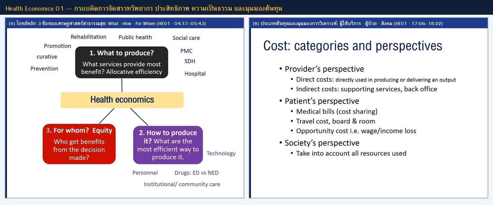
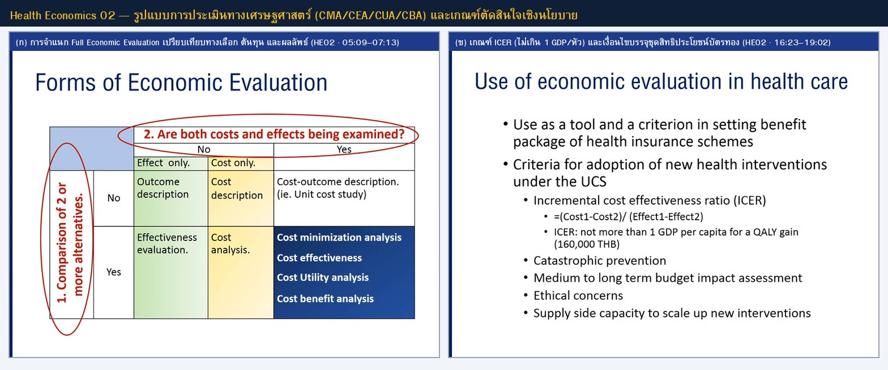

# HS3: คุณลักษณะของระบบบริการสุขภาพที่พึงประสงค์ (Desirable Characteristics of Health Services Systems)

ภูษิต ประคองสาย
ปวินท์ ศรีวิเชียร
ปรับปรุงจากฉบับของ ผศ.ดร.นพ. บวรศม ลีระพันธ์

## วัตถุประสงค์การเรียนรู้และคำถามนำ

| วัตถุประสงค์การเรียนรู้ | คำถามนำและโครงสร้างเนื้อหา |
|---|---|
| 1. **คุณลักษณะที่พึงประสงค์ในฐานะสัญญาณล่วงหน้า (desirable characteristics as early signals)** อธิบายความหมายของคุณลักษณะที่พึงประสงค์ ความเชื่อมโยงระหว่างองค์ประกอบของระบบบริการสุขภาพ คุณลักษณะที่พึงประสงค์ และเป้าหมายของระบบสุขภาพ ตลอดจนเหตุผลที่คุณลักษณะของกระบวนการทำหน้าที่เป็นสัญญาณเตือนล่วงหน้าตามตรรกะโครงสร้าง กระบวนการ และผลลัพธ์ | **1. เหตุใดคุณลักษณะของกระบวนการในระบบบริการสุขภาพจึงบอกล่วงหน้าได้ว่าระบบจะบรรลุเป้าหมายหรือไม่ (Why do the characteristics of health service processes signal in advance whether a system will achieve its goals?)** — ครอบคลุมการเชื่อมโยงองค์ประกอบหลักของระบบเข้ากับเป้าหมายสุดท้ายผ่านกรอบ EQESaRR (1.1) และกรอบแนวคิดเรื่องโครงสร้าง–กระบวนการ–ผลลัพธ์ เป้าหมายระยะกลาง และการคิดเชิงระบบ (1.2) |
| 2. **ความเป็นธรรมของระบบบริการสุขภาพและการเงินสุขภาพ (equity in health services and health financing)** แยกความแตกต่างระหว่างความเป็นธรรมกับความเท่าเทียม อธิบายแนวคิดพื้นฐานเรื่องความเป็นธรรมในการจัดสรรทรัพยากร จำแนกมิติของการเข้าถึงบริการสุขภาพ และวิเคราะห์ผลของกลไกการเงินด้านสุขภาพแต่ละแบบต่อความเป็นธรรมและการคุ้มครองทางการเงิน | **2. ระบบบริการสุขภาพที่เป็นธรรมมีลักษณะอย่างไร มีพื้นฐานมาจากหลักความเป็นธรรมใด และกลไกการเงินด้านสุขภาพส่งเสริมหรือบั่นทอนความเป็นธรรมได้อย่างไร (What makes a health services system equitable, which principles of justice underlie equity, and how can health financing mechanisms promote or undermine it?)** — ครอบคลุมแนวคิดเรื่องความเป็นธรรมในการจัดสรรทรัพยากรและภาวะที่คนยิ่งต้องการการดูแลมากกลับเข้าถึงบริการได้น้อย (inverse care law) (2.1) การเข้าถึงบริการและการเฝ้าระวังความเหลื่อมล้ำ (2.2) และกลไกการคลังสุขภาพเพื่อหลักประกันสุขภาพถ้วนหน้า (2.3) |
| 3. **คุณภาพของบริการสุขภาพและความครอบคลุมอย่างมีประสิทธิผล (quality of care and effective coverage)** อธิบายพัฒนาการของแนวคิดคุณภาพบริการสุขภาพ วิเคราะห์มิติของคุณภาพตามกรอบความปลอดภัย ประสิทธิผล ความทันเวลา และการมีผู้ป่วยเป็นศูนย์กลาง และแปลผลความครอบคลุมอย่างมีประสิทธิผลโดยแยกความจำเป็น การได้รับบริการ และคุณภาพออกจากกัน | **3. บริการสุขภาพที่มีคุณภาพมีลักษณะอย่างไร พัฒนามาอย่างไร และการที่ประชาชนได้รับบริการแล้วเพียงพอหรือไม่ที่จะสรุปว่าบริการนั้นทำให้สุขภาพดีขึ้น (What defines quality in health services, how did the concept develop, and is service use sufficient evidence that care improves health?)** — ครอบคลุมพัฒนาการแนวคิดคุณภาพและวัฒนธรรมความปลอดภัย (3.1) กรอบคุณภาพ STEP ในเวชปฏิบัติ (3.2) และความครอบคลุมอย่างมีประสิทธิผลตามกรอบ Need–Use–Quality (3.3) |
| 4. **ประสิทธิภาพของระบบบริการสุขภาพและการประเมินเทคโนโลยีด้านสุขภาพ (efficiency and health technology assessment)** อธิบายแนวคิดพื้นฐานของประสิทธิภาพจากความขาดแคลน ต้นทุนค่าเสียโอกาส และการมุ่งวัดผลลัพธ์ด้านสุขภาพโดยตรงแทนความพึงพอใจตามกำลังซื้อ เปรียบเทียบประสิทธิภาพแต่ละระดับ และอธิบายบทบาทของการประเมินเทคโนโลยีด้านสุขภาพโดยไม่กระทบความปลอดภัยและความเป็นธรรม | **4. เหตุใดระบบบริการสุขภาพจึงต้องเลือกวิธีใช้ทรัพยากรที่มีจำกัด และจะใช้ทรัพยากรนั้นให้เกิดประโยชน์สูงสุดโดยไม่กระทบความปลอดภัยและความเป็นธรรมได้อย่างไร (Why must a health services system choose how to use scarce resources, and how can it obtain the greatest benefit without compromising safety and equity?)** — ครอบคลุมแนวคิดพื้นฐานทางเศรษฐศาสตร์สุขภาพ (4.1) ประสิทธิภาพเชิงเทคนิค เชิงการผลิต และการจัดสรรทรัพยากร (4.2) และการประเมินเทคโนโลยีด้านสุขภาพควบคู่หลักความเป็นธรรม (4.3) |
| 5. **ธรรมาภิบาล ภาระรับผิดชอบต่อสังคม และความสอดคล้องกับบริบท (good governance, social accountability, and relevance)** อธิบายความหมายและที่มาของการอภิบาล ภาระรับผิดชอบ และการกำกับดูแลระบบอย่างรับผิดชอบต่อส่วนรวม วิเคราะห์หลักภาระรับผิดชอบต่อสังคมและความสอดคล้องกับบริบทของพื้นที่ พร้อมระบุกลไกที่ทำให้สังคมตรวจสอบระบบบริการสุขภาพได้ | **5. การอภิบาลระบบบริการสุขภาพที่ดีมีลักษณะอย่างไร แนวคิดภาระรับผิดชอบมีที่มาอย่างไร และระบบบริการสุขภาพต้องรับผิดชอบต่อสังคมในเรื่องใด (What characterizes good governance of a health services system, where does accountability come from, and for what is the system accountable to society?)** — ครอบคลุมทฤษฎีการอภิบาล ผู้มอบหมายกับผู้รับมอบหมายหน้าที่ และการกำกับดูแลระบบอย่างรับผิดชอบต่อส่วนรวม (5.1) และการแปลงภาระรับผิดชอบต่อสังคมและความสอดคล้องกับบริบทสู่ทางปฏิบัติ (5.2) |
| 6. **ความยืดหยุ่นและความสามารถในการปรับตัวของระบบสุขภาพ (health system resilience)** อธิบายที่มาของแนวคิดความยืดหยุ่นจากนิเวศวิทยาและระบบความเชื่อมโยงระหว่างสังคมกับสิ่งแวดล้อม วิเคราะห์ความสามารถในการรองรับวิกฤตเบื้องต้น การปรับวิธีทำงาน และการปฏิรูปโครงสร้างระบบ และระบุปัจจัยที่ช่วยให้ระบบคงบริการพื้นฐานไว้ได้ในยามวิกฤตโดยไม่ผลักภาระเกินควรแก่บุคลากรด่านหน้า | **6. แนวคิดความสามารถในการปรับตัวของระบบมีที่มาอย่างไร และระบบสุขภาพจะรักษาบริการที่จำเป็นไว้ได้อย่างไรเมื่อเผชิญวิกฤต รวมทั้งเรียนรู้เพื่อรับมืออนาคต (Where does the concept of resilience come from, and how can a health system sustain essential services during a crisis and learn for the future?)** — ครอบคลุมที่มาของแนวคิดจากวิชานิเวศวิทยา บทเรียนโรคระบาด และข้อวิพากษ์เชิงอำนาจ (6.1) และความสามารถในการรองรับวิกฤตเบื้องต้น ปรับวิธีทำงาน และปฏิรูปโครงสร้างระบบ (6.2) |
| 7. **บริบทระบบสุขภาพไทยและการประเมินด้วยหลายเกณฑ์ร่วมกัน (Thai health system context and multi-criteria assessment)** อธิบายฐานคุณค่าของแนวคิดระบบสุขภาพไทยและธรรมนูญว่าด้วยระบบสุขภาพแห่งชาติ วิเคราะห์ช่องว่างของคุณลักษณะในธรรมนูญฯ และประยุกต์ใช้กรอบ EQESaRR ร่วมกันในการตั้งคำถามและชั่งน้ำหนักแลกเปลี่ยนเมื่อประเมินระบบบริการสุขภาพจริง | **7. แนวคิดระบบสุขภาพของไทยตั้งอยู่บนฐานคุณค่าใด ธรรมนูญว่าด้วยระบบสุขภาพแห่งชาติครอบคลุมคุณลักษณะของระบบบริการสุขภาพเพียงใด และจะตัดสินได้อย่างไรว่าระบบทำงานได้ดีเพียงใด (On which values does the Thai health system rest, how fully does the National Health Charter cover desirable characteristics, and how can system performance be judged?)** — ครอบคลุมฐานคุณค่าสุขภาพองค์รวมและธรรมนูญสุขภาพไทย (7.1) ช่องว่างตัวชี้วัดระดับระบบบริการ (7.2) และการชั่งน้ำหนักหลายเกณฑ์ร่วมกันตามกรอบ EQESaRR (7.3) |

## (1) คุณลักษณะที่พึงประสงค์ของกระบวนการในระบบบริการสุขภาพทำหน้าที่เป็นสัญญาณเตือนล่วงหน้าว่าการทำงานขององค์ประกอบระบบมีแนวโน้มบรรลุเป้าหมายสุดท้ายหรือไม่ (Desirable Characteristics as Early Warning Signals)

การประเมินระบบบริการสุขภาพไม่อาจรอวัดเพียงผลลัพธ์สุขภาพระยะยาวของประชากรได้ แต่ต้องติดตามคุณลักษณะของกระบวนการทำงานภายในระบบผ่านกรอบคำย่อ **EQESaRR** (หัวข้อ 1.1) บนรากฐานทฤษฎีโครงสร้าง–กระบวนการ–ผลลัพธ์ ตัววัดสมรรถนะระยะกลาง และการคิดเชิงระบบ (หัวข้อ 1.2)

### 1.1 คุณลักษณะที่พึงประสงค์เชื่อมโยงองค์ประกอบหลักของระบบบริการสุขภาพเข้ากับเป้าหมายสุดท้ายผ่านกรอบแนวคิด EQESaRR (Linking Building Blocks to Ultimate Goals via EQESaRR)

> หากเปรียบระบบบริการสุขภาพเป็นทีมดูแลผู้ป่วยวิกฤต เหตุใดแพทย์จึงต้องเฝ้าระวังสัญญาณชีพและกระบวนการรักษาอย่างต่อเนื่อง แทนที่จะรอดูเพียงว่าผู้ป่วยรอดชีวิตเมื่อสิ้นสุดการรักษาหรือไม่

**คุณลักษณะของระบบบริการสุขภาพที่พึงประสงค์ (desirable characteristics of health services systems)** หมายถึงคุณสมบัติของกระบวนการทำงานและการอภิบาลภายในระบบบริการสุขภาพ ซึ่งบ่งชี้ล่วงหน้าว่าการทำหน้าที่ขององค์ประกอบต่าง ๆ ในระบบมีแนวโน้มจะบรรลุเป้าหมายของระบบบริการสุขภาพและเป้าหมายสุดท้ายของระบบสุขภาพโดยรวมหรือไม่ ([World Health Organization, 2000](https://cdn.who.int/media/docs/default-source/health-financing/whr-2000.pdf); [Roberts et al., 2004](https://doi.org/10.1093/acprof:oso/9780195371505.001.0001); [WHO, 2007](https://iris.who.int/handle/10665/43918)) ดังแสดงในภาพที่ 1 หกองค์ประกอบหลักของระบบบริการสุขภาพขับเคลื่อนกระบวนการทำงานที่สะท้อนผ่านคำย่อ **EQESaRR** ได้แก่ คุณลักษณะของการจัดบริการสามประการคือ **ความเป็นธรรม (equity)** **คุณภาพ (quality)** และ **ประสิทธิภาพ (efficiency)** คุณลักษณะของการนำและการอภิบาลสองประการคือ **ภาระรับผิดชอบต่อสังคม (social accountability)** และ **ความสอดคล้องกับปัญหาสุขภาพตามบริบทของสังคม (relevance)** และคุณลักษณะระดับระบบโดยรวมคือ **ความสามารถในการปรับตัวหรือความยืดหยุ่นของระบบ (resilience)** ซึ่งต่อยอดจากเกณฑ์ประเมินความรับผิดชอบต่อสังคมของสถาบันผลิตบุคลากรสุขภาพสี่ด้านขององค์การอนามัยโลก (ความสอดคล้อง คุณภาพ ความคุ้มค่า และความเป็นธรรม) ([Boelen & Heck, 1995](https://iris.who.int/handle/10665/59441)) ทั้งนี้ ความพยายามจัดอันดับระบบสุขภาพประเทศต่าง ๆ ด้วยดัชนีรวมตัวเดียวในรายงานอนามัยโลก ค.ศ. 2000 เคยถูกวิพากษ์อย่างกว้างขวางเรื่องความเที่ยงตรงของการถ่วงน้ำหนักและการละเลยบริบทเฉพาะพื้นที่ ([Karlberg, 2004](https://pmc.ncbi.nlm.nih.gov/articles/PMC1393275/)) อีกทั้งคุณลักษณะแต่ละด้านไม่ได้แยกขาดจากกันและอาจเกิดการแลกได้แลกเสียระหว่างกัน การทำความเข้าใจกรอบ EQESaRR จึงมุ่งใช้เป็นเลนส์วินิจฉัยหลายมิติร่วมกัน มิใช่สูตรคำนวณคะแนนเดี่ยว ([Institute of Medicine, 2001](https://doi.org/10.17226/10027); [บวรศม ลีระพันธ์ และคณะ, 2556](https://hdl.handle.net/11228/3865))

**ภาพที่ 1 กรอบแนวคิดความสัมพันธ์ระหว่างองค์ประกอบของระบบบริการสุขภาพ คุณลักษณะที่พึงประสงค์ตามกรอบ EQESaRR และเป้าหมายสุดท้ายของระบบสุขภาพ** (*ที่มา: ดัดแปลงจาก [WHO (2000)](https://cdn.who.int/media/docs/default-source/health-financing/whr-2000.pdf), [Roberts et al. (2004)](https://doi.org/10.1093/acprof:oso/9780195371505.001.0001) และ [WHO (2007)](https://iris.who.int/handle/10665/43918)*)

### 1.2 ตรรกะโครงสร้าง–กระบวนการ–ผลลัพธ์ เป้าหมายระยะกลาง และการคิดเชิงระบบ อธิบายเหตุผลที่คุณลักษณะของกระบวนการเป็นสัญญาณเตือนที่ไวและทันการณ์กว่าผลลัพธ์ปลายทาง (Structure–Process–Outcome, Intermediate Goals, and Systems Thinking)

**การรอประเมินเฉพาะผลลัพธ์ปลายทางด้านสุขภาพของประชากร เช่น อายุคาดเฉลี่ยหรืออัตราตาย มีข้อจำกัดสำคัญทั้งด้านความล่าช้าของเวลา ปัจจัยกวนนอกระบบบริการ และการไม่สามารถชี้จุดบกพร่องจำเพาะในขั้นตอนการดูแลได้** กรอบแนวคิดหลักสามด้านจึงอธิบายร่วมกันว่าเหตุใดการวัดคุณลักษณะของกระบวนการจึงทำหน้าที่เป็นสัญญาณเตือนล่วงหน้าที่แม่นยำและนำไปปรับปรุงงานได้ทันท่วงที ดังสังเคราะห์ในตารางต่อไปนี้

| กรอบแนวคิดหลัก | กลไกอธิบายบทบาทสัญญาณเตือนล่วงหน้า | นัยต่อการกำกับและพัฒนาระบบบริการสุขภาพ |
|---|---|---|
| **ตรรกะโครงสร้าง–กระบวนการ–ผลลัพธ์ (structure–process–outcome)** ([Donabedian, 1988](https://doi.org/10.1001/jama.1988.03410120089033); [Donabedian, 1966/2005](https://doi.org/10.1111/j.1468-0009.2005.00397.x)) | โครงสร้างที่ดีเพิ่ม **ความน่าจะเป็น (probability)** ที่จะเกิดกระบวนการดูแลที่ดี และกระบวนการที่ดีเพิ่มความน่าจะเป็นที่จะเกิดผลลัพธ์สุขภาพที่ดี ([Kourtis & Burns, 2019](https://doi.org/10.1002/ped4.12134)) ตัวชี้วัดกระบวนการจึงมีความไวต่อการตรวจจับคุณภาพที่เปลี่ยนไปมากกว่าผลลัพธ์ปลายทาง และไม่ต้องปรับความเสี่ยงพื้นฐานของผู้ป่วยซับซ้อนเท่าการวัดอัตราตาย ([Mant, 2001](https://doi.org/10.1093/intqhc/13.6.475)) | ช่วยชี้เป้าได้ทันทีว่าปัญหาอยู่ที่การเข้าถึง ความปลอดภัย หรือการไม่ปฏิบัติตามมาตรฐาน ก่อนที่ภาวะแทรกซ้อนระดับประชากรจะสะสมจนแก้ไขยาก |
| **เป้าหมายปลายทางที่มีคุณค่าในตัวเองและตัววัดสมรรถนะระยะกลาง (intrinsic vs. intermediate performance measures)** ([WHO, 2000](https://cdn.who.int/media/docs/default-source/health-financing/whr-2000.pdf); [Roberts et al., 2004](https://doi.org/10.1093/acprof:oso/9780195371505.001.0001)) | กรอบ **ปุ่มควบคุมการปฏิรูประบบสุขภาพ (control knobs)** ชี้ว่ามาตรการเชิงนโยบายไม่อาจกระโดดไปเปลี่ยนเป้าหมายสุดท้ายได้โดยตรง แต่ต้องส่งผลผ่านตัววัดสมรรถนะระยะกลาง ได้แก่ **ประสิทธิภาพ คุณภาพ และการเข้าถึงอย่างเป็นธรรม** เสียก่อน ([Roberts et al., 2004](https://doi.org/10.1093/acprof:oso/9780195371505.001.0001); [Katoue et al., 2022](https://doi.org/10.3389/fpubh.2022.1045739); [บวรศม ลีระพันธ์ และคณะ, 2556](https://hdl.handle.net/11228/3865)) | ป้องกันการสับสนระหว่างการนับทรัพยากรนำเข้า (เช่น จำนวนเตียง) กับผลลัพธ์จริง และเชื่อมการปฏิรูปการคลังหรือการจัดองค์กรเข้ากับผลทางคลินิก |
| **การคิดเชิงระบบและผลลัพธ์ร่วมจากการทำงานประสานกัน (systems thinking & emergent properties)** ([WHO, 2007](https://iris.who.int/handle/10665/43918); [de Savigny & Adam, 2009](https://iris.who.int/handle/10665/44204); [Adam & de Savigny, 2012](https://doi.org/10.1093/heapol/czs084)) | คุณลักษณะที่พึงประสงค์เป็น **ผลลัพธ์ร่วมที่เกิดจากการทำงานประสานกันของระบบ (emergent properties)** ที่เกิดจากปฏิสัมพันธ์ของทุกองค์ประกอบภายใต้ **ความซับซ้อนที่แต่ละส่วนปรับตัวและส่งผลถึงกันตลอดเวลา (dynamic complexity)** วงจรผลสะท้อนกลับ และความล่าช้าของเวลา ([Sterman, 2006](https://doi.org/10.2105/AJPH.2005.066043)) การเติมทรัพยากรจุดเดียวเป็นเพียงการพยุงระบบชั่วคราว (health system support) มิใช่การสร้างความเข้มแข็งของระบบอย่างยั่งยืน (health system strengthening) ([Chee et al., 2013](https://doi.org/10.1002/hpm.2122)) | เตือนให้ระวังผลข้างเคียงไม่พึงประสงค์ข้ามองค์ประกอบ เช่น การยกเลิกค่าธรรมเนียมบริการโดยไม่เตรียมยาและบุคลากรรองรับทำให้เกิดปัญหาคิวยาว ยาขาดคราว และคุณภาพตกต่ำ ([Ridde et al., 2012](https://doi.org/10.1186/1471-2458-12-289)) |

## (2) ความเป็นธรรมของระบบบริการสุขภาพและการเงินสุขภาพมุ่งจัดสรรบริการตามความจำเป็นและระดมทุนตามความสามารถในการจ่าย (Equity in Health Services and Health Financing)

ความเป็นธรรมวางอยู่บนแนวคิดเรื่องความเป็นธรรมในการจัดสรรทรัพยากรที่แยกความเป็นธรรมออกจากความเท่าเทียมแบบเหมารวม (หัวข้อ 2.1) วัดผลได้ในทางปฏิบัติผ่านมิติการเข้าถึงบริการควบคู่กับการเฝ้าระวังความเหลื่อมล้ำ (หัวข้อ 2.2) และต้องอาศัยกลไกการคลังสุขภาพแบบก้าวหน้าที่คุ้มครองครัวเรือนจากวิกฤตทางการเงิน (หัวข้อ 2.3)

### 2.1 ความเป็นธรรมแตกต่างจากความเท่าเทียม เพราะมุ่งจัดสรรโอกาสและบริการให้สอดคล้องกับความจำเป็นที่แตกต่างกันตามหลักความเป็นธรรมในการจัดสรรทรัพยากร (Equity vs. Equality and Distributive Justice Roots)

> หากโรงพยาบาลแจกคู่มือดูแลเบาหวานภาษาไทยมาตรฐานเล่มเดียวกันและนัดตรวจเวลา 09.00 น. เหมือนกันให้แก่ข้าราชการบำนาญในเมืองกับแรงงานข้ามชาติที่ทำงานกะเช้าในไร่อ้อย การปฏิบัติที่เหมือนกันทุกประการนี้เป็นธรรมหรือไม่ เพราะเหตุใด

**ความเป็นธรรมในระบบบริการสุขภาพ (equity in health services)** หมายถึงการจัดสรรทรัพยากรและบริการโดยยึดหลักว่าผู้ที่มีความจำเป็นทางสุขภาพเท่ากันควรได้รับบริการเท่าเทียมกัน และผู้ที่มีความจำเป็นทางสุขภาพมากกว่าควรได้รับการสนับสนุนมากกว่าอย่างได้สัดส่วน ซึ่งแตกต่างจาก **ความเท่าเทียม (equality)** ที่หมายถึงการแจกจ่ายสิ่งเดียวกันในปริมาณเท่ากันให้แก่ทุกคนโดยไม่คำนึงถึงจุดตั้งต้นหรือความจำเป็นที่ต่างกัน ([Wagstaff & van Doorslaer, 1992](https://doi.org/10.1016/0167-6296%2892%2990012-P); [Culyer & Wagstaff, 1993](https://doi.org/10.1016/0167-6296%2893%2990004-X); [Blackwood & Currie, 2016](https://www.healthknowledge.org.uk/public-health-textbook/research-methods/1c-health-care-evaluation-health-care-assessment/equity-health-care)) ในทางระบาดวิทยาและจริยธรรมยังต้องแยก **ความแตกต่างหลากหลายทางสุขภาพ (health inequality)** ซึ่งบางส่วนเกิดจากชีววิทยาตามธรรมชาติ เช่น อายุที่เพิ่มขึ้น ออกจาก **ความไม่เป็นธรรมทางสุขภาพ (health inequity)** ซึ่งหมายถึงความเหลื่อมล้ำทางสุขภาพที่ไม่จำเป็น หลีกเลี่ยงได้ และไม่ยุติธรรม (*unnecessary, avoidable, unfair and unjust*) อันเกิดจากโครงสร้างสังคมที่เอื้อเปรียบเสียเปรียบต่างกัน ([Whitehead, 1991](https://doi.org/10.1093/heapro/6.3.217); [Whitehead, 1992](https://doi.org/10.2190/986L-LHQ6-2VTE-YRRN); [Braveman & Gruskin, 2003](https://doi.org/10.1136/jech.57.4.254); [MacKay & Sreenivasan, 2021](https://plato.stanford.edu/entries/justice-inequality-health/)) ยิ่งปล่อยให้กลไกตลาดเสรีจัดสรรบริการทางการแพทย์ตามกำลังซื้อเพียงลำพัง ระบบยิ่งเกิด **ภาวะที่กลุ่มคนซึ่งต้องการการดูแลมากที่สุดกลับเข้าถึงบริการที่ดีได้น้อยที่สุด (inverse care law)** กล่าวคือความพร้อมของบริการทางการแพทย์ที่ดีกลับสวนทางกับความจำเป็นทางสุขภาพของประชากรในพื้นที่นั้นเสมอ ([Tudor Hart, 1971](https://doi.org/10.1016/S0140-6736%2871%2992410-X))

**หลักการจัดสรรทรัพยากรสุขภาพอย่างเป็นธรรมมีพื้นฐานมาจากแนวคิดเรื่องความเป็นธรรมในการจัดสรรทรัพยากร (distributive justice)** ซึ่งศึกษาว่าสังคมควรแบ่งปันสิทธิ ประโยชน์ และภาระร่วมกันด้วยเกณฑ์ทางศีลธรรมใด ([Lamont & Favor, 2017](https://plato.stanford.edu/entries/justice-distributive/); [Gosepath, 2021](https://plato.stanford.edu/entries/equality/)) สำนักคิดหลักที่กำหนดสถาปัตยกรรมระบบสุขภาพสมัยใหม่เปรียบเทียบได้ดังตารางต่อไปนี้

| แนวคิดหลักเรื่องความเป็นธรรมในการจัดสรรทรัพยากร | แนวคิดแกนกลางและการอธิบายความหมาย | การประยุกต์สู่ความเป็นธรรมในระบบบริการและการเงินสุขภาพ |
|---|---|---|
| **หลักการดูแลให้เหมาะสมตามความจำเป็นที่ต่างกันของอริสโตเติล (Aristotle's proportional equality)** ([Gosepath, 2021](https://plato.stanford.edu/entries/equality/); [LeBar, 2025](https://plato.stanford.edu/entries/justice-virtue/)) | แยกการแบ่งให้ทุกคนเท่ากันเป็นตัวเลข ออกจากหลักการดูแลให้เหมาะสมตามความต่าง คือดูแลเท่ากันเมื่อมีความจำเป็นเท่ากัน และดูแลต่างกันอย่างเหมาะสมเมื่อความจำเป็นต่างกัน | เป็นที่มาของ **ความเป็นธรรมระหว่างผู้ที่มีความจำเป็นเท่ากัน (horizontal equity)** (ความจำเป็นเท่ากันได้บริการเท่ากัน / กำลังจ่ายเท่ากันจ่ายสมทบเท่ากัน) และ **ความเป็นธรรมตามระดับความจำเป็นหรือกำลังจ่ายที่ต่างกัน (vertical equity)** (ป่วยซับซ้อนกว่าได้ทรัพยากรมากกว่า / รายได้สูงกว่าจ่ายสมทบอัตราก้าวหน้า) ([Wagstaff & van Doorslaer, 1992](https://doi.org/10.1016/0167-6296%2892%2990012-P)) |
| **แนวคิดความเป็นธรรมของรอลส์ และการคุ้มครองโอกาสทางสุขภาพของแดเนียลส์ (Rawls & Daniels)** ([Rawls, 1971/1999](https://doi.org/10.4159/9780674042582); [Freeman, 2023](https://plato.stanford.edu/entries/original-position/); [Wenar, 2025](https://plato.stanford.edu/entries/rawls/); [Daniels, 2001](https://doi.org/10.1162/152651601300168834), [2008](https://doi.org/10.1017/CBO9780511809514), [2017](https://plato.stanford.edu/entries/justice-healthcareaccess/)) | รอลส์เสนอการออกแบบกติกาจาก **จุดเริ่มต้นที่ทุกคนเท่าเทียมกัน (original position)** ภายใต้ **เงื่อนไขสมมติที่ไม่รู้สถานะของตนล่วงหน้า (veil of ignorance)** คือสมมติว่าผู้ร่างกติกาไม่รู้ล่วงหน้าว่าตนจะเกิดมารวยหรือจน แข็งแรงหรือพิการ จึงย่อมเลือกหลักความเท่าเทียมของโอกาสอย่างเป็นธรรมและ **หลักการให้ความสำคัญกับการยกระดับผู้เสียเปรียบที่สุดก่อน (difference principle)** ที่คุ้มครองผู้เสียเปรียบที่สุด แดเนียลส์ขยายต่อว่าสุขภาพคือการทำหน้าที่ปกติของกายและใจที่ปกป้องขอบเขตโอกาสชีวิต | เป็นรากฐานของระบบหลักประกันสุขภาพถ้วนหน้า และเมื่อต้องจัดลำดับความสำคัญภายใต้งบจำกัด แดเนียลส์เสนอ **กระบวนการจัดลำดับความสำคัญอย่างโปร่งใสและมีเหตุผลที่ตรวจสอบได้ (accountability for reasonableness: A4R)** 4 เงื่อนไข คือ เปิดเผยต่อสาธารณะ (publicity) ใช้เหตุผลและหลักฐานที่เกี่ยวข้อง (relevance) มีช่องทางอุทธรณ์ทบทวน (revision and appeals) และมีกลไกกำกับให้เกิดขึ้นจริง (regulation) |
| **แนวคิดของเซนที่มุ่งเน้นโอกาสและความสามารถจริงในการใช้ชีวิต (Sen's capability approach)** ([Sen, 1999](https://books.google.com/books/about/Development_as_Freedom.html?id=Qm8HtpFHYecC), [2002](https://doi.org/10.1002/hec.762); [Robeyns & Byskov, 2025](https://plato.stanford.edu/entries/capability-approach/)) | แยกทรัพยากรบนกระดาษออกจาก **ความสามารถ (capabilities)** คือเสรีภาพจริงที่จะบรรลุสุขภาวะและการดำเนินชีวิตที่มีคุณค่า (functionings) เพราะแต่ละคนมี **เงื่อนไขส่วนบุคคลและสภาพแวดล้อมในการเปลี่ยนสิทธิหรือทรัพยากรให้เกิดประโยชน์จริง (conversion factors)** ทั้งด้านร่างกาย สังคม และภูมิศาสตร์ไม่เท่ากัน | เตือนว่าการให้สิทธิบัตรรักษาฟรีเท่ากันยังไม่พอ หากผู้พิการไม่มีทางลาด หรือผู้ป่วยชนบทไม่มีค่ารถเดินทาง ระบบต้องจัดมาตรการเสริมเพื่อแปลงสิทธิบนกระดาษให้เป็นความสามารถในการรับบริการได้จริง |
| **แนวคิดที่มุ่งผลประโยชน์รวมสูงสุด กับแนวคิดที่ยึดกลไกตลาดเสรีเป็นหลัก (utilitarianism & Nozick's libertarianism)** ([Nozick, 1974](https://archive.org/details/anarchystateutop00nozi); [Mack, 2026](https://plato.stanford.edu/entries/nozick-political/)) | **แนวคิดมุ่งผลประโยชน์รวม (utilitarianism)** เน้นเพิ่มผลรวมสุขภาพสูงสุดของสังคมโดยอาจมองข้ามว่าผลลัพธ์กระจุกอยู่ที่ใคร ขณะที่ **แนวคิดตลาดเสรีของโนซิก (Nozick's libertarianism)** มองสุขภาพเป็นสินค้าซื้อขายตามสิทธิในทรัพย์สินและคัดค้านการเก็บภาษีไปอุดหนุนผู้อื่น | ชี้ให้เห็นข้อจำกัดของการวัดแต่ความคุ้มค่ารวมโดยละเลยกลุ่มเปราะบางห่างไกล และการปล่อยให้บริการสุขภาพเป็นสินค้าตลาดล้วนซึ่งนำไปสู่การทอดทิ้งผู้ยากไร้ |

### 2.2 ความเป็นธรรมของระบบบริการประเมินได้จากความสามารถในการเข้าถึงสี่มิติควบคู่กับการเฝ้าระวังความเหลื่อมล้ำแยกตามกลุ่มประชากร (Accessibility Dimensions and Equity Surveillance)

**การเข้าถึงบริการสุขภาพอย่างเป็นธรรมไม่ได้จำกัดอยู่เพียงการมีอาคารโรงพยาบาลตั้งอยู่ใกล้บ้าน แต่ครอบคลุมความสอดคล้องกันระหว่างคุณลักษณะของระบบบริการกับศักยภาพของประชากรครบสี่มิติ** ตามกรอบสิทธิมนุษยชนด้านสุขภาพของสหประชาชาติและตัวแบบการเข้าถึงบริการที่ยึดผู้ป่วยเป็นศูนย์กลาง ([Committee on Economic, Social and Cultural Rights, 2000](https://www.ohchr.org/sites/default/files/Documents/Issues/Women/WRGS/Health/GC14.pdf); [Levesque et al., 2013](https://doi.org/10.1186/1475-9276-12-18)) ดังแสดงในภาพที่ 2 ได้แก่ **(1) การเข้าถึงทางกายภาพ (physical accessibility)** คือประชากรทุกกลุ่มรวมถึงผู้สูงอายุ ผู้พิการ และผู้ป่วยพื้นที่ห่างไกลเดินทางไปรับบริการได้อย่างปลอดภัยและทันการณ์ **(2) การเข้าถึงทางจิตใจและสังคมวัฒนธรรมหรือการยอมรับได้ (psychological and cultural acceptability)** คือบริการเคารพศักดิ์ศรี ความลับ จริยธรรม และความละเอียดอ่อนทางเพศ ภาษา และชาติพันธุ์โดยปราศจากการตีตราเลือกปฏิบัติ **(3) การเข้าถึงทางการเงินหรือความสามารถในการจ่ายได้ (financial accessibility / affordability)** คือค่าบริการและค่าใช้จ่ายแฝงในการเดินทางหรือขาดรายได้ไม่กลายเป็นกำแพงกีดกันผู้ยากจน และ **(4) การเข้าถึงข้อมูลข่าวสาร (information accessibility)** คือสิทธิในการค้นหา รับรู้ และเข้าใจข้อมูลสุขภาพและทางเลือกการรักษาในภาษาและระดับความรอบรู้ด้านสุขภาพที่เหมาะสม ยิ่งไปกว่านั้น ระบบบริการต้องมี **การเฝ้าระวังความเป็นธรรม (equity surveillance)** โดยจัดเก็บและวิเคราะห์ข้อมูลการรับบริการและผลลัพธ์สุขภาพแยกย่อยตามเพศ อายุ ชาติพันธุ์ ภูมิลำเนา เศรษฐฐานะ และสิทธิประกันสุขภาพอย่างต่อเนื่อง เพราะค่าเฉลี่ยระดับประเทศที่ดูดีอาจบดบังช่องว่างรุนแรงของกลุ่มเปราะบางได้เสมอ ([Braveman & Gruskin, 2003](https://doi.org/10.1136/jech.57.4.254))

**ภาพที่ 2 ความเป็นธรรมทางสุขภาพ แนวคิดพื้นฐานเรื่องความเป็นธรรมในการจัดสรรทรัพยากร และมิติการเข้าถึงบริการสุขภาพสี่ด้าน** (*ที่มา: สังเคราะห์จาก [Tudor Hart (1971)](https://doi.org/10.1016/S0140-6736%2871%2992410-X), [Wagstaff & van Doorslaer (1992)](https://doi.org/10.1016/0167-6296%2892%2990012-P), [CESCR (2000)](https://www.ohchr.org/sites/default/files/Documents/Issues/Women/WRGS/Health/GC14.pdf), [Sen (2002)](https://doi.org/10.1002/hec.762), [Daniels (2008)](https://doi.org/10.1017/CBO9780511809514) และ [Levesque et al. (2013)](https://doi.org/10.1186/1475-9276-12-18)*)

### 2.3 ความเป็นธรรมในการเงินสุขภาพแยกการร่วมจ่ายตามกำลังทรัพย์ออกจากการรับบริการตามความจำเป็น เพื่อคุ้มครองครัวเรือนไม่ให้ล้มละลายจากค่ารักษา (Health Financing Equity and Financial Protection)

> หากค่ารักษาการผ่าตัดหัวใจฉุกเฉินต้องชำระด้วยเงินสดหน้าห้องผ่าตัดเท่านั้น ครอบครัวเกษตรกรรายย่อยกับครอบครัวผู้บริหารบริษัทขนาดใหญ่จะต้องเผชิญผลกระทบต่อชีวิตและทรัพย์สินต่างกันอย่างไร

**ระบบการเงินด้านสุขภาพที่เป็นธรรมต้องแยกการระดมทุนออกจากจุดรับบริการ โดยเก็บเงินสมทบตามความสามารถในการจ่าย (ability to pay) และจัดสรรทรัพยากรตามความจำเป็นทางสุขภาพที่สำคัญและสมควรได้รับการดูแล (morally relevant health needs) เช่น ความรุนแรงของโรคและความสามารถที่จะได้รับประโยชน์จากการรักษา มิใช่ตามฐานะหรืออำนาจต่อรอง** ([WHO, 2000](https://cdn.who.int/media/docs/default-source/health-financing/whr-2000.pdf); [Ataguba & Kabaniha, 2022](https://doi.org/10.1093/heapol/czac041); [Luyten & Tubeuf, 2025](https://doi.org/10.1016/j.healthpol.2024.105218)) ในทางเศรษฐศาสตร์สุขภาพ ความเป็นธรรมของการระดมทุนตามกำลังจ่ายที่ต่างกันวัดความก้าวหน้าด้วย **ดัชนีคักวานี (Kakwani index)** ซึ่งเปรียบเทียบการกระจุกตัวของภาระการจ่ายเงินด้านสุขภาพกับดัชนีความเหลื่อมล้ำของรายได้ (Gini index) ร่วมกับ **ดัชนีวัดการกระจุกตัวตามระดับเศรษฐานะ (concentration index)** โดยแหล่งเงินที่มี **อัตราก้าวหน้า (progressive)** (ดัชนีคักวานีเป็นบวก) หมายถึงผู้มีรายได้สูงจ่ายคิดเป็นสัดส่วนต่อรายได้มากกว่าผู้มีรายได้น้อย ส่วนแหล่งเงินที่มี **อัตราถดถอย (regressive)** (ดัชนีคักวานีเป็นลบ) หมายถึงผู้ยากจนต้องแบกรับภาระคิดเป็นสัดส่วนต่อรายได้สูงกว่าคนรวย ([O'Donnell et al., 2008](https://www.worldbank.org/content/dam/Worldbank/document/HDN/Health/HealthEquityCh16.pdf); [Munge & Briggs, 2014](https://doi.org/10.1093/heapol/czt073))

**เป้าหมายหลักของการคลังสุขภาพภายใต้หลักประกันสุขภาพถ้วนหน้า (universal health coverage: UHC) คือการคุ้มครองความเสี่ยงทางการเงิน (financial protection)** เพื่อป้องกันมิให้ประชาชนต้องเผชิญวิกฤตสองรูปแบบ ([Boerma et al., 2014](https://doi.org/10.1371/journal.pmed.1001731); [Nimubona et al., 2025](https://doi.org/10.1186/s12939-025-02404-7); [WHO, 2025](https://www.who.int/news-room/fact-sheets/detail/universal-health-coverage-%28uhc%29)) ดังแสดงในภาพที่ 3 ได้แก่ **(1) ค่ารักษาพยาบาลที่สูงเกินกำลังจนกระทบการดำรงชีพอย่างรุนแรง (catastrophic health spending)** ซึ่งตามตัวชี้วัดเป้าหมายการพัฒนาที่ยั่งยืน (SDG 3.8.2) นิยามว่าเป็นการควักเงินจ่ายค่ารักษาเองเกิน **ร้อยละ 10 หรือร้อยละ 25** ของรายจ่ายบริโภคทั้งหมดของครัวเรือน ([Wagstaff et al., 2018](https://doi.org/10.1016/S2214-109X%2817%2930429-1)) หรือตามนิยามองค์การอนามัยโลกคือตั้งแต่ **ร้อยละ 40 ขึ้นไป** ของความสามารถในการจ่ายหลังหักค่าอาหารจำเป็น ([Xu et al., 2003](https://doi.org/10.1016/S0140-6736%2803%2913861-5)) และ **(2) ค่าใช้จ่ายด้านสุขภาพที่ผลักให้ครัวเรือนยากจนลง (impoverishing health spending)** จนรายได้สุทธิต่ำกว่าเส้นความยากจน ผลกระทบของกลไกการคลังสุขภาพแต่ละรูปแบบต่อความเป็นธรรมเปรียบเทียบได้ดังตารางต่อไปนี้

**ภาพที่ 3 ความเป็นธรรมในการเงินด้านสุขภาพ ตัวชี้วัดภาวะวิกฤตทางการเงิน และการเปรียบเทียบกลไกการคลังสุขภาพ** (*ที่มา: สังเคราะห์จาก [Xu et al. (2003)](https://doi.org/10.1016/S0140-6736%2803%2913861-5), [O'Donnell et al. (2008)](https://www.worldbank.org/content/dam/Worldbank/document/HDN/Health/HealthEquityCh16.pdf), [Bambra et al. (2014)](https://doi.org/10.2190/HS.44.3.c), [Wagstaff et al. (2018)](https://doi.org/10.1016/S2214-109X%2817%2930429-1) และ [Luyten & Tubeuf (2025)](https://doi.org/10.1016/j.healthpol.2024.105218)*)

| กลไกการคลังสุขภาพ | ลักษณะการระดมทุนและการเฉลี่ยความเสี่ยง | ผลกระทบต่อความเป็นธรรมและข้อพึงระวังเชิงระบบ |
|---|---|---|
| **ระบบภาษีของรัฐ (tax-based financing)** ([O'Donnell et al., 2008](https://www.worldbank.org/content/dam/Worldbank/document/HDN/Health/HealthEquityCh16.pdf); [Bambra et al., 2014](https://doi.org/10.2190/HS.44.3.c)) | รวบรวมรายได้จากภาษีทั่วไปเข้ากองทุนกลางขนาดใหญ่เพื่อคุ้มครองประชากรทุกคนโดยไม่ผูกกับการจ้างงาน | **มีศักยภาพก้าวหน้าและเป็นธรรมสูงสุด** หากพึ่งพาภาษีทางตรงอัตราก้าวหน้า (ภาษีเงินได้และนิติบุคคล) แต่ความก้าวหน้าจะลดลงหากรัฐพึ่งพาภาษีทางอ้อม เช่น ภาษีมูลค่าเพิ่ม (VAT) ซึ่งคนจนเสียคิดเป็นสัดส่วนต่อรายได้สูงกว่าคนรวย ([Munge & Briggs, 2014](https://doi.org/10.1093/heapol/czt073); [Luyten & Tubeuf, 2025](https://doi.org/10.1016/j.healthpol.2024.105218)) |
| **ระบบประกันสุขภาพสังคม (social health insurance: SHI)** ([Wagstaff & van Doorslaer, 1992](https://doi.org/10.1016/0167-6296%2892%2990012-P); [Luyten & Tubeuf, 2025](https://doi.org/10.1016/j.healthpol.2024.105218)) | หักเงินสมทบตามสัดส่วนค่าจ้างจากลูกจ้างและนายจ้าง (และรัฐบาลร่วมสมทบ) เข้ากองทุนประกันสังคม | ดูเป็นธรรมในกลุ่มแรงงานในระบบ แต่เกิดความถดถอยได้หากกำหนด **เพดานเงินเดือนสูงสุดที่ใช้คำนวณเงินสมทบ (contribution ceiling)** ทำให้ผู้มีรายได้สูงจ่ายคิดเป็นร้อยละของรายได้จริงน้อยกว่าผู้มีรายได้ปานกลาง และมักตกหล่นแรงงานนอกระบบจำนวนมาก |
| **ประกันสุขภาพเอกชนแบบสมัครใจ (voluntary private insurance)** ([Bambra et al., 2014](https://doi.org/10.2190/HS.44.3.c); [Goudge et al., 2018](https://doi.org/10.1186/s12939-017-0710-z)) | เก็บเบี้ยประกันตามความเสี่ยงสุขภาพรายบุคคล (experience/risk rating) ไม่เฉลี่ยข้ามเศรษฐานะ | มักคัดกรองแต่คนแข็งแรงมีกำลังซื้อ (cream skimming) และสร้าง **ระบบบริการสองชนชั้น (two-tier system)** ที่ดึงแพทย์และทรัพยากรไปกระจุกในภาคเอกชน ดังบทเรียนโครงการประกันข้าราชการ GEMS ในแอฟริกาใต้ที่ขยายความเหลื่อมล้ำระหว่างผู้มีประกันกับผู้ใช้บริการภาครัฐที่ขาดแคลน ([Goudge et al., 2018](https://doi.org/10.1186/s12939-017-0710-z); [Ataguba & Kabaniha, 2022](https://doi.org/10.1093/heapol/czac041)) |
| **การจ่ายเงินสด ณ จุดรับบริการ (out-of-pocket payment: OOP)** ([Xu et al., 2003](https://doi.org/10.1016/S0140-6736%2803%2913861-5); [Wagstaff et al., 2018](https://doi.org/10.1016/S2214-109X%2817%2930429-1)) | ผู้ป่วยชำระค่ารักษาเองโดยตรงเมื่อเจ็บป่วยโดยไม่มีการจ่ายล่วงหน้าหรือการรวมความเสี่ยง | **ถดถอยและไม่เป็นธรรมที่สุด** เพราะผูกโอกาสการรอดชีวิตไว้กับเงินสดในกระเป๋ายามวิกฤต ทำให้คนจนต้องเลื่อนหรืองดรับการรักษาที่จำเป็น หรือต้องกู้หนี้ยืมสินจนล้มละลายทางการเงิน |

## (3) คุณภาพของบริการสุขภาพต้องผสานความปลอดภัย ประสิทธิผล ความทันเวลา และการยึดผู้ป่วยเป็นศูนย์กลาง เข้ากับการวัดความครอบคลุมอย่างมีประสิทธิผล (Quality of Care and Effective Coverage)

แนวคิดคุณภาพบริการสุขภาพพัฒนามาจากการติดตามผลการรักษารายบุคคลสู่การออกแบบระบบความปลอดภัยและลำดับขั้นความครอบคลุมระดับประชากร (หัวข้อ 3.1) สรุปเป็นแนวทางเวชปฏิบัติผ่านกรอบ **STEP** (หัวข้อ 3.2) และยกระดับการประเมินระบบบริการด้วยตัวชี้วัดความครอบคลุมอย่างมีประสิทธิผลตามแผนภาพ **Need–Use–Quality** (หัวข้อ 3.3)

### 3.1 แนวคิดคุณภาพพัฒนามาจากการติดตามผลลัพธ์ของคอดแมนและโดนาบีเดียน สู่การจัดการความผิดพลาดเชิงระบบ การแพทย์ที่ยึดผู้ป่วยเป็นศูนย์กลาง และลำดับขั้นความครอบคลุม (Evolution of Quality, System Safety, and Coverage Cascade)

> เมื่อเกิดเหตุการณ์ฉีดยาผิดขนาดในหอผู้ป่วยที่หลอดยาสองชนิดมีฉลากคล้ายกันมากและบุคลากรต้องขึ้นเวรควบติดต่อกัน การลงโทษผู้ฉีดเพียงคนเดียวจะป้องกันไม่ให้บุคลากรคนถัดไปทำผิดซ้ำได้จริงหรือไม่

**แนวคิดคุณภาพบริการสุขภาพสมัยใหม่เกิดจากการหลอมรวมสายธารความรู้ด้านการวัดผลทางคลินิก วิศวกรรมความปลอดภัยเชิงระบบ เวชศาสตร์ครอบครัว และระบาดวิทยาระบบบริการเข้าด้วยกัน** ในต้นคริสต์ศตวรรษที่ 20 ศัลยแพทย์เออร์เนสต์ คอดแมน เสนอ **แนวคิดผลลัพธ์ปลายทาง (end-result idea)** โดยติดตามผู้ป่วยหลังจำหน่ายออกจากโรงพยาบาล 337 รายอย่างตรงไปตรงมาและบันทึกความผิดพลาดที่ป้องกันได้ถึง 123 เหตุการณ์ เพื่อใช้เรียนรู้ปรับปรุงการรักษา ([Neuhauser, 2002](https://doi.org/10.1136/qhc.11.1.104)) ต่อมา อาเวดิส โดนาบีเดียน วางระบบการประเมินคุณภาพผ่านความสมดุลระหว่างเทคนิควิชาการกับความสัมพันธ์ระหว่างบุคคลภายใต้กรอบโครงสร้าง–กระบวนการ–ผลลัพธ์ ([Donabedian, 1980](https://books.google.com/books/about/Explorations_in_Quality_Assessment_and_M.html?id=RTs_xgEACAAJ), [1988](https://doi.org/10.1001/jama.1988.03410120089033)) จุดเปลี่ยนสำคัญระดับนโยบายเกิดขึ้นเมื่อรายงาน *To Err Is Human* ของสถาบันการแพทย์แห่งสหรัฐอเมริกาเปิดเผยว่า ความผิดพลาดทางการแพทย์ที่ป้องกันได้คร่าชีวิตผู้ป่วยในโรงพยาบาลสหรัฐฯ ถึง 44,000–98,000 รายต่อปี ([IOM, 2000](https://nap.nationalacademies.org/catalog/9728)) และรายงาน *Crossing the Quality Chasm* ได้กำหนดเป้าหมายคุณภาพหกประการ (ความปลอดภัย ประสิทธิผล การมีผู้ป่วยเป็นศูนย์กลาง ความทันเวลา ประสิทธิภาพ และความเป็นธรรม) ซึ่งในบทนี้สังเคราะห์มิติคุณภาพระดับคลินิกสี่ประการแรกเป็นคำย่อ **STEP** โดยแยกประสิทธิภาพและความเป็นธรรมออกเป็นคุณลักษณะหลักของระบบโดยตรง ([IOM, 2001](https://doi.org/10.17226/10027), [2004](https://www.ncbi.nlm.nih.gov/books/NBK215517/))

**ในมิติความปลอดภัยและมิติความเป็นมนุษย์ แนวคิดคุณภาพได้เปลี่ยนกระบวนทัศน์จากการกล่าวโทษตัวบุคคลและการมองแต่โรค ไปสู่การออกแบบปราการระบบและการเข้าใจผู้ป่วยทั้งชีวิต** ดังแสดงในภาพที่ 4 เจมส์ รีซัน อธิบายผ่าน **แบบจำลองแผ่นเนยแข็งสวิส (Swiss cheese model)** ว่าการมุ่งตำหนิตัวบุคคล (person approach) ก่อให้เกิด **วัฒนธรรมการกล่าวโทษ (blame culture)** ที่ทำให้คนปกปิดข้อมูล ในขณะที่วิธีคิดเชิงระบบ (system approach) ชี้ว่าเหตุการณ์รุนแรงต่อผู้ป่วยเกิดจากรูรั่วของปราการป้องกันหลายชั้นเรียงตัวตรงกัน ทั้ง **จุดอ่อนที่ซ่อนอยู่ในระบบงาน (latent conditions)** เช่น ภาระงานล้น การจัดซื้อยาชื่อพ้องมองคล้าย และ **ความผิดพลาดที่จุดปฏิบัติงาน (active failures)** การสร้าง **วัฒนธรรมความปลอดภัย (safety culture)** ที่ส่งเสริมการรายงาน **เหตุการณ์เกือบพลาด (near misses)** โดยไม่ลงโทษผู้รายงานโดยสุจริตจึงช่วยให้องค์กรอุดรูรั่วเชิงระบบได้ก่อนเกิดอันตรายจริง ([Leape, 1994](https://doi.org/10.1001/jama.1994.03520230061039); [Barach & Small, 2000](https://doi.org/10.1136/bmj.320.7237.759); [Reason, 2000](https://doi.org/10.1136/bmj.320.7237.768)) ควบคู่กันนั้น ขบวนการเวชศาสตร์ที่ยึดผู้ป่วยเป็นศูนย์กลางนับจากงานของเอนิดและไมเคิล บาลินท์ แบบจำลองชีวจิตสังคมของแองเจิล ([Engel, 1977](https://doi.org/10.1126/science.847460)) การแสวงหาจุดร่วมในการตัดสินใจของสจ๊วต ([Stewart, 2001](https://doi.org/10.1136/bmj.322.7284.444)) ตลอดจนการดูแลที่ยึดความสัมพันธ์เป็นศูนย์กลาง ([Beach et al., 2006](https://doi.org/10.1111/j.1525-1497.2006.00302.x); [Illingworth, 2010](https://doi.org/10.1111/j.1743-498X.2010.00367.x); [Epstein & Street, 2011](https://doi.org/10.1370/afm.1239); [Hudon et al., 2011](https://pmc.ncbi.nlm.nih.gov/articles/PMC3056864/)) ได้ย้ำให้แพทย์เข้าใจทั้งโรคและประสบการณ์ความเจ็บป่วยของผู้ป่วย ส่วนในระดับประชากร ทานาฮาชิได้วางกรอบ **ลำดับขั้นความครอบคลุมของบริการ 5 ขั้น (Tanahashi coverage cascade)** ตั้งแต่ความพร้อมของทรัพยากร (availability) การเข้าถึงทางกายภาพ (accessibility) การยอมรับได้ (acceptability) การได้มาสัมผัสบริการจริง (contact coverage) ไปจนถึงขั้นสูงสุดคือ **ความครอบคลุมอย่างมีประสิทธิผล (effectiveness coverage)** ซึ่งกลายเป็นรากฐานของการวิเคราะห์ห่วงโซ่การดูแล (care cascade) ในปัจจุบัน ([Tanahashi, 1978](https://pmc.ncbi.nlm.nih.gov/articles/PMC2395571/); [McCollum et al., 2019](https://doi.org/10.1186/s12939-019-0967-5); [Marsh et al., 2020](https://doi.org/10.1016/S2214-109X%2820%2930104-2); [Karim & de Savigny, 2023](https://doi.org/10.3390/diseases11010035))

**ภาพที่ 4 คุณภาพของบริการสุขภาพตามกรอบ STEP และแบบจำลองแผ่นเนยแข็งสวิสของการจัดการความปลอดภัยเชิงระบบ** (*ที่มา: สังเคราะห์จาก [Reason (2000)](https://doi.org/10.1136/bmj.320.7237.768), [IOM (2000)](https://nap.nationalacademies.org/catalog/9728), [IOM (2001)](https://doi.org/10.17226/10027), [Stewart (2001)](https://doi.org/10.1136/bmj.322.7284.444) และ [Neuhauser (2002)](https://doi.org/10.1136/qhc.11.1.104)*)

### 3.2 กรอบคุณภาพ STEP ชี้แนะการพัฒนาระบบบริการให้ปลอดภัย ได้ผลตามหลักฐาน ทันเวลา และเคารพคุณค่าของผู้ป่วย (The STEP Quality Framework in Practice)

**ระบบบริการสุขภาพที่มีคุณภาพต้องขับเคลื่อนองค์ประกอบทั้งสี่ของกรอบ STEP ไปพร้อมกันในเวชปฏิบัติ** ([IOM, 2001](https://doi.org/10.17226/10027)) สาระสำคัญและแนวทางปฏิบัติของแต่ละมิติสรุปได้ดังตารางต่อไปนี้

| มิติคุณภาพตามกรอบ STEP | ความหมายเชิงระบบและเป้าหมายหลัก | ตัวอย่างการแปลงสู่การจัดบริการทางคลินิก |
|---|---|---|
| **S – ความปลอดภัย (Safety)** ([IOM, 2000](https://nap.nationalacademies.org/catalog/9728); [Reason, 2000](https://doi.org/10.1136/bmj.320.7237.768); [Barach & Small, 2000](https://doi.org/10.1136/bmj.320.7237.759)) | ป้องกันมิให้ผู้ป่วยได้รับบาดเจ็บหรืออันตรายที่ไม่จำเป็นจากการรับบริการ โดยค้นหารากปัญหาเชิงระบบ (root causes) และเรียนรู้จากเหตุการณ์เกือบพลาดภายใต้บรรยากาศที่ปลอดภัยในการรายงาน | ระบบแยกเก็บและติดฉลากเตือนยาความเสี่ยงสูง บัญชีตรวจสอบความปลอดภัยก่อนผ่าตัด (surgical safety checklist) และระบบทบทวนอุบัติการณ์โดยไม่มุ่งหาคนผิด |
| **T – ความทันเวลา (Timeliness)** ([IOM, 2001](https://doi.org/10.17226/10027)) | ลดระยะเวลารอคอยและความล่าช้าที่เป็นอันตรายทั้งต่อผู้รับบริการและผู้ให้บริการ ครอบคลุมตั้งแต่การเข้าถึงจุดเกิดเหตุไปจนถึงการส่งต่อรักษาจำเพาะ | ระบบการแพทย์ฉุกเฉินนอกโรงพยาบาลที่เข้าถึงผู้ป่วยโรคหลอดเลือดสมองหรือกล้ามเนื้อหัวใจขาดเลือดเฉียบพลันในเวลาวิกฤต ระบบคัดแยกผู้ป่วยฉุกเฉิน และการลดคิวผ่าตัดมะเร็ง |
| **E – ประสิทธิผล (Effectiveness)** ([IOM, 2001](https://doi.org/10.17226/10027); [Donabedian, 1988](https://doi.org/10.1001/jama.1988.03410120089033)) | จัดบริการบนฐานเวชศาสตร์เชิงประจักษ์และแนวทางเวชปฏิบัติ (CPGs) โดยหลีกเลี่ยงทั้ง **การให้การรักษาน้อยเกินไป (underuse)** **การตรวจรักษามากเกินความจำเป็น (overuse)** และ **การใช้ผิดวิธี (misuse)** พร้อมปิด **ช่องว่างของการนำไปปฏิบัติ (implementation gap)** | เมื่อหลักฐานวิจัยยืนยันว่ายาควบคุมเบาหวานชนิด ข ลดภาวะแทรกซ้อนทางไตได้ดีกว่ายาชนิด ก ในแนวทางใหม่ ระบบต้องมีกลไกสนับสนุนการสั่งใช้ยาและความร่วมมือของผู้ป่วยให้เกิดผลจริงในคลินิก |
| **P – การมีผู้ป่วยเป็นศูนย์กลาง (Patient-centeredness)** ([Stewart, 2001](https://doi.org/10.1136/bmj.322.7284.444); [Epstein & Street, 2011](https://doi.org/10.1370/afm.1239)) | จัดบริการที่เคารพและตอบสนองต่อความต้องการ ค่านิยม และเป้าหมายชีวิตของผู้ป่วยแต่ละคน โดยให้คุณค่าของผู้ป่วยเป็นเข็มทิศนำการตัดสินใจร่วมกัน แทนการยึดโรคหรือความสะดวกของผู้ให้บริการเป็นศูนย์กลาง | ในผู้ป่วยมะเร็งระยะท้าย แพทย์นำเสนอทางเลือกระหว่างเคมีบำบัดประทังโรคกับการดูแลแบบประคับประคองที่บ้านอย่างโปร่งใส เพื่อให้ผู้ป่วยและครอบครัวเลือกแนวทางที่สอดคล้องกับเป้าหมายชีวิตของตน |

### 3.3 ความครอบคลุมอย่างมีประสิทธิผลผสานความจำเป็น การได้รับบริการ และคุณภาพเข้าด้วยกัน เพื่อชี้ให้เห็นช่องว่างคุณภาพที่ซ่อนอยู่หลังตัวเลขการเข้าถึง (Effective Coverage: Need–Use–Quality)

> หากคลินิกโรคเรื้อรังรายงานว่าผู้ป่วยเบาหวานในเขตรับผิดชอบมารับยาครบตามนัดถึงร้อยละ 80 แต่เมื่อเจาะเลือดตรวจน้ำตาลสะสมพบว่าควบคุมได้ตามเกณฑ์เพียงร้อยละ 15 ผู้เรียนจะสรุปว่าระบบดูแลเบาหวานของคลินิกนี้ประสบความสำเร็จแล้วหรือไม่

**ความครอบคลุมอย่างมีประสิทธิผล (effective coverage)** หมายถึงสัดส่วนของประชากรที่มีความจำเป็นทางสุขภาพซึ่งไม่เพียงได้เข้ารับบริการเท่านั้น แต่ยังได้รับบริการที่มีคุณภาพตามมาตรฐานจนเกิดผลลัพธ์ทางสุขภาพที่ดีขึ้นจริง โดยมีค่าตั้งแต่ 0 ถึง 1 หรือร้อยละ 0 ถึงร้อยละ 100 ([Shengelia et al., 2005](https://doi.org/10.1016/j.socscimed.2004.11.055); [Ng et al., 2014](https://doi.org/10.1371/journal.pmed.1001730); [Marsh et al., 2020](https://doi.org/10.1016/S2214-109X%2820%2930104-2)) ดังแสดงในภาพที่ 5 แผนภาพ **ความจำเป็น–การได้รับบริการ–คุณภาพ (Need–Use–Quality)** แยกคอขวดของระบบออกเป็นสองช่วงชัดเจน ช่วงแรกระหว่างผู้มีความจำเป็น (need) กับผู้ที่ได้มารับบริการจริง (use หรือ **สัดส่วนผู้ได้รับบริการเบื้องต้นโดยยังไม่คิดคุณภาพ [crude coverage]**) สะท้อน **ความจำเป็นที่ยังไม่ได้รับการตอบสนอง (unmet need)** จากอุปสรรคการเข้าถึง ส่วนช่วงที่สองระหว่างผู้ที่ได้มารับบริการกับผู้ที่ได้รับบริการคุณภาพดีจนควบคุมโรคได้จริง สะท้อน **ช่องว่างด้านคุณภาพ (quality gap)** หลักฐานเชิงประจักษ์ทั่วโลกชี้ตรงกันว่าความครอบคลุมของการมาสัมผัสบริการมักสูงกว่าความครอบคลุมอย่างมีประสิทธิผลอย่างมาก เช่น งานศึกษาการฝากครรภ์และการคลอดในเอธิโอเปีย ไนจีเรีย และอินเดียที่พบว่าสตรีจำนวนมากได้มาพบเจ้าหน้าที่แต่ไม่ได้รับหัตถการคัดกรองสำคัญครบถ้วน ([Marchant et al., 2016](https://doi.org/10.7189/jogh.06.010506)) เช่นเดียวกับการวิเคราะห์ฐานข้อมูลผู้มีสิทธิหลักประกันสุขภาพแห่งชาติของไทย พ.ศ. 2559–2562 ซึ่งพบว่าใน พ.ศ. 2562 ผู้ป่วยเบาหวานมีความครอบคลุมของการรับบริการร้อยละ 49.8 แต่มีความครอบคลุมอย่างมีประสิทธิผลที่ควบคุมน้ำตาลสะสม `HbA1c < 7%` ได้จริงเพียง **ร้อยละ 11.7** และผู้ป่วยความดันโลหิตสูงมารับบริการร้อยละ 29.2 แต่ควบคุมความดันโลหิต `< 140/90 mmHg` ได้จริงเพียง **ร้อยละ 15.7** ([Rajatanavin et al., 2022](https://doi.org/10.1136/bmjopen-2022-066289)) ตัวชี้วัดนี้จึงเป็นเครื่องมือหัวใจของการติดตามหลักประกันสุขภาพถ้วนหน้า เพราะเตือนให้ระบบไม่หยุดอยู่เพียงการแจกสิทธิเข้าถึงบริการ แต่ต้องยกระดับคุณภาพการดูแลต่อเนื่องไปพร้อมกัน ([Boerma et al., 2014](https://doi.org/10.1371/journal.pmed.1001731))

**ภาพที่ 5 แผนภาพความครอบคลุมอย่างมีประสิทธิผลตามกรอบ Need–Use–Quality และหลักฐานเชิงประจักษ์โรคไม่ติดต่อเรื้อรังในระบบบัตรทองของไทย** (*ที่มา: ดัดแปลงจาก [Tanahashi (1978)](https://pmc.ncbi.nlm.nih.gov/articles/PMC2395571/), [Shengelia et al. (2005)](https://doi.org/10.1016/j.socscimed.2004.11.055), [Ng et al. (2014)](https://doi.org/10.1371/journal.pmed.1001730) และข้อมูลประเทศไทยจาก [Rajatanavin et al. (2022)](https://doi.org/10.1136/bmjopen-2022-066289)*)

## (4) ประสิทธิภาพของระบบบริการสุขภาพมุ่งสร้างผลลัพธ์ทางสุขภาพสูงสุดจากทรัพยากรที่มีจำกัด โดยใช้การประเมินเทคโนโลยีด้านสุขภาพควบคู่กับการคุ้มครองความปลอดภัยและความเป็นธรรม (Efficiency and Health Technology Assessment)

ภายใต้ข้อจำกัดของทรัพยากรที่ทุกการตัดสินใจมีต้นทุนค่าเสียโอกาส เศรษฐศาสตร์สุขภาพได้พัฒนาเกณฑ์วัดคุณค่าทางสุขภาพและการชั่งน้ำหนักกับความเป็นธรรม (หัวข้อ 4.1) แยกการพัฒนาประสิทธิภาพออกเป็นระดับเทคนิค การผลิต และการจัดสรรทรัพยากร (หัวข้อ 4.2) และใช้การประเมินเทคโนโลยีด้านสุขภาพคัดกรองความสูญเปล่าโดยไม่ลดทอนความปลอดภัยของผู้ป่วย (หัวข้อ 4.3)

### 4.1 ความขาดแคลน ต้นทุนค่าเสียโอกาส และการมุ่งวัดผลลัพธ์ด้านสุขภาพโดยตรงแทนความพึงพอใจตามกำลังซื้อ วางรากฐานให้แก่การวัดความคุ้มค่าทางสุขภาพและการชั่งน้ำหนักกับความเป็นธรรม (Scarcity, Opportunity Cost, Extra-Welfarism, and Equity Trade-Offs)

> เมื่อโรงพยาบาลชุมชนมีงบประมาณเหลือเพียงก้อนเดียวระหว่างการซื้อเครื่องตรวจพิเศษราคาสูงที่ใช้กับผู้ป่วยไม่กี่ราย กับการจ้างพยาบาลเยี่ยมบ้านดูแลผู้ป่วยติดเตียงทั้งอำเภอ ประโยชน์ทางสุขภาพของผู้ป่วยติดเตียงที่ต้องสละไปหากเลือกซื้อเครื่องตรวจพิเศษเรียกว่าอะไร

**ปัญหาพื้นฐานทางเศรษฐศาสตร์สุขภาพเกิดจากความขาดแคลนของทรัพยากร (scarcity) เมื่อเทียบกับความต้องการด้านสุขภาพที่ไม่จำกัด ทำให้ทุกการตัดสินใจใช้ทรัพยากรมีต้นทุนค่าเสียโอกาสเสมอ** ([Robbins, 1932](https://books.google.com/books/about/An_Essay_on_the_Nature_and_Significance.html?id=nySoIkOgWQ4C); [Palmer & Torgerson, 1999](https://doi.org/10.1136/bmj.318.7191.1136)) **ต้นทุนค่าเสียโอกาส (opportunity cost)** หมายถึงคุณค่าหรือผลประโยชน์ทางสุขภาพของทางเลือกที่ดีที่สุดลำดับถัดไปที่สังคมต้องสละไปเมื่อนำงบประมาณ เวลาบุคลากร หรือเตียงผู้ป่วยไปใช้ในทางเลือกปัจจุบัน ดังงานบุกเบิกของอลัน วิลเลียมส์ ที่เปรียบเทียบต้นทุนต่อปีสุขภาวะของการผ่าตัดทำทางเบี่ยงหลอดเลือดหัวใจกับหัตถการอื่นเพื่อชี้ให้แพทย์เห็นว่าความสูญเปล่าในจุดหนึ่งคือการพรากโอกาสชีวิตของผู้ป่วยกลุ่มอื่นในระบบเดียวกัน ([Williams, 1985](https://doi.org/10.1136/bmj.291.6491.326); [Drummond et al., 2015](https://books.google.com/books/about/Methods_for_the_Economic_Evaluation_of_H.html?id=yzZSCwAAQBAJ); [Husereau et al., 2022](https://doi.org/10.1177/23814683211061097))

**เนื่องจากเกณฑ์ประสิทธิภาพแบบพาเรโต (Pareto efficiency)—คือภาวะที่ไม่อาจทำให้ใครดีขึ้นได้โดยไม่ทำให้คนอื่นแย่ลง—ใช้ตัดสินนโยบายจริงได้ยากเพราะแทบทุกนโยบายมีทั้งผู้ได้และผู้เสีย และไม่บอกความเป็นธรรมของการกระจาย เศรษฐศาสตร์สุขภาพจึงก้าวจากสวัสดิการนิยม (welfarism) สู่แนวคิดเศรษฐศาสตร์สุขภาพที่มุ่งวัดผลลัพธ์ด้านสุขภาพโดยตรง (extra-welfarism)** ([Culyer, 1989](https://doi.org/10.1093/oxrep/5.1.34); [Brouwer et al., 2008](https://doi.org/10.1016/j.jhealeco.2007.07.003); [Hausman, 2018](https://plato.stanford.edu/entries/economics/); [Sakowsky, 2021](https://doi.org/10.1002/hec.4382)) แนวทางนี้วัดผลลัพธ์เป็น **สุขภาพ** โดยตรงแทนความพึงพอใจจากการบริโภคตามกำลังซื้อ โดยใช้หน่วยวัดมาตรฐานเช่น **ปีสุขภาวะที่ปรับด้วยคุณภาพชีวิต (quality-adjusted life years: QALYs)** ซึ่งคูณจำนวนปีที่มีชีวิตอยู่ด้วยค่าน้ำหนักคุณภาพชีวิต (0 = เสียชีวิต ถึง 1 = สุขภาพสมบูรณ์) อย่างไรก็ตาม การมุ่งเพิ่มผลรวม QALYs สูงสุดเพียงอย่างเดียวอาจขัดแย้งกับความเป็นธรรมตามข้อสังเกตเรื่อง **ข้อจำกัดที่ต้องชั่งน้ำหนักระหว่างความคุ้มค่ารวมกับความเป็นธรรม เปรียบเหมือนถังน้ำที่มีการสูญเสียระหว่างทางของโอคุน (Okun's big tradeoff / leaky bucket)** เช่น การจัดหน่วยแพทย์เคลื่อนที่ไปพื้นที่เกาะหรือภูเขาห่างไกลย่อมมีต้นทุนต่อหัวสูงกว่าในเมือง ([Okun, 1975](https://archive.org/details/equalityefficien0000okun)) ปัจจุบันจึงมีการพัฒนา **การประเมินความคุ้มค่าควบคู่กับการดูว่าผลประโยชน์กระจายถึงกลุ่มเปราะบางอย่างเป็นธรรมหรือไม่ (distributional cost-effectiveness analysis: DCEA)** เพื่อนำผลกระทบต่อการลดความเหลื่อมล้ำทางสุขภาพมาชั่งน้ำหนักร่วมกับความคุ้มค่าอย่างโปร่งใส ([Cookson et al., 2017](https://doi.org/10.1016/j.jval.2016.11.027))

### 4.2 การยกระดับประสิทธิภาพของระบบบริการต้องแยกแยะระหว่างการลดความสูญเปล่าในขั้นตอน การจัดส่วนผสมทักษะบุคลากร และการจัดสรรงบประมาณระหว่างแผนงาน (Technical, Productive, and Allocative Efficiency)

**ประสิทธิภาพของระบบบริการสุขภาพไม่ได้หมายถึงการตัดลดงบประมาณแบบเหมารวม แต่แบ่งตามระดับของการตัดสินใจออกเป็นสามระดับที่เสริมกัน** นับจากงานวางรากฐานการวัดประสิทธิภาพของฟาร์เรลล์สู่การประยุกต์ในระบบสุขภาพ ([Farrell, 1957](https://doi.org/10.2307/2343100); [Palmer & Torgerson, 1999](https://doi.org/10.1136/bmj.318.7191.1136); [Chisholm & Evans, 2010](https://cdn.who.int/media/docs/default-source/health-financing/technical-briefs-background-papers/whr-2010-background-paper-28.pdf); [Galindro et al., 2019](https://arxiv.org/abs/1903.05516)) ดังแสดงในภาพที่ 6 และเปรียบเทียบได้ดังตารางต่อไปนี้

| ระดับของประสิทธิภาพ | คำถามหลักและความหมายทางเศรษฐศาสตร์สุขภาพ | ตัวอย่างการปรับปรุงในระบบบริการสุขภาพ |
|---|---|---|
| **ประสิทธิภาพเชิงเทคนิค (technical efficiency)** ([Farrell, 1957](https://doi.org/10.2307/2343100); [Palmer & Torgerson, 1999](https://doi.org/10.1136/bmj.318.7191.1136)) | *"ทำขั้นตอนงานโดยไม่สูญเปล่าหรือไม่"* — สร้างผลผลิตสุขภาพสูงสุดจากปัจจัยนำเข้าทางกายภาพชุดเดิม หรือใช้ปัจจัยนำเข้าน้อยที่สุดเพื่อให้ได้ผลผลิตเท่าเดิม | ลดการส่งตรวจทางห้องปฏิบัติการซ้ำซ้อน ลดการสูญเสียวัคซีนจากระบบลูกโซ่ความเย็นบกพร่อง และบริหารตารางห้องผ่าตัดไม่ให้ว่างเปล่าโดยไม่จำเป็น ([Chisholm & Evans, 2010](https://cdn.who.int/media/docs/default-source/health-financing/technical-briefs-background-papers/whr-2010-background-paper-28.pdf)) |
| **ประสิทธิภาพเชิงการผลิต (productive efficiency)** ([Palmer & Torgerson, 1999](https://doi.org/10.1136/bmj.318.7191.1136); [WHO, 2008](https://iris.who.int/server/api/core/bitstreams/2a6ad716-4aba-425c-9a11-47d1949dfb86/content); [Fulton et al., 2011](https://doi.org/10.1186/1478-4491-9-1)) | *"เลือกส่วนผสมของทรัพยากรและทักษะด้วยต้นทุนต่ำสุดหรือไม่"* — ปรับสัดส่วนปัจจัยนำเข้าตามราคาและสมรรถนะเพื่อผลิตบริการที่มีคุณภาพเท่าเดิมด้วยต้นทุนรวมต่ำสุด | การจัด **ส่วนผสมทักษะบุคลากร (skill mix)** และ **การถ่ายโอนงานอย่างเหมาะสม (task shifting)** เช่น การย้ายงานธุรการและงานเอกสารจากแพทย์และพยาบาลไปให้เจ้าหน้าที่บริหารดำเนินการแทน หรือการใช้ยาสามัญคุณภาพทัดเทียมยาต้นแบบ (ทั้งนี้ ในมุมบริหารภายในองค์กร การกระจายบุคลากรไปทำงานที่ถนัดที่สุดยังช่วยเพิ่มประสิทธิภาพการจัดสรรทรัพยากรภายในโรงพยาบาลด้วย) |
| **ประสิทธิภาพในการจัดสรรทรัพยากร (allocative efficiency)** ([Palmer & Torgerson, 1999](https://doi.org/10.1136/bmj.318.7191.1136); [Chisholm & Evans, 2010](https://cdn.who.int/media/docs/default-source/health-financing/technical-briefs-background-papers/whr-2010-background-paper-28.pdf)) | *"เลือกลงทุนในแผนงานที่สร้างคุณค่าต่อสังคมสูงสุดหรือไม่"* — กระจายงบประมาณระหว่างบริการประเภทต่าง ๆ ให้สอดคล้องกับภาระโรคและผลประโยชน์ทางสุขภาพของประชากร | การปรับสมดุลงบประมาณจากการทุ่มเทให้หัตถการตติยภูมิราคาสูงเพียงด้านเดียว มาลงทุนเพิ่มในงานสร้างเสริมสุขภาพ การป้องกันโรคปฐมภูมิ และการคัดกรองระยะเริ่มต้นที่ลดภาระโรคได้มากกว่า |

**ภาพที่ 6 ประสิทธิภาพทางเศรษฐศาสตร์สุขภาพสามระดับ กระบวนการประเมินเทคโนโลยีด้านสุขภาพ และหลักประกันความปลอดภัยและความเป็นธรรม** (*ที่มา: สังเคราะห์จาก [Farrell (1957)](https://doi.org/10.2307/2343100), [Palmer & Torgerson (1999)](https://doi.org/10.1136/bmj.318.7191.1136), [Chisholm & Evans (2010)](https://cdn.who.int/media/docs/default-source/health-financing/technical-briefs-background-papers/whr-2010-background-paper-28.pdf), [Cookson et al. (2017)](https://doi.org/10.1016/j.jval.2016.11.027), [O'Rourke et al. (2020)](https://doi.org/10.1017/S0266462320000215) และ [Teerawattananon et al. (2023)](https://doi.org/10.1080/23288604.2024.2330974)*)

### 4.3 การประเมินเทคโนโลยีด้านสุขภาพช่วยคัดกรองนวัตกรรมที่คุ้มค่าเข้าสู่ชุดสิทธิประโยชน์ โดยมีหลักการเด็ดขาดว่าต้องไม่ลดทอนความปลอดภัยหรือทิ้งกลุ่มเปราะบาง (Health Technology Assessment and Guardrails)

**การประเมินเทคโนโลยีด้านสุขภาพ (health technology assessment: HTA)** หมายถึงกระบวนการสหสาขาวิชาชีพที่ใช้วิธีการอันชัดเจนและโปร่งใสเพื่อประเมินคุณค่าของเทคโนโลยีนวัตกรรมตลอดวงจรชีวิต ทั้งด้านประสิทธิผลทางคลินิก ความปลอดภัย ความคุ้มค่าทางเศรษฐศาสตร์ ผลกระทบต่องบประมาณ ตลอดจนมิติทางจริยธรรม สังคม และความเป็นธรรม เพื่อสนับสนุนการตัดสินใจเชิงนโยบายที่เป็นธรรมและยั่งยืน ([O'Rourke et al., 2020](https://doi.org/10.1017/S0266462320000215)) ตัวอย่างเช่น หากบริษัทยานำเสนอยาใหม่ที่มีราคาสูงกว่ายามาตรฐานมากแต่ให้ผลทางคลินิกไม่ต่างกัน (me-too drug) กระบวนการ HTA จะช่วยคัดกรองไม่ให้นำเข้าสู่ชุดสิทธิประโยชน์เพื่อสงวนงบประมาณไว้ใช้กับบริการที่จำเป็นกว่า ในทางกลับกัน หากหลักฐานยืนยันว่า **การผ่าตัดแบบวันเดียวกลับ (day surgery)** ให้ผลการรักษาเท่าเทียมการนอนโรงพยาบาลหลายวันแต่ลดค่าใช้จ่ายและความแออัดของหอผู้ป่วยได้ ระบบก็จะส่งเสริมให้ขยายบริการดังกล่าว สำหรับประเทศไทย โครงการประเมินเทคโนโลยีและนโยบายด้านสุขภาพ (HITAP) ได้นำหลักฐาน HTA มาประกอบการพัฒนาบัญชียาหลักแห่งชาติและชุดสิทธิประโยชน์บัตรทองอย่างเป็นระบบ ซึ่งการศึกษาแบบจำลองประเมินว่าช่วยสร้างผลลัพธ์ทางสุขภาพและประหยัดงบประมาณสาธารณะได้อย่างมีนัยสำคัญ ([Kingkaew et al., 2022](https://doi.org/10.1017/S0266462322000277); [Teerawattananon et al., 2023](https://doi.org/10.1080/23288604.2024.2330974)) **อย่างไรก็ตาม ข้อควรระวังสำคัญที่สุดคือการเพิ่มประสิทธิภาพจะต้องไม่แลกมาด้วยการลดทอนความปลอดภัยของผู้ป่วยหรือความเป็นธรรม** เช่น การเร่งจำหน่ายผู้ป่วยหลังผ่าตัดกลับบ้านเร็วเกินไปโดยที่ผู้ป่วยสูงอายุอยู่ลำพังและไม่มีระบบติดตามอาการฉุกเฉิน ไม่ใช่ประสิทธิภาพที่แท้จริงแต่เป็นการผลักความเสี่ยงและต้นทุนกลับไปให้ครอบครัวผู้ป่วย

> **🎥 เชื่อมโยงวิดีโอบรรยายประกอบคำสอน (หมวดที่ 4 — Health Economics 01 & 02: ต้นทุน ประสิทธิภาพ และการประเมินทางเศรษฐศาสตร์)**
>
> - [▶ `HE01 · 01:18 – 05:43` ความขาดแคลน ต้นทุนค่าเสียโอกาส และโจทย์ 3 ข้อ (What = Allocative · How = Technical/Productive · For Whom = Equity)](https://drive.google.com/file/d/1hy8GbsNMmw2rUZOJoxQ7SJuFkfR_ZV7t/view?t=78s) · [▶ `HE01 · 08:56 – 18:22` แนวคิดต้นทุน (Total, Unit, Incremental, Marginal Cost) และมุมมองการวิเคราะห์ 3 ระดับ](https://drive.google.com/file/d/1hy8GbsNMmw2rUZOJoxQ7SJuFkfR_ZV7t/view?t=536s) · [▶ `HE01 · 18:22 – 23:33` แบบฝึกหัดเปรียบเทียบต้นทุนรักษาวัณโรคในชุมชนโดย อสม. เทียบกับโรงพยาบาล](https://drive.google.com/file/d/1hy8GbsNMmw2rUZOJoxQ7SJuFkfR_ZV7t/view?t=1102s)
> - [▶ `HE02 · 01:40 – 11:45` รูปแบบการประเมินทางเศรษฐศาสตร์ (CMA · CEA · CUA/QALY · CBA)](https://drive.google.com/file/d/1n9ypS2_ybWH8s9j2hTc-qevXpO15aLGU/view?t=100s) · [▶ `HE02 · 15:26 – 19:02` เกณฑ์ ICER ไม่เกิน 1 GDP/หัว การป้องกันรายจ่ายหายนะ (เช่น ล้างไต) และภาระงบประมาณ](https://drive.google.com/file/d/1n9ypS2_ybWH8s9j2hTc-qevXpO15aLGU/view?t=926s) · [▶ `HE02 · 19:02 – 27:21` แบบฝึกหัดคำนวณ ICER และผลกระทบงบประมาณของยารักษาเบาหวาน](https://drive.google.com/file/d/1n9ypS2_ybWH8s9j2hTc-qevXpO15aLGU/view?t=1142s)

**ภาพประกอบวิดีโอที่ 4.1 โจทย์หลัก 3 ข้อของเศรษฐศาสตร์สาธารณสุขและมุมมองการวิเคราะห์ต้นทุน** (ก) ความเชื่อมโยงระหว่างประสิทธิภาพการจัดสรร (`What to produce?`) ประสิทธิภาพการผลิต/เทคนิค (`How to produce it?`) และความเป็นธรรม (`For whom?`) (`HE01 · 04:17–05:43`) และ (ข) การจำแนกต้นทุนตามมุมมองผู้ให้บริการ ผู้ป่วย และสังคมซึ่งรวมต้นทุนค่าเสียโอกาส (`HE01 · 17:06–18:22`)

**ภาพประกอบวิดีโอที่ 4.2 การจำแนกรูปแบบการประเมินทางเศรษฐศาสตร์เต็มรูปแบบและเกณฑ์ตัดสินใจชุดสิทธิประโยชน์ในไทย** (ก) เมทริกซ์แสดงว่า `Full Economic Evaluation` (`CMA`, `CEA`, `CUA`, `CBA`) ต้องเปรียบเทียบตั้งแต่ 2 ทางเลือกขึ้นไปและวัดทั้งต้นทุนและผลลัพธ์ (`HE02 · 05:09–07:13`) และ (ข) เกณฑ์ `ICER` ไม่เกิน `1 GDP ต่อหัวประชากรต่อ 1 QALY` ควบคู่กับการป้องกันรายจ่ายหายนะ ภาระงบประมาณ จริยธรรม และศักยภาพหน่วยบริการ (`HE02 · 16:23–19:02`)

## (5) ธรรมาภิบาลของระบบบริการสุขภาพอาศัยภาระรับผิดชอบต่อสังคมและความสอดคล้องกับบริบท เพื่อกำกับการใช้อำนาจและทรัพยากรสาธารณะ (Good Governance, Social Accountability, and Relevance)

การอภิบาลระบบสุขภาพเชื่อมโยงรัฐ ผู้ให้บริการ และประชาชนเข้าด้วยกันภายใต้กลไกการตรวจสอบภาวะที่แต่ละฝ่ายรู้ข้อมูลไม่เท่ากันและการกำกับดูแลระบบอย่างรับผิดชอบต่อส่วนรวม (หัวข้อ 5.1) โดยมีภาระรับผิดชอบต่อสังคมและความสอดคล้องกับปัญหาสุขภาพของพื้นที่เป็นเสาหลักเชิงปฏิบัติการ (หัวข้อ 5.2)

### 5.1 ทฤษฎีการอภิบาล ความสัมพันธ์ระหว่างผู้มอบหมายกับผู้รับมอบหมายหน้าที่ และการกำกับดูแลระบบอย่างรับผิดชอบต่อส่วนรวม อธิบายความจำเป็นของการตรวจสอบความโปร่งใสและการจัดลำดับการปฏิรูปตามบริบท (Governance, Principal–Agent Theory, and Stewardship)

> เพราะเหตุใดผู้ป่วยส่วนใหญ่จึงไม่อาจตรวจสอบได้ด้วยตนเองว่ายาหรือการผ่าตัดที่แพทย์แนะนำนั้นจำเป็นและมีคุณภาพตามมาตรฐานวิชาชีพจริงหรือไม่ และสังคมต้องมีกลไกใดมาคุ้มครองผู้ป่วยในความสัมพันธ์เช่นนี้

**การอภิบาล (governance) กว้างกว่ารัฐบาล (government) เพราะครอบคลุมกระบวนการ กติกา และสถาบันทั้งที่เป็นทางการและไม่เป็นทางการที่ภาคส่วนต่าง ๆ ในสังคมใช้ตัดสินใจ จัดสรรอำนาจ และกำกับทรัพยากรร่วมกัน** ([World Bank, 1992](https://doi.org/10.1596/0-8213-2094-7); [Rhodes, 1996](https://doi.org/10.1111/j.1467-9248.1996.tb01747.x); [United Nations Development Programme, 1997](https://digitallibrary.un.org/record/492551)) แม้กรอบสากลของสหประชาชาติจะระบุองค์ประกอบของ **ธรรมาภิบาล (good governance)** ไว้แปดประการ (การมีส่วนร่วม นิติธรรม ความโปร่งใส การตอบสนอง การมุ่งฉันทามติ ความเป็นธรรมและครอบคลุม ประสิทธิผลและประสิทธิภาพ และภาระรับผิดชอบ) ([United Nations Economic and Social Commission for Asia and the Pacific, n.d.](https://www.unescap.org/sites/default/files/good-governance.pdf); [Siddiqi et al., 2009](https://doi.org/10.1016/j.healthpol.2008.08.005)) แต่เมอริลี กรินเดิล ได้เสนอแนวคิด **ธรรมาภิบาลที่ดีพอ (good enough governance)** เพื่อเตือนสติผู้ปฏิรูปในประเทศกำลังพัฒนาว่า ไม่ควรลอกรายการปฏิรูปในอุดมคติมายาวเหยียดพร้อมกันทั้งหมดโดยไม่คำนึงถึงข้อจำกัดด้านขีดความสามารถและพลวัตเชิงอำนาจ แต่ควรจัดลำดับแก้จุดสำคัญที่ส่งผลต่อระบบและเร่งด่วนและทำได้จริงในบริบทนั้นก่อน ([Grindle, 2004](https://doi.org/10.1111/j.0952-1895.2004.00256.x))

**ความจำเป็นของธรรมาภิบาลในระบบบริการสุขภาพอธิบายได้อย่างชัดเจนด้วยทฤษฎีความสัมพันธ์ระหว่างผู้มอบหมายกับผู้รับมอบหมายหน้าที่ (principal–agent theory) และแนวคิดการกำกับดูแลระบบอย่างรับผิดชอบต่อส่วนรวม (stewardship)** ([Saltman & Ferroussier-Davis, 2000](https://pmc.ncbi.nlm.nih.gov/articles/PMC2560782/); [Brinkerhoff, 2004](https://doi.org/10.1093/heapol/czh052); [Brinkerhoff & Bossert, 2014](https://doi.org/10.1093/heapol/czs132)) ในระบบสุขภาพ ประชาชนและผู้ป่วยในฐานะ **ผู้มอบหมายอำนาจ (principals)** มอบหมายอำนาจและภาษีให้กระทรวงสาธารณสุข กองทุนประกันสุขภาพ และวิชาชีพแพทย์ในฐานะ **ผู้รับมอบหมายให้ดูแลแทน (agents)** ทำหน้าที่ดูแลสุขภาพแทนตน แต่เนื่องจากความรู้ทางการแพทย์มีความซับซ้อนสูง จึงเกิด **ภาวะที่แต่ละฝ่ายรู้ข้อมูลไม่เท่ากัน โดยเฉพาะผู้ให้บริการรู้มากกว่าผู้ป่วย (information asymmetry)** ที่ผู้ให้บริการรู้ข้อมูลมากกว่าประชาชนผู้รับบริการอย่างมหาศาล และอาจมีแรงจูงใจด้านรายได้หรือชื่อเสียงไม่ตรงกับประโยชน์สูงสุดของผู้ป่วย ระบบจึงต้องสร้าง **ภาระรับผิดชอบ (accountability)** ที่ครบสององค์ประกอบเสมอ คือ **(1) ภาระการชี้แจงเหตุผลและเปิดเผยข้อมูล (answerability)** และ **(2) มาตรการบังคับใช้หรือผลตามมาเมื่อละเมิดกติกา (enforcement / sanctions)** ทั้งทางกฎหมาย งบประมาณ ชื่อเสียง และการกำกับวิชาชีพ ([Brinkerhoff, 2004](https://doi.org/10.1093/heapol/czh052)) พร้อมกันนั้น รัฐต้องทำหน้าที่ **การกำกับดูแลระบบอย่างรับผิดชอบต่อส่วนรวม (stewardship)** คือเป็นผู้ดูแลผลประโยชน์ด้านสุขภาวะของประชาชนอย่างมีจริยธรรม รอบคอบ และมองการณ์ไกล ทั้งการวางทิศทางเชิงยุทธศาสตร์ การกำกับภาคเอกชน และการใช้ข่าวกรองข้อมูลนำทางนโยบาย ([WHO, 2000](https://cdn.who.int/media/docs/default-source/health-financing/whr-2000.pdf); [Saltman & Ferroussier-Davis, 2000](https://pmc.ncbi.nlm.nih.gov/articles/PMC2560782/))

### 5.2 ภาระรับผิดชอบต่อสังคมและความสอดคล้องกับบริบททำให้ระบบบริการเปิดรับการตรวจสอบจากสาธารณะและมุ่งแก้ปัญหาสำคัญของพื้นที่ (Social Accountability and Contextual Relevance)

**ในกรอบ EQESaRR ธรรมาภิบาลของระบบบริการสุขภาพและสถาบันผลิตบุคลากรสุขภาพถูกแปลงสู่ทางปฏิบัติผ่านคุณลักษณะคู่ขนานสองประการ คือ ภาระรับผิดชอบต่อสังคม (`Sa`) และความสอดคล้องกับปัญหาสุขภาพตามบริบทของสังคม (`R`)** ([Boelen & Heck, 1995](https://iris.who.int/handle/10665/59441); [Boelen & Woollard, 2009](https://doi.org/10.1111/j.1365-2923.2009.03413.x); [Boelen et al., 2016](https://doi.org/10.1080/0142159X.2016.1219029); [Philibert & Blouin, 2020](https://doi.org/10.1186/s12909-020-02125-1)) ดังแสดงในฝั่งซ้ายของภาพที่ 7 **ภาระรับผิดชอบต่อสังคม (social accountability)** กำหนดให้หน่วยงานและสถานพยาบาลต้องวางยุทธศาสตร์และกฎระเบียบที่คุ้มครองสิทธิผู้ป่วย มีระบบรับฟังเสียงสะท้อนและข้อร้องเรียนของประชาชน เปิดเผยข้อมูลผลการดำเนินงาน คุณภาพ และการใช้จ่ายงบประมาณอย่างโปร่งใส และเปิดพื้นที่ให้ตัวแทนชุมชนและภาคประชาสังคมเข้ามาร่วมกำกับตรวจสอบได้จริง ส่วน **ความสอดคล้องกับปัญหาสุขภาพตามบริบทของสังคม (relevance)** กำหนดให้การจัดบริการ การวิจัย และการผลิตแพทย์ต้องไม่ลอกเลียนแบบเทคโนโลยีราคาแพงตามกระแสสากลโดยไม่ดูความจำเป็นจริง แต่ต้องจัดลำดับความสำคัญให้ตรงกับปัญหาสุขภาพและภาระโรคที่รุนแรงหรือพบบ่อยลำดับต้นในพื้นที่และช่วงเวลานั้น เช่น โรงพยาบาลในพื้นที่เกษตรกรรมที่มีอัตราโรคไตเรื้อรังและพิษสารเคมีกำจัดศัตรูพืชสูง ย่อมต้องจัดระบบคัดกรอง อาชีวอนามัย และคลินิกชะลอไตเสื่อมเชิงรุกในชุมชนเป็นภารกิจหลัก

**ภาพที่ 7 ธรรมาภิบาลในมิติภาระรับผิดชอบต่อสังคมและความสอดคล้องกับบริบท ควบคู่กับขีดความสามารถสามระดับของความยืดหยุ่นของระบบสุขภาพ** (*ที่มา: สังเคราะห์จาก [Boelen & Heck (1995)](https://iris.who.int/handle/10665/59441), [Brinkerhoff (2004)](https://doi.org/10.1093/heapol/czh052), [Blanchet et al. (2017)](https://doi.org/10.15171/ijhpm.2017.36) และ [Topp (2020)](https://doi.org/10.1136/bmjgh-2020-002891)*)

## (6) ความสามารถในการปรับตัวหรือความยืดหยุ่นของระบบสุขภาพช่วยให้ระบบคงบริการพื้นฐานไว้ได้ในยามวิกฤตและปฏิรูปโครงสร้างเพื่ออนาคต โดยไม่ผลักภาระให้บุคลากรด่านหน้า (Health System Resilience)

แนวคิดความยืดหยุ่นเดินทางจากนิเวศวิทยามาสู่การวิเคราะห์ระบบสุขภาพหลังวิกฤตโรคระบาดพร้อมข้อวิพากษ์สำคัญเรื่องความเป็นธรรมเชิงโครงสร้าง (หัวข้อ 6.1) และอธิบายกลไกรับมือวิกฤตผ่านความสามารถในการรองรับวิกฤตเบื้องต้น การปรับวิธีทำงาน และการปฏิรูปโครงสร้างระบบบนฐานการอภิบาลสี่มิติ (หัวข้อ 6.2)

### 6.1 แนวคิดความยืดหยุ่นพัฒนามาจากระบบความเชื่อมโยงระหว่างสังคมกับสิ่งแวดล้อมและบทเรียนโรคระบาด โดยมีข้อควรระวังสำคัญคือต้องไม่ย้อนกลับไปสู่ความเหลื่อมล้ำเดิมหรือผลักภาระให้คนหน้างาน (Origins, Epidemic Lessons, and Power Critiques of Resilience)

> เมื่อโรงพยาบาลผ่านพ้นวิกฤตโรคระบาดได้เพราะแพทย์และพยาบาลยอมอดนอนทำงานล่วงเวลาต่อเนื่องหลายเดือนโดยไม่ได้รับการเพิ่มอัตรากำลังหรือค่าตอบแทนที่เหมาะสม เราควรยกย่องว่าระบบบริการแห่งนี้มีความยืดหยุ่นที่เข้มแข็งแล้วหรือไม่

**แนวคิดความยืดหยุ่น (resilience) มีรากศัพท์จากนิเวศวิทยาของซี. เอส. ฮอลลิง ซึ่งแยกความยืดหยุ่นเชิงวิศวกรรม (engineering resilience)—คือการกลับคืนสู่จุดสมดุลเดิมอย่างรวดเร็ว—ออกจากความยืดหยุ่นเชิงนิเวศวิทยา (ecological resilience) คือขีดความสามารถของระบบในการรองรับความปั่นป่วนและปรับจัดองค์กรใหม่โดยยังคงทำหน้าที่หลักต่อไปได้** ([Holling, 1973](https://doi.org/10.1146/annurev.es.04.110173.000245); [Pęciłło, 2016](https://doi.org/10.1080/10803548.2015.1126142)) ต่อมากรอบ **ระบบความเชื่อมโยงระหว่างผู้คน สังคม และสิ่งแวดล้อม (social–ecological systems)** ของโฟลเกได้เพิ่มมิติการเรียนรู้และการจัดองค์กรตนเองของมนุษย์เพื่อเปลี่ยนวิกฤตให้เป็นโอกาสนวัตกรรม ([Folke, 2006](https://doi.org/10.1016/j.gloenvcha.2006.04.002)) แนวคิดนี้ก้าวขึ้นเป็นวาระหลักของระบบสุขภาพโลกหลังการระบาดของโรคอีโบลาในแอฟริกาตะวันตก ค.ศ. 2014–2016 ซึ่งชี้ให้เห็นว่าเมื่อระบบบริการพื้นฐานล่มสลาย จำนวนผู้เสียชีวิตทางอ้อมจากมาลาเรีย การคลอดบุตร และโรคเรื้อรังที่ขาดการรักษาอาจสูงยิ่งกว่าผู้เสียชีวิตจากเชื้ออีโบลาโดยตรง ([Kruk et al., 2015](https://doi.org/10.1016/S0140-6736%2815%2960755-3); [Thomas et al., 2020](https://www.ncbi.nlm.nih.gov/books/NBK559803/)) และได้รับการยืนยันอีกครั้งจากการเปรียบเทียบการรับมือโควิด-19 ใน 28 ประเทศ ซึ่งพบว่าประเทศที่รักษาบริการสุขภาพจำเป็นควบคู่กับการควบคุมโรคได้ดีต้องอาศัยการประสานงานข้ามภาคส่วน ระบบปฐมภูมิที่เข้มแข็ง และความไว้วางใจของประชาชน ([Haldane et al., 2021](https://doi.org/10.1038/s41591-021-01381-y))

**อย่างไรก็ตาม นักวิชาการระบบสุขภาพได้เตือนข้อวิพากษ์เชิงจริยธรรมและอำนาจไว้สองประการที่ผู้เรียนต้องระมัดระวังอย่างยิ่ง** ประการแรก การมุ่งแค่ **"ฟื้นคืนกลับสู่สภาพเดิม (bouncing back)"** เป็นเรื่องอันตรายหากสภาพเดิมก่อนวิกฤตนั้นเต็มไปด้วยความเหลื่อมล้ำและความเปราะบาง อีกทั้งระบบสุขภาพไม่ได้เผชิญเฉพาะภัยพิบัติเฉียบพลัน แต่ยังเผชิญความเครียดเรื้อรังรายวัน เช่น งบประมาณล่าช้าหรือการสูญเสียบุคลากรออกจากระบบ จึงต้องสร้าง **ความยืดหยุ่นในชีวิตประจำวัน (everyday resilience)** ควบคู่กันเสมอ ([Barasa et al., 2018](https://doi.org/10.15171/ijhpm.2018.06)) ประการที่สอง สเตฟานี ทอปป์ ชี้ว่าการอ้างแนวคิดความยืดหยุ่นอาจถูกผู้มีอำนาจนำไปใช้ในทางที่ผิดเพื่อปัดความรับผิดชอบของรัฐ โดยผลักภาระความขาดแคลนเชิงโครงสร้างให้แพทย์ พยาบาล อสม. และครอบครัวผู้ป่วยต้อง "อดทนเสียสละปรับตัวกันเอง" จนเกิดภาวะหมดไฟและความบอบช้ำทางใจเมื่อจำต้องทำงานขัดกับมโนธรรมวิชาชีพ (moral injury) ดังนั้น ความยืดหยุ่นที่แท้จริงต้องเกิดจากการลงทุนเชิงโครงสร้างและการอภิบาลที่เป็นธรรม มิใช่การพึ่งพาแต่ความเสียสละของบุคลากรด่านหน้าเกินกำลัง ([Topp, 2020](https://doi.org/10.1136/bmjgh-2020-002891))

### 6.2 ความยืดหยุ่นของระบบสุขภาพทำงานผ่านความสามารถในการรองรับวิกฤตเบื้องต้น การปรับวิธีทำงาน และการปฏิรูปโครงสร้างระบบ บนฐานการอภิบาลสี่มิติ (Absorptive, Adaptive, and Transformative Capacities)

**กรอบการจัดการความยืดหยุ่นของบล็องเชต์และคณะจำแนกขีดความสามารถของระบบสุขภาพในการรับมือแรงกระแทกตามระดับความรุนแรงของวิกฤตออกเป็นสามระดับต่อเนื่องกัน** ([Blanchet et al., 2017](https://doi.org/10.15171/ijhpm.2017.36); [Rohova & Koeva, 2021](https://doi.org/10.5272/jimab.2021274.4060); [Binagwaho et al., 2022](https://doi.org/10.9745/GHSP-D-22-00076)) ดังแสดงในฝั่งขวาของภาพที่ 7 และสรุปได้ดังตารางต่อไปนี้

| ระดับขีดความสามารถ | กลไกการตอบสนองต่อภาวะวิกฤต | ตัวอย่างรูปธรรมในระบบบริการสุขภาพ |
|---|---|---|
| **ความสามารถในการรองรับวิกฤตเบื้องต้นโดยบริการหลักไม่สะดุด (absorptive capacity)** ([Blanchet et al., 2017](https://doi.org/10.15171/ijhpm.2017.36)) | รับมือแรงกระแทกเบื้องต้นโดยใช้ทรัพยากรสำรอง (surge capacity) และโครงสร้างเดิมที่มีอยู่ เพื่อคงปริมาณและคุณภาพบริการพื้นฐานไม่ให้สะดุด | การสำรองยา เวชภัณฑ์ป้องกันส่วนบุคคล เตียงผู้ป่วยวิกฤต และแผนซ้อมรับมืออุบัติเหตุหมู่หรืออุทกภัยตามมาตรฐาน |
| **ความสามารถในการปรับวิธีทำงานอย่างยืดหยุ่นเมื่อเกินกำลังปกติ (adaptive capacity)** ([Blanchet et al., 2017](https://doi.org/10.15171/ijhpm.2017.36); [Haldane et al., 2021](https://doi.org/10.1038/s41591-021-01381-y)) | เมื่อวิกฤตรุนแรงเกินทรัพยากรสำรองปกติ ระบบสามารถปรับเปลี่ยนขั้นตอนการทำงาน โยกย้ายทรัพยากร หรือจัดรูปแบบบริการใหม่อย่างยืดหยุ่นเพื่อให้ยังบรรลุเป้าหมายเดิมได้ | การปรับหอผู้ป่วยทั่วไปเป็นหอผู้ป่วยแยกโรค การส่งยาทางไปรษณีย์และใช้การแพทย์ทางไกล (telemedicine) ดูแลผู้ป่วยโรคเรื้อรังแทนการมาโรงพยาบาลช่วงล็อกดาวน์ |
| **ความสามารถในการปฏิรูปโครงสร้างระบบให้ดียิ่งขึ้นระยะยาว (transformative capacity)** ([Blanchet et al., 2017](https://doi.org/10.15171/ijhpm.2017.36); [Binagwaho et al., 2022](https://doi.org/10.9745/GHSP-D-22-00076)) | เมื่อบริบทแวดล้อมเปลี่ยนไปอย่างถาวรจนโครงสร้างเดิมไม่ตอบโจทย์อีกต่อไป ระบบสามารถถอดบทเรียนและปฏิรูปสถาบัน กฎหมาย การคลัง และรูปแบบบริการขึ้นใหม่ให้ดีกว่าเดิม (*build back fairer*) | การจัดตั้งสถาบันเฝ้าระวังโรคระบาดถาวร การปฏิรูปกฎหมายการเงินการคลังยามฉุกเฉิน และการกระจายอำนาจระบบสุขภาพปฐมภูมิให้ชุมชนเข้มแข็งหลังผ่านพ้นโรคระบาดใหญ่ |

**การขับเคลื่อนขีดความสามารถทั้งสามระดับต้องอาศัยสมรรถนะการอภิบาลสี่มิติควบคู่กับปัจจัยเอื้อเชิงโครงสร้าง** ([Blanchet et al., 2017](https://doi.org/10.15171/ijhpm.2017.36); [Thomas et al., 2020](https://www.ncbi.nlm.nih.gov/books/NBK559803/); [Rohova & Koeva, 2021](https://doi.org/10.5272/jimab.2021274.4060)) ได้แก่ **(1) ความรู้ (knowledge)** ในการบูรณาการข้อมูลเฝ้าระวังทางระบาดวิทยากับข้อมูลศักยภาพโรงพยาบาลแบบทันเวลา **(2) การรับมือความไม่แน่นอน (uncertainties)** ด้วยการตัดสินใจที่ยืดหยุ่นพร้อมปรับแผนเมื่อมีหลักฐานใหม่ **(3) การจัดการความพึ่งพาอาศัยกันข้ามภาคส่วน (interdependence)** ระหว่างสาธารณสุข มหาดไทย คมนาคม เอกชน และท้องถิ่น และ **(4) ความชอบธรรม (legitimacy)** คือการสร้างความไว้วางใจทางสังคมเพื่อให้ประชาชนร่วมมือโดยไม่ต้องบังคับขู่เข็ญ ทั้งหมดนี้ต้องตั้งอยู่บนการลงทุนล่วงหน้าในกำลังคน ระบบข้อมูลข่าวสาร และการคุ้มครองสวัสดิภาพของบุคลากรด่านหน้าในยามปกติ ([Haldane et al., 2021](https://doi.org/10.1038/s41591-021-01381-y); [Binagwaho et al., 2022](https://doi.org/10.9745/GHSP-D-22-00076))

## (7) ระบบสุขภาพไทยวางอยู่บนฐานสุขภาพองค์รวมและธรรมนูญสุขภาพ แต่การประเมินระบบบริการจริงต้องใช้เกณฑ์ EQESaRR ทั้งหกประการชั่งน้ำหนักร่วมกัน (Thai Health System Context and Multi-Criteria Assessment)

กฎหมายและธรรมนูญสุขภาพของไทยวางรากฐานคุณค่าเรื่องสุขภาพองค์รวมสี่มิติและระบบความสัมพันธ์ทางสังคมไว้อย่างก้าวหน้า (หัวข้อ 7.1) แต่ยังเน้นมิติธรรมาภิบาลภาพรวมมากกว่าตัวชี้วัดระดับระบบบริการสุขภาพ (หัวข้อ 7.2) ผู้เรียนจึงต้องนำเกณฑ์ **EQESaRR** ทั้งหกประการมาตั้งคำถามและชั่งน้ำหนักการแลกเปลี่ยนร่วมกันเมื่อประเมินงานจริง (หัวข้อ 7.3)

### 7.1 สุขภาพองค์รวมสี่มิติ ระบบความสัมพันธ์ทั้งมวล และปรัชญาของเศรษฐกิจพอเพียง เป็นฐานคุณค่าหลักของกฎหมายและธรรมนูญระบบสุขภาพไทย (Holistic Health, Total Web of Relationships, and National Health Charters)

**พระราชบัญญัติสุขภาพแห่งชาติ พ.ศ. 2550 มาตรา 3 ได้วางรากฐานทางกฎหมายที่ก้าวพ้นตัวแบบชีวการแพทย์ โดยนิยาม "สุขภาพ" ว่าเป็นภาวะของมนุษย์ที่สมบูรณ์ทั้งทางกาย ทางจิต ทางปัญญา และทางสังคม เชื่อมโยงกันเป็นองค์รวมอย่างสมดุล และนิยาม "ระบบสุขภาพ" ว่าเป็นระบบความสัมพันธ์ทั้งมวลที่เกี่ยวข้องกับสุขภาพ** ([พระราชบัญญัติสุขภาพแห่งชาติ พ.ศ. 2550, 2550](https://ratchakitcha.soc.go.th/documents/211416.pdf)) ประวัติศาสตร์การยกร่างกฎหมายไทยจงใจเลือกใช้คำว่า **"ทางปัญญา"** แทนคำแปลตรงตัวของ *spiritual health* เพื่อหลีกเลี่ยงความเข้าใจคลาดเคลื่อนเป็นเรื่องไสยศาสตร์หรือพิธีกรรม โดยมุ่งสื่อถึงปัญญาในการรู้เท่าทันความจริงของชีวิต การลดความเห็นแก่ตัว และการอยู่ร่วมกับผู้อื่นอย่างเกื้อกูล ([วิชัย โชควิวัฒน, 2552](https://hdl.handle.net/11228/2861)) ฐานคิดเรื่องระบบความสัมพันธ์ทั้งมวลนี้เชื่อมโยงเข้ากับยุทธศาสตร์ **"สามเหลี่ยมเขยื้อนภูเขา"** (การสร้างความรู้ การเคลื่อนไหวทางสังคม และการเชื่อมโยงอำนาจรัฐ/นโยบาย) และปรากฏเป็นรูปธรรมใน **ธรรมนูญว่าด้วยระบบสุขภาพแห่งชาติ** ซึ่งทำหน้าที่เป็นกรอบทิศทางนโยบายสุขภาพของประเทศและท้องถิ่นต่อเนื่องมาตั้งแต่ฉบับที่ 1 พ.ศ. 2552 ฉบับที่ 2 พ.ศ. 2559 จนถึงฉบับที่ 3 พ.ศ. 2565 ตลอดจนธรรมนูญสุขภาพระดับตำบล เช่น ธรรมนูญสุขภาพตำบลสิงโตทอง ([ไพศาล ลิ้มสถิตย์, 2550](https://hdl.handle.net/11228/1764); [ธรรมนูญว่าด้วยระบบสุขภาพแห่งชาติ พ.ศ. 2552, 2552](https://infocenter.nationalhealth.or.th/sites/default/files/NHCO_charter_1.pdf); [คณะกรรมการจัดทำธรรมนูญสุขภาพตำบลสิงโตทอง, 2554](https://old.nationalhealth.or.th/sites/default/files/upload_files/Chachoengsao_SingToThong.pdf); [คณะกรรมการสุขภาพแห่งชาติ, 2559](https://infocenter.nationalhealth.or.th/files_infocenter/%E0%B8%98%E0%B8%A3%E0%B8%A3%E0%B8%A1%E0%B8%99%E0%B8%B9%E0%B8%8D%E0%B8%A3%E0%B8%B0%E0%B8%9A%E0%B8%9A%E0%B8%AA%E0%B8%B8%E0%B8%82%E0%B8%A0%E0%B8%B2%E0%B8%9E_%E0%B8%9B%E0%B8%A3%E0%B8%B0%E0%B8%81%E0%B8%B2%E0%B8%A8%E0%B8%A3%E0%B8%B2%E0%B8%8A%E0%B8%81%E0%B8%B4%E0%B8%88%E0%B8%88%E0%B8%B2%E0%B8%AF.PDF); [คณะกรรมการสุขภาพแห่งชาติ, 2566](https://old.nationalhealth.or.th/sites/default/files/upload_files/ChaterT3_final.pdf)) ทั้งนี้ ธรรมนูญฯ ยังอัญเชิญปรัชญาของเศรษฐกิจพอเพียง (ความพอประมาณ ความมีเหตุผล และภูมิคุ้มกันที่ดีบนฐานความรู้และคุณธรรม) มาเป็นกรอบเสริมสร้างความเข้มแข็งของชุมชน ควบคู่กับข้อสังเกตเชิงมานุษยวิทยาการเมืองที่เตือนว่า การส่งเสริมความพอเพียงและการพึ่งตนเองของชุมชนจะต้องใช้เพื่อเสริมพลังประชาชน มิใช่ถูกตีความเพื่อจำกัดสิทธิเรียกร้องหรือลดทอนหน้าที่ของรัฐในการจัดสรรโครงสร้างพื้นฐานและบริการสาธารณะอย่างเป็นธรรม ([Elinoff, 2014](https://doi.org/10.1111/plar.12052))

### 7.2 ธรรมนูญว่าด้วยระบบสุขภาพแห่งชาติวางหลักธรรมาภิบาลของระบบสุขภาพภาพรวมไว้ชัดเจน แต่ยังต้องเสริมด้วยเกณฑ์คุณภาพ ประสิทธิภาพ และความเป็นธรรมระดับระบบบริการ (Strengths and Service-Level Gaps of the National Health Charter)

**เมื่อวิเคราะห์คุณลักษณะที่พึงประสงค์ในธรรมนูญว่าด้วยระบบสุขภาพแห่งชาติ พบว่าธรรมนูญฯ กำหนดคุณลักษณะหลักของระบบสุขภาพภาพรวมไว้เด่นชัดในมิติธรรมาภิบาล การมีส่วนร่วม การเคารพศักดิ์ศรีความเป็นมนุษย์ และความสอดคล้องกับบริบท แต่ยังขาดกรอบตัวชี้วัดสมรรถนะระยะกลางที่จำเพาะต่อการจัดบริการทางการแพทย์โดยตรง** งานทบทวนสถานการณ์ระบบบริการสาธารณสุขไทยของบวรศม ลีระพันธ์ และคณะ ชี้ให้เห็นช่องว่างเชิงนโยบายว่า หากใช้เฉพาะถ้อยคำกว้าง ๆ ในธรรมนูญฯ เพียงลำพัง ผู้บริหารโรงพยาบาลและทีมสหวิชาชีพจะขาดเครื่องมือปฏิบัติการที่ชัดเจนในการวัดและกำกับ **คุณภาพทางคลินิก (quality)** **ประสิทธิภาพการใช้ทรัพยากร (efficiency)** และ **ความเป็นธรรมในการเข้าถึงและผลลัพธ์บริการ (equity)** ตลอดจนความยืดหยุ่นของระบบบริการยามวิกฤต ([บวรศม ลีระพันธ์ และคณะ, 2556](https://hdl.handle.net/11228/3865); [คณะกรรมการสุขภาพแห่งชาติ, 2566](https://old.nationalhealth.or.th/sites/default/files/upload_files/ChaterT3_final.pdf)) การนำกรอบ **EQESaRR** มาประกบคู่กับฐานคุณค่าของธรรมนูญสุขภาพไทยจึงช่วยเชื่อมปรัชญาสุขภาพองค์รวมระดับชาติเข้ากับการปรับปรุงคุณภาพโรงพยาบาลและคลินิกปฐมภูมิได้อย่างสมบูรณ์

### 7.3 การประเมินระบบบริการสุขภาพในโลกจริงต้องใช้เกณฑ์ EQESaRR ทั้งหกประการตั้งคำถามร่วมกัน เพื่อมองเห็นการแลกได้แลกเสียและชี้จุดพัฒนาได้อย่างสมดุล (Multi-Criteria Trade-Off Assessment with EQESaRR)

> หากกระทรวงสาธารณสุขตัดสินใจยุบห้องผ่าตัดโรงพยาบาลขนาดเล็กรอบนอกมารวมศูนย์ไว้ที่โรงพยาบาลศูนย์ประจำจังหวัดเพียงแห่งเดียวเพื่อให้ศัลยแพทย์เฉพาะทางมีเคสผ่าตัดมากพอจนผลการรักษาดีเยี่ยมและต้นทุนต่อรายลดลง นโยบายนี้จะส่งผลบวกต่อเกณฑ์ใดและส่งผลลบต่อเกณฑ์ใดในกรอบ EQESaRR

**ในโลกความเป็นจริง ไม่มีนโยบายหรือการจัดบริการรูปแบบใดที่ได้คะแนนสมบูรณ์แบบในทุกมิติพร้อมกัน เพราะการยกระดับคุณลักษณะด้านหนึ่งมักก่อให้เกิดการแลกได้แลกเสีย (trade-off) กับคุณลักษณะอีกด้านหนึ่งเสมอ** ([IOM, 2001](https://doi.org/10.17226/10027); [Roberts et al., 2004](https://doi.org/10.1093/acprof:oso/9780195371505.001.0001); [บวรศม ลีระพันธ์ และคณะ, 2556](https://hdl.handle.net/11228/3865)) ดังแสดงในภาพที่ 8 การรวมศูนย์บริการผ่าตัดซับซ้อนไว้ในเมืองใหญ่ช่วยเพิ่ม **คุณภาพทางคลินิก (`Q`)** และ **ประสิทธิภาพเชิงเทคนิค (`E`)** จากความชำนาญของทีมและปริมาณผู้ป่วยที่สูงขึ้น แต่อาจบั่นทอน **ความเป็นธรรมในการเข้าถึงทางกายภาพและการเงิน (`E`)** ของผู้ป่วยชนบทห่างไกล และอาจไม่ตอบโจทย์ **ความสอดคล้องกับปัญหาสุขภาพพื้นฐาน (`R`)** หรือ **ประสิทธิภาพในการจัดสรรทรัพยากร (`E`)** หากดึงงบประมาณไปจากระบบบริการปฐมภูมิ ดังนั้น เมื่อผู้เรียนออกฝึกปฏิบัติงานหรือวิเคราะห์ปัญหาสุขภาพในชุมชนและโรงพยาบาล จึงควรใช้คำถามวินิจฉัยครบทั้งหกเกณฑ์ตามตารางต่อไปนี้ควบคู่กันเสมอ

**ภาพที่ 8 ฐานคุณค่าธรรมนูญสุขภาพไทยและการชั่งน้ำหนักแลกเปลี่ยนหลายเกณฑ์ร่วมกันตามกรอบ EQESaRR** (*ที่มา: สังเคราะห์จาก [พระราชบัญญัติสุขภาพแห่งชาติ พ.ศ. 2550 (2550)](https://ratchakitcha.soc.go.th/documents/211416.pdf), [Roberts et al. (2004)](https://doi.org/10.1093/acprof:oso/9780195371505.001.0001), [บวรศม ลีระพันธ์ และคณะ (2556)](https://hdl.handle.net/11228/3865), [Elinoff (2014)](https://doi.org/10.1111/plar.12052) และ [คณะกรรมการสุขภาพแห่งชาติ (2566)](https://old.nationalhealth.or.th/sites/default/files/upload_files/ChaterT3_final.pdf)*)

| เกณฑ์ตามกรอบ EQESaRR | คำถามวินิจฉัยระบบบริการสุขภาพในเวชปฏิบัติและงานชุมชน |
|---|---|
| **E – ความเป็นธรรม (Equity)** | ผู้ที่มีความจำเป็นทางสุขภาพเท่ากันเข้าถึงบริการนี้ได้ครบทั้งทางกายภาพ วัฒนธรรม การเงิน และข้อมูลหรือไม่ มีกลุ่มเปราะบางที่ต้องการการดูแลมากแต่กลับเข้าถึงบริการได้น้อย (inverse care law) ตกหล่นอยู่หรือไม่ และครัวเรือนได้รับการคุ้มครองจากภาระค่ารักษาที่หนักเกินกำลังจนกระทบการดำรงชีพเพียงใด ([Tudor Hart, 1971](https://doi.org/10.1016/S0140-6736%2871%2992410-X); [Levesque et al., 2013](https://doi.org/10.1186/1475-9276-12-18); [Wagstaff et al., 2018](https://doi.org/10.1016/S2214-109X%2817%2930429-1)) |
| **Q – คุณภาพ (Quality)** | บริการมีความปลอดภัยเชิงระบบ ทันเวลา ได้ผลตามหลักฐานเชิงประจักษ์ และยึดคุณค่าของผู้ป่วยเป็นศูนย์กลาง (STEP) หรือไม่ และผู้มารับบริการสามารถควบคุมโรคจนเกิดผลลัพธ์สุขภาพที่ดีจริงตามความครอบคลุมอย่างมีประสิทธิผลเพียงใด ([Reason, 2000](https://doi.org/10.1136/bmj.320.7237.768); [IOM, 2001](https://doi.org/10.17226/10027); [Rajatanavin et al., 2022](https://doi.org/10.1136/bmjopen-2022-066289)) |
| **E – ประสิทธิภาพ (Efficiency)** | ทรัพยากรที่ใช้ไปคุ้มค่าเมื่อเทียบกับต้นทุนค่าเสียโอกาสหรือไม่ มีการลดความสูญเปล่า จัดส่วนผสมทักษะบุคลากร (skill mix) และใช้หลักฐาน HTA โดยไม่กระทบความปลอดภัยและความเป็นธรรมหรือไม่ ([Palmer & Torgerson, 1999](https://doi.org/10.1136/bmj.318.7191.1136); [Cookson et al., 2017](https://doi.org/10.1016/j.jval.2016.11.027); [O'Rourke et al., 2020](https://doi.org/10.1017/S0266462320000215)) |
| **Sa – ภาระรับผิดชอบต่อสังคม (Social accountability)** | หน่วยบริการเปิดเผยข้อมูลคุณภาพและงบประมาณอย่างโปร่งใส มีกลไกชี้แจงเหตุผลและรับผลตามมา (answerability & sanctions) และเปิดช่องทางให้ชุมชนร่วมตรวจสอบได้จริงหรือไม่ ([Boelen & Heck, 1995](https://iris.who.int/handle/10665/59441); [Brinkerhoff, 2004](https://doi.org/10.1093/heapol/czh052)) |
| **R – ความสอดคล้องกับบริบท (Relevance)** | การจัดลำดับความสำคัญของบริการ กำลังคน และงบประมาณ มุ่งแก้ไขภาระโรคและปัญหาสุขภาพลำดับต้นในบริบทจำเพาะของชุมชนและช่วงเวลานั้นจริงหรือไม่ ([Boelen et al., 2016](https://doi.org/10.1080/0142159X.2016.1219029); [Philibert & Blouin, 2020](https://doi.org/10.1186/s12909-020-02125-1)) |
| **R – ความสามารถในการปรับตัวของระบบ (Resilience)** | เมื่อเกิดโรคระบาด ภัยพิบัติ หรือความเครียดเรื้อรัง ระบบสามารถรองรับวิกฤตเบื้องต้น ปรับวิธีทำงาน และคงบริการพื้นฐานไว้ได้โดยไม่ผลักภาระจนบุคลากรด่านหน้าหมดไฟหรือไม่ และได้ปฏิรูปโครงสร้างเพื่ออนาคตหรือไม่ ([Blanchet et al., 2017](https://doi.org/10.15171/ijhpm.2017.36); [Topp, 2020](https://doi.org/10.1136/bmjgh-2020-002891); [Haldane et al., 2021](https://doi.org/10.1038/s41591-021-01381-y)) |

## บทสรุป (สาระสำคัญของบทนี้สรุปได้ดังนี้)

> ก่อนอ่านบทสรุป ขอให้ผู้เรียนลองเชื่อมโยงด้วยภาษาของตนเองว่า หากโรงพยาบาลแห่งหนึ่งมีผลการผ่าตัดดีเยี่ยมแต่เรียกเก็บเงินสดราคาสูงและไม่เปิดเผยข้อมูลภาวะแทรกซ้อนต่อสาธารณะ กรอบ EQESaRR จะช่วยชี้จุดเปราะบางของระบบบริการแห่งนี้ได้อย่างไร

- **คุณลักษณะของกระบวนการทำงานในระบบบริการสุขภาพทำหน้าที่เป็นสัญญาณเตือนล่วงหน้าที่ไวและชี้จุดแก้ไขได้ตรงกว่าการรอวัดผลลัพธ์ปลายทางระดับประชากร** เพราะโครงสร้างและกระบวนการที่ดีเป็นตัวกำหนดความน่าจะเป็นของผลลัพธ์สุขภาพที่ดีภายใต้ระบบที่ซับซ้อนและมีความล่าช้าของเวลา
- **ความเป็นธรรมไม่ใช่การแจกจ่ายบริการเท่ากันแบบเหมารวม แต่คือการจัดสรรบริการตามความจำเป็นทางสุขภาพและเก็บเงินสมทบตามความสามารถในการจ่าย** โดยต้องดูแลการเข้าถึงให้ครบทั้งทางกายภาพ วัฒนธรรม การเงิน และข้อมูลข่าวสาร พร้อมลดการจ่ายเงินสด ณ จุดรับบริการเพื่อป้องกันภาวะล้มละลายและระบบบริการสองชนชั้น
- **คุณภาพบริการสุขภาพต้องผสานความปลอดภัยเชิงระบบ ความทันเวลา ประสิทธิผลตามหลักฐาน และการยึดคุณค่าของผู้ป่วยเป็นศูนย์กลาง เข้ากับการวัดผลลัพธ์ที่เกิดขึ้นจริง** เพราะตัวเลขผู้มารับบริการที่สูงอาจซ่อนช่องว่างด้านคุณภาพไว้เป็นจำนวนมากหากไม่วัดด้วยความครอบคลุมอย่างมีประสิทธิผล
- **การใช้ทรัพยากรสุขภาพอย่างมีประสิทธิภาพต้องคำนึงถึงต้นทุนค่าเสียโอกาสและลดความสูญเปล่าโดยไม่แลกมาด้วยการลดทอนความปลอดภัยหรือการทอดทิ้งผู้ด้อยโอกาส** ผ่านการพัฒนาทั้งระดับเทคนิค การจัดส่วนผสมทักษะบุคลากร การจัดสรรงบประมาณระหว่างแผนงาน และการประเมินเทคโนโลยีด้านสุขภาพอย่างโปร่งใส
- **การที่ผู้ให้บริการรู้ข้อมูลทางการแพทย์มากกว่าผู้ป่วยทำให้ระบบบริการสุขภาพต้องมีธรรมาภิบาลที่เปิดให้สังคมตรวจสอบได้จริงและจัดลำดับความสำคัญให้ตรงกับปัญหาหลักของพื้นที่** โดยรัฐทำหน้าที่กำกับดูแลระบบเพื่อประโยชน์ส่วนรวมควบคู่กับกลไกภาระรับผิดชอบที่มีทั้งการชี้แจงข้อมูลและมาตรการกำกับบังคับใช้
- **ความยืดหยุ่นของระบบสุขภาพที่ยั่งยืนต้องเกิดจากการเตรียมความพร้อมในการรองรับวิกฤตเบื้องต้น ปรับวิธีทำงาน และปฏิรูปโครงสร้างให้เป็นธรรมยิ่งขึ้น มิใช่การผลักภาระให้บุคลากรด่านหน้าอดทนแบกรับความขาดแคลนเรื้อรัง** เพื่อรักษาบริการพื้นฐานที่จำเป็นไว้ได้แม้ในยามเผชิญวิกฤตซ้ำซ้อน
- **การประเมินระบบบริการสุขภาพไทยต้องนำเกณฑ์ EQESaRR ทั้งหกประการมาถ่วงดุลร่วมกับฐานคุณค่าสุขภาพองค์รวมของธรรมนูญสุขภาพแห่งชาติเสมอ** เพราะการมุ่งเน้นคุณลักษณะเพียงด้านเดียวอาจสร้างผลกระทบข้างเคียงต่อความเป็นธรรมหรือความยั่งยืนในอีกด้านหนึ่งโดยไม่ตั้งใจ

### ตารางทบทวนสาระสำคัญ (Rapid Review)

| ประเด็น | สาระสำคัญ | ตัวอย่างในบท | แหล่งอ้างอิง |
|---|---|---|---|
| **สัญญาณเตือนล่วงหน้าของระบบบริการ (Early warning process signals)** | โครงสร้างและกระบวนการเพิ่มความน่าจะเป็นของผลลัพธ์ที่ดี ตัวชี้วัดกระบวนการตามกรอบ EQESaRR จึงไวและชี้จุดแก้ไขได้ทันการณ์กว่าการรอดูอัตราตายระยะยาว | การใช้กรอบปุ่มควบคุม (control knobs) และวิธีคิดเชิงระบบเตือนภัยผลกระทบของการยกเลิกค่าธรรมเนียมโดยไม่เตรียมยาและกำลังคนรองรับ | [Donabedian (1988)](https://doi.org/10.1001/jama.1988.03410120089033); [Roberts et al. (2004)](https://doi.org/10.1093/acprof:oso/9780195371505.001.0001); [Ridde et al. (2012)](https://doi.org/10.1186/1471-2458-12-289) |
| **ความเป็นธรรมในการเข้าถึงและการเงินสุขภาพ (Equity in access & financing)** | จัดบริการตามความจำเป็น (ความเป็นธรรมตามความจำเป็นและกำลังจ่าย) ขจัดอุปสรรคการเข้าถึงสี่ด้าน และระดมทุนอัตราก้าวหน้าเพื่อป้องกันภาระค่ารักษาที่หนักเกินกำลังจนกระทบการดำรงชีพ | การใช้ภาษีทางตรงแทนการจ่ายเงินสดหน้างาน (OOP) และบทเรียนระบบสองชนชั้นจากประกันข้าราชการ GEMS ในแอฟริกาใต้ | [Whitehead (1992)](https://doi.org/10.2190/986L-LHQ6-2VTE-YRRN); [Xu et al. (2003)](https://doi.org/10.1016/S0140-6736%2803%2913861-5); [Goudge et al. (2018)](https://doi.org/10.1186/s12939-017-0710-z) |
| **คุณภาพตามกรอบ STEP และความปลอดภัยเชิงระบบ (Quality: STEP & Swiss cheese)** | แก้รูรั่วปราการระบบผ่านวัฒนธรรมความปลอดภัยและรายงาน near misses ปิดช่องว่างการนำหลักฐานไปใช้ ลดเวลารอคอย และตัดสินใจร่วมตามคุณค่าผู้ป่วย | การแยกฉลากยาความเสี่ยงสูง การนำยาควบคุมเบาหวานตามแนวทางใหม่ไปใช้จริง และการร่วมวางแผนดูแลมะเร็งระยะท้าย | [Reason (2000)](https://doi.org/10.1136/bmj.320.7237.768); [IOM (2001)](https://doi.org/10.17226/10027); [Stewart (2001)](https://doi.org/10.1136/bmj.322.7284.444) |
| **ความครอบคลุมอย่างมีประสิทธิผล (Effective coverage)** | วัดสัดส่วนผู้มีความจำเป็น (need) ที่ได้รับบริการจริง (use) และได้รับบริการคุณภาพดีจนควบคุมโรคได้จริง (quality) | สิทธิบัตรทองไทย พ.ศ. 2562 มีผู้รับบริการเบาหวานร้อยละ 49.8 และความดันสูงร้อยละ 29.2 แต่ควบคุมน้ำตาลและความดันได้จริงเพียงร้อยละ 11.7 และ 15.7 | [Tanahashi (1978)](https://pmc.ncbi.nlm.nih.gov/articles/PMC2395571/); [Ng et al. (2014)](https://doi.org/10.1371/journal.pmed.1001730); [Rajatanavin et al. (2022)](https://doi.org/10.1136/bmjopen-2022-066289) |
| **ประสิทธิภาพและการประเมินเทคโนโลยีด้านสุขภาพ (Efficiency & HTA)** | คำนึงถึงต้นทุนค่าเสียโอกาสและ QALYs พัฒนาประสิทธิภาพเชิงเทคนิค เชิงการผลิต และการจัดสรร และใช้ HTA/DCEA คัดกรองความคุ้มค่าโดยไม่กระทบความปลอดภัย | การย้ายงานธุรการจากแพทย์และพยาบาลไปให้นักบริหารทำแทน และการประเมินผ่าตัดวันเดียวกลับ (day surgery) โดย HITAP | [Palmer & Torgerson (1999)](https://doi.org/10.1136/bmj.318.7191.1136); [Cookson et al. (2017)](https://doi.org/10.1016/j.jval.2016.11.027); [Teerawattananon et al. (2023)](https://doi.org/10.1080/23288604.2024.2330974) |
| **ธรรมาภิบาล: ภาระรับผิดชอบต่อสังคมและความสอดคล้องกับบริบท (Sa & R)** | แก้ปัญหาภาวะที่แต่ละฝ่ายรู้ข้อมูลไม่เท่ากันด้วยกลไกชี้แจงเหตุผลและบทลงโทษ การกำกับดูแลระบบเพื่อประโยชน์ส่วนรวมของรัฐ และการมุ่งแก้ภาระโรคลำดับต้นของพื้นที่ | การเปิดเผยข้อมูลคุณภาพและงบประมาณต่อสาธารณะ และการจัดบริการอาชีวอนามัยและชะลอไตเสื่อมให้ตรงปัญหาหลักของชุมชน | [Boelen & Heck (1995)](https://iris.who.int/handle/10665/59441); [Brinkerhoff (2004)](https://doi.org/10.1093/heapol/czh052); [Grindle (2004)](https://doi.org/10.1111/j.0952-1895.2004.00256.x) |
| **ความยืดหยุ่นของระบบสุขภาพ (Health system resilience)** | พัฒนาความสามารถในการรองรับวิกฤตเบื้องต้น ปรับวิธีทำงาน และปฏิรูปโครงสร้างระบบบนฐานการอภิบาลสี่มิติ โดยไม่ผลักภาระความขาดแคลนให้คนด่านหน้า | การคงบริการแม่และเด็กและโรคเรื้อรังผ่านการแพทย์ทางไกลช่วงโรคระบาด พร้อมปฏิรูประบบปฐมภูมิหลังวิกฤต | [Kruk et al. (2015)](https://doi.org/10.1016/S0140-6736%2815%2960755-3); [Blanchet et al. (2017)](https://doi.org/10.15171/ijhpm.2017.36); [Topp (2020)](https://doi.org/10.1136/bmjgh-2020-002891) |
| **บริบทธรรมนูญสุขภาพไทยและการชั่งน้ำหนักหลายเกณฑ์ (Thai Charter & trade-offs)** | กฎหมายและธรรมนูญสุขภาพไทยยึดสุขภาพองค์รวมสี่มิติและธรรมาภิบาล จึงต้องเสริมด้วยเกณฑ์ EQESaRR เพื่อชั่งน้ำหนักแลกเปลี่ยนระดับบริการจริง | การชั่งน้ำหนักระหว่างการรวมศูนย์ผ่าตัดเฉพาะทางในจังหวัด (เพิ่มคุณภาพและประสิทธิภาพเทคนิค) กับการเข้าถึงของผู้ป่วยชนบท (ความเป็นธรรม) | [พระราชบัญญัติสุขภาพแห่งชาติ พ.ศ. 2550 (2550)](https://ratchakitcha.soc.go.th/documents/211416.pdf); [บวรศม ลีระพันธ์ และคณะ (2556)](https://hdl.handle.net/11228/3865); [คณะกรรมการสุขภาพแห่งชาติ (2566)](https://old.nationalhealth.or.th/sites/default/files/upload_files/ChaterT3_final.pdf) |

### คำศัพท์สำคัญ

| คำศัพท์ | ความหมาย |
|---|---|
| **คุณลักษณะของระบบบริการสุขภาพที่พึงประสงค์ (desirable characteristics of health services systems)** | คุณสมบัติของกระบวนการทำงานและการอภิบาลภายในระบบบริการสุขภาพตามกรอบ EQESaRR ซึ่งส่งสัญญาณเตือนล่วงหน้าว่าระบบมีแนวโน้มบรรลุเป้าหมายสุดท้ายด้านสุขภาพ การตอบสนอง และการคุ้มครองความเสี่ยงทางการเงินหรือไม่ |
| **ความเป็นธรรมทั้งในกลุ่มที่เหมือนกันและกลุ่มที่ต่างกัน (horizontal and vertical equity)** | หลักการจัดสรรโดยปฏิบัติเท่ากันต่อผู้ที่มีความจำเป็นหรือกำลังจ่ายเท่ากัน (แนวราบ) และปฏิบัติต่างกันอย่างได้สัดส่วนต่อผู้ที่มีความจำเป็นทางสุขภาพมากกว่าหรือมีความสามารถในการจ่ายสูงกว่า (แนวดิ่ง) |
| **หลักที่ชี้ว่ากลุ่มคนซึ่งต้องการการดูแลมากที่สุดกลับเข้าถึงบริการที่ดีได้น้อยที่สุด (inverse care law)** | ข้อสังเกตของทิวดอร์ ฮาร์ต ที่ชี้ว่าความพร้อมและคุณภาพของบริการทางการแพทย์มักสวนทางกับความจำเป็นด้านสุขภาพของประชากร โดยเฉพาะเมื่อปล่อยให้กลไกตลาดจัดสรรบริการตามกำลังซื้อ |
| **กระบวนการจัดลำดับความสำคัญอย่างโปร่งใสและมีเหตุผลที่ตรวจสอบได้ (accountability for reasonableness: A4R)** | กรอบความยุติธรรมเชิงกระบวนการของแดเนียลส์สำหรับการจัดลำดับความสำคัญในงบประมาณจำกัด ประกอบด้วยการเปิดเผยต่อสาธารณะ การใช้เหตุผลที่เกี่ยวข้อง การมีช่องทางอุทธรณ์ทบทวน และการมีกลไกกำกับ |
| **การคุ้มครองความเสี่ยงทางการเงิน (financial protection)** | การปกป้องครัวเรือนมิให้ต้องล้มละลายจากค่ารักษาพยาบาลที่สูงเกินกำลังจนกระทบการดำรงชีพอย่างรุนแรง (catastrophic health spending) หรือถูกผลักให้ตกอยู่ใต้เส้นความยากจน (impoverishing health spending) เมื่อเจ็บป่วย |
| **แบบจำลองแผ่นเนยแข็งสวิส (Swiss cheese model)** | แบบจำลองความปลอดภัยเชิงระบบของรีซันที่อธิบายว่าอันตรายต่อผู้ป่วยเกิดจากรูรั่วของปราการป้องกันหลายชั้น (ทั้งจุดอ่อนที่ซ่อนอยู่ในระบบงานและความผิดพลาดหน้างาน) เรียงตัวตรงกัน จึงต้องแก้ไขที่ระบบและเฝ้าระวังเหตุการณ์เกือบพลาด |
| **ความครอบคลุมอย่างมีประสิทธิผล (effective coverage)** | สัดส่วนของประชากรที่มีความจำเป็นทางสุขภาพ (need) ซึ่งได้เข้ารับบริการจริง (use) และได้รับบริการที่มีคุณภาพตามมาตรฐานจนเกิดผลลัพธ์ทางสุขภาพที่ดีขึ้นจริง (quality) |
| **ต้นทุนค่าเสียโอกาส (opportunity cost)** | คุณค่าหรือผลประโยชน์ทางสุขภาพของทางเลือกที่ดีที่สุดลำดับถัดไปที่สังคมต้องสละไป เมื่อตัดสินใจนำทรัพยากรที่มีจำกัดไปใช้ในทางเลือกปัจจุบัน |
| **แนวคิดเศรษฐศาสตร์สุขภาพที่มุ่งวัดผลลัพธ์ด้านสุขภาพโดยตรง (extra-welfarism)** | กระบวนทัศน์เศรษฐศาสตร์สุขภาพที่ประเมินนโยบายโดยใช้ผลลัพธ์ด้านสุขภาพและความสามารถของมนุษย์ (เช่น QALYs) เป็นเกณฑ์หลัก แทนการวัดเพียงความพึงพอใจส่วนบุคคลตามกำลังซื้อ |
| **ประสิทธิภาพเชิงเทคนิค เชิงการผลิต และการจัดสรรทรัพยากร (technical, productive, and allocative efficiency)** | การสร้างผลผลิตสูงสุดโดยไร้ความสูญเปล่าในขั้นตอน (เทคนิค) การเลือกส่วนผสมทักษะและปัจจัยนำเข้าด้วยต้นทุนต่ำสุด (การผลิต) และการกระจายงบประมาณระหว่างแผนงานเพื่อสร้างคุณค่าสุขภาพสูงสุดแก่สังคม (การจัดสรร) |
| **การประเมินเทคโนโลยีด้านสุขภาพ (health technology assessment: HTA)** | กระบวนการสหสาขาวิชาชีพที่ประเมินประสิทธิผล ความปลอดภัย ต้นทุนความคุ้มค่า และผลกระทบทางจริยธรรมและสังคมของเทคโนโลยีและบริการสุขภาพอย่างโปร่งใสเพื่อประกอบการตัดสินใจเชิงนโยบาย |
| **ภาระรับผิดชอบต่อสังคมและความสอดคล้องกับบริบท (social accountability and relevance)** | พันธะและกลไกที่ทำให้ระบบบริการสุขภาพต้องเปิดเผยข้อมูลและรับการตรวจสอบจากสาธารณะอย่างโปร่งใส พร้อมทั้งมุ่งแก้ไขปัญหาสุขภาพลำดับต้นที่สอดคล้องกับบริบทจำเพาะของพื้นที่ |
| **ความสามารถในการปรับตัวหรือความยืดหยุ่นของระบบสุขภาพ (health system resilience)** | ขีดความสามารถของระบบสุขภาพในการดูดซับ ปรับตัว และเปลี่ยนแปลงเชิงโครงสร้างเมื่อเผชิญวิกฤตหรือความเครียดเรื้อรัง เพื่อคงบริการพื้นฐานไว้และปฏิรูประบบให้เป็นธรรมยิ่งขึ้นโดยไม่ผลักภาระให้บุคลากรด่านหน้า |

### แบบทบทวนความรู้ด้วยตนเอง

1. เหตุใดผู้บริหารระบบสุขภาพจึงไม่อาจรอใช้เพียงตัวชี้วัดผลลัพธ์ปลายทาง เช่น อายุคาดเฉลี่ยหรืออัตราตายของประชากร ในการกำกับระบบบริการสุขภาพ และตรรกะโครงสร้าง–กระบวนการ–ผลลัพธ์ร่วมกับการคิดเชิงระบบช่วยอธิบายบทบาทของกรอบ EQESaRR ในฐานะสัญญาณเตือนล่วงหน้าได้อย่างไร
2. จงเปรียบเทียบความแตกต่างระหว่างความเป็นธรรม (equity) กับความเท่าเทียม (equality) พร้อมเชื่อมโยงแนวคิดของอริสโตเติล รอลส์ แดเนียลส์ และเซน เข้ากับการขจัดอุปสรรคการเข้าถึงบริการสี่มิติและการจัดลำดับชุดสิทธิประโยชน์อย่างเป็นธรรม
3. กลไกการคลังสุขภาพทั้งสี่รูปแบบส่งผลต่อความเป็นธรรมและการคุ้มครองความเสี่ยงทางการเงินแตกต่างกันอย่างไร และเหตุใดการพึ่งพิงการจ่ายเงินสด ณ จุดรับบริการหรือการปล่อยให้เกิดระบบบริการสองชนชั้นจึงบั่นทอนการบรรลุหลักประกันสุขภาพถ้วนหน้า
4. แบบจำลองแผ่นเนยแข็งสวิสแตกต่างจากวัฒนธรรมการกล่าวโทษตัวบุคคลอย่างไร และเหตุใดการยกระดับคุณภาพบริการระดับประเทศจึงต้องวัดความครอบคลุมอย่างมีประสิทธิผล (effective coverage) แทนการดูเพียงสัดส่วนผู้มารับบริการเบื้องต้นโดยยังไม่คิดคุณภาพ (crude coverage)
5. ต้นทุนค่าเสียโอกาสและการมุ่งวัดผลลัพธ์ด้านสุขภาพโดยตรงแทนความพึงพอใจตามกำลังซื้อเชื่อมโยงกับการวัดประสิทธิภาพทั้งสามระดับและการประเมินเทคโนโลยีด้านสุขภาพ (HTA) อย่างไร และแพทย์ควรใช้หลักเกณฑ์ใดระวังมิให้การลดต้นทุนทำลายความปลอดภัยและความเป็นธรรม
6. แนวคิดความสัมพันธ์ระหว่างผู้มอบหมายกับผู้รับมอบหมายหน้าที่และการกำกับดูแลระบบอย่างรับผิดชอบต่อส่วนรวมอธิบายความจำเป็นของภาระรับผิดชอบต่อสังคมและความสอดคล้องกับบริบทอย่างไร และแนวคิดธรรมาภิบาลที่ดีพอเตือนสติผู้ปฏิรูประบบสุขภาพในเรื่องใด
7. ความสามารถในการรองรับวิกฤตเบื้องต้น การปรับวิธีทำงาน และการปฏิรูปโครงสร้างระบบของความยืดหยุ่นแตกต่างกันอย่างไร และเมื่อพิจารณาจุดแข็งและช่องว่างของธรรมนูญว่าด้วยระบบสุขภาพแห่งชาติของไทย เหตุใดแพทย์จึงต้องใช้เกณฑ์ EQESaRR ทั้งหกประการชั่งน้ำหนักร่วมกันเสมอ

## แนวคำตอบ

1. แนวคำตอบหนึ่งที่สมเหตุสมผลคือ ผลลัพธ์ปลายทางด้านสุขภาพระดับประชากรต้องใช้เวลานานหลายปีกว่าจะเปลี่ยนแปลงชัดเจน ได้รับอิทธิพลจากปัจจัยเศรษฐกิจและสังคมนอกระบบบริการ และไม่สามารถชี้เฉพาะเจาะจงได้ว่าความบกพร่องเกิดที่จุดใดของการดูแล ตามตรรกะของโดนาบีเดียน โครงสร้างและกระบวนการที่ดีช่วยเพิ่มความน่าจะเป็นที่จะเกิดผลลัพธ์ทางสุขภาพที่ดี ขณะที่การคิดเชิงระบบชี้ว่าคุณลักษณะตามกรอบ EQESaRR เป็นผลลัพธ์ร่วมที่เกิดจากการทำงานประสานกันของระบบและตัววัดสมรรถนะระยะกลาง การติดตามคุณลักษณะของกระบวนการจึงมีความไวและทันการณ์กว่าในการส่งสัญญาณเตือนให้ปรับปรุงระบบก่อนที่จะเกิดความสูญเสียต่อประชาชนในวงกว้าง
2. แนวคำตอบหนึ่งที่สมเหตุสมผลคือ ความเท่าเทียมคือการแจกจ่ายทรัพยากรรูปแบบและปริมาณเดียวกันให้ทุกคนโดยไม่ดูความต่าง ส่วนความเป็นธรรมคือการจัดสรรตามความจำเป็นและบริบทเพื่อให้ทุกคนมีโอกาสบรรลุสุขภาพดีอย่างเป็นธรรม อริสโตเติลวางรากความเป็นธรรมระหว่างผู้ที่มีความจำเป็นเท่ากัน (ความจำเป็นเท่ากันได้บริการเท่ากัน) และแนวดิ่ง (ป่วยหนักกว่าได้รับการดูแลมากกว่า) รอลส์และแดเนียลส์ชี้ว่าบริการสุขภาพเป็นเงื่อนไขปกป้องขอบเขตโอกาสชีวิต และเมื่อต้องจัดลำดับสิทธิประโยชน์ในงบจำกัดต้องใช้กระบวนการ A4R ที่โปร่งใสและอุทธรณ์ได้ ส่วนเซนชี้ว่าสิทธิบนกระดาษไม่เพียงพอหากเงื่อนไขในการเปลี่ยนสิทธิให้เป็นประโยชน์จริงต่างกัน ระบบจึงต้องขจัดอุปสรรคการเข้าถึงทั้งทางกายภาพ วัฒนธรรม การเงิน และข้อมูลข่าวสารควบคู่กัน
3. แนวคำตอบหนึ่งที่สมเหตุสมผลคือ ระบบภาษีทางตรงมีศักยภาพก้าวหน้าและเฉลี่ยความเสี่ยงได้กว้างที่สุด (แต่ต้องระวังไม่พึ่งภาษีทางอ้อมเช่น VAT มากเกินไป) ระบบประกันสังคมเฉลี่ยความเสี่ยงในกลุ่มลูกจ้างแต่อาจถดถอยหากตั้งเพดานเงินเดือนคำนวณเงินสมทบและมักตกหล่นแรงงานนอกระบบ ประกันเอกชนสมัครใจคัดเลือกคนแข็งแรงมีกำลังซื้อและดึงทรัพยากรไปสร้างระบบสองชนชั้นดังกรณี GEMS ในแอฟริกาใต้ ส่วนการจ่ายเงินสด ณ จุดรับบริการ (OOP) ถดถอยและไม่เป็นธรรมที่สุดเพราะกีดกันคนจนจากการรักษาและก่อให้เกิดภาระค่ารักษาที่หนักเกินกำลังจนกระทบการดำรงชีพหรือผลักครัวเรือนสู่ความยากจน การบรรลุหลักประกันสุขภาพถ้วนหน้าจึงต้องลด OOP และใช้กลไกรวมกองทุนจ่ายล่วงหน้าที่มีอัตราก้าวหน้า
4. แนวคำตอบหนึ่งที่สมเหตุสมผลคือ วัฒนธรรมการกล่าวโทษมองความผิดพลาดว่าเกิดจากความประมาทส่วนบุคคลจึงลงโทษผู้ปฏิบัติงาน ทำให้คนกลัวและปกปิดข้อมูล ส่วนแบบจำลองแผ่นเนยแข็งสวิสมองว่าอันตรายเกิดจากรูรั่วของปราการระบบหลายชั้นเรียงตรงกัน การสร้างวัฒนธรรมความปลอดภัยและรายงานเหตุการณ์เกือบพลาดจึงช่วยซ่อมแซมรูรั่วเชิงระบบได้ก่อนเกิดอันตรายจริง สำหรับระดับประชากร ตัวเลขความครอบคลุมเบื้องต้นที่นับเพียงผู้มารับบริการวัดเพียงผู้ได้มาสัมผัสบริการ แต่ไม่ได้บอกว่าได้รับการรักษาที่มีคุณภาพตามกรอบ STEP จนโรคสงบหรือไม่ ดังข้อมูลสิทธิบัตรทองไทยที่ผู้ป่วยเบาหวานมารับบริการร้อยละ 49.8 แต่ควบคุมน้ำตาลสะสมได้จริงตามความครอบคลุมอย่างมีประสิทธิผลเพียงร้อยละ 11.7 ซึ่งชี้เป้าให้เร่งยกระดับคุณภาพการดูแลต่อเนื่องในระดับปฐมภูมิ
5. แนวคำตอบหนึ่งที่สมเหตุสมผลคือ ความขาดแคลนทำให้ทุกการใช้ทรัพยากรมีต้นทุนค่าเสียโอกาสเป็นประโยชน์สุขภาพของผู้ป่วยกลุ่มอื่นที่ต้องสละไป และการมุ่งวัดผลลัพธ์ด้านสุขภาพโดยตรงแทนความพึงพอใจตามกำลังซื้อมุ่งวัดผลลัพธ์เป็นสุขภาพโดยตรงเช่น QALYs ระบบจึงต้องลดความสูญเปล่าในขั้นตอน (ประสิทธิภาพเชิงเทคนิค) จัดส่วนผสมทักษะบุคลากรเช่นย้ายงานธุรการจากแพทย์และพยาบาลไปให้นักบริหาร (ประสิทธิภาพเชิงการผลิต) และจัดสรรงบไปสู่บริการที่สร้างคุณค่าสูงเช่นการป้องกันโรค (ประสิทธิภาพในการจัดสรร) โดยมี HTA ช่วยคัดกรองเทคโนโลยีที่คุ้มค่าเข้าสู่สิทธิประโยชน์ ทั้งนี้ แพทย์ต้องยึดหลักว่าห้ามลดต้นทุนด้วยการลดมาตรฐานความปลอดภัย (เช่น คัดกรองความพร้อมก่อนทำผ่าตัดวันเดียวกลับ) และใช้แนวคิด DCEA ถ่วงดุลไม่ให้ทอดทิ้งผู้ป่วยกลุ่มเปราะบางที่มีต้นทุนการจัดบริการสูงกว่า
6. แนวคำตอบหนึ่งที่สมเหตุสมผลคือ แนวคิดความสัมพันธ์ระหว่างผู้มอบหมายกับผู้รับมอบหมายหน้าที่ชี้ว่าประชาชนมอบอำนาจและทรัพยากรให้รัฐและวิชาชีพสุขภาพซึ่งมีข้อมูลทางการแพทย์เหนือกว่ามาก จึงต้องมีกลไกภาระรับผิดชอบที่ครบทั้งการชี้แจงข้อมูลอย่างโปร่งใส (answerability) และมาตรการบังคับใช้ (sanctions) ควบคู่กับการกำกับดูแลระบบอย่างรับผิดชอบต่อส่วนรวม (stewardship) ของรัฐ เพื่อกำกับให้หน่วยบริการเปิดพื้นที่ให้สังคมตรวจสอบได้จริง (ภาระรับผิดชอบต่อสังคม) และมุ่งแก้ภาระโรคลำดับต้นของพื้นที่ (ความสอดคล้องกับบริบท) ขณะเดียวกัน แนวคิดธรรมาภิบาลที่ดีพอเตือนว่าไม่ควรลอกรายการปฏิรูปสากลมาทำพร้อมกันทั้งหมดจนเกินกำลัง แต่ต้องจัดลำดับแก้จุดสำคัญที่สอดคล้องกับขีดความสามารถและบริบทอำนาจจริงของพื้นที่
7. แนวคำตอบหนึ่งที่สมเหตุสมผลคือ ความสามารถในการรองรับวิกฤตเบื้องต้นคือการรับมือวิกฤตด้วยทรัพยากรสำรองเดิม การปรับตัวคือการปรับขั้นตอนหรือรูปแบบบริการเช่นการแพทย์ทางไกลเมื่อแรงกดดันเกินระดับปกติ และการเปลี่ยนแปลงเชิงโครงสร้างคือการปฏิรูปกติกาและสถาบันใหม่ให้เป็นธรรมกว่าเดิมหลังวิกฤต โดยต้องไม่ผลักภาระความขาดแคลนเรื้อรังให้บุคลากรด่านหน้าแบกรับจนหมดไฟ สำหรับบริบทไทย แม้ธรรมนูญสุขภาพแห่งชาติจะวางฐานสุขภาพองค์รวมสี่มิติและธรรมาภิบาลไว้แข็งแรง แต่ยังขาดตัวชี้วัดสมรรถนะระยะกลางระดับระบบบริการ และเนื่องจากนโยบายจริงมักเกิดการแลกได้แลกเสียระหว่างเกณฑ์ (เช่น รวมศูนย์ผ่าตัดเพิ่มคุณภาพแต่ลดความเป็นธรรมในการเข้าถึงของคนชนบท) แพทย์และผู้ประเมินจึงต้องใช้กรอบ EQESaRR ทั้งหกประการตั้งคำถามและชั่งน้ำหนักร่วมกันเสมอ

## เอกสารอ้างอิง

- คณะกรรมการจัดทำธรรมนูญสุขภาพตำบลสิงโตทอง. (2554). *ธรรมนูญว่าด้วยระบบสุขภาพตำบลสิงโตทอง พ.ศ. 2554* [เอกสารเผยแพร่ทางเว็บไซต์สำนักงานคณะกรรมการสุขภาพแห่งชาติ]. https://old.nationalhealth.or.th/sites/default/files/upload_files/Chachoengsao_SingToThong.pdf
- คณะกรรมการสุขภาพแห่งชาติ. (2559). ประกาศคณะกรรมการสุขภาพแห่งชาติ เรื่อง ธรรมนูญว่าด้วยระบบสุขภาพแห่งชาติ ฉบับที่ 2 พ.ศ. 2559. *ราชกิจจานุเบกษา, 133*(ตอนพิเศษ 284 ง), 11. https://infocenter.nationalhealth.or.th/files_infocenter/%E0%B8%98%E0%B8%A3%E0%B8%A3%E0%B8%A1%E0%B8%99%E0%B8%B9%E0%B8%8D%E0%B8%A3%E0%B8%B0%E0%B8%9A%E0%B8%9A%E0%B8%AA%E0%B8%B8%E0%B8%82%E0%B8%A0%E0%B8%B2%E0%B8%9E_%E0%B8%9B%E0%B8%A3%E0%B8%B0%E0%B8%81%E0%B8%B2%E0%B8%A8%E0%B8%A3%E0%B8%B2%E0%B8%8A%E0%B8%81%E0%B8%B4%E0%B8%88%E0%B8%88%E0%B8%B2%E0%B8%AF.PDF
- คณะกรรมการสุขภาพแห่งชาติ. (2566). *ธรรมนูญว่าด้วยระบบสุขภาพแห่งชาติ ฉบับที่ 3 พ.ศ. 2565*. สำนักงานคณะกรรมการสุขภาพแห่งชาติ. https://old.nationalhealth.or.th/sites/default/files/upload_files/ChaterT3_final.pdf
- ธรรมนูญว่าด้วยระบบสุขภาพแห่งชาติ พ.ศ. 2552. (2552). สำนักงานคณะกรรมการสุขภาพแห่งชาติ. https://infocenter.nationalhealth.or.th/sites/default/files/NHCO_charter_1.pdf
- บวรศม ลีระพันธ์, อัครินทร์ นิมมานนิตย์, และ ดาริน จตุรภัทรพร. (2556). *การทบทวนสถานการณ์ระบบบริการสาธารณสุขและการควบคุมคุณภาพตามธรรมนูญว่าด้วยระบบสุขภาพแห่งชาติ พ.ศ. 2552* (รายงานวิจัยฉบับสมบูรณ์). สถาบันวิจัยระบบสาธารณสุข. https://hdl.handle.net/11228/3865
- พระราชบัญญัติสุขภาพแห่งชาติ พ.ศ. 2550. (2550, 19 มีนาคม). *ราชกิจจานุเบกษา, 124*(ตอนที่ 16 ก), 1–18. https://ratchakitcha.soc.go.th/documents/211416.pdf
- ไพศาล ลิ้มสถิตย์. (2550). *ธรรมนูญว่าด้วยระบบสุขภาพแห่งชาติ: มิติทางกฎหมาย*. สถาบันวิจัยระบบสาธารณสุข. https://hdl.handle.net/11228/1764
- วิชัย โชควิวัฒน. (2552). การศึกษาว่าด้วยมิติทั้ง 4 ของสุขภาพ. *วารสารวิจัยระบบสาธารณสุข, 3*(3), 323–335. https://hdl.handle.net/11228/2861
- Adam, T., & de Savigny, D. (2012). Systems thinking for strengthening health systems in LMICs: Need for a paradigm shift. *Health Policy and Planning, 27*(Suppl. 4), iv1–iv3. https://doi.org/10.1093/heapol/czs084
- Ataguba, J. E., & Kabaniha, G. A. (2022). Characterizing key misconceptions of equity in health financing for universal health coverage. *Health Policy and Planning, 37*(7), 928–931. https://doi.org/10.1093/heapol/czac041
- Bambra, C., Garthwaite, K., & Hunter, D. (2014). All things being equal: Does it matter for equity how you organize and pay for health care? A review of the international evidence. *International Journal of Health Services, 44*(3), 457–477. https://doi.org/10.2190/HS.44.3.c
- Barach, P., & Small, S. D. (2000). Reporting and preventing medical mishaps: Lessons from non-medical near miss reporting systems. *BMJ, 320*(7237), 759–763. https://doi.org/10.1136/bmj.320.7237.759
- Barasa, E., Mbau, R., & Gilson, L. (2018). What is resilience and how can it be nurtured? A systematic review of empirical literature on organizational resilience. *International Journal of Health Policy and Management, 7*(6), 491–503. https://doi.org/10.15171/ijhpm.2018.06
- Beach, M. C., Inui, T., & Relationship-Centered Care Research Network. (2006). Relationship-centered care: A constructive reframing. *Journal of General Internal Medicine, 21*(Suppl. 1), S3–S8. https://doi.org/10.1111/j.1525-1497.2006.00302.x
- Binagwaho, A., Hirwe, D., & Mathewos, K. (2022). Health system resilience: Withstanding shocks and maintaining progress. *Global Health: Science and Practice, 10*(Suppl. 1), Article e2200076. https://doi.org/10.9745/GHSP-D-22-00076
- Blackwood, R., & Currie, C. (2016). *Equity in health care*. Health Knowledge, Faculty of Public Health. https://www.healthknowledge.org.uk/public-health-textbook/research-methods/1c-health-care-evaluation-health-care-assessment/equity-health-care
- Blanchet, K., Nam, S. L., Ramalingam, B., & Pozo-Martin, F. (2017). Governance and capacity to manage resilience of health systems: Towards a new conceptual framework. *International Journal of Health Policy and Management, 6*(8), 431–435. https://doi.org/10.15171/ijhpm.2017.36
- Boelen, C., & Heck, J. E. (1995). *Defining and measuring the social accountability of medical schools* (Document WHO/HRH/95.7). World Health Organization. https://iris.who.int/handle/10665/59441
- Boelen, C., Pearson, D., Kaufman, A., Rourke, J., Woollard, R., Marsh, D. C., & Gibbs, T. (2016). Producing a socially accountable medical school: AMEE Guide No. 109. *Medical Teacher, 38*(11), 1078–1091. https://doi.org/10.1080/0142159X.2016.1219029
- Boelen, C., & Woollard, B. (2009). Social accountability and accreditation: A new frontier for educational institutions. *Medical Education, 43*(9), 887–894. https://doi.org/10.1111/j.1365-2923.2009.03413.x
- Boerma, T., Eozenou, P., Evans, D., Evans, T., Kieny, M.-P., & Wagstaff, A. (2014). Monitoring progress towards universal health coverage at country and global levels. *PLOS Medicine, 11*(9), Article e1001731. https://doi.org/10.1371/journal.pmed.1001731
- Braveman, P., & Gruskin, S. (2003). Defining equity in health. *Journal of Epidemiology and Community Health, 57*(4), 254–258. https://doi.org/10.1136/jech.57.4.254
- Brinkerhoff, D. W. (2004). Accountability and health systems: Toward conceptual clarity and policy relevance. *Health Policy and Planning, 19*(6), 371–379. https://doi.org/10.1093/heapol/czh052
- Brinkerhoff, D. W., & Bossert, T. J. (2014). Health governance: Principal–agent linkages and health system strengthening. *Health Policy and Planning, 29*(6), 685–693. https://doi.org/10.1093/heapol/czs132
- Brouwer, W. B. F., Culyer, A. J., van Exel, N. J. A., & Rutten, F. F. H. (2008). Welfarism vs. extra-welfarism. *Journal of Health Economics, 27*(2), 325–338. https://doi.org/10.1016/j.jhealeco.2007.07.003
- Chee, G., Pielemeier, N., Lion, A., & Connor, C. (2013). Why differentiating between health system support and health system strengthening is needed. *The International Journal of Health Planning and Management, 28*(1), 85–94. https://doi.org/10.1002/hpm.2122
- Chisholm, D., & Evans, D. B. (2010). *Improving health system efficiency as a means of moving towards universal coverage* (World Health Report 2010 Background Paper No. 28). World Health Organization. https://cdn.who.int/media/docs/default-source/health-financing/technical-briefs-background-papers/whr-2010-background-paper-28.pdf
- Committee on Economic, Social and Cultural Rights. (2000). *General comment No. 14: The right to the highest attainable standard of health (Art. 12)* (Document E/C.12/2000/4). United Nations. https://www.ohchr.org/sites/default/files/Documents/Issues/Women/WRGS/Health/GC14.pdf
- Cookson, R., Mirelman, A. J., Griffin, S., Asaria, M., Dawkins, B., Norheim, O. F., Verguet, S., & Culyer, A. J. (2017). Using cost-effectiveness analysis to address health equity concerns. *Value in Health, 20*(2), 206–212. https://doi.org/10.1016/j.jval.2016.11.027
- Culyer, A. J. (1989). The normative economics of health care finance and provision. *Oxford Review of Economic Policy, 5*(1), 34–58. https://doi.org/10.1093/oxrep/5.1.34
- Culyer, A. J., & Wagstaff, A. (1993). Equity and equality in health and health care. *Journal of Health Economics, 12*(4), 431–457. https://doi.org/10.1016/0167-6296%2893%2990004-X
- Daniels, N. (2001). Justice, health, and healthcare. *The American Journal of Bioethics, 1*(2), 2–16. https://doi.org/10.1162/152651601300168834
- Daniels, N. (2008). *Just health: Meeting health needs fairly*. Cambridge University Press. https://doi.org/10.1017/CBO9780511809514
- Daniels, N. (2017). Justice and access to health care. In E. N. Zalta (Ed.), *The Stanford encyclopedia of philosophy*. Stanford University. https://plato.stanford.edu/entries/justice-healthcareaccess/
- de Savigny, D., & Adam, T. (Eds.). (2009). *Systems thinking for health systems strengthening*. Alliance for Health Policy and Systems Research, World Health Organization. https://iris.who.int/handle/10665/44204
- Donabedian, A. (1980). *Explorations in quality assessment and monitoring: Vol. 1. The definition of quality and approaches to its assessment*. Health Administration Press. https://books.google.com/books/about/Explorations_in_Quality_Assessment_and_M.html?id=RTs_xgEACAAJ
- Donabedian, A. (1988). The quality of care: How can it be assessed? *JAMA, 260*(12), 1743–1748. https://doi.org/10.1001/jama.1988.03410120089033
- Donabedian, A. (2005). Evaluating the quality of medical care. *The Milbank Quarterly, 83*(4), 691–729. https://doi.org/10.1111/j.1468-0009.2005.00397.x (Original work published 1966)
- Drummond, M. F., Sculpher, M. J., Claxton, K., Stoddart, G. L., & Torrance, G. W. (2015). *Methods for the economic evaluation of health care programmes* (4th ed.). Oxford University Press. https://books.google.com/books/about/Methods_for_the_Economic_Evaluation_of_H.html?id=yzZSCwAAQBAJ
- Elinoff, E. (2014). Sufficient citizens: Moderation and the politics of sustainable development in Thailand. *PoLAR: Political and Legal Anthropology Review, 37*(1), 89–108. https://doi.org/10.1111/plar.12052
- Engel, G. L. (1977). The need for a new medical model: A challenge for biomedicine. *Science, 196*(4286), 129–136. https://doi.org/10.1126/science.847460
- Epstein, R. M., & Street, R. L., Jr. (2011). The values and value of patient-centered care. *Annals of Family Medicine, 9*(2), 100–103. https://doi.org/10.1370/afm.1239
- Farrell, M. J. (1957). The measurement of productive efficiency. *Journal of the Royal Statistical Society. Series A (General), 120*(3), 253–290. https://doi.org/10.2307/2343100
- Folke, C. (2006). Resilience: The emergence of a perspective for social–ecological systems analyses. *Global Environmental Change, 16*(3), 253–267. https://doi.org/10.1016/j.gloenvcha.2006.04.002
- Freeman, S. (2023). Original position. In E. N. Zalta & U. Nodelman (Eds.), *The Stanford encyclopedia of philosophy*. Stanford University. https://plato.stanford.edu/entries/original-position/
- Fulton, B. D., Scheffler, R. M., Sparkes, S. P., Auh, E. Y., Vujicic, M., & Soucat, A. (2011). Health workforce skill mix and task shifting in low income countries: A review of recent evidence. *Human Resources for Health, 9*, Article 1. https://doi.org/10.1186/1478-4491-9-1
- Galindro, A., Santos, M., Torres, D. F. M., & Marta-Costa, A. (2019). *A new mathematical model for the efficiency calculation* [Preprint]. arXiv. https://arxiv.org/abs/1903.05516
- Gosepath, S. (2021). Equality. In E. N. Zalta (Ed.), *The Stanford encyclopedia of philosophy*. Stanford University. https://plato.stanford.edu/entries/equality/
- Goudge, J., Alaba, O. A., Govender, V., Harris, B., Nxumalo, N., & Chersich, M. F. (2018). Social health insurance contributes to universal coverage in South Africa, but generates inequities: Survey evidence from householders and health care workers. *International Journal for Equity in Health, 17*, Article 1. https://doi.org/10.1186/s12939-017-0710-z
- Grindle, M. S. (2004). Good enough governance: Poverty reduction and reform in developing countries. *Governance, 17*(4), 525–548. https://doi.org/10.1111/j.0952-1895.2004.00256.x
- Haldane, V., De Foo, C., Abdalla, S. M., Jung, A.-S., Tan, M., Wu, S., Chua, A., Verma, M., Shrestha, P., Singh, S., Perez, T., Tan, S. M., Bartos, M., Mabuchi, S., Bonk, M., McNab, C., Werner, G. K., Panjabi, R., Nordström, A., & Legido-Quigley, H. (2021). Health systems resilience in managing the COVID-19 pandemic: Lessons from 28 countries. *Nature Medicine, 27*(6), 964–980. https://doi.org/10.1038/s41591-021-01381-y
- Hausman, D. M. (2018). Philosophy of economics. In E. N. Zalta (Ed.), *The Stanford encyclopedia of philosophy*. Stanford University. https://plato.stanford.edu/entries/economics/
- Holling, C. S. (1973). Resilience and stability of ecological systems. *Annual Review of Ecology and Systematics, 4*, 1–23. https://doi.org/10.1146/annurev.es.04.110173.000245
- Hudon, C., Fortin, M., Haggerty, J. L., Lambert, M., & Poitras, M.-E. (2011). Measuring patients' perceptions of patient-centered care: A systematic review of tools for family medicine. *Annals of Family Medicine, 9*(2), 155–164. https://pmc.ncbi.nlm.nih.gov/articles/PMC3056864/
- Husereau, D., Drummond, M., Augustovski, F., de Bekker-Grob, E., Briggs, A. H., Carswell, C., Caulley, L., Chaiyakunapruk, N., Greenberg, D., Loder, E., Mauskopf, J., Mullins, C. D., Petrou, S., Pwu, R.-F., & Staniszewska, S. (2022). Consolidated Health Economic Evaluation Reporting Standards 2022 (CHEERS 2022) statement: Updated reporting guidance for health economic evaluations. *MDM Policy & Practice, 7*(1), Article 23814683211061097. https://doi.org/10.1177/23814683211061097
- Illingworth, R. (2010). What does 'patient-centred' mean in relation to the consultation? *The Clinical Teacher, 7*(2), 116–120. https://doi.org/10.1111/j.1743-498X.2010.00367.x
- Institute of Medicine. (2000). *To err is human: Building a safer health system* (L. T. Kohn, J. M. Corrigan, & M. S. Donaldson, Eds.). National Academy Press. https://nap.nationalacademies.org/catalog/9728
- Institute of Medicine. (2001). *Crossing the quality chasm: A new health system for the 21st century*. National Academy Press. https://doi.org/10.17226/10027
- Institute of Medicine. (2004). *1st annual Crossing the Quality Chasm summit: A focus on communities*. National Academies Press. https://www.ncbi.nlm.nih.gov/books/NBK215517/
- Karim, A., & de Savigny, D. (2023). Effective coverage in health systems: Evolution of a concept. *Diseases, 11*(1), Article 35. https://doi.org/10.3390/diseases11010035
- Karlberg, J. P. E. (2004). Devolution of power in global health: The WHO's World Health Report 2000. *Journal of the Royal Society of Medicine, 97*(4), 159–161. https://pmc.ncbi.nlm.nih.gov/articles/PMC1393275/
- Katoue, M. G., Cerda, A. A., García, L. Y., & Jakovljevic, M. (2022). Healthcare system development in the Middle East and North Africa region: Challenges, endeavors and prospective opportunities. *Frontiers in Public Health, 10*, Article 1045739. https://doi.org/10.3389/fpubh.2022.1045739
- Kingkaew, P., Budtarad, N., Khuntha, S., Barlow, E., Morton, A., Isaranuwatchai, W., Teerawattananon, Y., & Painter, C. (2022). A model-based study to estimate the health and economic impact of health technology assessment in Thailand. *International Journal of Technology Assessment in Health Care, 38*(1), Article e45. https://doi.org/10.1017/S0266462322000277
- Kourtis, S. A., & Burns, J. P. (2019). Frameworks for quality improvement in pediatric intensive care: A concise review. *Pediatric Investigation, 3*(2), 117–121. https://doi.org/10.1002/ped4.12134
- Kruk, M. E., Myers, M., Varpilah, S. T., & Dahn, B. T. (2015). What is a resilient health system? Lessons from Ebola. *The Lancet, 385*(9980), 1910–1912. https://doi.org/10.1016/S0140-6736%2815%2960755-3
- Lamont, J., & Favor, C. (2017). Distributive justice. In E. N. Zalta (Ed.), *The Stanford encyclopedia of philosophy*. Stanford University. https://plato.stanford.edu/entries/justice-distributive/
- Leape, L. L. (1994). Error in medicine. *JAMA, 272*(23), 1851–1857. https://doi.org/10.1001/jama.1994.03520230061039
- LeBar, M. (2025). Justice as a virtue. In E. N. Zalta & U. Nodelman (Eds.), *The Stanford encyclopedia of philosophy*. Stanford University. https://plato.stanford.edu/entries/justice-virtue/
- Levesque, J.-F., Harris, M. F., & Russell, G. (2013). Patient-centred access to health care: Conceptualising access at the interface of health systems and populations. *International Journal for Equity in Health, 12*, Article 18. https://doi.org/10.1186/1475-9276-12-18
- Luyten, E., & Tubeuf, S. (2025). Equity in healthcare financing: A review of evidence. *Health Policy, 152*, Article 105218. https://doi.org/10.1016/j.healthpol.2024.105218
- Mack, E. (2026). Robert Nozick's political philosophy. In E. N. Zalta & U. Nodelman (Eds.), *The Stanford encyclopedia of philosophy*. Stanford University. https://plato.stanford.edu/entries/nozick-political/
- MacKay, D., & Sreenivasan, G. (2021). Justice, inequality, and health. In E. N. Zalta (Ed.), *The Stanford encyclopedia of philosophy*. Stanford University. https://plato.stanford.edu/entries/justice-inequality-health/
- Mant, J. (2001). Process versus outcome indicators in the assessment of quality of health care. *International Journal for Quality in Health Care, 13*(6), 475–480. https://doi.org/10.1093/intqhc/13.6.475
- Marchant, T., Tilley-Gyado, R. D., Tessema, T., Singh, K., Gautham, M., Umar, N., Berhanu, D., Cousens, S., & Armstrong Schellenberg, J. R. M. (2016). Adding content to contacts: Measurement of high quality contacts for maternal and newborn health in Ethiopia, north east Nigeria, and Uttar Pradesh, India. *Journal of Global Health, 6*(1), Article 010506. https://doi.org/10.7189/jogh.06.010506
- Marsh, A. D., Muzigaba, M., Diaz, T., Requejo, J., Jackson, D., Chou, D., Cresswell, J. A., Guthold, R., Moran, A. C., Strong, K. L., Banerjee, A., & Soucat, A. (2020). Effective coverage measurement in maternal, newborn, child, and adolescent health and nutrition: Progress, future prospects, and implications for quality health systems. *The Lancet Global Health, 8*(5), e730–e736. https://doi.org/10.1016/S2214-109X%2820%2930104-2
- McCollum, R., Taegtmeyer, M., Otiso, L., Mireku, M., Muturi, N., Martineau, T., & Theobald, S. (2019). Healthcare equity analysis: Applying the Tanahashi model of health service coverage to community health systems following devolution in Kenya. *International Journal for Equity in Health, 18*, Article 65. https://doi.org/10.1186/s12939-019-0967-5
- Munge, K., & Briggs, A. H. (2014). The progressivity of health-care financing in Kenya. *Health Policy and Planning, 29*(7), 912–920. https://doi.org/10.1093/heapol/czt073
- Neuhauser, D. (2002). Ernest Amory Codman MD. *Quality and Safety in Health Care, 11*(1), 104–105. https://doi.org/10.1136/qhc.11.1.104
- Ng, M., Fullman, N., Dieleman, J. L., Flaxman, A. D., Murray, C. J. L., & Lim, S. S. (2014). Effective coverage: A metric for monitoring universal health coverage. *PLOS Medicine, 11*(9), Article e1001730. https://doi.org/10.1371/journal.pmed.1001730
- Nimubona, A., Yandemye, I., Nigaba, C., & Abura, B. (2025). Global strategies for implementing health financing equity: A state-of-the-art review of political declarations. *International Journal for Equity in Health, 24*, Article 45. https://doi.org/10.1186/s12939-025-02404-7
- Nozick, R. (1974). *Anarchy, state, and utopia*. Basic Books. https://archive.org/details/anarchystateutop00nozi
- O'Donnell, O., van Doorslaer, E., Wagstaff, A., & Lindelow, M. (2008). Who pays for health care? Progressivity of health finance. In *Analyzing health equity using household survey data: A guide to techniques and their implementation* (pp. 187–202). World Bank. https://www.worldbank.org/content/dam/Worldbank/document/HDN/Health/HealthEquityCh16.pdf
- Okun, A. M. (1975). *Equality and efficiency: The big tradeoff*. Brookings Institution. https://archive.org/details/equalityefficien0000okun
- O'Rourke, B., Oortwijn, W., Schuller, T., & International Joint Task Group. (2020). The new definition of health technology assessment: A milestone in international collaboration. *International Journal of Technology Assessment in Health Care, 36*(3), 187–190. https://doi.org/10.1017/S0266462320000215
- Palmer, S., & Torgerson, D. J. (1999). Economics notes: Definitions of efficiency. *BMJ, 318*(7191), 1136. https://doi.org/10.1136/bmj.318.7191.1136
- Pęciłło, M. (2016). The concept of resilience in OSH management: A review of approaches. *International Journal of Occupational Safety and Ergonomics, 22*(2), 291–300. https://doi.org/10.1080/10803548.2015.1126142
- Philibert, I., & Blouin, D. (2020). Responsiveness to societal needs in postgraduate medical education: The role of accreditation. *BMC Medical Education, 20*(Suppl. 1), Article 309. https://doi.org/10.1186/s12909-020-02125-1
- Rajatanavin, N., Witthayapipopsakul, W., Vongmongkol, V., Saengruang, N., Wanwong, Y., Marshall, A. I., Patcharanarumol, W., & Tangcharoensathien, V. (2022). Effective coverage of diabetes and hypertension: An analysis of Thailand's national insurance database 2016–2019. *BMJ Open, 12*(12), Article e066289. https://doi.org/10.1136/bmjopen-2022-066289
- Rawls, J. (1999). *A theory of justice* (Rev. ed.). Belknap Press of Harvard University Press. https://doi.org/10.4159/9780674042582 (Original work published 1971)
- Reason, J. (2000). Human error: Models and management. *BMJ, 320*(7237), 768–770. https://doi.org/10.1136/bmj.320.7237.768
- Rhodes, R. A. W. (1996). The new governance: Governing without government. *Political Studies, 44*(4), 652–667. https://doi.org/10.1111/j.1467-9248.1996.tb01747.x
- Ridde, V., Robert, E., & Meessen, B. (2012). A literature review of the disruptive effects of user fee exemption policies on health systems. *BMC Public Health, 12*, Article 289. https://doi.org/10.1186/1471-2458-12-289
- Robbins, L. (1932). *An essay on the nature and significance of economic science*. Macmillan. https://books.google.com/books/about/An_Essay_on_the_Nature_and_Significance.html?id=nySoIkOgWQ4C
- Roberts, M. J., Hsiao, W., Berman, P., & Reich, M. R. (2004). *Getting health reform right: A guide to improving performance and equity*. Oxford University Press. https://doi.org/10.1093/acprof:oso/9780195371505.001.0001
- Robeyns, I., & Byskov, M. F. (2025). The capability approach. In E. N. Zalta & U. Nodelman (Eds.), *The Stanford encyclopedia of philosophy*. Stanford University. https://plato.stanford.edu/entries/capability-approach/
- Rohova, M., & Koeva, S. (2021). Health system resilience: Review of the concept and a framework for its understanding. *Journal of IMAB, 27*(4), 4060–4067. https://doi.org/10.5272/jimab.2021274.4060
- Sakowsky, R. A. (2021). Disentangling the welfarism/extra-welfarism distinction: Towards a more fine-grained categorization. *Health Economics, 30*(9), 2307–2311. https://doi.org/10.1002/hec.4382
- Saltman, R. B., & Ferroussier-Davis, O. (2000). The concept of stewardship in health policy. *Bulletin of the World Health Organization, 78*(6), 732–739. https://pmc.ncbi.nlm.nih.gov/articles/PMC2560782/
- Sen, A. (1999). *Development as freedom*. Oxford University Press. https://books.google.com/books/about/Development_as_Freedom.html?id=Qm8HtpFHYecC
- Sen, A. (2002). Why health equity? *Health Economics, 11*(8), 659–666. https://doi.org/10.1002/hec.762
- Shengelia, B., Tandon, A., Adams, O. B., & Murray, C. J. L. (2005). Access, utilization, quality, and effective coverage: An integrated conceptual framework and measurement strategy. *Social Science & Medicine, 61*(1), 97–109. https://doi.org/10.1016/j.socscimed.2004.11.055
- Siddiqi, S., Masud, T. I., Nishtar, S., Peters, D. H., Sabri, B., Bile, K. M., & Jama, M. A. (2009). Framework for assessing governance of the health system in developing countries: Gateway to good governance. *Health Policy, 90*(1), 13–25. https://doi.org/10.1016/j.healthpol.2008.08.005
- Sterman, J. D. (2006). Learning from evidence in a complex world. *American Journal of Public Health, 96*(3), 505–514. https://doi.org/10.2105/AJPH.2005.066043
- Stewart, M. (2001). Towards a global definition of patient centred care. *BMJ, 322*(7284), 444–445. https://doi.org/10.1136/bmj.322.7284.444
- Tanahashi, T. (1978). Health service coverage and its evaluation. *Bulletin of the World Health Organization, 56*(2), 295–303. https://pmc.ncbi.nlm.nih.gov/articles/PMC2395571/
- Teerawattananon, Y., Vishwanath Dabak, S., Culyer, A., Mills, A., Kingkaew, P., & Isaranuwatchai, W. (2023). Fifteen lessons from fifteen years of the Health Intervention and Technology Assessment Program in Thailand. *Health Systems & Reform, 9*(3), Article 2330974. https://doi.org/10.1080/23288604.2024.2330974
- Thomas, S., Sagan, A., Larkin, J., Cylus, J., Figueras, J., & Karanikolos, M. (2020). *Strengthening health systems resilience: Key concepts and strategies* (Policy Brief No. 36). European Observatory on Health Systems and Policies. https://www.ncbi.nlm.nih.gov/books/NBK559803/
- Topp, S. M. (2020). Power and politics: The case for linking resilience to health system governance. *BMJ Global Health, 5*(6), Article e002891. https://doi.org/10.1136/bmjgh-2020-002891
- Tudor Hart, J. (1971). The inverse care law. *The Lancet, 297*(7696), 405–412. https://doi.org/10.1016/S0140-6736%2871%2992410-X
- United Nations Development Programme. (1997). *Governance for sustainable human development: A UNDP policy document*. UNDP. https://digitallibrary.un.org/record/492551
- United Nations Economic and Social Commission for Asia and the Pacific. (n.d.). *What is good governance?* United Nations ESCAP. https://www.unescap.org/sites/default/files/good-governance.pdf
- Wagstaff, A., Flores, G., Hsu, J., Smitz, M.-F., Chepynoga, K., Buisman, L. R., van Wilgenburg, K., & Eozenou, P. (2018). Progress on catastrophic health spending in 133 countries: A retrospective observational study. *The Lancet Global Health, 6*(2), e169–e179. https://doi.org/10.1016/S2214-109X%2817%2930429-1
- Wagstaff, A., & van Doorslaer, E. (1992). Equity in the finance of health care: Some international comparisons. *Journal of Health Economics, 11*(4), 361–387. https://doi.org/10.1016/0167-6296%2892%2990012-P
- Wenar, L. (2025). John Rawls. In E. N. Zalta & U. Nodelman (Eds.), *The Stanford encyclopedia of philosophy*. Stanford University. https://plato.stanford.edu/entries/rawls/
- Whitehead, M. (1991). The concepts and principles of equity and health. *Health Promotion International, 6*(3), 217–228. https://doi.org/10.1093/heapro/6.3.217
- Whitehead, M. (1992). The concepts and principles of equity and health. *International Journal of Health Services, 22*(3), 429–445. https://doi.org/10.2190/986L-LHQ6-2VTE-YRRN
- Williams, A. (1985). Economics of coronary artery bypass grafting. *British Medical Journal (Clinical Research Edition), 291*(6491), 326–329. https://doi.org/10.1136/bmj.291.6491.326
- World Bank. (1992). *Governance and development*. World Bank. https://doi.org/10.1596/0-8213-2094-7
- World Health Organization. (2000). *The world health report 2000: Health systems: Improving performance*. World Health Organization. https://cdn.who.int/media/docs/default-source/health-financing/whr-2000.pdf
- World Health Organization. (2007). *Everybody's business: Strengthening health systems to improve health outcomes: WHO's framework for action*. World Health Organization. https://iris.who.int/handle/10665/43918
- World Health Organization. (2008). *Task shifting: Rational redistribution of tasks among health workforce teams: Global recommendations and guidelines*. World Health Organization. https://iris.who.int/server/api/core/bitstreams/2a6ad716-4aba-425c-9a11-47d1949dfb86/content
- World Health Organization. (2025, December 5). *Universal health coverage (UHC)* [Fact sheet]. https://www.who.int/news-room/fact-sheets/detail/universal-health-coverage-%28uhc%29
- Xu, K., Evans, D. B., Kawabata, K., Zeramdini, R., Klavus, J., & Murray, C. J. L. (2003). Household catastrophic health expenditure: A multicountry analysis. *The Lancet, 362*(9378), 111–117. https://doi.org/10.1016/S0140-6736%2803%2913861-5
