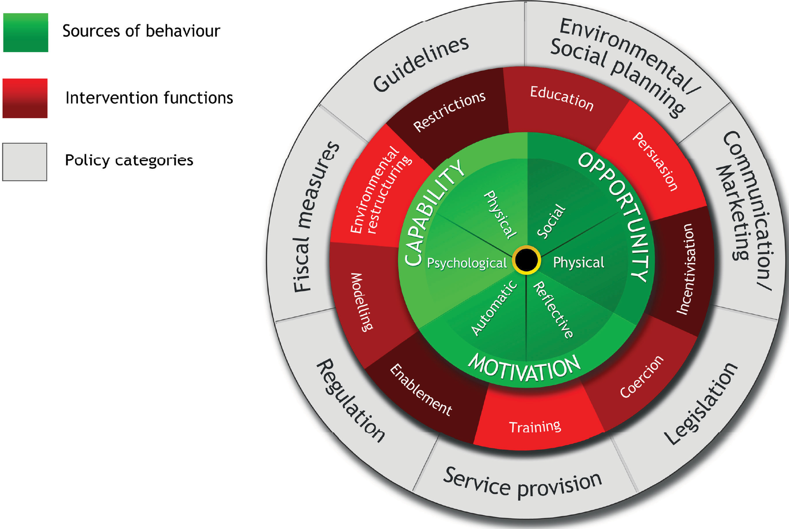
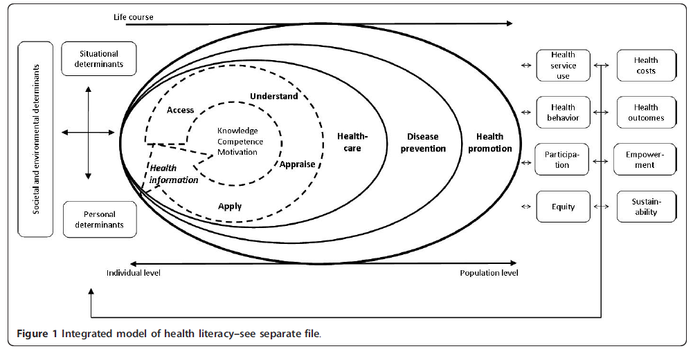
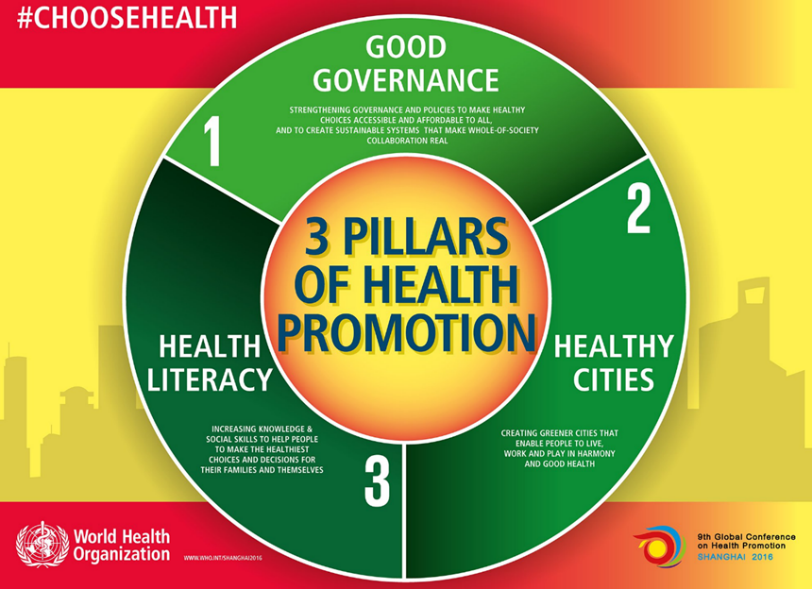

# HS4: พฤติกรรมสุขภาพและการปรับเปลี่ยนพฤติกรรม (Health Behaviour and Behaviour Change)

นพ.สัมฤทธิ์ ศรีธำรงสวัสดิ์

กันยายน 2565

ประเทศไทยก้าวเข้าสู่สังคมสูงวัยอย่างสมบูรณ์ (aged society) แล้ว โดยในปี พ.ศ. 2568 มีผู้สูงอายุตั้งแต่ 60 ปีขึ้นไปจำนวน 14.29 ล้านคน หรือคิดเป็นร้อยละ 21.71 ของประชากรทั้งหมด และกำลังมุ่งสู่สังคมสูงวัยระดับสุดยอด (super-aged society) ซึ่งหมายถึงสังคมที่มีประชากรอายุ 60 ปีขึ้นไปเกินร้อยละ 28 ([Department of Older Persons, 2026](https://www.dop.go.th/download/statistics/th1793240958-2616_0.pdf)) การเปลี่ยนแปลงโครงสร้างประชากรดังกล่าว ร่วมกับการเปลี่ยนแปลงด้านเศรษฐกิจ สังคม และสิ่งแวดล้อม นำมาซึ่ง **การเปลี่ยนผ่านทางระบาดวิทยา (epidemiological transition)** ของ **ภาระโรค (burden of disease)** จากเดิมที่เป็นปัญหาสุขภาพพื้นฐาน เช่น ปัญหาสุขภาพมารดาและทารก ภาวะทุพโภชนาการ และการเจ็บป่วยด้วยโรคติดต่อทั่วไป ไปสู่ภาระโรคอันเกิดจาก **โรคไม่ติดต่อเรื้อรัง (noncommunicable diseases: NCDs)** ซึ่งภาระโรคที่เพิ่มขึ้นมีแรงขับเคลื่อนหลักจากการเปลี่ยนโครงสร้างประชากร (demographic change) ([Bundhamcharoen et al., 2011](https://doi.org/10.1186/1471-2458-11-53)) และในปัจจุบันโรคไม่ติดต่อเรื้อรังเป็นสาเหตุการเสียชีวิตราวร้อยละ 76 ของประชากรไทย ([Vichitkunakorn et al., 2025](https://doi.org/10.1080/16549716.2025.2485689)) กลุ่มโรคไม่ติดต่อหลัก (main NCDs) ได้แก่ โรคหัวใจและหลอดเลือด (เช่น โรคกล้ามเนื้อหัวใจขาดเลือดและโรคหลอดเลือดสมอง) โรคมะเร็ง โรคทางเดินหายใจเรื้อรัง เช่น โรคปอดอุดกั้นเรื้อรัง (chronic obstructive pulmonary disease: COPD) และโรคเบาหวาน ส่วนภาวะความดันโลหิตสูง ภาวะไขมันในเลือดผิดปกติ ระดับน้ำตาลในเลือดสูง และภาวะน้ำหนักเกินหรืออ้วน จัดเป็น **ปัจจัยเสี่ยงทางเมแทบอลิก (metabolic risk factors)** ที่เพิ่มความเสี่ยงต่อโรคหัวใจและหลอดเลือด ([World Health Organization [WHO], 2025b](https://www.who.int/news-room/fact-sheets/detail/noncommunicable-diseases)) โดยโรคเบาหวานและโรคความดันโลหิตสูงที่ควบคุมไม่ได้ยังนำไปสู่ภาวะแทรกซ้อนสำคัญ ได้แก่ ภาวะตาบอด ไตวาย กล้ามเนื้อหัวใจขาดเลือด โรคหลอดเลือดสมอง และการถูกตัดขาหรือเท้า (lower limb amputation) ([WHO, 2025a](https://www.who.int/news-room/fact-sheets/detail/hypertension), [2026c](https://www.who.int/news-room/fact-sheets/detail/diabetes))

โรคไม่ติดต่อเรื้อรังที่กล่าวมาข้างต้นมีความสัมพันธ์อย่างมากกับพฤติกรรมเสี่ยงด้านสุขภาพ (behavioural risk factors) สี่ประการ ได้แก่ การสูบบุหรี่ การบริโภคอาหารที่มีเกลือ น้ำตาล และไขมันสูง หรืออาหารหวาน มัน เค็ม (unhealthy diet) การมีกิจกรรมทางกายไม่เพียงพอ (physical inactivity) และการดื่มเครื่องดื่มแอลกอฮอล์ในระดับที่เป็นอันตราย นอกจากนี้ มลพิษทางอากาศ (air pollution) ยังเป็นปัจจัยเสี่ยงด้านสิ่งแวดล้อมที่สำคัญของโรคไม่ติดต่อเรื้อรัง โดยเฉพาะโรคปอดอุดกั้นเรื้อรัง โดยพฤติกรรมเสี่ยงเหล่านี้ถูกขับเคลื่อนและหล่อหลอมโดยสิ่งแวดล้อมทางสังคม เชิงพาณิชย์ และกายภาพรอบตัวผู้คน ([WHO, 2025b](https://www.who.int/news-room/fact-sheets/detail/noncommunicable-diseases), [2026b](https://www.who.int/news-room/fact-sheets/detail/chronic-obstructive-pulmonary-disease-%28copd%29), [2026d](https://www.who.int/news-room/fact-sheets/detail/healthy-diet)) ข้อมูลการสำรวจพฤติกรรมสุขภาพของประชากรไทย พ.ศ. 2564 พบความชุกของการบริโภคอาหารไม่เหมาะสมร้อยละ 56.93 ภาวะน้ำหนักเกินหรืออ้วนร้อยละ 50.03 กิจกรรมทางกายไม่เพียงพอร้อยละ 42.70 การดื่มแอลกอฮอล์ร้อยละ 29.73 และการสูบบุหรี่ร้อยละ 16.61 ([Vichitkunakorn et al., 2025](https://doi.org/10.1080/16549716.2025.2485689)) ด้วยเหตุนี้ การปรับเปลี่ยนพฤติกรรมสุขภาพจึงเป็นองค์ประกอบหลักของการดูแลและป้องกันโรคไม่ติดต่อเรื้อรังควบคู่กับการรักษาด้วยยา ([WHO, 2025a](https://www.who.int/news-room/fact-sheets/detail/hypertension), [2026c](https://www.who.int/news-room/fact-sheets/detail/diabetes)) หลักฐานจากการทดลองแบบสุ่มที่มีกลุ่มเปรียบเทียบชี้ว่า ในผู้ที่มีความเสี่ยงสูงต่อเบาหวาน โปรแกรมปรับเปลี่ยนวิถีชีวิตช่วยลดอุบัติการณ์เกิดโรคเบาหวานชนิดที่ 2 ได้ถึงร้อยละ 58 ซึ่งได้ผลมากกว่าการใช้ยาเมทฟอร์มิน ([Knowler et al., 2002](https://doi.org/10.1056/NEJMoa012512)) และในผู้ป่วยเบาหวานชนิดที่ 2 ระยะแรก การจัดการลดน้ำหนักอย่างเข้มข้นในบริการปฐมภูมิช่วยให้ผู้เข้าร่วมเกือบครึ่งหนึ่งเข้าสู่ภาวะสงบของโรค (diabetes remission) ที่ 12 เดือนโดยไม่ต้องใช้ยาลดน้ำตาล ([Lean et al., 2018](https://doi.org/10.1016/S0140-6736%2817%2933102-1)) อย่างไรก็ดี ในผู้ป่วยเบาหวานที่เป็นโรคแล้ว การปรับวิถีชีวิตอย่างเข้มข้นแม้ช่วยลดน้ำตาลสะสมและปรับปัจจัยเสี่ยงได้ดีขึ้น แต่ไม่ลดอัตราการเกิดเหตุการณ์โรคหัวใจและหลอดเลือดเมื่อเทียบกับการดูแลมาตรฐาน ([Look AHEAD Research Group, 2013](https://doi.org/10.1056/NEJMoa1212914)) และผู้ป่วยความดันโลหิตสูงจำนวนหนึ่งยังจำเป็นต้องได้รับยาร่วมด้วยแม้ปรับเปลี่ยนพฤติกรรมแล้ว ([WHO, 2025a](https://www.who.int/news-room/fact-sheets/detail/hypertension)) การทำความเข้าใจเกี่ยวกับพฤติกรรม ปัจจัยที่มีอิทธิพลต่อพฤติกรรม และการปรับเปลี่ยนพฤติกรรมที่เกี่ยวเนื่องกับสุขภาพภายใต้บริบททางสังคม วัฒนธรรม เชิงพาณิชย์ และสิ่งแวดล้อม จึงมีความสำคัญเป็นอย่างยิ่งต่อการทำงานของแพทย์และระบบสุขภาพ ([WHO, 2021](https://iris.who.int/handle/10665/350161))

บทนี้ประกอบด้วยสี่ส่วนหลัก คือ (1) พฤติกรรมสุขภาพ (2) แนวคิดทฤษฎีเกี่ยวกับพฤติกรรมสุขภาพ ปัจจัยที่เกี่ยวข้อง และการปรับเปลี่ยนพฤติกรรม (3) ความรอบรู้ด้านสุขภาพ และ (4) การสร้างเสริมสุขภาพ

## 1. พฤติกรรมสุขภาพ

**“พฤติกรรมมนุษย์” (human behaviour)** หมายถึง การกระทำหรือปฏิกิริยาตอบสนองของบุคคลเมื่อเผชิญกับสถานการณ์หรือ **สิ่งเร้า (stimulus)** ไม่ว่าจะเป็นสิ่งเร้าภายในหรือสิ่งเร้าภายนอก จะเกิดขึ้นโดยรู้ตัวหรือไม่รู้ตัว (conscious or nonconscious) ชัดเจนหรือแอบแฝง และโดยตั้งใจหรือไม่ได้ตั้งใจ ([American Psychological Association [APA], 2018a](https://dictionary.apa.org/behavior), [2018h](https://dictionary.apa.org/stimulus)) ทั้งนี้ **สิ่งเร้าภายใน (internal stimulus)** ได้แก่ สิ่งเร้าหรือเหตุการณ์ภายในร่างกายที่เกิดจากความต้องการทางสรีรวิทยาหรือแรงขับทางชีวภาพ (biological drive) เช่น ความหิว ความกระหาย รวมถึงอาการรับรู้ภายใน เช่น อาการปวดศีรษะ ([APA, 2018b](https://dictionary.apa.org/biological-drive), [2018f](https://dictionary.apa.org/private-event)) ส่วน **สิ่งเร้าภายนอก (external stimulus)** ได้แก่ สิ่งกระตุ้นต่าง ๆ ทั้งจากสิ่งแวดล้อมทางกายภาพ (เช่น แสง เสียง อุณหภูมิ) และสิ่งแวดล้อมทางสังคม ที่รับรู้ได้ผ่านประสาทสัมผัสหลักทั้งห้า (five primary senses) คือ การมองเห็น (ตา) การได้ยิน (หู) การรับรส (ลิ้น) การดมกลิ่น (จมูก) และการสัมผัส (ผิวกาย) ([APA, 2018g](https://dictionary.apa.org/sense), [2018h](https://dictionary.apa.org/stimulus)) ในด้านรูปแบบของการแสดงออก พฤติกรรมอาจจำแนกเป็น **พฤติกรรมภายนอก (overt behaviour)** คือ พฤติกรรมที่ผู้อื่นสังเกตเห็นได้โดยตรงโดยไม่ต้องใช้เครื่องมือหรือความเชี่ยวชาญเฉพาะ เช่น การเดิน การพูด การเขียน การแสดงสีหน้า ท่าทาง หรือการร้องไห้ (ขณะที่การเต้นของหัวใจต้องอาศัยเครื่องมือหรือทักษะในการตรวจวัด จึงจัดเป็นการตอบสนองทางสรีรวิทยา ไม่ใช่พฤติกรรมภายนอกโดยตรง) ([APA, 2018a](https://dictionary.apa.org/behavior), [2018e](https://dictionary.apa.org/overt-behavior)) และ **พฤติกรรมภายใน (covert behaviour)** คือ กระบวนการหรือการกระทำภายในที่ผู้อื่นไม่สามารถสังเกตเห็นได้โดยตรง แต่รับรู้ได้จากการอนุมานหรือการบอกเล่าของเจ้าตัว เช่น ความรู้สึก การรับรู้ การจำ การคิด การตัดสินใจ และการจินตนาการ ([APA, 2018c](https://dictionary.apa.org/covert-behavior))

**“พฤติกรรมสุขภาพ” (health behaviour)** หมายถึง กิจกรรมใดก็ตามที่บุคคลกระทำโดยมีวัตถุประสงค์เพื่อส่งเสริม ปกป้อง ดำรงรักษา หรือฟื้นคืนสุขภาพ (promoting, protecting, maintaining or regaining health) ไม่ว่าการกระทำนั้นจะก่อผลดีต่อสุขภาพได้จริงหรือไม่ก็ตาม ([WHO, 2021](https://iris.who.int/handle/10665/350161)) ส่วนในความหมายกว้าง คำว่า **พฤติกรรมที่เกี่ยวข้องกับสุขภาพ (health-related behaviour)** จะครอบคลุมถึงพฤติกรรมเสี่ยงที่บั่นทอนสุขภาพ เช่น การสูบบุหรี่ การดื่มสุราเกินขนาด และการรับประทานอาหารที่ไม่เหมาะสมไว้ด้วย ([APA, 2026](https://dictionary.apa.org/health-behavior); [WHO, 1998](https://iris.who.int/handle/10665/64546)) ทั้งนี้ตามกรอบคลาสสิกของ [Kasl และ Cobb (1966a](https://doi.org/10.1080/00039896.1966.10664365), [1966b)](https://doi.org/10.1080/00039896.1966.10664421) เราสามารถจำแนกพฤติกรรมสุขภาพตามการรับรู้สถานะสุขภาพของบุคคลออกเป็นสามประเภทใหญ่ ๆ ([Buczkowska et al., 2022](https://doi.org/10.3390/ijerph192214650); [Mulyani et al., 2026](https://doi.org/10.1186/s12884-026-08761-7)) ได้แก่

**1) พฤติกรรมการป้องกันโรคและการส่งเสริมสุขภาพ (preventive and promotive behaviour)** เป็นการปฏิบัติกิจกรรมเพื่อดำรงภาวะสุขภาพ ส่งเสริมสุขภาพ และป้องกันอันตรายจากการบาดเจ็บหรือการเกิดโรค โดยตามนิยามดั้งเดิมของ [Kasl และ Cobb (1966a)](https://doi.org/10.1080/00039896.1966.10664365) พฤติกรรมป้องกันโรคหมายถึงกิจกรรมของผู้ที่เชื่อว่าตนเองมีสุขภาพดีเพื่อป้องกันโรคหรือค้นหาโรคตั้งแต่ระยะที่ยังไม่มีอาการ (asymptomatic stage) ก่อนที่แนวคิดยุคหลังจะขยายครอบคลุมพฤติกรรมการส่งเสริมสุขภาพด้วย ([Mulyani et al., 2026](https://doi.org/10.1186/s12884-026-08761-7); [WHO, 2021](https://iris.who.int/handle/10665/350161)) พฤติกรรมการป้องกันโรคช่วยลดโอกาสการเกิดโรคหรือความรุนแรงของโรค เช่น มะเร็งปากมดลูกซึ่งป้องกันได้เป็นส่วนใหญ่ด้วยการฉีดวัคซีนเอชพีวีและการตรวจคัดกรองสม่ำเสมอ ([WHO, 2026a](https://www.who.int/news-room/fact-sheets/detail/cervical-cancer)) ส่วนพฤติกรรมการส่งเสริมสุขภาพช่วยยกระดับสมรรถนะและสุขภาวะโดยรวม (well-being) ทั้งทางกายและทางใจ เช่น การมีกิจกรรมทางกายอย่างสม่ำเสมอ ([WHO, 2026f](https://www.who.int/news-room/fact-sheets/detail/physical-activity)) เพื่อประโยชน์ในการเรียนการสอน อาจจัดกลุ่มตัวอย่างพฤติกรรมด้านนี้ออกเป็น 4 กลุ่มย่อย (โดยกลุ่มที่ 2 และกลุ่มที่ 3 สามารถซ้อนทับกันได้ เช่น การงดสูบบุหรี่เป็นทั้งการส่งเสริมสุขภาพและการป้องกันโรค) คือ

- *1.1) การปฏิบัติกิจวัตรประจำวันที่ดีต่อสุขภาพ* เช่น การมีพฤติกรรมการบริโภคอาหารที่ดีต่อสุขภาพ ซึ่งช่วยป้องกันภาวะทุพโภชนาการและโรคไม่ติดต่อเรื้อรัง ([WHO, 2026d](https://www.who.int/news-room/fact-sheets/detail/healthy-diet))
- *1.2) การปฏิบัติกิจกรรมส่งเสริมสุขภาพ* เช่น การควบคุมน้ำหนักตัว การออกกำลังกาย การพักผ่อนหย่อนใจ การงดดื่มสุรา และการงดสูบบุหรี่ ([WHO, 2025b](https://www.who.int/news-room/fact-sheets/detail/noncommunicable-diseases), [2026c](https://www.who.int/news-room/fact-sheets/detail/diabetes))
- *1.3) การปฏิบัติกิจกรรมป้องกันโรคและการบาดเจ็บ (disease and injury prevention)* เช่น การฉีดวัคซีนป้องกันโรคติดเชื้อ ([WHO, 2026e](https://www.who.int/news-room/fact-sheets/detail/immunization-coverage)) การสวมหมวกนิรภัยซึ่งลดความเสี่ยงการเสียชีวิตจากอุบัติเหตุจักรยานยนต์ได้มากกว่า 6 เท่า และการคาดเข็มขัดนิรภัยซึ่งลดความเสี่ยงการเสียชีวิตของผู้โดยสารได้ถึงร้อยละ 50 ([WHO, 2026g](https://www.who.int/news-room/fact-sheets/detail/road-traffic-injuries))
- *1.4) การคัดกรองโรคและความเสี่ยงตามอายุและความเสี่ยง (age- and risk-appropriate screening)* เช่น การวัดความดันโลหิตซึ่งเป็นวิธีเดียวที่จะทราบว่ามีความดันโลหิตสูง การตรวจคัดกรองเบาหวาน การตรวจคัดกรองมะเร็งปากมดลูก และการตรวจสุขภาพช่องปาก ([WHO, 2025a](https://www.who.int/news-room/fact-sheets/detail/hypertension), [2026a](https://www.who.int/news-room/fact-sheets/detail/cervical-cancer)) ทั้งนี้ผู้เรียนควรแยกการคัดกรองตามกลุ่มอายุและความเสี่ยงออกจากการตรวจสุขภาพทั่วไปประจำปีแบบเหมารวม (general health checks) เนื่องจากการทบทวนวรรณกรรมอย่างเป็นระบบของ Cochrane พบว่าการตรวจสุขภาพทั่วไปแบบเหมารวมในผู้ใหญ่แทบไม่ลดอัตราตายโดยรวม อัตราตายจากมะเร็ง หรืออัตราตายจากโรคหัวใจและหลอดเลือด ([Krogsbøll et al., 2019](https://doi.org/10.1002/14651858.CD009009.pub3))

**2) พฤติกรรมเมื่อรู้สึกไม่สบายหรือเจ็บป่วย (illness behaviour)** หมายถึง กิจกรรมของผู้ที่รู้สึกว่าตนเองไม่สบายหรือมีอาการผิดปกติ เพื่อประเมินและตีความภาวะสุขภาพของตน ตลอดจนแสวงหาความช่วยเหลือหรือแนวทางรักษาที่เหมาะสม ([APA, 2018d](https://dictionary.apa.org/illness-behavior); [Kasl & Cobb, 1966a](https://doi.org/10.1080/00039896.1966.10664365); [Mulyani et al., 2026](https://doi.org/10.1186/s12884-026-08761-7)) เช่น การไปรับบริการที่สถานพยาบาลทั้งภาครัฐและเอกชน การหาซื้อยารับประทานเอง รวมทั้งการไม่กระทำอะไรเลยและเฝ้ารอให้อาการผิดปกติเหล่านั้นทุเลาหายไปเอง เนื่องจากอาการทางกายเดียวกันอาจถูกรับรู้ ตีความ และตอบสนองแตกต่างกันไปในแต่ละบุคคลและบริบท ([Millard, 2016](https://doi.org/10.1093/shm/hkw083))

**3) พฤติกรรมตามบทบาทผู้ป่วย (sick-role behaviour)** หมายถึง กิจกรรมของผู้ที่ถือว่าตนเองเจ็บป่วยแล้วโดยมีเป้าหมายเพื่อให้หายหรือฟื้นตัวจากการเจ็บป่วย ซึ่งครอบคลุมทั้งการดูแลตนเองและการให้ความร่วมมือกับผู้ให้การดูแลรักษาตามแนวคิดบทบาทผู้ป่วยของ Parsons (Parsons' sick role) ที่สังคมยกเว้นหน้าที่ปกติบางส่วนให้ผู้ป่วยควบคู่กับความคาดหวังให้ผู้ป่วยมุ่งรักษาตัวให้หาย ([APA, 2023](https://dictionary.apa.org/sick-role); [Kasl & Cobb, 1966b](https://doi.org/10.1080/00039896.1966.10664421); [Mulyani et al., 2026](https://doi.org/10.1186/s12884-026-08761-7)) ตัวอย่างเช่น การรับประทานยาต่อเนื่องตามแผนการรักษา (medication adherence) ([APA, 2026](https://dictionary.apa.org/health-behavior)) การปรับเปลี่ยนพฤติกรรมเสี่ยง เช่น งดสูบบุหรี่ งดดื่มสุรา และลดอาหารรสเค็มหรือรสจัดเพื่อช่วยลดระดับความดันโลหิต ([WHO, 2025a](https://www.who.int/news-room/fact-sheets/detail/hypertension)) รวมไปถึงการปฏิบัติกิจกรรมเพื่อฟื้นฟูสภาพร่างกาย เช่น การฟื้นฟูสมรรถภาพปอด (pulmonary rehabilitation) ในผู้ป่วยโรคปอดอุดกั้นเรื้อรัง ([WHO, 2026b](https://www.who.int/news-room/fact-sheets/detail/chronic-obstructive-pulmonary-disease-%28copd%29))

## 2. แนวคิดทฤษฎีเกี่ยวกับพฤติกรรมสุขภาพ ปัจจัยที่เกี่ยวข้อง และการปรับเปลี่ยนพฤติกรรม

การจัดโปรแกรมปรับเปลี่ยนพฤติกรรมสุขภาพแก่ประชาชน จำเป็นต้องเข้าใจก่อนว่า “ทำไมประชาชนจึงมีพฤติกรรมเช่นนั้น และมีปัจจัยอะไรที่จะจูงใจหรือเอื้อให้ประชาชนปรับเปลี่ยนพฤติกรรม” เนื่องจากมาตรการที่ออกแบบบนฐานทฤษฎีและการวิเคราะห์พฤติกรรมเป้าหมายอย่างเป็นระบบมีแนวโน้มเกิดประสิทธิผลมากกว่ามาตรการที่ไม่มีกรอบทฤษฎีรองรับ ([Glanz & Bishop, 2010](https://doi.org/10.1146/annurev.publhealth.012809.103604); [Glanz et al., 2008](https://books.google.com/books/about/Health_Behavior_and_Health_Education.html?id=G1-f0gEACAAJ); [Michie et al., 2011](https://doi.org/10.1186/1748-5908-6-42)) ทั้งนี้มีการพัฒนาแนวคิดทฤษฎีจำนวนมากเพื่อทำความเข้าใจหรือทำนายพฤติกรรมสุขภาพ—จากการทบทวนขอบเขตวรรณกรรมข้ามสาขาจิตวิทยา สังคมวิทยา มานุษยวิทยา และเศรษฐศาสตร์ พบทฤษฎีพฤติกรรมและการปรับเปลี่ยนพฤติกรรมถึง 82 ทฤษฎี ([Davis et al., 2015](https://doi.org/10.1080/17437199.2014.941722)) แต่ด้วยพฤติกรรมสุขภาพมีความซับซ้อนและถูกกำหนดจากปัจจัยหลายระดับ ทฤษฎีใดทฤษฎีหนึ่งเพียงลำพังจึงมักไม่ครอบคลุมทุกปัจจัย นักวิชาการจึงผสมผสานหลายแนวคิดทฤษฎีเพื่ออธิบายและแก้ไขปัญหาพฤติกรรมสุขภาพที่จำเพาะภายใต้บริบทหนึ่ง ๆ ([Davis et al., 2015](https://doi.org/10.1080/17437199.2014.941722); [Glanz & Bishop, 2010](https://doi.org/10.1146/annurev.publhealth.012809.103604))

แม้ทฤษฎีส่วนใหญ่ที่ใช้ในงานสาธารณสุขมักเน้นปัจจัยระดับปัจเจก เช่น ความคิด ความรู้สึก ความเชื่อ ความสามารถ และแรงจูงใจของบุคคล แต่ **แบบจำลองเชิงนิเวศ (ecological model)** ชี้ให้เห็นว่าพฤติกรรมสุขภาพได้รับอิทธิพลจากปัจจัยหลายระดับซ้อนกัน ได้แก่ (1) ระดับปัจเจกบุคคล (intrapersonal/individual factors) (2) ปัจจัยระหว่างบุคคลหรือกลุ่มปฐมภูมิ (interpersonal factors) (3) ปัจจัยระดับองค์กรหรือสถาบัน (institutional/organizational factors) (4) ปัจจัยระดับชุมชน (community factors) และ (5) บริบทสังคมและนโยบายสาธารณะ (public policy เช่น โครงสร้าง มาตรการกำกับ และกฎหมาย) ([Davis et al., 2015](https://doi.org/10.1080/17437199.2014.941722); [McLeroy et al., 1988](https://doi.org/10.1177/109019818801500401)) ทฤษฎีที่มีการใช้บ่อยในงานวิจัยและโปรแกรมสาธารณสุข ได้แก่ แบบแผนความเชื่อทางสุขภาพ (health belief model) แบบจำลองข้ามทฤษฎีหรือลำดับขั้นของการเปลี่ยนแปลง (transtheoretical model) ทฤษฎีปัญญาสังคม (social cognitive theory) ทฤษฎีพฤติกรรมตามแผน (theory of planned behaviour) และแบบจำลองเชิงนิเวศ ส่วนแนวคิด KAP เป็นกรอบคิดเชิงสำรวจที่ใช้กันแพร่หลายตั้งแต่อดีต ([Davis et al., 2015](https://doi.org/10.1080/17437199.2014.941722); [Glanz & Bishop, 2010](https://doi.org/10.1146/annurev.publhealth.012809.103604); [Launiala, 2009](https://doi.org/10.22582/am.v11i1.31)) ในที่นี้ขอนำเสนอแนวคิดและทฤษฎีที่พบบ่อย ดังนี้

### 2.1 แนวคิดความรู้ ทัศนคติ พฤติกรรม (Knowledge–Attitude–Practice: KAP)

**แนวคิดความรู้ ทัศนคติ พฤติกรรม (Knowledge–Attitude–Practice)** หรือที่รู้จักกันในนาม **KAP model** มีจุดเริ่มต้นจากการสำรวจ KAP (KAP survey) ในงานวางแผนครอบครัวและการศึกษาประชากรช่วงทศวรรษ 1950 ก่อนขยายมาใช้วางแผนโครงการสาธารณสุขและสุขศึกษาในยุคแรกอย่างกว้างขวาง ([Launiala, 2009](https://doi.org/10.22582/am.v11i1.31); [Nutbeam, 2000](https://doi.org/10.1093/heapro/15.3.259)) แนวคิดนี้ตั้งอยู่บนสมมติฐานการขาดข้อมูล (information deficit) ที่เชื่อว่า “การให้ความรู้เป็นสิ่งสำคัญที่จะนำไปสู่การมีพฤติกรรมที่ดีต่อสุขภาพ” โดยสมมติว่าเมื่อบุคคลได้รับความรู้จะนำไปสู่การเปลี่ยนทัศนคติ และทัศนคติจะส่งผลให้เกิดการปรับเปลี่ยนพฤติกรรมตามลำดับ ในอดีตงานสุขศึกษาจึงมุ่งเน้นการให้ความรู้แก่ประชาชนเป็นหลัก ([Kelly & Barker, 2016](https://doi.org/10.1016/j.puhe.2016.03.030); [Valente et al., 1998](https://doi.org/10.1111/j.1468-2958.1998.tb00421.x))

อย่างไรก็ดี ปัจจุบันมีหลักฐานเชิงประจักษ์จำนวนมากชี้ว่าแนวคิดนี้ไม่เพียงพอที่จะอธิบายหรือเปลี่ยนพฤติกรรมบุคคล ([Arlinghaus & Johnston, 2018](https://doi.org/10.1177/1559827617745479); [Kelly & Barker, 2016](https://doi.org/10.1016/j.puhe.2016.03.030)) การวิเคราะห์อภิมานของการศึกษาเชิงทดลอง (การรวบรวมผลทางสถิติจากการทดลองจำนวนมากมาวิเคราะห์สังเคราะห์ร่วมกัน) พบว่าแม้มาตรการจะเพิ่มความตั้งใจได้ในระดับปานกลางถึงมาก แต่กลับเปลี่ยนพฤติกรรมจริงได้เพียงระดับเล็กถึงปานกลาง ซึ่งสะท้อน **ช่องว่างระหว่างความตั้งใจกับพฤติกรรม (intention–behaviour gap)** ([Webb & Sheeran, 2006](https://doi.org/10.1037/0033-2909.132.2.249)) บ่อยครั้งพฤติกรรมเสี่ยงไม่ได้เกิดจากการขาดความรู้—คนจำนวนมากทราบดีว่าการรับประทานอาหารเกินพอดี การสูบบุหรี่ การดื่มสุรา และการไม่ออกกำลังกายเป็นผลเสียต่อสุขภาพ แต่ยังคงปฏิบัติอยู่ ([Kelly & Barker, 2016](https://doi.org/10.1016/j.puhe.2016.03.030); [Marteau et al., 2012](https://doi.org/10.1126/science.1226918)) นอกจากนี้ K–A–P มิได้มีความสัมพันธ์กันในลักษณะเส้นตรงตามลำดับเดียว แต่เรียงลำดับได้หลายรูปแบบ เช่น บางกรณีการลงมือปฏิบัติเกิดขึ้นก่อน แล้วความรู้และทัศนคติที่ชัดเจนจึงเกิดตามมาภายหลัง ดังที่พบในงานวิจัยด้านการวางแผนครอบครัว ([Launiala, 2009](https://doi.org/10.22582/am.v11i1.31); [Valente et al., 1998](https://doi.org/10.1111/j.1468-2958.1998.tb00421.x)) แนวคิดนี้ยังถูกวิพากษ์ว่ายืมตัวแบบทางการแพทย์ (medical model) ที่มุ่งเน้นความรู้และความรับผิดชอบของปัจเจกในการหลีกเลี่ยงโรค จนละเลยปัจจัยกำหนดสุขภาพทางสังคมและอาจนำไปสู่การกล่าวโทษผู้ป่วย (victim blaming) ([Baum & Fisher, 2014](https://doi.org/10.1111/1467-9566.12112); [Kelly & Barker, 2016](https://doi.org/10.1016/j.puhe.2016.03.030); [McLeroy et al., 1988](https://doi.org/10.1177/109019818801500401)) ทั้งนี้ข้อวิพากษ์ดังกล่าวมิได้ปฏิเสธความสำคัญของความรู้ แม้พฤติกรรมจำนวนมากของมนุษย์จะเกิดขึ้นโดยอัตโนมัติตามสิ่งเร้าในสภาพแวดล้อมมากกว่าผ่านการไตร่ตรอง แต่ในบางกรณีพฤติกรรมก็ได้รับอิทธิพลจากความเชื่อและการไตร่ตรอง และที่สำคัญคือ **การเลือกอย่างมีข้อมูล (informed choice)** ที่สอดคล้องกับคุณค่าของผู้ตัดสินใจจะเกิดขึ้นมิได้หากปราศจากความรู้ที่ถูกต้องเป็นพื้นฐาน ([Arlinghaus & Johnston, 2018](https://doi.org/10.1177/1559827617745479); [Kelly & Barker, 2016](https://doi.org/10.1016/j.puhe.2016.03.030); [Marteau et al., 2001](https://doi.org/10.1046/j.1369-6513.2001.00140.x), [2012](https://doi.org/10.1126/science.1226918))

### 2.2 ทฤษฎีแบบแผนความเชื่อทางสุขภาพ (Health Belief Model: HBM)

**ทฤษฎีแบบแผนความเชื่อทางสุขภาพ (Health Belief Model: HBM)** พัฒนาขึ้นครั้งแรกโดยกลุ่มนักวิจัยของหน่วยงานบริการสาธารณสุขสหรัฐอเมริกา (U.S. Public Health Service) ในทศวรรษ 1950 เพื่อทำนายและอธิบายว่าเหตุใดประชาชนจึงไม่เข้ารับบริการป้องกันโรคหรือคัดกรองโรค (preventive health behaviour) ก่อนที่จะดัดแปลงขยายไปใช้อธิบายพฤติกรรมเมื่อรู้สึกเจ็บป่วย (illness behaviour) และพฤติกรรมตามบทบาทผู้ป่วย (sick-role behaviour) ([Janz & Becker, 1984](https://doi.org/10.1177/109019818401100101); [Jones et al., 2015](https://doi.org/10.1080/10410236.2013.873363); [Rosenstock, 1974](https://doi.org/10.1177/109019817400200403)) แนวคิดหลักของทฤษฎีนี้มองว่าบุคคลตัดสินใจอย่างมีเหตุมีผลโดยชั่งน้ำหนักระหว่างประโยชน์ที่จะได้รับกับความยากลำบากหรืออุปสรรคของการกระทำ (rational cost–benefit appraisal) และจะลงมือปฏิบัติเมื่อเห็นว่าประโยชน์มีค่ามากกว่าอุปสรรค ([Carpenter, 2010](https://doi.org/10.1080/10410236.2010.521906); [Orji et al., 2012](https://doi.org/10.5210/ojphi.v4i3.4321)) องค์ประกอบสำคัญที่มีอิทธิพลต่อพฤติกรรมสุขภาพตามทฤษฎีนี้ ได้แก่ (1) **การรับรู้โอกาสเสี่ยงในการเป็นโรค (perceived susceptibility)** (2) **การรับรู้ความรุนแรงของโรค (perceived severity)** (3) **การรับรู้ประโยชน์ของการปฏิบัติ (perceived benefits)** (4) **การรับรู้อุปสรรคของการปฏิบัติ (perceived barriers)** (5) **ปัจจัยปรับ (modifying factors)** เช่น ปัจจัยด้านประชากร จิตสังคม และโครงสร้าง (6) **สิ่งชักนำให้เกิดการปฏิบัติ (cues to action)** ทั้งสิ่งชักนำภายใน เช่น อาการผิดปกติทางกาย และสิ่งชักนำภายนอก เช่น การสื่อสารรณรงค์หรือคำแนะนำของบุคลากรสุขภาพ (7) **แรงจูงใจด้านสุขภาพ (health motivation)** และ (8) **การรับรู้ความสามารถของตนเอง (self-efficacy)** คือความเชื่อมั่นว่าตนสามารถกระทำพฤติกรรมนั้นได้สำเร็จ ซึ่งเป็นตัวแปรอิสระที่เสนอเพิ่มเข้ามาในแบบจำลองระยะหลัง ([Champion, 1984](https://doi.org/10.1097/00012272-198404000-00011); [Jones et al., 2015](https://doi.org/10.1080/10410236.2013.873363); [Limbu et al., 2022](https://doi.org/10.3390/vaccines10060973); [Rosenstock et al., 1988](https://doi.org/10.1177/109019818801500203)) ทั้งนี้ หลักฐานจากการทบทวนอย่างเป็นระบบและการวิเคราะห์อภิมานพบว่า การรับรู้อุปสรรคและการรับรู้ประโยชน์เป็นตัวทำนายพฤติกรรมที่เข้มแข็งที่สุดอย่างสม่ำเสมอ ขณะที่การรับรู้ความรุนแรงและการรับรู้โอกาสเสี่ยงทำนายพฤติกรรมได้อ่อน และโดยรวมตัวแปรของ HBM ยังอธิบายความแปรปรวนของพฤติกรรมได้จำกัด เพราะตั้งอยู่บนสมมติฐานการคิดไตร่ตรองอย่างมีเหตุผลโดยยังไม่ได้ครอบคลุมกระบวนการอัตโนมัติ ([Carpenter, 2010](https://doi.org/10.1080/10410236.2010.521906); [Janz & Becker, 1984](https://doi.org/10.1177/109019818401100101); [Marteau et al., 2012](https://doi.org/10.1126/science.1226918); [Orji et al., 2012](https://doi.org/10.5210/ojphi.v4i3.4321))

### 2.3 ทฤษฎีลำดับขั้นของการเปลี่ยนแปลง (Stages of Change / Transtheoretical Model: TTM)

**ทฤษฎีลำดับขั้นของการเปลี่ยนแปลง (stages of change model)** ซึ่งเป็นแกนกลางของ **แบบจำลองข้ามทฤษฎี (transtheoretical model: TTM)** ให้ความสนใจกับความพร้อมของบุคคล (readiness to change) ในการเปลี่ยนแปลงพฤติกรรมหรือลดละพฤติกรรมที่ทำลายสุขภาพ ([Cahill et al., 2010](https://doi.org/10.1002/14651858.CD004492.pub4); [Prochaska & Velicer, 1997](https://doi.org/10.4278/0890-1171-12.1.38)) แนวคิดหลักคือ “การเปลี่ยนแปลงพฤติกรรมเป็นกระบวนการที่ต่อเนื่องตามเวลา ไม่ใช่เหตุการณ์ที่เกิดขึ้นฉับพลันครั้งเดียว” และในประชากรกลุ่มเสี่ยงแต่ละคนมีระดับแรงจูงใจหรือความพร้อมที่จะเปลี่ยนพฤติกรรมแตกต่างกัน ([Kelly & Barker, 2016](https://doi.org/10.1016/j.puhe.2016.03.030); [Prochaska & Velicer, 1997](https://doi.org/10.4278/0890-1171-12.1.38)) ลำดับขั้นที่ใช้แพร่หลายประกอบด้วย 5 ขั้นหลัก ได้แก่ (1) **ขั้นยังไม่สนใจ (precontemplation)** คือยังไม่คิดจะเปลี่ยน (2) **ขั้นลังเลใจ (contemplation)** คือเริ่มมีความคิดว่าจะเปลี่ยนแปลง (3) **ขั้นเตรียมการ (preparation)** คือคิดและวางแผนจะเริ่มเปลี่ยนในอนาคตอันใกล้ เช่น ภายใน 30 วัน (4) **ขั้นลงมือทำ (action)** คือเริ่มปฏิบัติพฤติกรรมใหม่แล้วในช่วงไม่เกิน 6 เดือนแรก และ (5) **ขั้นคงพฤติกรรม (maintenance)** คือดำรงรักษาพฤติกรรมสุขภาพนั้นต่อเนื่องเกิน 6 เดือน นอกจากนี้ งานของ [Prochaska และ Velicer (1997)](https://doi.org/10.4278/0890-1171-12.1.38) ยังกล่าวถึงขั้นที่หกคือ **ขั้นยุติ (termination)** เมื่อไม่มีแรงยั่วยุให้กลับไปทำพฤติกรรมเดิมอีก ขณะที่งานต้นแบบเรื่องการเลิกบุหรี่ด้วยตนเองของ [Prochaska และ DiClemente (1983)](https://doi.org/10.1037/0022-006X.51.3.390) ชี้ให้เห็นว่า **การกลับไปทำพฤติกรรมเดิม (relapse)** เกิดขึ้นได้บ่อยในวัฏจักรการเปลี่ยนแปลง ([Cahill et al., 2010](https://doi.org/10.1002/14651858.CD004492.pub4))

แม้ผู้พัฒนาทฤษฎีจะเสนอว่าโปรแกรมการปรับเปลี่ยนพฤติกรรมควรจัดให้จำเพาะตามลำดับขั้นความพร้อมของแต่ละบุคคล (stage-matched interventions) ([Prochaska & Velicer, 1997](https://doi.org/10.4278/0890-1171-12.1.38)) แต่หลักฐานจากการทบทวนวรรณกรรมอย่างเป็นระบบและการวิเคราะห์อภิมานในเวลาต่อมา (รวมถึงการทบทวนของ Cochrane จาก 41 การทดลอง) ไม่พบว่าการจัดโปรแกรมแยกตามขั้นความพร้อมให้ผลสำเร็จในการเลิกบุหรี่หรือเปลี่ยนพฤติกรรมดีกว่าโปรแกรมมาตรฐานแบบเดียวกันที่ไม่แบ่งขั้นอย่างมีนัยสำคัญ และแม้การปรับเนื้อหาสื่อให้เหมาะกับรายบุคคล (tailoring) จะมีผลทางบวกขนาดเล็ก แต่คุณค่าเพิ่มของการแบ่งขั้นตาม TTM ยังไม่แน่ชัด ([Cahill et al., 2010](https://doi.org/10.1002/14651858.CD004492.pub4); [Davis et al., 2015](https://doi.org/10.1080/17437199.2014.941722); [Noar et al., 2007](https://doi.org/10.1037/0033-2909.133.4.673); [Riemsma et al., 2003](https://doi.org/10.1136/bmj.326.7400.1175)) ดังนั้นในทางเวชปฏิบัติ แพทย์จึงควรใช้ลำดับขั้นความพร้อมเป็นกรอบช่วยทำความเข้าใจและสื่อสารกับผู้ป่วยแต่ละรายอย่างเหมาะสม โดยไม่จำกัดการให้คำแนะนำหรือความช่วยเหลือไว้เฉพาะผู้ที่อยู่ในขั้นเตรียมการหรือขั้นลงมือทำเท่านั้น ([Cahill et al., 2010](https://doi.org/10.1002/14651858.CD004492.pub4))

### 2.4 แนวคิดทางเศรษฐศาสตร์พฤติกรรม (Behavioural Economics) และทฤษฎีผลักดัน (Nudge)

**เศรษฐศาสตร์พฤติกรรม (behavioural economics)** เป็นสาขาวิชาที่พัฒนาขึ้นโดยโต้แย้งข้อสมมติฐานของเศรษฐศาสตร์กระแสหลักที่เชื่อว่ามนุษย์ตัดสินใจอย่างมีเหตุมีผลเสมอ (rational agent model) ส่วน **ทฤษฎีผลักดัน (nudge)** เป็นแนวทางประยุกต์หนึ่งที่ต่อยอดจากสาขาเศรษฐศาสตร์พฤติกรรม ([Hollands et al., 2013](https://doi.org/10.1186/1471-2458-13-1218); [Marteau et al., 2011](https://doi.org/10.1136/bmj.d228); [Royal Swedish Academy of Sciences, 2017](https://www.nobelprize.org/prizes/economic-sciences/2017/press-release/)) เศรษฐศาสตร์พฤติกรรมชี้ว่าในความเป็นจริง การตัดสินใจของมนุษย์จำนวนมากมีความไม่คงเส้นคงวาเมื่อกรอบการนำเสนอเปลี่ยนไป (inconsistent preferences) ([Tversky & Kahneman, 1981](https://doi.org/10.1126/science.7455683)) มีความลำเอียงทางความคิด (cognitive biases) ยึดติดกับทางเลือกเดิม (status quo bias) ([Kahneman et al., 1991](https://doi.org/10.1257/jep.5.1.193)) ใช้หลักการหยาบ ๆ หรือทางลัดในการคิด (heuristics หรือ rules of thumb) ซึ่งช่วยประหยัดแรงในการคิดแต่นำไปสู่ความผิดพลาดอย่างเป็นระบบและคาดการณ์ได้ (systematic errors — มิใช่การเดาสุ่มไร้แบบแผน) ([Tversky & Kahneman, 1974](https://doi.org/10.1126/science.185.4157.1124)) ตลอดจนมีแนวโน้มคล้อยตามบรรทัดฐานของคนรอบข้าง (social norms / herding) มีความสามารถจำกัดในการควบคุมตนเอง (limited self-control) ผัดวันประกันพรุ่ง (procrastination) และมีความใส่ใจจำกัด (limited attention) ([Mertens et al., 2022](https://doi.org/10.1073/pnas.2107346118); [Thaler & Sunstein, 2003](https://doi.org/10.1257/000282803321947001); [สินาด ตรีวรรณไชย, 2559](https://medium.com/@treewanchai/%E0%B9%80%E0%B8%A8%E0%B8%A3%E0%B8%A9%E0%B8%90%E0%B8%A8%E0%B8%B2%E0%B8%AA%E0%B8%95%E0%B8%A3%E0%B9%8C%E0%B8%9E%E0%B8%A4%E0%B8%95%E0%B8%B4%E0%B8%81%E0%B8%A3%E0%B8%A3%E0%B8%A1%E0%B8%81%E0%B8%B1%E0%B8%9A%E0%B8%99%E0%B9%82%E0%B8%A2%E0%B8%9A%E0%B8%B2%E0%B8%A2%E0%B8%82%E0%B8%AD%E0%B8%87%E0%B9%80%E0%B8%A1%E0%B8%B7%E0%B8%AD%E0%B8%87-29634eb18a05)) พฤติกรรมเหล่านี้อาจก่อผลเสียต่อทั้งตนเองและสังคม เช่น การบริโภคอาหารพลังงานสูงเกินความจำเป็นเมื่อถูกกระตุ้นด้วยการจัดวางและการโฆษณา ([Marteau et al., 2011](https://doi.org/10.1136/bmj.d228)) รวมถึงตัวอย่างในชีวิตประจำวัน เช่น การละเมิดกฎจราจรหรือการทิ้งขยะไม่เป็นที่

เศรษฐศาสตร์พฤติกรรมผนวกองค์ความรู้ทางจิตวิทยา—โดยเฉพาะจิตวิทยาการรู้คิดและจิตวิทยาสังคม—ร่วมกับมุมมองทางสังคมวิทยาเรื่องบรรทัดฐานและสิ่งแวดล้อม เพื่ออธิบายกระบวนการตัดสินใจของมนุษย์ผ่าน **ทฤษฎีกระบวนการคู่ (dual process theory)** ซึ่งแบ่งกระบวนการคิดออกเป็น 2 ระบบที่ทำงานร่วมกัน (โดย Kahneman เรียกว่าระบบที่ 1 และระบบที่ 2 ส่วน Thaler และ Sunstein เรียกว่าระบบอัตโนมัติและระบบไตร่ตรอง) ([Evans & Stanovich, 2013](https://doi.org/10.1177/1745691612460685); [Hansen & Jespersen, 2013](https://doi.org/10.1017/S1867299X00002762); [Marteau et al., 2011](https://doi.org/10.1136/bmj.d228); [Royal Swedish Academy of Sciences, 2017](https://www.nobelprize.org/prizes/economic-sciences/2017/press-release/)) ได้แก่

- **ระบบอัตโนมัติ (automatic system หรือ System 1)** เน้นใช้สัญชาตญาณและประสบการณ์ความเคยชินโดยไม่ผ่านการไตร่ตรอง มีลักษณะควบคุมยาก (uncontrolled) ไม่ต้องใช้ความพยายาม (effortless) เชื่อมโยงความคิดแบบอัตโนมัติ (associative) รวดเร็ว (fast) เกิดขึ้นโดยไม่รู้ตัว (unconscious) อาศัยความชำนาญ (skilled) และมักถูกกระตุ้นด้วยความรู้สึกเฉพาะหน้าและสิ่งเร้าในสภาพแวดล้อม (environmental cues) ([Hansen & Jespersen, 2013](https://doi.org/10.1017/S1867299X00002762); [Marteau et al., 2011](https://doi.org/10.1136/bmj.d228))
- **ระบบไตร่ตรอง (reflective system หรือ System 2)** เน้นการคิดวิเคราะห์อย่างมีเหตุมีผลมุ่งสู่เป้าหมาย มีลักษณะควบคุมได้ (controlled) ต้องใช้ความพยายาม (effortful) ใช้การอนุมาน (deductive) ทำงานช้า (slow) รู้ตัว (self-aware) ทำตามกฎเกณฑ์หรือหลักการ (rule following) และต้องพึ่งพาหน่วยความจำใช้งาน (working memory) ที่มีขีดจำกัด ([Evans & Stanovich, 2013](https://doi.org/10.1177/1745691612460685); [Hansen & Jespersen, 2013](https://doi.org/10.1017/S1867299X00002762))

เนื่องจากมนุษย์มีข้อจำกัดในการประมวลผลข้อมูล หรือ **ความมีเหตุผลที่มีขอบเขตจำกัด (bounded rationality)** ยิ่งข้อมูลมีความซับซ้อน มีเรื่องต้องตัดสินใจจำนวนมากจนเกิดภาวะทางเลือกล้น (choice overload) มีภาระทางความคิดสูง (cognitive load) หรือมีเวลาจำกัด ผู้คนจึงมักพึ่งพาระบบอัตโนมัติมากกว่าระบบไตร่ตรอง ([Chernev et al., 2015](https://doi.org/10.1016/j.jcps.2014.08.002); [Marteau et al., 2011](https://doi.org/10.1136/bmj.d228); [Mertens et al., 2022](https://doi.org/10.1073/pnas.2107346118)) ทั้งนี้ตามกรอบการสังเคราะห์ของ [สินาด ตรีวรรณไชย (2559)](https://medium.com/@treewanchai/%E0%B9%80%E0%B8%A8%E0%B8%A3%E0%B8%A9%E0%B8%90%E0%B8%A8%E0%B8%B2%E0%B8%AA%E0%B8%95%E0%B8%A3%E0%B9%8C%E0%B8%9E%E0%B8%A4%E0%B8%95%E0%B8%B4%E0%B8%81%E0%B8%A3%E0%B8%A3%E0%B8%A1%E0%B8%81%E0%B8%B1%E0%B8%9A%E0%B8%99%E0%B9%82%E0%B8%A2%E0%B8%9A%E0%B8%B2%E0%B8%A2%E0%B8%82%E0%B8%AD%E0%B8%87%E0%B9%80%E0%B8%A1%E0%B8%B7%E0%B8%AD%E0%B8%87-29634eb18a05) เราอาจพิจารณาปัจจัยที่เกี่ยวข้องกับการตัดสินใจตามแนวคิดเศรษฐศาสตร์พฤติกรรมได้ 3 ด้านสำคัญ คือ

1) **การรับรู้ (perception)** ประกอบด้วย 3 องค์ประกอบ คือ การให้ข่าวสารข้อมูล (information) การสร้างภาพลวงตาทางประสาทสัมผัส (visual illusion) และการจัดกรอบการนำเสนอหรือการจัดฉาก (framing) ซึ่งการนำเสนอข้อมูลชุดเดียวกันด้วยกรอบที่ต่างกันสามารถเปลี่ยนความชอบและการตัดสินใจของบุคคลได้ ([Hansen & Jespersen, 2013](https://doi.org/10.1017/S1867299X00002762); [Tversky & Kahneman, 1981](https://doi.org/10.1126/science.7455683); [สินาด ตรีวรรณไชย, 2559](https://medium.com/@treewanchai/%E0%B9%80%E0%B8%A8%E0%B8%A3%E0%B8%A9%E0%B8%90%E0%B8%A8%E0%B8%B2%E0%B8%AA%E0%B8%95%E0%B8%A3%E0%B9%8C%E0%B8%9E%E0%B8%A4%E0%B8%95%E0%B8%B4%E0%B8%81%E0%B8%A3%E0%B8%A3%E0%B8%A1%E0%B8%81%E0%B8%B1%E0%B8%9A%E0%B8%99%E0%B9%82%E0%B8%A2%E0%B8%9A%E0%B8%B2%E0%B8%A2%E0%B8%82%E0%B8%AD%E0%B8%87%E0%B9%80%E0%B8%A1%E0%B8%B7%E0%B8%AD%E0%B8%87-29634eb18a05))

2) **ความพึงพอใจ (preference)** การใช้ทางลัดทางความคิด (heuristics) นำไปสู่ความลำเอียงที่เป็นระบบ ([Tversky & Kahneman, 1974](https://doi.org/10.1126/science.185.4157.1124)) ความกลัวการสูญเสียที่ให้น้ำหนักกับความสูญเสียมากกว่าผลได้ในขนาดเท่ากัน (loss aversion) ร่วมกับความเฉื่อย (inertia) และการตีความว่าค่าตั้งต้นเป็นคำแนะนำ (endorsement) ทำให้ผู้คนยึดติดกับทางเลือกเดิม (status quo bias) ([Jachimowicz et al., 2019](https://doi.org/10.1017/bpp.2018.43); [Kahneman et al., 1991](https://doi.org/10.1257/jep.5.1.193)) อีกทั้งสิ่งยั่วยุเฉพาะหน้า (temptation) ยังกระตุ้นให้บุคคลตัดสินใจตอบสนองความต้องการระยะสั้นโดยขาดการไตร่ตรอง เช่น การหยิบขนมหน้าจุดชำระเงินทั้งที่ตั้งใจควบคุมน้ำหนัก ([Marteau et al., 2011](https://doi.org/10.1136/bmj.d228))

3) **สถาบัน (institution)** หมายถึง กติกาที่มนุษย์สร้างขึ้นเพื่อจัดระเบียบปฏิสัมพันธ์ในสังคม ทั้งกติกาที่เป็นทางการ (เช่น กฎหมาย กฎระเบียบ ข้อบังคับ) และกติกาที่ไม่เป็นทางการ (เช่น บรรทัดฐาน วัฒนธรรม ประเพณี) ซึ่งทำหน้าที่กำหนดขอบเขตของชุดทางเลือก (choice set) และส่งผลต่อพฤติกรรมของผู้คนอย่างหลีกเลี่ยงไม่ได้ ([North, 1991](https://doi.org/10.1257/jep.5.1.97); [สินาด ตรีวรรณไชย, 2559](https://medium.com/@treewanchai/%E0%B9%80%E0%B8%A8%E0%B8%A3%E0%B8%A9%E0%B8%90%E0%B8%A8%E0%B8%B2%E0%B8%AA%E0%B8%95%E0%B8%A3%E0%B9%8C%E0%B8%9E%E0%B8%A4%E0%B8%95%E0%B8%B4%E0%B8%81%E0%B8%A3%E0%B8%A3%E0%B8%A1%E0%B8%81%E0%B8%B1%E0%B8%9A%E0%B8%99%E0%B9%82%E0%B8%A2%E0%B8%9A%E0%B8%B2%E0%B8%A2%E0%B8%82%E0%B8%AD%E0%B8%87%E0%B9%80%E0%B8%A1%E0%B8%B7%E0%B8%AD%E0%B8%87-29634eb18a05))

หนึ่งในแนวคิดประยุกต์จากเศรษฐศาสตร์พฤติกรรมที่ได้รับความนิยมอย่างกว้างขวางทั้งในนโยบายสาธารณะของรัฐบาลและกลยุทธ์ภาคธุรกิจ คือ **“ทฤษฎีผลักดัน (Nudge)”** ซึ่งเผยแพร่ในหนังสือ *Nudge* ปี ค.ศ. 2008 โดย ริชาร์ด เธเลอร์ (Richard H. Thaler ผู้ได้รับรางวัลโนเบลสาขาเศรษฐศาสตร์ในปี ค.ศ. 2017 จากผลงานด้านเศรษฐศาสตร์พฤติกรรมโดยรวม) ร่วมกับ แคส ซันสตีน (Cass R. Sunstein) ([Hollands et al., 2013](https://doi.org/10.1186/1471-2458-13-1218); [Royal Swedish Academy of Sciences, 2017](https://www.nobelprize.org/prizes/economic-sciences/2017/press-release/); [Thaler & Sunstein, 2008](https://books.google.com/books/about/Nudge.html?id=dSJQn8egXvUC)) ทฤษฎีผลักดันคือ **การออกแบบโครงสร้างทางเลือก (choice architecture)** เพื่อโน้มน้าวให้ผู้คนตัดสินใจเลือกสิ่งที่เป็นประโยชน์ต่อตนเองหรือสังคม และลดผลกระทบภายนอกทางลบ (negative externalities) **โดยไม่สั่งห้ามทางเลือกใดและไม่เปลี่ยนแปลงแรงจูงใจทางเศรษฐกิจหรือราคาอย่างมีนัยสำคัญ** บนปรัชญาที่เรียกว่า **ปิตาธิปไตยแบบเสรีนิยม (libertarian paternalism)** กล่าวคือ มุ่งชี้นำทางเลือกเพื่อประโยชน์ของผู้ตัดสินใจเองโดยยังคงเปิดเสรีภาพให้เลือกทางอื่นได้ ([Hansen & Jespersen, 2013](https://doi.org/10.1017/S1867299X00002762); [Hollands et al., 2013](https://doi.org/10.1186/1471-2458-13-1218); [Mertens et al., 2022](https://doi.org/10.1073/pnas.2107346118); [Thaler & Sunstein, 2003](https://doi.org/10.1257/000282803321947001)) แนวทางนี้จึงแตกต่างจากการบังคับควบคุมด้วยกฎหมายโดยตรง (command and control) อย่างไรก็ดี หลักฐานทางสาธารณสุขชี้ว่าการผลักดันพฤติกรรมเป็นเครื่องมือเสริม (complement) ไม่ใช่สิ่งที่จะนำมาใช้แทนที่กฎหมายและมาตรการกำกับได้ โดยเฉพาะเมื่อภาคธุรกิจก็นำเทคนิคโครงสร้างทางเลือกไปใช้กระตุ้นการบริโภคสินค้าที่ทำลายสุขภาพเช่นกัน ([Marteau et al., 2011](https://doi.org/10.1136/bmj.d228))

ตัวอย่างของการออกแบบโครงสร้างทางเลือกตามแนวคิด Nudge และข้อสังเกตเชิงกลไก ได้แก่

- การตีเส้นทึบขวางถนนให้มีระยะห่างแคบลงเรื่อย ๆ เมื่อเข้าใกล้โค้งอันตราย เพื่อให้ผู้ขับขี่เกิด **ภาพลวงตาทางสายตา (visual illusion)** ว่ารถกำลังแล่นเร็วขึ้นและชะลอความเร็วลงโดยอัตโนมัติ ([Hansen & Jespersen, 2013](https://doi.org/10.1017/S1867299X00002762); [University of Chicago Law School, n.d.](https://www.law.uchicago.edu/news/chronicle-review-sunsteins-nudge))
- การติดภาพแมลงวันในโถปัสสาวะ (เช่น ที่ท่าอากาศยานสคิปโฮล) เพื่อลดการกระเด็นออกนอกโถ ซึ่งทำงานผ่านกลไก **การสร้างเป้าดึงความสนใจทางสายตา (attention target / salience)** ไม่ใช่ภาพลวงตา ทั้งนี้ตัวเลขที่มักอ้างกันว่าช่วยลดการกระเด็นได้ร้อยละ 80 ยังไม่มีงานวิจัยตีพิมพ์ที่ผ่านการทบทวนยืนยันอย่างเป็นทางการ ([Hansen & Jespersen, 2013](https://doi.org/10.1017/S1867299X00002762); [The Decision Lab, n.d.](https://thedecisionlab.com/intervention/how-a-picture-of-a-fly-reduced-washroom-cleaning-costs-by-8); [University of Chicago Law School, n.d.](https://www.law.uchicago.edu/news/chronicle-review-sunsteins-nudge))
- การจัดวางอาหารที่ดีต่อสุขภาพ เช่น ผลไม้ บนชั้นวางระดับสายตาหรือวางไว้ก่อนของหวานในโรงอาหารและซุปเปอร์มาร์เก็ต ซึ่งเป็นการปรับโครงสร้างการตัดสินใจด้วย **การจัดตำแหน่งและระยะใกล้ให้เห็นง่ายและหยิบง่าย (placement / proximity)** (ไม่ใช่การจัดกรอบข้อมูลหรือ framing) ทั้งนี้การทบทวนอย่างเป็นระบบพบว่าการจัดตำแหน่งมีผลต่อการเลือกอาหาร แต่ยังต้องการหลักฐานระยะยาวเรื่องปริมาณการบริโภคจริง ([Bucher et al., 2016](https://doi.org/10.1017/S0007114516001653); [Hollands et al., 2013](https://doi.org/10.1186/1471-2458-13-1218); [Mertens et al., 2022](https://doi.org/10.1073/pnas.2107346118); [Thaler & Sunstein, 2003](https://doi.org/10.1257/000282803321947001))
- การกำหนด **ค่าตั้งต้นแบบต่ออายุหรือเข้าร่วมอัตโนมัติ (default option / opt-out)** เช่น โครงการออมเงินสะสมหรือการต่อสัญญารายปีโดยอัตโนมัติหากไม่แจ้งยกเลิก ซึ่งอาศัยความโน้มเอียงในการยึดติดกับทางเลือกเดิม (status quo bias) มาตรการค่าตั้งต้นเป็นรูปแบบ nudge ที่มีหลักฐานสนับสนุนสม่ำเสมอที่สุด แม้ในบริบทเชิงพาณิชย์การต่อสัญญาบริการอัตโนมัติอาจไม่ได้เป็นประโยชน์ต่อผู้บริโภคเสมอไป ([Jachimowicz et al., 2019](https://doi.org/10.1017/bpp.2018.43); [Marteau et al., 2011](https://doi.org/10.1136/bmj.d228); [Szaszi et al., 2022](https://doi.org/10.1073/pnas.2200732119))
- *ข้อพึงระวังในการจำแนกตัวอย่าง:* กลยุทธ์ส่งเสริมการขายแบบ **“ซื้อ 1 แถม 1”** เป็นการลดราคาสินค้าต่อหน่วยลงครึ่งหนึ่ง จึงเป็นการเปลี่ยนแรงจูงใจทางราคาโดยตรง (price incentive / marketing promotion) และ **ไม่จัดเป็น nudge** ตามนิยามของ Thaler และ Sunstein ที่ต้องไม่เปลี่ยนแรงจูงใจทางเศรษฐกิจอย่างมีนัยสำคัญ ([Hansen & Jespersen, 2013](https://doi.org/10.1017/S1867299X00002762); [Hollands et al., 2013](https://doi.org/10.1186/1471-2458-13-1218); [Thaler & Sunstein, 2008](https://books.google.com/books/about/Nudge.html?id=dSJQn8egXvUC))

ในด้านประสิทธิผลโดยรวม การวิเคราะห์อภิมานขนาดใหญ่ในปี ค.ศ. 2022 พบว่ามาตรการออกแบบโครงสร้างทางเลือกมีขนาดผลเฉลี่ยระดับเล็กถึงปานกลาง (Cohen’s *d* = 0.45) โดยได้ผลเด่นชัดกว่าในพฤติกรรมการเลือกอาหารและการปรับโครงสร้างทางเลือกเมื่อเทียบกับการให้ข้อมูล แต่เมื่อปรับแก้อคติการตีพิมพ์ (publication bias — แนวโน้มที่งานวิจัยซึ่งได้ผลลัพธ์เชิงบวกได้รับการตีพิมพ์มากกว่างานที่ไม่พบผล) ขนาดผลรวมลดลงอย่างมาก และข้อมูลจากการทดลองใช้งานจริงในระดับนโยบายของหน่วยงานรัฐในสหรัฐอเมริกาพบผลเฉลี่ยเพียงประมาณ 1.4 จุดร้อยละ ([DellaVigna & Linos, 2022](https://doi.org/10.3982/ECTA18709); [Maier et al., 2022](https://doi.org/10.1073/pnas.2200300119); [Mertens et al., 2022](https://doi.org/10.1073/pnas.2107346118); [Szaszi et al., 2022](https://doi.org/10.1073/pnas.2200732119)) ดังนั้นประสิทธิผลของ nudge จึงขึ้นกับชนิดของมาตรการและบริบทอย่างมาก และไม่ควรคาดหวังว่าการใช้ nudge เพียงลำพังจะทดแทนมาตรการเชิงโครงสร้างและกฎหมายในการยกระดับสุขภาพประชากรระยะยาวได้ ([Marteau et al., 2011](https://doi.org/10.1136/bmj.d228); [Szaszi et al., 2022](https://doi.org/10.1073/pnas.2200732119))

### 2.5 แนวคิดวงล้อการปรับเปลี่ยนพฤติกรรม (Behaviour Change Wheel: BCW)

**แนวคิดวงล้อการปรับเปลี่ยนพฤติกรรม (Behaviour Change Wheel: BCW)** พัฒนาจากการสังเคราะห์กรอบการปรับเปลี่ยนพฤติกรรม 19 กรอบเข้าด้วยกัน เพื่อเชื่อมโยงทั้งปัจจัยต้นทางของพฤติกรรม มาตรการปรับเปลี่ยนพฤติกรรม และนโยบายสนับสนุนไว้ในระบบเดียว ดังแสดงในภาพที่ 1 วงล้อประกอบด้วย 3 ชั้นที่ไม่เป็นเส้นตรงแต่มีปฏิสัมพันธ์ต่อกัน ได้แก่ (1) วงในสีเขียว คือ **แหล่งที่มาของพฤติกรรม (sources of behaviour)** (2) วงกลางสีแดง คือ **หน้าที่ของมาตรการปรับเปลี่ยนพฤติกรรม (intervention functions)** 9 ด้าน และ (3) วงนอกสีเทา คือ **ประเภทนโยบาย (policy categories)** 7 ประเภทที่หน่วยงานผู้รับผิดชอบใช้เอื้อหรือสนับสนุนให้มาตรการดำเนินการได้จริง ([Michie et al., 2011](https://doi.org/10.1186/1748-5908-6-42))

**ภาพที่ 1 วงล้อการปรับเปลี่ยนพฤติกรรม (Behaviour Change Wheel)** แสดงโครงสร้างสามชั้น ได้แก่ แหล่งที่มาของพฤติกรรมตามแบบจำลอง COM-B (วงในสีเขียว) หน้าที่ของมาตรการปรับเปลี่ยนพฤติกรรม 9 ด้าน (วงกลางสีแดง) และประเภทนโยบาย 7 ประเภท (วงนอกสีเทา) (*ที่มา: [Michie et al., 2011](https://doi.org/10.1186/1748-5908-6-42)*)

แหล่งที่มาของพฤติกรรมในวงในจำแนกตาม **แบบจำลอง COM-B (Capability, Opportunity, Motivation – Behaviour)** เป็น 3 องค์ประกอบหลัก (6 องค์ประกอบย่อย) ที่มีอิทธิพลต่อกันและรับผลย้อนกลับจากพฤติกรรมที่เกิดขึ้นเป็นระบบพลวัต ([Michie et al., 2011](https://doi.org/10.1186/1748-5908-6-42); [West & Michie, 2020](https://doi.org/10.32388/WW04E6)) ได้แก่

- **ความสามารถ (Capability)** คือสมรรถนะในตัวบุคคลทั้งทางกายและทางจิตใจในการกระทำพฤติกรรมนั้น แยกเป็น **ความสามารถทางกาย (physical capability)** หมายถึงสภาพร่างกาย กำลัง ทักษะทางกาย และการทำงานของระบบกล้ามเนื้อและกระดูก เช่น การทรงตัวและความคล่องแคล่ว (ทั้งนี้ *การเข้าถึงทางกายภาพ* เช่น ระยะทาง เวลา หรือค่าใช้จ่าย เป็นปัจจัยนอกตัวบุคคลจึงจัดเป็นโอกาสทางกายภาพ ไม่ใช่ความสามารถทางกาย) และ **ความสามารถทางจิตใจ (psychological capability)** หมายถึงความรู้ ความเข้าใจ ความจำ ทักษะการคิดวิเคราะห์การใช้เหตุผล และการกำกับตนเองที่จำเป็นต่อการทำพฤติกรรม ([Michie et al., 2011](https://doi.org/10.1186/1748-5908-6-42); [West & Michie, 2020](https://doi.org/10.32388/WW04E6))
- **โอกาส (Opportunity)** คือปัจจัยภายนอกตัวบุคคลทั้งหมดที่ทำให้พฤติกรรมเกิดขึ้นได้หรือกระตุ้นให้ทำพฤติกรรม แยกเป็น **โอกาสทางกายภาพ (physical opportunity)** ได้แก่ สิ่งแวดล้อมทางกายภาพ การเข้าถึง เวลา และทรัพยากรทางการเงินหรือวัสดุอุปกรณ์ และ **โอกาสทางสังคม (social opportunity)** ได้แก่ การสนับสนุนจากบุคคลและองค์กร ค่านิยม วัฒนธรรม และบรรทัดฐานทางสังคม ([Michie et al., 2011](https://doi.org/10.1186/1748-5908-6-42); [West & Michie, 2020](https://doi.org/10.32388/WW04E6))
- **แรงจูงใจ (Motivation)** คือกระบวนการทำงานของสมองทั้งหมดที่กระตุ้นและกำหนดทิศทางพฤติกรรม แยกเป็น **แรงจูงใจแบบไตร่ตรอง (reflective motivation)** คือกระบวนการคิดอย่างมีสติ ได้แก่ การประเมินดีเสียและความเชื่อ (evaluations) และการตั้งเป้าหมายวางแผน (plans) (ส่วนความรู้จัดอยู่ในความสามารถทางจิตใจ) และ **แรงจูงใจแบบอัตโนมัติ (automatic motivation)** คืออารมณ์ ความอยาก แรงกระตุ้น สัญชาตญาณ และนิสัยความเคยชินที่เกิดจากการเรียนรู้เชื่อมโยง ([Michie et al., 2011](https://doi.org/10.1186/1748-5908-6-42); [West & Michie, 2020](https://doi.org/10.32388/WW04E6))

ในการประยุกต์ใช้กรอบ COM-B เช่น การวิเคราะห์ว่าเหตุใดสตรีวัยเจริญพันธุ์จึงไม่มารับการตรวจคัดกรองมะเร็งปากมดลูก (cervical screening) งานวิจัยเชิงประจักษ์พบว่าความจำกัดด้านความสามารถทางกายและจิตใจ (เช่น ขาดความรู้หรือทักษะรับมือความกังวลต่อการตรวจ) เป็นอุปสรรค ขณะที่โอกาสทางกายภาพและทางสังคม (เช่น เวลาที่สะดวกและบุคลากรสุขภาพที่ช่วยกระตุ้น) เอื้อต่อการมารับบริการ และแรงจูงใจทั้งแบบไตร่ตรองและแบบอัตโนมัติ (เช่น ความอายหรือความกลัว) ล้วนมีอิทธิพลสำคัญ ([O'Donovan et al., 2021](https://doi.org/10.1111/hex.13346)) การศึกษาทดสอบแบบจำลองยังพบว่า COM-B อธิบายความแปรปรวนของพฤติกรรมกิจกรรมทางกายได้ร้อยละ 31 และพฤติกรรมการบริโภคอาหารได้ร้อยละ 23 โดยความสามารถและโอกาสส่งผลต่อพฤติกรรมผ่านแรงจูงใจ ([Willmott et al., 2021](https://doi.org/10.1186/s12889-021-11019-w)) เมื่อวินิจฉัยได้แล้วว่าองค์ประกอบใดเป็นข้อจำกัด ขั้นต่อไปคือการเลือกมาตรการปรับเปลี่ยนพฤติกรรมให้ตรงจุด ดังแสดงความเชื่อมโยงในตารางที่ 1 โดยมาตรการสำคัญมี 9 หน้าที่ (ซึ่งหนึ่งกิจกรรมอาจทำได้มากกว่าหนึ่งหน้าที่) ([Michie et al., 2011](https://doi.org/10.1186/1748-5908-6-42)) ได้แก่

1. **การให้ความรู้ (education)** เพื่อเพิ่มความรู้หรือความเข้าใจ แก้ไขปัญหาด้านความสามารถทางจิตใจ (psychological capability) และแรงจูงใจแบบไตร่ตรอง (reflective motivation)
2. **การพูดโน้มน้าว (persuasion)** ใช้การสื่อสารกระตุ้นความรู้สึกเชิงบวกหรือลบหรือกระตุ้นการลงมือทำ แก้ไขด้านแรงจูงใจแบบไตร่ตรองและแบบอัตโนมัติ
3. **การให้รางวัล (incentivisation)** สร้างความคาดหวังว่าจะได้รับผลตอบแทน แก้ไขด้านแรงจูงใจแบบไตร่ตรองและแบบอัตโนมัติ
4. **การบังคับหรือคาดโทษ/เพิ่มต้นทุน (coercion)** สร้างความคาดหวังว่าจะถูกลงโทษหรือต้องเสียค่าใช้จ่าย แก้ไขด้านแรงจูงใจแบบไตร่ตรองและแบบอัตโนมัติ
5. **การฝึกอบรม (training)** เพื่อพัฒนาทักษะการปฏิบัติ แก้ไขปัญหาด้านความสามารถทางกายและทางจิตใจ (physical and psychological capability)
6. **การห้ามหรือจำกัด (restriction)** ใช้กฎเกณฑ์ลดโอกาสทำพฤติกรรมที่เป็นปัญหา (หรือลดพฤติกรรมคู่แข่ง) แก้ไขปัญหาด้านโอกาสทางกายภาพและทางสังคม (physical and social opportunity)
7. **การปรับสภาพแวดล้อม (environmental restructuring)** เปลี่ยนบริบททางกายภาพหรือทางสังคม แก้ไขปัญหาด้านแรงจูงใจแบบอัตโนมัติ และโอกาสทางกายภาพและทางสังคม
8. **การมีตัวแบบที่ดี (modelling)** นำเสนอตัวอย่างให้ผู้คนอยากเลียนแบบ แก้ไขด้านแรงจูงใจแบบอัตโนมัติ
9. **การจัดให้มีปัจจัยเอื้อสนับสนุน (enablement)** เพิ่มวิธีการหรือลดอุปสรรคนอกเหนือจากการให้ความรู้ การฝึกอบรม และการปรับสภาพแวดล้อม (เช่น การให้คำปรึกษาช่วยเลิกบุหรี่ การให้ยารักษา หรือกายอุปกรณ์) แก้ไขปัญหาได้ **5 ใน 6 องค์ประกอบ** คือ ความสามารถทางกาย ความสามารถทางจิตใจ แรงจูงใจแบบอัตโนมัติ โอกาสทางกายภาพ และโอกาสทางสังคม (**ยกเว้นแรงจูงใจแบบไตร่ตรอง**) ([Michie et al., 2011](https://doi.org/10.1186/1748-5908-6-42))

**ตารางที่ 1** ความเชื่อมโยงระหว่างองค์ประกอบของแบบจำลอง COM-B กับหน้าที่ของมาตรการปรับเปลี่ยนพฤติกรรม

| องค์ประกอบ COM-B | Education | Persuasion | Incentivisation | Coercion | Training | Restriction | Environmental restructuring | Modelling | Enablement |
|---|:---:|:---:|:---:|:---:|:---:|:---:|:---:|:---:|:---:|
| **C-Ph** (Physical capability) | | | | | ✓ | | | | ✓ |
| **C-Ps** (Psychological capability) | ✓ | | | | ✓ | | | | ✓ |
| **M-Re** (Reflective motivation) | ✓ | ✓ | ✓ | ✓ | | | | | |
| **M-Au** (Automatic motivation) | | ✓ | ✓ | ✓ | | | ✓ | ✓ | ✓ |
| **O-Ph** (Physical opportunity) | | | | | | ✓ | ✓ | | ✓ |
| **O-So** (Social opportunity) | | | | | | ✓ | ✓ | | ✓ |

*หมายเหตุ: ดัดแปลงจาก Table 2 ของ [Michie et al. (2011)](https://doi.org/10.1186/1748-5908-6-42) โดย C-Ph เพิ่มได้ด้วยการฝึกทักษะทางกายหรือมาตรการเอื้อ เช่น ยา การผ่าตัด หรือกายอุปกรณ์; C-Ps เพิ่มได้ด้วยการให้ความรู้ การฝึกทักษะทางความคิด/อารมณ์ หรือมาตรการเอื้อ; M-Re เพิ่มได้ด้วยการเพิ่มความเข้าใจและการเปลี่ยนการประเมินคุณค่าทางเลือก; M-Au เพิ่มได้ด้วยการเรียนรู้เชื่อมโยง การเลียนแบบ การสร้างนิสัย หรือการปรับสิ่งแวดล้อม; O-Ph และ O-So เพิ่มได้ด้วยการปรับเปลี่ยนบริบทและกติกาแวดล้อม*

การเลือกนำมาตรการเหล่านี้ไปใช้จะได้ผลเพียงใดขึ้นอยู่กับลักษณะของพฤติกรรมเป้าหมายและบริบทของประชากรกลุ่มนั้น ๆ ทั้งนี้มาตรการทั้ง 9 หน้าที่เชื่อมโยงกับ **ประเภทนโยบาย (policy categories)** ทั้ง 7 ประเภทในวงล้อชั้นนอกที่จะเอื้อให้ดำเนินมาตรการได้จริง ดังแสดงในตารางที่ 2 ได้แก่ (1) การสื่อสารและการตลาด (communication/marketing) (2) การจัดทำแนวทางปฏิบัติ (guidelines) (3) มาตรการการคลังและภาษี (fiscal measures) (4) การควบคุมกำกับด้วยกฎระเบียบ (regulation) (5) การออกหรือแก้ไขกฎหมายบังคับ (legislation) (6) การวางแผนด้านสิ่งแวดล้อมและสังคม (environmental/social planning) และ (7) การจัดบริการ (service provision) ตัวอย่างเช่น มาตรการการคลังผ่านระบบภาษีสามารถเอื้อต่อการให้รางวัล การเพิ่มต้นทุนบังคับ การฝึกอบรม การปรับสภาพแวดล้อม และการจัดปัจจัยเอื้อสนับสนุน ขณะที่การวางแผนสิ่งแวดล้อมและสังคมเอื้อโดยตรงต่อการปรับสภาพแวดล้อมและการจัดปัจจัยเอื้อสนับสนุน ([Michie et al., 2011](https://doi.org/10.1186/1748-5908-6-42))

**ตารางที่ 2** ความเชื่อมโยงระหว่างประเภทนโยบายกับหน้าที่ของมาตรการปรับเปลี่ยนพฤติกรรม

| ประเภทนโยบาย (Policy categories) | Education | Persuasion | Incentivisation | Coercion | Training | Restriction | Environmental restructuring | Modelling | Enablement |
|---|:---:|:---:|:---:|:---:|:---:|:---:|:---:|:---:|:---:|
| **Communication/marketing** | ✓ | ✓ | ✓ | ✓ | | | | ✓ | |
| **Guidelines** | ✓ | ✓ | ✓ | ✓ | ✓ | ✓ | ✓ | | ✓ |
| **Fiscal measures** | | | ✓ | ✓ | ✓ | | ✓ | | ✓ |
| **Regulation** | ✓ | ✓ | ✓ | ✓ | ✓ | ✓ | ✓ | | ✓ |
| **Legislation** | ✓ | ✓ | ✓ | ✓ | ✓ | ✓ | ✓ | | ✓ |
| **Environmental/social planning** | | | | | | | ✓ | | ✓ |
| **Service provision** | ✓ | ✓ | ✓ | ✓ | ✓ | | | ✓ | ✓ |

*ที่มา: ดัดแปลงจาก Table 3 ของ [Michie et al. (2011)](https://doi.org/10.1186/1748-5908-6-42)*

โดยสรุป แนวคิดทฤษฎีในการทำความเข้าใจพฤติกรรมสุขภาพระยะแรกมุ่งเน้นปัจจัยระดับปัจเจกเป็นหลัก ทั้งแนวคิด KAP ที่ตั้งอยู่บนสมมติฐานการขาดข้อมูล (information deficit) และทฤษฎีแบบแผนความเชื่อทางสุขภาพ (Health Belief Model: HBM) ที่มองว่าบุคคลชั่งน้ำหนักประโยชน์และอุปสรรคอย่างมีสติและมีเหตุผล แต่หลักฐานภายหลังชี้ว่าความรู้อย่างเดียวไม่เพียงพอและตัวแปรของ HBM ทำนายพฤติกรรมได้จำกัด ([Carpenter, 2010](https://doi.org/10.1080/10410236.2010.521906); [Kelly & Barker, 2016](https://doi.org/10.1016/j.puhe.2016.03.030); [Orji et al., 2012](https://doi.org/10.5210/ojphi.v4i3.4321)) ต่อมาแนวคิดทางเศรษฐศาสตร์พฤติกรรมชี้ให้เห็นว่ามนุษย์ไม่ได้ตัดสินใจอย่างมีเหตุผลเสมอไป (และก็ไม่ได้ไร้เหตุผลเสมอไป) แต่หลายกรณีเป็นการตอบสนองแบบอัตโนมัติหรือตามความเคยชินภายใต้บริบทแวดล้อม จึงเกิดแนวคิดการผลักดันพฤติกรรม (Nudge) ที่ออกแบบโครงสร้างทางเลือกโดยไม่บังคับ ซึ่งได้ผลเฉลี่ยระดับเล็กถึงปานกลางและต้องคำนึงถึงอคติการตีพิมพ์ ([Kelly & Barker, 2016](https://doi.org/10.1016/j.puhe.2016.03.030); [Mertens et al., 2022](https://doi.org/10.1073/pnas.2107346118)) ท้ายที่สุด กรอบที่ผนวกทั้งปัจจัยภายในตัวบุคคล ปัจจัยสิ่งแวดล้อม และการตัดสินใจทั้งแบบไตร่ตรองและแบบอัตโนมัติเข้าด้วยกันพร้อมมาตรการที่กว้างกว่าการผลักดัน คือ **วงล้อการปรับเปลี่ยนพฤติกรรม (Behaviour Change Wheel)** ซึ่งเชื่อมแหล่งที่มาของพฤติกรรม (ความสามารถ โอกาส และแรงจูงใจตามตัวแบบ COM-B) เข้ากับมาตรการปรับเปลี่ยนพฤติกรรม 9 หน้าที่ และนโยบายสนับสนุน 7 ประเภทอย่างเป็นระบบ ([Michie et al., 2011](https://doi.org/10.1186/1748-5908-6-42))

## 3. ความรอบรู้ด้านสุขภาพ (Health Literacy)

ในเดือนสิงหาคม ค.ศ. 2020 แผน *Healthy People 2030* ของกระทรวงสาธารณสุขและบริการมนุษย์ สหรัฐอเมริกา (U.S. Department of Health and Human Services) ได้ปรับปรุงนิยามของความรอบรู้ด้านสุขภาพใหม่โดยแยกเป็นสองระดับ ซึ่งศูนย์ควบคุมและป้องกันโรค สหรัฐอเมริกา (Centers for Disease Control and Prevention: CDC) นำมาใช้อย่างเป็นทางการ ([Centers for Disease Control and Prevention [CDC], 2024](https://www.cdc.gov/health-literacy/php/about/index.html); [Office of Disease Prevention and Health Promotion, n.d.](https://odphp.health.gov/healthypeople/priority-areas/health-literacy-healthy-people-2030); [Santana et al., 2021](https://doi.org/10.1097/PHH.0000000000001324)) ดังนี้

- **ความรอบรู้ด้านสุขภาพระดับบุคคล (personal health literacy)** หมายถึง ระดับที่ปัจเจกบุคคลมีความสามารถในการค้นหา (find) ทำความเข้าใจ (understand) และใช้ (use) ข้อมูลและบริการ เพื่อประกอบการตัดสินใจและการลงมือทำที่เกี่ยวกับสุขภาพสำหรับตนเองและผู้อื่น จุดเปลี่ยนสำคัญจากนิยามเดิมของ *Healthy People 2010* และ *2020* คือการเน้นความสามารถในการ **นำข้อมูลไปใช้จริง** มากกว่าเพียงแค่เข้าใจ และการมุ่งเน้น **การตัดสินใจโดยมีข้อมูลรอบด้าน (well-informed decisions)** แทนคำว่าการตัดสินใจที่ “เหมาะสม” (appropriate decisions) ([CDC, 2024](https://www.cdc.gov/health-literacy/php/about/index.html); [Office of Disease Prevention and Health Promotion, n.d.](https://odphp.health.gov/healthypeople/priority-areas/health-literacy-healthy-people-2030))
- **ความรอบรู้ด้านสุขภาพระดับองค์กร (organizational health literacy)** ตามนิยามที่เผยแพร่โดย CDC หมายถึง ระดับที่องค์กร **เอื้ออำนวยอย่างเป็นธรรม (equitably enable)** ให้ปัจเจกบุคคลสามารถค้นหา ทำความเข้าใจ และใช้ข้อมูลและบริการ เพื่อประกอบการตัดสินใจและการลงมือทำที่เกี่ยวกับสุขภาพสำหรับตนเองและผู้อื่น โดยตระหนักว่าเป็นความรับผิดชอบขององค์กรที่จะต้องลดอุปสรรคในการสื่อสารและการจัดบริการ อันเป็นการผนวกมุมมองด้านการสาธารณสุขและเชื่อมความรอบรู้ด้านสุขภาพเข้ากับความเป็นธรรมด้านสุขภาพ (health equity) ([CDC, 2024](https://www.cdc.gov/health-literacy/php/about/index.html); [Kružliaková et al., 2021](https://doi.org/10.3928/24748307-20210114-01); [Santana et al., 2021](https://doi.org/10.1097/PHH.0000000000001324))

นิยามสองระดับดังกล่าวชี้ให้เห็นว่า ความรอบรู้ด้านสุขภาพระดับบุคคลมีลักษณะขึ้นกับบริบท (contextual) มิได้ขึ้นอยู่กับทักษะของตัวผู้ป่วยเพียงฝ่ายเดียว แต่ขึ้นอยู่กับความยากง่ายของข้อมูลและระบบบริการที่องค์กรด้านสุขภาพออกแบบไว้ด้วย ([Kružliaková et al., 2021](https://doi.org/10.3928/24748307-20210114-01); [Office of Disease Prevention and Health Promotion, n.d.](https://odphp.health.gov/healthypeople/priority-areas/health-literacy-healthy-people-2030); [Santana et al., 2021](https://doi.org/10.1097/PHH.0000000000001324))

### กรอบแนวคิดความรอบรู้ด้านสุขภาพ

ตาม **แบบจำลองบูรณาการความรอบรู้ด้านสุขภาพ (integrated model of health literacy)** ของ [Sørensen และคณะ (2012)](https://doi.org/10.1186/1471-2458-12-80) ความรอบรู้ด้านสุขภาพประกอบด้วย **ความรู้ (knowledge)** **แรงจูงใจ (motivation)** และ **สมรรถนะ (competences)** ของบุคคล 4 ประการ (ซึ่งทั้งสามส่วนนี้เป็นองค์ประกอบแกนกลางของความรอบรู้ด้านสุขภาพ) ได้แก่ (1) **การเข้าถึง (access)** คือความสามารถในการแสวงหา ค้นพบ และได้มาซึ่งข้อมูลสุขภาพ (2) **การเข้าใจ (understand)** คือความสามารถในการทำความเข้าใจข้อมูลสุขภาพที่เข้าถึงได้ (3) **การประเมิน (appraise)** คือความสามารถในการตีความ กลั่นกรอง ตัดสิน และประเมินความน่าเชื่อถือของข้อมูลสุขภาพ และ (4) **การประยุกต์ใช้ (apply)** คือความสามารถในการสื่อสารและใช้ข้อมูลในการตัดสินใจเพื่อคงไว้และพัฒนาสุขภาพ สมรรถนะทั้ง 4 ด้านนี้ถูกนำไปใช้ตลอด 3 ขอบเขตต่อเนื่องของสุขภาพ ได้แก่ การดูแลรักษาเมื่อเจ็บป่วยในระบบบริการ (healthcare) การป้องกันโรคเมื่อมีความเสี่ยง (disease prevention) และการสร้างเสริมสุขภาพในฐานะพลเมืองในครอบครัว ที่ทำงาน ชุมชน และเวทีนโยบาย (health promotion) รวมเป็นเมทริกซ์ 12 มิติ ดังแสดงในภาพที่ 2

ทั้งนี้ปัจจัยกำหนดที่มีอิทธิพลต่อความรอบรู้ด้านสุขภาพจำแนกตามระยะใกล้–ไกลในแบบจำลองของ [Sørensen และคณะ (2012)](https://doi.org/10.1186/1471-2458-12-80) ได้เป็น 3 กลุ่ม คือ (1) **ปัจจัยส่วนบุคคล (personal determinants)** เช่น อายุ เพศ เชื้อชาติ สถานะทางเศรษฐกิจสังคม การศึกษา อาชีพ รายได้ และทักษะการอ่านออกเขียนได้ทั่วไป รวมถึงสมรรถนะส่วนบุคคล เช่น การมองเห็น การได้ยิน ทักษะการพูด ความจำและการให้เหตุผล สมรรถนะทางกาย ทักษะทางสังคม ทักษะการอ่าน ความเข้าใจ และการคำนวณ (numeracy) ตลอดจนประสบการณ์เดิมเกี่ยวกับการเจ็บป่วยและการรับบริการสุขภาพ (2) **ปัจจัยด้านสถานการณ์หรือบริบทใกล้ตัว (situational determinants)** เช่น เครือข่ายแรงสนับสนุนทางสังคม อิทธิพลจากครอบครัวและเพื่อน การใช้สื่อ (รวมถึงสื่อสังคมออนไลน์) และสภาพแวดล้อมทางกายภาพ และ (3) **ปัจจัยระยะไกลด้านสังคมและสิ่งแวดล้อม (societal and environmental determinants)** เช่น โครงสร้างประชากร วัฒนธรรม ภาษา พลังทางการเมือง นโยบายรัฐ และระบบการจัดช่องทางข้อมูลข่าวสารและเทคโนโลยีสารสนเทศของสังคม

**ภาพที่ 2 แบบจำลองบูรณาการความรอบรู้ด้านสุขภาพ (Integrated model of health literacy)** แสดงองค์ประกอบแกนกลางและสมรรถนะ 4 ด้านใน 3 ขอบเขตสุขภาพ ปัจจัยกำหนดระยะใกล้และระยะไกล และความเชื่อมโยงกับการใช้บริการ ค่าใช้จ่าย พฤติกรรม ผลลัพธ์สุขภาพ การเสริมพลัง และความเป็นธรรม (*ที่มา: [Sørensen et al., 2012](https://doi.org/10.1186/1471-2458-12-80)*)

ในด้านผลที่เชื่อมโยงกับความรอบรู้ด้านสุขภาพ แม้กรอบแนวคิดจะวางเส้นทางว่าความรอบรู้ด้านสุขภาพส่งผลต่อการใช้บริการและพฤติกรรมสุขภาพต่อไปยังผลลัพธ์และค่าใช้จ่ายของระบบ แต่ผู้เรียนพึงตระหนักว่าหลักฐานเชิงประจักษ์ส่วนใหญ่มาจากการศึกษาเชิงสังเกตที่แสดง **ความสัมพันธ์ (association)** มากกว่าการพิสูจน์ความเป็นเหตุและผลโดยตรง กล่าวคือ ความรอบรู้ด้านสุขภาพที่ต่ำมีความสัมพันธ์อย่างสม่ำเสมอกับการนอนโรงพยาบาลและการใช้ห้องฉุกเฉินที่เพิ่มขึ้น การได้รับบริการคัดกรองมะเร็งเต้านมและวัคซีนไข้หวัดใหญ่น้อยลง และในผู้สูงอายุสัมพันธ์กับสถานะสุขภาพโดยรวมที่ด้อยกว่าและอัตราตายที่สูงกว่า ([Berkman et al., 2011](https://doi.org/10.7326/0003-4819-155-2-201107190-00005)) ด้านค่าใช้จ่าย ความรอบรู้ด้านสุขภาพที่จำกัดสัมพันธ์กับค่าใช้จ่ายส่วนเพิ่มประมาณร้อยละ 3–5 ของค่าใช้จ่ายสุขภาพรวมระดับระบบต่อปี แม้จำนวนการศึกษายังมีไม่มาก ผลลัพธ์มีความหลากหลาย และยังต้องอาศัยการศึกษายืนยันความเป็นเหตุและผล ([Eichler et al., 2009](https://doi.org/10.1007/s00038-009-0058-2); [Tusoni et al., 2025](https://doi.org/10.1136/bmjopen-2025-108816)) ส่วนด้านพฤติกรรมและผลลัพธ์สุขภาพ การวิเคราะห์อภิมานพบความสัมพันธ์เชิงบวกขนาดเล็กถึงปานกลางบนฐานข้อมูลเชิงสหสัมพันธ์ และแม้การทดลองจัดมาตรการส่งเสริมความรอบรู้จะช่วยปรับพฤติกรรมได้ใน 7 จาก 8 การศึกษา แต่การศึกษาเหล่านั้นยังมีความเสี่ยงต่ออคติทางระเบียบวิธีวิจัย ([McAnally & Hagger, 2023](https://doi.org/10.1037/hea0001266); [Walters et al., 2020](https://doi.org/10.1186/s12889-020-08991-0))

ในมิติด้านสังคม ความรอบรู้ด้านสุขภาพถือเป็นทุน (asset) ที่ส่งเสริมการมีส่วนร่วมของประชาชนในกิจกรรมสุขภาพ และโดยเฉพาะความรอบรู้ขั้นวิจารณญาณจะช่วยเสริมพลังอำนาจ (empowerment) ให้ประชาชนและชุมชนจัดการกับปัจจัยกำหนดสุขภาพของตนเองได้มากขึ้น ([Nutbeam, 2008](https://doi.org/10.1016/j.socscimed.2008.09.050); [Sørensen et al., 2012](https://doi.org/10.1186/1471-2458-12-80)) นอกจากนี้ ความรอบรู้ด้านสุขภาพยังทำหน้าที่เป็นตัวแปรคั่นกลาง (mediator) ส่วนหนึ่งระหว่างสถานะทางเศรษฐกิจสังคมและเชื้อชาติกับผลลัพธ์สุขภาพและการใช้บริการป้องกันโรค การยกระดับความรอบรู้ของประชากรควบคู่กับการจัดบริการที่เข้าถึงและเข้าใจง่ายอย่างเป็นธรรมจึงอาจนำไปสู่ความเป็นธรรมด้านสุขภาพและความยั่งยืนของการเปลี่ยนแปลงด้านสาธารณสุขในระดับประชากร ([Berkman et al., 2011](https://doi.org/10.7326/0003-4819-155-2-201107190-00005); [Sørensen et al., 2012](https://doi.org/10.1186/1471-2458-12-80); [Stormacq et al., 2019](https://doi.org/10.1093/heapro/day062)) ทั้งนี้ความสัมพันธ์ระหว่างปัจจัยกำหนด ความรอบรู้ด้านสุขภาพ และผลลัพธ์อาจไม่เป็นเส้นตรง (เช่น อาจมีลักษณะเป็นขั้นบันไดหรือจุดเปลี่ยน threshold effect) มีปฏิสัมพันธ์กับแรงสนับสนุนทางสังคมอย่างซับซ้อน และยังมีเส้นทางเชื่อมโยงที่ต้องศึกษาเพิ่มเติม ([Sørensen et al., 2012](https://doi.org/10.1186/1471-2458-12-80))

## 4. การสร้างเสริมสุขภาพ (Health Promotion)

จากความหมายของคำว่า “สุขภาพ” และ “ระบบสุขภาพ” ที่มีขอบเขตกว้างขวางและสัมพันธ์กับปัจจัยแวดล้อมทุกมิติ ขณะที่บริการรักษาพยาบาลมีผลต่อสถานะสุขภาพของประชากรโดยรวมน้อยกว่าปัจจัยกำหนดสุขภาพด้านสังคม เศรษฐกิจ และสิ่งแวดล้อม การพัฒนาสุขภาพของบุคคล ครอบครัว และชุมชนจึงไม่อาจพึ่งพาเฉพาะภาคบริการสุขภาพเพียงลำพัง แต่ต้องพัฒนาปัจจัยกำหนดสุขภาพทุกด้านควบคู่กันไป ([Public Health Agency of Canada, 1986](https://www.canada.ca/en/public-health/services/health-promotion/population-health/ottawa-charter-health-promotion-international-conference-on-health-promotion.html); [WHO, 1986](https://www.who.int/teams/health-promotion/enhanced-wellbeing/first-global-conference); [Williams et al., 2026](https://doi.org/10.1093/heapro/daag102)) องค์การอนามัยโลกได้ให้นิยามของ **“การสร้างเสริมสุขภาพ” (health promotion)** ไว้ใน **กฎบัตรออตตาวา (Ottawa Charter for Health Promotion)** ค.ศ. 1986 ว่าหมายถึง *“กระบวนการที่ทำให้ประชาชนสามารถเพิ่มการควบคุมและพัฒนาสุขภาพของตนเอง (the process of enabling people to increase control over, and to improve, their health)”* ซึ่งอภิธานศัพท์การสร้างเสริมสุขภาพฉบับปรับปรุง ค.ศ. 2021 ยังคงยืนยันนิยามมาตรฐานนี้ และกฎบัตรกรุงเทพฯ ค.ศ. 2005 ได้เน้นย้ำเพิ่มเติมถึงการควบคุมปัจจัยกำหนดสุขภาพ (determinants of health) ในโลกยุคโลกาภิวัตน์ ([Nutbeam & Muscat, 2021](https://doi.org/10.1093/heapro/daaa157); [WHO, 1986](https://www.who.int/teams/health-promotion/enhanced-wellbeing/first-global-conference), [2005](https://www.who.int/teams/health-promotion/enhanced-wellbeing/sixth-global-conference/the-bangkok-charter), [2021](https://iris.who.int/handle/10665/350161), [n.d.](https://www.who.int/health-topics/health-promotion)) การสร้างเสริมสุขภาพจึงเป็นขบวนการเคลื่อนไหวทางสังคมที่อาศัยความร่วมมือของทุกภาคส่วน (ทั้งภาครัฐ ภาคสุขภาพ ภาคเศรษฐกิจสังคม องค์กรเอกชน อาสาสมัคร ท้องถิ่น อุตสาหกรรม และสื่อ) มุ่งครอบคลุมประชากรทั้งหมดในวิถีชีวิตประจำวัน (population as a whole) มิได้จำกัดเฉพาะกลุ่มเสี่ยงต่อโรคใดโรคหนึ่ง และมีขอบเขตกว้างกว่าบริการส่งเสริมสุขภาพรายบุคคลในสถานพยาบาล—แม้บริการสุขภาพจะเป็นองค์ประกอบหนึ่งที่ต้องปรับทิศทางให้สนับสนุนการสร้างเสริมสุขภาพด้วยก็ตาม ([Honkala, 2014](https://doi.org/10.1159/000357916); [Public Health Agency of Canada, 1986](https://www.canada.ca/en/public-health/services/health-promotion/population-health/ottawa-charter-health-promotion-international-conference-on-health-promotion.html); [WHO, 1986](https://www.who.int/teams/health-promotion/enhanced-wellbeing/first-global-conference))

### 4.1 หลักการสำคัญของการสร้างเสริมสุขภาพ

จากการสังเคราะห์เอกสารอภิปรายหลักการสร้างเสริมสุขภาพขององค์การอนามัยโลกภาคพื้นยุโรป ค.ศ. 1984 ร่วมกับกฎบัตรออตตาวา ค.ศ. 1986 และงานทบทวนครบรอบสี่ทศวรรษของกฎบัตร ([Biehl et al., 2026](https://doi.org/10.3389/ijph.2026.1609452); [Honkala, 2014](https://doi.org/10.1159/000357916); [WHO, 1986](https://www.who.int/teams/health-promotion/enhanced-wellbeing/first-global-conference)) หลักการสำคัญของการสร้างเสริมสุขภาพสรุปได้ 5 ประการ ได้แก่

1. **การเสริมสร้างพลังอำนาจ (empowerment)** เป็นการเพิ่มขีดความสามารถของบุคคล ครอบครัว และชุมชนในการเป็นเจ้าของและควบคุมปัจจัยที่กำหนดสุขภาพของตนเอง ([Biehl et al., 2026](https://doi.org/10.3389/ijph.2026.1609452); [Public Health Agency of Canada, 1986](https://www.canada.ca/en/public-health/services/health-promotion/population-health/ottawa-charter-health-promotion-international-conference-on-health-promotion.html); [WHO, 1986](https://www.who.int/teams/health-promotion/enhanced-wellbeing/first-global-conference))
2. **การมีส่วนร่วมของสาธารณะ (public participation)** ส่งเสริมให้บุคคล ครอบครัว และชุมชนมีส่วนร่วมอย่างเป็นรูปธรรมตั้งแต่การยกประเด็นปัญหา วิเคราะห์สาเหตุ ตัดสินใจวางแผน ไปจนถึงการลงมือแก้ไขปัญหาที่ส่งผลต่อชีวิตและสุขภาพของพวกเขา ([Honkala, 2014](https://doi.org/10.1159/000357916); [Public Health Agency of Canada, 1986](https://www.canada.ca/en/public-health/services/health-promotion/population-health/ottawa-charter-health-promotion-international-conference-on-health-promotion.html))
3. **การจัดการปัจจัยกำหนดสุขภาพด้านสังคมและสิ่งแวดล้อม (action on the determinants of health)** ให้ความสำคัญกับปัจจัยทางการเมือง เศรษฐกิจ สังคม วัฒนธรรม และสิ่งแวดล้อม ซึ่งส่วนใหญ่อยู่นอกภาคบริการสาธารณสุข ([Honkala, 2014](https://doi.org/10.1159/000357916); [WHO, 1986](https://www.who.int/teams/health-promotion/enhanced-wellbeing/first-global-conference), [n.d.](https://www.who.int/health-topics/health-promotion))
4. **การลดความไม่เป็นธรรมด้านสุขภาพ (equity in health)** ลดความเหลื่อมล้ำของสถานะสุขภาพและสร้างโอกาสตลอดจนทรัพยากรที่เท่าเทียมกันเพื่อให้ทุกคนบรรลุศักยภาพทางสุขภาพสูงสุดของตน ([WHO, 1986](https://www.who.int/teams/health-promotion/enhanced-wellbeing/first-global-conference))
5. **การประสานความร่วมมือระหว่างภาคส่วน (intersectoral collaboration)** บูรณาการความร่วมมือระหว่างภาครัฐ ภาคเอกชน และภาคประชาสังคมในการสร้างเสริมสุขภาพระดับประชากรและชุมชน ([Biehl et al., 2026](https://doi.org/10.3389/ijph.2026.1609452); [WHO, 1986](https://www.who.int/teams/health-promotion/enhanced-wellbeing/first-global-conference))

### 4.2 ห้าด้านปฏิบัติการของการสร้างเสริมสุขภาพตามกฎบัตรออตตาวา

กฎบัตรออตตาวาแบ่งกรอบการดำเนินงานออกเป็น **ห้าด้านปฏิบัติการ (five action areas)** (ส่วนคำว่ายุทธศาสตร์พื้นฐานหรือ strategies ใช้กับ advocate, enable และ mediate) ([WHO, n.d.](https://www.who.int/health-topics/health-promotion); [Wongwatcharapaiboon et al., 2026](https://doi.org/10.1093/heapro/daag068)) ดังนี้

1. **การสร้างนโยบายสาธารณะเพื่อสุขภาพ (build healthy public policy)** คือการบรรจุประเด็นสุขภาพเข้าไปอยู่ในวาระของผู้กำหนดนโยบายทุกภาคส่วนและทุกระดับ เพื่อให้ตระหนักถึงผลกระทบทางสุขภาพจากการตัดสินใจและร่วมรับผิดชอบต่อผลนั้น ซึ่งต่อมาพัฒนาเป็นแนวคิดสุขภาพในทุกนโยบาย (Health in All Policies) ([Public Health Agency of Canada, 1986](https://www.canada.ca/en/public-health/services/health-promotion/population-health/ottawa-charter-health-promotion-international-conference-on-health-promotion.html); [Williams et al., 2026](https://doi.org/10.1093/heapro/daag102)) นโยบายสาธารณะผสมผสานเครื่องมือทางกฎหมาย มาตรการการคลัง ภาษี กฎกติกาชุมชน และการเปลี่ยนแปลงองค์กร โดยมีจุดมุ่งหมายหลักเพื่อ **ทำให้ทางเลือกที่ดีต่อสุขภาพเป็นทางเลือกที่ตัดสินใจได้ง่าย (make the healthier choice the easier choice)** ทั้งสำหรับประชาชนและผู้กำหนดนโยบาย ตลอดจนส่งเสริมความเป็นธรรมด้านรายได้และสังคม ([Public Health Agency of Canada, 1986](https://www.canada.ca/en/public-health/services/health-promotion/population-health/ottawa-charter-health-promotion-international-conference-on-health-promotion.html)) นโยบายระดับประชากรส่งผลครอบคลุมผู้คนในพื้นที่แม้ขนาดการตอบสนองในแต่ละกลุ่มจะต่างกัน เช่น ประเทศไทยเริ่มเก็บภาษีสรรพสามิตเครื่องดื่มรสหวานในปี พ.ศ. 2560 และหลักฐานการวิเคราะห์อภิมานในระดับนานาชาติพบว่าภาษีเครื่องดื่มรสหวานสัมพันธ์กับยอดขายที่ลดลงเฉลี่ยร้อยละ 15 ขณะที่ผลระยะยาวต่ออาหารโดยรวมและผลลัพธ์สุขภาพยังอยู่ระหว่างการศึกษาเพิ่มเติม ([Andreyeva et al., 2022](https://doi.org/10.1001/jamanetworkopen.2022.15276); [Wongwatcharapaiboon et al., 2026](https://doi.org/10.1093/heapro/daag068))
2. **การสร้างสิ่งแวดล้อมที่เอื้อต่อสุขภาพ (create supportive environments)** ยึดแนวคิดนิเวศสังคม (socio-ecological approach) ที่มองว่าผู้คนกับสิ่งแวดล้อมเชื่อมโยงแยกจากกันไม่ได้ สิ่งแวดล้อมในที่นี้จึงครอบคลุมทั้งมิติทางกายภาพ สังคม การเมือง เศรษฐกิจ และวัฒนธรรม รวมถึงการจัดสภาพการอยู่อาศัย การทำงาน และการพักผ่อนให้ปลอดภัยและเอื้อต่อสุขภาวะ ควบคู่กับการปกป้องสิ่งแวดล้อมธรรมชาติ สิ่งแวดล้อมที่มนุษย์สร้างขึ้น และการอนุรักษ์ทรัพยากร ([Public Health Agency of Canada, 1986](https://www.canada.ca/en/public-health/services/health-promotion/population-health/ottawa-charter-health-promotion-international-conference-on-health-promotion.html))
3. **การเสริมความเข้มแข็งของการดำเนินการโดยชุมชน (strengthen community action)** อาศัยการมีส่วนร่วมและความเป็นเจ้าของของชุมชนในการจัดลำดับความสำคัญของปัญหา การตัดสินใจ การวางแผน และการลงมือปฏิบัติ รวมทั้งการระดมทรัพยากรภายในชุมชนเพื่อยกระดับการช่วยเหลือตนเองและการสนับสนุนทางสังคม (self-help and social support) โดยชุมชนต้องเข้าถึงข้อมูลข่าวสาร โอกาสการเรียนรู้ และแหล่งทุนสนับสนุนอย่างเต็มที่และต่อเนื่อง ([Public Health Agency of Canada, 1986](https://www.canada.ca/en/public-health/services/health-promotion/population-health/ottawa-charter-health-promotion-international-conference-on-health-promotion.html)) ทั้งนี้หลักฐานจากการวิเคราะห์อภิมานพบว่ามาตรการที่เปิดให้ชุมชนมีส่วนร่วมช่วยให้พฤติกรรมและผลลัพธ์สุขภาพของกลุ่มด้อยโอกาสดีขึ้นอย่างมีนัยสำคัญในระดับเล็กถึงปานกลาง แม้ยังไม่มีข้อสรุปตายตัวว่ารูปแบบการมีส่วนร่วมแบบใดเหนือกว่ากัน ([O'Mara-Eves et al., 2015](https://doi.org/10.1186/s12889-015-1352-y))
4. **การพัฒนาทักษะส่วนบุคคล (develop personal skills)** สนับสนุนการพัฒนาบุคคลและสังคมผ่านการให้ข้อมูลข่าวสาร การศึกษาด้านสุขภาพ และการพัฒนาทักษะชีวิต (life skills) เพื่อให้ประชาชนมีทางเลือกมากขึ้นในการควบคุมสุขภาพและสิ่งแวดล้อมของตนเอง เตรียมพร้อมรับการเปลี่ยนแปลงตามช่วงวัย และรับมือกับการเจ็บป่วยเรื้อรังหรือการบาดเจ็บ โดยต้องดำเนินการต่อเนื่องทั้งในครอบครัว โรงเรียน ที่ทำงาน ชุมชน และหน่วยงานต่าง ๆ ([Public Health Agency of Canada, 1986](https://www.canada.ca/en/public-health/services/health-promotion/population-health/ottawa-charter-health-promotion-international-conference-on-health-promotion.html))
5. **การปรับเปลี่ยนการจัดบริการสุขภาพให้มุ่งการสร้างเสริมสุขภาพ (reorient health services)** ระบบบริการสุขภาพต้องก้าวพ้นบทบาทการให้บริการรักษาพยาบาลทางคลินิกเพียงอย่างเดียว ไปสู่การสนับสนุนความต้องการของบุคคลและชุมชนโดยมองผู้รับบริการแบบองค์รวมทั้งคน (whole person) และเคารพความแตกต่างทางวัฒนธรรม จำเป็นต้องปรับเปลี่ยนทั้งเจตคติ โครงสร้างการจัดบริการ งานวิจัยด้านสุขภาพ และการศึกษาฝึกอบรมวิชาชีพบุคลากรสุขภาพ ตลอดจนเปิดช่องทางทำงานร่วมกับภาคสังคม การเมือง เศรษฐกิจ และสิ่งแวดล้อม โดยเป็นความรับผิดชอบร่วมกันของประชาชน ชุมชน บุคลากรสุขภาพ สถานบริการ และรัฐบาล ([Public Health Agency of Canada, 1986](https://www.canada.ca/en/public-health/services/health-promotion/population-health/ottawa-charter-health-promotion-international-conference-on-health-promotion.html))

### 4.3 ยุทธศาสตร์พื้นฐานสามข้อ และบทบาทของแพทย์และบุคลากรสาธารณสุขในงานสร้างเสริมสุขภาพ

กฎบัตรออตตาวาวาง **ยุทธศาสตร์พื้นฐานของการสร้างเสริมสุขภาพ (three basic strategies)** ไว้สามประการซึ่งทุกภาคส่วนนำมาใช้ขับเคลื่อนห้าด้านปฏิบัติการข้างต้นได้ โดยแพทย์และบุคลากรสาธารณสุขมีบทบาทสำคัญอย่างยิ่ง ([WHO, 1986](https://www.who.int/teams/health-promotion/enhanced-wellbeing/first-global-conference), [n.d.](https://www.who.int/health-topics/health-promotion); [Wongwatcharapaiboon et al., 2026](https://doi.org/10.1093/heapro/daag068)) ได้แก่

1. **การชี้นำและรณรงค์ผลักดัน (Advocate)** ได้แก่ การรณรงค์ผลักดันทางสังคมและนโยบายโดยใช้หลักฐานวิชาการ เพื่อให้ปัจจัยทางการเมือง เศรษฐกิจ สังคม วัฒนธรรม และสิ่งแวดล้อมเอื้อต่อการมีสุขภาพที่ดี
2. **การไกล่เกลี่ยและประสานผลประโยชน์ (Mediate)** ได้แก่ การทำหน้าที่ประสานกลุ่มผลประโยชน์ต่าง ๆ ที่แตกต่างกันในสังคมเพื่อมุ่งสู่เป้าหมายสุขภาพ เนื่องจากภาคสุขภาพเพียงลำพัง (health sector alone) ไม่สามารถสร้างสุขภาพที่ดีให้แก่ประชากรได้สำเร็จ จึงต้องอาศัยความร่วมมือระหว่างภาคส่วนต่าง ๆ
3. **การทำให้สามารถและเสริมศักยภาพ (Enable)** ได้แก่ การลดความเหลื่อมล้ำและเสริมศักยภาพแก่ประชาชนในการควบคุมปัจจัยที่มีผลต่อสุขภาพ โดยสร้างความเท่าเทียมของโอกาสและทรัพยากร ทั้งสภาพแวดล้อมที่เกื้อหนุน การเข้าถึงข้อมูลข่าวสาร ทักษะชีวิต และทางเลือกที่ดีต่อสุขภาพ

### 4.4 บทสรุปและทิศทางการสร้างเสริมสุขภาพระดับโลก

โดยสรุป การสร้างเสริมสุขภาพเป็นขบวนการเคลื่อนไหวทางสังคมโดยความร่วมมือของทุกภาคส่วน เพื่อให้ประชาชนบรรลุสุขภาวะ (well-being) ที่ดีขึ้น ทั้งสำหรับประชาชนทั่วไป กลุ่มเสี่ยง กลุ่มผู้เจ็บป่วย และผู้พิการ โดยมุ่งพัฒนาปัจจัยพื้นฐานและปัจจัยกำหนดสุขภาพทุกด้าน ได้แก่ สันติภาพ ที่อยู่อาศัย การศึกษา อาหาร รายได้ ระบบนิเวศที่มั่นคง ทรัพยากรที่ยั่งยืน ความยุติธรรมทางสังคม และความเป็นธรรม ([Honkala, 2014](https://doi.org/10.1159/000357916); [Public Health Agency of Canada, 1986](https://www.canada.ca/en/public-health/services/health-promotion/population-health/ottawa-charter-health-promotion-international-conference-on-health-promotion.html); [WHO, 1986](https://www.who.int/teams/health-promotion/enhanced-wellbeing/first-global-conference))

ในการประชุมการสร้างเสริมสุขภาพระดับโลกครั้งที่ 9 ณ **นครเซี่ยงไฮ้ (Shanghai)** ประเทศจีน ระหว่างวันที่ 21–24 พฤศจิกายน ค.ศ. 2016 (พ.ศ. 2559) ที่ประชุมได้รับรองปฏิญญาเซี่ยงไฮ้ (Shanghai Declaration on Health Promotion) โดยองค์การอนามัยโลกสรุปเป็น **สามเสาหลักในการสร้างเสริมสุขภาพระดับประชากร (3 Pillars of Health Promotion)** ดังแสดงในภาพที่ 3 ([WHO, 2016](https://www.who.int/news/item/21-11-2016-9th-global-conference-on-health-promotion-global-leaders-agree-to-promote-health-in-order-to-achieve-sustainable-development-goals), [2017](https://www.who.int/publications/i/item/promoting-health-in-the-sdgs), [2020](https://www.who.int/multi-media/details/health-promotion-3-pillars)) ประกอบด้วย

1) **ธรรมาภิบาลที่ดี (good governance)** เสริมสร้างความเข้มแข็งของระบบอภิบาลและนโยบาย (เช่น กฎหมาย การกำกับดูแล และมาตรการภาษีสินค้าที่ทำลายสุขภาพ) เพื่อทำให้ทางเลือกที่ดีต่อสุขภาพสามารถเข้าถึงได้และจ่ายได้สำหรับทุกคน และสร้างระบบที่ยั่งยืนให้ทุกภาคส่วนในสังคมร่วมมือกันได้จริง (whole-of-society collaboration)

2) **เมืองสุขภาพดีหรือเมืองน่าอยู่ (healthy cities)** สร้างเมืองสีเขียวที่เอื้อให้ผู้คนอยู่อาศัย ทำงาน และพักผ่อนอย่างกลมกลืนและมีสุขภาพดี (live, work and play in harmony) บนฐานนโยบายเมืองที่ไม่ทิ้งใครไว้ข้างหลัง

3) **ความรอบรู้ด้านสุขภาพ (health literacy)** เพิ่มพูนความรู้และทักษะทางสังคมเพื่อช่วยให้ประชาชนสามารถเลือก ตัดสินใจ และควบคุมสิ่งที่ดีที่สุดต่อสุขภาพสำหรับตนเองและครอบครัว

ต่อมาในการประชุมการสร้างเสริมสุขภาพระดับโลกครั้งที่ 10 ซึ่งจัดขึ้นในเดือนธันวาคม ค.ศ. 2021 ที่ประชุมได้รับรอง **กฎบัตรเจนีวาว่าด้วยสุขภาวะ (Geneva Charter for Well-being)** เพื่อต่อยอดไปสู่การสร้างสังคมสุขภาวะ (well-being societies) ที่ให้ความสำคัญกับสุขภาพ ความเป็นธรรม และความยั่งยืนทางนิเวศควบคู่กัน ([WHO, n.d.](https://www.who.int/health-topics/health-promotion))

**ภาพที่ 3 สามเสาหลักของการสร้างเสริมสุขภาพ (3 Pillars of Health Promotion)** จากการประชุมการสร้างเสริมสุขภาพระดับโลกครั้งที่ 9 ณ นครเซี่ยงไฮ้ ประเทศจีน ค.ศ. 2016 ประกอบด้วย ธรรมาภิบาลที่ดี (Good Governance) เมืองสุขภาพดี (Healthy Cities) และความรอบรู้ด้านสุขภาพ (Health Literacy) (*ที่มา: [World Health Organization, 2020](https://www.who.int/multi-media/details/health-promotion-3-pillars)*)

## เอกสารอ้างอิง

- สินาด ตรีวรรณไชย. (2559, 25 สิงหาคม). *เศรษฐศาสตร์พฤติกรรม: แนวคิดและการประยุกต์ (Behavioral economics: Concepts and applications)*. Medium. [https://medium.com/@treewanchai/เศรษฐศาสตร์พฤติกรรมกับนโยบายของเมือง-29634eb18a05](https://medium.com/@treewanchai/%E0%B9%80%E0%B8%A8%E0%B8%A3%E0%B8%A9%E0%B8%90%E0%B8%A8%E0%B8%B2%E0%B8%AA%E0%B8%95%E0%B8%A3%E0%B9%8C%E0%B8%9E%E0%B8%A4%E0%B8%95%E0%B8%B4%E0%B8%81%E0%B8%A3%E0%B8%A3%E0%B8%A1%E0%B8%81%E0%B8%B1%E0%B8%9A%E0%B8%99%E0%B9%82%E0%B8%A2%E0%B8%9A%E0%B8%B2%E0%B8%A2%E0%B8%82%E0%B8%AD%E0%B8%87%E0%B9%80%E0%B8%A1%E0%B8%B7%E0%B8%AD%E0%B8%87-29634eb18a05)
- American Psychological Association. (2018a). Behavior. In *APA dictionary of psychology*. [https://dictionary.apa.org/behavior](https://dictionary.apa.org/behavior)
- American Psychological Association. (2018b). Biological drive. In *APA dictionary of psychology*. [https://dictionary.apa.org/biological-drive](https://dictionary.apa.org/biological-drive)
- American Psychological Association. (2018c). Covert behavior. In *APA dictionary of psychology*. [https://dictionary.apa.org/covert-behavior](https://dictionary.apa.org/covert-behavior)
- American Psychological Association. (2018d). Illness behavior. In *APA dictionary of psychology*. [https://dictionary.apa.org/illness-behavior](https://dictionary.apa.org/illness-behavior)
- American Psychological Association. (2018e). Overt behavior. In *APA dictionary of psychology*. [https://dictionary.apa.org/overt-behavior](https://dictionary.apa.org/overt-behavior)
- American Psychological Association. (2018f). Private event. In *APA dictionary of psychology*. [https://dictionary.apa.org/private-event](https://dictionary.apa.org/private-event)
- American Psychological Association. (2018g). Sense. In *APA dictionary of psychology*. [https://dictionary.apa.org/sense](https://dictionary.apa.org/sense)
- American Psychological Association. (2018h). Stimulus. In *APA dictionary of psychology*. [https://dictionary.apa.org/stimulus](https://dictionary.apa.org/stimulus)
- American Psychological Association. (2023). Sick role. In *APA dictionary of psychology*. [https://dictionary.apa.org/sick-role](https://dictionary.apa.org/sick-role)
- American Psychological Association. (2026). Health behavior. In *APA dictionary of psychology*. [https://dictionary.apa.org/health-behavior](https://dictionary.apa.org/health-behavior)
- Andreyeva, T., Marple, K., Marinello, S., Moore, T. E., & Powell, L. M. (2022). Outcomes following taxation of sugar-sweetened beverages: A systematic review and meta-analysis. *JAMA Network Open, 5*(6), Article e2215276. [https://doi.org/10.1001/jamanetworkopen.2022.15276](https://doi.org/10.1001/jamanetworkopen.2022.15276)
- Arlinghaus, K. R., & Johnston, C. A. (2018). Advocating for behavior change with education. *American Journal of Lifestyle Medicine, 12*(2), 113–116. [https://doi.org/10.1177/1559827617745479](https://doi.org/10.1177/1559827617745479)
- Baum, F., & Fisher, M. (2014). Why behavioural health promotion endures despite its failure to reduce health inequities. *Sociology of Health & Illness, 36*(2), 213–225. [https://doi.org/10.1111/1467-9566.12112](https://doi.org/10.1111/1467-9566.12112)
- Berkman, N. D., Sheridan, S. L., Donahue, K. E., Halpern, D. J., & Crotty, K. (2011). Low health literacy and health outcomes: An updated systematic review. *Annals of Internal Medicine, 155*(2), 97–107. [https://doi.org/10.7326/0003-4819-155-2-201107190-00005](https://doi.org/10.7326/0003-4819-155-2-201107190-00005)
- Biehl, V., Potvin, L., Plunger, P., Wahl, A., & Van den Broucke, S. (2026). Strengthening the capacity for health promotion: Reflections on forty years since the Ottawa Charter. *International Journal of Public Health, 71*, Article 1609452. [https://doi.org/10.3389/ijph.2026.1609452](https://doi.org/10.3389/ijph.2026.1609452)
- Bucher, T., Collins, C., Rollo, M. E., McCaffrey, T. A., De Vlieger, N., Van der Bend, D., Truby, H., & Perez-Cueto, F. J. A. (2016). Nudging consumers towards healthier choices: A systematic review of positional influences on food choice. *British Journal of Nutrition, 115*(12), 2252–2263. [https://doi.org/10.1017/S0007114516001653](https://doi.org/10.1017/S0007114516001653)
- Buczkowska, M., Górski, M., Domagalska, J., Buczkowski, K., & Nowak, P. (2022). Type D personality and health behaviors in people living with obesity. *International Journal of Environmental Research and Public Health, 19*(22), Article 14650. [https://doi.org/10.3390/ijerph192214650](https://doi.org/10.3390/ijerph192214650)
- Bundhamcharoen, K., Odton, P., Phulkerd, S., & Tangcharoensathien, V. (2011). Burden of disease in Thailand: Changes in health gap between 1999 and 2004. *BMC Public Health, 11*, Article 53. [https://doi.org/10.1186/1471-2458-11-53](https://doi.org/10.1186/1471-2458-11-53)
- Cahill, K., Lancaster, T., & Green, N. (2010). Stage-based interventions for smoking cessation. *Cochrane Database of Systematic Reviews*, (11), Article CD004492. [https://doi.org/10.1002/14651858.CD004492.pub4](https://doi.org/10.1002/14651858.CD004492.pub4)
- Carpenter, C. J. (2010). A meta-analysis of the effectiveness of health belief model variables in predicting behavior. *Health Communication, 25*(8), 661–669. [https://doi.org/10.1080/10410236.2010.521906](https://doi.org/10.1080/10410236.2010.521906)
- Centers for Disease Control and Prevention. (2024, October 16). *What is health literacy?* U.S. Department of Health and Human Services. [https://www.cdc.gov/health-literacy/php/about/index.html](https://www.cdc.gov/health-literacy/php/about/index.html)
- Champion, V. L. (1984). Instrument development for health belief model constructs. *Advances in Nursing Science, 6*(3), 73–85. [https://doi.org/10.1097/00012272-198404000-00011](https://doi.org/10.1097/00012272-198404000-00011)
- Chernev, A., Böckenholt, U., & Goodman, J. (2015). Choice overload: A conceptual review and meta-analysis. *Journal of Consumer Psychology, 25*(2), 333–358. [https://doi.org/10.1016/j.jcps.2014.08.002](https://doi.org/10.1016/j.jcps.2014.08.002)
- Davis, R., Campbell, R., Hildon, Z., Hobbs, L., & Michie, S. (2015). Theories of behaviour and behaviour change across the social and behavioural sciences: A scoping review. *Health Psychology Review, 9*(3), 323–344. [https://doi.org/10.1080/17437199.2014.941722](https://doi.org/10.1080/17437199.2014.941722)
- DellaVigna, S., & Linos, E. (2022). RCTs to scale: Comprehensive evidence from two nudge units. *Econometrica, 90*(1), 81–116. [https://doi.org/10.3982/ECTA18709](https://doi.org/10.3982/ECTA18709)
- Department of Older Persons. (2026). *Situation of the Thai older persons 2025*. Ministry of Social Development and Human Security. [https://www.dop.go.th/download/statistics/th1793240958-2616\_0.pdf](https://www.dop.go.th/download/statistics/th1793240958-2616_0.pdf)
- Eichler, K., Wieser, S., & Brügger, U. (2009). The costs of limited health literacy: A systematic review. *International Journal of Public Health, 54*(5), 313–324. [https://doi.org/10.1007/s00038-009-0058-2](https://doi.org/10.1007/s00038-009-0058-2)
- Evans, J. St. B. T., & Stanovich, K. E. (2013). Dual-process theories of higher cognition: Advancing the debate. *Perspectives on Psychological Science, 8*(3), 223–241. [https://doi.org/10.1177/1745691612460685](https://doi.org/10.1177/1745691612460685)
- Glanz, K., & Bishop, D. B. (2010). The role of behavioral science theory in development and implementation of public health interventions. *Annual Review of Public Health, 31*, 399–418. [https://doi.org/10.1146/annurev.publhealth.012809.103604](https://doi.org/10.1146/annurev.publhealth.012809.103604)
- Glanz, K., Rimer, B. K., & Viswanath, K. (Eds.). (2008). *Health behavior and health education: Theory, research, and practice* (4th ed.). Jossey-Bass. [https://books.google.com/books/about/Health\_Behavior\_and\_Health\_Education.html?id=G1-f0gEACAAJ](https://books.google.com/books/about/Health_Behavior_and_Health_Education.html?id=G1-f0gEACAAJ)
- Hansen, P. G., & Jespersen, A. M. (2013). Nudge and the manipulation of choice: A framework for the responsible use of the nudge approach to behaviour change in public policy. *European Journal of Risk Regulation, 4*(1), 3–28. [https://doi.org/10.1017/S1867299X00002762](https://doi.org/10.1017/S1867299X00002762)
- Hollands, G. J., Shemilt, I., Marteau, T. M., Jebb, S. A., Kelly, M. P., Nakamura, R., Suhrcke, M., & Ogilvie, D. (2013). Altering micro-environments to change population health behaviour: Towards an evidence base for choice architecture interventions. *BMC Public Health, 13*, Article 1218. [https://doi.org/10.1186/1471-2458-13-1218](https://doi.org/10.1186/1471-2458-13-1218)
- Honkala, E. (2014). Primary oral health care. *Medical Principles and Practice, 23*(Suppl. 1), 17–23. [https://doi.org/10.1159/000357916](https://doi.org/10.1159/000357916)
- Jachimowicz, J. M., Duncan, S., Weber, E. U., & Johnson, E. J. (2019). When and why defaults influence decisions: A meta-analysis of default effects. *Behavioural Public Policy, 3*(2), 159–186. [https://doi.org/10.1017/bpp.2018.43](https://doi.org/10.1017/bpp.2018.43)
- Janz, N. K., & Becker, M. H. (1984). The health belief model: A decade later. *Health Education Quarterly, 11*(1), 1–47. [https://doi.org/10.1177/109019818401100101](https://doi.org/10.1177/109019818401100101)
- Jones, C. L., Jensen, J. D., Scherr, C. L., Brown, N. R., Christy, K., & Weaver, J. (2015). The health belief model as an explanatory framework in communication research: Exploring parallel, serial, and moderated mediation. *Health Communication, 30*(6), 566–576. [https://doi.org/10.1080/10410236.2013.873363](https://doi.org/10.1080/10410236.2013.873363)
- Kahneman, D., Knetsch, J. L., & Thaler, R. H. (1991). Anomalies: The endowment effect, loss aversion, and status quo bias. *Journal of Economic Perspectives, 5*(1), 193–206. [https://doi.org/10.1257/jep.5.1.193](https://doi.org/10.1257/jep.5.1.193)
- Kasl, S. V., & Cobb, S. (1966a). Health behavior, illness behavior, and sick role behavior: I. Health and illness behavior. *Archives of Environmental Health, 12*(2), 246–266. [https://doi.org/10.1080/00039896.1966.10664365](https://doi.org/10.1080/00039896.1966.10664365)
- Kasl, S. V., & Cobb, S. (1966b). Health behavior, illness behavior, and sick-role behavior: II. Sick-role behavior. *Archives of Environmental Health, 12*(4), 531–541. [https://doi.org/10.1080/00039896.1966.10664421](https://doi.org/10.1080/00039896.1966.10664421)
- Kelly, M. P., & Barker, M. (2016). Why is changing health-related behaviour so difficult? *Public Health, 136*, 109–116. [https://doi.org/10.1016/j.puhe.2016.03.030](https://doi.org/10.1016/j.puhe.2016.03.030)
- Knowler, W. C., Barrett-Connor, E., Fowler, S. E., Hamman, R. F., Lachin, J. M., Walker, E. A., Nathan, D. M., & Diabetes Prevention Program Research Group. (2002). Reduction in the incidence of type 2 diabetes with lifestyle intervention or metformin. *The New England Journal of Medicine, 346*(6), 393–403. [https://doi.org/10.1056/NEJMoa012512](https://doi.org/10.1056/NEJMoa012512)
- Krogsbøll, L. T., Jørgensen, K. J., & Gøtzsche, P. C. (2019). General health checks in adults for reducing morbidity and mortality from disease. *Cochrane Database of Systematic Reviews, 2019*(1), Article CD009009. [https://doi.org/10.1002/14651858.CD009009.pub3](https://doi.org/10.1002/14651858.CD009009.pub3)
- Kružliaková, N., Porter, K., Ray, P. A., Hedrick, V., Brock, D. J., & Zoellner, J. (2021). Understanding and advancing organizational health literacy within a public health setting. *Health Literacy Research and Practice, 5*(1), e35–e48. [https://doi.org/10.3928/24748307-20210114-01](https://doi.org/10.3928/24748307-20210114-01)
- Launiala, A. (2009). How much can a KAP survey tell us about people’s knowledge, attitudes and practices? Some observations from medical anthropology research on malaria in pregnancy in Malawi. *Anthropology Matters, 11*(1), 1–13. [https://doi.org/10.22582/am.v11i1.31](https://doi.org/10.22582/am.v11i1.31)
- Lean, M. E. J., Leslie, W. S., Barnes, A. C., Brosnahan, N., Thom, G., McCombie, L., Peters, C., Zhyzhneuskaya, S., Al-Mrabeh, A., Hollingsworth, K. G., Rodrigues, A. M., Rehackova, L., Adamson, A. J., Sniehotta, F. F., Mathers, J. C., Ross, H. M., McIlvenna, Y., Stefanetti, R., Trenell, M., … Taylor, R. (2018). Primary care-led weight management for remission of type 2 diabetes (DiRECT): An open-label, cluster-randomised trial. *The Lancet, 391*(10120), 541–551. [https://doi.org/10.1016/S0140-6736(17)33102-1](https://doi.org/10.1016/S0140-6736%2817%2933102-1)
- Limbu, Y. B., Gautam, R. K., & Pham, L. (2022). The health belief model applied to COVID-19 vaccine hesitancy: A systematic review. *Vaccines, 10*(6), Article 973. [https://doi.org/10.3390/vaccines10060973](https://doi.org/10.3390/vaccines10060973)
- Look AHEAD Research Group. (2013). Cardiovascular effects of intensive lifestyle intervention in type 2 diabetes. *The New England Journal of Medicine, 369*(2), 145–154. [https://doi.org/10.1056/NEJMoa1212914](https://doi.org/10.1056/NEJMoa1212914)
- Maier, M., Bartoš, F., Stanley, T. D., Shanks, D. R., Harris, A. J. L., & Wagenmakers, E.-J. (2022). No evidence for nudging after adjusting for publication bias. *Proceedings of the National Academy of Sciences, 119*(31), Article e2200300119. [https://doi.org/10.1073/pnas.2200300119](https://doi.org/10.1073/pnas.2200300119)
- Marteau, T. M., Dormandy, E., & Michie, S. (2001). A measure of informed choice. *Health Expectations, 4*(2), 99–108. [https://doi.org/10.1046/j.1369-6513.2001.00140.x](https://doi.org/10.1046/j.1369-6513.2001.00140.x)
- Marteau, T. M., Hollands, G. J., & Fletcher, P. C. (2012). Changing human behavior to prevent disease: The importance of targeting automatic processes. *Science, 337*(6101), 1492–1495. [https://doi.org/10.1126/science.1226918](https://doi.org/10.1126/science.1226918)
- Marteau, T. M., Ogilvie, D., Roland, M., Suhrcke, M., & Kelly, M. P. (2011). Judging nudging: Can nudging improve population health? *BMJ, 342*, Article d228. [https://doi.org/10.1136/bmj.d228](https://doi.org/10.1136/bmj.d228)
- McAnally, K., & Hagger, M. S. (2023). Health literacy, social cognition constructs, and health behaviors and outcomes: A meta-analysis. *Health Psychology, 42*(4), 213–234. [https://doi.org/10.1037/hea0001266](https://doi.org/10.1037/hea0001266)
- McLeroy, K. R., Bibeau, D., Steckler, A., & Glanz, K. (1988). An ecological perspective on health promotion programs. *Health Education Quarterly, 15*(4), 351–377. [https://doi.org/10.1177/109019818801500401](https://doi.org/10.1177/109019818801500401)
- Mertens, S., Herberz, M., Hahnel, U. J. J., & Brosch, T. (2022). The effectiveness of nudging: A meta-analysis of choice architecture interventions across behavioral domains. *Proceedings of the National Academy of Sciences, 119*(1), Article e2107346118. [https://doi.org/10.1073/pnas.2107346118](https://doi.org/10.1073/pnas.2107346118)
- Michie, S., van Stralen, M. M., & West, R. (2011). The behaviour change wheel: A new method for characterising and designing behaviour change interventions. *Implementation Science, 6*, Article 42. [https://doi.org/10.1186/1748-5908-6-42](https://doi.org/10.1186/1748-5908-6-42)
- Millard, C. (2016). Concepts, diagnosis and the history of medicine: Historicising Ian Hacking and Münchausen syndrome. *Social History of Medicine, 30*(3), 567–589. [https://doi.org/10.1093/shm/hkw083](https://doi.org/10.1093/shm/hkw083)
- Mulyani, E. Y., Rakhmawati, T., Damayanti, S., Widodo, A. M., Novianti, A., Syofyan, H., Jus’at, I., & Sumaedi, S. (2026). Healthy behavior of pregnant women: Review and integrated model conceptualization. *BMC Pregnancy and Childbirth, 26*, Article 179. [https://doi.org/10.1186/s12884-026-08761-7](https://doi.org/10.1186/s12884-026-08761-7)
- Noar, S. M., Benac, C. N., & Harris, M. S. (2007). Does tailoring matter? Meta-analytic review of tailored print health behavior change interventions. *Psychological Bulletin, 133*(4), 673–693. [https://doi.org/10.1037/0033-2909.133.4.673](https://doi.org/10.1037/0033-2909.133.4.673)
- North, D. C. (1991). Institutions. *Journal of Economic Perspectives, 5*(1), 97–112. [https://doi.org/10.1257/jep.5.1.97](https://doi.org/10.1257/jep.5.1.97)
- Nutbeam, D. (2000). Health literacy as a public health goal: A challenge for contemporary health education and communication strategies into the 21st century. *Health Promotion International, 15*(3), 259–267. [https://doi.org/10.1093/heapro/15.3.259](https://doi.org/10.1093/heapro/15.3.259)
- Nutbeam, D. (2008). The evolving concept of health literacy. *Social Science & Medicine, 67*(12), 2072–2078. [https://doi.org/10.1016/j.socscimed.2008.09.050](https://doi.org/10.1016/j.socscimed.2008.09.050)
- Nutbeam, D., & Muscat, D. M. (2021). Health promotion glossary 2021. *Health Promotion International, 36*(6), 1578–1598. [https://doi.org/10.1093/heapro/daaa157](https://doi.org/10.1093/heapro/daaa157)
- O'Donovan, B., Mooney, T., Rimmer, B., Fitzpatrick, P., Flannelly, G., Doherty, L., Martin, C., O'Leary, J., O'Connor, M., & Sharp, L. (2021). Advancing understanding of influences on cervical screening (non)-participation among younger and older women: A qualitative study using the theoretical domains framework and the COM-B model. *Health Expectations, 24*(6), 2023–2035. [https://doi.org/10.1111/hex.13346](https://doi.org/10.1111/hex.13346)
- O'Mara-Eves, A., Brunton, G., Oliver, S., Kavanagh, J., Jamal, F., & Thomas, J. (2015). The effectiveness of community engagement in public health interventions for disadvantaged groups: A meta-analysis. *BMC Public Health, 15*, Article 129. [https://doi.org/10.1186/s12889-015-1352-y](https://doi.org/10.1186/s12889-015-1352-y)
- Office of Disease Prevention and Health Promotion. (n.d.). *Health literacy in Healthy People 2030*. U.S. Department of Health and Human Services. [https://odphp.health.gov/healthypeople/priority-areas/health-literacy-healthy-people-2030](https://odphp.health.gov/healthypeople/priority-areas/health-literacy-healthy-people-2030)
- Orji, R., Vassileva, J., & Mandryk, R. (2012). Towards an effective health interventions design: An extension of the health belief model. *Online Journal of Public Health Informatics, 4*(3), Article e9. [https://doi.org/10.5210/ojphi.v4i3.4321](https://doi.org/10.5210/ojphi.v4i3.4321)
- Prochaska, J. O., & DiClemente, C. C. (1983). Stages and processes of self-change of smoking: Toward an integrative model of change. *Journal of Consulting and Clinical Psychology, 51*(3), 390–395. [https://doi.org/10.1037/0022-006X.51.3.390](https://doi.org/10.1037/0022-006X.51.3.390)
- Prochaska, J. O., & Velicer, W. F. (1997). The transtheoretical model of health behavior change. *American Journal of Health Promotion, 12*(1), 38–48. [https://doi.org/10.4278/0890-1171-12.1.38](https://doi.org/10.4278/0890-1171-12.1.38)
- Public Health Agency of Canada. (1986). *Ottawa Charter for Health Promotion: An International Conference on Health Promotion*. [https://www.canada.ca/en/public-health/services/health-promotion/population-health/ottawa-charter-health-promotion-international-conference-on-health-promotion.html](https://www.canada.ca/en/public-health/services/health-promotion/population-health/ottawa-charter-health-promotion-international-conference-on-health-promotion.html)
- Riemsma, R. P., Pattenden, J., Bridle, C., Sowden, A. J., Mather, L., Watt, I. S., & Walker, A. (2003). Systematic review of the effectiveness of stage based interventions to promote smoking cessation. *BMJ, 326*(7400), 1175–1177. [https://doi.org/10.1136/bmj.326.7400.1175](https://doi.org/10.1136/bmj.326.7400.1175)
- Rosenstock, I. M. (1974). Historical origins of the health belief model. *Health Education Monographs, 2*(4), 328–335. [https://doi.org/10.1177/109019817400200403](https://doi.org/10.1177/109019817400200403)
- Rosenstock, I. M., Strecher, V. J., & Becker, M. H. (1988). Social learning theory and the health belief model. *Health Education Quarterly, 15*(2), 175–183. [https://doi.org/10.1177/109019818801500203](https://doi.org/10.1177/109019818801500203)
- Royal Swedish Academy of Sciences. (2017, October 9). *The Prize in Economic Sciences 2017: Press release*. NobelPrize.org. [https://www.nobelprize.org/prizes/economic-sciences/2017/press-release/](https://www.nobelprize.org/prizes/economic-sciences/2017/press-release/)
- Santana, S., Brach, C., Harris, L., Ochiai, E., Blakey, C., Bevington, F., Kleinman, D., & Pronk, N. (2021). Updating health literacy for Healthy People 2030: Defining its importance for a new decade in public health. *Journal of Public Health Management and Practice, 27*(Suppl. 6), S258–S264. [https://doi.org/10.1097/PHH.0000000000001324](https://doi.org/10.1097/PHH.0000000000001324)
- Sørensen, K., Van den Broucke, S., Fullam, J., Doyle, G., Pelikan, J., Slonska, Z., Brand, H., & (HLS-EU) Consortium Health Literacy Project European. (2012). Health literacy and public health: A systematic review and integration of definitions and models. *BMC Public Health, 12*, Article 80. [https://doi.org/10.1186/1471-2458-12-80](https://doi.org/10.1186/1471-2458-12-80)
- Stormacq, C., Van den Broucke, S., & Wosinski, J. (2019). Does health literacy mediate the relationship between socioeconomic status and health disparities? Integrative review. *Health Promotion International, 34*(5), e1–e17. [https://doi.org/10.1093/heapro/day062](https://doi.org/10.1093/heapro/day062)
- Szaszi, B., Higney, A., Charlton, A., Gelman, A., Ziano, I., Aczel, B., Goldstein, D. G., Yeager, D. S., & Tipton, E. (2022). No reason to expect large and consistent effects of nudge interventions. *Proceedings of the National Academy of Sciences, 119*(31), Article e2200732119. [https://doi.org/10.1073/pnas.2200732119](https://doi.org/10.1073/pnas.2200732119)
- Thaler, R. H., & Sunstein, C. R. (2003). Libertarian paternalism. *The American Economic Review, 93*(2), 175–179. [https://doi.org/10.1257/000282803321947001](https://doi.org/10.1257/000282803321947001)
- Thaler, R. H., & Sunstein, C. R. (2008). *Nudge: Improving decisions about health, wealth, and happiness*. Yale University Press. [https://books.google.com/books/about/Nudge.html?id=dSJQn8egXvUC](https://books.google.com/books/about/Nudge.html?id=dSJQn8egXvUC)
- The Decision Lab. (n.d.). *How a picture of a fly reduced washroom cleaning costs by 8%*. [https://thedecisionlab.com/intervention/how-a-picture-of-a-fly-reduced-washroom-cleaning-costs-by-8](https://thedecisionlab.com/intervention/how-a-picture-of-a-fly-reduced-washroom-cleaning-costs-by-8)
- Tusoni, F., Iagnemma, A., Mastrantonio, R., Muselli, M., Fabiani, L., & Necozione, S. (2025). What is the impact of health literacy on healthcare costs? A systematic review and evidence synthesis. *BMJ Open, 15*(12), Article e108816. [https://doi.org/10.1136/bmjopen-2025-108816](https://doi.org/10.1136/bmjopen-2025-108816)
- Tversky, A., & Kahneman, D. (1974). Judgment under uncertainty: Heuristics and biases. *Science, 185*(4157), 1124–1131. [https://doi.org/10.1126/science.185.4157.1124](https://doi.org/10.1126/science.185.4157.1124)
- Tversky, A., & Kahneman, D. (1981). The framing of decisions and the psychology of choice. *Science, 211*(4481), 453–458. [https://doi.org/10.1126/science.7455683](https://doi.org/10.1126/science.7455683)
- University of Chicago Law School. (n.d.). *The Chronicle Review on Sunstein’s “Nudge”*. [https://www.law.uchicago.edu/news/chronicle-review-sunsteins-nudge](https://www.law.uchicago.edu/news/chronicle-review-sunsteins-nudge)
- Valente, T. W., Paredes, P., & Poppe, P. R. (1998). Matching the message to the process: The relative ordering of knowledge, attitudes, and practices in behavior change research. *Human Communication Research, 24*(3), 366–385. [https://doi.org/10.1111/j.1468-2958.1998.tb00421.x](https://doi.org/10.1111/j.1468-2958.1998.tb00421.x)
- Vichitkunakorn, P., Bunyanukul, W., Apiwan, K., Tanasanchonnakul, D., & Sittisombut, M. (2025). Prevalence of non-communicable disease risk factors and their association with economic status: Findings from the 2021 health behaviour of population survey in Thailand. *Global Health Action, 18*(1), Article 2485689. [https://doi.org/10.1080/16549716.2025.2485689](https://doi.org/10.1080/16549716.2025.2485689)
- Walters, R., Leslie, S. J., Polson, R., Cusack, T., & Gorely, T. (2020). Establishing the efficacy of interventions to improve health literacy and health behaviours: A systematic review. *BMC Public Health, 20*, Article 1040. [https://doi.org/10.1186/s12889-020-08991-0](https://doi.org/10.1186/s12889-020-08991-0)
- Webb, T. L., & Sheeran, P. (2006). Does changing behavioral intentions engender behavior change? A meta-analysis of the experimental evidence. *Psychological Bulletin, 132*(2), 249–268. [https://doi.org/10.1037/0033-2909.132.2.249](https://doi.org/10.1037/0033-2909.132.2.249)
- West, R., & Michie, S. (2020). *A brief introduction to the COM-B Model of behaviour and the PRIME Theory of motivation* [Preprint]. Qeios. [https://doi.org/10.32388/WW04E6](https://doi.org/10.32388/WW04E6)
- Williams, C., Thomas, S., Wolfenden, L., & Nutbeam, D. (2026). 40 years of the Ottawa Charter: Why healthy public policy still matters for health equity in Australia. *Health Promotion International, 41*(5), Article daag102. [https://doi.org/10.1093/heapro/daag102](https://doi.org/10.1093/heapro/daag102)
- Willmott, T. J., Pang, B., & Rundle-Thiele, S. (2021). Capability, opportunity, and motivation: An across contexts empirical examination of the COM-B model. *BMC Public Health, 21*(1), Article 1014. [https://doi.org/10.1186/s12889-021-11019-w](https://doi.org/10.1186/s12889-021-11019-w)
- Wongwatcharapaiboon, P., Ruangrittisak, N., Sakornsin Ruddit, M., Munkong, R., & Supaka, N. (2026). Operationalizing the Ottawa Charter for Health Promotion in Thailand: The role of ThaiHealth. *Health Promotion International, 41*(3), Article daag068. [https://doi.org/10.1093/heapro/daag068](https://doi.org/10.1093/heapro/daag068)
- World Health Organization. (1986). *Ottawa Charter for Health Promotion: First International Conference on Health Promotion, Ottawa, 21 November 1986*. [https://www.who.int/teams/health-promotion/enhanced-wellbeing/first-global-conference](https://www.who.int/teams/health-promotion/enhanced-wellbeing/first-global-conference)
- World Health Organization. (1998). *Health promotion glossary* (WHO/HPR/HEP/98.1). [https://iris.who.int/handle/10665/64546](https://iris.who.int/handle/10665/64546)
- World Health Organization. (2005). *The Bangkok Charter for Health Promotion in a Globalized World*. [https://www.who.int/teams/health-promotion/enhanced-wellbeing/sixth-global-conference/the-bangkok-charter](https://www.who.int/teams/health-promotion/enhanced-wellbeing/sixth-global-conference/the-bangkok-charter)
- World Health Organization. (2016, November 21). *9th Global conference on health promotion: Global leaders agree to promote health in order to achieve Sustainable Development Goals* [News release]. [https://www.who.int/news/item/21-11-2016-9th-global-conference-on-health-promotion-global-leaders-agree-to-promote-health-in-order-to-achieve-sustainable-development-goals](https://www.who.int/news/item/21-11-2016-9th-global-conference-on-health-promotion-global-leaders-agree-to-promote-health-in-order-to-achieve-sustainable-development-goals)
- World Health Organization. (2017). *Promoting health in the SDGs: Report on the 9th Global conference for health promotion, Shanghai, China, 21–24 November 2016: All for health, health for all* (WHO/NMH/PND/17.5). [https://www.who.int/publications/i/item/promoting-health-in-the-sdgs](https://www.who.int/publications/i/item/promoting-health-in-the-sdgs)
- World Health Organization. (2020). *Health promotion 3 pillars* [Infographic]. [https://www.who.int/multi-media/details/health-promotion-3-pillars](https://www.who.int/multi-media/details/health-promotion-3-pillars)
- World Health Organization. (2021). *Health promotion glossary of terms 2021*. [https://iris.who.int/handle/10665/350161](https://iris.who.int/handle/10665/350161)
- World Health Organization. (2025a, September 25). *Hypertension* [Fact sheet]. [https://www.who.int/news-room/fact-sheets/detail/hypertension](https://www.who.int/news-room/fact-sheets/detail/hypertension)
- World Health Organization. (2025b, September 25). *Noncommunicable diseases* [Fact sheet]. [https://www.who.int/news-room/fact-sheets/detail/noncommunicable-diseases](https://www.who.int/news-room/fact-sheets/detail/noncommunicable-diseases)
- World Health Organization. (2026a, November 10). *Cervical cancer* [Fact sheet]. [https://www.who.int/news-room/fact-sheets/detail/cervical-cancer](https://www.who.int/news-room/fact-sheets/detail/cervical-cancer)
- World Health Organization. (2026b, June 10). *Chronic obstructive pulmonary disease (COPD)* [Fact sheet]. [https://www.who.int/news-room/fact-sheets/detail/chronic-obstructive-pulmonary-disease-(copd)](https://www.who.int/news-room/fact-sheets/detail/chronic-obstructive-pulmonary-disease-%28copd%29)
- World Health Organization. (2026c, November 11). *Diabetes* [Fact sheet]. [https://www.who.int/news-room/fact-sheets/detail/diabetes](https://www.who.int/news-room/fact-sheets/detail/diabetes)
- World Health Organization. (2026d, January 26). *Healthy diet* [Fact sheet]. [https://www.who.int/news-room/fact-sheets/detail/healthy-diet](https://www.who.int/news-room/fact-sheets/detail/healthy-diet)
- World Health Organization. (2026e, July 15). *Immunization coverage* [Fact sheet]. [https://www.who.int/news-room/fact-sheets/detail/immunization-coverage](https://www.who.int/news-room/fact-sheets/detail/immunization-coverage)
- World Health Organization. (2026f, November 4). *Physical activity* [Fact sheet]. [https://www.who.int/news-room/fact-sheets/detail/physical-activity](https://www.who.int/news-room/fact-sheets/detail/physical-activity)
- World Health Organization. (2026g, July 20). *Road traffic injuries* [Fact sheet]. [https://www.who.int/news-room/fact-sheets/detail/road-traffic-injuries](https://www.who.int/news-room/fact-sheets/detail/road-traffic-injuries)
- World Health Organization. (n.d.). *Health promotion* [Health topic]. [https://www.who.int/health-topics/health-promotion](https://www.who.int/health-topics/health-promotion)
