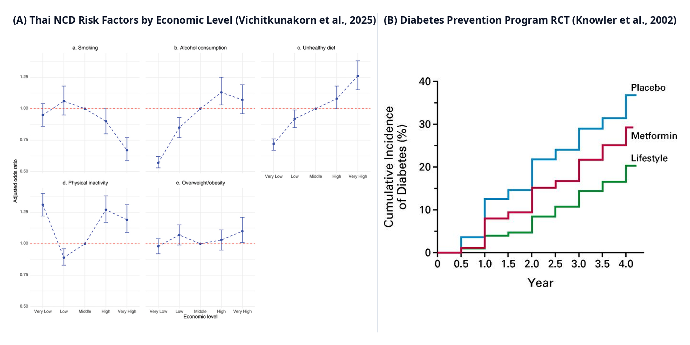
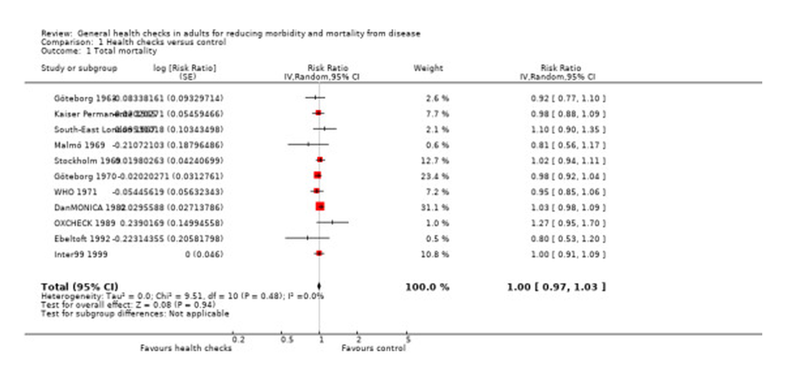
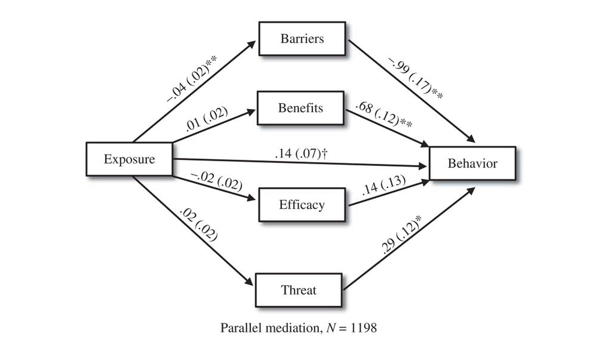
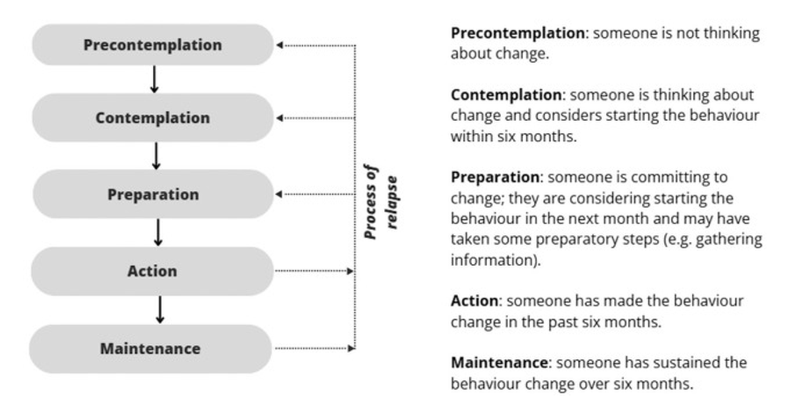
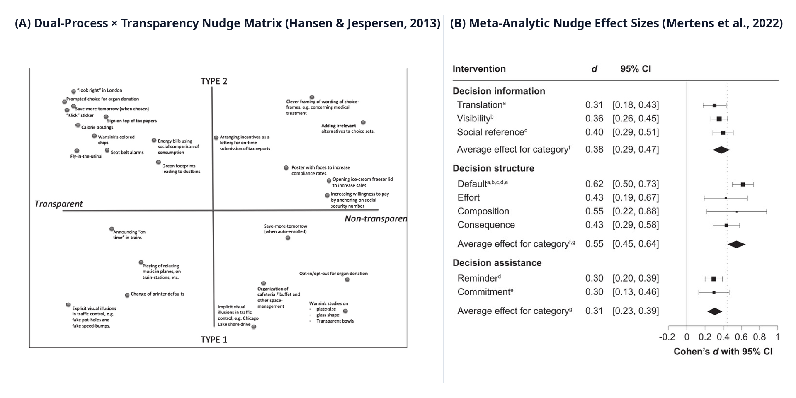
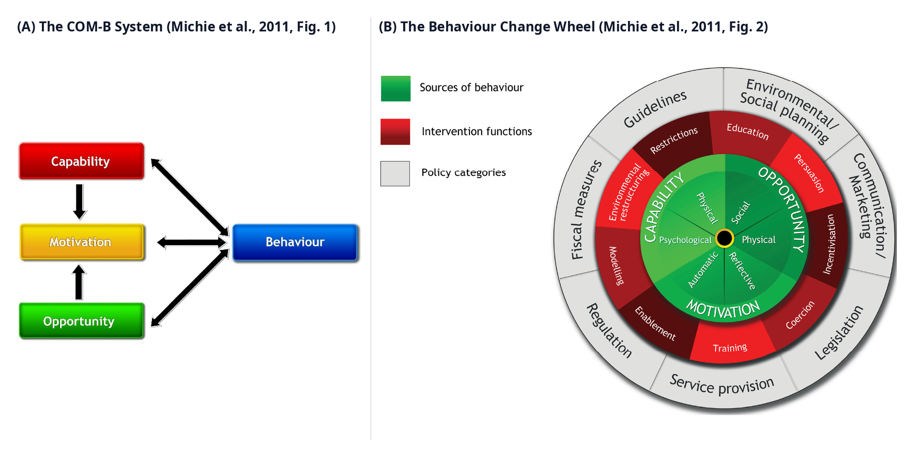
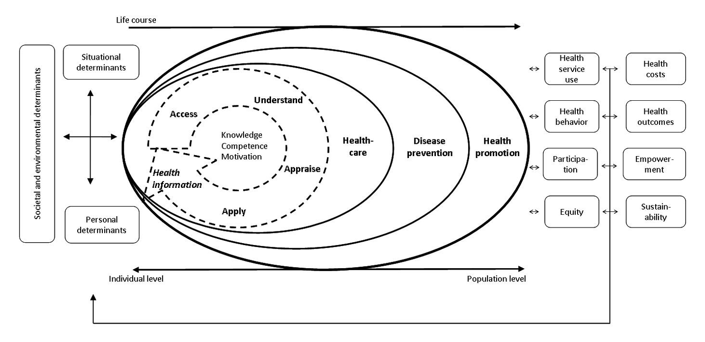
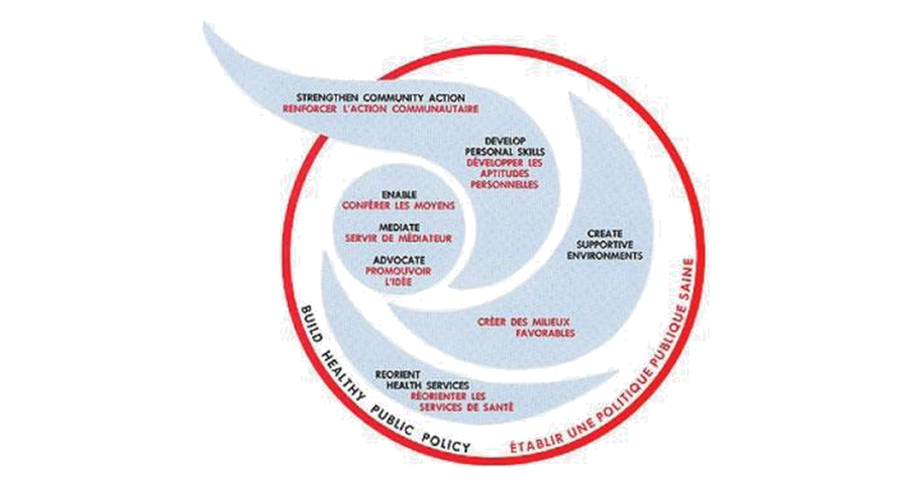
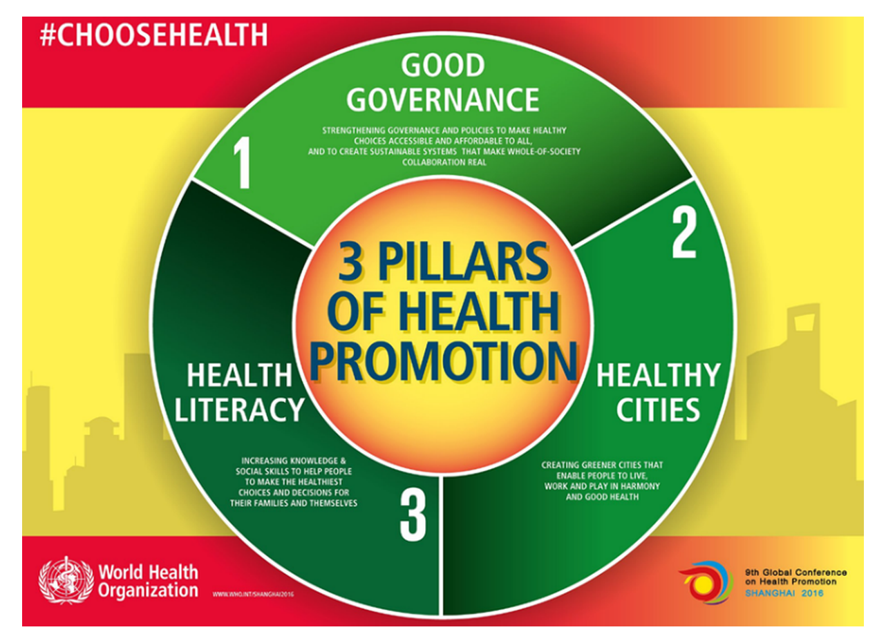

# HS4: พฤติกรรมสุขภาพและการปรับเปลี่ยนพฤติกรรม (Health Behaviour and Behaviour Change)

นพ.สัมฤทธิ์ ศรีธำรงสวัสดิ์

กันยายน 2565

## วัตถุประสงค์การเรียนรู้และคำถามนำ

| วัตถุประสงค์การเรียนรู้ | คำถามนำ |
| --- | --- |
| 1. **การเปลี่ยนผ่านทางระบาดวิทยาและพฤติกรรมสุขภาพ (epidemiological transition and health behaviour)** วิเคราะห์ความเชื่อมโยงระหว่างสังคมสูงวัย ภาระโรคไม่ติดต่อเรื้อรัง และการปรับเปลี่ยนพฤติกรรมควบคู่กับการใช้ยา อธิบายองค์ประกอบของพฤติกรรมมนุษย์ และจำแนกพฤติกรรมสุขภาพตามสถานะสุขภาพของบุคคล | 1. เหตุใดภาระโรคยุคปัจจุบันจึงต้องดูแลด้วยพฤติกรรมควบคู่กับการใช้ยา และพฤติกรรมสุขภาพจำแนกตามการรับรู้สถานะสุขภาพอย่างไร (Why must modern disease burdens be managed through behaviour change alongside medication, and how are health behaviours classified across health states?) |
| 2. **ทฤษฎีพฤติกรรมสุขภาพ เศรษฐศาสตร์พฤติกรรม และวงล้อการปรับเปลี่ยนพฤติกรรม (health behaviour theories, behavioural economics, and Behaviour Change Wheel)** เปรียบเทียบแนวคิด KAP ทฤษฎี HBM ทฤษฎีลำดับขั้นการเปลี่ยนแปลง (TTM) และเศรษฐศาสตร์พฤติกรรมรวมถึงทฤษฎีผลักดัน (Nudge) พร้อมประยุกต์ใช้ตัวแบบ COM-B เลือกมาตรการและนโยบายในวงล้อการปรับเปลี่ยนพฤติกรรม | 2. เหตุใดการให้ความรู้เพียงอย่างเดียวจึงไม่พอเปลี่ยนพฤติกรรม และแพทย์จะวิเคราะห์ต้นตอพฤติกรรมเพื่อเลือกมาตรการและนโยบายให้ตรงจุดได้อย่างไร (Why is knowledge alone insufficient for behaviour change, and how can clinicians diagnose behavioural drivers to match interventions and policies?) |
| 3. **ความรอบรู้ด้านสุขภาพ (health literacy)** อธิบายความรอบรู้ด้านสุขภาพระดับบุคคล ระดับองค์กร และระดับความรอบรู้ตามกรอบของ Nutbeam วิเคราะห์สมรรถนะ 4 ด้านใน 3 ขอบเขตสุขภาพของ Sørensen และประเมินหลักฐานเชิงความสัมพันธ์ต่อการใช้บริการ ค่าใช้จ่าย และความเป็นธรรม | 3. ความรอบรู้ด้านสุขภาพต่างจากการมีความรู้เรื่องโรคอย่างไร และเหตุใดองค์กรบริการสุขภาพจึงต้องร่วมรับผิดชอบในการเอื้ออย่างเป็นธรรม (How does health literacy differ from disease knowledge, and why must health organizations share responsibility for equitable enablement?) |
| 4. **การสร้างเสริมสุขภาพ (health promotion)** อธิบายนิยามและหลักการของการสร้างเสริมสุขภาพระดับประชากร เชื่อมโยงห้าด้านปฏิบัติการและยุทธศาสตร์พื้นฐานสามข้อตามกฎบัตรออตตาวา กฎบัตรกรุงเทพฯ กลไกภาษีบาปของ สสส. ไปจนถึงสามเสาหลักปฏิญญาเซี่ยงไฮ้และกฎบัตรเจนีวา | 4. การสร้างเสริมสุขภาพก้าวพ้นการรักษาผู้ป่วยรายบุคคลในโรงพยาบาลไปสู่การขับเคลื่อนนโยบายและสิ่งแวดล้อมร่วมกันทั้งสังคมอย่างไร (How does health promotion move beyond hospital-based care toward whole-of-society action on health determinants?) |

คำถามนำทั้งสี่ข้อเปิดหัวข้อหลักตามลำดับเนื้อหา และแตกย่อยเป็นประเด็นสำคัญในแต่ละหัวข้อย่อย ดังนี้

1. พฤติกรรมสุขภาพ (health behaviour)
  1. สังคมสูงวัยอย่างสมบูรณ์และการเปลี่ยนผ่านทางระบาดวิทยาทำให้ต้องใช้การปรับพฤติกรรมควบคู่กับการรักษาด้วยยาอย่างไร และมีขอบเขตข้อจำกัดใด
  2. พฤติกรรมมนุษย์ประกอบด้วยสิ่งเร้าภายใน–ภายนอก และพฤติกรรมภายนอก–ภายในอย่างไร
  3. พฤติกรรมสุขภาพจำแนกตามการรับรู้สถานะสุขภาพได้กี่ระยะ และการคัดกรองตามอายุและความเสี่ยงต่างจากการตรวจสุขภาพเหมารวมอย่างไร
2. แนวคิดทฤษฎีเกี่ยวกับพฤติกรรมสุขภาพ ปัจจัยที่เกี่ยวข้อง และการปรับเปลี่ยนพฤติกรรม
  1. เหตุใดแนวคิดความรู้–ทัศนคติ–พฤติกรรม (KAP) จึงไม่เพียงพอเพียงลำพัง แต่ความรู้ยังจำเป็นต่อการเลือกอย่างมีข้อมูล
  2. องค์ประกอบใดของทฤษฎีแบบแผนความเชื่อทางสุขภาพ (HBM) ทำนายพฤติกรรมได้เข้มแข็งที่สุด
  3. ทฤษฎีลำดับขั้นของการเปลี่ยนแปลง (TTM) ช่วยในการสื่อสารทางคลินิกอย่างไรเมื่อโปรแกรมแยกตามขั้นไม่ได้ผลเหนือกว่าโปรแกรมมาตรฐาน
  4. ระบบคิดอัตโนมัติ (System 1) กับระบบไตร่ตรอง (System 2) นำไปสู่การออกแบบโครงสร้างทางเลือก (Nudge) อย่างไร และมีข้อควรระวังใด
  5. ตัวแบบ COM-B เชื่อมสู่มาตรการ 9 หน้าที่และนโยบาย 7 ประเภทในวงล้อการปรับเปลี่ยนพฤติกรรม (BCW) อย่างไร
3. ความรอบรู้ด้านสุขภาพ (health literacy)
  1. ความรอบรู้ระดับบุคคล ระดับองค์กร และความรอบรู้ 3 ระดับของ Nutbeam เชื่อมโยงกันอย่างไร
  2. สมรรถนะ 4 ด้านของ Sørensen ปัจจัยกำหนด 3 กลุ่ม และหลักฐานเชิงความสัมพันธ์ต่อการใช้บริการและค่าใช้จ่ายมีนัยสำคัญอย่างไร
4. การสร้างเสริมสุขภาพ (health promotion)
  1. หลักการสำคัญ 5 ประการของการสร้างเสริมสุขภาพระดับประชากรคืออะไร
  2. ห้าด้านปฏิบัติการตามกฎบัตรออตตาวาและกลไกภาษีบาปของ สสส. ทำให้ทางเลือกสุขภาพเป็นทางเลือกที่ง่ายอย่างไร
  3. ยุทธศาสตร์พื้นฐาน Advocate–Mediate–Enable กำหนดบทบาทของแพทย์อย่างไร
  4. สามเสาหลักปฏิญญาเซี่ยงไฮ้ ค.ศ. 2016 และกฎบัตรเจนีวา ค.ศ. 2021 กำหนดทิศทางโลกอย่างไร

## 1. พฤติกรรมสุขภาพ

> คำถามนำของหัวข้อนี้คือ เหตุใดภาระโรคยุคปัจจุบันจึงต้องดูแลด้วยพฤติกรรมควบคู่กับการใช้ยา และพฤติกรรมสุขภาพจำแนกตามการรับรู้สถานะสุขภาพอย่างไร

การเปลี่ยนโครงสร้างประชากรและวิถีชีวิตในไทยทำให้โรคไม่ติดต่อเรื้อรังเป็นสาเหตุการเสียชีวิตหลัก แพทย์จึงต้องเข้าใจบทบาทของการปรับพฤติกรรมควบคู่การใช้ยา (1.1) กลไกของพฤติกรรมมนุษย์ (1.2) และการจำแนกพฤติกรรมสุขภาพตามสถานะสุขภาพ (1.3) ดังภาพรวมในภาพที่ 1 ([Kasl & Cobb, 1966a](https://doi.org/10.1080/00039896.1966.10664365); [World Health Organization [WHO], 2021](https://iris.who.int/handle/10665/350161))

### 1.1 สังคมสูงวัยอย่างสมบูรณ์ การเปลี่ยนผ่านทางระบาดวิทยา และบทบาทการปรับเปลี่ยนพฤติกรรมควบคู่กับการใช้ยา

> ลองนึกถึงผู้ป่วยเบาหวานและความดันโลหิตสูงในคลินิกผู้ป่วยนอก เหตุใดการจ่ายยาเพียงอย่างเดียวจึงมักไม่พอหยุดภาวะแทรกซ้อน ขณะเดียวกันการปรับวิถีชีวิตอย่างเดียวก็อาจไม่พอทดแทนยาได้ในผู้ป่วยทุกราย

ภาระโรคหลักของคนไทยในปัจจุบันเปลี่ยนจากโรคติดเชื้อเฉียบพลันมาเป็นโรคเรื้อรังที่ผูกพันกับวิถีชีวิตและสภาพแวดล้อม การดูแลรักษาที่มีประสิทธิผลจึงต้องผสานการปรับพฤติกรรมเข้ากับการใช้ยาอย่างรู้เท่าทันขอบเขตของหลักฐานเชิงประจักษ์ ดังนี้

- **สังคมสูงวัยอย่างสมบูรณ์สู่ระดับสุดยอด (aged & super-aged society):** ประเทศไทยก้าวเข้าสู่สังคมสูงวัยอย่างสมบูรณ์แล้ว โดยในปี พ.ศ. 2568 มีผู้สูงอายุ 60 ปีขึ้นไปจำนวน 14.29 ล้านคน (ร้อยละ 21.71 ของประชากร) และกำลังมุ่งสู่สังคมสูงวัยระดับสุดยอดเมื่อสัดส่วนผู้สูงอายุเกินร้อยละ 28 ([Department of Older Persons, 2026](https://www.dop.go.th/download/statistics/th1793240958-2616_0.pdf))
- **การเปลี่ยนผ่านทางระบาดวิทยา (epidemiological transition) และภาระโรค (burden of disease):** การเปลี่ยนโครงสร้างประชากร (`demographic change`) ร่วมกับการเปลี่ยนแปลงทางเศรษฐกิจ สังคม และสิ่งแวดล้อม ทำให้ภาระโรคหลักเปลี่ยนจากปัญหาสุขภาพมารดาและทารก ภาวะทุพโภชนาการ และโรคติดต่อทั่วไป ไปสู่ **โรคไม่ติดต่อเรื้อรัง (noncommunicable diseases: NCDs)** ซึ่งเป็นสาเหตุการเสียชีวิตราวร้อยละ 76 ของประชากรไทย ([Bundhamcharoen et al., 2011](https://doi.org/10.1186/1471-2458-11-53); [Vichitkunakorn et al., 2025](https://doi.org/10.1080/16549716.2025.2485689))
- **กลุ่มโรคไม่ติดต่อหลักและปัจจัยเสี่ยงทางเมแทบอลิก (metabolic risk factors):** โรคไม่ติดต่อหลักได้แก่ โรคหัวใจและหลอดเลือด (กล้ามเนื้อหัวใจขาดเลือด โรคหลอดเลือดสมอง) มะเร็ง โรคทางเดินหายใจเรื้อรัง เช่น โรคปอดอุดกั้นเรื้อรัง (`COPD`) และโรคเบาหวาน ส่วนภาวะความดันโลหิตสูง ไขมันในเลือดผิดปกติ น้ำตาลในเลือดสูง และน้ำหนักเกินหรืออ้วนจัดเป็นปัจจัยเสี่ยงทางเมแทบอลิก ซึ่งหากคุมไม่ได้จะนำไปสู่ภาวะตาบอด ไตวาย กล้ามเนื้อหัวใจขาดเลือด โรคหลอดเลือดสมอง และการถูกตัดขาหรือเท้า (`lower limb amputation`) ([WHO, 2025a](https://www.who.int/news-room/fact-sheets/detail/hypertension), [2025b](https://www.who.int/news-room/fact-sheets/detail/noncommunicable-diseases), [2026c](https://www.who.int/news-room/fact-sheets/detail/diabetes))
- **พฤติกรรมเสี่ยงด้านสุขภาพ 4 ประการ มลพิษทางอากาศ และความชุกในไทย:** `NCDs` สัมพันธ์อย่างมากกับการสูบบุหรี่ การบริโภคอาหารหวาน มัน เค็ม (`unhealthy diet`) กิจกรรมทางกายไม่เพียงพอ (`physical inactivity`) และการดื่มแอลกอฮอล์ระดับอันตราย ร่วมกับ **มลพิษทางอากาศ (air pollution)** โดยเฉพาะใน `COPD` ซึ่งล้วนถูกหล่อหลอมโดยสิ่งแวดล้อมทางสังคม เชิงพาณิชย์ และกายภาพ ([WHO, 2025b](https://www.who.int/news-room/fact-sheets/detail/noncommunicable-diseases), [2026b](https://www.who.int/news-room/fact-sheets/detail/chronic-obstructive-pulmonary-disease-%28copd%29), [2026d](https://www.who.int/news-room/fact-sheets/detail/healthy-diet)) โดยการสำรวจคนไทย พ.ศ. 2564 พบอาหารไม่เหมาะสมร้อยละ 56.93 น้ำหนักเกินหรืออ้วนร้อยละ 50.03 กิจกรรมทางกายไม่เพียงพอร้อยละ 42.70 ดื่มแอลกอฮอล์ร้อยละ 29.73 และสูบบุหรี่ร้อยละ 16.61 ([Vichitkunakorn et al., 2025](https://doi.org/10.1080/16549716.2025.2485689))
- **พลังของการปรับวิถีชีวิตในระยะเสี่ยงและระยะแรกของโรค:** การทดลองแบบสุ่มที่มีกลุ่มเปรียบเทียบ (`RCT`) ชี้ว่าโปรแกรมปรับวิถีชีวิตในผู้เสี่ยงสูงลดอุบัติการณ์เกิดเบาหวานชนิดที่ 2 ได้ถึงร้อยละ 58 ซึ่งได้ผลมากกว่ายาเมทฟอร์มิน ([Knowler et al., 2002](https://doi.org/10.1056/NEJMoa012512)) และในผู้ป่วยเบาหวานชนิดที่ 2 ระยะแรก การจัดการลดน้ำหนักเข้มข้นในบริการปฐมภูมิช่วยให้เกือบครึ่งหนึ่งเข้าสู่ภาวะสงบของโรค (`diabetes remission`) ที่ 12 เดือนโดยไม่ต้องใช้ยาลดน้ำตาล ([Lean et al., 2018](https://doi.org/10.1016/S0140-6736%2817%2933102-1))
- **ขอบเขตข้อจำกัดและความจำเป็นของการใช้ยาร่วมด้วย:** ในผู้ที่เป็นโรคเบาหวานแล้ว การปรับวิถีชีวิตเข้มข้นแม้ช่วยลดน้ำตาลสะสมและปรับปัจจัยเสี่ยงได้ดีขึ้น แต่ไม่ลดอัตราการเกิดเหตุการณ์โรคหัวใจและหลอดเลือดเมื่อเทียบกับการดูแลมาตรฐาน ([Look AHEAD Research Group, 2013](https://doi.org/10.1056/NEJMoa1212914)) และผู้ป่วยความดันโลหิตสูงจำนวนหนึ่งยังจำเป็นต้องได้รับยาควบคู่กับการปรับพฤติกรรมภายใต้บริบทสังคม วัฒนธรรม เชิงพาณิชย์ และสิ่งแวดล้อม ([WHO, 2021](https://iris.who.int/handle/10665/350161), [2025a](https://www.who.int/news-room/fact-sheets/detail/hypertension), [2026c](https://www.who.int/news-room/fact-sheets/detail/diabetes))

> **สรุปประเด็นสำคัญ:** สังคมสูงวัยและการเปลี่ยนผ่านทางระบาดวิทยาทำให้โรคไม่ติดต่อเรื้อรังเป็นสาเหตุการเสียชีวิตหลักของคนไทย แพทย์จึงต้องใช้การปรับเปลี่ยนพฤติกรรมและสิ่งแวดล้อมเป็นแกนหลักในการป้องกันและทำให้โรคสงบในระยะแรก ควบคู่กับการใช้ยาตามข้อบ่งชี้ในผู้ที่เป็นโรคแล้ว

**ภาพที่ 1ก (ต้นฉบับจากแหล่งอ้างอิงหลัก) ปัจจัยเสี่ยงโรคไม่ติดต่อเรื้อรังตามระดับเศรษฐกิจในประชากรไทย และการทดลองป้องกันโรคเบาหวานด้วยวิถีชีวิตเทียบกับยา** (A) อัตราส่วนออดส์ปรับค่าของพฤติกรรมเสี่ยงและภาวะน้ำหนักเกิน/อ้วนจำแนกตามสถานะเศรษฐกิจจากการสำรวจพฤติกรรมสุขภาพประชากรไทย พ.ศ. 2564 และ (B) อุบัติการณ์สะสมของโรคเบาหวานชนิดที่ 2 ในการทดลองแบบสุ่ม Diabetes Prevention Program ซึ่งชี้ว่ากลุ่มปรับเปลี่ยนวิถีชีวิตลดอุบัติการณ์โรคได้ร้อยละ 58 เหนือกว่ากลุ่มยาเมทฟอร์มิน (ร้อยละ 31) และยาหลอก (*ที่มา: [Knowler et al., 2002](https://doi.org/10.1056/NEJMoa012512); [Vichitkunakorn et al., 2025](https://doi.org/10.1080/16549716.2025.2485689)*)

**ภาพที่ 1ข (แผนภาพสังเคราะห์แนวคิดรวบยอด) สาระสำคัญที่ภาพรวมต้องการสื่อสาร: การเปลี่ยนผ่านทางระบาดวิทยาของไทยและเหตุผลที่การดูแลโรคไม่ติดต่อเรื้อรังต้องผสานการปรับพฤติกรรมควบคู่กับการใช้ยา** สังเคราะห์ความเชื่อมโยงตั้งแต่สังคมสูงวัยอย่างสมบูรณ์และการเปลี่ยนภาระโรคสู่โรคไม่ติดต่อเรื้อรัง (ร้อยละ 76 ของการเสียชีวิต) พฤติกรรมเสี่ยง 4 ด้านและมลพิษทางอากาศภายใต้บริบทแวดล้อม ไปจนถึงขอบเขตหลักฐานทางคลินิกที่การปรับวิถีชีวิตเด่นชัดในการป้องกันและระยะแรกของเบาหวาน แต่ไม่สามารถทดแทนการใช้ยาในผู้ป่วยที่เป็นโรคแล้วทุกราย (*ที่มา: สังเคราะห์แนวคิดจาก [Department of Older Persons (2026)](https://www.dop.go.th/download/statistics/th1793240958-2616_0.pdf), [Knowler et al. (2002)](https://doi.org/10.1056/NEJMoa012512), [Lean et al. (2018)](https://doi.org/10.1016/S0140-6736%2817%2933102-1), [Look AHEAD Research Group (2013)](https://doi.org/10.1056/NEJMoa1212914), [Vichitkunakorn et al. (2025)](https://doi.org/10.1080/16549716.2025.2485689) และ [WHO (2025a](https://www.who.int/news-room/fact-sheets/detail/hypertension), [2025b)](https://www.who.int/news-room/fact-sheets/detail/noncommunicable-diseases)*)

### 1.2 องค์ประกอบของพฤติกรรมมนุษย์ สิ่งเร้าภายใน–ภายนอก และพฤติกรรมภายนอก–ภายใน

ก่อนออกแบบมาตรการปรับพฤติกรรม ผู้เรียนต้องเข้าใจความหมายทางจิตวิทยาของพฤติกรรมมนุษย์เพื่อแยกแยะสิ่งเร้าและรูปแบบการแสดงออกได้อย่างแม่นยำ ดังนี้

- **ความหมายของพฤติกรรมมนุษย์ (human behaviour):** การกระทำหรือปฏิกิริยาตอบสนองของบุคคลเมื่อเผชิญกับสถานการณ์หรือ **สิ่งเร้า (stimulus)** ไม่ว่าจะเกิดขึ้นโดยรู้ตัวหรือไม่รู้ตัว (`conscious or nonconscious`) ชัดเจนหรือแอบแฝง และโดยตั้งใจหรือไม่ตั้งใจ ([American Psychological Association [APA], 2018a](https://dictionary.apa.org/behavior), [2018h](https://dictionary.apa.org/stimulus))
- **สิ่งเร้าภายใน (internal stimulus):** สิ่งเร้าหรือเหตุการณ์ภายในร่างกายที่เกิดจากความต้องการทางสรีรวิทยาหรือแรงขับทางชีวภาพ (`biological drive`) เช่น ความหิว ความกระหาย รวมถึงอาการรับรู้ภายในอย่างอาการปวดศีรษะ ([APA, 2018b](https://dictionary.apa.org/biological-drive), [2018f](https://dictionary.apa.org/private-event))
- **สิ่งเร้าภายนอก (external stimulus):** สิ่งกระตุ้นจากสิ่งแวดล้อมทางกายภาพ (แสง เสียง อุณหภูมิ) และสิ่งแวดล้อมทางสังคม ที่รับรู้ผ่าน **ประสาทสัมผัสหลักทั้งห้า (five primary senses)** ได้แก่ การมองเห็น (ตา) การได้ยิน (หู) การรับรส (ลิ้น) การดมกลิ่น (จมูก) และการสัมผัส (ผิวกาย) ([APA, 2018g](https://dictionary.apa.org/sense), [2018h](https://dictionary.apa.org/stimulus))
- **พฤติกรรมภายนอก (overt behaviour) และข้อพึงระวังเรื่องการตอบสนองทางสรีรวิทยา:** พฤติกรรมที่ผู้อื่นสังเกตเห็นได้โดยตรงโดยไม่ต้องใช้เครื่องมือหรือความเชี่ยวชาญเฉพาะ เช่น การเดิน การพูด การเขียน การแสดงสีหน้า ท่าทาง หรือการร้องไห้ ส่วน *การเต้นของหัวใจ* ต้องอาศัยหูฟังแพทย์หรือเครื่องมือตรวจวัด จึงจัดเป็นการตอบสนองทางสรีรวิทยา ไม่ใช่พฤติกรรมภายนอกโดยตรง ([APA, 2018a](https://dictionary.apa.org/behavior), [2018e](https://dictionary.apa.org/overt-behavior))
- **พฤติกรรมภายใน (covert behaviour):** กระบวนการหรือการกระทำภายในจิตใจที่ผู้อื่นสังเกตเห็นโดยตรงไม่ได้ แต่รับรู้จากการอนุมานหรือการบอกเล่าของเจ้าตัว เช่น ความรู้สึก การรับรู้ การจำ การคิด การตัดสินใจ และการจินตนาการ ([APA, 2018c](https://dictionary.apa.org/covert-behavior))

> **สรุปประเด็นสำคัญ:** พฤติกรรมมนุษย์คือการตอบสนองทั้งโดยรู้ตัวและไม่รู้ตัวต่อสิ่งเร้าภายในร่างกายและสิ่งเร้าภายนอกผ่านประสาทสัมผัสทั้งห้า โดยแสดงออกเป็นทั้งพฤติกรรมภายนอกที่สังเกตได้ด้วยตาเปล่าและกระบวนการคิดความรู้สึกภายในจิตใจ

### 1.3 นิยามและการจำแนกพฤติกรรมสุขภาพสามประเภทตามการรับรู้สถานะสุขภาพ

> ผู้เรียนคิดว่าผู้ที่ดื่มน้ำสมุนไพรตามคำบอกเล่าเพราะตั้งใจบำรุงตับแต่กลับเกิดพิษต่อตับ นับว่ากำลังทำ "พฤติกรรมสุขภาพ" หรือไม่ และการไปตรวจโปรแกรมเช็กอัปชุดใหญ่ทุกปีช่วยลดอัตราตายได้ดีกว่าการคัดกรองตามความเสี่ยงจริงหรือไม่

ในทางวิชาการ นิยามของพฤติกรรมสุขภาพดูที่ "จุดมุ่งหมายของผู้กระทำ" และจำแนกออกเป็นสามระยะตามการรับรู้สถานะสุขภาพของบุคคล ดังรายละเอียดสำคัญต่อไปนี้

- **พฤติกรรมสุขภาพ (health behaviour) เทียบกับพฤติกรรมที่เกี่ยวข้องกับสุขภาพ (health-related behaviour):** พฤติกรรมสุขภาพหมายถึงกิจกรรมใดก็ตามที่บุคคลกระทำโดยมีวัตถุประสงค์เพื่อส่งเสริม ปกป้อง ดำรงรักษา หรือฟื้นคืนสุขภาพ (`promoting, protecting, maintaining or regaining health`) **ไม่ว่าการกระทำนั้นจะก่อผลดีต่อสุขภาพได้จริงหรือไม่ก็ตาม** ([WHO, 2021](https://iris.who.int/handle/10665/350161)) ส่วนความหมายกว้างของ `health-related behaviour` จะครอบคลุมพฤติกรรมเสี่ยงที่บั่นทอนสุขภาพ เช่น การสูบบุหรี่ การดื่มสุราเกินขนาด และการกินอาหารไม่เหมาะสมไว้ด้วย ([APA, 2026](https://dictionary.apa.org/health-behavior); [WHO, 1998](https://iris.who.int/handle/10665/64546))
- **1) พฤติกรรมการป้องกันโรคและการส่งเสริมสุขภาพ (preventive and promotive behaviour):** กิจกรรมของผู้ที่เชื่อว่าตนมีสุขภาพดีและยังไม่มีอาการ (`asymptomatic stage`) เพื่อลดโอกาสเกิดโรคหรือความรุนแรง (เช่น ฉีดวัคซีนเอชพีวีและคัดกรองป้องกันมะเร็งปากมดลูก) และยกระดับสุขภาวะรวมทั้งกายและใจ (เช่น กิจกรรมทางกายสม่ำเสมอ) ([Kasl & Cobb, 1966a](https://doi.org/10.1080/00039896.1966.10664365); [Buczkowska et al., 2022](https://doi.org/10.3390/ijerph192214650); [Mulyani et al., 2026](https://doi.org/10.1186/s12884-026-08761-7); [WHO, 2021](https://iris.who.int/handle/10665/350161), [2026a](https://www.who.int/news-room/fact-sheets/detail/cervical-cancer), [2026f](https://www.who.int/news-room/fact-sheets/detail/physical-activity))
- **4 กลุ่มย่อยของพฤติกรรมป้องกันและส่งเสริมสุขภาพ (โดยกลุ่ม 1.2 และ 1.3 ซ้อนทับกันได้):** ได้แก่ *(1.1) กิจวัตรประจำวันที่ดีต่อสุขภาพ* เช่น อาหารสมดุลป้องกันทุพโภชนาการและ `NCDs` ([WHO, 2026d](https://www.who.int/news-room/fact-sheets/detail/healthy-diet)); *(1.2) กิจกรรมส่งเสริมสุขภาพ* เช่น คุมน้ำหนัก ออกกำลังกาย พักผ่อน งดสุราและบุหรี่ ([WHO, 2025b](https://www.who.int/news-room/fact-sheets/detail/noncommunicable-diseases), [2026c](https://www.who.int/news-room/fact-sheets/detail/diabetes)); *(1.3) กิจกรรมป้องกันโรคและการบาดเจ็บ (disease and injury prevention)* เช่น ฉีดวัคซีน ([WHO, 2026e](https://www.who.int/news-room/fact-sheets/detail/immunization-coverage)) สวมหมวกนิรภัย (ลดความเสี่ยงเสียชีวิตจากจักรยานยนต์ได้มากกว่า 6 เท่า) และคาดเข็มขัดนิรภัย (ลดความเสี่ยงเสียชีวิตได้ถึงร้อยละ 50) ([WHO, 2026g](https://www.who.int/news-room/fact-sheets/detail/road-traffic-injuries)); และ *(1.4) การคัดกรองตามอายุและความเสี่ยง (age- and risk-appropriate screening)* เช่น วัดความดันโลหิต คัดกรองเบาหวาน มะเร็งปากมดลูก และตรวจสุขภาพช่องปาก ([WHO, 2025a](https://www.who.int/news-room/fact-sheets/detail/hypertension), [2026a](https://www.who.int/news-room/fact-sheets/detail/cervical-cancer))
- **ความต่างระหว่างการคัดกรองจำเพาะกับการตรวจสุขภาพทั่วไปแบบเหมารวม (general health checks):** การทบทวนวรรณกรรมอย่างเป็นระบบ (`systematic review` — การรวบรวมและประเมินหลักฐานวิจัยทั้งหมดอย่างมีเกณฑ์ชัดเจน) ของ Cochrane พบว่าการตรวจสุขภาพทั่วไปประจำปีแบบเหมารวมในผู้ใหญ่แทบไม่ลดอัตราตายรวม อัตราตายจากมะเร็ง หรืออัตราตายจากโรคหัวใจและหลอดเลือด แพทย์จึงควรแนะนำการคัดกรองตามอายุและความเสี่ยงแทน ([Krogsbøll et al., 2019](https://doi.org/10.1002/14651858.CD009009.pub3))
- **2) พฤติกรรมเมื่อรู้สึกไม่สบายหรือเจ็บป่วย (illness behaviour):** กิจกรรมของผู้ที่รู้สึกว่าตนมีอาการผิดปกติเพื่อประเมินตีความอาการและแสวงหาทางช่วยเหลือ เช่น ไปสถานพยาบาลรัฐหรือเอกชน ซื้อยากินเอง หรือเฝ้ารอให้อาการทุเลาเอง เนื่องจากอาการทางกายเดียวกันถูกรับรู้และตอบสนองต่างกันตามบุคคลและบริบท ([APA, 2018d](https://dictionary.apa.org/illness-behavior); [Kasl & Cobb, 1966a](https://doi.org/10.1080/00039896.1966.10664365); [Millard, 2016](https://doi.org/10.1093/shm/hkw083); [Mulyani et al., 2026](https://doi.org/10.1186/s12884-026-08761-7))
- **3) พฤติกรรมตามบทบาทผู้ป่วย (sick-role behaviour):** กิจกรรมของผู้ที่ถือว่าตนป่วยแล้วเพื่อให้หายหรือฟื้นตัว สอดคล้องกับแนวคิดบทบาทผู้ป่วยของ Parsons (`Parsons' sick role`) ที่สังคมยกเว้นหน้าที่ปกติบางส่วนให้ควบคู่กับความคาดหวังให้ผู้ป่วยร่วมมือรักษาตัว เช่น การรับประทานยาต่อเนื่องตามแผนการรักษา (`medication adherence`) การงดบุหรี่/สุราและลดเค็มเพื่อลดความดันโลหิต และการฟื้นฟูสมรรถภาพปอด (`pulmonary rehabilitation`) ในผู้ป่วย `COPD` ([APA, 2023](https://dictionary.apa.org/sick-role), [2026](https://dictionary.apa.org/health-behavior); [Kasl & Cobb, 1966b](https://doi.org/10.1080/00039896.1966.10664421); [Mulyani et al., 2026](https://doi.org/10.1186/s12884-026-08761-7); [WHO, 2025a](https://www.who.int/news-room/fact-sheets/detail/hypertension), [2026b](https://www.who.int/news-room/fact-sheets/detail/chronic-obstructive-pulmonary-disease-%28copd%29))

| ประเภทพฤติกรรมสุขภาพ | สถานะสุขภาพที่รับรู้และเป้าหมายหลัก | ตัวอย่างทางคลินิกและชุมชนที่สำคัญ |
| --- | --- | --- |
| **1. พฤติกรรมการป้องกันโรคและการส่งเสริมสุขภาพ (Preventive & promotive behaviour)** | เชื่อว่าตนสุขภาพดีและยังไม่มีอาการ (`asymptomatic`) มุ่งลดความเสี่ยงเกิดโรค/บาดเจ็บและยกระดับสุขภาวะ | อาหารสมดุล ออกกำลังกาย ฉีดวัคซีน หมวกนิรภัย เข็มขัดนิรภัย และคัดกรองตามอายุและความเสี่ยง (ต่างจาก `general health checks` แบบเหมารวม) |
| **2. พฤติกรรมเมื่อรู้สึกไม่สบายหรือเจ็บป่วย (Illness behaviour)** | เริ่มรับรู้ความผิดปกติหรืออาการไม่สบาย มุ่งตีความอาการและแสวงหาความช่วยเหลือ | ไปตรวจที่โรงพยาบาล/คลินิก ซื้อยารับประทานเอง หรือสังเกตอาการรอให้ทุเลาเองตามบริบทความเชื่อ |
| **3. พฤติกรรมตามบทบาทผู้ป่วย (Sick-role behaviour)** | รับรู้สถานะว่าตนเจ็บป่วยแล้ว มุ่งรักษาตัวให้หาย ควบคุมโรค หรือฟื้นฟูสมรรถภาพ | รับประทานยาลดความดันต่อเนื่อง (`adherence`) ปรับอาหารลดเค็ม งดบุหรี่ และทำกายภาพฟื้นฟูปอดใน `COPD` |

> **สรุปประเด็นสำคัญ:** พฤติกรรมสุขภาพจำแนกตามการรับรู้สถานะสุขภาพเป็นระยะแข็งแรง (ป้องกันและส่งเสริมสุขภาพรวมถึงการคัดกรองตามความเสี่ยง) ระยะเริ่มมีอาการ (แสวงหาการรักษา) และระยะเป็นผู้ป่วย (ดูแลตนเองและร่วมมือรักษา)

**ภาพที่ 2ก (ต้นฉบับจากแหล่งอ้างอิงหลัก) ผลการวิเคราะห์อภิมานของการตรวจสุขภาพทั่วไปแบบเหมารวมในผู้ใหญ่ต่ออัตราตายโดยรวม** แผนภูมิป่าไม้ (forest plot) จากการทบทวนอย่างเป็นระบบของ Cochrane รวบรวมการทดลองแบบสุ่มเปรียบเทียบการตรวจสุขภาพทั่วไปแบบเหมารวม (general health checks) กับกลุ่มควบคุม พบค่าอัตราส่วนความเสี่ยงรวม (Risk Ratio) ของการเสียชีวิตทุกสาเหตุเท่ากับ 1.00 (95% CI [0.97, 1.03]) สะท้อนว่าการตรวจเช็กสุขภาพแบบเหมารวมโดยไม่จำแนกตามความเสี่ยงไม่ลดอัตราตาย (*ที่มา: [Krogsbøll et al., 2019](https://doi.org/10.1002/14651858.CD009009.pub3)*)

**ภาพที่ 2ข (แผนภาพสังเคราะห์แนวคิดรวบยอด) สาระสำคัญที่ภาพรวมต้องการสื่อสาร: กลไกพฤติกรรมมนุษย์ พฤติกรรมสุขภาพ 3 ประเภทตามสถานะสุขภาพ และเส้นแบ่งของการคัดกรองโรคเชิงประจักษ์** สรุปกลไกสิ่งเร้าภายใน–ภายนอกและการตอบสนองเป็นพฤติกรรมภายนอก–ภายใน (โดยการเต้นของหัวใจเป็นการตอบสนองทางสรีรวิทยา ไม่ใช่พฤติกรรมภายนอก) เชื่อมสู่พฤติกรรมสุขภาพ 3 ระยะของ Kasl และ Cobb พร้อมชี้ชัดว่าในระยะไม่มีอาการต้องเลือกใช้การคัดกรองตามอายุและความเสี่ยงแทนการตรวจสุขภาพทั่วไปแบบเหมารวม (*ที่มา: สังเคราะห์แนวคิดจาก [APA (2018c](https://dictionary.apa.org/covert-behavior), [2018e)](https://dictionary.apa.org/overt-behavior), [Kasl & Cobb (1966a](https://doi.org/10.1080/00039896.1966.10664365), [1966b)](https://doi.org/10.1080/00039896.1966.10664421), [Krogsbøll et al. (2019)](https://doi.org/10.1002/14651858.CD009009.pub3) และ [WHO (2025a](https://www.who.int/news-room/fact-sheets/detail/hypertension), [2026g)](https://www.who.int/news-room/fact-sheets/detail/road-traffic-injuries)*)

## 2. แนวคิดทฤษฎีเกี่ยวกับพฤติกรรมสุขภาพ ปัจจัยที่เกี่ยวข้อง และการปรับเปลี่ยนพฤติกรรม

> คำถามนำของหัวข้อนี้คือ เหตุใดการให้ความรู้เพียงอย่างเดียวจึงไม่พอเปลี่ยนพฤติกรรม และแพทย์จะวิเคราะห์ต้นตอพฤติกรรมเพื่อเลือกมาตรการและนโยบายให้ตรงจุดได้อย่างไร

การออกแบบโปรแกรมปรับเปลี่ยนพฤติกรรมต้องเริ่มจากการเข้าใจเหตุปัจจัยของพฤติกรรมอย่างเป็นระบบก่อนลงมือทำ ดังกรอบรากฐานก่อนเข้าสู่แต่ละทฤษฎีย่อยต่อไปนี้

- **ความสำคัญของทฤษฎีและการผสมผสานหลายมุมมอง:** มาตรการที่มีทฤษฎีและการวิเคราะห์พฤติกรรมเป้าหมายรองรับมีแนวโน้มเกิดประสิทธิผลสูงกว่ามาตรการไร้กรอบทฤษฎี ([Glanz & Bishop, 2010](https://doi.org/10.1146/annurev.publhealth.012809.103604); [Glanz et al., 2008](https://books.google.com/books/about/Health_Behavior_and_Health_Education.html?id=G1-f0gEACAAJ); [Michie et al., 2011](https://doi.org/10.1186/1748-5908-6-42)) ทั้งนี้การทบทวนขอบเขตวรรณกรรมข้ามสาขาจิตวิทยา สังคมวิทยา มานุษยวิทยา และเศรษฐศาสตร์พบทฤษฎีพฤติกรรมถึง 82 ทฤษฎี นักวิชาการจึงมักบูรณาการหลายทฤษฎีเข้าด้วยกันตามบริบท ([Davis et al., 2015](https://doi.org/10.1080/17437199.2014.941722))
- **แบบจำลองเชิงนิเวศ (ecological model) 5 ระดับ:** เตือนสติไม่ให้มองแต่ปัจจัยภายในตัวบุคคล (`HBM`, `TTM`, `social cognitive theory`, `theory of planned behaviour` หรือการสำรวจ `KAP`) โดยชี้ว่าพฤติกรรมได้รับอิทธิพลซ้อนกัน 5 ระดับ คือ (1) ปัจเจกบุคคล (`intrapersonal/individual`) (2) ระหว่างบุคคล/กลุ่มปฐมภูมิ (`interpersonal`) (3) องค์กรหรือสถาบัน (`institutional/organizational`) (4) ชุมชน (`community`) และ (5) นโยบายสาธารณะและกฎหมาย (`public policy`) ดังวิวัฒนาการแนวคิดในภาพที่ 2 ([Davis et al., 2015](https://doi.org/10.1080/17437199.2014.941722); [Glanz & Bishop, 2010](https://doi.org/10.1146/annurev.publhealth.012809.103604); [Launiala, 2009](https://doi.org/10.22582/am.v11i1.31); [McLeroy et al., 1988](https://doi.org/10.1177/109019818801500401))

### 2.1 แนวคิดความรู้ ทัศนคติ พฤติกรรม (Knowledge–Attitude–Practice: KAP)

นักศึกษาแพทย์และบุคลากรสุขภาพมักเริ่มต้นด้วยการสอนสุขศึกษาเพราะเชื่อว่าผู้ป่วยทำพฤติกรรมเสี่ยงเนื่องจากไม่รู้ข้อมูล แต่หลักฐานเชิงประจักษ์ชี้ให้เห็นทั้งคุณค่าและข้อจำกัดสำคัญของ **แนวคิด KAP** ดังนี้

- **จุดเริ่มต้นและสมมติฐานการขาดข้อมูล (information deficit):** พัฒนาจากการสำรวจ `KAP survey` ในงานวางแผนครอบครัวช่วงทศวรรษ 1950 โดยสมมติเป็นเส้นตรงว่าการให้ความรู้ (`Knowledge`) จะเปลี่ยนทัศนคติ (`Attitude`) และนำไปสู่การเปลี่ยนพฤติกรรม (`Practice`) ทำให้งานสุขศึกษายุคแรกมุ่งเน้นแต่การให้ความรู้ ([Kelly & Barker, 2016](https://doi.org/10.1016/j.puhe.2016.03.030); [Launiala, 2009](https://doi.org/10.22582/am.v11i1.31); [Nutbeam, 2000](https://doi.org/10.1093/heapro/15.3.259); [Valente et al., 1998](https://doi.org/10.1111/j.1468-2958.1998.tb00421.x))
- **ช่องว่างระหว่างความตั้งใจกับพฤติกรรม (intention–behaviour gap):** การวิเคราะห์อภิมานของการศึกษาเชิงทดลอง (`meta-analysis` — การรวบรวมผลทางสถิติของการทดลองจำนวนมากมาวิเคราะห์รวมกัน) พบว่าแม้มาตรการจะเพิ่มความตั้งใจได้ระดับปานกลางถึงมาก แต่เปลี่ยนพฤติกรรมจริงได้เพียงระดับเล็กถึงปานกลาง ดังที่คนจำนวนมากรู้ดีว่าบุหรี่ สุรา และอาหารเกินพอดีเป็นผลเสียแต่ยังทำต่อเนื่อง ([Arlinghaus & Johnston, 2018](https://doi.org/10.1177/1559827617745479); [Kelly & Barker, 2016](https://doi.org/10.1016/j.puhe.2016.03.030); [Marteau et al., 2012](https://doi.org/10.1126/science.1226918); [Webb & Sheeran, 2006](https://doi.org/10.1037/0033-2909.132.2.249))
- **ความสัมพันธ์ที่ไม่เป็นเส้นตรงและความเสี่ยงในการกล่าวโทษผู้ป่วย (victim blaming):** `K–A–P` ไม่ได้เรียงลำดับเดียวเสมอไป เช่น งานวิจัยวางแผนครอบครัวพบบางกรณีประชาชนทดลองปฏิบัติก่อน แล้วความรู้และทัศนคติที่ชัดเจนจึงตามมาภายหลัง ([Launiala, 2009](https://doi.org/10.22582/am.v11i1.31); [Valente et al., 1998](https://doi.org/10.1111/j.1468-2958.1998.tb00421.x)) อีกทั้งการยืมตัวแบบทางการแพทย์ที่เพ่งเล็งเฉพาะความรับผิดชอบของปัจเจกยังทำให้ละเลยปัจจัยกำหนดสุขภาพทางสังคมและนำไปสู่การกล่าวโทษผู้ป่วย ([Baum & Fisher, 2014](https://doi.org/10.1111/1467-9566.12112); [Kelly & Barker, 2016](https://doi.org/10.1016/j.puhe.2016.03.030); [McLeroy et al., 1988](https://doi.org/10.1177/109019818801500401))
- **บทบาทที่ขาดไม่ได้ของความรู้ต่อการเลือกอย่างมีข้อมูล (informed choice):** แม้พฤติกรรมส่วนใหญ่เกิดแบบอัตโนมัติตามสิ่งเร้าแวดล้อม แต่ความรู้ที่ถูกต้องยังเป็นรากฐานที่ขาดไม่ได้เพื่อให้ผู้ป่วยสามารถตัดสินใจเลือกแนวทางสุขภาพที่สอดคล้องกับคุณค่าของตนเองได้อย่างมีข้อมูลรอบด้าน ([Arlinghaus & Johnston, 2018](https://doi.org/10.1177/1559827617745479); [Marteau et al., 2001](https://doi.org/10.1046/j.1369-6513.2001.00140.x), [2012](https://doi.org/10.1126/science.1226918))

> **สรุปประเด็นสำคัญ:** การให้ความรู้ตามแนวคิด KAP เพียงลำพังไม่เพียงพอเปลี่ยนพฤติกรรมเพราะเกิดช่องว่างระหว่างความตั้งใจกับการกระทำและเสี่ยงต่อการกล่าวโทษผู้ป่วย แต่ความรู้ยังคงเป็นเงื่อนไขพื้นฐานที่จำเป็นสำหรับการตัดสินใจอย่างมีข้อมูล

### 2.2 ทฤษฎีแบบแผนความเชื่อทางสุขภาพ (Health Belief Model: HBM)

**ทฤษฎีแบบแผนความเชื่อทางสุขภาพ (Health Belief Model: HBM)** อธิบายว่าบุคคลตัดสินใจด้านสุขภาพโดยชั่งน้ำหนักระหว่างประโยชน์กับอุปสรรคของการกระทำอย่างมีเหตุผล (`rational cost–benefit appraisal`) ดังองค์ประกอบและข้อค้นพบสำคัญต่อไปนี้

- **ที่มาและขอบเขตการประยุกต์ใช้:** พัฒนาโดยนักวิจัยของหน่วยงานบริการสาธารณสุขสหรัฐอเมริกา (`U.S. Public Health Service`) ในทศวรรษ 1950 เพื่ออธิบายว่าเหตุใดประชาชนจึงไม่มารับบริการป้องกันหรือคัดกรองโรค ก่อนขยายไปใช้อธิบายพฤติกรรมเมื่อเจ็บป่วยและพฤติกรรมตามบทบาทผู้ป่วย เช่น ความลังเลในการรับวัคซีน ([Janz & Becker, 1984](https://doi.org/10.1177/109019818401100101); [Jones et al., 2015](https://doi.org/10.1080/10410236.2013.873363); [Limbu et al., 2022](https://doi.org/10.3390/vaccines10060973); [Rosenstock, 1974](https://doi.org/10.1177/109019817400200403))
- **การรับรู้หลัก 4 ด้านเกี่ยวกับโรคและการปฏิบัติ:** ได้แก่ (1) **การรับรู้โอกาสเสี่ยงในการเป็นโรค (perceived susceptibility)** (2) **การรับรู้ความรุนแรงของโรค (perceived severity)** (3) **การรับรู้ประโยชน์ของการปฏิบัติ (perceived benefits)** และ (4) **การรับรู้อุปสรรคของการปฏิบัติ (perceived barriers)** เช่น กลัวเจ็บ เสียเวลา หรือเสียรายได้เมื่อมาตรวจคัดกรอง ([Champion, 1984](https://doi.org/10.1097/00012272-198404000-00011); [Rosenstock, 1974](https://doi.org/10.1177/109019817400200403))
- **ตัวแปรเสริมอีก 4 ด้านในแบบจำลองฉบับสมบูรณ์:** ได้แก่ (5) **ปัจจัยปรับ (modifying factors)** ด้านประชากร จิตสังคม และโครงสร้าง (6) **สิ่งชักนำให้เกิดการปฏิบัติ (cues to action)** ทั้งอาการทางกายภายในและคำแนะนำของแพทย์หรือสื่อรณรงค์ภายนอก (7) **แรงจูงใจด้านสุขภาพ (health motivation)** และ (8) **การรับรู้ความสามารถของตนเอง (self-efficacy)** หรือความเชื่อมั่นว่าตนทำพฤติกรรมนั้นได้สำเร็จ ซึ่งเพิ่มเข้ามาในระยะหลัง ([Champion, 1984](https://doi.org/10.1097/00012272-198404000-00011); [Jones et al., 2015](https://doi.org/10.1080/10410236.2013.873363); [Limbu et al., 2022](https://doi.org/10.3390/vaccines10060973); [Rosenstock et al., 1988](https://doi.org/10.1177/109019818801500203))
- **หลักฐานการวิเคราะห์อภิมานและข้อจำกัดของ HBM:** **การรับรู้อุปสรรคและการรับรู้ประโยชน์** เป็นตัวทำนายพฤติกรรมที่เข้มแข็งที่สุดอย่างสม่ำเสมอ ขณะที่การรับรู้ความรุนแรงและโอกาสเสี่ยงทำนายได้อ่อน และโดยรวม `HBM` ยังอธิบายความแปรปรวนของพฤติกรรมได้จำกัดเพราะสมมติว่ามนุษย์คิดคำนวณอย่างมีเหตุผลโดยไม่รวมกระบวนการอัตโนมัติ ([Carpenter, 2010](https://doi.org/10.1080/10410236.2010.521906); [Janz & Becker, 1984](https://doi.org/10.1177/109019818401100101); [Marteau et al., 2012](https://doi.org/10.1126/science.1226918); [Orji et al., 2012](https://doi.org/10.5210/ojphi.v4i3.4321))

> **สรุปประเด็นสำคัญ:** ทฤษฎี HBM ชี้ว่าผู้ป่วยจะลงมือปฏิบัติเมื่อเห็นประโยชน์เหนืออุปสรรคและมั่นใจว่าตนทำได้ โดยในทางปฏิบัติการช่วยลดอุปสรรคและชี้ประโยชน์ที่จับต้องได้มีพลังเปลี่ยนพฤติกรรมมากกว่าการขู่ให้กลัวความรุนแรงของโรคเพียงอย่างเดียว

**ภาพที่ 3ก (ต้นฉบับจากแหล่งอ้างอิงหลัก) การวิเคราะห์ตัวแปรคั่นกลางแบบขนานของทฤษฎีแบบแผนความเชื่อทางสุขภาพ (Health Belief Model) ต่อพฤติกรรมสุขภาพ** แสดงค่าสัมประสิทธิ์เส้นทางเชิงประจักษ์ (*N* = 1,198) ซึ่งชี้ให้เห็นว่าการรับรู้อุปสรรค (Barriers, *b* = −.99**) และการรับรู้ประโยชน์ (Benefits, *b* = .68**) มีขนาดอิทธิพลต่อพฤติกรรมสูงกว่าการรับรู้ภัยคุกคาม (Threat, *b* = .29*) การรับรู้ความสามารถตนเอง (Efficacy, b* = .14) และการเปิดรับสื่อรณรงค์โดยตรง (Exposure, *b* = .14†) อย่างชัดเจน (ที่มา: [Jones et al., 2015](https://doi.org/10.1080/10410236.2013.873363)*)

**ภาพที่ 3ข (แผนภาพสังเคราะห์แนวคิดรวบยอด) สาระสำคัญที่ภาพรวมต้องการสื่อสาร: เหตุใดการให้ข้อมูลอย่างเดียวจึงไม่พอ (KAP) และองค์ประกอบใดขับเคลื่อนการตัดสินใจจริงใน HBM** เปรียบเทียบบริบท 5 ระดับของแบบจำลองเชิงนิเวศและช่องว่างระหว่างความตั้งใจกับพฤติกรรม (ซึ่งความรู้ยังจำเป็นต่อการเลือกอย่างมีข้อมูลแต่ไม่เพียงพอโดยลำพัง) คู่กับกลไกการชั่งน้ำหนักประโยชน์เทียบอุปสรรคใน HBM ที่มีพลังทำนายจำกัดเมื่อพฤติกรรมขับเคลื่อนด้วยความเคยชินอัตโนมัติ (*ที่มา: สังเคราะห์แนวคิดจาก [Carpenter (2010)](https://doi.org/10.1080/10410236.2010.521906), [Jones et al. (2015)](https://doi.org/10.1080/10410236.2013.873363), [Kelly & Barker (2016)](https://doi.org/10.1016/j.puhe.2016.03.030), [Marteau et al. (2001](https://doi.org/10.1046/j.1369-6513.2001.00140.x), [2012)](https://doi.org/10.1126/science.1226918), [McLeroy et al. (1988)](https://doi.org/10.1177/109019818801500401) และ [Webb & Sheeran (2006)](https://doi.org/10.1037/0033-2909.132.2.249)*)

### 2.3 ทฤษฎีลำดับขั้นของการเปลี่ยนแปลง (Stages of Change / Transtheoretical Model: TTM)

**ทฤษฎีลำดับขั้นของการเปลี่ยนแปลง (stages of change model)** ซึ่งเป็นแกนกลางของ **แบบจำลองข้ามทฤษฎี (transtheoretical model: TTM)** มองว่าการเปลี่ยนพฤติกรรมเป็นกระบวนการต่อเนื่องตามเวลาตามระดับความพร้อมของบุคคล (`readiness to change`) มิใช่เหตุการณ์ฉับพลันครั้งเดียว ([Cahill et al., 2010](https://doi.org/10.1002/14651858.CD004492.pub4); [Kelly & Barker, 2016](https://doi.org/10.1016/j.puhe.2016.03.030); [Prochaska & Velicer, 1997](https://doi.org/10.4278/0890-1171-12.1.38))

- **ลำดับความพร้อม 5 ขั้นหลักที่ใช้แพร่หลายในคลินิก:** ได้แก่ (1) **ขั้นยังไม่สนใจ (precontemplation)** ยังไม่คิดจะเปลี่ยน; (2) **ขั้นลังเลใจ (contemplation)** เริ่มคิดว่าจะเปลี่ยนแต่ยังชั่งใจอยู่; (3) **ขั้นเตรียมการ (preparation)** วางแผนจะเริ่มเปลี่ยนในอนาคตอันใกล้ เช่น ภายใน 30 วัน; (4) **ขั้นลงมือทำ (action)** เริ่มทำพฤติกรรมใหม่แล้วในช่วงไม่เกิน 6 เดือนแรก; และ (5) **ขั้นคงพฤติกรรม (maintenance)** รักษาพฤติกรรมนั้นต่อเนื่องเกิน 6 เดือน ([Prochaska & Velicer, 1997](https://doi.org/10.4278/0890-1171-12.1.38))
- **ขั้นยุติ (termination) และการกลับไปทำพฤติกรรมเดิม (relapse):** งานของ [Prochaska และ Velicer (1997)](https://doi.org/10.4278/0890-1171-12.1.38) ระบุขั้นที่หกคือ `termination` เมื่อไม่มีแรงยั่วยุให้กลับไปทำซ้ำอีก ขณะที่งานต้นแบบเรื่องการเลิกบุหรี่ของ [Prochaska และ DiClemente (1983)](https://doi.org/10.1037/0022-006X.51.3.390) ชี้ว่า `relapse` เกิดขึ้นได้บ่อยเป็นปกติในวัฏจักรการเปลี่ยนแปลง แพทย์จึงควรให้กำลังใจผู้ป่วยเริ่มใหม่โดยไม่ตำหนิ ([Cahill et al., 2010](https://doi.org/10.1002/14651858.CD004492.pub4))
- **หลักฐานเชิงวิพากษ์ต่อการจัดโปรแกรมแยกตามขั้น (stage-matched interventions) และนัยทางเวชปฏิบัติ:** การทบทวนอย่างเป็นระบบของ Cochrane (จาก 41 การทดลองเลิกบุหรี่) และการวิเคราะห์อภิมานไม่พบว่าการจัดโปรแกรมแยกตามขั้นความพร้อมได้ผลดีกว่าโปรแกรมมาตรฐานแบบเดียวกันที่ไม่แบ่งขั้นอย่างมีนัยสำคัญ และแม้การปรับเนื้อหาสื่อเฉพาะรายบุคคล (`tailoring`) จะมีผลบวกขนาดเล็กแต่คุณค่าเพิ่มของการแบ่งขั้นตาม `TTM` ยังไม่แน่ชัด แพทย์จึงควรใช้ขั้นความพร้อมช่วยปรับท่าทีการสนทนา แต่ **ไม่ควรจำกัดการให้คำแนะนำช่วยเหลือไว้เฉพาะผู้ที่อยู่ในขั้นเตรียมการหรือลงมือทำเท่านั้น** ([Cahill et al., 2010](https://doi.org/10.1002/14651858.CD004492.pub4); [Davis et al., 2015](https://doi.org/10.1080/17437199.2014.941722); [Noar et al., 2007](https://doi.org/10.1037/0033-2909.133.4.673); [Riemsma et al., 2003](https://doi.org/10.1136/bmj.326.7400.1175))

> **สรุปประเด็นสำคัญ:** ทฤษฎี TTM ช่วยให้แพทย์เข้าใจความพร้อมและการกลับไปทำซ้ำของผู้ป่วยอย่างเข้าอกเข้าใจ แต่เนื่องจากโปรแกรมแยกตามขั้นไม่ได้ผลเหนือกว่าโปรแกรมมาตรฐาน แพทย์จึงควรเปิดโอกาสเสนอความช่วยเหลือแก่ผู้ป่วยทุกระดับความพร้อม

**ภาพที่ 4ก (ต้นฉบับจากแหล่งอ้างอิงหลัก) แบบจำลองลำดับขั้นของการเปลี่ยนแปลง (Stages of Change) และกระบวนการกลับไปทำพฤติกรรมเดิม (Process of Relapse)** แสดงลำดับความพร้อมในการเปลี่ยนแปลงพฤติกรรม 5 ขั้นหลักตามแนวคิดของ Prochaska และ DiClemente ได้แก่ ขั้นยังไม่สนใจ (Precontemplation) ขั้นลังเลใจ (Contemplation) ขั้นเตรียมการภายใน 1 เดือน (Preparation) ขั้นลงมือทำในช่วง 6 เดือนแรก (Action) และขั้นคงพฤติกรรมเกิน 6 เดือน (Maintenance) พร้อมเส้นประสะท้อนการย้อนกลับไปสู่ขั้นก่อนหน้าเมื่อเกิดการกลับไปทำซ้ำ (*ที่มา: [Bergman et al., 2026](https://doi.org/10.1177/02692163261431148)*)

**ภาพที่ 4ข (แผนภาพสังเคราะห์แนวคิดรวบยอด) สาระสำคัญที่ภาพรวมต้องการสื่อสาร: ความพร้อมในการเปลี่ยนพฤติกรรมเป็นพลวัต แต่เวชปฏิบัติไม่ควรจำกัดการช่วยเหลือไว้เฉพาะผู้ที่พร้อมแล้ว** เชื่อมโยงวัฏจักรความพร้อมและการกลับไปทำซ้ำเข้ากับหลักฐานการทบทวนอย่างเป็นระบบของ Cochrane ที่ไม่พบว่าการจัดโปรแกรมแยกตามขั้นได้ผลเหนือกว่าโปรแกรมมาตรฐานที่ไม่แบ่งขั้น แพทย์จึงควรใช้ลำดับขั้นเพื่อปรับการสื่อสารอย่างเข้าใจผู้ป่วยทุกรายโดยไม่ชะลอการให้ความช่วยเหลือ (*ที่มา: สังเคราะห์แนวคิดจาก [Bergman et al. (2026)](https://doi.org/10.1177/02692163261431148), [Cahill et al. (2010)](https://doi.org/10.1002/14651858.CD004492.pub4), [Prochaska & DiClemente (1983)](https://doi.org/10.1037/0022-006X.51.3.390), [Prochaska & Velicer (1997)](https://doi.org/10.4278/0890-1171-12.1.38) และ [Riemsma et al. (2003)](https://doi.org/10.1136/bmj.326.7400.1175)*)

### 2.4 แนวคิดทางเศรษฐศาสตร์พฤติกรรม (Behavioural Economics) และทฤษฎีผลักดัน (Nudge)

**เศรษฐศาสตร์พฤติกรรม (behavioural economics)** โต้แย้งสมมติฐานเศรษฐศาสตร์ดั้งเดิมที่เชื่อว่ามนุษย์คิดคำนวณอย่างมีเหตุผลเสมอ (`rational agent model`) และต่อยอดสู่ **ทฤษฎีผลักดัน (nudge)** ที่จัดสภาพแวดล้อมให้เอื้อต่อการตัดสินใจที่ดี ([Hollands et al., 2013](https://doi.org/10.1186/1471-2458-13-1218); [Marteau et al., 2011](https://doi.org/10.1136/bmj.d228); [Royal Swedish Academy of Sciences, 2017](https://www.nobelprize.org/prizes/economic-sciences/2017/press-release/))

- **ความเบี่ยงเบนจากการตัดสินใจเชิงเหตุผลในชีวิตจริง:** มนุษย์มีความชอบไม่คงเส้นคงวาเมื่อกรอบนำเสนอเปลี่ยน (`inconsistent preferences`) ([Tversky & Kahneman, 1981](https://doi.org/10.1126/science.7455683)) ยึดติดทางเลือกเดิม (`status quo bias`) ([Kahneman et al., 1991](https://doi.org/10.1257/jep.5.1.193)) ใช้ทางลัดในการคิด (`heuristics` หรือ `rules of thumb`) ที่ประหยัดแรงสมองแต่ก่อความผิดพลาดอย่างเป็นระบบและคาดการณ์ได้ (`systematic errors` — มิใช่การเดาสุ่ม) ([Tversky & Kahneman, 1974](https://doi.org/10.1126/science.185.4157.1124)) ตลอดจนคล้อยตามบรรทัดฐานคนรอบข้าง (`social norms / herding`) มีการควบคุมตนเองและความใส่ใจจำกัด และผัดวันประกันพรุ่ง (`procrastination`) เช่น การกินอาหารพลังงานสูงเกินจำเป็นตามป้ายโฆษณา ([Marteau et al., 2011](https://doi.org/10.1136/bmj.d228); [Mertens et al., 2022](https://doi.org/10.1073/pnas.2107346118); [Thaler & Sunstein, 2003](https://doi.org/10.1257/000282803321947001); [สินาด ตรีวรรณไชย, 2559](https://medium.com/@treewanchai/%E0%B9%80%E0%B8%A8%E0%B8%A3%E0%B8%A9%E0%B8%90%E0%B8%A8%E0%B8%B2%E0%B8%AA%E0%B8%95%E0%B8%A3%E0%B9%8C%E0%B8%9E%E0%B8%A4%E0%B8%95%E0%B8%B4%E0%B8%81%E0%B8%A3%E0%B8%A3%E0%B8%A1%E0%B8%81%E0%B8%B1%E0%B8%9A%E0%B8%99%E0%B9%82%E0%B8%A2%E0%B8%9A%E0%B8%B2%E0%B8%A2%E0%B8%82%E0%B8%AD%E0%B8%87%E0%B9%80%E0%B8%A1%E0%B8%B7%E0%B8%AD%E0%B8%87-29634eb18a05))
- **ทฤษฎีกระบวนการคู่ (dual process theory) — ระบบคิดที่ 1 เทียบกับระบบคิดที่ 2:** แบ่งเป็น **ระบบอัตโนมัติ (automatic system / System 1)** ที่ใช้สัญชาตญาณและความเคยชิน ควบคุมยาก ไม่ต้องพยายาม เชื่อมโยงอัตโนมัติ (`associative`) รวดเร็ว ไม่รู้ตัว และถูกกระตุ้นด้วยสิ่งเร้าแวดล้อม (`environmental cues`) เทียบกับ **ระบบไตร่ตรอง (reflective system / System 2)** ที่ควบคุมได้ ใช้ความพยายาม ใช้การอนุมาน (`deductive`) ทำงานช้า รู้ตัว ทำตามกฎเกณฑ์ และพึ่งพาหน่วยความจำใช้งาน (`working memory`) ที่มีจำกัด ([Evans & Stanovich, 2013](https://doi.org/10.1177/1745691612460685); [Hansen & Jespersen, 2013](https://doi.org/10.1017/S1867299X00002762); [Marteau et al., 2011](https://doi.org/10.1136/bmj.d228))
- **ความมีเหตุผลที่มีขอบเขตจำกัด (bounded rationality) และปัจจัยการตัดสินใจ 3 ด้าน:** เมื่อข้อมูลซับซ้อน เกิดภาวะทางเลือกล้น (`choice overload`) มีภาระทางความคิดสูง (`cognitive load`) หรือเวลาน้อย ผู้คนจะพึ่ง `System 1` เป็นหลัก ([Chernev et al., 2015](https://doi.org/10.1016/j.jcps.2014.08.002); [Mertens et al., 2022](https://doi.org/10.1073/pnas.2107346118)) โดยปัจจัยที่กำกับการตัดสินใจสรุปได้ 3 ด้าน ([สินาด ตรีวรรณไชย, 2559](https://medium.com/@treewanchai/%E0%B9%80%E0%B8%A8%E0%B8%A3%E0%B8%A9%E0%B8%90%E0%B8%A8%E0%B8%B2%E0%B8%AA%E0%B8%95%E0%B8%A3%E0%B9%8C%E0%B8%9E%E0%B8%A4%E0%B8%95%E0%B8%B4%E0%B8%81%E0%B8%A3%E0%B8%A3%E0%B8%A1%E0%B8%81%E0%B8%B1%E0%B8%9A%E0%B8%99%E0%B9%82%E0%B8%A2%E0%B8%9A%E0%B8%B2%E0%B8%A2%E0%B8%82%E0%B8%AD%E0%B8%87%E0%B9%80%E0%B8%A1%E0%B8%B7%E0%B8%AD%E0%B8%87-29634eb18a05)) คือ *(1) การรับรู้ (perception)* จากข่าวสาร ภาพลวงตาทางประสาทสัมผัส และการจัดกรอบนำเสนอ (`framing`) ([Tversky & Kahneman, 1981](https://doi.org/10.1126/science.7455683)); *(2) ความพึงพอใจ (preference)* ที่ถูกดึงด้วยความกลัวการสูญเสีย (`loss aversion`) ความเฉื่อย การมองค่าตั้งต้นเป็นคำแนะนำ (`endorsement`) และสิ่งยั่วยุเฉพาะหน้า (`temptation`) เช่น ขนมหน้าจุดชำระเงิน ([Jachimowicz et al., 2019](https://doi.org/10.1017/bpp.2018.43); [Kahneman et al., 1991](https://doi.org/10.1257/jep.5.1.193); [Marteau et al., 2011](https://doi.org/10.1136/bmj.d228)); และ *(3) สถาบัน (institution)* ทั้งกฎหมายทางการและบรรทัดฐานทางวัฒนธรรมไม่เป็นทางการที่กำหนดขอบเขตชุดทางเลือก (`choice set`) ([North, 1991](https://doi.org/10.1257/jep.5.1.97))
- **นิยามและปรัชญาของทฤษฎีผลักดัน (Nudge & Choice Architecture):** เผยแพร่โดย Richard H. Thaler (รางวัลโนเบลเศรษฐศาสตร์ปี 2017) และ Cass R. Sunstein หมายถึง **การออกแบบโครงสร้างทางเลือก (choice architecture)** เพื่อโน้มน้าวสู่ทางเลือกที่เป็นประโยชน์ต่อตนเองหรือสังคมและลดผลกระทบภายนอกทางลบ (`negative externalities`) **โดยไม่สั่งห้ามทางเลือกใดและไม่เปลี่ยนแรงจูงใจทางเศรษฐกิจหรือราคาอย่างมีนัยสำคัญ** บนปรัชญา **ปิตาธิปไตยแบบเสรีนิยม (libertarian paternalism)** ที่ชี้นำทางเลือกที่ดีโดยยังเปิดเสรีภาพให้เลือกทางอื่นได้ ([Hansen & Jespersen, 2013](https://doi.org/10.1017/S1867299X00002762); [Hollands et al., 2013](https://doi.org/10.1186/1471-2458-13-1218); [Royal Swedish Academy of Sciences, 2017](https://www.nobelprize.org/prizes/economic-sciences/2017/press-release/); [Thaler & Sunstein, 2003](https://doi.org/10.1257/000282803321947001), [2008](https://books.google.com/books/about/Nudge.html?id=dSJQn8egXvUC))
- **ตัวอย่างกลไก Nudge ที่ต้องจำแนกให้แม่นยำ (และตัวอย่างที่ไม่ใช่ Nudge):** *(ก) เส้นทึบขวางถนนถี่ขึ้นก่อนโค้งอันตราย* สร้าง **ภาพลวงตาทางสายตา (visual illusion)** ว่ารถเร็วขึ้นจนชะลอความเร็วเอง ([University of Chicago Law School, n.d.](https://www.law.uchicago.edu/news/chronicle-review-sunsteins-nudge)); *(ข) สติกเกอร์แมลงวันในโถปัสสาวะ* ทำงานผ่าน **เป้าดึงความสนใจทางสายตา (attention target / salience)** ไม่ใช่ภาพลวงตา และตัวเลขอ้างอิงว่าลดการกระเด็นร้อยละ 80 ยังไม่มีงานวิจัยตีพิมพ์ยืนยัน ([Hansen & Jespersen, 2013](https://doi.org/10.1017/S1867299X00002762); [The Decision Lab, n.d.](https://thedecisionlab.com/intervention/how-a-picture-of-a-fly-reduced-washroom-cleaning-costs-by-8)); *(ค) วางผลไม้ระดับสายตา* คือ **การจัดตำแหน่งและระยะใกล้ (placement / proximity)** ไม่ใช่ `framing` ([Bucher et al., 2016](https://doi.org/10.1017/S0007114516001653)); *(ง) ค่าตั้งต้นแบบเข้าร่วมอัตโนมัติ (default / opt-out)* อาศัย `status quo bias` และมีหลักฐานได้ผลสม่ำเสมอที่สุด ([Jachimowicz et al., 2019](https://doi.org/10.1017/bpp.2018.43)); ส่วน *(จ) โปรโมชัน “ซื้อ 1 แถม 1”* ลดราคาต่อหน่วยลงครึ่งหนึ่งจึงเป็นแรงจูงใจทางราคาโดยตรง และ **ไม่จัดเป็น nudge** ([Hollands et al., 2013](https://doi.org/10.1186/1471-2458-13-1218); [Thaler & Sunstein, 2008](https://books.google.com/books/about/Nudge.html?id=dSJQn8egXvUC))
- **ขนาดผลเชิงประจักษ์ อคติการตีพิมพ์ และบทบาทในฐานะเครื่องมือเสริมกฎหมาย:** การวิเคราะห์อภิมานปี ค.ศ. 2022 พบขนาดผลเฉลี่ยระดับเล็กถึงปานกลาง (`Cohen's d = 0.45`) แต่ลดลงมากเมื่อปรับแก้อคติการตีพิมพ์ (`publication bias` — แนวโน้มที่งานวิจัยผลบวกถูกตีพิมพ์มากกว่างานไม่พบผล) และงานทดลองระดับนโยบายของรัฐในสหรัฐฯ พบผลเฉลี่ยราว 1.4 จุดร้อยละ จึงต้องใช้ `nudge` เป็นเครื่องมือเสริม (`complement`) ไม่ใช่ตัวแทนกฎหมายและมาตรการเชิงโครงสร้าง โดยเฉพาะเมื่อภาคธุรกิจก็ใช้โครงสร้างทางเลือกกระตุ้นการบริโภคสินค้าทำลายสุขภาพเช่นกัน ([DellaVigna & Linos, 2022](https://doi.org/10.3982/ECTA18709); [Maier et al., 2022](https://doi.org/10.1073/pnas.2200300119); [Marteau et al., 2011](https://doi.org/10.1136/bmj.d228); [Mertens et al., 2022](https://doi.org/10.1073/pnas.2107346118); [Szaszi et al., 2022](https://doi.org/10.1073/pnas.2200732119))

> **สรุปประเด็นสำคัญ:** มนุษย์พึ่งพาระบบคิดอัตโนมัติ (System 1) อย่างมากภายใต้ข้อจำกัดของเวลาและข้อมูล ทฤษฎีผลักดัน (Nudge) จึงปรับโครงสร้างทางเลือกโดยไม่ห้ามและไม่เปลี่ยนราคาเพื่อช่วยให้ตัดสินใจดีขึ้น แต่ต้องใช้ควบคู่กับมาตรการทางกฎหมายและโครงสร้างเสมอ

**ภาพที่ 5ก (ต้นฉบับจากแหล่งอ้างอิงหลัก) เมทริกซ์จำแนกมาตรการผลักดันพฤติกรรม (Nudge) สี่กลุ่มตามระบบคิดและความโปร่งใส และขนาดผลเชิงประจักษ์แยกตามกลไกโครงสร้างทางเลือก** (A) การจัดกลุ่มตัวอย่าง nudge ตามการกระตุ้นระบบอัตโนมัติ (Type 1) เทียบกับระบบไตร่ตรอง (Type 2) และความโปร่งใสต่อผู้ตัดสินใจ เช่น ภาพแมลงวันในโถปัสสาวะ เส้นจราจรลวงตา การจัดผังโรงอาหาร การตั้งค่าเริ่มต้นบริจาคอวัยวะ และการจัดกรอบข้อมูลทางการแพทย์ และ (B) ขนาดผลเฉลี่ย (Cohen’s *d*) จากการวิเคราะห์อภิมานซึ่งชี้ว่าการปรับโครงสร้างการตัดสินใจ (*d* = 0.55 โดยเฉพาะค่าตั้งต้น Default *d* = 0.62) ให้ผลสูงกว่าการให้ข้อมูล (*d* = 0.38) และการช่วยเตือน/สร้างคำมั่น (*d* = 0.31) (*ที่มา: [Hansen & Jespersen, 2013](https://doi.org/10.1017/S1867299X00002762); [Mertens et al., 2022](https://doi.org/10.1073/pnas.2107346118)*)

**ภาพที่ 5ข (แผนภาพสังเคราะห์แนวคิดรวบยอด) สาระสำคัญที่ภาพรวมต้องการสื่อสาร: เหตุใดมนุษย์จึงพึ่งระบบคิดที่ 1 กลไกใดนับหรือไม่นับเป็น Nudge และเหตุใด Nudge จึงใช้เสริมแต่ไม่แทนกฎหมาย** สรุปความมีเหตุผลที่มีขอบเขตจำกัด ระบบคิดสองระบบ การแยกกลไกของตัวอย่างสำคัญ (รวมถึงเหตุผลที่โปรโมชัน “ซื้อ 1 แถม 1” เป็นแรงจูงใจทางราคาจึงไม่ใช่ nudge) และข้อเท็จจริงเรื่องอคติการตีพิมพ์และขนาดผลในงานนโยบายจริงราว 1.4 จุดร้อยละ (*ที่มา: สังเคราะห์แนวคิดจาก [DellaVigna & Linos (2022)](https://doi.org/10.3982/ECTA18709), [Hansen & Jespersen (2013)](https://doi.org/10.1017/S1867299X00002762), [Hollands et al. (2013)](https://doi.org/10.1186/1471-2458-13-1218), [Maier et al. (2022)](https://doi.org/10.1073/pnas.2200300119), [Marteau et al. (2011)](https://doi.org/10.1136/bmj.d228), [Mertens et al. (2022)](https://doi.org/10.1073/pnas.2107346118) และ [Thaler & Sunstein (2008)](https://books.google.com/books/about/Nudge.html?id=dSJQn8egXvUC)*)

### 2.5 แนวคิดวงล้อการปรับเปลี่ยนพฤติกรรม (Behaviour Change Wheel: BCW)

**วงล้อการปรับเปลี่ยนพฤติกรรม (Behaviour Change Wheel: BCW)** สังเคราะห์กรอบการปรับเปลี่ยนพฤติกรรม 19 กรอบเข้าเป็นระบบพลวัต 3 ชั้นที่ไม่เป็นเส้นตรง เพื่อเชื่อมการวินิจฉัยต้นตอพฤติกรรมเข้ากับมาตรการและนโยบายอย่างครบวงจร ดังภาพที่ 3 ([Michie et al., 2011](https://doi.org/10.1186/1748-5908-6-42))

- **วงในสีเขียว — แหล่งที่มาของพฤติกรรมตามตัวแบบ COM-B (6 องค์ประกอบย่อย):**
 *(1) ความสามารถทางกาย (physical capability: C-Ph)* คือสภาพร่างกาย กำลัง ทักษะทางกาย และระบบกล้ามเนื้อกระดูก (ไม่ใช่ระยะทางหรือค่าเดินทาง);
 *(2) ความสามารถทางจิตใจ (psychological capability: C-Ps)* คือความรู้ ความเข้าใจ ความจำ เหตุผล และการกำกับตนเอง;
 *(3) โอกาสทางกายภาพ (physical opportunity: O-Ph)* คือปัจจัยนอกตัวบุคคล ได้แก่ สิ่งแวดล้อม การเข้าถึง ระยะทาง เวลา และทรัพยากรการเงิน/อุปกรณ์;
 *(4) โอกาสทางสังคม (social opportunity: O-So)* คือแรงสนับสนุนทางสังคม ค่านิยม วัฒนธรรม และบรรทัดฐาน;
 *(5) แรงจูงใจแบบไตร่ตรอง (reflective motivation: M-Re)* คือการประเมินดีเสีย (`evaluations`) และการตั้งเป้าหมายวางแผน (`plans`) (ส่วนความรู้จัดอยู่ใน `C-Ps`); และ
 *(6) แรงจูงใจแบบอัตโนมัติ (automatic motivation: M-Au)* คืออารมณ์ ความอยาก แรงกระตุ้น และนิสัยความเคยชิน ([Michie et al., 2011](https://doi.org/10.1186/1748-5908-6-42); [West & Michie, 2020](https://doi.org/10.32388/WW04E6))
- **หลักฐานการประยุกต์ใช้ COM-B ในงานวิจัยจริง:** ในกรณีสตรีไม่มารับการตรวจคัดกรองมะเร็งปากมดลูก พบอุปสรรคครบทั้งการขาดความรู้หรือทักษะรับมือความกังวล (`C-Ps`) เวลาคลินิกและการกระตุ้นจากบุคลากร (`O-Ph`, `O-So`) ตลอดจนความอายและความกลัว (`M-Re`, `M-Au`) ([O'Donovan et al., 2021](https://doi.org/10.1111/hex.13346)) ทั้งนี้การทดสอบแบบจำลองพบว่า `COM-B` อธิบายความแปรปรวนของกิจกรรมทางกายได้ร้อยละ 31 และการบริโภคอาหารได้ร้อยละ 23 โดย `C` และ `O` ส่งผลต่อพฤติกรรมผ่าน `M` ([Willmott et al., 2021](https://doi.org/10.1186/s12889-021-11019-w))
- **วงกลางสีแดง — หน้าที่ของมาตรการปรับเปลี่ยนพฤติกรรม 9 ด้าน (intervention functions):** ได้แก่ (1) **การให้ความรู้ (education)** แก้ `C-Ps, M-Re`; (2) **การพูดโน้มน้าว (persuasion)** แก้ `M-Re, M-Au`; (3) **การให้รางวัล (incentivisation)** แก้ `M-Re, M-Au`; (4) **การบังคับ/คาดโทษ/เพิ่มต้นทุน (coercion)** แก้ `M-Re, M-Au`; (5) **การฝึกอบรมทักษะ (training)** แก้ `C-Ph, C-Ps`; (6) **การห้ามหรือจำกัดด้วยกฎเกณฑ์ (restriction)** แก้ `O-Ph, O-So`; (7) **การปรับสภาพแวดล้อม (environmental restructuring)** แก้ `M-Au, O-Ph, O-So`; (8) **การมีตัวแบบที่ดี (modelling)** แก้ `M-Au`; และ (9) **การจัดปัจจัยเอื้อสนับสนุน (enablement)** เช่น คำปรึกษาเลิกบุหรี่ ยา หรือกายอุปกรณ์ ซึ่งแก้ได้ถึง **5 ใน 6 องค์ประกอบ ยกเว้นแรงจูงใจแบบไตร่ตรอง (`M-Re`)** ดังตารางที่ 1 ([Michie et al., 2011](https://doi.org/10.1186/1748-5908-6-42))

**ตารางที่ 1** ความเชื่อมโยงระหว่างองค์ประกอบของแบบจำลอง COM-B กับหน้าที่ของมาตรการปรับเปลี่ยนพฤติกรรม

| องค์ประกอบ COM-B | Education | Persuasion | Incentivisation | Coercion | Training | Restriction | Environmental restructuring | Modelling | Enablement |
| --- | --- | --- | --- | --- | --- | --- | --- | --- | --- |
| **C-Ph** (Physical capability) | - | - | - | - | ✓ | - | - | - | ✓ |
| **C-Ps** (Psychological capability) | ✓ | - | - | - | ✓ | - | - | - | ✓ |
| **M-Re** (Reflective motivation) | ✓ | ✓ | ✓ | ✓ | - | - | - | - | - |
| **M-Au** (Automatic motivation) | - | ✓ | ✓ | ✓ | - | - | ✓ | ✓ | ✓ |
| **O-Ph** (Physical opportunity) | - | - | - | - | - | ✓ | ✓ | - | ✓ |
| **O-So** (Social opportunity) | - | - | - | - | - | ✓ | ✓ | - | ✓ |

*หมายเหตุ: ดัดแปลงจาก Table 2 ของ [Michie et al. (2011)](https://doi.org/10.1186/1748-5908-6-42) โดย C-Ph เสริมได้ด้วยการฝึกทักษะ ยา การผ่าตัด หรือกายอุปกรณ์; C-Ps เสริมด้วยความรู้และทักษะกำกับความคิด; M-Re เสริมด้วยการประเมินคุณค่าและวางแผน; M-Au เสริมด้วยการสร้างนิสัย ตัวแบบ หรือปรับสิ่งแวดล้อม; O-Ph และ O-So เสริมด้วยการปรับบริบทและกติกา*

- **วงนอกสีเทา — ประเภทนโยบายสนับสนุน 7 ประเภท (policy categories):** เอื้อให้มาตรการทั้ง 9 หน้าที่เกิดขึ้นจริง (ตารางที่ 2) ได้แก่ (1) การสื่อสารและการตลาด (`communication/marketing`) (2) แนวทางปฏิบัติ (`guidelines`) (3) มาตรการการคลังและภาษี (`fiscal measures`) (4) การควบคุมกำกับด้วยกฎระเบียบ (`regulation`) (5) การออกหรือแก้ไขกฎหมายบังคับ (`legislation`) (6) การวางแผนสิ่งแวดล้อมและสังคม (`environmental/social planning`) และ (7) การจัดบริการ (`service provision`) ([Michie et al., 2011](https://doi.org/10.1186/1748-5908-6-42))
- **ภาพสังเคราะห์พัฒนาการของทฤษฎีในหมวดที่ 2:** ทฤษฎียุคแรกเน้นปัจเจกและเหตุผล (`KAP`, `HBM`) ซึ่งทำนายพฤติกรรมได้จำกัด ต่อมาเศรษฐศาสตร์พฤติกรรมและ `Nudge` ชี้บทบาทของระบบอัตโนมัติแต่เป็นเพียงเครื่องมือเสริม จนมาถึง `BCW / COM-B` ที่บูรณาการทั้งปัจจัยในตัวคน สิ่งแวดล้อม ระบบคิดทั้งสองแบบ มาตรการ และนโยบายไว้ในกรอบเดียว ([Carpenter, 2010](https://doi.org/10.1080/10410236.2010.521906); [Kelly & Barker, 2016](https://doi.org/10.1016/j.puhe.2016.03.030); [Mertens et al., 2022](https://doi.org/10.1073/pnas.2107346118); [Michie et al., 2011](https://doi.org/10.1186/1748-5908-6-42); [Orji et al., 2012](https://doi.org/10.5210/ojphi.v4i3.4321))

**ตารางที่ 2** ความเชื่อมโยงระหว่างประเภทนโยบายกับหน้าที่ของมาตรการปรับเปลี่ยนพฤติกรรม

| ประเภทนโยบาย (Policy categories) | Education | Persuasion | Incentivisation | Coercion | Training | Restriction | Environmental restructuring | Modelling | Enablement |
| --- | --- | --- | --- | --- | --- | --- | --- | --- | --- |
| **Communication/marketing** | ✓ | ✓ | ✓ | ✓ | - | - | - | ✓ | - |
| **Guidelines** | ✓ | ✓ | ✓ | ✓ | ✓ | ✓ | ✓ | - | ✓ |
| **Fiscal measures** | - | - | ✓ | ✓ | ✓ | - | ✓ | - | ✓ |
| **Regulation** | ✓ | ✓ | ✓ | ✓ | ✓ | ✓ | ✓ | - | ✓ |
| **Legislation** | ✓ | ✓ | ✓ | ✓ | ✓ | ✓ | ✓ | - | ✓ |
| **Environmental/social planning** | - | - | - | - | - | - | ✓ | - | ✓ |
| **Service provision** | ✓ | ✓ | ✓ | ✓ | ✓ | - | - | ✓ | ✓ |

*ที่มา: ดัดแปลงจาก Table 3 ของ [Michie et al. (2011)](https://doi.org/10.1186/1748-5908-6-42)*

> **สรุปประเด็นสำคัญ:** วงล้อการปรับเปลี่ยนพฤติกรรม (BCW) ช่วยให้แพทย์วินิจฉัยคอขวดของพฤติกรรมให้ครบทั้งความสามารถ โอกาส และแรงจูงใจ (COM-B) แล้วเลือกจับคู่หน้าที่ของมาตรการ 9 ด้านและนโยบายสนับสนุน 7 ประเภทอย่างตรงจุดแทนการสอนสุขศึกษาซ้ำ ๆ เพียงอย่างเดียว

**ภาพที่ 6ก (ต้นฉบับจากแหล่งอ้างอิงหลัก) ระบบพฤติกรรม COM-B และวงล้อการปรับเปลี่ยนพฤติกรรม (Behaviour Change Wheel)** (A) แผนภาพต้นฉบับแสดงปฏิสัมพันธ์เชิงพลวัตระหว่างความสามารถ (Capability) โอกาส (Opportunity) แรงจูงใจ (Motivation) และพฤติกรรม (Behaviour) และ (B) วงล้อ 3 ชั้นที่เชื่อมแหล่งที่มาของพฤติกรรม (วงในสีเขียว) เข้ากับหน้าที่ของมาตรการปรับเปลี่ยนพฤติกรรม 9 ด้าน (วงกลางสีแดง) และประเภทนโยบายสนับสนุน 7 ประเภท (วงนอกสีเทา) (*ที่มา: [Michie et al., 2011](https://doi.org/10.1186/1748-5908-6-42)*)

**ภาพที่ 6ข (แผนภาพสังเคราะห์แนวคิดรวบยอด) สาระสำคัญที่ภาพรวมต้องการสื่อสาร: ลำดับขั้นการแปลงผลการวินิจฉัยอุปสรรคตาม COM-B ไปสู่มาตรการ 9 หน้าที่และนโยบาย 7 ประเภทอย่างตรงจุด** สรุปนิยามเชิงขอบเขตที่แม่นยำขององค์ประกอบย่อยทั้ง 6 ด้าน (โดยแยกความสามารถทางกายในตัวบุคคลออกจากการเข้าถึงทางกายภาพซึ่งเป็นโอกาสทางกายภาพ และแยกความรู้ในความสามารถทางจิตใจออกจากการประเมิน/วางแผนในแรงจูงใจแบบไตร่ตรอง) พร้อมชี้หลักสำคัญว่า Enablement ครอบคลุมได้ 5 ใน 6 องค์ประกอบย่อย ยกเว้นแรงจูงใจแบบไตร่ตรอง (*ที่มา: สังเคราะห์แนวคิดจาก [Michie et al. (2011)](https://doi.org/10.1186/1748-5908-6-42) และ [West & Michie (2020)](https://doi.org/10.32388/WW04E6)*)

## 3. ความรอบรู้ด้านสุขภาพ (Health Literacy)

> คำถามนำของหัวข้อนี้คือ ความรอบรู้ด้านสุขภาพต่างจากการมีความรู้เรื่องโรคอย่างไร และเหตุใดองค์กรบริการสุขภาพจึงต้องร่วมรับผิดชอบในการเอื้ออย่างเป็นธรรม

ความรอบรู้ด้านสุขภาพไม่ได้หมายถึงเพียงการอ่านออกเขียนได้หรือการท่องจำความรู้เรื่องโรค แต่ครอบคลุมสมรรถนะในการใช้ข้อมูลจริงควบคู่กับการจัดระบบสื่อสารและบริการขององค์กรให้เข้าใจง่ายอย่างเป็นธรรม (3.1–3.2)

### 3.1 นิยามความรอบรู้ด้านสุขภาพระดับบุคคล ระดับองค์กร และความรอบรู้สามระดับตามกรอบของ Nutbeam

แผน *Healthy People 2030* ของสหรัฐอเมริกาและศูนย์ควบคุมและป้องกันโรค (`CDC`) ได้ปรับนิยามความรอบรู้ด้านสุขภาพเมื่อเดือนสิงหาคม ค.ศ. 2020 เป็นสองระดับคู่ขนานกัน ซึ่งเชื่อมโยงอย่างลงตัวกับการจำแนกระดับความรอบรู้ของ Nutbeam ดังนี้

- **ความรอบรู้ด้านสุขภาพระดับบุคคล (personal health literacy):** ระดับความสามารถของปัจเจกในการ **ค้นหา (find) ทำความเข้าใจ (understand) และใช้ (use)** ข้อมูลและบริการเพื่อประกอบการตัดสินใจและการลงมือทำเกี่ยวกับสุขภาพของตนเองและผู้อื่น จุดเปลี่ยนสำคัญจากนิยามเดิม (*Healthy People 2010/2020*) คือเน้น **การนำข้อมูลไปใช้จริง** มากกว่าแค่เข้าใจ และมุ่ง **การตัดสินใจโดยมีข้อมูลรอบด้าน (well-informed decisions)** แทนคำว่าการตัดสินใจที่ “เหมาะสม” ([Centers for Disease Control and Prevention [CDC], 2024](https://www.cdc.gov/health-literacy/php/about/index.html); [Office of Disease Prevention and Health Promotion, n.d.](https://odphp.health.gov/healthypeople/priority-areas/health-literacy-healthy-people-2030); [Santana et al., 2021](https://doi.org/10.1097/PHH.0000000000001324))
- **ความรอบรู้ด้านสุขภาพระดับองค์กร (organizational health literacy):** ระดับที่องค์กร **เอื้ออำนวยอย่างเป็นธรรม (equitably enable)** ให้ปัจเจกสามารถค้นหา ทำความเข้าใจ และใช้ข้อมูลและบริการได้ ชี้ให้เห็นว่าความรอบรู้มีลักษณะขึ้นกับบริบท (`contextual`) มิใช่ภาระของผู้ป่วยฝ่ายเดียว แต่เป็นพันธะของโรงพยาบาลและหน่วยงานสุขภาพที่จะต้องลดความซับซ้อนของภาษา ป้ายนำทาง และขั้นตอนบริการเพื่อสร้างความเป็นธรรมด้านสุขภาพ ([CDC, 2024](https://www.cdc.gov/health-literacy/php/about/index.html); [Kružliaková et al., 2021](https://doi.org/10.3928/24748307-20210114-01); [Office of Disease Prevention and Health Promotion, n.d.](https://odphp.health.gov/healthypeople/priority-areas/health-literacy-healthy-people-2030); [Santana et al., 2021](https://doi.org/10.1097/PHH.0000000000001324))
- **ความรอบรู้ด้านสุขภาพ 3 ระดับตามกรอบของ Nutbeam (Nutbeam's three levels):** จำแนกตามความก้าวหน้าของทักษะและอิสระในการพึ่งตนเอง ได้แก่ *(1) ความรอบรู้ขั้นพื้นฐาน (functional health literacy)* ทักษะการอ่าน เขียน และคำนวณพื้นฐานเพื่ออ่านฉลากยาหรือใบนัดได้เข้าใจ; *(2) ความรอบรู้ขั้นปฏิสัมพันธ์ (interactive / communicative health literacy)* ทักษะการสื่อสาร ซักถามแลกเปลี่ยนกับบุคลากร และนำข้อมูลใหม่ไปปรับใช้เมื่อสถานการณ์เปลี่ยน; และ *(3) ความรอบรู้ขั้นวิจารณญาณ (critical health literacy)* ทักษะขั้นสูงในการคิดวิเคราะห์ประเมินข้อมูลอย่างรู้เท่าทันและรวมพลังจัดการกับปัจจัยกำหนดสุขภาพทางสังคมและเศรษฐกิจ ([Nutbeam, 2000](https://doi.org/10.1093/heapro/15.3.259), [2008](https://doi.org/10.1016/j.socscimed.2008.09.050))

> **สรุปประเด็นสำคัญ:** ความรอบรู้ด้านสุขภาพยุคใหม่ไม่ได้มองแค่ทักษะการอ่านฉลากยาของผู้ป่วย แต่มองตั้งแต่ทักษะระดับพื้นฐาน ปฏิสัมพันธ์ และวิจารณญาณในการใช้ข้อมูลตัดสินใจอย่างรอบด้าน ควบคู่กับความรับผิดชอบขององค์กรสุขภาพในการจัดระบบที่เข้าใจและเข้าถึงง่ายอย่างเป็นธรรม

### 3.2 กรอบแนวคิดความรอบรู้ด้านสุขภาพของ Sørensen ปัจจัยกำหนด และผลลัพธ์ที่เกี่ยวข้อง

**แบบจำลองบูรณาการความรอบรู้ด้านสุขภาพ (integrated model of health literacy)** ของ [Sørensen และคณะ (2012)](https://doi.org/10.1186/1471-2458-12-80) เชื่อมสมรรถนะแกนกลางเข้ากับปัจจัยกำหนดและผลลัพธ์ทางสุขภาพและสังคมไว้อย่างเป็นระบบดังภาพที่ 4

- **สมรรถนะ 4 ด้าน × 3 ขอบเขตสุขภาพ (เมทริกซ์ 12 มิติ):** ผสานความรู้ แรงจูงใจ และสมรรถนะ 4 ขั้น คือ (1) **การเข้าถึง (access)** แสวงหาและได้มาซึ่งข้อมูลสุขภาพ; (2) **การเข้าใจ (understand)** ทำความเข้าใจข้อมูลที่ได้รับ; (3) **การประเมิน (appraise)** ตีความ กลั่นกรอง และประเมินความน่าเชื่อถือของข้อมูล (เช่น แยกข่าวลวงสุขภาพออนไลน์ออกจากหลักฐานทางการแพทย์); และ (4) **การประยุกต์ใช้ (apply)** สื่อสารและใช้ข้อมูลตัดสินใจดูแลสุขภาพ ตลอด 3 ขอบเขตต่อเนื่อง คือ *การดูแลรักษาเมื่อเจ็บป่วย (healthcare)* *การป้องกันโรค (disease prevention)* และ *การสร้างเสริมสุขภาพ (health promotion)* ([Sørensen et al., 2012](https://doi.org/10.1186/1471-2458-12-80))
- **ปัจจัยกำหนดความรอบรู้ด้านสุขภาพ 3 กลุ่มตามระยะใกล้–ไกล:** ได้แก่ *(1) ปัจจัยส่วนบุคคล (personal determinants)* เช่น อายุ เพศ เชื้อชาติ สถานะเศรษฐกิจสังคม การศึกษา อาชีพ รายได้ การมองเห็น การได้ยิน ความจำ การอ่านและการคำนวณ (`numeracy`) และประสบการณ์รับบริการเดิม; *(2) ปัจจัยด้านสถานการณ์ใกล้ตัว (situational determinants)* เช่น แรงสนับสนุนทางสังคม อิทธิพลครอบครัว/เพื่อน การใช้สื่อสังคมออนไลน์ และสภาพแวดล้อมกายภาพ; และ *(3) ปัจจัยระยะไกลด้านสังคมและสิ่งแวดล้อม (societal and environmental determinants)* เช่น โครงสร้างประชากร วัฒนธรรม ภาษา การเมือง นโยบายรัฐ และระบบสารสนเทศ ([Sørensen et al., 2012](https://doi.org/10.1186/1471-2458-12-80))
- **หลักฐานเชิงความสัมพันธ์ต่อการใช้บริการและอัตราตาย (association, not proven causation):** ผู้เรียนต้องตีความอย่างระมัดระวังว่าหลักฐานส่วนใหญ่มาจาก **การศึกษาเชิงสังเกต (observational study)** ที่แสดง **ความสัมพันธ์ (association)** มากกว่าการพิสูจน์เหตุและผลโดยตรง โดยความรอบรู้ต่ำสัมพันธ์อย่างสม่ำเสมอกับการนอนโรงพยาบาลและการใช้ห้องฉุกเฉินเพิ่มขึ้น การรับบริการคัดกรองมะเร็งเต้านมและวัคซีนไข้หวัดใหญ่น้อยลง และในผู้สูงอายุสัมพันธ์กับสุขภาพโดยรวมที่ด้อยกว่าและอัตราตายที่สูงกว่า ([Berkman et al., 2011](https://doi.org/10.7326/0003-4819-155-2-201107190-00005))
- **หลักฐานด้านค่าใช้จ่ายและพฤติกรรมสุขภาพพร้อมข้อจำกัดงานวิจัย:** ความรอบรู้ที่จำกัดสัมพันธ์กับค่าใช้จ่ายส่วนเพิ่มราวร้อยละ 3–5 ของค่าใช้จ่ายสุขภาพรวมระดับระบบต่อปี แม้จำนวนการศึกษายังไม่มากและผลลัพธ์หลากหลาย ([Eichler et al., 2009](https://doi.org/10.1007/s00038-009-0058-2); [Tusoni et al., 2025](https://doi.org/10.1136/bmjopen-2025-108816)) ส่วนด้านพฤติกรรม การวิเคราะห์อภิมานพบความสัมพันธ์เชิงบวกขนาดเล็กถึงปานกลาง และแม้การทดลองส่งเสริมความรอบรู้ช่วยปรับพฤติกรรมได้ใน 7 จาก 8 การศึกษา แต่ยังมีความเสี่ยงต่ออคติทางระเบียบวิธีวิจัย ([McAnally & Hagger, 2023](https://doi.org/10.1037/hea0001266); [Walters et al., 2020](https://doi.org/10.1186/s12889-020-08991-0))
- **ทุนเสริมพลังอำนาจ (asset & empowerment) และตัวแปรคั่นกลาง (mediator) สู่ความเป็นธรรม:** ความรอบรู้ด้านสุขภาพ (โดยเฉพาะขั้นวิจารณญาณ) เป็นทุนที่เสริมพลังให้ชุมชนจัดการปัจจัยสุขภาพของตน และทำหน้าที่เป็นตัวแปรคั่นกลางส่วนหนึ่งระหว่างสถานะทางเศรษฐกิจสังคมและเชื้อชาติกับผลลัพธ์สุขภาพผ่านความสัมพันธ์ที่ซับซ้อนและอาจไม่เป็นเส้นตรง (เช่น มีจุดเปลี่ยน `threshold effect`) ([Berkman et al., 2011](https://doi.org/10.7326/0003-4819-155-2-201107190-00005); [Nutbeam, 2008](https://doi.org/10.1016/j.socscimed.2008.09.050); [Sørensen et al., 2012](https://doi.org/10.1186/1471-2458-12-80); [Stormacq et al., 2019](https://doi.org/10.1093/heapro/day062))

> **สรุปประเด็นสำคัญ:** แบบจำลองของ Sørensen เชื่อมสมรรถนะ 4 ขั้น (เข้าถึง เข้าใจ ประเมิน ประยุกต์ใช้) ใน 3 ขอบเขตสุขภาพเข้ากับปัจจัยระดับบุคคล สถานการณ์ และสังคม โดยความรอบรู้ต่ำมีความสัมพันธ์กับการพึ่งพาห้องฉุกเฉิน ค่าใช้จ่ายระบบที่สูงขึ้น และความเหลื่อมล้ำด้านสุขภาพ

**ภาพที่ 7ก (ต้นฉบับจากแหล่งอ้างอิงหลัก) แบบจำลองบูรณาการความรอบรู้ด้านสุขภาพ (Integrated Model of Health Literacy)** แสดงองค์ประกอบแกนกลาง (ความรู้ สมรรถนะ แรงจูงใจ) และสมรรถนะการจัดการข้อมูลสุขภาพ 4 ขั้นตอน (Access, Understand, Appraise, Apply) ตลอด 3 ขอบเขตต่อเนื่อง (Healthcare, Disease prevention, Health promotion) ภายใต้ปัจจัยกำหนดระยะใกล้–ไกล และความเชื่อมโยงกับผลด้านบริการ ค่าใช้จ่าย พฤติกรรม ผลลัพธ์สุขภาพ การเสริมพลัง และความเป็นธรรมตลอดช่วงชีวิต (*ที่มา: [Sørensen et al., 2012](https://doi.org/10.1186/1471-2458-12-80)*)

**ภาพที่ 7ข (แผนภาพสังเคราะห์แนวคิดรวบยอด) สาระสำคัญที่ภาพรวมต้องการสื่อสาร: ความรับผิดชอบร่วมระหว่างสมรรถนะระดับบุคคลกับการเอื้ออย่างเป็นธรรมขององค์กร และขอบเขตหลักฐานเชิงความสัมพันธ์** ผสานนิยามสองระดับของแผน *Healthy People 2030* และ CDC (ค.ศ. 2020) เข้ากับเมทริกซ์ 12 มิติของ Sørensen และคณะ พร้อมเน้นย้ำว่าผลด้านการนอนโรงพยาบาล ห้องฉุกเฉิน ค่าใช้จ่ายส่วนเพิ่มร้อยละ 3–5 และการเป็นตัวกลางลดความเหลื่อมล้ำส่วนใหญ่เป็นหลักฐานความสัมพันธ์จากการศึกษาเชิงสังเกตในเส้นทางที่ไม่เป็นเส้นตรง (*ที่มา: สังเคราะห์แนวคิดจาก [Berkman et al. (2011)](https://doi.org/10.7326/0003-4819-155-2-201107190-00005), [CDC (2024)](https://www.cdc.gov/health-literacy/php/about/index.html), [Eichler et al. (2009)](https://doi.org/10.1007/s00038-009-0058-2), [Sørensen et al. (2012)](https://doi.org/10.1186/1471-2458-12-80) และ [Stormacq et al. (2019)](https://doi.org/10.1093/heapro/day062)*)

## 4. การสร้างเสริมสุขภาพ (Health Promotion)

> คำถามนำของหัวข้อนี้คือ การสร้างเสริมสุขภาพก้าวพ้นการรักษาผู้ป่วยรายบุคคลในโรงพยาบาลไปสู่การขับเคลื่อนนโยบายและสิ่งแวดล้อมร่วมกันทั้งสังคมอย่างไร

เนื่องจากบริการรักษาพยาบาลมีผลต่อสุขภาพของประชากรโดยรวมน้อยกว่าปัจจัยกำหนดสุขภาพด้านสังคม เศรษฐกิจ และสิ่งแวดล้อม การยกระดับสุขภาวะจึงไม่อาจพึ่งพาเฉพาะโรงพยาบาลเพียงลำพัง แต่ต้องขับเคลื่อนเป็นขบวนการทางสังคมระดับประชากรดังภาพรวมในภาพที่ 5

- **นิยามมาตรฐานตามกฎบัตรออตตาวา (Ottawa Charter, 1986):** องค์การอนามัยโลกนิยาม **การสร้างเสริมสุขภาพ (health promotion)** ว่าหมายถึง *“กระบวนการที่ทำให้ประชาชนสามารถเพิ่มการควบคุมและพัฒนาสุขภาพของตนเอง (the process of enabling people to increase control over, and to improve, their health)”* ซึ่งยังคงเป็นนิยามหลักในอภิธานศัพท์ ค.ศ. 2021 ([Nutbeam & Muscat, 2021](https://doi.org/10.1093/heapro/daaa157); [Public Health Agency of Canada, 1986](https://www.canada.ca/en/public-health/services/health-promotion/population-health/ottawa-charter-health-promotion-international-conference-on-health-promotion.html); [WHO, 1986](https://www.who.int/teams/health-promotion/enhanced-wellbeing/first-global-conference), [2021](https://iris.who.int/handle/10665/350161), [n.d.](https://www.who.int/health-topics/health-promotion); [Williams et al., 2026](https://doi.org/10.1093/heapro/daag102))
- **การต่อยอดในกฎบัตรกรุงเทพฯ (Bangkok Charter, 2005):** การประชุมระดับโลกครั้งที่ 6 ณ กรุงเทพมหานครเน้นย้ำเพิ่มเติมถึงการควบคุม **ปัจจัยกำหนดสุขภาพ (determinants of health)** ในโลกยุคโลกาภิวัตน์ ทั้งปัจจัยเชิงพาณิชย์ สิ่งแวดล้อมระดับโลก และพันธสัญญาร่วมของภาครัฐ เอกชน และประชาสังคม ([WHO, 2005](https://www.who.int/teams/health-promotion/enhanced-wellbeing/sixth-global-conference/the-bangkok-charter))
- **ขอบเขตระดับประชากรทั้งหมด (population as a whole):** การสร้างเสริมสุขภาพเป็นขบวนการเคลื่อนไหวทางสังคมโดยความร่วมมือของทุกภาคส่วน (รัฐ สุขภาพ เศรษฐกิจสังคม เอกชน อาสาสมัคร ท้องถิ่น อุตสาหกรรม และสื่อ) มุ่งประชากรทั้งหมดในวิถีชีวิตประจำวัน มิใช่จำกัดเฉพาะกลุ่มเสี่ยง และกว้างกว่าบริการส่งเสริมสุขภาพรายบุคคลในคลินิก ([Honkala, 2014](https://doi.org/10.1159/000357916); [Public Health Agency of Canada, 1986](https://www.canada.ca/en/public-health/services/health-promotion/population-health/ottawa-charter-health-promotion-international-conference-on-health-promotion.html); [WHO, 1986](https://www.who.int/teams/health-promotion/enhanced-wellbeing/first-global-conference))

### 4.1 หลักการสำคัญของการสร้างเสริมสุขภาพ

จากการสังเคราะห์เอกสารหลักการสร้างเสริมสุขภาพขององค์การอนามัยโลก ค.ศ. 1984 ร่วมกับกฎบัตรออตตาวา ค.ศ. 1986 และงานทบทวนครบรอบ 40 ปีของกฎบัตร หลักการรากฐานสรุปได้ดังนี้ ([Biehl et al., 2026](https://doi.org/10.3389/ijph.2026.1609452); [Honkala, 2014](https://doi.org/10.1159/000357916); [WHO, 1986](https://www.who.int/teams/health-promotion/enhanced-wellbeing/first-global-conference))

- **การเสริมสร้างพลังอำนาจ (empowerment):** เพิ่มขีดความสามารถของบุคคล ครอบครัว และชุมชนในการเป็นเจ้าของและควบคุมปัจจัยที่กำหนดสุขภาพของตนเอง ([Biehl et al., 2026](https://doi.org/10.3389/ijph.2026.1609452); [Public Health Agency of Canada, 1986](https://www.canada.ca/en/public-health/services/health-promotion/population-health/ottawa-charter-health-promotion-international-conference-on-health-promotion.html); [WHO, 1986](https://www.who.int/teams/health-promotion/enhanced-wellbeing/first-global-conference))
- **การมีส่วนร่วมของสาธารณะ (public participation):** ส่งเสริมให้ประชาชนและชุมชนมีส่วนร่วมจริงตั้งแต่การยกประเด็นปัญหา วิเคราะห์สาเหตุ ตัดสินใจวางแผน ไปจนถึงลงมือแก้ไขปัญหาสุขภาพของตนเอง ([Honkala, 2014](https://doi.org/10.1159/000357916); [Public Health Agency of Canada, 1986](https://www.canada.ca/en/public-health/services/health-promotion/population-health/ottawa-charter-health-promotion-international-conference-on-health-promotion.html))
- **การจัดการปัจจัยกำหนดสุขภาพด้านสังคมและสิ่งแวดล้อม (action on the determinants of health):** มุ่งจัดการปัจจัยทางการเมือง เศรษฐกิจ สังคม วัฒนธรรม และสิ่งแวดล้อม ซึ่งส่วนใหญ่อยู่นอกภาคบริการสาธารณสุข ([Honkala, 2014](https://doi.org/10.1159/000357916); [WHO, 1986](https://www.who.int/teams/health-promotion/enhanced-wellbeing/first-global-conference), [n.d.](https://www.who.int/health-topics/health-promotion))
- **การลดความไม่เป็นธรรมด้านสุขภาพ (equity in health):** ลดความเหลื่อมล้ำของสถานะสุขภาพและสร้างโอกาสตลอดจนทรัพยากรที่เท่าเทียมกันเพื่อให้ทุกคนบรรลุศักยภาพทางสุขภาพสูงสุดของตน ([WHO, 1986](https://www.who.int/teams/health-promotion/enhanced-wellbeing/first-global-conference))
- **การประสานความร่วมมือระหว่างภาคส่วน (intersectoral collaboration):** บูรณาการความร่วมมือระหว่างภาครัฐ ภาคเอกชน และภาคประชาสังคมในการสร้างเสริมสุขภาพระดับประชากรและชุมชน ([Biehl et al., 2026](https://doi.org/10.3389/ijph.2026.1609452); [WHO, 1986](https://www.who.int/teams/health-promotion/enhanced-wellbeing/first-global-conference))

> **สรุปประเด็นสำคัญ:** การสร้างเสริมสุขภาพยึดหลักการเสริมพลังอำนาจและการมีส่วนร่วมของประชาชนเพื่อจัดการปัจจัยกำหนดสุขภาพนอกภาคบริการ ลดความไม่เป็นธรรม และประสานความร่วมมือข้ามภาคส่วนทั้งสังคม

### 4.2 ห้าด้านปฏิบัติการของการสร้างเสริมสุขภาพตามกฎบัตรออตตาวา

กฎบัตรออตตาวาแบ่งกรอบการดำเนินงานออกเป็น **ห้าด้านปฏิบัติการ (five action areas)** (แยกจากคำว่ายุทธศาสตร์พื้นฐาน `strategies` ที่ใช้กับ `advocate, enable, mediate`) ดังนี้ ([WHO, n.d.](https://www.who.int/health-topics/health-promotion); [Wongwatcharapaiboon et al., 2026](https://doi.org/10.1093/heapro/daag068))

- **1) การสร้างนโยบายสาธารณะเพื่อสุขภาพ (build healthy public policy):** นำสุขภาพเข้าสู่วาระของผู้กำหนดนโยบายทุกภาคส่วน (พัฒนาสู่แนวคิด `Health in All Policies`) ผสมผสานกฎหมาย การคลัง ภาษี และการเปลี่ยนองค์กรเพื่อ **ทำให้ทางเลือกที่ดีต่อสุขภาพเป็นทางเลือกที่ตัดสินใจได้ง่าย (make the healthier choice the easier choice)** เช่น ไทยเก็บภาษีสรรพสามิตเครื่องดื่มรสหวานตั้งแต่ พ.ศ. 2560 โดยการวิเคราะห์อภิมานนานาชาติพบว่าภาษีความหวานสัมพันธ์กับยอดขายที่ลดลงเฉลี่ยร้อยละ 15 ขณะที่ผลระยะยาวต่ออาหารรวมและผลลัพธ์สุขภาพยังศึกษาเพิ่มเติม ([Andreyeva et al., 2022](https://doi.org/10.1001/jamanetworkopen.2022.15276); [Public Health Agency of Canada, 1986](https://www.canada.ca/en/public-health/services/health-promotion/population-health/ottawa-charter-health-promotion-international-conference-on-health-promotion.html); [Williams et al., 2026](https://doi.org/10.1093/heapro/daag102); [Wongwatcharapaiboon et al., 2026](https://doi.org/10.1093/heapro/daag068))
- **ตัวอย่างนวัตกรรมเชิงสถาบันของไทย — กลไกภาษีบาปและยุทธศาสตร์สามพลังของ สสส. (ThaiHealth):** ประเทศไทยแปลงกฎบัตรออตตาวาและกฎบัตรกรุงเทพฯ สู่การปฏิบัติจริงผ่านสำนักงานกองทุนสนับสนุนการสร้างเสริมสุขภาพ (สสส.) ซึ่งจัดตั้งตาม พ.ร.บ.กองทุนสนับสนุนการสร้างเสริมสุขภาพ พ.ศ. 2544 โดยใช้กลไกเก็บเงินบำรุงกองทุนในอัตราร้อยละ 2 ของภาษีสรรพสามิตยาสูบและสุรา (`2% earmarked surcharge / sin-tax mechanism`) เป็นแหล่งทุนที่มั่นคงขับเคลื่อน **ยุทธศาสตร์สามพลัง (Tri-Power Strategy)** คือ สร้างความรู้ ขับเคลื่อนนโยบาย และขับเคลื่อนสังคม อาทิ การสนับสนุนหลักฐานวิชาการผลักดันภาษีความหวาน พ.ศ. 2560 โรงเรียนปลอดน้ำอัดลมกว่า 3,000 แห่ง การรณรงค์งดเหล้าเข้าพรรษา และการลดอุบัติเหตุทางถนน ([Wongwatcharapaiboon et al., 2026](https://doi.org/10.1093/heapro/daag068))
- **2) การสร้างสิ่งแวดล้อมที่เอื้อต่อสุขภาพ (create supportive environments):** ยึดแนวคิดนิเวศสังคม (`socio-ecological approach`) ที่มองคนกับสิ่งแวดล้อมเชื่อมโยงแยกไม่ออก ครอบคลุมมิติกายภาพ สังคม การเมือง เศรษฐกิจ และวัฒนธรรม จัดสภาพการอยู่อาศัย การทำงาน และการพักผ่อนให้ปลอดภัยควบคู่กับการอนุรักษ์ทรัพยากรธรรมชาติ ([Public Health Agency of Canada, 1986](https://www.canada.ca/en/public-health/services/health-promotion/population-health/ottawa-charter-health-promotion-international-conference-on-health-promotion.html))
- **3) การเสริมความเข้มแข็งของการดำเนินการโดยชุมชน (strengthen community action):** ชุมชนร่วมจัดลำดับปัญหา ตัดสินใจ วางแผน ลงมือปฏิบัติ และระดมทรัพยากรช่วยเหลือตนเองและสนับสนุนทางสังคม (`self-help and social support`) โดยเข้าถึงข้อมูลและแหล่งทุนต่อเนื่อง ทั้งนี้การวิเคราะห์อภิมานพบว่ามาตรการที่ชุมชนมีส่วนร่วมช่วยให้พฤติกรรมและผลลัพธ์สุขภาพของกลุ่มด้อยโอกาสดีขึ้นอย่างมีนัยสำคัญระดับเล็กถึงปานกลาง แม้ยังไม่มีข้อสรุปตายตัวว่ารูปแบบการมีส่วนร่วมใดเหนือกว่ากัน ([O'Mara-Eves et al., 2015](https://doi.org/10.1186/s12889-015-1352-y); [Public Health Agency of Canada, 1986](https://www.canada.ca/en/public-health/services/health-promotion/population-health/ottawa-charter-health-promotion-international-conference-on-health-promotion.html))
- **4) การพัฒนาทักษะส่วนบุคคล (develop personal skills):** ให้ข้อมูลข่าวสาร สุขศึกษา และพัฒนาทักษะชีวิต (`life skills`) ต่อเนื่องในครอบครัว โรงเรียน ที่ทำงาน และชุมชน เพื่อให้ประชาชนมีทางเลือกควบคุมสุขภาพและรับมือโรคเรื้อรังหรือการบาดเจ็บได้ตลอดช่วงวัย ([Public Health Agency of Canada, 1986](https://www.canada.ca/en/public-health/services/health-promotion/population-health/ottawa-charter-health-promotion-international-conference-on-health-promotion.html))
- **5) การปรับเปลี่ยนการจัดบริการสุขภาพให้มุ่งการสร้างเสริมสุขภาพ (reorient health services):** ก้าวพ้นการให้บริการรักษาพยาบาลทางคลินิกเพียงอย่างเดียวไปสู่การดูแลผู้รับบริการแบบองค์รวมทั้งคน (`whole person`) เคารพความต่างทางวัฒนธรรม ปรับเจตคติ โครงสร้างบริการ งานวิจัย และการศึกษาวิชาชีพบุคลากรสุขภาพให้เชื่อมการทำงานกับภาคสังคม เศรษฐกิจ และสิ่งแวดล้อม ([Public Health Agency of Canada, 1986](https://www.canada.ca/en/public-health/services/health-promotion/population-health/ottawa-charter-health-promotion-international-conference-on-health-promotion.html))

> **สรุปประเด็นสำคัญ:** ห้าด้านปฏิบัติการของกฎบัตรออตตาวาขับเคลื่อนตั้งแต่นโยบายสาธารณะและกลไกการคลังเพื่อสุขภาพ สิ่งแวดล้อมที่ปลอดภัย ชุมชนเข้มแข็ง ทักษะส่วนบุคคล ไปจนถึงการปรับระบบบริการสุขภาพให้ดูแลคนแบบองค์รวม

### 4.3 ยุทธศาสตร์พื้นฐานสามข้อ และบทบาทของแพทย์และบุคลากรสาธารณสุขในงานสร้างเสริมสุขภาพ

กฎบัตรออตตาวากำหนด **ยุทธศาสตร์พื้นฐานของการสร้างเสริมสุขภาพ (three basic strategies)** ไว้สามประการซึ่งแพทย์และบุคลากรสาธารณสุขต้องใช้ขับเคลื่อนห้าด้านปฏิบัติการข้างต้น ดังนี้ ([WHO, 1986](https://www.who.int/teams/health-promotion/enhanced-wellbeing/first-global-conference), [n.d.](https://www.who.int/health-topics/health-promotion); [Wongwatcharapaiboon et al., 2026](https://doi.org/10.1093/heapro/daag068))

- **การชี้นำและรณรงค์ผลักดัน (Advocate):** ใช้ข้อมูลและหลักฐานทางวิชาการรณรงค์ผลักดันทางสังคมและนโยบาย เพื่อให้ปัจจัยทางการเมือง เศรษฐกิจ สังคม วัฒนธรรม และสิ่งแวดล้อมเอื้อต่อการมีสุขภาพที่ดี เช่น แพทย์นำข้อมูลผู้ป่วยบาดเจ็บและโรคปอดเรื้อรังไปร่วมผลักดันมาตรการถนนปลอดภัยและอากาศสะอาด ([WHO, 1986](https://www.who.int/teams/health-promotion/enhanced-wellbeing/first-global-conference))
- **การไกล่เกลี่ยและประสานผลประโยชน์ (Mediate):** ทำหน้าที่ประสานกลุ่มผลประโยชน์ที่แตกต่างกันในสังคมให้มุ่งสู่เป้าหมายสุขภาพร่วมกัน เนื่องจากภาคสุขภาพเพียงลำพัง (`health sector alone`) ไม่สามารถสร้างสุขภาพที่ดีให้ประชากรได้สำเร็จโดยไม่ทำงานร่วมกับภาคเศรษฐกิจ ท้องถิ่น และชุมชน ([WHO, 1986](https://www.who.int/teams/health-promotion/enhanced-wellbeing/first-global-conference))
- **การทำให้สามารถและเสริมศักยภาพ (Enable):** ลดความเหลื่อมล้ำและเสริมศักยภาพให้ประชาชนควบคุมปัจจัยที่มีผลต่อสุขภาพได้จริง ผ่านการสร้างความเท่าเทียมของโอกาส สภาพแวดล้อมที่เกื้อหนุน ข้อมูลข่าวสารที่เข้าใจง่าย ทักษะชีวิต และทางเลือกที่ดีต่อสุขภาพ ([WHO, 1986](https://www.who.int/teams/health-promotion/enhanced-wellbeing/first-global-conference))

| องค์ประกอบกฎบัตรออตตาวา | บทบาทเชิงระบบที่ต้องดำเนินการร่วมกัน | ตัวอย่างรูปธรรมของการปฏิบัติ |
| --- | --- | --- |
| **ห้าด้านปฏิบัติการ (5 Action Areas)** | (1) นโยบายสาธารณะเพื่อสุขภาพ (2) สิ่งแวดล้อมที่เอื้อ (3) ชุมชนเข้มแข็ง (4) ทักษะส่วนบุคคล และ (5) ปรับบริการสุขภาพสู่องค์รวม | ภาษีความหวานและกลไกภาษีบาป สสส. พื้นที่สีเขียว กองทุนสุขภาพตำบล สุขศึกษาทักษะชีวิต และคลินิกหมอครอบครัวเชื่อมชุมชน |
| **สามยุทธศาสตร์พื้นฐาน (3 Basic Strategies)** | **Advocate** (ชี้นำด้วยหลักฐาน) · **Mediate** (ประสานผลประโยชน์ข้ามภาคส่วน) · **Enable** (เสริมศักยภาพอย่างเป็นธรรม) | แพทย์ใช้ข้อมูลระบาดวิทยาผลักดันนโยบาย ประสานเทศบาล–โรงเรียน–ผู้ประกอบการ และจัดบริการองค์กรรอบรู้ด้านสุขภาพ |

> **สรุปประเด็นสำคัญ:** แพทย์ในงานสร้างเสริมสุขภาพไม่ได้ทำหน้าที่เพียงรักษาโรคในห้องตรวจ แต่เป็นทั้งผู้ชี้นำนโยบายด้วยหลักฐานวิชาการ (Advocate) ผู้ประสานความร่วมมือข้ามภาคส่วน (Mediate) และผู้เสริมศักยภาพลดความเหลื่อมล้ำให้ประชาชน (Enable)

**ภาพที่ 8ก (ต้นฉบับจากแหล่งอ้างอิงหลัก) สัญลักษณ์การสร้างเสริมสุขภาพตามกฎบัตรออตตาวา ค.ศ. 1986 (Ottawa Charter Health Promotion Emblem)** แสดงองค์ประกอบเชิงสัญลักษณ์ต้นฉบับขององค์การอนามัยโลก ได้แก่ จุดกลมด้านในแทนยุทธศาสตร์พื้นฐาน 3 ข้อ (Enable, Mediate, Advocate) ปีกทั้งสามแทนปฏิบัติการสร้างเสริมสุขภาพ (โดยปีกบนพุ่งทะลุวงกลมแทนการดำเนินการโดยชุมชนและการพัฒนาทักษะส่วนบุคคลที่ไม่หยุดนิ่ง ปีกกลางแทนการสร้างสิ่งแวดล้อมที่เอื้อ และปีกล่างแทนการปรับบริการสุขภาพ) และวงกลมสีแดงรอบนอกแทนการสร้างนโยบายสาธารณะเพื่อสุขภาพที่โอบอุ้มทุกด้านเข้าด้วยกัน (*ที่มา: [WHO, 1986](https://www.who.int/teams/health-promotion/enhanced-wellbeing/first-global-conference), [n.d.-a](https://www.who.int/teams/health-promotion/enhanced-wellbeing/first-global-conference/emblem)*)

**ภาพที่ 8ข (แผนภาพสังเคราะห์แนวคิดรวบยอด) สาระสำคัญที่ภาพรวมต้องการสื่อสาร: การถอดรหัสโครงสร้างกฎบัตรออตตาวาจากรากฐานและหลักการ 5 ข้อ สู่บทบาทแพทย์ 3 ยุทธศาสตร์ และปฏิบัติการ 5 ด้านระดับประชากร** ชี้ให้เห็นว่าการสร้างเสริมสุขภาพมุ่งประชากรทั้งหมดในชีวิตประจำวันบนปัจจัยพื้นฐานและหลักการ 5 ประการ โดยใช้ยุทธศาสตร์ Advocate–Mediate–Enable ขับเคลื่อนห้าด้านปฏิบัติการอย่างบูรณาการเพื่อทำให้ทางเลือกที่ดีต่อสุขภาพเป็นทางเลือกที่ตัดสินใจได้ง่าย (*ที่มา: สังเคราะห์แนวคิดจาก [Andreyeva et al. (2022)](https://doi.org/10.1001/jamanetworkopen.2022.15276), [Biehl et al. (2026)](https://doi.org/10.3389/ijph.2026.1609452), [Public Health Agency of Canada (1986)](https://www.canada.ca/en/public-health/services/health-promotion/population-health/ottawa-charter-health-promotion-international-conference-on-health-promotion.html) และ [WHO (1986](https://www.who.int/teams/health-promotion/enhanced-wellbeing/first-global-conference), [n.d.-a)](https://www.who.int/teams/health-promotion/enhanced-wellbeing/first-global-conference/emblem)*)

### 4.4 บทสรุปและทิศทางการสร้างเสริมสุขภาพระดับโลก

การสร้างเสริมสุขภาพระดับโลกพัฒนาต่อเนื่องจากกฎบัตรออตตาวาสู่การบรรลุเป้าหมายการพัฒนาที่ยั่งยืน (`SDGs`) และการสร้างสังคมสุขภาวะในศตวรรษที่ 21 ดังนี้

- **ปัจจัยพื้นฐานของสุขภาพ (prerequisites for health):** การสร้างเสริมสุขภาพมุ่งยกระดับสุขภาวะ (`well-being`) ของประชากรทุกกลุ่ม (คนทั่วไป กลุ่มเสี่ยง ผู้ป่วย และผู้พิการ) โดยพัฒนาปัจจัยพื้นฐานครบทุกด้าน ได้แก่ สันติภาพ ที่อยู่อาศัย การศึกษา อาหาร รายได้ ระบบนิเวศที่มั่นคง ทรัพยากรที่ยั่งยืน ความยุติธรรมทางสังคม และความเป็นธรรม ([Honkala, 2014](https://doi.org/10.1159/000357916); [Public Health Agency of Canada, 1986](https://www.canada.ca/en/public-health/services/health-promotion/population-health/ottawa-charter-health-promotion-international-conference-on-health-promotion.html); [WHO, 1986](https://www.who.int/teams/health-promotion/enhanced-wellbeing/first-global-conference))
- **ปฏิญญาเซี่ยงไฮ้ ค.ศ. 2016 — สามเสาหลักของการสร้างเสริมสุขภาพ (3 Pillars of Health Promotion):** จากการประชุมระดับโลกครั้งที่ 9 ณ นครเซี่ยงไฮ้ ประเทศจีน (21–24 พฤศจิกายน ค.ศ. 2016) สรุปเป็น 3 เสาหลักดังภาพที่ 6 ได้แก่ *(1) ธรรมาภิบาลที่ดี (good governance)* เสริมระบบอภิบาล กฎหมาย และมาตรการภาษีสินค้าทำลายสุขภาพให้ทางเลือกสุขภาพเข้าถึงและจ่ายได้ผ่านความร่วมมือทั้งสังคม (`whole-of-society collaboration`); *(2) เมืองสุขภาพดีหรือเมืองน่าอยู่ (healthy cities)* สร้างเมืองสีเขียวให้ผู้คนอยู่อาศัย ทำงาน และพักผ่อนอย่างกลมกลืนโดยไม่ทิ้งใครไว้ข้างหลัง; และ *(3) ความรอบรู้ด้านสุขภาพ (health literacy)* เพิ่มความรู้และทักษะทางสังคมให้ประชาชนตัดสินใจและควบคุมสิ่งที่ดีที่สุดต่อสุขภาพของตนเองและครอบครัว ([WHO, 2016](https://www.who.int/news/item/21-11-2016-9th-global-conference-on-health-promotion-global-leaders-agree-to-promote-health-in-order-to-achieve-sustainable-development-goals), [2017](https://www.who.int/publications/i/item/promoting-health-in-the-sdgs), [2020](https://www.who.int/multi-media/details/health-promotion-3-pillars))
- **กฎบัตรเจนีวาว่าด้วยสุขภาวะ ค.ศ. 2021 (Geneva Charter for Well-being):** การประชุมระดับโลกครั้งที่ 10 (ธันวาคม ค.ศ. 2021) ต่อยอดไปสู่การสร้าง **สังคมสุขภาวะ (well-being societies)** ที่บูรณาการสุขภาพ ความเป็นธรรมทางสังคม และความยั่งยืนทางระบบนิเวศเข้าด้วยกัน ([WHO, n.d.](https://www.who.int/health-topics/health-promotion))

> **สรุปประเด็นสำคัญ:** ทิศทางการสร้างเสริมสุขภาพโลกเชื่อมธรรมาภิบาลด้านนโยบายและภาษีสุขภาพ เมืองสุขภาพดี และความรอบรู้ด้านสุขภาพเข้าด้วยกันตามปฏิญญาเซี่ยงไฮ้ เพื่อก้าวสู่สังคมสุขภาวะที่เป็นธรรมและยั่งยืนตามกฎบัตรเจนีวา

**ภาพที่ 9ก (ต้นฉบับจากแหล่งอ้างอิงหลัก) สามเสาหลักของการสร้างเสริมสุขภาพ (3 Pillars of Health Promotion) จากการประชุมระดับโลกครั้งที่ 9 ณ นครเซี่ยงไฮ้ ค.ศ. 2016** แสดงเสาหลักระดับประชากร 3 ด้านขององค์การอนามัยโลก ได้แก่ (1) ธรรมาภิบาลที่ดี (Good Governance) (2) เมืองสุขภาพดี (Healthy Cities) และ (3) ความรอบรู้ด้านสุขภาพ (Health Literacy) (*ที่มา: [World Health Organization, 2020](https://www.who.int/multi-media/details/health-promotion-3-pillars)*)

**ภาพที่ 9ข (แผนภาพสังเคราะห์แนวคิดรวบยอด) สาระสำคัญที่ภาพรวมต้องการสื่อสาร: กลไกที่สามเสาหลักเซี่ยงไฮ้ (ค.ศ. 2016) เสริมแรงกันทั้งระดับมหภาค บริบทเมือง และพลเมือง เพื่อมุ่งสู่กฎบัตรเจนีวาว่าด้วยสุขภาวะ (ค.ศ. 2021)** แสดงการทำงานสอดประสานระหว่างนโยบายและมาตรการภาษีระดับมหภาค (Good Governance) สิ่งแวดล้อมเมืองสีเขียวในชีวิตประจำวัน (Healthy Cities) และศักยภาพการตัดสินใจของประชาชน (Health Literacy) ซึ่งต่อยอดสู่เป้าหมายสังคมสุขภาวะที่ผสานสุขภาพประชากร ความเป็นธรรม และความยั่งยืนทางนิเวศเข้าด้วยกัน (*ที่มา: สังเคราะห์แนวคิดจาก [WHO (2016](https://www.who.int/news/item/21-11-2016-9th-global-conference-on-health-promotion-global-leaders-agree-to-promote-health-in-order-to-achieve-sustainable-development-goals), [2017](https://www.who.int/publications/i/item/promoting-health-in-the-sdgs), [2020](https://www.who.int/multi-media/details/health-promotion-3-pillars), [n.d.-b)](https://www.who.int/health-topics/health-promotion)*)

## บทสรุป (สาระสำคัญของบทนี้สรุปได้ดังนี้)

> ก่อนอ่านบทสรุป ขอให้ผู้เรียนลองทบทวนด้วยตนเองว่า หากพบผู้ป่วยเบาหวานในชุมชนยังดื่มเครื่องดื่มรสหวานและขาดยาเป็นประจำ ผู้เรียนจะเชื่อมโยงตัวแบบ COM-B ความรอบรู้ระดับองค์กร และกฎบัตรออตตาวาเข้าด้วยกันเพื่อช่วยผู้ป่วยโดยไม่กล่าวโทษตัวบุคคลอย่างไร

- **สังคมสูงวัยอย่างสมบูรณ์และการเปลี่ยนผ่านสู่ภาระโรคไม่ติดต่อเรื้อรังทำให้การปรับเปลี่ยนพฤติกรรมเป็นหัวใจของการดูแลควบคู่กับการใช้ยา:** แพทย์ต้องจำแนกพฤติกรรมมนุษย์และพฤติกรรมสุขภาพทั้ง 3 ระยะ (ป้องกันและส่งเสริมสุขภาพรวมถึงการคัดกรองตามความเสี่ยง เมื่อรู้สึกเจ็บป่วย และตามบทบาทผู้ป่วย) พร้อมรู้เท่าทันขอบเขตของหลักฐานการทดลองทางคลินิก
- **การให้ความรู้ตามแนวคิด KAP เพียงลำพังไม่เพียงพอเปลี่ยนพฤติกรรม เพราะมนุษย์มีช่องว่างระหว่างความตั้งใจกับการกระทำและพึ่งพาระบบคิดอัตโนมัติ (System 1) ในชีวิตประจำวัน:** การเปลี่ยนพฤติกรรมจึงต้องเข้าใจการชั่งอุปสรรค–ประโยชน์ (`HBM`) ระดับความพร้อม (`TTM`) และการจัดโครงสร้างทางเลือก (`Nudge`) ในฐานะเครื่องมือเสริมกฎหมาย
- **วงล้อการปรับเปลี่ยนพฤติกรรม (BCW) และตัวแบบ COM-B ช่วยให้วินิจฉัยต้นตอพฤติกรรมและเลือกมาตรการพร้อมนโยบายได้อย่างครบวงจร:** แทนที่จะสอนสุขศึกษาซ้ำ ๆ แพทย์สามารถแยกแยะคอขวดด้านความสามารถ (`C`) โอกาสทางกายภาพและสังคม (`O`) และแรงจูงใจทั้งสองระบบ (`M`) เพื่อจับคู่กับมาตรการ 9 หน้าที่และนโยบาย 7 ประเภทอย่างเป็นระบบ
- **ความรอบรู้ด้านสุขภาพและการสร้างเสริมสุขภาพเชื่อมสมรรถนะของประชาชนเข้ากับความรับผิดชอบขององค์กรและนโยบายสาธารณะทั้งสังคม:** ตั้งแต่การสร้างองค์กรรอบรู้ด้านสุขภาพที่เอื้ออย่างเป็นธรรม ไปจนถึงการขับเคลื่อนห้าด้านปฏิบัติการของกฎบัตรออตตาวา บทบาท `Advocate–Mediate–Enable` กลไกภาษีบาปของ สสส. และสามเสาหลักปฏิญญาเซี่ยงไฮ้

### ตารางทบทวนสาระสำคัญ (Rapid Review)

| ประเด็น | สาระสำคัญ | ตัวอย่างในบท | แหล่งอ้างอิง |
| --- | --- | --- | --- |
| **สังคมสูงวัย การเปลี่ยนผ่านระบาดวิทยา และ NCDs** | ไทยเป็นสังคมสูงวัยอย่างสมบูรณ์ (ร้อยละ 21.71 อายุ ≥ 60 ปี ในปี 2568); `NCDs` เป็นสาเหตุตายร้อยละ 76 ขับเคลื่อนด้วย 4 พฤติกรรมเสี่ยงและมลพิษทางอากาศ; ต้องปรับพฤติกรรมควบคู่การใช้ยา | ภาพที่ 1; ปรับวิถีชีวิตลดอุบัติการณ์เบาหวานร้อยละ 58 และให้ภาวะสงบเกือบครึ่งหนึ่งในระยะแรก แต่ไม่ลดเหตุการณ์โรคหัวใจในผู้ที่เป็นเบาหวานแล้ว | [Department of Older Persons (2026)](https://www.dop.go.th/download/statistics/th1793240958-2616_0.pdf); [Knowler et al. (2002)](https://doi.org/10.1056/NEJMoa012512); [Lean et al. (2018)](https://doi.org/10.1016/S0140-6736%2817%2933102-1); [Look AHEAD Research Group (2013)](https://doi.org/10.1056/NEJMoa1212914); [Vichitkunakorn et al. (2025)](https://doi.org/10.1080/16549716.2025.2485689) |
| **พฤติกรรมมนุษย์และพฤติกรรมสุขภาพ 3 ประเภท** | สิ่งเร้าภายนอกรับผ่าน 5 สัมผัส; พฤติกรรมภายนอกสังเกตได้โดยไม่ต้องใช้เครื่องมือ (การเต้นหัวใจเป็นการตอบสนองสรีรวิทยา); จำแนกเป็น `Preventive/Promotive`, `Illness` และ `Sick-role behaviour` | คัดกรองตามอายุและความเสี่ยง (ความดัน เบาหวาน มะเร็งปากมดลูก) ต่างจากตรวจสุขภาพทั่วไปประจำปีแบบเหมารวมที่แทบไม่ลดอัตราตาย | [APA (2018e](https://dictionary.apa.org/overt-behavior), [2018g)](https://dictionary.apa.org/sense); [Kasl & Cobb (1966a](https://doi.org/10.1080/00039896.1966.10664365), [1966b)](https://doi.org/10.1080/00039896.1966.10664421); [Krogsbøll et al. (2019)](https://doi.org/10.1002/14651858.CD009009.pub3); [WHO (2021)](https://iris.who.int/handle/10665/350161) |
| **แนวคิด KAP ทฤษฎี HBM และ TTM** | ความรู้จำเป็นต่อ `informed choice` แต่ไม่พอเพียงลำพัง (`intention–behaviour gap`); `HBM` มี 8 องค์ประกอบรวม `self-efficacy` โดยอุปสรรคและประโยชน์ทำนายแรงสุด; `TTM` มี 5 ขั้นหลักแต่โปรแกรมแยกขั้นไม่ได้ผลเหนือกว่าโปรแกรมไม่แบ่งขั้น | ภาพที่ 2; การเน้นความรู้ฝ่ายเดียวเสี่ยงกล่าวโทษผู้ป่วย; แพทย์ไม่ควรจำกัดคำแนะนำเลิกบุหรี่เฉพาะผู้ที่อยู่ในขั้นเตรียมการหรือลงมือทำ | [Cahill et al. (2010)](https://doi.org/10.1002/14651858.CD004492.pub4); [Carpenter (2010)](https://doi.org/10.1080/10410236.2010.521906); [Kelly & Barker (2016)](https://doi.org/10.1016/j.puhe.2016.03.030); [Rosenstock et al. (1988)](https://doi.org/10.1177/109019818801500203); [Webb & Sheeran (2006)](https://doi.org/10.1037/0033-2909.132.2.249) |
| **เศรษฐศาสตร์พฤติกรรมและทฤษฎีผลักดัน (Nudge)** | `System 1` (อัตโนมัติ) ทำงานเด่นเมื่อข้อมูลซับซ้อนหรือทางเลือกล้น; `Nudge` ปรับโครงสร้างทางเลือกโดยไม่ห้ามและไม่เปลี่ยนแรงจูงใจทางราคาอย่างมีนัยสำคัญ; ต้องระวังอคติการตีพิมพ์และใช้เสริมกฎหมาย | ค่าตั้งต้น (`opt-out`) ได้ผลสม่ำเสมอสุด; แมลงวันในโถปัสสาวะคือเป้าดึงความสนใจ; วางอาหารระดับสายตาคือ `placement`; **ซื้อ 1 แถม 1 ไม่ใช่ nudge** เพราะเปลี่ยนราคา | [Hansen & Jespersen (2013)](https://doi.org/10.1017/S1867299X00002762); [Hollands et al. (2013)](https://doi.org/10.1186/1471-2458-13-1218); [Marteau et al. (2011)](https://doi.org/10.1136/bmj.d228); [Mertens et al. (2022)](https://doi.org/10.1073/pnas.2107346118); [Thaler & Sunstein (2008)](https://books.google.com/books/about/Nudge.html?id=dSJQn8egXvUC) |
| **วงล้อการปรับเปลี่ยนพฤติกรรม (BCW) และ COM-B** | วงล้อ 3 ชั้น: `COM-B` (6 องค์ประกอบย่อย) → มาตรการ 9 หน้าที่ → นโยบาย 7 ประเภท; `C-Ph` คือสภาพและทักษะทางกาย ส่วนการเข้าถึง/เวลาเป็น `O-Ph`; `Enablement` แก้ได้ 5 ใน 6 องค์ประกอบ ยกเว้น `M-Re` | ภาพที่ 3 ตารางที่ 1–2; วิเคราะห์เหตุที่ไม่มาคัดกรองมะเร็งปากมดลูกครบทั้ง `C, O, M` แล้วจับคู่มาตรการและนโยบาย | [Michie et al. (2011)](https://doi.org/10.1186/1748-5908-6-42); [O'Donovan et al. (2021)](https://doi.org/10.1111/hex.13346); [West & Michie (2020)](https://doi.org/10.32388/WW04E6); [Willmott et al. (2021)](https://doi.org/10.1186/s12889-021-11019-w) |
| **ความรอบรู้ด้านสุขภาพและการสร้างเสริมสุขภาพ** | แยกระดับบุคคลกับระดับองค์กร + 3 ระดับของ Nutbeam + 4 สมรรถนะ × 3 ขอบเขตของ Sørensen; กฎบัตรออตตาวามี 5 ด้านปฏิบัติการ + 3 ยุทธศาสตร์ (`Advocate, Mediate, Enable`) ต่อยอดสู่กฎบัตรกรุงเทพฯ ปฏิญญาเซี่ยงไฮ้ และกฎบัตรเจนีวา | ภาพที่ 4–6; ความรอบรู้ต่ำสัมพันธ์กับค่าใช้จ่ายเพิ่มร้อยละ 3–5; กลไกภาษีบาป ร้อยละ 2 ของ สสส. และภาษีความหวานไทย พ.ศ. 2560; สามเสาหลักเซี่ยงไฮ้ | [Berkman et al. (2011)](https://doi.org/10.7326/0003-4819-155-2-201107190-00005); [CDC (2024)](https://www.cdc.gov/health-literacy/php/about/index.html); [Nutbeam (2000)](https://doi.org/10.1093/heapro/15.3.259); [Sørensen et al. (2012)](https://doi.org/10.1186/1471-2458-12-80); [Wongwatcharapaiboon et al. (2026)](https://doi.org/10.1093/heapro/daag068); [WHO (1986](https://www.who.int/teams/health-promotion/enhanced-wellbeing/first-global-conference), [2017)](https://www.who.int/publications/i/item/promoting-health-in-the-sdgs) |

### คำศัพท์สำคัญ

| คำศัพท์ | ความหมาย |
| --- | --- |
| **การเปลี่ยนผ่านทางระบาดวิทยา (epidemiological transition)** | การเปลี่ยนแบบแผนภาระโรคหลักของประชากรจากโรคติดเชื้อและภาวะทุพโภชนาการไปสู่โรคไม่ติดต่อเรื้อรัง โดยมีโครงสร้างประชากรสูงวัยและการเปลี่ยนแปลงทางเศรษฐกิจสังคมเป็นแรงขับสำคัญ |
| **พฤติกรรมภายนอกและพฤติกรรมภายใน (overt & covert behaviour)** | พฤติกรรมภายนอกคือการกระทำที่ผู้อื่นสังเกตได้โดยตรงโดยไม่ต้องใช้เครื่องมือวัด ส่วนพฤติกรรมภายในคือกระบวนการทางจิตใจ เช่น การคิด ความรู้สึก และการตัดสินใจ ที่รับรู้ผ่านการอนุมานหรือคำบอกเล่า |
| **พฤติกรรมสุขภาพ 3 ระยะ (Kasl & Cobb classification)** | การจำแนกพฤติกรรมตามการรับรู้สถานะสุขภาพเป็น (1) พฤติกรรมป้องกันและส่งเสริมสุขภาพเมื่อแข็งแรง (2) พฤติกรรมเมื่อรู้สึกเจ็บป่วยเพื่อแสวงหาการรักษา และ (3) พฤติกรรมตามบทบาทผู้ป่วยเพื่อฟื้นตัวและดูแลตนเองต่อเนื่อง |
| **ช่องว่างระหว่างความตั้งใจกับพฤติกรรม (intention–behaviour gap)** | ปรากฏการณ์ที่การให้ความรู้หรือมาตรการสามารถเพิ่มความตั้งใจได้มาก แต่เปลี่ยนพฤติกรรมจริงได้เพียงเล็กน้อยถึงปานกลาง สะท้อนข้อจำกัดของแนวคิด `KAP` |
| **ทฤษฎีแบบแผนความเชื่อทางสุขภาพ (Health Belief Model: HBM)** | ทฤษฎีที่อธิบายการตัดสินใจด้านสุขภาพจากการรับรู้โอกาสเสี่ยง ความรุนแรง ประโยชน์ อุปสรรค สิ่งชักนำ แรงจูงใจ ปัจจัยปรับ และการรับรู้ความสามารถของตนเอง (`self-efficacy`) |
| **แบบจำลองข้ามทฤษฎีและลำดับขั้นการเปลี่ยนแปลง (TTM / stages of change)** | กรอบที่มองการเปลี่ยนพฤติกรรมเป็นกระบวนการความพร้อมตั้งแต่ยังไม่สนใจ ลังเลใจ เตรียมการ ลงมือทำ ไปจนถึงคงพฤติกรรม (รวมถึงการกลับไปทำซ้ำ `relapse`) |
| **ระบบคิดที่ 1 และระบบคิดที่ 2 (System 1 & System 2)** | ทฤษฎีกระบวนการคู่ที่แยกระบบคิดอัตโนมัติที่รวดเร็ว ไม่ต้องพยายาม และไวต่อสิ่งเร้าแวดล้อม (`System 1`) ออกจากระบบคิดไตร่ตรองที่ช้า ใช้ความพยายาม และพึ่งพาหน่วยความจำใช้งานจำกัด (`System 2`) |
| **ทฤษฎีผลักดันและโครงสร้างทางเลือก (Nudge & choice architecture)** | การจัดสภาพแวดล้อมและโครงสร้างทางเลือกบนหลักปิตาธิปไตยแบบเสรีนิยม เพื่อโน้มน้าวสู่ทางเลือกที่เป็นประโยชน์โดยไม่สั่งห้ามทางเลือกอื่นและไม่เปลี่ยนแรงจูงใจทางราคาอย่างมีนัยสำคัญ |
| **แบบจำลอง COM-B และวงล้อการปรับเปลี่ยนพฤติกรรม (BCW)** | กรอบระบบ 3 ชั้นของ Michie และคณะ ที่เชื่อมความสามารถ (`C`) โอกาส (`O`) และแรงจูงใจ (`M`) เข้ากับหน้าที่ของมาตรการ 9 ด้าน และประเภทนโยบายสนับสนุน 7 ประเภท |
| **ความรอบรู้ด้านสุขภาพระดับบุคคล ระดับองค์กร และ 3 ระดับของ Nutbeam** | ความสามารถในการค้นหา เข้าใจ และใช้ข้อมูลตัดสินใจอย่างรอบด้าน (ตั้งแต่ระดับพื้นฐาน ปฏิสัมพันธ์ ถึงวิจารณญาณ) ควบคู่กับพันธะขององค์กรในการเอื้ออำนวยอย่างเป็นธรรม (`equitably enable`) |
| **การสร้างเสริมสุขภาพและกฎบัตรออตตาวา (Ottawa Charter)** | กระบวนการเสริมพลังให้ประชาชนเพิ่มการควบคุมและพัฒนาสุขภาพของตนผ่าน 5 ด้านปฏิบัติการ และ 3 ยุทธศาสตร์พื้นฐาน (`Advocate, Mediate, Enable`) |
| **สามเสาหลักของการสร้างเสริมสุขภาพ (Shanghai three pillars)** | กรอบปฏิญญาเซี่ยงไฮ้ ค.ศ. 2016 ที่สรุปเสาหลักระดับประชากร 3 ด้าน ได้แก่ ธรรมาภิบาลที่ดี (`good governance`) เมืองสุขภาพดี (`healthy cities`) และความรอบรู้ด้านสุขภาพ (`health literacy`) |

### แบบทบทวนความรู้ด้วยตนเอง

ขอให้ผู้เรียนลองคิดและเขียนคำตอบด้วยตนเองก่อนคลิกเปิดแนวคำตอบด้านล่าง

1. เหตุใดการก้าวเข้าสู่สังคมสูงวัยอย่างสมบูรณ์และการเปลี่ยนผ่านทางระบาดวิทยาของไทยจึงทำให้การดูแลโรคไม่ติดต่อเรื้อรังต้องใช้การปรับเปลี่ยนพฤติกรรมควบคู่กับการใช้ยา และหลักฐานการทดลองทางคลินิกชี้ขอบเขตและข้อจำกัดของการปรับวิถีชีวิตไว้อย่างไร
2. จงแยกความแตกต่างระหว่างสิ่งเร้าภายในกับสิ่งเร้าภายนอก และพฤติกรรมภายนอกกับพฤติกรรมภายใน พร้อมอธิบายว่าเหตุใด “การเต้นของหัวใจ” จึงไม่จัดเป็นพฤติกรรมภายนอก และเหตุใด “การตรวจสุขภาพทั่วไปประจำปีแบบเหมารวม” จึงต้องปรับเป็นการคัดกรองตามอายุและความเสี่ยง
3. จำแนกพฤติกรรมสุขภาพทั้ง 3 ประเภทตามกรอบของ Kasl และ Cobb พร้อมยกตัวอย่างกรณีโรคความดันโลหิตสูงหรือมะเร็งปากมดลูกในแต่ละระยะ
4. วิเคราะห์ข้อจำกัดของแนวคิด KAP และเปรียบเทียบองค์ประกอบตลอดจนข้อค้นพบเชิงประจักษ์ของทฤษฎีแบบแผนความเชื่อทางสุขภาพ (HBM) กับทฤษฎีลำดับขั้นของการเปลี่ยนแปลง (TTM)
5. เปรียบเทียบระบบคิดแบบอัตโนมัติ (System 1) กับระบบไตร่ตรอง (System 2) และอธิบายนิยามของทฤษฎีผลักดัน (Nudge) กลไกของตัวอย่างสำคัญ เหตุผลที่โปรโมชัน “ซื้อ 1 แถม 1” ไม่ใช่ nudge และข้อพึงระวังเรื่องประสิทธิผลของ nudge
6. ในแบบจำลอง COM-B “ความสามารถทางกาย (physical capability)” ต่างจาก “โอกาสทางกายภาพ (physical opportunity)” อย่างไร และมาตรการ “การจัดปัจจัยเอื้อสนับสนุน (enablement)” แก้ไของค์ประกอบใดได้บ้าง จงประยุกต์ใช้วงล้อการปรับเปลี่ยนพฤติกรรมวิเคราะห์กรณีสตรีไม่มารับการตรวจคัดกรองมะเร็งปากมดลูก
7. เปรียบเทียบความรอบรู้ด้านสุขภาพระดับบุคคลกับระดับองค์กรตามนิยามปี ค.ศ. 2020 เชื่อมโยงกับความรอบรู้ 3 ระดับของ Nutbeam และสมรรถนะ 4 ด้านของ Sørensen พร้อมอธิบายว่าเหตุใดจึงต้องตีความผลด้านการใช้บริการและค่าใช้จ่ายเป็น “ความสัมพันธ์” มากกว่าเหตุและผลโดยตรง
8. อธิบายความเชื่อมโยงระหว่างหลักการสำคัญ 5 ประการ ห้าด้านปฏิบัติการ และยุทธศาสตร์พื้นฐาน 3 ข้อ (Advocate, Mediate, Enable) ตามกฎบัตรออตตาวา พร้อมยกตัวอย่างกลไกภาษีบาปของ สสส. และเชื่อมสู่สามเสาหลักของปฏิญญาเซี่ยงไฮ้ ค.ศ. 2016 และกฎบัตรเจนีวา ค.ศ. 2021

## แนวคำตอบ

แนวคำตอบต่อไปนี้เป็นแนวคำตอบหนึ่งที่สมเหตุสมผลสำหรับใช้ทบทวนความเข้าใจด้วยตนเอง

1. แนวคำตอบหนึ่งที่สมเหตุสมผลคือ ประเทศไทยเป็นสังคมสูงวัยอย่างสมบูรณ์แล้ว (ผู้สูงอายุร้อยละ 21.71 ในปี 2568) ส่งผลให้ภาระโรคเปลี่ยนผ่านไปสู่โรคไม่ติดต่อเรื้อรังซึ่งเป็นสาเหตุการเสียชีวิตราวร้อยละ 76 และขับเคลื่อนด้วยพฤติกรรมเสี่ยง 4 ด้านร่วมกับมลพิษทางอากาศภายใต้บริบทแวดล้อม ([Department of Older Persons, 2026](https://www.dop.go.th/download/statistics/th1793240958-2616_0.pdf); [Vichitkunakorn et al., 2025](https://doi.org/10.1080/16549716.2025.2485689); [WHO, 2025b](https://www.who.int/news-room/fact-sheets/detail/noncommunicable-diseases)) หลักฐานเชิงทดลองชี้ว่าการปรับวิถีชีวิตลดอุบัติการณ์เบาหวานในกลุ่มเสี่ยงได้ร้อยละ 58 ([Knowler et al., 2002](https://doi.org/10.1056/NEJMoa012512)) และทำให้เบาหวานชนิดที่ 2 ระยะแรกเข้าสู่ภาวะสงบเกือบครึ่งหนึ่งใน 12 เดือน ([Lean et al., 2018](https://doi.org/10.1016/S0140-6736%2817%2933102-1)) แต่ในผู้ป่วยเบาหวานที่เป็นโรคแล้วการปรับวิถีชีวิตเข้มข้นไม่ลดเหตุการณ์โรคหัวใจและหลอดเลือด ([Look AHEAD Research Group, 2013](https://doi.org/10.1056/NEJMoa1212914)) และผู้ป่วยความดันโลหิตสูงจำนวนหนึ่งยังต้องได้รับยาควบคู่กัน ([WHO, 2025a](https://www.who.int/news-room/fact-sheets/detail/hypertension))
2. แนวคำตอบหนึ่งที่สมเหตุสมผลคือ สิ่งเร้าภายในเกิดจากแรงขับหรืออาการภายในร่างกาย (เช่น ความหิว ความกระหาย อาการปวด) ส่วนสิ่งเร้าภายนอกมาจากสิ่งแวดล้อมทางกายภาพและทางสังคมผ่านประสาทสัมผัสหลักทั้งห้า ได้แก่ ตา หู ลิ้น จมูก และผิวกาย ([APA, 2018b](https://dictionary.apa.org/biological-drive), [2018g](https://dictionary.apa.org/sense)) พฤติกรรมภายนอกคือการกระทำที่ผู้อื่นสังเกตเห็นได้โดยตรงโดยไม่ต้องใช้เครื่องมือวัด (เช่น การเดิน การพูด สีหน้าท่าทาง) ขณะที่การเต้นของหัวใจต้องใช้เครื่องมือหรือทักษะตรวจวัดจึงเป็นการตอบสนองทางสรีรวิทยา ไม่ใช่พฤติกรรมภายนอก ส่วนพฤติกรรมภายในคือความคิด ความรู้สึก และการตัดสินใจที่สังเกตโดยตรงไม่ได้ ([APA, 2018c](https://dictionary.apa.org/covert-behavior), [2018e](https://dictionary.apa.org/overt-behavior)) สำหรับการตรวจสุขภาพทั่วไปประจำปีแบบเหมารวม (general health checks) การทบทวนของ Cochrane พบว่าแทบไม่ลดอัตราตายรวม มะเร็ง หรือโรคหัวใจและหลอดเลือด จึงควรใช้การตรวจคัดกรองที่เหมาะสมตามกลุ่มอายุและความเสี่ยงแทน ([Krogsbøll et al., 2019](https://doi.org/10.1002/14651858.CD009009.pub3))
3. แนวคำตอบหนึ่งที่สมเหตุสมผลคือ กรอบของ [Kasl และ Cobb (1966a](https://doi.org/10.1080/00039896.1966.10664365), [1966b)](https://doi.org/10.1080/00039896.1966.10664421) แบ่งเป็น (1) พฤติกรรมป้องกันและส่งเสริมสุขภาพ กระทำเมื่อเชื่อว่าตนแข็งแรงและไม่มีอาการ เช่น การรับประทานอาหารลดเค็ม ออกกำลังกาย ฉีดวัคซีนเอชพีวี วัดความดันโลหิต หรือตรวจคัดกรองมะเร็งปากมดลูกตามเกณฑ์อายุ ([WHO, 2025a](https://www.who.int/news-room/fact-sheets/detail/hypertension), [2026a](https://www.who.int/news-room/fact-sheets/detail/cervical-cancer)) (2) พฤติกรรมเมื่อรู้สึกเจ็บป่วย กระทำเมื่อเริ่มมีอาการผิดปกติ เช่น ปวดศีรษะหรือเลือดออกผิดปกติทางช่องคลอด แล้วประเมินอาการเพื่อไปพบแพทย์ ซื้อยากินเอง หรือรอดูอาการ ([APA, 2018d](https://dictionary.apa.org/illness-behavior)) และ (3) พฤติกรรมตามบทบาทผู้ป่วย กระทำหลังได้รับการวินิจฉัยว่าเป็นผู้ป่วยเพื่อให้หายหรือคุมโรคได้ เช่น การรับประทานยาลดความดันต่อเนื่องตามแผนการรักษา งดสูบบุหรี่ และมารับการรักษาติดตามตามนัด ([APA, 2023](https://dictionary.apa.org/sick-role), [2026](https://dictionary.apa.org/health-behavior))
4. แนวคำตอบหนึ่งที่สมเหตุสมผลคือ แนวคิด KAP ตั้งอยู่บนสมมติฐานการขาดข้อมูล แต่หลักฐานพบช่องว่างระหว่างความตั้งใจกับพฤติกรรม ความสัมพันธ์ไม่เป็นเส้นตรง และเสี่ยงกล่าวโทษผู้ป่วยแม้ความรู้ยังจำเป็นต่อการเลือกอย่างมีข้อมูล ([Baum & Fisher, 2014](https://doi.org/10.1111/1467-9566.12112); [Marteau et al., 2001](https://doi.org/10.1046/j.1369-6513.2001.00140.x); [Webb & Sheeran, 2006](https://doi.org/10.1037/0033-2909.132.2.249)) ส่วน HBM มี 8 องค์ประกอบรวม self-efficacy โดยการวิเคราะห์อภิมานพบว่าอุปสรรคและประโยชน์ทำนายพฤติกรรมได้แรงที่สุด ขณะที่ความรุนแรงและโอกาสเสี่ยงทำนายได้อ่อนและพลังทำนายรวมยังจำกัด ([Carpenter, 2010](https://doi.org/10.1080/10410236.2010.521906); [Rosenstock et al., 1988](https://doi.org/10.1177/109019818801500203)) ด้าน TTM แบ่งความพร้อมเป็น 5 ขั้นหลัก (ยังไม่สนใจ ลังเลใจ เตรียมการ ลงมือทำ คงพฤติกรรม) แต่การทบทวนอย่างเป็นระบบไม่พบว่าโปรแกรมจัดตามขั้นได้ผลเหนือกว่าโปรแกรมมาตรฐานที่ไม่แบ่งขั้น จึงควรใช้เพื่อปรับการสื่อสารโดยไม่จำกัดการให้คำแนะนำเฉพาะคนบางขั้น ([Cahill et al., 2010](https://doi.org/10.1002/14651858.CD004492.pub4); [Riemsma et al., 2003](https://doi.org/10.1136/bmj.326.7400.1175))
5. แนวคำตอบหนึ่งที่สมเหตุสมผลคือ ระบบอัตโนมัติ (System 1) รวดเร็ว ไม่ต้องพยายาม เชื่อมโยงอัตโนมัติ ไม่รู้ตัว และไวต่อสิ่งเร้าแวดล้อม ส่วนระบบไตร่ตรอง (System 2) ช้า ควบคุมได้ ใช้ความพยายามและหน่วยความจำใช้งานที่มีจำกัด ([Evans & Stanovich, 2013](https://doi.org/10.1177/1745691612460685); [Hansen & Jespersen, 2013](https://doi.org/10.1017/S1867299X00002762)) ทฤษฎีผลักดัน (Nudge) คือการออกแบบโครงสร้างทางเลือกบนหลักปิตาธิปไตยแบบเสรีนิยมโดยไม่ห้ามทางเลือกและไม่เปลี่ยนแรงจูงใจทางราคาอย่างมีนัยสำคัญ เช่น เส้นขวางถนนถี่ขึ้น (ภาพลวงตาทางสายตา) สติกเกอร์แมลงวันในโถปัสสาวะ (เป้าดึงความสนใจ) การวางผลไม้ระดับสายตา (การจัดตำแหน่ง placement) และค่าตั้งต้นแบบแจ้งออก (default) ส่วนโปรโมชัน “ซื้อ 1 แถม 1” ลดราคาต่อหน่วยครึ่งหนึ่งจึงเปลี่ยนแรงจูงใจทางราคาและไม่นับเป็น nudge ([Hollands et al., 2013](https://doi.org/10.1186/1471-2458-13-1218); [Thaler & Sunstein, 2008](https://books.google.com/books/about/Nudge.html?id=dSJQn8egXvUC)) ทั้งนี้ผลเฉลี่ยของ nudge อยู่ในระดับเล็กถึงปานกลางและลดลงมากเมื่อแก้อคติการตีพิมพ์ จึงต้องใช้เสริมมาตรการทางกฎหมาย ([Marteau et al., 2011](https://doi.org/10.1136/bmj.d228); [Mertens et al., 2022](https://doi.org/10.1073/pnas.2107346118))
6. แนวคำตอบหนึ่งที่สมเหตุสมผลคือ ความสามารถทางกาย (physical capability) เป็นคุณลักษณะในตัวบุคคล ได้แก่ สภาพร่างกาย กำลัง ทักษะ และการทำงานของกล้ามเนื้อและกระดูก ส่วนระยะทาง เวลา ค่าใช้จ่าย และการเข้าถึงบริการเป็นปัจจัยนอกตัวบุคคลจึงจัดเป็นโอกาสทางกายภาพ (physical opportunity) ([Michie et al., 2011](https://doi.org/10.1186/1748-5908-6-42); [West & Michie, 2020](https://doi.org/10.32388/WW04E6)) มาตรการการจัดปัจจัยเอื้อสนับสนุน (enablement) แก้ไขได้ 5 ใน 6 องค์ประกอบย่อย ยกเว้นแรงจูงใจแบบไตร่ตรอง ในกรณีสตรีไม่มาตรวจคัดกรองมะเร็งปากมดลูก อาจติดขัดทั้งความเข้าใจและทักษะรับมือการตรวจ (C-Ps) เวลาทำการคลินิกหรือระยะเดินทาง (O-Ph) ค่านิยมความเขินอาย (O-So / M-Au) และการประเมินความจำเป็น (M-Re) จึงควรผสานการให้ความรู้และการโน้มน้าว การปรับสภาพแวดล้อม/ขยายเวลาคลินิกหรือชุดตรวจด้วยตนเอง (environmental restructuring & enablement) สนับสนุนด้วยนโยบายการจัดบริการและการสื่อสาร ([Michie et al., 2011](https://doi.org/10.1186/1748-5908-6-42); [O'Donovan et al., 2021](https://doi.org/10.1111/hex.13346))
7. แนวคำตอบหนึ่งที่สมเหตุสมผลคือ ความรอบรู้ระดับบุคคลเน้นความสามารถในการค้นหา เข้าใจ และนำข้อมูล/บริการไปใช้เพื่อตัดสินใจอย่างมีข้อมูลรอบด้าน (well-informed decisions) ซึ่งพัฒนาตั้งแต่ระดับพื้นฐาน ปฏิสัมพันธ์ ไปจนถึงวิจารณญาณตามกรอบของ [Nutbeam (2000](https://doi.org/10.1093/heapro/15.3.259), [2008)](https://doi.org/10.1016/j.socscimed.2008.09.050) ส่วนความรอบรู้ระดับองค์กรเน้นพันธะความรับผิดชอบขององค์กรในการเอื้ออำนวยอย่างเป็นธรรม (equitably enable) ([CDC, 2024](https://www.cdc.gov/health-literacy/php/about/index.html); [Santana et al., 2021](https://doi.org/10.1097/PHH.0000000000001324)) แบบจำลองของ [Sørensen และคณะ (2012)](https://doi.org/10.1186/1471-2458-12-80) ประกอบด้วยสมรรถนะ 4 ด้าน (เข้าถึง เข้าใจ ประเมิน ประยุกต์ใช้) ใน 3 ขอบเขตสุขภาพ และได้รับอิทธิพลจากปัจจัยส่วนบุคคล สถานการณ์ และสังคมสิ่งแวดล้อม ทั้งนี้หลักฐานเรื่องการนอนโรงพยาบาล ห้องฉุกเฉิน และค่าใช้จ่ายส่วนเพิ่มร้อยละ 3–5 มาจากการศึกษาเชิงสังเกตและสหสัมพันธ์ที่ยังมีความเสี่ยงอคติและความหลากหลายสูง จึงต้องระบุว่าเป็นความสัมพันธ์มากกว่าเหตุและผลที่พิสูจน์แล้ว ([Berkman et al., 2011](https://doi.org/10.7326/0003-4819-155-2-201107190-00005); [Eichler et al., 2009](https://doi.org/10.1007/s00038-009-0058-2); [Tusoni et al., 2025](https://doi.org/10.1136/bmjopen-2025-108816))
8. แนวคำตอบหนึ่งที่สมเหตุสมผลคือ หลักการสร้างเสริมสุขภาพ 5 ประการเป็นรากฐานกำกับห้าด้านปฏิบัติการของกฎบัตรออตตาวา ได้แก่ นโยบายสาธารณะเพื่อสุขภาพ สิ่งแวดล้อมที่เอื้อ ชุมชนเข้มแข็ง ทักษะส่วนบุคคล และการปรับบริการสุขภาพสู่องค์รวม โดยมีแพทย์และภาคส่วนต่าง ๆ ขับเคลื่อนผ่านยุทธศาสตร์พื้นฐาน 3 ข้อ คือ ชี้นำผลักดัน (Advocate) ไกล่เกลี่ยประสานผลประโยชน์ (Mediate) และเสริมศักยภาพอย่างเท่าเทียม (Enable) ([Honkala, 2014](https://doi.org/10.1159/000357916); [Public Health Agency of Canada, 1986](https://www.canada.ca/en/public-health/services/health-promotion/population-health/ottawa-charter-health-promotion-international-conference-on-health-promotion.html); [WHO, 1986](https://www.who.int/teams/health-promotion/enhanced-wellbeing/first-global-conference)) ในประเทศไทย สสส. ใช้กลไกเก็บเงินบำรุงกองทุนร้อยละ 2 ของภาษีสรรพสามิตยาสูบและสุราขับเคลื่อนยุทธศาสตร์สามพลังเชื่อมกฎบัตรออตตาวาและกฎบัตรกรุงเทพฯ สู่การปฏิบัติจริง เช่น ภาษีความหวานและโรงเรียนปลอดน้ำอัดลม ([Wongwatcharapaiboon et al., 2026](https://doi.org/10.1093/heapro/daag068)) และในระดับโลกต่อยอดสู่ปฏิญญาเซี่ยงไฮ้ 3 เสาหลัก (ธรรมาภิบาลที่ดี เมืองสุขภาพดี และความรอบรู้ด้านสุขภาพ) และกฎบัตรเจนีวา ค.ศ. 2021 ที่มุ่งสร้างสังคมสุขภาวะอย่างเป็นธรรมและยั่งยืน ([WHO, 2017](https://www.who.int/publications/i/item/promoting-health-in-the-sdgs), [2020](https://www.who.int/multi-media/details/health-promotion-3-pillars), [n.d.](https://www.who.int/health-topics/health-promotion))

## เอกสารอ้างอิง

สินาด ตรีวรรณไชย. (2559, 25 สิงหาคม). *เศรษฐศาสตร์พฤติกรรม: แนวคิดและการประยุกต์ (Behavioral economics: Concepts and applications)*. Medium. [https://medium.com/@treewanchai/เศรษฐศาสตร์พฤติกรรมกับนโยบายของเมือง-29634eb18a05](https://medium.com/@treewanchai/%E0%B9%80%E0%B8%A8%E0%B8%A3%E0%B8%A9%E0%B8%90%E0%B8%A8%E0%B8%B2%E0%B8%AA%E0%B8%95%E0%B8%A3%E0%B9%8C%E0%B8%9E%E0%B8%A4%E0%B8%95%E0%B8%B4%E0%B8%81%E0%B8%A3%E0%B8%A3%E0%B8%A1%E0%B8%81%E0%B8%B1%E0%B8%9A%E0%B8%99%E0%B9%82%E0%B8%A2%E0%B8%9A%E0%B8%B2%E0%B8%A2%E0%B8%82%E0%B8%AD%E0%B8%87%E0%B9%80%E0%B8%A1%E0%B8%B7%E0%B8%AD%E0%B8%87-29634eb18a05)

American Psychological Association. (2018a). Behavior. In *APA dictionary of psychology*. [https://dictionary.apa.org/behavior](https://dictionary.apa.org/behavior)

American Psychological Association. (2018b). Biological drive. In *APA dictionary of psychology*. [https://dictionary.apa.org/biological-drive](https://dictionary.apa.org/biological-drive)

American Psychological Association. (2018c). Covert behavior. In *APA dictionary of psychology*. [https://dictionary.apa.org/covert-behavior](https://dictionary.apa.org/covert-behavior)

American Psychological Association. (2018d). Illness behavior. In *APA dictionary of psychology*. [https://dictionary.apa.org/illness-behavior](https://dictionary.apa.org/illness-behavior)

American Psychological Association. (2018e). Overt behavior. In *APA dictionary of psychology*. [https://dictionary.apa.org/overt-behavior](https://dictionary.apa.org/overt-behavior)

American Psychological Association. (2018f). Private event. In *APA dictionary of psychology*. [https://dictionary.apa.org/private-event](https://dictionary.apa.org/private-event)

American Psychological Association. (2018g). Sense. In *APA dictionary of psychology*. [https://dictionary.apa.org/sense](https://dictionary.apa.org/sense)

American Psychological Association. (2018h). Stimulus. In *APA dictionary of psychology*. [https://dictionary.apa.org/stimulus](https://dictionary.apa.org/stimulus)

American Psychological Association. (2023). Sick role. In *APA dictionary of psychology*. [https://dictionary.apa.org/sick-role](https://dictionary.apa.org/sick-role)

American Psychological Association. (2026). Health behavior. In *APA dictionary of psychology*. [https://dictionary.apa.org/health-behavior](https://dictionary.apa.org/health-behavior)

Andreyeva, T., Marple, K., Marinello, S., Moore, T. E., & Powell, L. M. (2022). Outcomes following taxation of sugar-sweetened beverages: A systematic review and meta-analysis. *JAMA Network Open, 5*(6), Article e2215276. [https://doi.org/10.1001/jamanetworkopen.2022.15276](https://doi.org/10.1001/jamanetworkopen.2022.15276)

Arlinghaus, K. R., & Johnston, C. A. (2018). Advocating for behavior change with education. *American Journal of Lifestyle Medicine, 12*(2), 113–116. [https://doi.org/10.1177/1559827617745479](https://doi.org/10.1177/1559827617745479)

Baum, F., & Fisher, M. (2014). Why behavioural health promotion endures despite its failure to reduce health inequities. *Sociology of Health & Illness, 36*(2), 213–225. [https://doi.org/10.1111/1467-9566.12112](https://doi.org/10.1111/1467-9566.12112)

Berkman, N. D., Sheridan, S. L., Donahue, K. E., Halpern, D. J., & Crotty, K. (2011). Low health literacy and health outcomes: An updated systematic review. *Annals of Internal Medicine, 155*(2), 97–107. [https://doi.org/10.7326/0003-4819-155-2-201107190-00005](https://doi.org/10.7326/0003-4819-155-2-201107190-00005)

Biehl, V., Potvin, L., Plunger, P., Wahl, A., & Van den Broucke, S. (2026). Strengthening the capacity for health promotion: Reflections on forty years since the Ottawa Charter. *International Journal of Public Health, 71*, Article 1609452. [https://doi.org/10.3389/ijph.2026.1609452](https://doi.org/10.3389/ijph.2026.1609452)

Bucher, T., Collins, C., Rollo, M. E., McCaffrey, T. A., De Vlieger, N., Van der Bend, D., Truby, H., & Perez-Cueto, F. J. A. (2016). Nudging consumers towards healthier choices: A systematic review of positional influences on food choice. *British Journal of Nutrition, 115*(12), 2252–2263. [https://doi.org/10.1017/S0007114516001653](https://doi.org/10.1017/S0007114516001653)

Buczkowska, M., Górski, M., Domagalska, J., Buczkowski, K., & Nowak, P. (2022). Type D personality and health behaviors in people living with obesity. *International Journal of Environmental Research and Public Health, 19*(22), Article 14650. [https://doi.org/10.3390/ijerph192214650](https://doi.org/10.3390/ijerph192214650)

Bundhamcharoen, K., Odton, P., Phulkerd, S., & Tangcharoensathien, V. (2011). Burden of disease in Thailand: Changes in health gap between 1999 and 2004. *BMC Public Health, 11*, Article 53. [https://doi.org/10.1186/1471-2458-11-53](https://doi.org/10.1186/1471-2458-11-53)

Cahill, K., Lancaster, T., & Green, N. (2010). Stage-based interventions for smoking cessation. *Cochrane Database of Systematic Reviews*, (11), Article CD004492. [https://doi.org/10.1002/14651858.CD004492.pub4](https://doi.org/10.1002/14651858.CD004492.pub4)

Carpenter, C. J. (2010). A meta-analysis of the effectiveness of health belief model variables in predicting behavior. *Health Communication, 25*(8), 661–669. [https://doi.org/10.1080/10410236.2010.521906](https://doi.org/10.1080/10410236.2010.521906)

Centers for Disease Control and Prevention. (2024, October 16). *What is health literacy?* U.S. Department of Health and Human Services. [https://www.cdc.gov/health-literacy/php/about/index.html](https://www.cdc.gov/health-literacy/php/about/index.html)

Champion, V. L. (1984). Instrument development for health belief model constructs. *Advances in Nursing Science, 6*(3), 73–85. [https://doi.org/10.1097/00012272-198404000-00011](https://doi.org/10.1097/00012272-198404000-00011)

Chernev, A., Böckenholt, U., & Goodman, J. (2015). Choice overload: A conceptual review and meta-analysis. *Journal of Consumer Psychology, 25*(2), 333–358. [https://doi.org/10.1016/j.jcps.2014.08.002](https://doi.org/10.1016/j.jcps.2014.08.002)

Davis, R., Campbell, R., Hildon, Z., Hobbs, L., & Michie, S. (2015). Theories of behaviour and behaviour change across the social and behavioural sciences: A scoping review. *Health Psychology Review, 9*(3), 323–344. [https://doi.org/10.1080/17437199.2014.941722](https://doi.org/10.1080/17437199.2014.941722)

DellaVigna, S., & Linos, E. (2022). RCTs to scale: Comprehensive evidence from two nudge units. *Econometrica, 90*(1), 81–116. [https://doi.org/10.3982/ECTA18709](https://doi.org/10.3982/ECTA18709)

Department of Older Persons. (2026). *Situation of the Thai older persons 2025*. Ministry of Social Development and Human Security. [https://www.dop.go.th/download/statistics/th1793240958-2616_0.pdf](https://www.dop.go.th/download/statistics/th1793240958-2616_0.pdf)

Eichler, K., Wieser, S., & Brügger, U. (2009). The costs of limited health literacy: A systematic review. *International Journal of Public Health, 54*(5), 313–324. [https://doi.org/10.1007/s00038-009-0058-2](https://doi.org/10.1007/s00038-009-0058-2)

Evans, J. St. B. T., & Stanovich, K. E. (2013). Dual-process theories of higher cognition: Advancing the debate. *Perspectives on Psychological Science, 8*(3), 223–241. [https://doi.org/10.1177/1745691612460685](https://doi.org/10.1177/1745691612460685)

Glanz, K., & Bishop, D. B. (2010). The role of behavioral science theory in development and implementation of public health interventions. *Annual Review of Public Health, 31*, 399–418. [https://doi.org/10.1146/annurev.publhealth.012809.103604](https://doi.org/10.1146/annurev.publhealth.012809.103604)

Glanz, K., Rimer, B. K., & Viswanath, K. (Eds.). (2008). *Health behavior and health education: Theory, research, and practice* (4th ed.). Jossey-Bass. [https://books.google.com/books/about/Health_Behavior_and_Health_Education.html?id=G1-f0gEACAAJ](https://books.google.com/books/about/Health_Behavior_and_Health_Education.html?id=G1-f0gEACAAJ)

Hansen, P. G., & Jespersen, A. M. (2013). Nudge and the manipulation of choice: A framework for the responsible use of the nudge approach to behaviour change in public policy. *European Journal of Risk Regulation, 4*(1), 3–28. [https://doi.org/10.1017/S1867299X00002762](https://doi.org/10.1017/S1867299X00002762)

Hollands, G. J., Shemilt, I., Marteau, T. M., Jebb, S. A., Kelly, M. P., Nakamura, R., Suhrcke, M., & Ogilvie, D. (2013). Altering micro-environments to change population health behaviour: Towards an evidence base for choice architecture interventions. *BMC Public Health, 13*, Article 1218. [https://doi.org/10.1186/1471-2458-13-1218](https://doi.org/10.1186/1471-2458-13-1218)

Honkala, E. (2014). Primary oral health care. *Medical Principles and Practice, 23*(Suppl. 1), 17–23. [https://doi.org/10.1159/000357916](https://doi.org/10.1159/000357916)

Jachimowicz, J. M., Duncan, S., Weber, E. U., & Johnson, E. J. (2019). When and why defaults influence decisions: A meta-analysis of default effects. *Behavioural Public Policy, 3*(2), 159–186. [https://doi.org/10.1017/bpp.2018.43](https://doi.org/10.1017/bpp.2018.43)

Janz, N. K., & Becker, M. H. (1984). The health belief model: A decade later. *Health Education Quarterly, 11*(1), 1–47. [https://doi.org/10.1177/109019818401100101](https://doi.org/10.1177/109019818401100101)

Jones, C. L., Jensen, J. D., Scherr, C. L., Brown, N. R., Christy, K., & Weaver, J. (2015). The health belief model as an explanatory framework in communication research: Exploring parallel, serial, and moderated mediation. *Health Communication, 30*(6), 566–576. [https://doi.org/10.1080/10410236.2013.873363](https://doi.org/10.1080/10410236.2013.873363)

Kahneman, D., Knetsch, J. L., & Thaler, R. H. (1991). Anomalies: The endowment effect, loss aversion, and status quo bias. *Journal of Economic Perspectives, 5*(1), 193–206. [https://doi.org/10.1257/jep.5.1.193](https://doi.org/10.1257/jep.5.1.193)

Kasl, S. V., & Cobb, S. (1966a). Health behavior, illness behavior, and sick role behavior: I. Health and illness behavior. *Archives of Environmental Health, 12*(2), 246–266. [https://doi.org/10.1080/00039896.1966.10664365](https://doi.org/10.1080/00039896.1966.10664365)

Kasl, S. V., & Cobb, S. (1966b). Health behavior, illness behavior, and sick-role behavior: II. Sick-role behavior. *Archives of Environmental Health, 12*(4), 531–541. [https://doi.org/10.1080/00039896.1966.10664421](https://doi.org/10.1080/00039896.1966.10664421)

Kelly, M. P., & Barker, M. (2016). Why is changing health-related behaviour so difficult? *Public Health, 136*, 109–116. [https://doi.org/10.1016/j.puhe.2016.03.030](https://doi.org/10.1016/j.puhe.2016.03.030)

Knowler, W. C., Barrett-Connor, E., Fowler, S. E., Hamman, R. F., Lachin, J. M., Walker, E. A., Nathan, D. M., & Diabetes Prevention Program Research Group. (2002). Reduction in the incidence of type 2 diabetes with lifestyle intervention or metformin. *The New England Journal of Medicine, 346*(6), 393–403. [https://doi.org/10.1056/NEJMoa012512](https://doi.org/10.1056/NEJMoa012512)

Krogsbøll, L. T., Jørgensen, K. J., & Gøtzsche, P. C. (2019). General health checks in adults for reducing morbidity and mortality from disease. *Cochrane Database of Systematic Reviews, 2019*(1), Article CD009009. [https://doi.org/10.1002/14651858.CD009009.pub3](https://doi.org/10.1002/14651858.CD009009.pub3)

Kružliaková, N., Porter, K., Ray, P. A., Hedrick, V., Brock, D. J., & Zoellner, J. (2021). Understanding and advancing organizational health literacy within a public health setting. *Health Literacy Research and Practice, 5*(1), e35–e48. [https://doi.org/10.3928/24748307-20210114-01](https://doi.org/10.3928/24748307-20210114-01)

Launiala, A. (2009). How much can a KAP survey tell us about people’s knowledge, attitudes and practices? Some observations from medical anthropology research on malaria in pregnancy in Malawi. *Anthropology Matters, 11*(1), 1–13. [https://doi.org/10.22582/am.v11i1.31](https://doi.org/10.22582/am.v11i1.31)

Lean, M. E. J., Leslie, W. S., Barnes, A. C., Brosnahan, N., Thom, G., McCombie, L., Peters, C., Zhyzhneuskaya, S., Al-Mrabeh, A., Hollingsworth, K. G., Rodrigues, A. M., Rehackova, L., Adamson, A. J., Sniehotta, F. F., Mathers, J. C., Ross, H. M., McIlvenna, Y., Stefanetti, R., Trenell, M., … Taylor, R. (2018). Primary care-led weight management for remission of type 2 diabetes (DiRECT): An open-label, cluster-randomised trial. *The Lancet, 391*(10120), 541–551. [https://doi.org/10.1016/S0140-6736(17)33102-1](https://doi.org/10.1016/S0140-6736%2817%2933102-1)

Limbu, Y. B., Gautam, R. K., & Pham, L. (2022). The health belief model applied to COVID-19 vaccine hesitancy: A systematic review. *Vaccines, 10*(6), Article 973. [https://doi.org/10.3390/vaccines10060973](https://doi.org/10.3390/vaccines10060973)

Look AHEAD Research Group. (2013). Cardiovascular effects of intensive lifestyle intervention in type 2 diabetes. *The New England Journal of Medicine, 369*(2), 145–154. [https://doi.org/10.1056/NEJMoa1212914](https://doi.org/10.1056/NEJMoa1212914)

Maier, M., Bartoš, F., Stanley, T. D., Shanks, D. R., Harris, A. J. L., & Wagenmakers, E.-J. (2022). No evidence for nudging after adjusting for publication bias. *Proceedings of the National Academy of Sciences, 119*(31), Article e2200300119. [https://doi.org/10.1073/pnas.2200300119](https://doi.org/10.1073/pnas.2200300119)

Marteau, T. M., Dormandy, E., & Michie, S. (2001). A measure of informed choice. *Health Expectations, 4*(2), 99–108. [https://doi.org/10.1046/j.1369-6513.2001.00140.x](https://doi.org/10.1046/j.1369-6513.2001.00140.x)

Marteau, T. M., Hollands, G. J., & Fletcher, P. C. (2012). Changing human behavior to prevent disease: The importance of targeting automatic processes. *Science, 337*(6101), 1492–1495. [https://doi.org/10.1126/science.1226918](https://doi.org/10.1126/science.1226918)

Marteau, T. M., Ogilvie, D., Roland, M., Suhrcke, M., & Kelly, M. P. (2011). Judging nudging: Can nudging improve population health? *BMJ, 342*, Article d228. [https://doi.org/10.1136/bmj.d228](https://doi.org/10.1136/bmj.d228)

McAnally, K., & Hagger, M. S. (2023). Health literacy, social cognition constructs, and health behaviors and outcomes: A meta-analysis. *Health Psychology, 42*(4), 213–234. [https://doi.org/10.1037/hea0001266](https://doi.org/10.1037/hea0001266)

McLeroy, K. R., Bibeau, D., Steckler, A., & Glanz, K. (1988). An ecological perspective on health promotion programs. *Health Education Quarterly, 15*(4), 351–377. [https://doi.org/10.1177/109019818801500401](https://doi.org/10.1177/109019818801500401)

Mertens, S., Herberz, M., Hahnel, U. J. J., & Brosch, T. (2022). The effectiveness of nudging: A meta-analysis of choice architecture interventions across behavioral domains. *Proceedings of the National Academy of Sciences, 119*(1), Article e2107346118. [https://doi.org/10.1073/pnas.2107346118](https://doi.org/10.1073/pnas.2107346118)

Michie, S., van Stralen, M. M., & West, R. (2011). The behaviour change wheel: A new method for characterising and designing behaviour change interventions. *Implementation Science, 6*, Article 42. [https://doi.org/10.1186/1748-5908-6-42](https://doi.org/10.1186/1748-5908-6-42)

Millard, C. (2016). Concepts, diagnosis and the history of medicine: Historicising Ian Hacking and Münchausen syndrome. *Social History of Medicine, 30*(3), 567–589. [https://doi.org/10.1093/shm/hkw083](https://doi.org/10.1093/shm/hkw083)

Mulyani, E. Y., Rakhmawati, T., Damayanti, S., Widodo, A. M., Novianti, A., Syofyan, H., Jus’at, I., & Sumaedi, S. (2026). Healthy behavior of pregnant women: Review and integrated model conceptualization. *BMC Pregnancy and Childbirth, 26*, Article 179. [https://doi.org/10.1186/s12884-026-08761-7](https://doi.org/10.1186/s12884-026-08761-7)

Noar, S. M., Benac, C. N., & Harris, M. S. (2007). Does tailoring matter? Meta-analytic review of tailored print health behavior change interventions. *Psychological Bulletin, 133*(4), 673–693. [https://doi.org/10.1037/0033-2909.133.4.673](https://doi.org/10.1037/0033-2909.133.4.673)

North, D. C. (1991). Institutions. *Journal of Economic Perspectives, 5*(1), 97–112. [https://doi.org/10.1257/jep.5.1.97](https://doi.org/10.1257/jep.5.1.97)

Nutbeam, D. (2000). Health literacy as a public health goal: A challenge for contemporary health education and communication strategies into the 21st century. *Health Promotion International, 15*(3), 259–267. [https://doi.org/10.1093/heapro/15.3.259](https://doi.org/10.1093/heapro/15.3.259)

Nutbeam, D. (2008). The evolving concept of health literacy. *Social Science & Medicine, 67*(12), 2072–2078. [https://doi.org/10.1016/j.socscimed.2008.09.050](https://doi.org/10.1016/j.socscimed.2008.09.050)

Nutbeam, D., & Muscat, D. M. (2021). Health promotion glossary 2021. *Health Promotion International, 36*(6), 1578–1598. [https://doi.org/10.1093/heapro/daaa157](https://doi.org/10.1093/heapro/daaa157)

O'Donovan, B., Mooney, T., Rimmer, B., Fitzpatrick, P., Flannelly, G., Doherty, L., Martin, C., O'Leary, J., O'Connor, M., & Sharp, L. (2021). Advancing understanding of influences on cervical screening (non)-participation among younger and older women: A qualitative study using the theoretical domains framework and the COM-B model. *Health Expectations, 24*(6), 2023–2035. [https://doi.org/10.1111/hex.13346](https://doi.org/10.1111/hex.13346)

O'Mara-Eves, A., Brunton, G., Oliver, S., Kavanagh, J., Jamal, F., & Thomas, J. (2015). The effectiveness of community engagement in public health interventions for disadvantaged groups: A meta-analysis. *BMC Public Health, 15*, Article 129. [https://doi.org/10.1186/s12889-015-1352-y](https://doi.org/10.1186/s12889-015-1352-y)

Office of Disease Prevention and Health Promotion. (n.d.). *Health literacy in Healthy People 2030*. U.S. Department of Health and Human Services. [https://odphp.health.gov/healthypeople/priority-areas/health-literacy-healthy-people-2030](https://odphp.health.gov/healthypeople/priority-areas/health-literacy-healthy-people-2030)

Orji, R., Vassileva, J., & Mandryk, R. (2012). Towards an effective health interventions design: An extension of the health belief model. *Online Journal of Public Health Informatics, 4*(3), Article e9. [https://doi.org/10.5210/ojphi.v4i3.4321](https://doi.org/10.5210/ojphi.v4i3.4321)

Prochaska, J. O., & DiClemente, C. C. (1983). Stages and processes of self-change of smoking: Toward an integrative model of change. *Journal of Consulting and Clinical Psychology, 51*(3), 390–395. [https://doi.org/10.1037/0022-006X.51.3.390](https://doi.org/10.1037/0022-006X.51.3.390)

Prochaska, J. O., & Velicer, W. F. (1997). The transtheoretical model of health behavior change. *American Journal of Health Promotion, 12*(1), 38–48. [https://doi.org/10.4278/0890-1171-12.1.38](https://doi.org/10.4278/0890-1171-12.1.38)

Public Health Agency of Canada. (1986). *Ottawa Charter for Health Promotion: An International Conference on Health Promotion*. [https://www.canada.ca/en/public-health/services/health-promotion/population-health/ottawa-charter-health-promotion-international-conference-on-health-promotion.html](https://www.canada.ca/en/public-health/services/health-promotion/population-health/ottawa-charter-health-promotion-international-conference-on-health-promotion.html)

Riemsma, R. P., Pattenden, J., Bridle, C., Sowden, A. J., Mather, L., Watt, I. S., & Walker, A. (2003). Systematic review of the effectiveness of stage based interventions to promote smoking cessation. *BMJ, 326*(7400), 1175–1177. [https://doi.org/10.1136/bmj.326.7400.1175](https://doi.org/10.1136/bmj.326.7400.1175)

Rosenstock, I. M. (1974). Historical origins of the health belief model. *Health Education Monographs, 2*(4), 328–335. [https://doi.org/10.1177/109019817400200403](https://doi.org/10.1177/109019817400200403)

Rosenstock, I. M., Strecher, V. J., & Becker, M. H. (1988). Social learning theory and the health belief model. *Health Education Quarterly, 15*(2), 175–183. [https://doi.org/10.1177/109019818801500203](https://doi.org/10.1177/109019818801500203)

Royal Swedish Academy of Sciences. (2017, October 9). *The Prize in Economic Sciences 2017: Press release*. NobelPrize.org. [https://www.nobelprize.org/prizes/economic-sciences/2017/press-release/](https://www.nobelprize.org/prizes/economic-sciences/2017/press-release/)

Santana, S., Brach, C., Harris, L., Ochiai, E., Blakey, C., Bevington, F., Kleinman, D., & Pronk, N. (2021). Updating health literacy for Healthy People 2030: Defining its importance for a new decade in public health. *Journal of Public Health Management and Practice, 27*(Suppl. 6), S258–S264. [https://doi.org/10.1097/PHH.0000000000001324](https://doi.org/10.1097/PHH.0000000000001324)

Sørensen, K., Van den Broucke, S., Fullam, J., Doyle, G., Pelikan, J., Slonska, Z., Brand, H., & (HLS-EU) Consortium Health Literacy Project European. (2012). Health literacy and public health: A systematic review and integration of definitions and models. *BMC Public Health, 12*, Article 80. [https://doi.org/10.1186/1471-2458-12-80](https://doi.org/10.1186/1471-2458-12-80)

Stormacq, C., Van den Broucke, S., & Wosinski, J. (2019). Does health literacy mediate the relationship between socioeconomic status and health disparities? Integrative review. *Health Promotion International, 34*(5), e1–e17. [https://doi.org/10.1093/heapro/day062](https://doi.org/10.1093/heapro/day062)

Szaszi, B., Higney, A., Charlton, A., Gelman, A., Ziano, I., Aczel, B., Goldstein, D. G., Yeager, D. S., & Tipton, E. (2022). No reason to expect large and consistent effects of nudge interventions. *Proceedings of the National Academy of Sciences, 119*(31), Article e2200732119. [https://doi.org/10.1073/pnas.2200732119](https://doi.org/10.1073/pnas.2200732119)

Thaler, R. H., & Sunstein, C. R. (2003). Libertarian paternalism. *The American Economic Review, 93*(2), 175–179. [https://doi.org/10.1257/000282803321947001](https://doi.org/10.1257/000282803321947001)

Thaler, R. H., & Sunstein, C. R. (2008). *Nudge: Improving decisions about health, wealth, and happiness*. Yale University Press. [https://books.google.com/books/about/Nudge.html?id=dSJQn8egXvUC](https://books.google.com/books/about/Nudge.html?id=dSJQn8egXvUC)

The Decision Lab. (n.d.). *How a picture of a fly reduced washroom cleaning costs by 8%*. [https://thedecisionlab.com/intervention/how-a-picture-of-a-fly-reduced-washroom-cleaning-costs-by-8](https://thedecisionlab.com/intervention/how-a-picture-of-a-fly-reduced-washroom-cleaning-costs-by-8)

Tusoni, F., Iagnemma, A., Mastrantonio, R., Muselli, M., Fabiani, L., & Necozione, S. (2025). What is the impact of health literacy on healthcare costs? A systematic review and evidence synthesis. *BMJ Open, 15*(12), Article e108816. [https://doi.org/10.1136/bmjopen-2025-108816](https://doi.org/10.1136/bmjopen-2025-108816)

Tversky, A., & Kahneman, D. (1974). Judgment under uncertainty: Heuristics and biases. *Science, 185*(4157), 1124–1131. [https://doi.org/10.1126/science.185.4157.1124](https://doi.org/10.1126/science.185.4157.1124)

Tversky, A., & Kahneman, D. (1981). The framing of decisions and the psychology of choice. *Science, 211*(4481), 453–458. [https://doi.org/10.1126/science.7455683](https://doi.org/10.1126/science.7455683)

University of Chicago Law School. (n.d.). *The Chronicle Review on Sunstein’s “Nudge”*. [https://www.law.uchicago.edu/news/chronicle-review-sunsteins-nudge](https://www.law.uchicago.edu/news/chronicle-review-sunsteins-nudge)

Valente, T. W., Paredes, P., & Poppe, P. R. (1998). Matching the message to the process: The relative ordering of knowledge, attitudes, and practices in behavior change research. *Human Communication Research, 24*(3), 366–385. [https://doi.org/10.1111/j.1468-2958.1998.tb00421.x](https://doi.org/10.1111/j.1468-2958.1998.tb00421.x)

Vichitkunakorn, P., Bunyanukul, W., Apiwan, K., Tanasanchonnakul, D., & Sittisombut, M. (2025). Prevalence of non-communicable disease risk factors and their association with economic status: Findings from the 2021 health behaviour of population survey in Thailand. *Global Health Action, 18*(1), Article 2485689. [https://doi.org/10.1080/16549716.2025.2485689](https://doi.org/10.1080/16549716.2025.2485689)

Walters, R., Leslie, S. J., Polson, R., Cusack, T., & Gorely, T. (2020). Establishing the efficacy of interventions to improve health literacy and health behaviours: A systematic review. *BMC Public Health, 20*, Article 1040. [https://doi.org/10.1186/s12889-020-08991-0](https://doi.org/10.1186/s12889-020-08991-0)

Webb, T. L., & Sheeran, P. (2006). Does changing behavioral intentions engender behavior change? A meta-analysis of the experimental evidence. *Psychological Bulletin, 132*(2), 249–268. [https://doi.org/10.1037/0033-2909.132.2.249](https://doi.org/10.1037/0033-2909.132.2.249)

West, R., & Michie, S. (2020). *A brief introduction to the COM-B Model of behaviour and the PRIME Theory of motivation* [Preprint]. Qeios. [https://doi.org/10.32388/WW04E6](https://doi.org/10.32388/WW04E6)

Williams, C., Thomas, S., Wolfenden, L., & Nutbeam, D. (2026). 40 years of the Ottawa Charter: Why healthy public policy still matters for health equity in Australia. *Health Promotion International, 41*(5), Article daag102. [https://doi.org/10.1093/heapro/daag102](https://doi.org/10.1093/heapro/daag102)

Willmott, T. J., Pang, B., & Rundle-Thiele, S. (2021). Capability, opportunity, and motivation: An across contexts empirical examination of the COM-B model. *BMC Public Health, 21*(1), Article 1014. [https://doi.org/10.1186/s12889-021-11019-w](https://doi.org/10.1186/s12889-021-11019-w)

Wongwatcharapaiboon, P., Ruangrittisak, N., Sakornsin Ruddit, M., Munkong, R., & Supaka, N. (2026). Operationalizing the Ottawa Charter for Health Promotion in Thailand: The role of ThaiHealth. *Health Promotion International, 41*(3), Article daag068. [https://doi.org/10.1093/heapro/daag068](https://doi.org/10.1093/heapro/daag068)

World Health Organization. (1986). *Ottawa Charter for Health Promotion: First International Conference on Health Promotion, Ottawa, 21 November 1986*. [https://www.who.int/teams/health-promotion/enhanced-wellbeing/first-global-conference](https://www.who.int/teams/health-promotion/enhanced-wellbeing/first-global-conference)

World Health Organization. (1998). *Health promotion glossary* (WHO/HPR/HEP/98.1). [https://iris.who.int/handle/10665/64546](https://iris.who.int/handle/10665/64546)

World Health Organization. (2005). *The Bangkok Charter for Health Promotion in a Globalized World*. [https://www.who.int/teams/health-promotion/enhanced-wellbeing/sixth-global-conference/the-bangkok-charter](https://www.who.int/teams/health-promotion/enhanced-wellbeing/sixth-global-conference/the-bangkok-charter)

World Health Organization. (2016, November 21). *9th Global conference on health promotion: Global leaders agree to promote health in order to achieve Sustainable Development Goals* [News release]. [https://www.who.int/news/item/21-11-2016-9th-global-conference-on-health-promotion-global-leaders-agree-to-promote-health-in-order-to-achieve-sustainable-development-goals](https://www.who.int/news/item/21-11-2016-9th-global-conference-on-health-promotion-global-leaders-agree-to-promote-health-in-order-to-achieve-sustainable-development-goals)

World Health Organization. (2017). *Promoting health in the SDGs: Report on the 9th Global conference for health promotion, Shanghai, China, 21–24 November 2016: All for health, health for all* (WHO/NMH/PND/17.5). [https://www.who.int/publications/i/item/promoting-health-in-the-sdgs](https://www.who.int/publications/i/item/promoting-health-in-the-sdgs)

World Health Organization. (2020). *Health promotion 3 pillars* [Infographic]. [https://www.who.int/multi-media/details/health-promotion-3-pillars](https://www.who.int/multi-media/details/health-promotion-3-pillars)

World Health Organization. (2021). *Health promotion glossary of terms 2021*. [https://iris.who.int/handle/10665/350161](https://iris.who.int/handle/10665/350161)

World Health Organization. (2025a, September 25). *Hypertension* [Fact sheet]. [https://www.who.int/news-room/fact-sheets/detail/hypertension](https://www.who.int/news-room/fact-sheets/detail/hypertension)

World Health Organization. (2025b, September 25). *Noncommunicable diseases* [Fact sheet]. [https://www.who.int/news-room/fact-sheets/detail/noncommunicable-diseases](https://www.who.int/news-room/fact-sheets/detail/noncommunicable-diseases)

World Health Organization. (2026a, November 10). *Cervical cancer* [Fact sheet]. [https://www.who.int/news-room/fact-sheets/detail/cervical-cancer](https://www.who.int/news-room/fact-sheets/detail/cervical-cancer)

World Health Organization. (2026b, June 10). *Chronic obstructive pulmonary disease (COPD)* [Fact sheet]. [https://www.who.int/news-room/fact-sheets/detail/chronic-obstructive-pulmonary-disease-(copd)](https://www.who.int/news-room/fact-sheets/detail/chronic-obstructive-pulmonary-disease-%28copd%29)

World Health Organization. (2026c, November 11). *Diabetes* [Fact sheet]. [https://www.who.int/news-room/fact-sheets/detail/diabetes](https://www.who.int/news-room/fact-sheets/detail/diabetes)

World Health Organization. (2026d, January 26). *Healthy diet* [Fact sheet]. [https://www.who.int/news-room/fact-sheets/detail/healthy-diet](https://www.who.int/news-room/fact-sheets/detail/healthy-diet)

World Health Organization. (2026e, July 15). *Immunization coverage* [Fact sheet]. [https://www.who.int/news-room/fact-sheets/detail/immunization-coverage](https://www.who.int/news-room/fact-sheets/detail/immunization-coverage)

World Health Organization. (2026f, November 4). *Physical activity* [Fact sheet]. [https://www.who.int/news-room/fact-sheets/detail/physical-activity](https://www.who.int/news-room/fact-sheets/detail/physical-activity)

World Health Organization. (2026g, July 20). *Road traffic injuries* [Fact sheet]. [https://www.who.int/news-room/fact-sheets/detail/road-traffic-injuries](https://www.who.int/news-room/fact-sheets/detail/road-traffic-injuries)

World Health Organization. (n.d.). *Health promotion* [Health topic]. [https://www.who.int/health-topics/health-promotion](https://www.who.int/health-topics/health-promotion)
