# HS4: พฤติกรรมสุขภาพและการปรับเปลี่ยนพฤติกรรม (Health Behaviour and Behaviour Change)

นพ.สัมฤทธิ์ ศรีธำรงสวัสดิ์

## วัตถุประสงค์การเรียนรู้และคำถามนำ

| วัตถุประสงค์การเรียนรู้ | คำถามนำและโครงสร้างเนื้อหา |
|---|---|
| 1. **การเปลี่ยนผ่านทางระบาดวิทยาและพฤติกรรมสุขภาพ (epidemiological transition and health behaviour)** วิเคราะห์ความเชื่อมโยงระหว่างสังคมสูงวัย ภาระโรคไม่ติดต่อเรื้อรัง และการปรับเปลี่ยนพฤติกรรมควบคู่กับการใช้ยา อธิบายองค์ประกอบของพฤติกรรมมนุษย์ และจำแนกพฤติกรรมสุขภาพตามสถานะสุขภาพของบุคคล | **1. เหตุใดภาระโรคยุคปัจจุบันจึงต้องดูแลด้วยพฤติกรรมควบคู่กับการใช้ยา และพฤติกรรมสุขภาพจำแนกตามสถานะสุขภาพอย่างไร** — สังคมสูงวัยอย่างสมบูรณ์ ภาระโรคไม่ติดต่อเรื้อรัง และบทบาทการปรับพฤติกรรมควบคู่ยา (1.1) พฤติกรรมมนุษย์ สิ่งเร้าภายใน–ภายนอก และพฤติกรรมภายนอก–ภายใน (1.2) และพฤติกรรมสุขภาพ 3 ประเภทตาม Kasl และ Cobb พร้อมการคัดกรองตามอายุและความเสี่ยง (1.3) |
| 2. **ทฤษฎีพฤติกรรมสุขภาพ เศรษฐศาสตร์พฤติกรรม และวงล้อการปรับเปลี่ยนพฤติกรรม (health behaviour theories, behavioural economics, and Behaviour Change Wheel)** เปรียบเทียบแนวคิด KAP ทฤษฎี HBM ทฤษฎีลำดับขั้นการเปลี่ยนแปลง (TTM) และเศรษฐศาสตร์พฤติกรรมรวมถึงทฤษฎีผลักดัน (Nudge) พร้อมประยุกต์ใช้ตัวแบบ COM-B เลือกมาตรการและนโยบายในวงล้อการปรับเปลี่ยนพฤติกรรม | **2. เหตุใดความรู้อย่างเดียวจึงไม่พอเปลี่ยนพฤติกรรม และเราจะวิเคราะห์ต้นตอพฤติกรรมเพื่อเลือกมาตรการและนโยบายให้ตรงจุดได้อย่างไร** — ระดับปัจจัยเชิงนิเวศและข้อจำกัดของแนวคิด KAP (2.1) การชั่งประโยชน์–อุปสรรคตาม HBM และความพร้อมตาม TTM (2.2) ระบบคิดสองระบบ อคติทางความคิด และโครงสร้างทางเลือกตามแนวคิด Nudge (2.3) และตัวแบบ COM-B กับมาตรการ 9 หน้าที่และนโยบาย 7 ประเภทใน BCW (2.4) |
| 3. **ความรอบรู้ด้านสุขภาพ (health literacy)** อธิบายความรอบรู้ด้านสุขภาพระดับบุคคลและพันธะความรับผิดชอบขององค์กรในการเอื้ออย่างเป็นธรรม วิเคราะห์สมรรถนะ 4 ด้านใน 3 ขอบเขตสุขภาพ และประเมินหลักฐานเชิงความสัมพันธ์ต่อการใช้บริการ ค่าใช้จ่าย และผลลัพธ์สุขภาพ | **3. ความรอบรู้ด้านสุขภาพต่างจากการมีความรู้เรื่องสุขภาพอย่างไร และเหตุใดองค์กรบริการสุขภาพจึงต้องร่วมรับผิดชอบ** — นิยามความรอบรู้ระดับบุคคลและระดับองค์กรตามแผน Healthy People 2030 และ CDC (3.1) และแบบจำลองบูรณาการของ Sørensen และคณะ ปัจจัยกำหนด และผลที่เกี่ยวข้องเชิงความสัมพันธ์ (3.2) |
| 4. **การสร้างเสริมสุขภาพ (health promotion)** อธิบายนิยามและหลักการของการสร้างเสริมสุขภาพระดับประชากร เชื่อมโยงห้าด้านปฏิบัติการกับยุทธศาสตร์พื้นฐานสามข้อตามกฎบัตรออตตาวา และสรุปสามเสาหลักจากปฏิญญาเซี่ยงไฮ้สู่กฎบัตรเจนีวาว่าด้วยสุขภาวะ | **4. การสร้างเสริมสุขภาพก้าวพ้นการรักษาผู้ป่วยรายบุคคลในโรงพยาบาลไปสู่การทำงานร่วมกันของทุกภาคส่วนอย่างไร** — นิยาม ขอบเขตประชากรทั้งหมด และหลักการสำคัญ 5 ประการ (4.1) ห้าด้านปฏิบัติการกับยุทธศาสตร์พื้นฐานสามข้อและบทบาทแพทย์ตามกฎบัตรออตตาวา (4.2) และสามเสาหลักเซี่ยงไฮ้ ค.ศ. 2016 สู่กฎบัตรเจนีวา ค.ศ. 2021 (4.3) |

## 1. สังคมสูงวัยและการเปลี่ยนผ่านทางระบาดวิทยาทำให้โรคไม่ติดต่อเรื้อรังกลายเป็นภาระโรคหลัก ซึ่งต้องอาศัยความเข้าใจพฤติกรรมมนุษย์และพฤติกรรมสุขภาพแต่ละระยะควบคู่กับการรักษาทางการแพทย์ (Epidemiological Transition and Health Behaviour)

การเปลี่ยนโครงสร้างประชากรและวิถีชีวิตในประเทศไทยทำให้โรคไม่ติดต่อเรื้อรังเป็นสาเหตุการเสียชีวิตหลัก การดูแลสุขภาพยุคใหม่จึงต้องเข้าใจตั้งแต่บทบาทของการปรับพฤติกรรมควบคู่การใช้ยา ไปจนถึงกลไกของพฤติกรรมมนุษย์และการจำแนกพฤติกรรมสุขภาพตามการรับรู้สถานะสุขภาพ ([Kasl & Cobb, 1966a](https://doi.org/10.1080/00039896.1966.10664365); [World Health Organization [WHO], 2021](https://iris.who.int/handle/10665/350161), [2025b](https://www.who.int/news-room/fact-sheets/detail/noncommunicable-diseases))

### 1.1 ประเทศไทยเข้าสู่สังคมสูงวัยอย่างสมบูรณ์และเผชิญภาระโรคไม่ติดต่อเรื้อรังที่ขับเคลื่อนด้วยพฤติกรรมเสี่ยงและสภาพแวดล้อม จึงต้องใช้การปรับเปลี่ยนพฤติกรรมควบคู่กับการรักษาด้วยยา (Aged Society, NCDs, and Lifestyle Alongside Medication)

ประเทศไทยเป็น **สังคมสูงวัยอย่างสมบูรณ์ (aged society)** แล้ว โดยในปี พ.ศ. 2568 มีประชากรอายุ 60 ปีขึ้นไป 14.29 ล้านคน (ร้อยละ 21.71) และกำลังมุ่งสู่ **สังคมสูงวัยระดับสุดยอด (super-aged society)** เมื่อสัดส่วนดังกล่าวเกินร้อยละ 28 ([Department of Older Persons, 2026](https://www.dop.go.th/download/statistics/th1793240958-2616_0.pdf)) การเปลี่ยนโครงสร้างประชากรเป็นตัวขับหลักของ **การเปลี่ยนผ่านทางระบาดวิทยา (epidemiological transition)** จากโรคติดเชื้อ ปัญหามารดาและทารก และภาวะทุพโภชนาการ ไปสู่ **โรคไม่ติดต่อเรื้อรัง (noncommunicable diseases: NCDs)** ซึ่งเป็นสาเหตุการเสียชีวิตราวร้อยละ 76 ของคนไทย ([Bundhamcharoen et al., 2011](https://doi.org/10.1186/1471-2458-11-53); [Vichitkunakorn et al., 2025](https://doi.org/10.1080/16549716.2025.2485689)) กลุ่มโรคไม่ติดต่อหลักได้แก่ โรคหัวใจและหลอดเลือด (กล้ามเนื้อหัวใจขาดเลือด โรคหลอดเลือดสมอง) มะเร็ง โรคทางเดินหายใจเรื้อรัง (เช่น ปอดอุดกั้นเรื้อรัง COPD) และเบาหวาน ส่วนความดันโลหิตสูง ไขมันในเลือดผิดปกติ น้ำตาลในเลือดสูง และภาวะน้ำหนักเกินหรืออ้วนเป็น **ปัจจัยเสี่ยงทางเมแทบอลิก (metabolic risk factors)** ที่นำไปสู่โรคหัวใจและหลอดเลือดและภาวะแทรกซ้อน เช่น ตาบอด ไตวาย และการถูกตัดขา ([WHO, 2025a](https://www.who.int/news-room/fact-sheets/detail/hypertension), [2025b](https://www.who.int/news-room/fact-sheets/detail/noncommunicable-diseases), [2026c](https://www.who.int/news-room/fact-sheets/detail/diabetes))

โรคไม่ติดต่อเรื้อรังสัมพันธ์กับ **พฤติกรรมเสี่ยง 4 ประการ** ได้แก่ การสูบบุหรี่ อาหารหวาน มัน เค็ม กิจกรรมทางกายไม่เพียงพอ และการดื่มแอลกอฮอล์ ร่วมกับ **มลพิษทางอากาศ (air pollution)** โดยเฉพาะในโรคปอดอุดกั้นเรื้อรัง ซึ่งล้วนถูกขับเคลื่อนโดยสิ่งแวดล้อมทางสังคม เชิงพาณิชย์ และกายภาพ ([WHO, 2025b](https://www.who.int/news-room/fact-sheets/detail/noncommunicable-diseases), [2026b](https://www.who.int/news-room/fact-sheets/detail/chronic-obstructive-pulmonary-disease-%28copd%29)) ในประชากรไทยปี พ.ศ. 2564 พบอาหารไม่เหมาะสมร้อยละ 56.93 น้ำหนักเกินหรืออ้วนร้อยละ 50.03 กิจกรรมทางกายไม่เพียงพอร้อยละ 42.70 ดื่มแอลกอฮอล์ร้อยละ 29.73 และสูบบุหรี่ร้อยละ 16.61 ([Vichitkunakorn et al., 2025](https://doi.org/10.1080/16549716.2025.2485689)) **การปรับเปลี่ยนพฤติกรรมจึงเป็นองค์ประกอบหลักของการดูแลโรคไม่ติดต่อเรื้อรังควบคู่กับการใช้ยา** โดยการทดลองแบบสุ่มพบว่าโปรแกรมปรับวิถีชีวิตในกลุ่มเสี่ยงลดอุบัติการณ์เบาหวานได้ร้อยละ 58 (เหนือกว่าเมทฟอร์มิน) ([Knowler et al., 2002](https://doi.org/10.1056/NEJMoa012512)) และการลดน้ำหนักเข้มข้นในเบาหวานชนิดที่ 2 ระยะแรกทำให้เกือบครึ่งหนึ่งเข้าสู่ภาวะสงบของโรค (remission) ที่ 12 เดือน ([Lean et al., 2018](https://doi.org/10.1016/S0140-6736%2817%2933102-1)) อย่างไรก็ดี การปรับวิถีชีวิตเข้มข้นในผู้ป่วยเบาหวานไม่ลดเหตุการณ์โรคหัวใจและหลอดเลือด ([Look AHEAD Research Group, 2013](https://doi.org/10.1056/NEJMoa1212914)) และผู้ป่วยความดันโลหิตสูงบางรายยังต้องใช้ยาร่วมด้วย ([WHO, 2025a](https://www.who.int/news-room/fact-sheets/detail/hypertension)) ดังแสดงหลักฐานต้นฉบับและแผนภาพสังเคราะห์ในภาพที่ 1ก และ 1ข

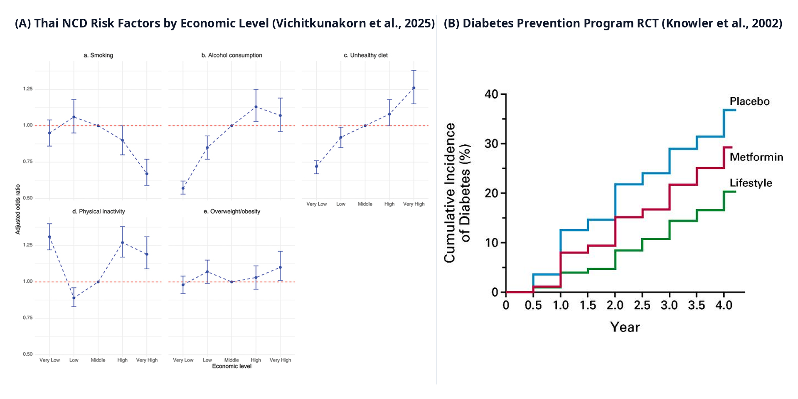

**ภาพที่ 1ก (ต้นฉบับจากแหล่งอ้างอิงหลัก) ปัจจัยเสี่ยงโรคไม่ติดต่อเรื้อรังตามระดับเศรษฐกิจในประชากรไทย และการทดลองป้องกันโรคเบาหวานด้วยวิถีชีวิตเทียบกับยา** (A) อัตราส่วนออดส์ปรับค่าของพฤติกรรมเสี่ยงและภาวะน้ำหนักเกิน/อ้วนจำแนกตามสถานะเศรษฐกิจจากการสำรวจพฤติกรรมสุขภาพประชากรไทย พ.ศ. 2564 และ (B) อุบัติการณ์สะสมของโรคเบาหวานชนิดที่ 2 ในการทดลองแบบสุ่ม Diabetes Prevention Program ซึ่งชี้ว่ากลุ่มปรับเปลี่ยนวิถีชีวิตลดอุบัติการณ์โรคได้ร้อยละ 58 เหนือกว่ากลุ่มยาเมทฟอร์มิน (ร้อยละ 31) และยาหลอก (*ที่มา: [Knowler et al., 2002](https://doi.org/10.1056/NEJMoa012512); [Vichitkunakorn et al., 2025](https://doi.org/10.1080/16549716.2025.2485689)*)

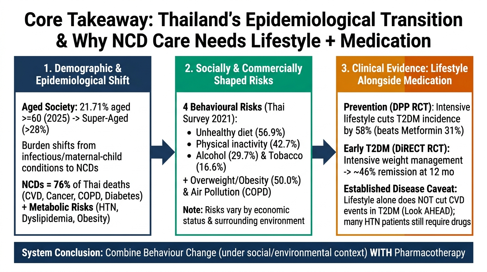

**ภาพที่ 1ข (แผนภาพสังเคราะห์แนวคิดรวบยอด) สาระสำคัญที่ภาพรวมต้องการสื่อสาร: การเปลี่ยนผ่านทางระบาดวิทยาของไทยและเหตุผลที่การดูแลโรคไม่ติดต่อเรื้อรังต้องผสานการปรับพฤติกรรมควบคู่กับการใช้ยา** สังเคราะห์ความเชื่อมโยงตั้งแต่สังคมสูงวัยอย่างสมบูรณ์และการเปลี่ยนภาระโรคสู่โรคไม่ติดต่อเรื้อรัง (ร้อยละ 76 ของการเสียชีวิต) พฤติกรรมเสี่ยง 4 ด้านและมลพิษทางอากาศภายใต้บริบทแวดล้อม ไปจนถึงขอบเขตหลักฐานทางคลินิกที่การปรับวิถีชีวิตเด่นชัดในการป้องกันและระยะแรกของเบาหวาน แต่ไม่สามารถทดแทนการใช้ยาในผู้ป่วยที่เป็นโรคแล้วทุกราย (*ที่มา: สังเคราะห์แนวคิดจาก [Department of Older Persons (2026)](https://www.dop.go.th/download/statistics/th1793240958-2616_0.pdf), [Knowler et al. (2002)](https://doi.org/10.1056/NEJMoa012512), [Lean et al. (2018)](https://doi.org/10.1016/S0140-6736%2817%2933102-1), [Look AHEAD Research Group (2013)](https://doi.org/10.1056/NEJMoa1212914), [Vichitkunakorn et al. (2025)](https://doi.org/10.1080/16549716.2025.2485689) และ [WHO (2025a](https://www.who.int/news-room/fact-sheets/detail/hypertension), [2025b)](https://www.who.int/news-room/fact-sheets/detail/noncommunicable-diseases)*)

### 1.2 พฤติกรรมมนุษย์เกิดจากการตอบสนองต่อสิ่งเร้าภายในและภายนอก ทั้งในรูปพฤติกรรมภายนอกที่สังเกตเห็นได้โดยตรงและพฤติกรรมภายในจิตใจ (Human Behaviour, Stimuli, and Overt vs. Covert Behaviour)

**พฤติกรรมมนุษย์ (human behaviour)** หมายถึงการกระทำหรือปฏิกิริยาตอบสนองต่อ **สิ่งเร้า (stimulus)** ทั้งโดยรู้ตัวหรือไม่รู้ตัว (conscious or nonconscious) ชัดเจนหรือแอบแฝง และตั้งใจหรือไม่ตั้งใจ ([American Psychological Association [APA], 2018a](https://dictionary.apa.org/behavior), [2018h](https://dictionary.apa.org/stimulus)) จำแนกองค์ประกอบพื้นฐานได้ดังนี้

- **สิ่งเร้าภายใน (internal stimulus):** แรงขับทางสรีรวิทยาและเหตุการณ์ภายในร่างกาย เช่น ความหิว ความกระหาย และอาการปวดศีรษะ ([APA, 2018b](https://dictionary.apa.org/biological-drive), [2018f](https://dictionary.apa.org/private-event))
- **สิ่งเร้าภายนอก (external stimulus):** สิ่งกระตุ้นจากทั้งสิ่งแวดล้อมทางกายภาพ (แสง เสียง อุณหภูมิ) และสิ่งแวดล้อมทางสังคม ที่รับรู้ผ่าน **ประสาทสัมผัสหลักทั้งห้า** คือ การมองเห็น (ตา) การได้ยิน (หู) การรับรส (ลิ้น) การดมกลิ่น (จมูก) และการสัมผัส (ผิวกาย) ([APA, 2018g](https://dictionary.apa.org/sense), [2018h](https://dictionary.apa.org/stimulus))
- **พฤติกรรมภายนอก (overt behaviour):** การกระทำที่ผู้อื่นสังเกตเห็นได้โดยตรงโดยไม่ต้องใช้เครื่องมือหรือความเชี่ยวชาญ เช่น การเดิน การพูด การเขียน การแสดงสีหน้าและท่าทาง (ส่วนการเต้นของหัวใจเป็นการตอบสนองทางสรีรวิทยาที่ต้องใช้เครื่องมือวัด จึงไม่จัดเป็นพฤติกรรมภายนอก) ([APA, 2018e](https://dictionary.apa.org/overt-behavior))
- **พฤติกรรมภายใน (covert behaviour):** กระบวนการภายในที่สังเกตโดยตรงไม่ได้แต่รับรู้จากการอนุมานหรือคำบอกเล่า เช่น ความรู้สึก การรับรู้ การจำ การคิด การตัดสินใจ และการจินตนาการ ([APA, 2018c](https://dictionary.apa.org/covert-behavior))

### 1.3 พฤติกรรมสุขภาพจำแนกตามการรับรู้สถานะสุขภาพได้สามประเภท โดยการคัดกรองโรคในระยะไม่มีอาการต้องเลือกให้เหมาะกับอายุและความเสี่ยงแทนการตรวจเหมารวม (Types of Health Behaviour)

**พฤติกรรมสุขภาพ (health behaviour)** หมายถึงกิจกรรมที่บุคคลกระทำเพื่อส่งเสริม ปกป้อง ดำรงรักษา หรือฟื้นคืนสุขภาพ **ไม่ว่าการกระทำนั้นจะได้ผลจริงหรือไม่** ([WHO, 2021](https://iris.who.int/handle/10665/350161)) ส่วนความหมายกว้างของ **พฤติกรรมที่เกี่ยวข้องกับสุขภาพ (health-related behaviour)** รวมพฤติกรรมเสี่ยง เช่น การสูบบุหรี่และการดื่มสุราไว้ด้วย ([APA, 2026](https://dictionary.apa.org/health-behavior); [WHO, 1998](https://iris.who.int/handle/10665/64546)) ตามกรอบของ [Kasl และ Cobb (1966a](https://doi.org/10.1080/00039896.1966.10664365), [1966b)](https://doi.org/10.1080/00039896.1966.10664421) พฤติกรรมสุขภาพจำแนกตามการรับรู้สถานะสุขภาพได้ 3 ประเภท ([Buczkowska et al., 2022](https://doi.org/10.3390/ijerph192214650); [Mulyani et al., 2026](https://doi.org/10.1186/s12884-026-08761-7)) ดังตารางต่อไปนี้

| ประเภทพฤติกรรมสุขภาพ | สถานะสุขภาพที่รับรู้และนิยามหลัก | ตัวอย่างสำคัญและหลักฐานเชิงประจักษ์ |
|---|---|---|
| **1. พฤติกรรมการป้องกันโรคและการส่งเสริมสุขภาพ (Preventive and promotive behaviour)** | กระทำขณะเชื่อว่าตนเองสุขภาพดีและยังไม่มีอาการ (asymptomatic) เพื่อลดโอกาสเกิด/ความรุนแรงของโรคและยกระดับสุขภาวะ ([Kasl & Cobb, 1966a](https://doi.org/10.1080/00039896.1966.10664365); [WHO, 2026f](https://www.who.int/news-room/fact-sheets/detail/physical-activity)) | กรอบการสอนแบ่งเป็น 4 กลุ่ม (กลุ่ม 2–3 ซ้อนกันได้): (1) *กิจวัตรประจำวัน* เช่น อาหารดีต่อสุขภาพ ([WHO, 2026d](https://www.who.int/news-room/fact-sheets/detail/healthy-diet)) (2) *ส่งเสริมสุขภาพ* เช่น คุมน้ำหนัก ออกกำลังกาย พักผ่อน งดบุหรี่/สุรา (3) *ป้องกันโรคและบาดเจ็บ* เช่น วัคซีน ([WHO, 2026e](https://www.who.int/news-room/fact-sheets/detail/immunization-coverage)) หมวกนิรภัย (ลดเสี่ยงตาย > 6 เท่า) เข็มขัดนิรภัย (ลดเสี่ยงตายร้อยละ 50) ([WHO, 2026g](https://www.who.int/news-room/fact-sheets/detail/road-traffic-injuries)) และ (4) *การคัดกรองตามอายุและความเสี่ยง* เช่น วัดความดันโลหิต คัดกรองเบาหวานและมะเร็งปากมดลูก ([WHO, 2025a](https://www.who.int/news-room/fact-sheets/detail/hypertension), [2026a](https://www.who.int/news-room/fact-sheets/detail/cervical-cancer)) — **ต่างจากการตรวจสุขภาพทั่วไปประจำปีแบบเหมารวม (general health checks) ที่แทบไม่ลดอัตราตายรวม มะเร็ง หรือโรคหัวใจและหลอดเลือด** ([Krogsbøll et al., 2019](https://doi.org/10.1002/14651858.CD009009.pub3)) |
| **2. พฤติกรรมเมื่อรู้สึกไม่สบายหรือเจ็บป่วย (Illness behaviour)** | กระทำเมื่อรู้สึกไม่สบายหรือมีอาการผิดปกติ เพื่อประเมินภาวะสุขภาพของตนและแสวงหาการรักษาที่เหมาะสม ([APA, 2018d](https://dictionary.apa.org/illness-behavior); [Kasl & Cobb, 1966a](https://doi.org/10.1080/00039896.1966.10664365)) | ไปรับบริการสถานพยาบาลรัฐหรือเอกชน ซื้อยารับประทานเอง หรือเฝ้ารอให้อาการหายเอง เพราะอาการเดียวกันถูกรับรู้และตอบสนองต่างกันในแต่ละคน ([Millard, 2016](https://doi.org/10.1093/shm/hkw083)) |
| **3. พฤติกรรมตามบทบาทผู้ป่วย (Sick-role behaviour)** | กระทำเมื่อถือว่าตนเองป่วยเพื่อให้หายหรือฟื้นตัว ทั้งการดูแลตนเองและการร่วมมือกับผู้รักษาตามบทบาทผู้ป่วยของ Parsons ([APA, 2023](https://dictionary.apa.org/sick-role); [Kasl & Cobb, 1966b](https://doi.org/10.1080/00039896.1966.10664421)) | รับประทานยาต่อเนื่องตามแผนการรักษา (medication adherence) ([APA, 2026](https://dictionary.apa.org/health-behavior)) งดบุหรี่/สุราและลดเค็มเพื่อลดความดันโลหิต ([WHO, 2025a](https://www.who.int/news-room/fact-sheets/detail/hypertension)) และฟื้นฟูสมรรถภาพ เช่น ฟื้นฟูปอดใน COPD ([WHO, 2026b](https://www.who.int/news-room/fact-sheets/detail/chronic-obstructive-pulmonary-disease-%28copd%29)) |

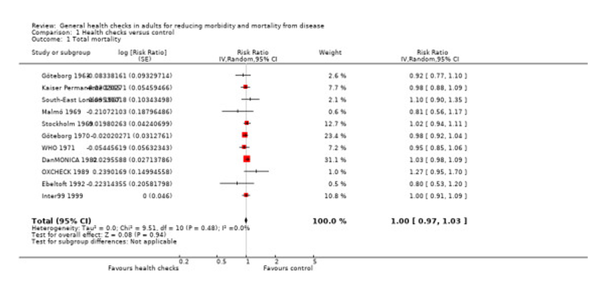

**ภาพที่ 2ก (ต้นฉบับจากแหล่งอ้างอิงหลัก) ผลการวิเคราะห์อภิมานของการตรวจสุขภาพทั่วไปแบบเหมารวมในผู้ใหญ่ต่ออัตราตายโดยรวม** แผนภูมิป่าไม้ (forest plot) จากการทบทวนอย่างเป็นระบบของ Cochrane รวบรวมการทดลองแบบสุ่มเปรียบเทียบการตรวจสุขภาพทั่วไปแบบเหมารวม (general health checks) กับกลุ่มควบคุม พบค่าอัตราส่วนความเสี่ยงรวม (Risk Ratio) ของการเสียชีวิตทุกสาเหตุเท่ากับ 1.00 (95% CI [0.97, 1.03]) สะท้อนว่าการตรวจเช็กสุขภาพแบบเหมารวมโดยไม่จำแนกตามความเสี่ยงไม่ลดอัตราตาย (*ที่มา: [Krogsbøll et al., 2019](https://doi.org/10.1002/14651858.CD009009.pub3)*)

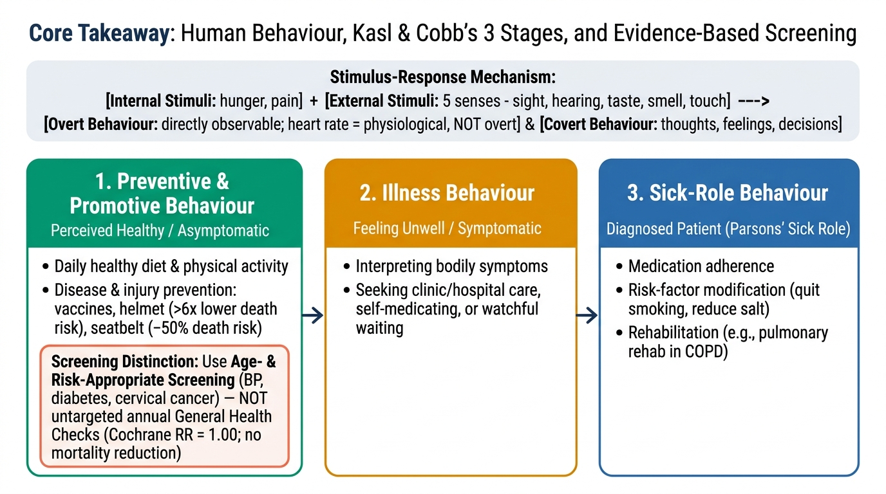

**ภาพที่ 2ข (แผนภาพสังเคราะห์แนวคิดรวบยอด) สาระสำคัญที่ภาพรวมต้องการสื่อสาร: กลไกพฤติกรรมมนุษย์ พฤติกรรมสุขภาพ 3 ประเภทตามสถานะสุขภาพ และเส้นแบ่งของการคัดกรองโรคเชิงประจักษ์** สรุปกลไกสิ่งเร้าภายใน–ภายนอกและการตอบสนองเป็นพฤติกรรมภายนอก–ภายใน (โดยการเต้นของหัวใจเป็นการตอบสนองทางสรีรวิทยา ไม่ใช่พฤติกรรมภายนอก) เชื่อมสู่พฤติกรรมสุขภาพ 3 ระยะของ Kasl และ Cobb พร้อมชี้ชัดว่าในระยะไม่มีอาการต้องเลือกใช้การคัดกรองตามอายุและความเสี่ยงแทนการตรวจสุขภาพทั่วไปแบบเหมารวม (*ที่มา: สังเคราะห์แนวคิดจาก [APA (2018c](https://dictionary.apa.org/covert-behavior), [2018e)](https://dictionary.apa.org/overt-behavior), [Kasl & Cobb (1966a](https://doi.org/10.1080/00039896.1966.10664365), [1966b)](https://doi.org/10.1080/00039896.1966.10664421), [Krogsbøll et al. (2019)](https://doi.org/10.1002/14651858.CD009009.pub3) และ [WHO (2025a](https://www.who.int/news-room/fact-sheets/detail/hypertension), [2026g)](https://www.who.int/news-room/fact-sheets/detail/road-traffic-injuries)*)

## 2. ทฤษฎีพฤติกรรมสุขภาพพัฒนาจากการเน้นความรู้และการคิดเชิงเหตุผลระดับปัจเจก ไปสู่ความเข้าใจระบบคิดอัตโนมัติและวงล้อการปรับเปลี่ยนพฤติกรรมที่เชื่อมความสามารถ โอกาส แรงจูงใจ มาตรการ และนโยบาย (Health Behaviour Theories and Behaviour Change)

โปรแกรมปรับเปลี่ยนพฤติกรรมที่วางอยู่บนฐานทฤษฎีและการวิเคราะห์พฤติกรรมเป้าหมายมีแนวโน้มได้ผลมากกว่าโปรแกรมที่ขาดฐานทฤษฎี และเนื่องจากพฤติกรรมมีทฤษฎีอธิบายถึง 82 ทฤษฎีและถูกกำหนดจากหลายระดับ จึงมักต้องผสมผสานหลายกรอบแนวคิดเข้าด้วยกัน ([Davis et al., 2015](https://doi.org/10.1080/17437199.2014.941722); [Glanz & Bishop, 2010](https://doi.org/10.1146/annurev.publhealth.012809.103604); [Glanz et al., 2008](https://books.google.com/books/about/Health_Behavior_and_Health_Education.html?id=G1-f0gEACAAJ))

### 2.1 พฤติกรรมสุขภาพได้รับอิทธิพลจากปัจจัยหลายระดับตามแบบจำลองเชิงนิเวศ และการให้ความรู้ตามแนวคิด KAP เพียงลำพังไม่เพียงพอแม้ความรู้ยังจำเป็นต่อการเลือกอย่างมีข้อมูล (Ecological Levels and KAP Model)

ทฤษฎีพฤติกรรมจำนวนมากมุ่งเน้นระดับปัจเจก แต่ **แบบจำลองเชิงนิเวศ (ecological model)** ชี้ว่าต้องพิจารณาปัจจัย 5 ระดับร่วมกัน ได้แก่ ปัจเจกบุคคล (individual) ระหว่างบุคคล/กลุ่ม (interpersonal) องค์กร (organizational) ชุมชน (community) และนโยบายสาธารณะ (public policy เช่น กฎหมายและมาตรการกำกับ) ([McLeroy et al., 1988](https://doi.org/10.1177/109019818801500401))

**แนวคิดความรู้ ทัศนคติ พฤติกรรม (Knowledge–Attitude–Practice: KAP)** เริ่มจากการสำรวจด้านวางแผนครอบครัวในทศวรรษ 1950 โดยตั้งอยู่บนสมมติฐานการขาดข้อมูล (information deficit) ว่าความรู้จะเปลี่ยนทัศนคติและเปลี่ยนพฤติกรรมเป็นเส้นตรง ([Launiala, 2009](https://doi.org/10.22582/am.v11i1.31); [Nutbeam, 2000](https://doi.org/10.1093/heapro/15.3.259); [Valente et al., 1998](https://doi.org/10.1111/j.1468-2958.1998.tb00421.x)) อย่างไรก็ดี หลักฐานปัจจุบันชี้ว่า **การให้ความรู้เพียงอย่างเดียวไม่เพียงพอ** เพราะมี **ช่องว่างระหว่างความตั้งใจกับพฤติกรรม (intention–behaviour gap)** (เพิ่มความตั้งใจได้มากแต่พฤติกรรมเปลี่ยนเพียงเล็กถึงปานกลาง) ([Webb & Sheeran, 2006](https://doi.org/10.1037/0033-2909.132.2.249)) ความสัมพันธ์ของ K–A–P ไม่ได้เรียงเป็นเส้นตรง (บางกรณีปฏิบัติก่อนแล้วความรู้และทัศนคติตามมา) ([Valente et al., 1998](https://doi.org/10.1111/j.1468-2958.1998.tb00421.x)) และการมุ่งเน้นความรับผิดชอบของปัจเจกฝ่ายเดียวอาจละเลยปัจจัยทางสังคมจนกลายเป็นการกล่าวโทษผู้ป่วย (victim blaming) ([Baum & Fisher, 2014](https://doi.org/10.1111/1467-9566.12112); [Kelly & Barker, 2016](https://doi.org/10.1016/j.puhe.2016.03.030)) กระนั้น **ความรู้ยังคงเป็นเงื่อนไขที่จำเป็น (necessary but not sufficient)** เพราะการเลือกอย่างมีข้อมูล (informed choice) ไม่สามารถเกิดขึ้นได้หากปราศจากความรู้ที่ถูกต้อง ([Arlinghaus & Johnston, 2018](https://doi.org/10.1177/1559827617745479); [Marteau et al., 2001](https://doi.org/10.1046/j.1369-6513.2001.00140.x))

### 2.2 ทฤษฎีแบบแผนความเชื่อทางสุขภาพเน้นการชั่งประโยชน์กับอุปสรรค ส่วนทฤษฎีลำดับขั้นของการเปลี่ยนแปลงชี้กระบวนการความพร้อมแต่การจัดโปรแกรมแยกขั้นไม่ได้ผลเหนือกว่าโปรแกรมมาตรฐาน (Health Belief Model and Stages of Change)

- **ทฤษฎีแบบแผนความเชื่อทางสุขภาพ (Health Belief Model: HBM):** พัฒนาในทศวรรษ 1950 เพื่ออธิบายพฤติกรรมป้องกันโรคก่อนขยายสู่พฤติกรรมเมื่อเจ็บป่วยและบทบาทผู้ป่วย โดยสมมติว่าบุคคลชั่งประโยชน์เทียบกับอุปสรรคอย่างมีเหตุผล ([Janz & Becker, 1984](https://doi.org/10.1177/109019818401100101); [Rosenstock, 1974](https://doi.org/10.1177/109019817400200403)) มีองค์ประกอบ 8 ประการ คือ (1) การรับรู้โอกาสเสี่ยง (perceived susceptibility) (2) การรับรู้ความรุนแรง (perceived severity) (3) การรับรู้ประโยชน์ (perceived benefits) (4) การรับรู้อุปสรรค (perceived barriers) (5) ปัจจัยปรับด้านประชากร จิตสังคม และโครงสร้าง (modifying factors) (6) สิ่งชักนำภายในและภายนอก (cues to action) (7) แรงจูงใจด้านสุขภาพ (health motivation) และ (8) **การรับรู้ความสามารถของตนเอง (self-efficacy)** ที่เพิ่มเข้ามาภายหลัง ([Champion, 1984](https://doi.org/10.1097/00012272-198404000-00011); [Jones et al., 2015](https://doi.org/10.1080/10410236.2013.873363); [Limbu et al., 2022](https://doi.org/10.3390/vaccines10060973); [Rosenstock et al., 1988](https://doi.org/10.1177/109019818801500203)) *หลักฐานเชิงประจักษ์:* การรับรู้อุปสรรคและประโยชน์เป็นตัวทำนายที่แรงที่สุด ส่วนความรุนแรงและโอกาสเสี่ยงทำนายได้อ่อน และพลังทำนายโดยรวมของแบบจำลองยังจำกัดเพราะไม่ได้รวมกระบวนการอัตโนมัติ ([Carpenter, 2010](https://doi.org/10.1080/10410236.2010.521906); [Marteau et al., 2012](https://doi.org/10.1126/science.1226918); [Orji et al., 2012](https://doi.org/10.5210/ojphi.v4i3.4321)) ดังแสดงในภาพที่ 3ก และ 3ข

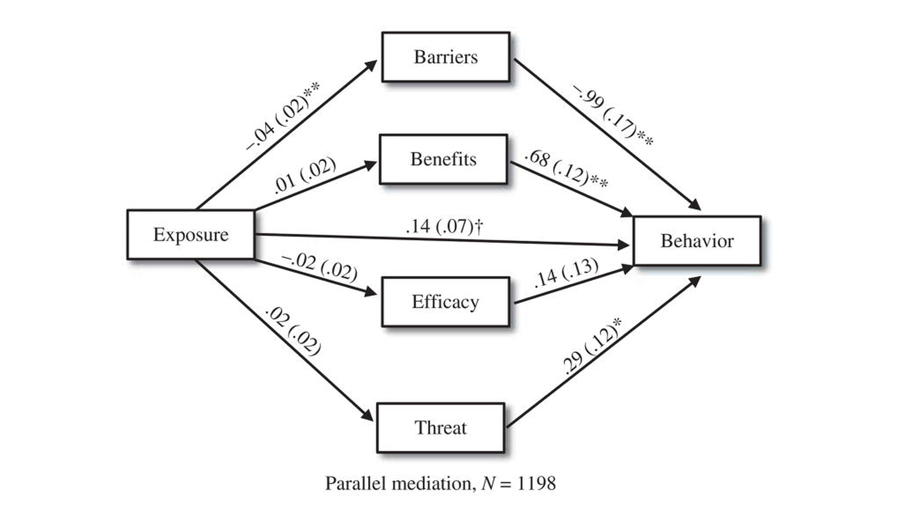

**ภาพที่ 3ก (ต้นฉบับจากแหล่งอ้างอิงหลัก) การวิเคราะห์ตัวแปรคั่นกลางแบบขนานของทฤษฎีแบบแผนความเชื่อทางสุขภาพ (Health Belief Model) ต่อพฤติกรรมสุขภาพ** แสดงค่าสัมประสิทธิ์เส้นทางเชิงประจักษ์ (*N* = 1,198) ซึ่งชี้ให้เห็นว่าการรับรู้อุปสรรค (Barriers, *b* = −.99**) และการรับรู้ประโยชน์ (Benefits, *b* = .68**) มีขนาดอิทธิพลต่อพฤติกรรมสูงกว่าการรับรู้ภัยคุกคาม (Threat, *b* = .29*) การรับรู้ความสามารถตนเอง (Efficacy, *b* = .14) และการเปิดรับสื่อรณรงค์โดยตรง (Exposure, *b* = .14†) อย่างชัดเจน (*ที่มา: [Jones et al., 2015](https://doi.org/10.1080/10410236.2013.873363)*)

**ภาพที่ 3ข (แผนภาพสังเคราะห์แนวคิดรวบยอด) สาระสำคัญที่ภาพรวมต้องการสื่อสาร: เหตุใดการให้ข้อมูลอย่างเดียวจึงไม่พอ (KAP) และองค์ประกอบใดขับเคลื่อนการตัดสินใจจริงใน HBM** เปรียบเทียบบริบท 5 ระดับของแบบจำลองเชิงนิเวศและช่องว่างระหว่างความตั้งใจกับพฤติกรรม (ซึ่งความรู้ยังจำเป็นต่อการเลือกอย่างมีข้อมูลแต่ไม่เพียงพอโดยลำพัง) คู่กับกลไกการชั่งน้ำหนักประโยชน์เทียบอุปสรรคใน HBM ที่มีพลังทำนายจำกัดเมื่อพฤติกรรมขับเคลื่อนด้วยความเคยชินอัตโนมัติ (*ที่มา: สังเคราะห์แนวคิดจาก [Carpenter (2010)](https://doi.org/10.1080/10410236.2010.521906), [Jones et al. (2015)](https://doi.org/10.1080/10410236.2013.873363), [Kelly & Barker (2016)](https://doi.org/10.1016/j.puhe.2016.03.030), [Marteau et al. (2001](https://doi.org/10.1046/j.1369-6513.2001.00140.x), [2012)](https://doi.org/10.1126/science.1226918), [McLeroy et al. (1988)](https://doi.org/10.1177/109019818801500401) และ [Webb & Sheeran (2006)](https://doi.org/10.1037/0033-2909.132.2.249)*)

- **ทฤษฎีลำดับขั้นของการเปลี่ยนแปลง / แบบจำลองข้ามทฤษฎี (Stages of Change / Transtheoretical Model: TTM):** มองการเปลี่ยนพฤติกรรมเป็นกระบวนการตามระดับความพร้อม 5 ขั้นหลัก ได้แก่ (1) **ยังไม่สนใจ (precontemplation)** (2) **ลังเลใจ (contemplation)** (3) **เตรียมการภายใน 30 วัน (preparation)** (4) **ลงมือทำไม่เกิน 6 เดือน (action)** และ (5) **คงพฤติกรรมเกิน 6 เดือน (maintenance)** (พร้อมขั้นยุติ termination และการกลับไปทำซ้ำ relapse) ([Cahill et al., 2010](https://doi.org/10.1002/14651858.CD004492.pub4); [Prochaska & DiClemente, 1983](https://doi.org/10.1037/0022-006X.51.3.390); [Prochaska & Velicer, 1997](https://doi.org/10.4278/0890-1171-12.1.38)) *หลักฐานเชิงประจักษ์:* แม้ทฤษฎีเสนอให้จัดโปรแกรมจำเพาะตามขั้น (stage-matched interventions) แต่การทบทวนอย่างเป็นระบบและการวิเคราะห์อภิมานไม่พบว่าโปรแกรมตามขั้นได้ผลดีกว่าโปรแกรมมาตรฐานที่ไม่แบ่งขั้น จึงควรใช้เป็นแนวทางสื่อสารรายบุคคลโดยไม่จำกัดการช่วยเหลือไว้เฉพาะผู้ที่พร้อมแล้วเท่านั้น ([Bergman et al., 2026](https://doi.org/10.1177/02692163261431148); [Cahill et al., 2010](https://doi.org/10.1002/14651858.CD004492.pub4); [Noar et al., 2007](https://doi.org/10.1037/0033-2909.133.4.673); [Riemsma et al., 2003](https://doi.org/10.1136/bmj.326.7400.1175)) ดังแสดงในภาพที่ 4ก และ 4ข

**ภาพที่ 4ก (ต้นฉบับจากแหล่งอ้างอิงหลัก) แบบจำลองลำดับขั้นของการเปลี่ยนแปลง (Stages of Change) และกระบวนการกลับไปทำพฤติกรรมเดิม (Process of Relapse)** แสดงลำดับความพร้อมในการเปลี่ยนแปลงพฤติกรรม 5 ขั้นหลักตามแนวคิดของ Prochaska และ DiClemente ได้แก่ ขั้นยังไม่สนใจ (Precontemplation) ขั้นลังเลใจ (Contemplation) ขั้นเตรียมการภายใน 1 เดือน (Preparation) ขั้นลงมือทำในช่วง 6 เดือนแรก (Action) และขั้นคงพฤติกรรมเกิน 6 เดือน (Maintenance) พร้อมเส้นประสะท้อนการย้อนกลับไปสู่ขั้นก่อนหน้าเมื่อเกิดการกลับไปทำซ้ำ (*ที่มา: [Bergman et al., 2026](https://doi.org/10.1177/02692163261431148)*)

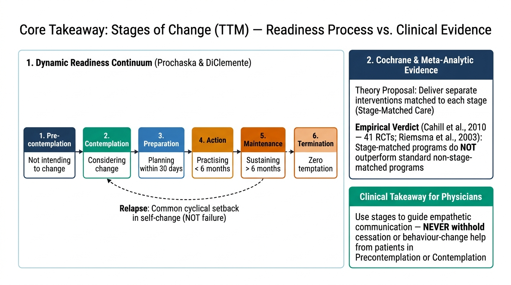

**ภาพที่ 4ข (แผนภาพสังเคราะห์แนวคิดรวบยอด) สาระสำคัญที่ภาพรวมต้องการสื่อสาร: ความพร้อมในการเปลี่ยนพฤติกรรมเป็นพลวัต แต่เวชปฏิบัติไม่ควรจำกัดการช่วยเหลือไว้เฉพาะผู้ที่พร้อมแล้ว** เชื่อมโยงวัฏจักรความพร้อมและการกลับไปทำซ้ำเข้ากับหลักฐานการทบทวนอย่างเป็นระบบของ Cochrane ที่ไม่พบว่าการจัดโปรแกรมแยกตามขั้นได้ผลเหนือกว่าโปรแกรมมาตรฐานที่ไม่แบ่งขั้น แพทย์จึงควรใช้ลำดับขั้นเพื่อปรับการสื่อสารอย่างเข้าใจผู้ป่วยทุกรายโดยไม่ชะลอการให้ความช่วยเหลือ (*ที่มา: สังเคราะห์แนวคิดจาก [Bergman et al. (2026)](https://doi.org/10.1177/02692163261431148), [Cahill et al. (2010)](https://doi.org/10.1002/14651858.CD004492.pub4), [Prochaska & DiClemente (1983)](https://doi.org/10.1037/0022-006X.51.3.390), [Prochaska & Velicer (1997)](https://doi.org/10.4278/0890-1171-12.1.38) และ [Riemsma et al. (2003)](https://doi.org/10.1136/bmj.326.7400.1175)*)

### 2.3 เศรษฐศาสตร์พฤติกรรมอธิบายระบบคิดอัตโนมัติและข้อจำกัดของการประมวลผลข้อมูล นำไปสู่การออกแบบโครงสร้างทางเลือกแบบผลักดันพฤติกรรมที่เป็นเครื่องมือเสริมกฎหมาย (Behavioural Economics and Nudge)

**เศรษฐศาสตร์พฤติกรรม (behavioural economics)** ผนวกจิตวิทยาการรู้คิดและจิตวิทยาสังคมเข้ากับเศรษฐศาสตร์ ชี้ว่ามนุษย์มีความมีเหตุผลที่มีขอบเขตจำกัด (bounded rationality) เมื่อข้อมูลซับซ้อน มีทางเลือกล้น (choice overload) หรือเวลาน้อย ผู้คนจึงพึ่ง **ระบบอัตโนมัติ (System 1)** ที่รวดเร็ว ไม่ต้องพยายาม เชื่อมโยงอัตโนมัติ (associative) ไม่รู้ตัว และขับเคลื่อนด้วยสิ่งเร้าแวดล้อม มากกว่า **ระบบไตร่ตรอง (System 2)** ที่ควบคุมได้ ใช้ความพยายามและหน่วยความจำใช้งาน (working memory) ช้า และทำตามกฎเกณฑ์ ([Chernev et al., 2015](https://doi.org/10.1016/j.jcps.2014.08.002); [Evans & Stanovich, 2013](https://doi.org/10.1177/1745691612460685); [Hansen & Jespersen, 2013](https://doi.org/10.1017/S1867299X00002762); [Marteau et al., 2011](https://doi.org/10.1136/bmj.d228)) ปัจจัยที่เกี่ยวข้องกับการตัดสินใจสรุปได้ 3 ด้าน ([สินาด ตรีวรรณไชย, 2559](https://medium.com/@treewanchai/%E0%B9%80%E0%B8%A8%E0%B8%A3%E0%B8%A9%E0%B8%90%E0%B8%A8%E0%B8%B2%E0%B8%AA%E0%B8%95%E0%B8%A3%E0%B9%8C%E0%B8%9E%E0%B8%A4%E0%B8%95%E0%B8%B4%E0%B8%81%E0%B8%A3%E0%B8%A3%E0%B8%A1%E0%B8%81%E0%B8%B1%E0%B8%9A%E0%B8%99%E0%B9%82%E0%B8%A2%E0%B8%9A%E0%B8%B2%E0%B8%A2%E0%B8%82%E0%B8%AD%E0%B8%87%E0%B9%80%E0%B8%A1%E0%B8%B7%E0%B8%AD%E0%B8%87-29634eb18a05)) คือ (1) **การรับรู้ (perception)** ได้แก่ ข้อมูล ภาพลวงตาทางสายตา และการจัดกรอบการนำเสนอ (framing) ([Tversky & Kahneman, 1981](https://doi.org/10.1126/science.7455683)) (2) **ความพึงพอใจ (preference)** ซึ่งการใช้ทางลัดทางความคิด (heuristics) ก่อความลำเอียงที่เป็นระบบ (ไม่ใช่การเดาสุ่ม) ([Tversky & Kahneman, 1974](https://doi.org/10.1126/science.185.4157.1124)) ความกลัวการสูญเสีย (loss aversion) ความเฉื่อย และการมองค่าตั้งต้นเป็นคำแนะนำทำให้ยึดติดทางเลือกเดิม (status quo bias) ([Jachimowicz et al., 2019](https://doi.org/10.1017/bpp.2018.43); [Kahneman et al., 1991](https://doi.org/10.1257/jep.5.1.193)) ร่วมกับแรงยั่วยุเฉพาะหน้า (temptation) การคล้อยตามคนอื่น การผัดวันประกันพรุ่ง และการควบคุมตนเองจำกัด ([Mertens et al., 2022](https://doi.org/10.1073/pnas.2107346118)) และ (3) **สถาบัน (institution)** ทั้งกฎหมายทางการและบรรทัดฐานไม่เป็นทางการที่กำหนดขอบเขตทางเลือก ([North, 1991](https://doi.org/10.1257/jep.5.1.97))

**ทฤษฎีผลักดัน (Nudge)** ของ Richard H. Thaler (รางวัลโนเบลเศรษฐศาสตร์ปี 2017 จากผลงานเศรษฐศาสตร์พฤติกรรมโดยรวม) และ Cass R. Sunstein เป็นแนวทางประยุกต์ที่ **ออกแบบโครงสร้างทางเลือก (choice architecture)** เพื่อโน้มน้าวสู่ทางเลือกที่เป็นประโยชน์บนหลัก **ปิตาธิปไตยแบบเสรีนิยม (libertarian paternalism)** โดยไม่ห้ามทางเลือกใดและไม่เปลี่ยนแรงจูงใจทางเศรษฐกิจอย่างมีนัยสำคัญ ([Hollands et al., 2013](https://doi.org/10.1186/1471-2458-13-1218); [Royal Swedish Academy of Sciences, 2017](https://www.nobelprize.org/prizes/economic-sciences/2017/press-release/); [Thaler & Sunstein, 2003](https://doi.org/10.1257/000282803321947001), [2008](https://books.google.com/books/about/Nudge.html?id=dSJQn8egXvUC)) ตัวอย่างกลไกที่ต้องแยกให้แม่นยำ ได้แก่ เส้นขวางถนนถี่ขึ้นก่อนโค้งอันตราย (ภาพลวงตาทางสายตา) สติกเกอร์แมลงวันในโถปัสสาวะ (เป้าดึงความสนใจทางสายตา ไม่ใช่ภาพลวงตา และตัวเลขลดร้อยละ 80 ยังไม่มีงานตีพิมพ์ยืนยัน) ([Hansen & Jespersen, 2013](https://doi.org/10.1017/S1867299X00002762); [The Decision Lab, n.d.](https://thedecisionlab.com/intervention/how-a-picture-of-a-fly-reduced-washroom-cleaning-costs-by-8); [University of Chicago Law School, n.d.](https://www.law.uchicago.edu/news/chronicle-review-sunsteins-nudge)) การวางอาหารดีต่อสุขภาพระดับสายตา (การจัดตำแหน่ง/ระยะใกล้ placement ปรับโครงสร้างการตัดสินใจ ไม่ใช่ framing) ([Bucher et al., 2016](https://doi.org/10.1017/S0007114516001653)) และค่าตั้งต้นแบบแจ้งออก (default / opt-out ซึ่งได้ผลสม่ำเสมอที่สุด) ส่วน **โปรโมชันซื้อ 1 แถม 1 ไม่ใช่ nudge** เพราะลดราคาต่อหน่วยครึ่งหนึ่งจึงเป็นแรงจูงใจทางราคา ([Hansen & Jespersen, 2013](https://doi.org/10.1017/S1867299X00002762); [Hollands et al., 2013](https://doi.org/10.1186/1471-2458-13-1218)) ทั้งนี้การวิเคราะห์อภิมานพบขนาดผลเฉลี่ยของ nudge ระดับเล็กถึงปานกลาง (Cohen’s *d* = 0.45) ซึ่งลดลงมากเมื่อปรับแก้อคติการตีพิมพ์ และในงานนโยบายจริงพบผลเฉลี่ยราว 1.4 จุดร้อยละ จึงต้องใช้ nudge เป็นเครื่องมือเสริมควบคู่กับกฎหมายและมาตรการเชิงโครงสร้าง ([DellaVigna & Linos, 2022](https://doi.org/10.3982/ECTA18709); [Maier et al., 2022](https://doi.org/10.1073/pnas.2200300119); [Marteau et al., 2011](https://doi.org/10.1136/bmj.d228); [Mertens et al., 2022](https://doi.org/10.1073/pnas.2107346118); [Szaszi et al., 2022](https://doi.org/10.1073/pnas.2200732119)) ดังแสดงเมทริกซ์และขนาดผลต้นฉบับควบคู่กับแผนภาพสังเคราะห์ในภาพที่ 5ก และ 5ข

**ภาพที่ 5ก (ต้นฉบับจากแหล่งอ้างอิงหลัก) เมทริกซ์จำแนกมาตรการผลักดันพฤติกรรม (Nudge) สี่กลุ่มตามระบบคิดและความโปร่งใส และขนาดผลเชิงประจักษ์แยกตามกลไกโครงสร้างทางเลือก** (A) การจัดกลุ่มตัวอย่าง nudge ตามการกระตุ้นระบบอัตโนมัติ (Type 1) เทียบกับระบบไตร่ตรอง (Type 2) และความโปร่งใสต่อผู้ตัดสินใจ เช่น ภาพแมลงวันในโถปัสสาวะ เส้นจราจรลวงตา การจัดผังโรงอาหาร การตั้งค่าเริ่มต้นบริจาคอวัยวะ และการจัดกรอบข้อมูลทางการแพทย์ และ (B) ขนาดผลเฉลี่ย (Cohen’s *d*) จากการวิเคราะห์อภิมานซึ่งชี้ว่าการปรับโครงสร้างการตัดสินใจ (*d* = 0.55 โดยเฉพาะค่าตั้งต้น Default *d* = 0.62) ให้ผลสูงกว่าการให้ข้อมูล (*d* = 0.38) และการช่วยเตือน/สร้างคำมั่น (*d* = 0.31) (*ที่มา: [Hansen & Jespersen, 2013](https://doi.org/10.1017/S1867299X00002762); [Mertens et al., 2022](https://doi.org/10.1073/pnas.2107346118)*)

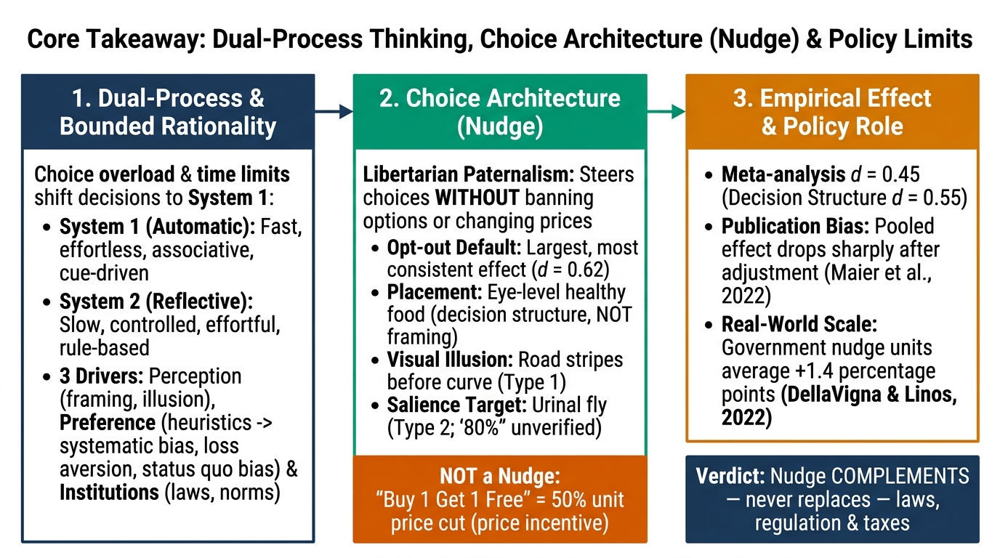

**ภาพที่ 5ข (แผนภาพสังเคราะห์แนวคิดรวบยอด) สาระสำคัญที่ภาพรวมต้องการสื่อสาร: เหตุใดมนุษย์จึงพึ่งระบบคิดที่ 1 กลไกใดนับหรือไม่นับเป็น Nudge และเหตุใด Nudge จึงใช้เสริมแต่ไม่แทนกฎหมาย** สรุปความมีเหตุผลที่มีขอบเขตจำกัด ระบบคิดสองระบบ การแยกกลไกของตัวอย่างสำคัญ (รวมถึงเหตุผลที่โปรโมชัน “ซื้อ 1 แถม 1” เป็นแรงจูงใจทางราคาจึงไม่ใช่ nudge) และข้อเท็จจริงเรื่องอคติการตีพิมพ์และขนาดผลในงานนโยบายจริงราว 1.4 จุดร้อยละ (*ที่มา: สังเคราะห์แนวคิดจาก [DellaVigna & Linos (2022)](https://doi.org/10.3982/ECTA18709), [Hansen & Jespersen (2013)](https://doi.org/10.1017/S1867299X00002762), [Hollands et al. (2013)](https://doi.org/10.1186/1471-2458-13-1218), [Maier et al. (2022)](https://doi.org/10.1073/pnas.2200300119), [Marteau et al. (2011)](https://doi.org/10.1136/bmj.d228), [Mertens et al. (2022)](https://doi.org/10.1073/pnas.2107346118) และ [Thaler & Sunstein (2008)](https://books.google.com/books/about/Nudge.html?id=dSJQn8egXvUC)*)

### 2.4 วงล้อการปรับเปลี่ยนพฤติกรรมเชื่อมแหล่งที่มาของพฤติกรรมตามแบบจำลอง COM-B เข้ากับมาตรการเก้าหน้าที่และนโยบายเจ็ดประเภทอย่างเป็นระบบ (Behaviour Change Wheel and COM-B Model)

**วงล้อการปรับเปลี่ยนพฤติกรรม (Behaviour Change Wheel: BCW)** ผนวกปัจจัยภายในตัวบุคคล สิ่งแวดล้อม และระบบคิดทั้งแบบไตร่ตรองและแบบอัตโนมัติเข้าไว้ในระบบไม่เป็นเส้นตรง 3 ชั้น ได้แก่ **แหล่งที่มาของพฤติกรรม (COM-B)** วงในสีเขียว **หน้าที่ของมาตรการ 9 ด้าน** วงกลางสีแดง และ **ประเภทนโยบาย 7 ประเภท** วงนอกสีเทา ([Michie et al., 2011](https://doi.org/10.1186/1748-5908-6-42); [West & Michie, 2020](https://doi.org/10.32388/WW04E6)) ซึ่งใช้วิเคราะห์ปัญหาจริง เช่น อุปสรรคการตรวจคัดกรองมะเร็งปากมดลูก และอธิบายความแปรปรวนของกิจกรรมทางกายและการบริโภคอาหารได้ในเชิงประจักษ์ ([O'Donovan et al., 2021](https://doi.org/10.1111/hex.13346); [Willmott et al., 2021](https://doi.org/10.1186/s12889-021-11019-w)) ดังแสดงแผนภาพต้นฉบับและขั้นตอนการสังเคราะห์นำไปใช้ในภาพที่ 6ก และ 6ข

**ภาพที่ 6ก (ต้นฉบับจากแหล่งอ้างอิงหลัก) ระบบพฤติกรรม COM-B และวงล้อการปรับเปลี่ยนพฤติกรรม (Behaviour Change Wheel)** (A) แผนภาพต้นฉบับแสดงปฏิสัมพันธ์เชิงพลวัตระหว่างความสามารถ (Capability) โอกาส (Opportunity) แรงจูงใจ (Motivation) และพฤติกรรม (Behaviour) และ (B) วงล้อ 3 ชั้นที่เชื่อมแหล่งที่มาของพฤติกรรม (วงในสีเขียว) เข้ากับหน้าที่ของมาตรการปรับเปลี่ยนพฤติกรรม 9 ด้าน (วงกลางสีแดง) และประเภทนโยบายสนับสนุน 7 ประเภท (วงนอกสีเทา) (*ที่มา: [Michie et al., 2011](https://doi.org/10.1186/1748-5908-6-42)*)

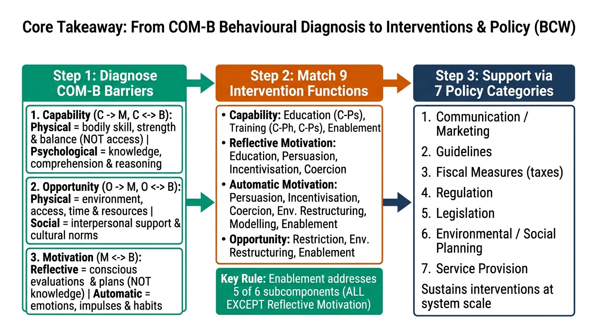

**ภาพที่ 6ข (แผนภาพสังเคราะห์แนวคิดรวบยอด) สาระสำคัญที่ภาพรวมต้องการสื่อสาร: ลำดับขั้นการแปลงผลการวินิจฉัยอุปสรรคตาม COM-B ไปสู่มาตรการ 9 หน้าที่และนโยบาย 7 ประเภทอย่างตรงจุด** สรุปนิยามเชิงขอบเขตที่แม่นยำขององค์ประกอบย่อยทั้ง 6 ด้าน (โดยแยกความสามารถทางกายในตัวบุคคลออกจากการเข้าถึงทางกายภาพซึ่งเป็นโอกาสทางกายภาพ และแยกความรู้ในความสามารถทางจิตใจออกจากการประเมิน/วางแผนในแรงจูงใจแบบไตร่ตรอง) พร้อมชี้หลักสำคัญว่า Enablement ครอบคลุมได้ 5 ใน 6 องค์ประกอบย่อย ยกเว้นแรงจูงใจแบบไตร่ตรอง (*ที่มา: สังเคราะห์แนวคิดจาก [Michie et al. (2011)](https://doi.org/10.1186/1748-5908-6-42) และ [West & Michie (2020)](https://doi.org/10.32388/WW04E6)*)

| องค์ประกอบ COM-B (วงใน) | คำจำกัดความที่แม่นยำ ([Michie et al., 2011](https://doi.org/10.1186/1748-5908-6-42); [West & Michie, 2020](https://doi.org/10.32388/WW04E6)) | หน้าที่ของมาตรการที่ตรงจุด (วงกลาง) | ประเภทนโยบายที่เอื้อมาตรการ (วงนอก) |
|---|---|---|---|
| **1. Physical capability (C-Ph)** | สภาพร่างกาย กำลัง ทักษะทางกาย และการทำงานของกล้ามเนื้อและกระดูก เช่น การทรงตัว (*ไม่ใช่การเข้าถึงทางกายภาพ*) | Training, Enablement | Guidelines, Fiscal measures, Regulation, Legislation, Environmental/social planning (เฉพาะ Enablement), Service provision |
| **2. Psychological capability (C-Ps)** | ความรู้ ความเข้าใจ ความจำ การใช้เหตุผล และการกำกับความคิด | Education, Training, Enablement | Communication/marketing (เฉพาะ Education), Guidelines, Fiscal measures, Regulation, Legislation, Service provision |
| **3. Reflective motivation (M-Re)** | กระบวนการคิดอย่างมีสติ ได้แก่ การประเมินคุณค่าดีเสีย (evaluations) และการวางแผน (plans) (*ไม่ใช่ตัวความรู้*) | Education, Persuasion, Incentivisation, Coercion (*Enablement ไม่ครอบคลุม M-Re*) | Communication/marketing, Guidelines, Fiscal measures (เฉพาะ Incentivisation/Coercion), Regulation, Legislation, Service provision |
| **4. Automatic motivation (M-Au)** | อารมณ์ ความอยาก แรงกระตุ้น สัญชาตญาณ และนิสัยความเคยชิน (habits) | Persuasion, Incentivisation, Coercion, Environmental restructuring, Modelling, Enablement | ครบทั้ง 7 ประเภทนโยบายตามหน้าที่มาตรการที่เลือกใช้ (เช่น Modelling เอื้อด้วย Communication/marketing และ Service provision) |
| **5. Physical opportunity (O-Ph)** | ปัจจัยกายภาพนอกตัวบุคคล ได้แก่ สิ่งแวดล้อม การเข้าถึง ระยะทาง เวลา และทรัพยากรการเงิน/วัสดุ | Restriction, Environmental restructuring, Enablement | Guidelines, Fiscal measures, Regulation, Legislation, Environmental/social planning, Service provision (เฉพาะ Enablement) |
| **6. Social opportunity (O-So)** | ปัจจัยทางสังคมนอกตัวบุคคล ได้แก่ การสนับสนุนทางสังคม ค่านิยม วัฒนธรรม และบรรทัดฐานสังคม | Restriction, Environmental restructuring, Enablement | Guidelines, Fiscal measures, Regulation, Legislation, Environmental/social planning, Service provision (เฉพาะ Enablement) |

## 3. ความรอบรู้ด้านสุขภาพครอบคลุมทั้งสมรรถนะการใช้ข้อมูลระดับบุคคลและความรับผิดชอบขององค์กรในการเอื้ออย่างเป็นธรรม โดยสัมพันธ์กับการใช้บริการ ค่าใช้จ่าย และความเป็นธรรมด้านสุขภาพ (Health Literacy)

ความรอบรู้ด้านสุขภาพก้าวพ้นการอ่านออกเขียนได้ทั่วไปไปสู่สมรรถนะในการจัดการข้อมูลและบริการสุขภาพภายใต้บริบทขององค์กรและสังคม ([Centers for Disease Control and Prevention [CDC], 2024](https://www.cdc.gov/health-literacy/php/about/index.html); [Sørensen et al., 2012](https://doi.org/10.1186/1471-2458-12-80))

### 3.1 นิยามความรอบรู้ด้านสุขภาพยุคใหม่แยกเป็นระดับบุคคลที่เน้นการนำข้อมูลไปใช้ตัดสินใจโดยมีข้อมูลรอบด้าน และระดับองค์กรที่ต้องเอื้ออำนวยอย่างเป็นธรรม (Personal and Organizational Health Literacy)

ในเดือนสิงหาคม ค.ศ. 2020 แผน *Healthy People 2030* ของกระทรวงสาธารณสุขและบริการมนุษย์สหรัฐอเมริกาได้ปรับนิยามความรอบรู้ด้านสุขภาพเป็น 2 ระดับ ซึ่ง CDC นำมาใช้อย่างเป็นทางการ ([CDC, 2024](https://www.cdc.gov/health-literacy/php/about/index.html); [Office of Disease Prevention and Health Promotion, n.d.](https://odphp.health.gov/healthypeople/priority-areas/health-literacy-healthy-people-2030); [Santana et al., 2021](https://doi.org/10.1097/PHH.0000000000001324)) ได้แก่

1. **ความรอบรู้ด้านสุขภาพระดับบุคคล (personal health literacy):** ระดับความสามารถของปัจเจกในการ **ค้นหา (find) ทำความเข้าใจ (understand) และใช้ (use)** ข้อมูลและบริการ เพื่อประกอบ **การตัดสินใจโดยมีข้อมูลรอบด้าน (well-informed decisions)** และการลงมือทำสำหรับตนเองและผู้อื่น (เปลี่ยนจากนิยามเดิมที่เน้นเพียงความเข้าใจและการตัดสินใจที่ “เหมาะสม”)
2. **ความรอบรู้ด้านสุขภาพระดับองค์กร (organizational health literacy):** ระดับที่องค์กร **เอื้ออำนวยอย่างเป็นธรรม (equitably enable)** ให้ปัจเจกค้นหา ทำความเข้าใจ และใช้ข้อมูลและบริการได้ โดยถือเป็นความรับผิดชอบของหน่วยบริการและองค์กรสาธารณสุขในการจัดระบบสื่อสารและบริการที่ลดความเหลื่อมล้ำ ([CDC, 2024](https://www.cdc.gov/health-literacy/php/about/index.html); [Kružliaková et al., 2021](https://doi.org/10.3928/24748307-20210114-01))

### 3.2 แบบจำลองบูรณาการของ Sørensen และคณะเชื่อมสมรรถนะสี่ด้านในสามขอบเขตเข้ากับปัจจัยกำหนดและผลที่เกี่ยวข้องเชิงความสัมพันธ์ (Integrated Model and Correlational Consequences)

แบบจำลองของ [Sørensen และคณะ (2012)](https://doi.org/10.1186/1471-2458-12-80) ระบุว่าความรอบรู้ด้านสุขภาพมีองค์ประกอบแกนกลางคือ **ความรู้ แรงจูงใจ และสมรรถนะ 4 ด้าน** ได้แก่ **(1) การเข้าถึง (access)** **(2) การเข้าใจ (understand)** **(3) การประเมินความน่าเชื่อถือ (appraise)** และ **(4) การประยุกต์ใช้สื่อสารและตัดสินใจ (apply)** ซึ่งนำไปใช้ใน **3 ขอบเขต** คือ การดูแลรักษาเมื่อเจ็บป่วย (healthcare) การป้องกันโรค (disease prevention) และการสร้างเสริมสุขภาพ (health promotion) รวม 12 มิติ โดยมีปัจจัยกำหนด 3 กลุ่ม คือ **ปัจจัยส่วนบุคคล** (อายุ เพศ เชื้อชาติ สถานะเศรษฐกิจสังคม การศึกษา อาชีพ รายได้ การมองเห็น/ได้ยิน ความจำ/เหตุผล ทักษะการอ่านและการคำนวณ numeracy และประสบการณ์เจ็บป่วยเดิม) **ปัจจัยด้านสถานการณ์** (แรงสนับสนุนทางสังคม ครอบครัว/เพื่อน การใช้สื่อรวมถึงสื่อสังคมออนไลน์ และสภาพแวดล้อมกายภาพ) และ **ปัจจัยด้านสังคมและสิ่งแวดล้อม** (ประชากร วัฒนธรรม ภาษา พลังทางการเมือง และนโยบายรัฐ)

หลักฐานเชิงประจักษ์ส่วนใหญ่แสดง **ความสัมพันธ์ (association)** จากการศึกษาเชิงสังเกตมากกว่าเหตุและผลโดยตรง ได้แก่ ความรอบรู้ต่ำสัมพันธ์กับการนอนโรงพยาบาลและการใช้ห้องฉุกเฉินเพิ่มขึ้น การรับการคัดกรองและวัคซีนน้อยลง และอัตราตายสูงขึ้นในผู้สูงอายุ ([Berkman et al., 2011](https://doi.org/10.7326/0003-4819-155-2-201107190-00005)) สัมพันธ์กับค่าใช้จ่ายสุขภาพส่วนเพิ่มราวร้อยละ 3–5 ของค่าใช้จ่ายระบบต่อปี (แม้การศึกษายังน้อยและผลหลากหลาย) ([Eichler et al., 2009](https://doi.org/10.1007/s00038-009-0058-2); [Tusoni et al., 2025](https://doi.org/10.1136/bmjopen-2025-108816)) และมีความสัมพันธ์เชิงบวกขนาดเล็กถึงปานกลางกับพฤติกรรมและผลลัพธ์สุขภาพ ([McAnally & Hagger, 2023](https://doi.org/10.1037/hea0001266); [Walters et al., 2020](https://doi.org/10.1186/s12889-020-08991-0)) นอกจากนี้ ความรอบรู้ด้านสุขภาพยังเป็นทุนเสริมพลังอำนาจ (empowerment) และเป็นตัวกลาง (mediator) ระหว่างสถานะทางเศรษฐกิจสังคมกับสุขภาพ ซึ่งอาจช่วยลดความเหลื่อมล้ำและสร้างความยั่งยืนของการเปลี่ยนแปลงด้านสาธารณสุขผ่านความสัมพันธ์ที่ซับซ้อนและไม่เป็นเส้นตรง ([Nutbeam, 2008](https://doi.org/10.1016/j.socscimed.2008.09.050); [Sørensen et al., 2012](https://doi.org/10.1186/1471-2458-12-80); [Stormacq et al., 2019](https://doi.org/10.1093/heapro/day062)) ดังแสดงแบบจำลองต้นฉบับและแผนภาพสังเคราะห์ในภาพที่ 7ก และ 7ข

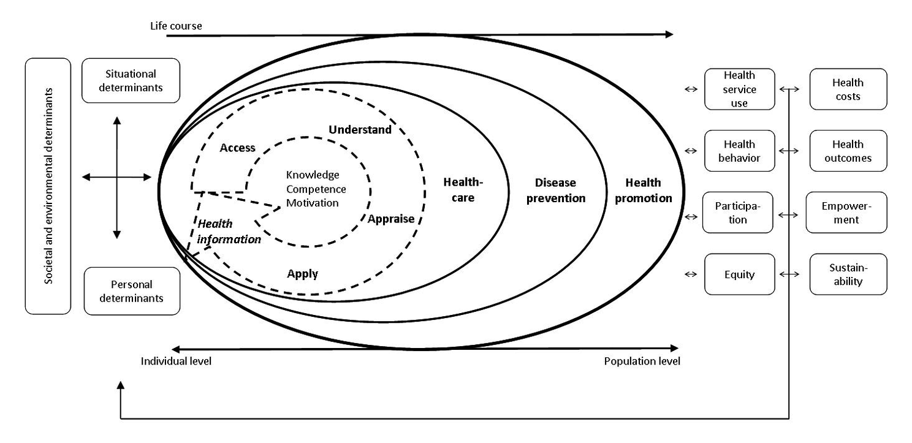

**ภาพที่ 7ก (ต้นฉบับจากแหล่งอ้างอิงหลัก) แบบจำลองบูรณาการความรอบรู้ด้านสุขภาพ (Integrated Model of Health Literacy)** แสดงองค์ประกอบแกนกลาง (ความรู้ สมรรถนะ แรงจูงใจ) และสมรรถนะการจัดการข้อมูลสุขภาพ 4 ขั้นตอน (Access, Understand, Appraise, Apply) ตลอด 3 ขอบเขตต่อเนื่อง (Healthcare, Disease prevention, Health promotion) ภายใต้ปัจจัยกำหนดระยะใกล้–ไกล และความเชื่อมโยงกับผลด้านบริการ ค่าใช้จ่าย พฤติกรรม ผลลัพธ์สุขภาพ การเสริมพลัง และความเป็นธรรมตลอดช่วงชีวิต (*ที่มา: [Sørensen et al., 2012](https://doi.org/10.1186/1471-2458-12-80)*)

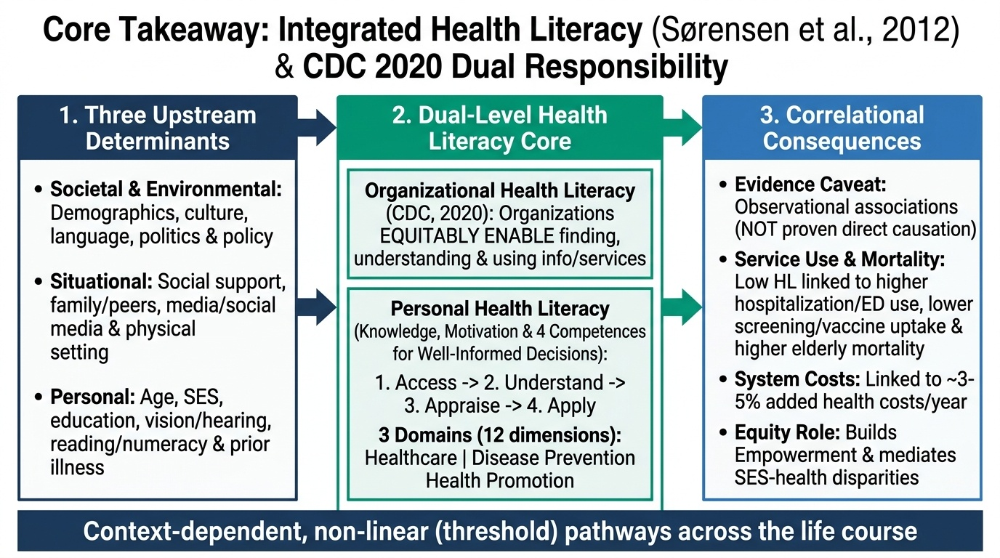

**ภาพที่ 7ข (แผนภาพสังเคราะห์แนวคิดรวบยอด) สาระสำคัญที่ภาพรวมต้องการสื่อสาร: ความรับผิดชอบร่วมระหว่างสมรรถนะระดับบุคคลกับการเอื้ออย่างเป็นธรรมขององค์กร และขอบเขตหลักฐานเชิงความสัมพันธ์** ผสานนิยามสองระดับของแผน *Healthy People 2030* และ CDC (ค.ศ. 2020) เข้ากับเมทริกซ์ 12 มิติของ Sørensen และคณะ พร้อมเน้นย้ำว่าผลด้านการนอนโรงพยาบาล ห้องฉุกเฉิน ค่าใช้จ่ายส่วนเพิ่มร้อยละ 3–5 และการเป็นตัวกลางลดความเหลื่อมล้ำส่วนใหญ่เป็นหลักฐานความสัมพันธ์จากการศึกษาเชิงสังเกตในเส้นทางที่ไม่เป็นเส้นตรง (*ที่มา: สังเคราะห์แนวคิดจาก [Berkman et al. (2011)](https://doi.org/10.7326/0003-4819-155-2-201107190-00005), [CDC (2024)](https://www.cdc.gov/health-literacy/php/about/index.html), [Eichler et al. (2009)](https://doi.org/10.1007/s00038-009-0058-2), [Sørensen et al. (2012)](https://doi.org/10.1186/1471-2458-12-80) และ [Stormacq et al. (2019)](https://doi.org/10.1093/heapro/day062)*)

## 4. การสร้างเสริมสุขภาพเป็นขบวนการทางสังคมระดับประชากรที่เสริมพลังให้ประชาชนควบคุมปัจจัยกำหนดสุขภาพผ่านหลักการห้าข้อ ห้าด้านปฏิบัติการ ยุทธศาสตร์พื้นฐานสามข้อ และสามเสาหลักระดับโลก (Health Promotion)

การสร้างเสริมสุขภาพก้าวพ้นการรักษาพยาบาลรายบุคคลในโรงพยาบาลไปสู่การพัฒนาปัจจัยกำหนดสุขภาพทุกด้านร่วมกันทั้งสังคม ([Public Health Agency of Canada, 1986](https://www.canada.ca/en/public-health/services/health-promotion/population-health/ottawa-charter-health-promotion-international-conference-on-health-promotion.html); [WHO, 1986](https://www.who.int/teams/health-promotion/enhanced-wellbeing/first-global-conference); [Williams et al., 2026](https://doi.org/10.1093/heapro/daag102))

### 4.1 การสร้างเสริมสุขภาพมุ่งให้ประชากรทั้งหมดควบคุมและพัฒนาสุขภาพของตนบนฐานปัจจัยพื้นฐานและหลักการสำคัญห้าประการ (Definition, Population Scope, and Five Core Principles)

องค์การอนามัยโลกนิยาม **การสร้างเสริมสุขภาพ (health promotion)** ในกฎบัตรออตตาวา ค.ศ. 1986 (และคงไว้ในอภิธานศัพท์ ค.ศ. 2021 พร้อมการเน้นปัจจัยกำหนดสุขภาพในกฎบัตรกรุงเทพฯ ค.ศ. 2005) ว่าเป็น **กระบวนการที่ทำให้ประชาชนสามารถเพิ่มการควบคุมและพัฒนาสุขภาพของตนเอง** ([Nutbeam & Muscat, 2021](https://doi.org/10.1093/heapro/daaa157); [WHO, 1986](https://www.who.int/teams/health-promotion/enhanced-wellbeing/first-global-conference), [2005](https://www.who.int/teams/health-promotion/enhanced-wellbeing/sixth-global-conference/the-bangkok-charter), [2021](https://iris.who.int/handle/10665/350161)) เป็นขบวนการทางสังคมที่มุ่ง **ประชากรทั้งหมดในชีวิตประจำวัน (population as a whole)** ทั้งคนปกติ กลุ่มเสี่ยง ผู้ป่วย และผู้พิการ บนฐานปัจจัยพื้นฐานของสุขภาพ (สันติภาพ ที่อยู่อาศัย การศึกษา อาหาร รายได้ ระบบนิเวศมั่นคง ทรัพยากรยั่งยืน ความยุติธรรมทางสังคม และความเป็นธรรม) โดยมี **หลักการสำคัญ 5 ประการ** จากการสังเคราะห์เอกสาร WHO ค.ศ. 1984 และกฎบัตรออตตาวา ([Biehl et al., 2026](https://doi.org/10.3389/ijph.2026.1609452); [Honkala, 2014](https://doi.org/10.1159/000357916)) ได้แก่ **(1) การเสริมสร้างพลังอำนาจ (empowerment)** **(2) การมีส่วนร่วมของสาธารณะ (public participation)** **(3) การจัดการปัจจัยกำหนดสุขภาพด้านสังคมและสิ่งแวดล้อม (action on the determinants of health)** **(4) การลดความไม่เป็นธรรมด้านสุขภาพ (equity in health)** และ **(5) ความร่วมมือระหว่างภาคส่วน (intersectoral collaboration)**

### 4.2 กฎบัตรออตตาวากำหนดห้าด้านปฏิบัติการควบคู่กับยุทธศาสตร์พื้นฐานสามข้อที่แพทย์และบุคลากรสาธารณสุขมีบทบาทสำคัญ (Ottawa Charter Five Action Areas and Three Basic Strategies)

กฎบัตรออตตาวาแยก **ห้าด้านปฏิบัติการ (five action areas)** ออกจาก **ยุทธศาสตร์พื้นฐานสามข้อ (three basic strategies)** ([Public Health Agency of Canada, 1986](https://www.canada.ca/en/public-health/services/health-promotion/population-health/ottawa-charter-health-promotion-international-conference-on-health-promotion.html); [WHO, 1986](https://www.who.int/teams/health-promotion/enhanced-wellbeing/first-global-conference), [n.d.-b](https://www.who.int/health-topics/health-promotion); [Wongwatcharapaiboon et al., 2026](https://doi.org/10.1093/heapro/daag068)) ดังนี้

| กรอบกฎบัตรออตตาวา | องค์ประกอบและสาระสำคัญเชิงระบบ | ตัวอย่างการดำเนินงานและหลักฐาน |
|---|---|---|
| **ห้าด้านปฏิบัติการ (Five action areas)** | **1. สร้างนโยบายสาธารณะเพื่อสุขภาพ (Build healthy public policy):** นำสุขภาพเข้าสู่วาระทุกภาคส่วน (พัฒนาสู่ Health in All Policies) ใช้กฎหมาย การคลัง ภาษี และการเปลี่ยนองค์กร เพื่อทำให้ทางเลือกที่ดีต่อสุขภาพเป็นทางเลือกที่ง่าย | ภาษีสรรพสามิตเครื่องดื่มรสหวานของไทย พ.ศ. 2560 ([Wongwatcharapaiboon et al., 2026](https://doi.org/10.1093/heapro/daag068)); หลักฐานนานาชาติพบยอดขายลดลงเฉลี่ยร้อยละ 15 ([Andreyeva et al., 2022](https://doi.org/10.1001/jamanetworkopen.2022.15276)) |
| | **2. สร้างสิ่งแวดล้อมที่เอื้อต่อสุขภาพ (Create supportive environments):** ยึดแนวคิดนิเวศสังคม ครอบคลุมมิติกายภาพ สังคม การเมือง เศรษฐกิจ และวัฒนธรรม สภาพการทำงาน/การใช้ชีวิตที่ปลอดภัย และการอนุรักษ์ทรัพยากรธรรมชาติ | การจัดพื้นที่สีเขียว ทางเดินเท้าปลอดภัย สภาพแวดล้อมการทำงานปลอดฝุ่นและลดความเครียด ([Public Health Agency of Canada, 1986](https://www.canada.ca/en/public-health/services/health-promotion/population-health/ottawa-charter-health-promotion-international-conference-on-health-promotion.html)) |
| | **3. เสริมความเข้มแข็งของการดำเนินการโดยชุมชน (Strengthen community action):** ชุมชนร่วมจัดลำดับปัญหา ตัดสินใจ วางแผน ลงมือทำ และระดมทรัพยากรช่วยเหลือตนเองโดยเข้าถึงข้อมูล โอกาสเรียนรู้ และแหล่งทุนต่อเนื่อง | การมีส่วนร่วมของชุมชนช่วยให้พฤติกรรมและผลลัพธ์สุขภาพดีขึ้นในระดับเล็กถึงปานกลาง ([O'Mara-Eves et al., 2015](https://doi.org/10.1186/s12889-015-1352-y)) |
| | **4. พัฒนาทักษะส่วนบุคคล (Develop personal skills):** ให้ข้อมูล สุขศึกษา และพัฒนาทักษะชีวิตตลอดช่วงวัย เพื่อควบคุมสุขภาพและรับมือโรคเรื้อรัง/การบาดเจ็บ | ดำเนินการต่อเนื่องในครอบครัว โรงเรียน ที่ทำงาน และชุมชน ([Public Health Agency of Canada, 1986](https://www.canada.ca/en/public-health/services/health-promotion/population-health/ottawa-charter-health-promotion-international-conference-on-health-promotion.html)) |
| | **5. ปรับบริการสุขภาพให้มุ่งการสร้างเสริมสุขภาพ (Reorient health services):** ก้าวพ้นบริการรักษาทางคลินิกสู่มุมมององค์รวมทั้งคน (whole person) เคารพวัฒนธรรม ปรับงานวิจัยและการศึกษาวิชาชีพ และเชื่อมกับภาคส่วนอื่นร่วมกันทุกฝ่าย | โรงพยาบาลและคลินิกทำงานสร้างเสริมสุขภาพเชื่อมกับชุมชนและองค์กรท้องถิ่น ([Public Health Agency of Canada, 1986](https://www.canada.ca/en/public-health/services/health-promotion/population-health/ottawa-charter-health-promotion-international-conference-on-health-promotion.html)) |
| **ยุทธศาสตร์พื้นฐานสามข้อและบทบาทแพทย์ (Three basic strategies)** | **1. Advocate (การชี้นำ/รณรงค์ผลักดัน):** ใช้หลักฐานผลักดันให้ปัจจัยการเมือง เศรษฐกิจ สังคม และสิ่งแวดล้อมเอื้อต่อสุขภาพ **2. Mediate (การไกล่เกลี่ย/ประสานผลประโยชน์):** ประสานผลประโยชน์ที่ต่างกันในสังคมเพราะภาคสุขภาพลำพังไม่อาจสร้างสุขภาพดีได้ **3. Enable (การทำให้สามารถ/เสริมศักยภาพ):** สร้างโอกาส ทรัพยากร ข้อมูล และทักษะที่เท่าเทียมกันให้ทุกคนบรรลุศักยภาพสุขภาพสูงสุด | แพทย์และองค์กรวิชาชีพใช้ข้อมูลวิชาการผลักดันนโยบาย ประสานภาครัฐ–เอกชน–ชุมชน และลดอุปสรรคของกลุ่มเปราะบาง โดยสัญลักษณ์กฎบัตรออตตาวาใช้วงกลมรอบนอกแทน Healthy Public Policy จุดกลมในแทนยุทธศาสตร์ทั้งสาม และปีกบนที่พุ่งทะลุวงกลมแทนพลวัตของชุมชนและทักษะบุคคล ([WHO, 1986](https://www.who.int/teams/health-promotion/enhanced-wellbeing/first-global-conference), [n.d.-a](https://www.who.int/teams/health-promotion/enhanced-wellbeing/first-global-conference/emblem)) |

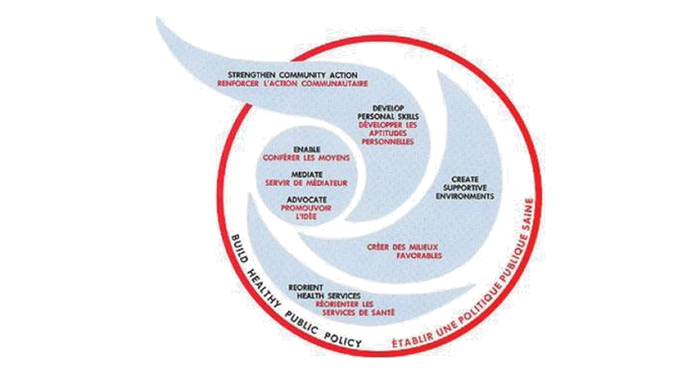

**ภาพที่ 8ก (ต้นฉบับจากแหล่งอ้างอิงหลัก) สัญลักษณ์การสร้างเสริมสุขภาพตามกฎบัตรออตตาวา ค.ศ. 1986 (Ottawa Charter Health Promotion Emblem)** แสดงองค์ประกอบเชิงสัญลักษณ์ต้นฉบับขององค์การอนามัยโลก ได้แก่ จุดกลมด้านในแทนยุทธศาสตร์พื้นฐาน 3 ข้อ (Enable, Mediate, Advocate) ปีกทั้งสามแทนปฏิบัติการสร้างเสริมสุขภาพ (โดยปีกบนพุ่งทะลุวงกลมแทนการดำเนินการโดยชุมชนและการพัฒนาทักษะส่วนบุคคลที่ไม่หยุดนิ่ง ปีกกลางแทนการสร้างสิ่งแวดล้อมที่เอื้อ และปีกล่างแทนการปรับบริการสุขภาพ) และวงกลมสีแดงรอบนอกแทนการสร้างนโยบายสาธารณะเพื่อสุขภาพที่โอบอุ้มทุกด้านเข้าด้วยกัน (*ที่มา: [WHO, 1986](https://www.who.int/teams/health-promotion/enhanced-wellbeing/first-global-conference), [n.d.-a](https://www.who.int/teams/health-promotion/enhanced-wellbeing/first-global-conference/emblem)*)

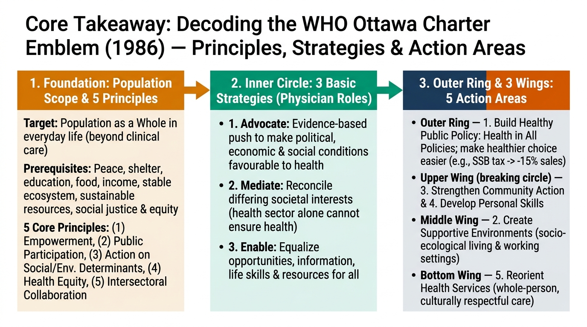

**ภาพที่ 8ข (แผนภาพสังเคราะห์แนวคิดรวบยอด) สาระสำคัญที่ภาพรวมต้องการสื่อสาร: การถอดรหัสโครงสร้างกฎบัตรออตตาวาจากรากฐานและหลักการ 5 ข้อ สู่บทบาทแพทย์ 3 ยุทธศาสตร์ และปฏิบัติการ 5 ด้านระดับประชากร** ชี้ให้เห็นว่าการสร้างเสริมสุขภาพมุ่งประชากรทั้งหมดในชีวิตประจำวันบนปัจจัยพื้นฐานและหลักการ 5 ประการ โดยใช้ยุทธศาสตร์ Advocate–Mediate–Enable ขับเคลื่อนห้าด้านปฏิบัติการอย่างบูรณาการเพื่อทำให้ทางเลือกที่ดีต่อสุขภาพเป็นทางเลือกที่ตัดสินใจได้ง่าย (*ที่มา: สังเคราะห์แนวคิดจาก [Andreyeva et al. (2022)](https://doi.org/10.1001/jamanetworkopen.2022.15276), [Biehl et al. (2026)](https://doi.org/10.3389/ijph.2026.1609452), [Public Health Agency of Canada (1986)](https://www.canada.ca/en/public-health/services/health-promotion/population-health/ottawa-charter-health-promotion-international-conference-on-health-promotion.html) และ [WHO (1986](https://www.who.int/teams/health-promotion/enhanced-wellbeing/first-global-conference), [n.d.-a)](https://www.who.int/teams/health-promotion/enhanced-wellbeing/first-global-conference/emblem)*)

### 4.3 ปฏิญญาเซี่ยงไฮ้สรุปสามเสาหลักของการสร้างเสริมสุขภาพระดับประชากรและต่อยอดสู่กฎบัตรเจนีวาว่าด้วยสุขภาวะ (Shanghai Three Pillars and Geneva Charter for Well-being)

การประชุมการสร้างเสริมสุขภาพระดับโลกครั้งที่ 9 ณ **นครเซี่ยงไฮ้ (Shanghai)** ประเทศจีน (21–24 พฤศจิกายน ค.ศ. 2016) รับรองปฏิญญาเซี่ยงไฮ้และสรุป **สามเสาหลักของการสร้างเสริมสุขภาพ (3 Pillars of Health Promotion)** ได้แก่ **(1) ธรรมาภิบาลที่ดี (good governance)** เสริมระบบอภิบาลและนโยบายให้ทางเลือกสุขภาพเข้าถึงและจ่ายได้สำหรับทุกคนผ่านความร่วมมือทั้งสังคม **(2) เมืองสุขภาพดี (healthy cities)** สร้างเมืองสีเขียวให้ผู้คนอยู่อาศัย ทำงาน และพักผ่อนอย่างกลมกลืนและมีสุขภาพดีโดยไม่ทิ้งใครไว้ข้างหลัง และ **(3) ความรอบรู้ด้านสุขภาพ (health literacy)** เพิ่มความรู้และทักษะทางสังคมให้ประชาชนตัดสินใจและควบคุมปัจจัยสุขภาพของตนเองและครอบครัว ([WHO, 2016](https://www.who.int/news/item/21-11-2016-9th-global-conference-on-health-promotion-global-leaders-agree-to-promote-health-in-order-to-achieve-sustainable-development-goals), [2017](https://www.who.int/publications/i/item/promoting-health-in-the-sdgs), [2020](https://www.who.int/multi-media/details/health-promotion-3-pillars)) ต่อมาการประชุมระดับโลกครั้งที่ 10 (ธันวาคม ค.ศ. 2021) ได้รับรอง **กฎบัตรเจนีวาว่าด้วยสุขภาวะ (Geneva Charter for Well-being)** มุ่งสู่สังคมสุขภาวะที่ยึดสุขภาพ ความเป็นธรรม และความยั่งยืนควบคู่กัน ([WHO, n.d.-b](https://www.who.int/health-topics/health-promotion)) ดังแสดงอินโฟกราฟิกต้นฉบับและแผนภาพสังเคราะห์ในภาพที่ 9ก และ 9ข

**ภาพที่ 9ก (ต้นฉบับจากแหล่งอ้างอิงหลัก) สามเสาหลักของการสร้างเสริมสุขภาพ (3 Pillars of Health Promotion) จากการประชุมระดับโลกครั้งที่ 9 ณ นครเซี่ยงไฮ้ ค.ศ. 2016** แสดงเสาหลักระดับประชากร 3 ด้านขององค์การอนามัยโลก ได้แก่ (1) ธรรมาภิบาลที่ดี (Good Governance) (2) เมืองสุขภาพดี (Healthy Cities) และ (3) ความรอบรู้ด้านสุขภาพ (Health Literacy) (*ที่มา: [World Health Organization, 2020](https://www.who.int/multi-media/details/health-promotion-3-pillars)*)

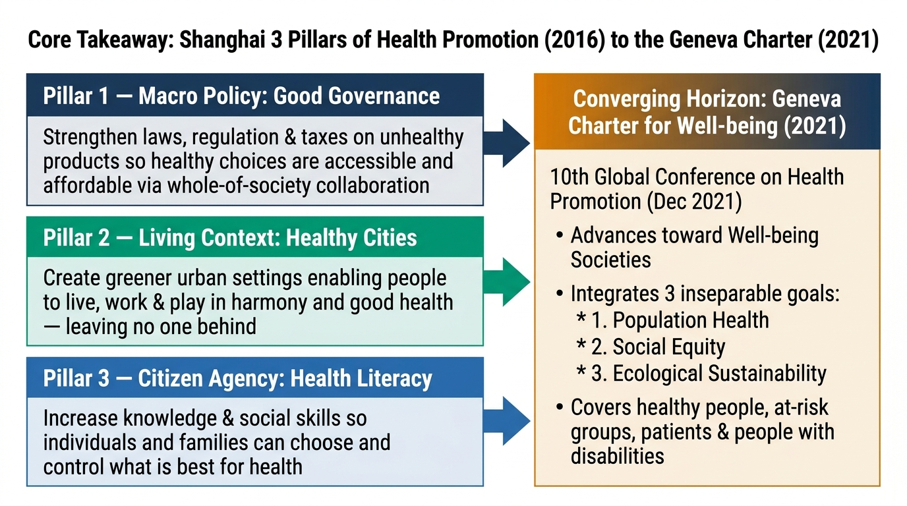

**ภาพที่ 9ข (แผนภาพสังเคราะห์แนวคิดรวบยอด) สาระสำคัญที่ภาพรวมต้องการสื่อสาร: กลไกที่สามเสาหลักเซี่ยงไฮ้ (ค.ศ. 2016) เสริมแรงกันทั้งระดับมหภาค บริบทเมือง และพลเมือง เพื่อมุ่งสู่กฎบัตรเจนีวาว่าด้วยสุขภาวะ (ค.ศ. 2021)** แสดงการทำงานสอดประสานระหว่างนโยบายและมาตรการภาษีระดับมหภาค (Good Governance) สิ่งแวดล้อมเมืองสีเขียวในชีวิตประจำวัน (Healthy Cities) และศักยภาพการตัดสินใจของประชาชน (Health Literacy) ซึ่งต่อยอดสู่เป้าหมายสังคมสุขภาวะที่ผสานสุขภาพประชากร ความเป็นธรรม และความยั่งยืนทางนิเวศเข้าด้วยกัน (*ที่มา: สังเคราะห์แนวคิดจาก [WHO (2016](https://www.who.int/news/item/21-11-2016-9th-global-conference-on-health-promotion-global-leaders-agree-to-promote-health-in-order-to-achieve-sustainable-development-goals), [2017](https://www.who.int/publications/i/item/promoting-health-in-the-sdgs), [2020](https://www.who.int/multi-media/details/health-promotion-3-pillars), [n.d.-b)](https://www.who.int/health-topics/health-promotion)*)

## บทสรุป (สาระสำคัญของบทนี้สรุปได้ดังนี้)

- **การเปลี่ยนผ่านสู่สังคมสูงวัยอย่างสมบูรณ์และภาระโรคไม่ติดต่อเรื้อรังทำให้การปรับเปลี่ยนพฤติกรรมเป็นองค์ประกอบหลักควบคู่กับการรักษาด้วยยา** โดยต้องเข้าใจตั้งแต่สิ่งเร้าและพฤติกรรมภายนอก–ภายใน ไปจนถึงพฤติกรรมสุขภาพทั้ง 3 ระยะ (ป้องกันและส่งเสริมสุขภาพรวมถึงการคัดกรองตามอายุและความเสี่ยง เมื่อรู้สึกเจ็บป่วย และตามบทบาทผู้ป่วย) ([Kasl & Cobb, 1966a](https://doi.org/10.1080/00039896.1966.10664365); [Knowler et al., 2002](https://doi.org/10.1056/NEJMoa012512); [WHO, 2025b](https://www.who.int/news-room/fact-sheets/detail/noncommunicable-diseases))
- **ความรู้อย่างเดียวไม่เพียงพอเปลี่ยนพฤติกรรมเพราะการตัดสินใจของมนุษย์จำนวนมากขับเคลื่อนด้วยระบบอัตโนมัติและบริบทแวดล้อม** การออกแบบมาตรการจึงต้องก้าวพ้นสมมติฐานการขาดข้อมูล (KAP) ไปสู่การบูรณาการความสามารถ โอกาส และแรงจูงใจทั้งสองระบบในวงล้อการปรับเปลี่ยนพฤติกรรม (COM-B / BCW) โดยใช้ทฤษฎีผลักดัน (Nudge) เป็นเครื่องมือเสริมร่วมกับมาตรการทางกฎหมายและนโยบาย ([Kelly & Barker, 2016](https://doi.org/10.1016/j.puhe.2016.03.030); [Marteau et al., 2011](https://doi.org/10.1136/bmj.d228); [Michie et al., 2011](https://doi.org/10.1186/1748-5908-6-42))
- **ความรอบรู้ด้านสุขภาพและการสร้างเสริมสุขภาพระดับประชากรเชื่อมสมรรถนะของประชาชนเข้ากับความรับผิดชอบขององค์กรและการขับเคลื่อนนโยบายทั้งสังคม** ตั้งแต่องค์กรที่เอื้ออย่างเป็นธรรมให้ประชาชนค้นหา เข้าใจ ประเมิน และใช้ข้อมูล ไปจนถึงการขับเคลื่อนห้าด้านปฏิบัติการตามกฎบัตรออตตาวา ยุทธศาสตร์ Advocate–Mediate–Enable และสามเสาหลักปฏิญญาเซี่ยงไฮ้ ([CDC, 2024](https://www.cdc.gov/health-literacy/php/about/index.html); [Sørensen et al., 2012](https://doi.org/10.1186/1471-2458-12-80); [WHO, 1986](https://www.who.int/teams/health-promotion/enhanced-wellbeing/first-global-conference), [2017](https://www.who.int/publications/i/item/promoting-health-in-the-sdgs))

### ตารางทบทวนสาระสำคัญ (Rapid Review)

| ประเด็น | สาระสำคัญ | ตัวอย่างในบท | แหล่งอ้างอิง |
|---|---|---|---|
| **สังคมสูงวัย การเปลี่ยนผ่านระบาดวิทยา และ NCDs** | ไทยเป็นสังคมสูงวัยอย่างสมบูรณ์ (ร้อยละ 21.71 อายุ ≥ 60 ปี ในปี 2568); NCDs เป็นสาเหตุตายร้อยละ 76 ขับเคลื่อนด้วย 4 พฤติกรรมเสี่ยงและมลพิษทางอากาศ; ต้องปรับพฤติกรรมควบคู่การใช้ยา | ปรับวิถีชีวิตลดอุบัติการณ์เบาหวานร้อยละ 58 และให้ภาวะสงบเกือบครึ่งหนึ่งในระยะแรก แต่ไม่ลดเหตุการณ์โรคหัวใจในผู้ป่วยเบาหวานที่เป็นโรคแล้ว | [Department of Older Persons (2026)](https://www.dop.go.th/download/statistics/th1793240958-2616_0.pdf); [Knowler et al. (2002)](https://doi.org/10.1056/NEJMoa012512); [Lean et al. (2018)](https://doi.org/10.1016/S0140-6736%2817%2933102-1); [Look AHEAD Research Group (2013)](https://doi.org/10.1056/NEJMoa1212914); [Vichitkunakorn et al. (2025)](https://doi.org/10.1080/16549716.2025.2485689) |
| **พฤติกรรมมนุษย์และพฤติกรรมสุขภาพ 3 ประเภท** | สิ่งเร้าภายนอกรับผ่าน 5 สัมผัส (ตา หู ลิ้น จมูก ผิวกาย); พฤติกรรมภายนอกสังเกตได้โดยไม่ต้องใช้เครื่องมือ (การเต้นหัวใจเป็นการตอบสนองสรีรวิทยา); จำแนกเป็น Preventive/Promotive, Illness และ Sick-role behaviour | คัดกรองตามอายุและความเสี่ยง (ความดัน เบาหวาน มะเร็งปากมดลูก) ต่างจากตรวจสุขภาพทั่วไปประจำปีแบบเหมารวมที่แทบไม่ลดอัตราตาย | [APA (2018e](https://dictionary.apa.org/overt-behavior), [2018g)](https://dictionary.apa.org/sense); [Kasl & Cobb (1966a](https://doi.org/10.1080/00039896.1966.10664365), [1966b)](https://doi.org/10.1080/00039896.1966.10664421); [Krogsbøll et al. (2019)](https://doi.org/10.1002/14651858.CD009009.pub3); [WHO (2021)](https://iris.who.int/handle/10665/350161) |
| **แนวคิด KAP ทฤษฎี HBM และ TTM** | ความรู้จำเป็นต่อ informed choice แต่ไม่พอเพียงลำพัง (intention–behaviour gap); HBM มี 8 องค์ประกอบรวม self-efficacy โดยอุปสรรคและประโยชน์ทำนายแรงสุด; TTM แบ่ง 5 ขั้นหลักแต่โปรแกรมแยกตามขั้นไม่ได้ผลเหนือกว่าโปรแกรมไม่แบ่งขั้น | การเน้นความรู้ฝ่ายเดียวเสี่ยงกล่าวโทษผู้ป่วย; แพทย์ไม่ควรจำกัดคำแนะนำเลิกบุหรี่เฉพาะผู้ที่อยู่ในขั้นเตรียมการหรือลงมือทำ | [Cahill et al. (2010)](https://doi.org/10.1002/14651858.CD004492.pub4); [Carpenter (2010)](https://doi.org/10.1080/10410236.2010.521906); [Kelly & Barker (2016)](https://doi.org/10.1016/j.puhe.2016.03.030); [Rosenstock et al. (1988)](https://doi.org/10.1177/109019818801500203); [Webb & Sheeran (2006)](https://doi.org/10.1037/0033-2909.132.2.249) |
| **เศรษฐศาสตร์พฤติกรรมและทฤษฎีผลักดัน (Nudge)** | ระบบคิดที่ 1 (อัตโนมัติ) ทำงานเด่นเมื่อข้อมูลซับซ้อนหรือทางเลือกล้น; Nudge ปรับโครงสร้างทางเลือกโดยไม่ห้ามทางเลือกและไม่เปลี่ยนแรงจูงใจทางราคาอย่างมีนัยสำคัญ; ต้องระวังอคติการตีพิมพ์และใช้เสริมกฎหมาย | ค่าตั้งต้น (opt-out) ได้ผลสม่ำเสมอสุด; แมลงวันในโถปัสสาวะคือเป้าดึงความสนใจ; วางอาหารระดับสายตาคือ placement; **ซื้อ 1 แถม 1 ไม่ใช่ nudge** เพราะเปลี่ยนราคา | [Hansen & Jespersen (2013)](https://doi.org/10.1017/S1867299X00002762); [Hollands et al. (2013)](https://doi.org/10.1186/1471-2458-13-1218); [Marteau et al. (2011)](https://doi.org/10.1136/bmj.d228); [Mertens et al. (2022)](https://doi.org/10.1073/pnas.2107346118); [Thaler & Sunstein (2008)](https://books.google.com/books/about/Nudge.html?id=dSJQn8egXvUC) |
| **วงล้อการปรับเปลี่ยนพฤติกรรม (BCW) และ COM-B** | วงล้อ 3 ชั้น: COM-B (6 องค์ประกอบย่อย) → มาตรการ 9 หน้าที่ → นโยบาย 7 ประเภท; Physical capability คือสภาพและทักษะทางกาย ส่วนการเข้าถึง/เวลาเป็น Physical opportunity; Enablement แก้ได้ 5 ใน 6 องค์ประกอบ ยกเว้น M-Re | วิเคราะห์เหตุที่ไม่มาคัดกรองมะเร็งปากมดลูกทั้งด้านทักษะรับมือ (C) เวลา/การกระตุ้น (O) และความอาย/การวางแผน (M) แล้วจับคู่มาตรการและนโยบาย | [Michie et al. (2011)](https://doi.org/10.1186/1748-5908-6-42); [O'Donovan et al. (2021)](https://doi.org/10.1111/hex.13346); [West & Michie (2020)](https://doi.org/10.32388/WW04E6); [Willmott et al. (2021)](https://doi.org/10.1186/s12889-021-11019-w) |
| **ความรอบรู้ด้านสุขภาพและการสร้างเสริมสุขภาพ** | นิยามปี 2020 แยกระดับบุคคล (ใช้ข้อมูลตัดสินใจอย่างรอบด้าน) กับระดับองค์กร (เอื้ออย่างเป็นธรรม); Sørensen มี 4 สมรรถนะ × 3 ขอบเขต และผลส่วนใหญ่เป็นความสัมพันธ์; กฎบัตรออตตาวามี 5 ด้านปฏิบัติการ + 3 ยุทธศาสตร์พื้นฐาน และเซี่ยงไฮ้สรุป 3 เสาหลัก | ความรอบรู้ต่ำสัมพันธ์กับค่าใช้จ่ายเพิ่มร้อยละ 3–5; ภาษีความหวานไทย พ.ศ. 2560; สามเสาหลักเซี่ยงไฮ้: Good governance, Healthy cities, Health literacy | [Berkman et al. (2011)](https://doi.org/10.7326/0003-4819-155-2-201107190-00005); [CDC (2024)](https://www.cdc.gov/health-literacy/php/about/index.html); [Eichler et al. (2009)](https://doi.org/10.1007/s00038-009-0058-2); [Sørensen et al. (2012)](https://doi.org/10.1186/1471-2458-12-80); [WHO (1986](https://www.who.int/teams/health-promotion/enhanced-wellbeing/first-global-conference), [2017)](https://www.who.int/publications/i/item/promoting-health-in-the-sdgs) |

### คำศัพท์สำคัญ

| คำศัพท์ | ความหมาย |
|---|---|
| **การเปลี่ยนผ่านทางระบาดวิทยา (epidemiological transition)** | การเปลี่ยนแบบแผนภาระโรคหลักของประชากรจากโรคติดเชื้อและภาวะทุพโภชนาการไปสู่โรคไม่ติดต่อเรื้อรัง โดยมีโครงสร้างประชากรสูงวัยและการเปลี่ยนแปลงทางเศรษฐกิจสังคมเป็นแรงขับสำคัญ |
| **พฤติกรรมภายนอกและพฤติกรรมภายใน (overt & covert behaviour)** | พฤติกรรมภายนอกคือการกระทำที่ผู้อื่นสังเกตได้โดยตรงโดยไม่ต้องใช้เครื่องมือวัด ส่วนพฤติกรรมภายในคือกระบวนการทางจิตใจ เช่น การคิด ความรู้สึก และการตัดสินใจ ที่รับรู้ผ่านการอนุมานหรือคำบอกเล่า |
| **พฤติกรรมการป้องกันและส่งเสริมสุขภาพ (preventive & promotive behaviour)** | กิจกรรมของผู้ที่เชื่อว่าตนสุขภาพดีเพื่อลดโอกาสเกิดโรคหรือการบาดเจ็บ ยกระดับสุขภาวะ และคัดกรองโรคตามอายุและความเสี่ยงตั้งแต่ระยะไม่มีอาการ |
| **พฤติกรรมเมื่อรู้สึกเจ็บป่วย (illness behaviour)** | กิจกรรมของผู้ที่รับรู้ว่าตนไม่สบายหรือมีอาการผิดปกติ เพื่อประเมินภาวะสุขภาพและแสวงหาแนวทางช่วยเหลือรักษา เช่น ไปสถานพยาบาล ซื้อยากินเอง หรือเฝ้าดูอาการ |
| **พฤติกรรมตามบทบาทผู้ป่วย (sick-role behaviour)** | กิจกรรมของผู้ที่ถือว่าตนเองป่วยเพื่อให้หายหรือฟื้นตัว ทั้งการรับประทานยาต่อเนื่อง การปรับพฤติกรรมเสี่ยง และการฟื้นฟูสมรรถภาพโดยร่วมมือกับผู้รักษา |
| **ช่องว่างระหว่างความตั้งใจกับพฤติกรรม (intention–behaviour gap)** | ปรากฏการณ์ที่การให้ความรู้หรือมาตรการสามารถเพิ่มความตั้งใจได้มาก แต่เปลี่ยนพฤติกรรมจริงได้เพียงเล็กน้อยถึงปานกลาง สะท้อนข้อจำกัดของแนวคิด KAP |
| **ทฤษฎีแบบแผนความเชื่อทางสุขภาพ (Health Belief Model: HBM)** | ทฤษฎีที่อธิบายการตัดสินใจด้านสุขภาพจากการรับรู้โอกาสเสี่ยง ความรุนแรง ประโยชน์ อุปสรรค สิ่งชักนำ แรงจูงใจ ปัจจัยปรับ และการรับรู้ความสามารถของตนเอง (self-efficacy) |
| **แบบจำลองข้ามทฤษฎีและลำดับขั้นการเปลี่ยนแปลง (TTM / stages of change)** | กรอบที่มองการเปลี่ยนพฤติกรรมเป็นกระบวนการความพร้อมตั้งแต่ยังไม่สนใจ ลังเลใจ เตรียมการ ลงมือทำ ไปจนถึงคงพฤติกรรม (รวมถึงการกลับไปทำซ้ำและการยุติ) |
| **ทฤษฎีกระบวนการคู่ (dual process theory)** | การแบ่งระบบคิดเป็นระบบอัตโนมัติ (System 1: รวดเร็ว ไม่ต้องพยายาม เชื่อมโยงอัตโนมัติ ตอบสนองสิ่งเร้า) และระบบไตร่ตรอง (System 2: ช้า ใช้ความพยายาม ทำตามหลักเหตุผล) |
| **ปิตาธิปไตยแบบเสรีนิยมและทฤษฎีผลักดัน (libertarian paternalism & nudge)** | การออกแบบโครงสร้างทางเลือก (choice architecture) เพื่อโน้มน้าวสู่ทางเลือกที่เป็นประโยชน์โดยไม่สั่งห้ามทางเลือกอื่นและไม่เปลี่ยนแรงจูงใจทางราคาอย่างมีนัยสำคัญ |
| **แบบจำลองความสามารถ โอกาส และแรงจูงใจ (COM-B model)** | กรอบวิเคราะห์ต้นตอพฤติกรรมจากความสามารถทางกายและจิตใจ (Capability) โอกาสทางกายภาพและสังคม (Opportunity) และแรงจูงใจแบบไตร่ตรองและอัตโนมัติ (Motivation) |
| **วงล้อการปรับเปลี่ยนพฤติกรรม (Behaviour Change Wheel: BCW)** | กรอบระบบ 3 ชั้นของ Michie และคณะ ที่เชื่อมแหล่งที่มาของพฤติกรรม (COM-B) เข้ากับหน้าที่ของมาตรการ 9 ด้าน และประเภทนโยบายสนับสนุน 7 ประเภท |
| **ความรอบรู้ด้านสุขภาพระดับบุคคลและระดับองค์กร (personal & organizational health literacy)** | ความสามารถของบุคคลในการค้นหา เข้าใจ และใช้ข้อมูล/บริการเพื่อตัดสินใจอย่างมีข้อมูลรอบด้าน ควบคู่กับระดับที่องค์กรเอื้ออำนวยอย่างเป็นธรรมให้ผู้รับบริการทำสิ่งดังกล่าวได้ |
| **แบบจำลองบูรณาการความรอบรู้ด้านสุขภาพ (integrated model of health literacy)** | กรอบของ Sørensen และคณะ ที่ผสานความรู้ แรงจูงใจ และสมรรถนะ 4 ด้าน (เข้าถึง เข้าใจ ประเมิน ประยุกต์ใช้) ใน 3 ขอบเขตสุขภาพเป็น 12 มิติ |
| **การสร้างเสริมสุขภาพและห้าด้านปฏิบัติการ (health promotion & five action areas)** | กระบวนการเสริมให้ประชาชนเพิ่มการควบคุมและพัฒนาสุขภาพของตนตามกฎบัตรออตตาวา ผ่านนโยบายสาธารณะ สิ่งแวดล้อมที่เอื้อ ชุมชนเข้มแข็ง ทักษะส่วนบุคคล และการปรับระบบบริการสุขภาพ |
| **สามเสาหลักของการสร้างเสริมสุขภาพ (Shanghai three pillars)** | กรอบปฏิญญาเซี่ยงไฮ้ ค.ศ. 2016 ที่สรุปเสาหลักระดับประชากร 3 ด้าน ได้แก่ ธรรมาภิบาลที่ดี (good governance) เมืองสุขภาพดี (healthy cities) และความรอบรู้ด้านสุขภาพ (health literacy) |

### แบบทบทวนความรู้ด้วยตนเอง

1. เหตุใดการก้าวเข้าสู่สังคมสูงวัยอย่างสมบูรณ์และการเปลี่ยนผ่านทางระบาดวิทยาของไทยจึงทำให้การดูแลโรคไม่ติดต่อเรื้อรังต้องใช้การปรับเปลี่ยนพฤติกรรมควบคู่กับการใช้ยา และหลักฐานการทดลองทางคลินิกชี้ขอบเขตและข้อจำกัดของการปรับวิถีชีวิตไว้อย่างไร
2. จงแยกความแตกต่างระหว่างสิ่งเร้าภายในกับสิ่งเร้าภายนอก และพฤติกรรมภายนอกกับพฤติกรรมภายใน พร้อมอธิบายว่าเหตุใด “การเต้นของหัวใจ” จึงไม่จัดเป็นพฤติกรรมภายนอก และเหตุใด “การตรวจสุขภาพทั่วไปประจำปีแบบเหมารวม” จึงต้องปรับเป็นการคัดกรองตามอายุและความเสี่ยง
3. จำแนกพฤติกรรมสุขภาพทั้ง 3 ประเภทตามกรอบของ Kasl และ Cobb พร้อมยกตัวอย่างกรณีโรคความดันโลหิตสูงหรือมะเร็งปากมดลูกในแต่ละระยะ
4. วิเคราะห์ข้อจำกัดของแนวคิด KAP และเปรียบเทียบองค์ประกอบตลอดจนข้อค้นพบเชิงประจักษ์ของทฤษฎีแบบแผนความเชื่อทางสุขภาพ (HBM) กับทฤษฎีลำดับขั้นของการเปลี่ยนแปลง (TTM)
5. เปรียบเทียบระบบคิดแบบอัตโนมัติ (System 1) กับระบบไตร่ตรอง (System 2) และอธิบายนิยามของทฤษฎีผลักดัน (Nudge) กลไกของตัวอย่างสำคัญ เหตุผลที่โปรโมชัน “ซื้อ 1 แถม 1” ไม่ใช่ nudge และข้อพึงระวังเรื่องประสิทธิผลของ nudge
6. ในแบบจำลอง COM-B “ความสามารถทางกาย (physical capability)” ต่างจาก “โอกาสทางกายภาพ (physical opportunity)” อย่างไร และมาตรการ “การจัดปัจจัยเอื้อสนับสนุน (enablement)” แก้ไของค์ประกอบใดได้บ้าง จงประยุกต์ใช้วงล้อการปรับเปลี่ยนพฤติกรรมวิเคราะห์กรณีสตรีไม่มารับการตรวจคัดกรองมะเร็งปากมดลูก
7. เปรียบเทียบความรอบรู้ด้านสุขภาพระดับบุคคลกับระดับองค์กรตามนิยามปี ค.ศ. 2020 และอธิบายสมรรถนะ 4 ด้าน ปัจจัยกำหนด 3 กลุ่ม และเหตุผลที่ต้องตีความผลด้านการใช้บริการและค่าใช้จ่ายเป็น “ความสัมพันธ์” มากกว่าเหตุและผลโดยตรง
8. อธิบายความเชื่อมโยงระหว่างหลักการสำคัญ 5 ประการ ห้าด้านปฏิบัติการ และยุทธศาสตร์พื้นฐาน 3 ข้อ (Advocate, Mediate, Enable) ตามกฎบัตรออตตาวา พร้อมเชื่อมโยงสู่สามเสาหลักของปฏิญญาเซี่ยงไฮ้ ค.ศ. 2016 และกฎบัตรเจนีวา ค.ศ. 2021

## แนวคำตอบ

1. แนวคำตอบหนึ่งที่สมเหตุสมผลคือ ประเทศไทยเป็นสังคมสูงวัยอย่างสมบูรณ์แล้ว (ผู้สูงอายุร้อยละ 21.71 ในปี 2568) ส่งผลให้ภาระโรคเปลี่ยนผ่านไปสู่โรคไม่ติดต่อเรื้อรังซึ่งเป็นสาเหตุการเสียชีวิตราวร้อยละ 76 และขับเคลื่อนด้วยพฤติกรรมเสี่ยง 4 ด้านร่วมกับมลพิษทางอากาศภายใต้บริบทแวดล้อม ([Department of Older Persons, 2026](https://www.dop.go.th/download/statistics/th1793240958-2616_0.pdf); [Vichitkunakorn et al., 2025](https://doi.org/10.1080/16549716.2025.2485689); [WHO, 2025b](https://www.who.int/news-room/fact-sheets/detail/noncommunicable-diseases)) หลักฐานเชิงทดลองชี้ว่าการปรับวิถีชีวิตลดอุบัติการณ์เบาหวานในกลุ่มเสี่ยงได้ร้อยละ 58 ([Knowler et al., 2002](https://doi.org/10.1056/NEJMoa012512)) และทำให้เบาหวานชนิดที่ 2 ระยะแรกเข้าสู่ภาวะสงบเกือบครึ่งหนึ่งใน 12 เดือน ([Lean et al., 2018](https://doi.org/10.1016/S0140-6736%2817%2933102-1)) แต่ในผู้ป่วยเบาหวานที่เป็นโรคแล้วการปรับวิถีชีวิตเข้มข้นไม่ลดเหตุการณ์โรคหัวใจและหลอดเลือด ([Look AHEAD Research Group, 2013](https://doi.org/10.1056/NEJMoa1212914)) และผู้ป่วยความดันโลหิตสูงจำนวนหนึ่งยังต้องได้รับยาควบคู่กัน ([WHO, 2025a](https://www.who.int/news-room/fact-sheets/detail/hypertension))
2. แนวคำตอบหนึ่งที่สมเหตุสมผลคือ สิ่งเร้าภายในเกิดจากแรงขับหรืออาการภายในร่างกาย (เช่น ความหิว ความกระหาย อาการปวด) ส่วนสิ่งเร้าภายนอกมาจากสิ่งแวดล้อมทางกายภาพและทางสังคมผ่านประสาทสัมผัสหลักทั้งห้า ได้แก่ ตา หู ลิ้น จมูก และผิวกาย ([APA, 2018b](https://dictionary.apa.org/biological-drive), [2018g](https://dictionary.apa.org/sense)) พฤติกรรมภายนอกคือการกระทำที่ผู้อื่นสังเกตเห็นได้โดยตรงโดยไม่ต้องใช้เครื่องมือวัด (เช่น การเดิน การพูด สีหน้าท่าทาง) ขณะที่การเต้นของหัวใจต้องใช้เครื่องมือหรือทักษะตรวจวัดจึงเป็นการตอบสนองทางสรีรวิทยา ไม่ใช่พฤติกรรมภายนอก ส่วนพฤติกรรมภายในคือความคิด ความรู้สึก และการตัดสินใจที่สังเกตโดยตรงไม่ได้ ([APA, 2018c](https://dictionary.apa.org/covert-behavior), [2018e](https://dictionary.apa.org/overt-behavior)) สำหรับการตรวจสุขภาพทั่วไปประจำปีแบบเหมารวม (general health checks) การทบทวนของ Cochrane พบว่าแทบไม่ลดอัตราตายรวม มะเร็ง หรือโรคหัวใจและหลอดเลือด จึงควรใช้การตรวจคัดกรองที่เหมาะสมตามกลุ่มอายุและความเสี่ยงแทน ([Krogsbøll et al., 2019](https://doi.org/10.1002/14651858.CD009009.pub3))
3. แนวคำตอบหนึ่งที่สมเหตุสมผลคือ กรอบของ [Kasl และ Cobb (1966a](https://doi.org/10.1080/00039896.1966.10664365), [1966b)](https://doi.org/10.1080/00039896.1966.10664421) แบ่งเป็น (1) พฤติกรรมป้องกันและส่งเสริมสุขภาพ กระทำเมื่อเชื่อว่าตนแข็งแรงและไม่มีอาการ เช่น การรับประทานอาหารลดเค็ม ออกกำลังกาย ฉีดวัคซีนเอชพีวี วัดความดันโลหิต หรือตรวจคัดกรองมะเร็งปากมดลูกตามเกณฑ์อายุ ([WHO, 2025a](https://www.who.int/news-room/fact-sheets/detail/hypertension), [2026a](https://www.who.int/news-room/fact-sheets/detail/cervical-cancer)) (2) พฤติกรรมเมื่อรู้สึกเจ็บป่วย กระทำเมื่อเริ่มมีอาการผิดปกติ เช่น ปวดศีรษะหรือเลือดออกผิดปกติทางช่องคลอด แล้วประเมินอาการเพื่อไปพบแพทย์ ซื้อยากินเอง หรือรอดูอาการ ([APA, 2018d](https://dictionary.apa.org/illness-behavior)) และ (3) พฤติกรรมตามบทบาทผู้ป่วย กระทำหลังได้รับการวินิจฉัยว่าเป็นผู้ป่วยเพื่อให้หายหรือคุมโรคได้ เช่น การรับประทานยาลดความดันต่อเนื่องตามแผนการรักษา งดสูบบุหรี่ และมารับการรักษาติดตามตามนัด ([APA, 2023](https://dictionary.apa.org/sick-role), [2026](https://dictionary.apa.org/health-behavior))
4. แนวคำตอบหนึ่งที่สมเหตุสมผลคือ แนวคิด KAP ตั้งอยู่บนสมมติฐานการขาดข้อมูล แต่หลักฐานพบช่องว่างระหว่างความตั้งใจกับพฤติกรรม ความสัมพันธ์ไม่เป็นเส้นตรง และเสี่ยงกล่าวโทษผู้ป่วยแม้ความรู้ยังจำเป็นต่อการเลือกอย่างมีข้อมูล ([Baum & Fisher, 2014](https://doi.org/10.1111/1467-9566.12112); [Marteau et al., 2001](https://doi.org/10.1046/j.1369-6513.2001.00140.x); [Webb & Sheeran, 2006](https://doi.org/10.1037/0033-2909.132.2.249)) ส่วน HBM มี 8 องค์ประกอบรวม self-efficacy โดยการวิเคราะห์อภิมานพบว่าอุปสรรคและประโยชน์ทำนายพฤติกรรมได้แรงที่สุด ขณะที่ความรุนแรงและโอกาสเสี่ยงทำนายได้อ่อนและพลังทำนายรวมยังจำกัด ([Carpenter, 2010](https://doi.org/10.1080/10410236.2010.521906); [Rosenstock et al., 1988](https://doi.org/10.1177/109019818801500203)) ด้าน TTM แบ่งความพร้อมเป็น 5 ขั้นหลัก (ยังไม่สนใจ ลังเลใจ เตรียมการ ลงมือทำ คงพฤติกรรม) แต่การทบทวนอย่างเป็นระบบไม่พบว่าโปรแกรมจัดตามขั้นได้ผลเหนือกว่าโปรแกรมมาตรฐานที่ไม่แบ่งขั้น จึงควรใช้เพื่อปรับการสื่อสารโดยไม่จำกัดการให้คำแนะนำเฉพาะคนบางขั้น ([Cahill et al., 2010](https://doi.org/10.1002/14651858.CD004492.pub4); [Riemsma et al., 2003](https://doi.org/10.1136/bmj.326.7400.1175))
5. แนวคำตอบหนึ่งที่สมเหตุสมผลคือ ระบบอัตโนมัติ (System 1) รวดเร็ว ไม่ต้องพยายาม เชื่อมโยงอัตโนมัติ ไม่รู้ตัว และไวต่อสิ่งเร้าแวดล้อม ส่วนระบบไตร่ตรอง (System 2) ช้า ควบคุมได้ ใช้ความพยายามและหน่วยความจำใช้งานที่มีจำกัด ([Evans & Stanovich, 2013](https://doi.org/10.1177/1745691612460685); [Hansen & Jespersen, 2013](https://doi.org/10.1017/S1867299X00002762)) ทฤษฎีผลักดัน (Nudge) คือการออกแบบโครงสร้างทางเลือกบนหลักปิตาธิปไตยแบบเสรีนิยมโดยไม่ห้ามทางเลือกและไม่เปลี่ยนแรงจูงใจทางราคาอย่างมีนัยสำคัญ เช่น เส้นขวางถนนถี่ขึ้น (ภาพลวงตาทางสายตา) สติกเกอร์แมลงวันในโถปัสสาวะ (เป้าดึงความสนใจ) การวางผลไม้ระดับสายตา (การจัดตำแหน่ง placement) และค่าตั้งต้นแบบแจ้งออก (default) ส่วนโปรโมชัน “ซื้อ 1 แถม 1” ลดราคาต่อหน่วยครึ่งหนึ่งจึงเปลี่ยนแรงจูงใจทางราคาและไม่นับเป็น nudge ([Hollands et al., 2013](https://doi.org/10.1186/1471-2458-13-1218); [Thaler & Sunstein, 2008](https://books.google.com/books/about/Nudge.html?id=dSJQn8egXvUC)) ทั้งนี้ผลเฉลี่ยของ nudge อยู่ในระดับเล็กถึงปานกลางและลดลงมากเมื่อแก้อคติการตีพิมพ์ จึงต้องใช้เสริมมาตรการทางกฎหมาย ([Marteau et al., 2011](https://doi.org/10.1136/bmj.d228); [Mertens et al., 2022](https://doi.org/10.1073/pnas.2107346118))
6. แนวคำตอบหนึ่งที่สมเหตุสมผลคือ ความสามารถทางกาย (physical capability) เป็นคุณลักษณะในตัวบุคคล ได้แก่ สภาพร่างกาย กำลัง ทักษะ และการทำงานของกล้ามเนื้อและกระดูก ส่วนระยะทาง เวลา ค่าใช้จ่าย และการเข้าถึงบริการเป็นปัจจัยนอกตัวบุคคลจึงจัดเป็นโอกาสทางกายภาพ (physical opportunity) ([Michie et al., 2011](https://doi.org/10.1186/1748-5908-6-42); [West & Michie, 2020](https://doi.org/10.32388/WW04E6)) มาตรการการจัดปัจจัยเอื้อสนับสนุน (enablement) แก้ไขได้ 5 ใน 6 องค์ประกอบย่อย ยกเว้นแรงจูงใจแบบไตร่ตรอง ในกรณีสตรีไม่มาตรวจคัดกรองมะเร็งปากมดลูก อาจติดขัดทั้งความเข้าใจและทักษะรับมือการตรวจ (C-Ps) เวลาทำการคลินิกหรือระยะเดินทาง (O-Ph) ค่านิยมความเขินอาย (O-So / M-Au) และการประเมินความจำเป็น (M-Re) จึงควรผสานการให้ความรู้และการโน้มน้าว การปรับสภาพแวดล้อม/ขยายเวลาคลินิกหรือชุดตรวจด้วยตนเอง (environmental restructuring & enablement) สนับสนุนด้วยนโยบายการจัดบริการและการสื่อสาร ([Michie et al., 2011](https://doi.org/10.1186/1748-5908-6-42); [O'Donovan et al., 2021](https://doi.org/10.1111/hex.13346))
7. แนวคำตอบหนึ่งที่สมเหตุสมผลคือ ความรอบรู้ระดับบุคคลเน้นความสามารถในการค้นหา เข้าใจ และนำข้อมูล/บริการไปใช้เพื่อตัดสินใจอย่างมีข้อมูลรอบด้าน (well-informed decisions) ส่วนความรอบรู้ระดับองค์กรเน้นพันธะความรับผิดชอบขององค์กรในการเอื้ออำนวยอย่างเป็นธรรม (equitably enable) ให้ผู้รับบริการทำสิ่งดังกล่าวได้ ([CDC, 2024](https://www.cdc.gov/health-literacy/php/about/index.html); [Santana et al., 2021](https://doi.org/10.1097/PHH.0000000000001324)) แบบจำลองของ [Sørensen และคณะ (2012)](https://doi.org/10.1186/1471-2458-12-80) ประกอบด้วยสมรรถนะ 4 ด้าน (เข้าถึง เข้าใจ ประเมิน ประยุกต์ใช้) ใน 3 ขอบเขตสุขภาพ และได้รับอิทธิพลจากปัจจัยส่วนบุคคล ปัจจัยด้านสถานการณ์ (เช่น แรงสนับสนุนทางสังคมและการใช้สื่อ) และปัจจัยด้านสังคมและสิ่งแวดล้อม (เช่น วัฒนธรรม ภาษา นโยบายรัฐ) ทั้งนี้หลักฐานเรื่องการนอนโรงพยาบาล ห้องฉุกเฉิน และค่าใช้จ่ายส่วนเพิ่มร้อยละ 3–5 มาจากการศึกษาเชิงสังเกตและสหสัมพันธ์ที่ยังมีความเสี่ยงอคติและความหลากหลายสูง จึงต้องระบุว่าเป็นความสัมพันธ์มากกว่าเหตุและผลที่พิสูจน์แล้ว ([Berkman et al., 2011](https://doi.org/10.7326/0003-4819-155-2-201107190-00005); [Eichler et al., 2009](https://doi.org/10.1007/s00038-009-0058-2); [Tusoni et al., 2025](https://doi.org/10.1136/bmjopen-2025-108816))
8. แนวคำตอบหนึ่งที่สมเหตุสมผลคือ หลักการสร้างเสริมสุขภาพ 5 ประการ (การเสริมพลังอำนาจ การมีส่วนร่วมของสาธารณะ การจัดการปัจจัยสังคมและสิ่งแวดล้อม ความเป็นธรรมด้านสุขภาพ และความร่วมมือระหว่างภาคส่วน) เป็นรากฐานกำกับห้าด้านปฏิบัติการของกฎบัตรออตตาวา ได้แก่ การสร้างนโยบายสาธารณะเพื่อสุขภาพ การสร้างสิ่งแวดล้อมที่เอื้อ การเสริมความเข้มแข็งของชุมชน การพัฒนาทักษะส่วนบุคคล และการปรับบริการสุขภาพสู่การดูแลองค์รวม โดยมีแพทย์และภาคส่วนต่าง ๆ ขับเคลื่อนผ่านยุทธศาสตร์พื้นฐาน 3 ข้อ คือ การชี้นำผลักดัน (Advocate) การไกล่เกลี่ยประสานผลประโยชน์ (Mediate) และการทำให้สามารถอย่างเท่าเทียม (Enable) ([Honkala, 2014](https://doi.org/10.1159/000357916); [Public Health Agency of Canada, 1986](https://www.canada.ca/en/public-health/services/health-promotion/population-health/ottawa-charter-health-promotion-international-conference-on-health-promotion.html); [WHO, 1986](https://www.who.int/teams/health-promotion/enhanced-wellbeing/first-global-conference)) กรอบนี้ต่อยอดสู่ปฏิญญาเซี่ยงไฮ้ ค.ศ. 2016 ใน 3 เสาหลัก (ธรรมาภิบาลที่ดี เมืองสุขภาพดี และความรอบรู้ด้านสุขภาพ) และกฎบัตรเจนีวา ค.ศ. 2021 ที่มุ่งสร้างสังคมสุขภาวะอย่างเป็นธรรมและยั่งยืน ([WHO, 2017](https://www.who.int/publications/i/item/promoting-health-in-the-sdgs), [2020](https://www.who.int/multi-media/details/health-promotion-3-pillars), [n.d.-b](https://www.who.int/health-topics/health-promotion))

## เอกสารอ้างอิง

- สินาด ตรีวรรณไชย. (2559, 25 สิงหาคม). *เศรษฐศาสตร์พฤติกรรม: แนวคิดและการประยุกต์ (Behavioral economics: Concepts and applications)*. Medium. [https://medium.com/@treewanchai/เศรษฐศาสตร์พฤติกรรมกับนโยบายของเมือง-29634eb18a05](https://medium.com/@treewanchai/%E0%B9%80%E0%B8%A8%E0%B8%A3%E0%B8%A9%E0%B8%90%E0%B8%A8%E0%B8%B2%E0%B8%AA%E0%B8%95%E0%B8%A3%E0%B9%8C%E0%B8%9E%E0%B8%A4%E0%B8%95%E0%B8%B4%E0%B8%81%E0%B8%A3%E0%B8%A3%E0%B8%A1%E0%B8%81%E0%B8%B1%E0%B8%9A%E0%B8%99%E0%B9%82%E0%B8%A2%E0%B8%9A%E0%B8%B2%E0%B8%A2%E0%B8%82%E0%B8%AD%E0%B8%87%E0%B9%80%E0%B8%A1%E0%B8%B7%E0%B8%AD%E0%B8%87-29634eb18a05)
- American Psychological Association. (2018a). Behavior. In *APA dictionary of psychology*. [https://dictionary.apa.org/behavior](https://dictionary.apa.org/behavior)
- American Psychological Association. (2018b). Biological drive. In *APA dictionary of psychology*. [https://dictionary.apa.org/biological-drive](https://dictionary.apa.org/biological-drive)
- American Psychological Association. (2018c). Covert behavior. In *APA dictionary of psychology*. [https://dictionary.apa.org/covert-behavior](https://dictionary.apa.org/covert-behavior)
- American Psychological Association. (2018d). Illness behavior. In *APA dictionary of psychology*. [https://dictionary.apa.org/illness-behavior](https://dictionary.apa.org/illness-behavior)
- American Psychological Association. (2018e). Overt behavior. In *APA dictionary of psychology*. [https://dictionary.apa.org/overt-behavior](https://dictionary.apa.org/overt-behavior)
- American Psychological Association. (2018f). Private event. In *APA dictionary of psychology*. [https://dictionary.apa.org/private-event](https://dictionary.apa.org/private-event)
- American Psychological Association. (2018g). Sense. In *APA dictionary of psychology*. [https://dictionary.apa.org/sense](https://dictionary.apa.org/sense)
- American Psychological Association. (2018h). Stimulus. In *APA dictionary of psychology*. [https://dictionary.apa.org/stimulus](https://dictionary.apa.org/stimulus)
- American Psychological Association. (2023). Sick role. In *APA dictionary of psychology*. [https://dictionary.apa.org/sick-role](https://dictionary.apa.org/sick-role)
- American Psychological Association. (2026). Health behavior. In *APA dictionary of psychology*. [https://dictionary.apa.org/health-behavior](https://dictionary.apa.org/health-behavior)
- Andreyeva, T., Marple, K., Marinello, S., Moore, T. E., & Powell, L. M. (2022). Outcomes following taxation of sugar-sweetened beverages: A systematic review and meta-analysis. *JAMA Network Open, 5*(6), Article e2215276. [https://doi.org/10.1001/jamanetworkopen.2022.15276](https://doi.org/10.1001/jamanetworkopen.2022.15276)
- Arlinghaus, K. R., & Johnston, C. A. (2018). Advocating for behavior change with education. *American Journal of Lifestyle Medicine, 12*(2), 113–116. [https://doi.org/10.1177/1559827617745479](https://doi.org/10.1177/1559827617745479)
- Baum, F., & Fisher, M. (2014). Why behavioural health promotion endures despite its failure to reduce health inequities. *Sociology of Health & Illness, 36*(2), 213–225. [https://doi.org/10.1111/1467-9566.12112](https://doi.org/10.1111/1467-9566.12112)
- Bergman, T. D., Onwuteaka-Philipsen, B. D., Bolt, E. E., Pasman, H. R. W., & van der Plas, A. G. M. (2026). The ACP-ASC model: A comprehensive behaviour change model for advance care planning based on the Stages of Change model. *Palliative Medicine, 40*(6), 868–878. [https://doi.org/10.1177/02692163261431148](https://doi.org/10.1177/02692163261431148)
- Berkman, N. D., Sheridan, S. L., Donahue, K. E., Halpern, D. J., & Crotty, K. (2011). Low health literacy and health outcomes: An updated systematic review. *Annals of Internal Medicine, 155*(2), 97–107. [https://doi.org/10.7326/0003-4819-155-2-201107190-00005](https://doi.org/10.7326/0003-4819-155-2-201107190-00005)
- Biehl, V., Potvin, L., Plunger, P., Wahl, A., & Van den Broucke, S. (2026). Strengthening the capacity for health promotion: Reflections on forty years since the Ottawa Charter. *International Journal of Public Health, 71*, Article 1609452. [https://doi.org/10.3389/ijph.2026.1609452](https://doi.org/10.3389/ijph.2026.1609452)
- Bucher, T., Collins, C., Rollo, M. E., McCaffrey, T. A., De Vlieger, N., Van der Bend, D., Truby, H., & Perez-Cueto, F. J. A. (2016). Nudging consumers towards healthier choices: A systematic review of positional influences on food choice. *British Journal of Nutrition, 115*(12), 2252–2263. [https://doi.org/10.1017/S0007114516001653](https://doi.org/10.1017/S0007114516001653)
- Buczkowska, M., Górski, M., Domagalska, J., Buczkowski, K., & Nowak, P. (2022). Type D personality and health behaviors in people living with obesity. *International Journal of Environmental Research and Public Health, 19*(22), Article 14650. [https://doi.org/10.3390/ijerph192214650](https://doi.org/10.3390/ijerph192214650)
- Bundhamcharoen, K., Odton, P., Phulkerd, S., & Tangcharoensathien, V. (2011). Burden of disease in Thailand: Changes in health gap between 1999 and 2004. *BMC Public Health, 11*, Article 53. [https://doi.org/10.1186/1471-2458-11-53](https://doi.org/10.1186/1471-2458-11-53)
- Cahill, K., Lancaster, T., & Green, N. (2010). Stage-based interventions for smoking cessation. *Cochrane Database of Systematic Reviews*, (11), Article CD004492. [https://doi.org/10.1002/14651858.CD004492.pub4](https://doi.org/10.1002/14651858.CD004492.pub4)
- Carpenter, C. J. (2010). A meta-analysis of the effectiveness of health belief model variables in predicting behavior. *Health Communication, 25*(8), 661–669. [https://doi.org/10.1080/10410236.2010.521906](https://doi.org/10.1080/10410236.2010.521906)
- Centers for Disease Control and Prevention. (2024, October 16). *What is health literacy?* U.S. Department of Health and Human Services. [https://www.cdc.gov/health-literacy/php/about/index.html](https://www.cdc.gov/health-literacy/php/about/index.html)
- Champion, V. L. (1984). Instrument development for health belief model constructs. *Advances in Nursing Science, 6*(3), 73–85. [https://doi.org/10.1097/00012272-198404000-00011](https://doi.org/10.1097/00012272-198404000-00011)
- Chernev, A., Böckenholt, U., & Goodman, J. (2015). Choice overload: A conceptual review and meta-analysis. *Journal of Consumer Psychology, 25*(2), 333–358. [https://doi.org/10.1016/j.jcps.2014.08.002](https://doi.org/10.1016/j.jcps.2014.08.002)
- Davis, R., Campbell, R., Hildon, Z., Hobbs, L., & Michie, S. (2015). Theories of behaviour and behaviour change across the social and behavioural sciences: A scoping review. *Health Psychology Review, 9*(3), 323–344. [https://doi.org/10.1080/17437199.2014.941722](https://doi.org/10.1080/17437199.2014.941722)
- DellaVigna, S., & Linos, E. (2022). RCTs to scale: Comprehensive evidence from two nudge units. *Econometrica, 90*(1), 81–116. [https://doi.org/10.3982/ECTA18709](https://doi.org/10.3982/ECTA18709)
- Department of Older Persons. (2026). *Situation of the Thai older persons 2025*. Ministry of Social Development and Human Security. [https://www.dop.go.th/download/statistics/th1793240958-2616\_0.pdf](https://www.dop.go.th/download/statistics/th1793240958-2616_0.pdf)
- Eichler, K., Wieser, S., & Brügger, U. (2009). The costs of limited health literacy: A systematic review. *International Journal of Public Health, 54*(5), 313–324. [https://doi.org/10.1007/s00038-009-0058-2](https://doi.org/10.1007/s00038-009-0058-2)
- Evans, J. St. B. T., & Stanovich, K. E. (2013). Dual-process theories of higher cognition: Advancing the debate. *Perspectives on Psychological Science, 8*(3), 223–241. [https://doi.org/10.1177/1745691612460685](https://doi.org/10.1177/1745691612460685)
- Glanz, K., & Bishop, D. B. (2010). The role of behavioral science theory in development and implementation of public health interventions. *Annual Review of Public Health, 31*, 399–418. [https://doi.org/10.1146/annurev.publhealth.012809.103604](https://doi.org/10.1146/annurev.publhealth.012809.103604)
- Glanz, K., Rimer, B. K., & Viswanath, K. (Eds.). (2008). *Health behavior and health education: Theory, research, and practice* (4th ed.). Jossey-Bass. [https://books.google.com/books/about/Health\_Behavior\_and\_Health\_Education.html?id=G1-f0gEACAAJ](https://books.google.com/books/about/Health_Behavior_and_Health_Education.html?id=G1-f0gEACAAJ)
- Hansen, P. G., & Jespersen, A. M. (2013). Nudge and the manipulation of choice: A framework for the responsible use of the nudge approach to behaviour change in public policy. *European Journal of Risk Regulation, 4*(1), 3–28. [https://doi.org/10.1017/S1867299X00002762](https://doi.org/10.1017/S1867299X00002762)
- Hollands, G. J., Shemilt, I., Marteau, T. M., Jebb, S. A., Kelly, M. P., Nakamura, R., Suhrcke, M., & Ogilvie, D. (2013). Altering micro-environments to change population health behaviour: Towards an evidence base for choice architecture interventions. *BMC Public Health, 13*, Article 1218. [https://doi.org/10.1186/1471-2458-13-1218](https://doi.org/10.1186/1471-2458-13-1218)
- Honkala, E. (2014). Primary oral health care. *Medical Principles and Practice, 23*(Suppl. 1), 17–23. [https://doi.org/10.1159/000357916](https://doi.org/10.1159/000357916)
- Jachimowicz, J. M., Duncan, S., Weber, E. U., & Johnson, E. J. (2019). When and why defaults influence decisions: A meta-analysis of default effects. *Behavioural Public Policy, 3*(2), 159–186. [https://doi.org/10.1017/bpp.2018.43](https://doi.org/10.1017/bpp.2018.43)
- Janz, N. K., & Becker, M. H. (1984). The health belief model: A decade later. *Health Education Quarterly, 11*(1), 1–47. [https://doi.org/10.1177/109019818401100101](https://doi.org/10.1177/109019818401100101)
- Jones, C. L., Jensen, J. D., Scherr, C. L., Brown, N. R., Christy, K., & Weaver, J. (2015). The health belief model as an explanatory framework in communication research: Exploring parallel, serial, and moderated mediation. *Health Communication, 30*(6), 566–576. [https://doi.org/10.1080/10410236.2013.873363](https://doi.org/10.1080/10410236.2013.873363)
- Kahneman, D., Knetsch, J. L., & Thaler, R. H. (1991). Anomalies: The endowment effect, loss aversion, and status quo bias. *Journal of Economic Perspectives, 5*(1), 193–206. [https://doi.org/10.1257/jep.5.1.193](https://doi.org/10.1257/jep.5.1.193)
- Kasl, S. V., & Cobb, S. (1966a). Health behavior, illness behavior, and sick role behavior: I. Health and illness behavior. *Archives of Environmental Health, 12*(2), 246–266. [https://doi.org/10.1080/00039896.1966.10664365](https://doi.org/10.1080/00039896.1966.10664365)
- Kasl, S. V., & Cobb, S. (1966b). Health behavior, illness behavior, and sick-role behavior: II. Sick-role behavior. *Archives of Environmental Health, 12*(4), 531–541. [https://doi.org/10.1080/00039896.1966.10664421](https://doi.org/10.1080/00039896.1966.10664421)
- Kelly, M. P., & Barker, M. (2016). Why is changing health-related behaviour so difficult? *Public Health, 136*, 109–116. [https://doi.org/10.1016/j.puhe.2016.03.030](https://doi.org/10.1016/j.puhe.2016.03.030)
- Knowler, W. C., Barrett-Connor, E., Fowler, S. E., Hamman, R. F., Lachin, J. M., Walker, E. A., Nathan, D. M., & Diabetes Prevention Program Research Group. (2002). Reduction in the incidence of type 2 diabetes with lifestyle intervention or metformin. *The New England Journal of Medicine, 346*(6), 393–403. [https://doi.org/10.1056/NEJMoa012512](https://doi.org/10.1056/NEJMoa012512)
- Krogsbøll, L. T., Jørgensen, K. J., & Gøtzsche, P. C. (2019). General health checks in adults for reducing morbidity and mortality from disease. *Cochrane Database of Systematic Reviews, 2019*(1), Article CD009009. [https://doi.org/10.1002/14651858.CD009009.pub3](https://doi.org/10.1002/14651858.CD009009.pub3)
- Kružliaková, N., Porter, K., Ray, P. A., Hedrick, V., Brock, D. J., & Zoellner, J. (2021). Understanding and advancing organizational health literacy within a public health setting. *Health Literacy Research and Practice, 5*(1), e35–e48. [https://doi.org/10.3928/24748307-20210114-01](https://doi.org/10.3928/24748307-20210114-01)
- Launiala, A. (2009). How much can a KAP survey tell us about people’s knowledge, attitudes and practices? Some observations from medical anthropology research on malaria in pregnancy in Malawi. *Anthropology Matters, 11*(1), 1–13. [https://doi.org/10.22582/am.v11i1.31](https://doi.org/10.22582/am.v11i1.31)
- Lean, M. E. J., Leslie, W. S., Barnes, A. C., Brosnahan, N., Thom, G., McCombie, L., Peters, C., Zhyzhneuskaya, S., Al-Mrabeh, A., Hollingsworth, K. G., Rodrigues, A. M., Rehackova, L., Adamson, A. J., Sniehotta, F. F., Mathers, J. C., Ross, H. M., McIlvenna, Y., Stefanetti, R., Trenell, M., … Taylor, R. (2018). Primary care-led weight management for remission of type 2 diabetes (DiRECT): An open-label, cluster-randomised trial. *The Lancet, 391*(10120), 541–551. [https://doi.org/10.1016/S0140-6736(17)33102-1](https://doi.org/10.1016/S0140-6736%2817%2933102-1)
- Limbu, Y. B., Gautam, R. K., & Pham, L. (2022). The health belief model applied to COVID-19 vaccine hesitancy: A systematic review. *Vaccines, 10*(6), Article 973. [https://doi.org/10.3390/vaccines10060973](https://doi.org/10.3390/vaccines10060973)
- Look AHEAD Research Group. (2013). Cardiovascular effects of intensive lifestyle intervention in type 2 diabetes. *The New England Journal of Medicine, 369*(2), 145–154. [https://doi.org/10.1056/NEJMoa1212914](https://doi.org/10.1056/NEJMoa1212914)
- Maier, M., Bartoš, F., Stanley, T. D., Shanks, D. R., Harris, A. J. L., & Wagenmakers, E.-J. (2022). No evidence for nudging after adjusting for publication bias. *Proceedings of the National Academy of Sciences, 119*(31), Article e2200300119. [https://doi.org/10.1073/pnas.2200300119](https://doi.org/10.1073/pnas.2200300119)
- Marteau, T. M., Dormandy, E., & Michie, S. (2001). A measure of informed choice. *Health Expectations, 4*(2), 99–108. [https://doi.org/10.1046/j.1369-6513.2001.00140.x](https://doi.org/10.1046/j.1369-6513.2001.00140.x)
- Marteau, T. M., Hollands, G. J., & Fletcher, P. C. (2012). Changing human behavior to prevent disease: The importance of targeting automatic processes. *Science, 337*(6101), 1492–1495. [https://doi.org/10.1126/science.1226918](https://doi.org/10.1126/science.1226918)
- Marteau, T. M., Ogilvie, D., Roland, M., Suhrcke, M., & Kelly, M. P. (2011). Judging nudging: Can nudging improve population health? *BMJ, 342*, Article d228. [https://doi.org/10.1136/bmj.d228](https://doi.org/10.1136/bmj.d228)
- McAnally, K., & Hagger, M. S. (2023). Health literacy, social cognition constructs, and health behaviors and outcomes: A meta-analysis. *Health Psychology, 42*(4), 213–234. [https://doi.org/10.1037/hea0001266](https://doi.org/10.1037/hea0001266)
- McLeroy, K. R., Bibeau, D., Steckler, A., & Glanz, K. (1988). An ecological perspective on health promotion programs. *Health Education Quarterly, 15*(4), 351–377. [https://doi.org/10.1177/109019818801500401](https://doi.org/10.1177/109019818801500401)
- Mertens, S., Herberz, M., Hahnel, U. J. J., & Brosch, T. (2022). The effectiveness of nudging: A meta-analysis of choice architecture interventions across behavioral domains. *Proceedings of the National Academy of Sciences, 119*(1), Article e2107346118. [https://doi.org/10.1073/pnas.2107346118](https://doi.org/10.1073/pnas.2107346118)
- Michie, S., van Stralen, M. M., & West, R. (2011). The behaviour change wheel: A new method for characterising and designing behaviour change interventions. *Implementation Science, 6*, Article 42. [https://doi.org/10.1186/1748-5908-6-42](https://doi.org/10.1186/1748-5908-6-42)
- Millard, C. (2016). Concepts, diagnosis and the history of medicine: Historicising Ian Hacking and Münchausen syndrome. *Social History of Medicine, 30*(3), 567–589. [https://doi.org/10.1093/shm/hkw083](https://doi.org/10.1093/shm/hkw083)
- Mulyani, E. Y., Rakhmawati, T., Damayanti, S., Widodo, A. M., Novianti, A., Syofyan, H., Jus’at, I., & Sumaedi, S. (2026). Healthy behavior of pregnant women: Review and integrated model conceptualization. *BMC Pregnancy and Childbirth, 26*, Article 179. [https://doi.org/10.1186/s12884-026-08761-7](https://doi.org/10.1186/s12884-026-08761-7)
- Noar, S. M., Benac, C. N., & Harris, M. S. (2007). Does tailoring matter? Meta-analytic review of tailored print health behavior change interventions. *Psychological Bulletin, 133*(4), 673–693. [https://doi.org/10.1037/0033-2909.133.4.673](https://doi.org/10.1037/0033-2909.133.4.673)
- North, D. C. (1991). Institutions. *Journal of Economic Perspectives, 5*(1), 97–112. [https://doi.org/10.1257/jep.5.1.97](https://doi.org/10.1257/jep.5.1.97)
- Nutbeam, D. (2000). Health literacy as a public health goal: A challenge for contemporary health education and communication strategies into the 21st century. *Health Promotion International, 15*(3), 259–267. [https://doi.org/10.1093/heapro/15.3.259](https://doi.org/10.1093/heapro/15.3.259)
- Nutbeam, D. (2008). The evolving concept of health literacy. *Social Science & Medicine, 67*(12), 2072–2078. [https://doi.org/10.1016/j.socscimed.2008.09.050](https://doi.org/10.1016/j.socscimed.2008.09.050)
- Nutbeam, D., & Muscat, D. M. (2021). Health promotion glossary 2021. *Health Promotion International, 36*(6), 1578–1598. [https://doi.org/10.1093/heapro/daaa157](https://doi.org/10.1093/heapro/daaa157)
- O'Donovan, B., Mooney, T., Rimmer, B., Fitzpatrick, P., Flannelly, G., Doherty, L., Martin, C., O'Leary, J., O'Connor, M., & Sharp, L. (2021). Advancing understanding of influences on cervical screening (non)-participation among younger and older women: A qualitative study using the theoretical domains framework and the COM-B model. *Health Expectations, 24*(6), 2023–2035. [https://doi.org/10.1111/hex.13346](https://doi.org/10.1111/hex.13346)
- O'Mara-Eves, A., Brunton, G., Oliver, S., Kavanagh, J., Jamal, F., & Thomas, J. (2015). The effectiveness of community engagement in public health interventions for disadvantaged groups: A meta-analysis. *BMC Public Health, 15*, Article 129. [https://doi.org/10.1186/s12889-015-1352-y](https://doi.org/10.1186/s12889-015-1352-y)
- Office of Disease Prevention and Health Promotion. (n.d.). *Health literacy in Healthy People 2030*. U.S. Department of Health and Human Services. [https://odphp.health.gov/healthypeople/priority-areas/health-literacy-healthy-people-2030](https://odphp.health.gov/healthypeople/priority-areas/health-literacy-healthy-people-2030)
- Orji, R., Vassileva, J., & Mandryk, R. (2012). Towards an effective health interventions design: An extension of the health belief model. *Online Journal of Public Health Informatics, 4*(3), Article e9. [https://doi.org/10.5210/ojphi.v4i3.4321](https://doi.org/10.5210/ojphi.v4i3.4321)
- Prochaska, J. O., & DiClemente, C. C. (1983). Stages and processes of self-change of smoking: Toward an integrative model of change. *Journal of Consulting and Clinical Psychology, 51*(3), 390–395. [https://doi.org/10.1037/0022-006X.51.3.390](https://doi.org/10.1037/0022-006X.51.3.390)
- Prochaska, J. O., & Velicer, W. F. (1997). The transtheoretical model of health behavior change. *American Journal of Health Promotion, 12*(1), 38–48. [https://doi.org/10.4278/0890-1171-12.1.38](https://doi.org/10.4278/0890-1171-12.1.38)
- Public Health Agency of Canada. (1986). *Ottawa Charter for Health Promotion: An International Conference on Health Promotion*. [https://www.canada.ca/en/public-health/services/health-promotion/population-health/ottawa-charter-health-promotion-international-conference-on-health-promotion.html](https://www.canada.ca/en/public-health/services/health-promotion/population-health/ottawa-charter-health-promotion-international-conference-on-health-promotion.html)
- Riemsma, R. P., Pattenden, J., Bridle, C., Sowden, A. J., Mather, L., Watt, I. S., & Walker, A. (2003). Systematic review of the effectiveness of stage based interventions to promote smoking cessation. *BMJ, 326*(7400), 1175–1177. [https://doi.org/10.1136/bmj.326.7400.1175](https://doi.org/10.1136/bmj.326.7400.1175)
- Rosenstock, I. M. (1974). Historical origins of the health belief model. *Health Education Monographs, 2*(4), 328–335. [https://doi.org/10.1177/109019817400200403](https://doi.org/10.1177/109019817400200403)
- Rosenstock, I. M., Strecher, V. J., & Becker, M. H. (1988). Social learning theory and the health belief model. *Health Education Quarterly, 15*(2), 175–183. [https://doi.org/10.1177/109019818801500203](https://doi.org/10.1177/109019818801500203)
- Royal Swedish Academy of Sciences. (2017, October 9). *The Prize in Economic Sciences 2017: Press release*. NobelPrize.org. [https://www.nobelprize.org/prizes/economic-sciences/2017/press-release/](https://www.nobelprize.org/prizes/economic-sciences/2017/press-release/)
- Santana, S., Brach, C., Harris, L., Ochiai, E., Blakey, C., Bevington, F., Kleinman, D., & Pronk, N. (2021). Updating health literacy for Healthy People 2030: Defining its importance for a new decade in public health. *Journal of Public Health Management and Practice, 27*(Suppl. 6), S258–S264. [https://doi.org/10.1097/PHH.0000000000001324](https://doi.org/10.1097/PHH.0000000000001324)
- Sørensen, K., Van den Broucke, S., Fullam, J., Doyle, G., Pelikan, J., Slonska, Z., Brand, H., & (HLS-EU) Consortium Health Literacy Project European. (2012). Health literacy and public health: A systematic review and integration of definitions and models. *BMC Public Health, 12*, Article 80. [https://doi.org/10.1186/1471-2458-12-80](https://doi.org/10.1186/1471-2458-12-80)
- Stormacq, C., Van den Broucke, S., & Wosinski, J. (2019). Does health literacy mediate the relationship between socioeconomic status and health disparities? Integrative review. *Health Promotion International, 34*(5), e1–e17. [https://doi.org/10.1093/heapro/day062](https://doi.org/10.1093/heapro/day062)
- Szaszi, B., Higney, A., Charlton, A., Gelman, A., Ziano, I., Aczel, B., Goldstein, D. G., Yeager, D. S., & Tipton, E. (2022). No reason to expect large and consistent effects of nudge interventions. *Proceedings of the National Academy of Sciences, 119*(31), Article e2200732119. [https://doi.org/10.1073/pnas.2200732119](https://doi.org/10.1073/pnas.2200732119)
- Thaler, R. H., & Sunstein, C. R. (2003). Libertarian paternalism. *The American Economic Review, 93*(2), 175–179. [https://doi.org/10.1257/000282803321947001](https://doi.org/10.1257/000282803321947001)
- Thaler, R. H., & Sunstein, C. R. (2008). *Nudge: Improving decisions about health, wealth, and happiness*. Yale University Press. [https://books.google.com/books/about/Nudge.html?id=dSJQn8egXvUC](https://books.google.com/books/about/Nudge.html?id=dSJQn8egXvUC)
- The Decision Lab. (n.d.). *How a picture of a fly reduced washroom cleaning costs by 8%*. [https://thedecisionlab.com/intervention/how-a-picture-of-a-fly-reduced-washroom-cleaning-costs-by-8](https://thedecisionlab.com/intervention/how-a-picture-of-a-fly-reduced-washroom-cleaning-costs-by-8)
- Tusoni, F., Iagnemma, A., Mastrantonio, R., Muselli, M., Fabiani, L., & Necozione, S. (2025). What is the impact of health literacy on healthcare costs? A systematic review and evidence synthesis. *BMJ Open, 15*(12), Article e108816. [https://doi.org/10.1136/bmjopen-2025-108816](https://doi.org/10.1136/bmjopen-2025-108816)
- Tversky, A., & Kahneman, D. (1974). Judgment under uncertainty: Heuristics and biases. *Science, 185*(4157), 1124–1131. [https://doi.org/10.1126/science.185.4157.1124](https://doi.org/10.1126/science.185.4157.1124)
- Tversky, A., & Kahneman, D. (1981). The framing of decisions and the psychology of choice. *Science, 211*(4481), 453–458. [https://doi.org/10.1126/science.7455683](https://doi.org/10.1126/science.7455683)
- University of Chicago Law School. (n.d.). *The Chronicle Review on Sunstein’s “Nudge”*. [https://www.law.uchicago.edu/news/chronicle-review-sunsteins-nudge](https://www.law.uchicago.edu/news/chronicle-review-sunsteins-nudge)
- Valente, T. W., Paredes, P., & Poppe, P. R. (1998). Matching the message to the process: The relative ordering of knowledge, attitudes, and practices in behavior change research. *Human Communication Research, 24*(3), 366–385. [https://doi.org/10.1111/j.1468-2958.1998.tb00421.x](https://doi.org/10.1111/j.1468-2958.1998.tb00421.x)
- Vichitkunakorn, P., Bunyanukul, W., Apiwan, K., Tanasanchonnakul, D., & Sittisombut, M. (2025). Prevalence of non-communicable disease risk factors and their association with economic status: Findings from the 2021 health behaviour of population survey in Thailand. *Global Health Action, 18*(1), Article 2485689. [https://doi.org/10.1080/16549716.2025.2485689](https://doi.org/10.1080/16549716.2025.2485689)
- Walters, R., Leslie, S. J., Polson, R., Cusack, T., & Gorely, T. (2020). Establishing the efficacy of interventions to improve health literacy and health behaviours: A systematic review. *BMC Public Health, 20*, Article 1040. [https://doi.org/10.1186/s12889-020-08991-0](https://doi.org/10.1186/s12889-020-08991-0)
- Webb, T. L., & Sheeran, P. (2006). Does changing behavioral intentions engender behavior change? A meta-analysis of the experimental evidence. *Psychological Bulletin, 132*(2), 249–268. [https://doi.org/10.1037/0033-2909.132.2.249](https://doi.org/10.1037/0033-2909.132.2.249)
- West, R., & Michie, S. (2020). *A brief introduction to the COM-B Model of behaviour and the PRIME Theory of motivation* [Preprint]. Qeios. [https://doi.org/10.32388/WW04E6](https://doi.org/10.32388/WW04E6)
- Williams, C., Thomas, S., Wolfenden, L., & Nutbeam, D. (2026). 40 years of the Ottawa Charter: Why healthy public policy still matters for health equity in Australia. *Health Promotion International, 41*(5), Article daag102. [https://doi.org/10.1093/heapro/daag102](https://doi.org/10.1093/heapro/daag102)
- Willmott, T. J., Pang, B., & Rundle-Thiele, S. (2021). Capability, opportunity, and motivation: An across contexts empirical examination of the COM-B model. *BMC Public Health, 21*(1), Article 1014. [https://doi.org/10.1186/s12889-021-11019-w](https://doi.org/10.1186/s12889-021-11019-w)
- Wongwatcharapaiboon, P., Ruangrittisak, N., Sakornsin Ruddit, M., Munkong, R., & Supaka, N. (2026). Operationalizing the Ottawa Charter for Health Promotion in Thailand: The role of ThaiHealth. *Health Promotion International, 41*(3), Article daag068. [https://doi.org/10.1093/heapro/daag068](https://doi.org/10.1093/heapro/daag068)
- World Health Organization. (1986). *Ottawa Charter for Health Promotion: First International Conference on Health Promotion, Ottawa, 21 November 1986*. [https://www.who.int/teams/health-promotion/enhanced-wellbeing/first-global-conference](https://www.who.int/teams/health-promotion/enhanced-wellbeing/first-global-conference)
- World Health Organization. (1998). *Health promotion glossary* (WHO/HPR/HEP/98.1). [https://iris.who.int/handle/10665/64546](https://iris.who.int/handle/10665/64546)
- World Health Organization. (2005). *The Bangkok Charter for Health Promotion in a Globalized World*. [https://www.who.int/teams/health-promotion/enhanced-wellbeing/sixth-global-conference/the-bangkok-charter](https://www.who.int/teams/health-promotion/enhanced-wellbeing/sixth-global-conference/the-bangkok-charter)
- World Health Organization. (2016, November 21). *9th Global conference on health promotion: Global leaders agree to promote health in order to achieve Sustainable Development Goals* [News release]. [https://www.who.int/news/item/21-11-2016-9th-global-conference-on-health-promotion-global-leaders-agree-to-promote-health-in-order-to-achieve-sustainable-development-goals](https://www.who.int/news/item/21-11-2016-9th-global-conference-on-health-promotion-global-leaders-agree-to-promote-health-in-order-to-achieve-sustainable-development-goals)
- World Health Organization. (2017). *Promoting health in the SDGs: Report on the 9th Global conference for health promotion, Shanghai, China, 21–24 November 2016: All for health, health for all* (WHO/NMH/PND/17.5). [https://www.who.int/publications/i/item/promoting-health-in-the-sdgs](https://www.who.int/publications/i/item/promoting-health-in-the-sdgs)
- World Health Organization. (2020). *Health promotion 3 pillars* [Infographic]. [https://www.who.int/multi-media/details/health-promotion-3-pillars](https://www.who.int/multi-media/details/health-promotion-3-pillars)
- World Health Organization. (2021). *Health promotion glossary of terms 2021*. [https://iris.who.int/handle/10665/350161](https://iris.who.int/handle/10665/350161)
- World Health Organization. (2025a, September 25). *Hypertension* [Fact sheet]. [https://www.who.int/news-room/fact-sheets/detail/hypertension](https://www.who.int/news-room/fact-sheets/detail/hypertension)
- World Health Organization. (2025b, September 25). *Noncommunicable diseases* [Fact sheet]. [https://www.who.int/news-room/fact-sheets/detail/noncommunicable-diseases](https://www.who.int/news-room/fact-sheets/detail/noncommunicable-diseases)
- World Health Organization. (2026a, November 10). *Cervical cancer* [Fact sheet]. [https://www.who.int/news-room/fact-sheets/detail/cervical-cancer](https://www.who.int/news-room/fact-sheets/detail/cervical-cancer)
- World Health Organization. (2026b, June 10). *Chronic obstructive pulmonary disease (COPD)* [Fact sheet]. [https://www.who.int/news-room/fact-sheets/detail/chronic-obstructive-pulmonary-disease-(copd)](https://www.who.int/news-room/fact-sheets/detail/chronic-obstructive-pulmonary-disease-%28copd%29)
- World Health Organization. (2026c, November 11). *Diabetes* [Fact sheet]. [https://www.who.int/news-room/fact-sheets/detail/diabetes](https://www.who.int/news-room/fact-sheets/detail/diabetes)
- World Health Organization. (2026d, January 26). *Healthy diet* [Fact sheet]. [https://www.who.int/news-room/fact-sheets/detail/healthy-diet](https://www.who.int/news-room/fact-sheets/detail/healthy-diet)
- World Health Organization. (2026e, July 15). *Immunization coverage* [Fact sheet]. [https://www.who.int/news-room/fact-sheets/detail/immunization-coverage](https://www.who.int/news-room/fact-sheets/detail/immunization-coverage)
- World Health Organization. (2026f, November 4). *Physical activity* [Fact sheet]. [https://www.who.int/news-room/fact-sheets/detail/physical-activity](https://www.who.int/news-room/fact-sheets/detail/physical-activity)
- World Health Organization. (2026g, July 20). *Road traffic injuries* [Fact sheet]. [https://www.who.int/news-room/fact-sheets/detail/road-traffic-injuries](https://www.who.int/news-room/fact-sheets/detail/road-traffic-injuries)
- World Health Organization. (n.d.-a). *Health promotion emblem*. [https://www.who.int/teams/health-promotion/enhanced-wellbeing/first-global-conference/emblem](https://www.who.int/teams/health-promotion/enhanced-wellbeing/first-global-conference/emblem)
- World Health Organization. (n.d.-b). *Health promotion* [Health topic]. [https://www.who.int/health-topics/health-promotion](https://www.who.int/health-topics/health-promotion)
