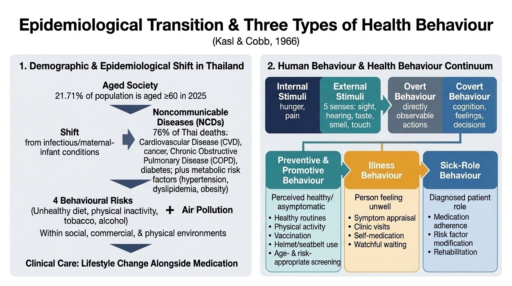
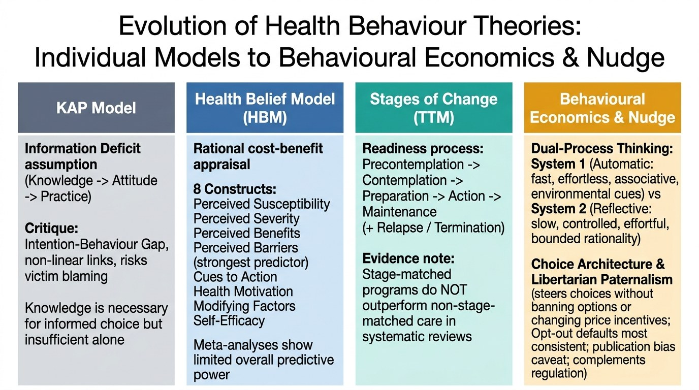
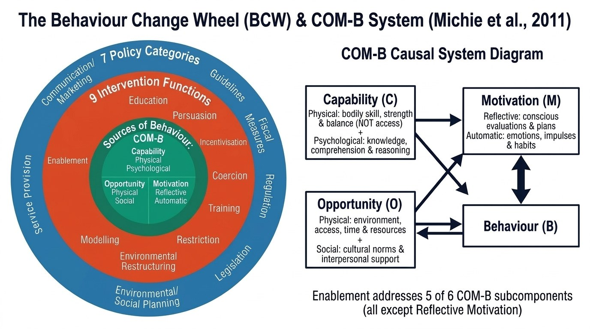
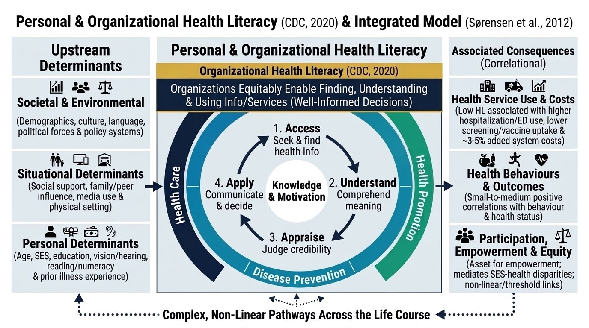
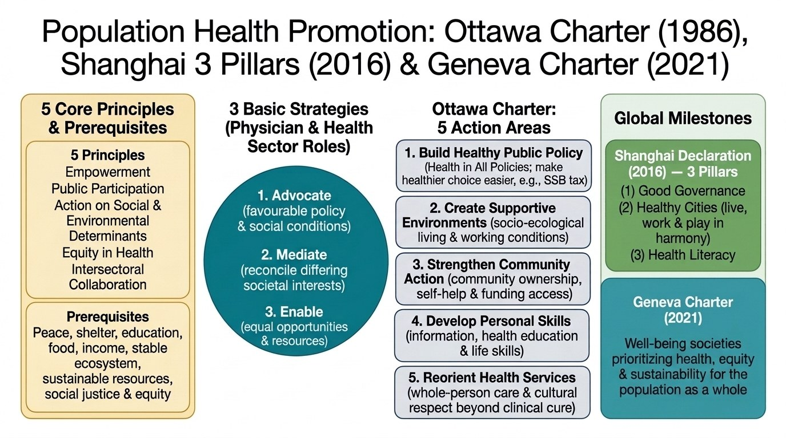

# HS4: พฤติกรรมสุขภาพ (Health Behavior) การปรับเปลี่ยนพฤติกรรม (Behavior Change) และการสร้างเสริมสุขภาพ (Health Promotion)

สัมฤทธิ์ ศรีธำรงสวัสดิ์

## วัตถุประสงค์การเรียนรู้และคำถามนำ

| วัตถุประสงค์การเรียนรู้ | คำถามนำและโครงสร้างเนื้อหา |
|---|---|
| 1. **การสร้างเสริมสุขภาพ (health promotion)** อธิบายความหมาย กลยุทธ์ และหลักการของการสร้างเสริมสุขภาพตามกฎบัตรออตตาวา แยกการสร้างเสริมสุขภาพระดับประชากรออกจากการให้บริการแก่ผู้ป่วยรายบุคคล และอธิบายบทบาทของแพทย์ในการชี้นำ การไกล่เกลี่ย และการเสริมพลังให้ประชาชน | **1. การสร้างเสริมสุขภาพคืออะไร และแพทย์มีบทบาทอย่างไร (What is health promotion, and what role do physicians play?)** — ครอบคลุมนิยามและขอบเขตระดับประชากรตามกฎบัตรออตตาวา (1.1) กลยุทธ์การปฏิบัติตั้งแต่ระดับนโยบายสาธารณะจนถึงระบบบริการสุขภาพ (1.2) หลักการกำกับความยั่งยืนและเป็นธรรม (1.3) และบทบาทแพทย์ในการชี้นำ ไกล่เกลี่ย และเสริมพลัง (1.4) |
| 2. **การเปลี่ยนผ่านทางระบาดวิทยา (epidemiological transition)** วิเคราะห์ว่าการเปลี่ยนผ่านของภาระโรคไปสู่โรคไม่ติดต่อเรื้อรังที่สัมพันธ์กับพฤติกรรมและสภาพแวดล้อม ทำให้การสร้างเสริมสุขภาพและการปรับเปลี่ยนพฤติกรรมมีความสำคัญต่อระบบสุขภาพอย่างไร | **2. ทำไมเราต้องสร้างเสริมสุขภาพ (Why do we need health promotion?)** — ครอบคลุมการก้าวสู่สังคมสูงวัย การเปลี่ยนผ่านภาระโรคสู่โรคไม่ติดต่อเรื้อรัง และเหตุผลที่การจ่ายยาในโรงพยาบาลเพียงลำพังไม่อาจควบคุมโรคที่มีรากฐานจากพฤติกรรมและสภาพแวดล้อมได้ (2.1) |
| 3. **พฤติกรรมสุขภาพ (health behavior)** อธิบายความหมายของพฤติกรรมมนุษย์และพฤติกรรมสุขภาพ และจำแนกประเภทของพฤติกรรมสุขภาพตามสถานะสุขภาพของบุคคลจากตัวอย่างในชีวิตประจำวัน | **3. พฤติกรรมสุขภาพคืออะไร (What is health behavior?)** — ครอบคลุมองค์ประกอบของพฤติกรรมภายนอกและกระบวนการภายในจิตใจ และการจำแนกพฤติกรรมสุขภาพตามการรับรู้สถานะสุขภาพตั้งแต่ระยะแข็งแรง ระยะมีอาการ ไปจนถึงระยะเป็นผู้ป่วย (3.1) |
| 4. **ทฤษฎีพฤติกรรมสุขภาพและเศรษฐศาสตร์พฤติกรรม (health behavior theories and behavioral economics)** เปรียบเทียบคำอธิบายพฤติกรรมสุขภาพของแนวคิดความรู้–ทัศนคติ–การปฏิบัติ ทฤษฎีแบบแผนความเชื่อด้านสุขภาพ ทฤษฎีลำดับขั้นของการเปลี่ยนแปลง และเศรษฐศาสตร์พฤติกรรมรวมถึงทฤษฎีผลักดัน และระบุข้อจำกัดของสมมติฐานที่ว่าบุคคลตัดสินใจอย่างมีเหตุผลเสมอ | **4. ทำไมคนเราจึงทำสิ่งที่รู้ว่าไม่ดีต่อสุขภาพ (Why do people do things they know are bad for their health?)** — ครอบคลุมข้อจำกัดของการให้ความรู้ตามแนวคิด KAP (4.1) การประเมินความคุกคามและอุปสรรคตามทฤษฎี HBM (4.2) ความพร้อมในการเปลี่ยนพฤติกรรมตามทฤษฎี TTM (4.3) และระบบคิดสองระบบ อคติทางความคิด และการจัดสภาพแวดล้อมและตัวเลือกให้ตัดสินใจได้ง่ายขึ้นตามแนวคิด Nudge และ MINDSPACE (4.4) |
| 5. **วงล้อการปรับเปลี่ยนพฤติกรรม (Behaviour Change Wheel)** ประยุกต์ใช้ตัวแบบความสามารถ–โอกาส–แรงจูงใจ (COM-B) วิเคราะห์ปัจจัยที่มีอิทธิพลต่อพฤติกรรมสุขภาพ และเลือกมาตรการปรับเปลี่ยนพฤติกรรมและเครื่องมือทางนโยบายที่สอดคล้องกับปัจจัยนั้น | **5. เราจะช่วยให้คนเปลี่ยนพฤติกรรมได้อย่างไร (How can we help people change their behavior?)** — ครอบคลุมการวินิจฉัยต้นตอพฤติกรรมด้วยตัวแบบ COM-B (5.1) การจับคู่มาตรการแทรกแซงในวงล้อชั้นกลางให้ตรงจุดติดขัด (5.2) และการใช้เครื่องมือทางนโยบายในวงล้อชั้นนอกสร้างเงื่อนไขเชิงระบบ (5.3) |
| 6. **ความรอบรู้ด้านสุขภาพ (health literacy)** อธิบายความรอบรู้ด้านสุขภาพระดับบุคคลและระดับองค์กร วิเคราะห์สมรรถนะในการเข้าถึง การเข้าใจ การประเมิน และการนำข้อมูลสุขภาพไปใช้ และเชื่อมโยงกับความรับผิดชอบขององค์กรและระบบบริการสุขภาพ | **6. ความรอบรู้ด้านสุขภาพคืออะไร และต่างจากการมีความรู้เรื่องสุขภาพอย่างไร (What is health literacy, and how does it differ from health knowledge?)** — ครอบคลุมความรอบรู้ด้านสุขภาพระดับบุคคลและพันธะความรับผิดชอบขององค์กร (6.1) และกรอบแนวคิดบูรณาการของ Sørensen และคณะที่เชื่อมสมรรถนะการจัดการข้อมูลเข้ากับระบบสุขภาพและกฎบัตรออตตาวา (6.2) |

## 1. การสร้างเสริมสุขภาพคือกระบวนการเสริมพลังให้ผู้คนควบคุมปัจจัยกำหนดสุขภาพและพัฒนาสุขภาพของตนเอง ซึ่งก้าวพ้นการรักษาผู้ป่วยรายบุคคลไปสู่การทำงานร่วมกันของทุกภาคส่วน (Health Promotion)

การทำความเข้าใจการสร้างเสริมสุขภาพเริ่มต้นจากนิยามและขอบเขตระดับประชากรตามกฎบัตรออตตาวาที่แยกแยะออกจากบริการรักษาผู้ป่วยรายบุคคล (หัวข้อ 1.1) แล้วพิจารณาแนวทางแปลงนิยามสู่การปฏิบัติตั้งแต่ระดับนโยบายสาธารณะลงมาถึงการจัดระบบบริการสุขภาพ (หัวข้อ 1.2) บนฐานหลักการกำกับความเป็นธรรมและการมีส่วนร่วม (หัวข้อ 1.3) พร้อมบทบาทของแพทย์ในการชี้นำ ไกล่เกลี่ย และเสริมพลังประชาชน (หัวข้อ 1.4)

### 1.1 กฎบัตรออตตาวานิยามการสร้างเสริมสุขภาพว่าเป็นกระบวนการช่วยให้ผู้คนควบคุมและพัฒนาสุขภาพของตนเองได้มากขึ้น โดยมองสุขภาพเป็นทรัพยากรของการดำรงชีวิตระดับประชากร (Ottawa Charter Definition)

> เมื่อได้ยินคำว่า "การสร้างเสริมสุขภาพ" ผู้เรียนนึกถึงการที่แพทย์ให้คำแนะนำผู้ป่วยรายบุคคลในห้องตรวจ หรือการจัดสภาพแวดล้อมและนโยบายในสังคมมากกว่ากัน และทั้งสองแนวทางนี้มีขอบเขตผลกระทบต่างกันอย่างไร

**การสร้างเสริมสุขภาพ (health promotion)** หมายถึงกระบวนการเสริมสร้างสมรรถนะและเงื่อนไขให้ประชาชนสามารถควบคุมปัจจัยกำหนดสุขภาพและพัฒนาสุขภาพของตนเองได้มากขึ้น ([World Health Organization, 1986](https://iris.who.int/handle/10665/59557)) นิยามสากลนี้รับรองไว้ใน **กฎบัตรออตตาวาว่าด้วยการสร้างเสริมสุขภาพ (Ottawa Charter for Health Promotion)** จากการประชุมนานาชาติว่าด้วยการสร้างเสริมสุขภาพครั้งแรก ณ กรุงออตตาวา ประเทศแคนาดา เมื่อวันที่ 21 พฤศจิกายน ค.ศ. 1986 โดยความร่วมมือขององค์การอนามัยโลก กระทรวงสุขภาพและสวัสดิการแคนาดา และสมาคมสาธารณสุขแคนาดา ว่า *“Health promotion is the process of enabling people to increase control over, and to improve, their health.”* คำสำคัญว่า *enabling* (การเสริมให้ทำได้จริง) ชี้ชัดว่าหัวใจของการสร้างเสริมสุขภาพไม่ใช่การที่บุคลากรทางการแพทย์ใช้อำนาจสั่งการหรือทำแทน แต่คือการสร้างศักยภาพและสภาพแวดล้อมที่เอื้อให้ผู้คนดูแลสุขภาพได้ด้วยตนเอง

**รากฐานของกฎบัตรออตตาวามองว่าสุขภาพเป็นทรัพยากรสำหรับการดำเนินชีวิตประจำวัน มิใช่เป้าหมายสุดท้ายของการมีชีวิตอยู่ การสร้างเสริมสุขภาพจึงก้าวพ้นเขตแดนของโรงพยาบาลไปสู่การจัดการปัจจัยพื้นฐานทางสังคมร่วมกันทุกภาคส่วน** กฎบัตรระบุว่าบุคคลหรือกลุ่มคนจะบรรลุสุขภาวะที่สมบูรณ์ได้ก็ต่อเมื่อสามารถระบุและทำความมุ่งหวังให้เป็นจริง ตอบสนองความจำเป็น และเปลี่ยนแปลงหรือรับมือกับสิ่งแวดล้อมได้ (*“To reach a state of complete physical, mental and social well-being, an individual or group must be able to identify and to realize aspirations, to satisfy needs, and to change or cope with the environment.”*) สุขภาพจึงเป็นแนวคิดเชิงบวกที่เน้นทรัพยากรทางสังคมและส่วนบุคคลควบคู่กับสมรรถนะทางกาย (*“Health is therefore, seen as a resource for everyday life, not the objective of living. Health is a positive concept emphasizing social and personal resources, as well as physical capacities.”*) และต้องวางอยู่บน **ปัจจัยพื้นฐานของสุขภาพ (prerequisites for health)** ได้แก่ สันติภาพ ที่อยู่อาศัย การศึกษา อาหาร รายได้ ระบบนิเวศที่มั่นคง ทรัพยากรที่ยั่งยืน ความยุติธรรมทางสังคม และความเป็นธรรม (*“peace, shelter, education, food, income, a stable eco-system, sustainable resources, social justice and equity”*) ด้วยเหตุนี้ การสร้างเสริมสุขภาพจึงไม่ใช่ความรับผิดชอบของภาคสาธารณสุขเพียงลำพัง (*“not just the responsibility of the health sector, but goes beyond healthy life-styles to well-being”*) และเป็นการดำเนินงานระดับประชากรหรือชุมชน (population-based health promotion) ที่ก้าวพ้นการรักษาพยาบาลรายบุคคล (*“Health promotion goes beyond health care”*) โดยผสานมาตรการทางกฎหมาย การคลัง ภาษี และการปรับองค์กรเข้าด้วยกัน ([World Health Organization, 1986](https://iris.who.int/handle/10665/59557)) ตัวอย่างเช่น การที่แพทย์ให้คำปรึกษาเลิกบุหรี่แก่ผู้ป่วยรายหนึ่งในคลินิกเป็นการบริการสุขภาพรายบุคคล แต่การขึ้นภาษียาสูบและการกำหนดเขตปลอดบุหรี่ตามกฎหมายเป็นการสร้างเสริมสุขภาพระดับประชากรที่ปรับบริบทให้เอื้อต่อทุกคนพร้อมกัน ดังแสดงโครงสร้างภาพรวมในภาพที่ 1

**ภาพที่ 1 กรอบแนวคิดการสร้างเสริมสุขภาพตามกฎบัตรออตตาวา ปัจจัยพื้นฐานของสุขภาพ บทบาทหลักของวิชาชีพสุขภาพ และกลยุทธ์การปฏิบัติ 5 ด้าน** แสดงความเชื่อมโยงตั้งแต่ปัจจัยพื้นฐานของสุขภาพ (Prerequisites for Health) บทบาทแกนกลางของแพทย์และภาคสุขภาพในการชี้นำผลักดัน (Advocate) การไกล่เกลี่ยประสานผลประโยชน์ (Mediate) และการเสริมพลังสร้างโอกาสที่เท่าเทียม (Enable) ไปสู่กลยุทธ์การปฏิบัติทั้ง 5 ด้าน เพื่อเพิ่มอำนาจควบคุมปัจจัยกำหนดสุขภาพของประชากร (*ที่มา: สังเคราะห์จาก [World Health Organization (1986)](https://iris.who.int/handle/10665/59557)*)

### 1.2 กฎบัตรออตตาวาแปลงนิยามสู่การปฏิบัติผ่านกลยุทธ์ที่เชื่อมโยงตั้งแต่นโยบายสาธารณะและสิ่งแวดล้อมไปจนถึงชุมชน ทักษะส่วนบุคคล และระบบบริการสุขภาพ (Ottawa Charter Action Areas)

> เหตุใดการรณรงค์ให้ประชาชนลดอาหารหวาน มัน เค็ม เพียงลำพังจึงมักได้ผลจำกัด หากไม่มีมาตรการด้านราคา กฎหมาย การจัดสภาพแวดล้อม และการปรับระบบบริการสุขภาพควบคู่กัน

**การสร้างเสริมสุขภาพที่มีประสิทธิผลไม่อาจแยกทำเฉพาะการสอนสุขศึกษารายบุคคล แต่ต้องขับเคลื่อนกลยุทธ์เชิงโครงสร้าง ชุมชน บุคคล และระบบบริการให้สอดประสานกันทุกระดับ** ภายใต้หัวข้อ *“Health Promotion action means:”* กฎบัตรออตตาวากำหนดกลยุทธ์ปฏิบัติการที่หนุนเสริมกันตั้งแต่ระดับมหภาคลงสู่ระดับจุลภาค ([World Health Organization, 1986](https://iris.who.int/handle/10665/59557)) ดังสังเคราะห์สาระสำคัญและจุดเชื่อมโยงในตารางต่อไปนี้

| กลยุทธ์ตามกฎบัตรออตตาวา | สาระสำคัญและแนวคิดหลักในกฎบัตร ([World Health Organization, 1986](https://iris.who.int/handle/10665/59557)) | ความเชื่อมโยงเชิงระบบและตัวอย่างการปฏิบัติ |
|---|---|---|
| **1. การสร้างนโยบายสาธารณะเพื่อสุขภาพ (build healthy public policy)** | บรรจุประเด็นสุขภาพไว้ในวาระของผู้กำหนดนโยบายทุกภาคส่วนและทุกระดับ เพื่อให้ตระหนักถึงผลกระทบทางสุขภาพของการตัดสินใจและสร้างความเป็นธรรม โดยมีเป้าหมายทำให้ทางเลือกที่ดีต่อสุขภาพเป็นทางเลือกที่ตัดสินใจได้ง่าย (*“make the healthier choice the easier choice”*) | ใช้กฎหมาย มาตรการภาษี และการคลังปรับสภาพแวดล้อมและทางเลือกของสังคม ซึ่งสอดคล้องโดยตรงกับทฤษฎีผลักดัน ([Thaler & Sunstein, 2008](https://books.google.com/books/about/Nudge.html?id=dSJQn8egXvUC)) และวงล้อการปรับเปลี่ยนพฤติกรรม ([Michie et al., 2011](https://doi.org/10.1186/1748-5908-6-42)) เช่น ภาษีความหวานและกฎหมายควบคุมการตลาดอาหารเด็ก |
| **2. การสร้างสิ่งแวดล้อมที่เอื้อต่อสุขภาพ (create supportive environments)** | ยึดแนวทางนิเวศวิทยาสังคม (*socio-ecological approach*) ที่ชี้ว่าผู้คนกับสิ่งแวดล้อมแยกกันไม่ได้ จึงต้องจัดสภาพการอยู่อาศัย การทำงาน และการพักผ่อนให้ปลอดภัย สร้างสรรค์ และเกื้อหนุนสุขภาพ (*“safe, stimulating, satisfying and enjoyable”*) | ปรับสภาพแวดล้อมทางกายภาพ สังคม เศรษฐกิจ และวัฒนธรรมในชีวิตประจำวัน เช่น การจัดพื้นที่สีเขียวและทางเดินเท้าที่ปลอดภัย การควบคุมฝุ่นควัน และการออกแบบสถานที่ทำงานให้ปลอดภัยและลดความเครียดเรื้อรัง |
| **3. การเสริมความเข้มแข็งของชุมชน (strengthen community action)** | สนับสนุนการเสริมพลังให้ชุมชนเป็นเจ้าของและกำหนดชะตาของตนเอง (*“empowerment of communities, their ownership and control of their own endeavours”*) ตั้งแต่การจัดลำดับปัญหา การวางแผน ไปจนถึงการลงมือทำ | ให้ชุมชนเข้าถึงข้อมูลข่าวสาร โอกาสเรียนรู้ และแหล่งทุนสนับสนุนอย่างต่อเนื่อง เพื่อให้เกิดการแก้ปัญหาที่ยั่งยืนกว่าโครงการสำเร็จรูปที่หน่วยงานภายนอกสั่งการลงมา |
| **4. การพัฒนาทักษะส่วนบุคคล (develop personal skills)** | สนับสนุนการพัฒนาศักยภาพบุคคลผ่านการให้ข้อมูล การศึกษาด้านสุขภาพ และการฝึกทักษะชีวิต (*life skills*) ในโรงเรียน บ้าน ที่ทำงาน และชุมชน เพื่อเพิ่มทางเลือกในการควบคุมสุขภาพและรับมือแต่ละช่วงวัย | ก้าวพ้นการแจกแผ่นพับความรู้ไปสู่การฝึกทักษะปฏิบัติจริงในการอ่านฉลากโภชนาการ การจัดการความเครียด และการดูแลตนเองเมื่อเจ็บป่วยเรื้อรัง |
| **5. การปรับเปลี่ยนระบบบริการสุขภาพ (reorient health services)** | ขยายบทบาทของภาคบริการสุขภาพให้ก้าวพ้นบริการรักษาพยาบาลทางคลินิก (*“beyond its responsibility for providing clinical and curative services”*) ไปสู่การดูแลผู้รับบริการทั้งคนแบบองค์รวม (*“whole person”*) โดยแบ่งปันความรับผิดชอบร่วมกันทุกฝ่าย | ปฏิรูปเจตคติ โครงสร้างองค์กร งานวิจัยสุขภาพ และการศึกษาวิชาชีพบุคลากรทางการแพทย์ เพื่อให้โรงพยาบาลและคลินิกเชื่อมต่อการทำงานสร้างเสริมสุขภาพร่วมกับชุมชนและภาคส่วนอื่น |

### 1.3 หลักการของการสร้างเสริมสุขภาพยึดการเสริมพลัง การมีส่วนร่วม ปัจจัยทางสังคมและสิ่งแวดล้อม ความเป็นธรรม และความร่วมมือระหว่างภาคส่วนเป็นแกนกลาง (Principles of Health Promotion)

**หลักการพื้นฐานของการสร้างเสริมสุขภาพทำหน้าที่เป็นเข็มทิศทางจริยธรรมและวิชาการ เพื่อกำกับมิให้มาตรการสุขภาพกลายเป็นการใช้อำนาจบังคับจากบนลงล่างหรือทิ้งกลุ่มเปราะบางไว้ข้างหลัง** ไม่ว่าจะดำเนินกลยุทธ์ในระดับนโยบาย ชุมชน หรือสถานพยาบาล การสร้างเสริมสุขภาพที่แท้จริงต้องยึดหลักการกำกับร่วมกัน ([World Health Organization, 1986](https://iris.who.int/handle/10665/59557); [Rootman et al., 2001](https://eric.ed.gov/?id=ED460081)) ได้แก่ **(1) การเสริมสร้างพลังอำนาจ (empowerment)** คือการเพิ่มขีดความสามารถให้บุคคล ครอบครัว และชุมชนควบคุมปัจจัยกำหนดสุขภาพได้ด้วยตนเอง **(2) การมีส่วนร่วมของสาธารณะ (public participation)** คือการเปิดพื้นที่ให้ผู้ได้รับผลกระทบร่วมคิด วิเคราะห์สาเหตุ วางแผน และลงมือแก้ไขปัญหาของตนเองทุกขั้นตอน **(3) การจัดการปัจจัยทางสังคมและสิ่งแวดล้อม (addressing social and environmental determinants)** คือการมองปัญหาสุขภาพเชื่อมโยงกับบริบทการดำรงชีวิตแบบองค์รวมตามแนวคิดนิเวศวิทยาสังคม ไม่กล่าวโทษพฤติกรรมปัจเจกโดยละเลยสภาพแวดล้อม **(4) การลดความไม่เป็นธรรมด้านสุขภาพ (reducing health inequity)** คือการลดความเหลื่อมล้ำของสถานะสุขภาพและสร้างความเป็นธรรมในการเข้าถึงทรัพยากรและโอกาสทางสุขภาพ และ **(5) การประสานความร่วมมือระหว่างภาคส่วน (intersectoral collaboration)** คือการบูรณาการการทำงานระหว่างภาครัฐนอกกระทรวงสาธารณสุข ภาคเอกชน และภาคประชาสังคม

### 1.4 แพทย์และบุคลากรสาธารณสุขมีบทบาทชี้นำผลักดันทางสังคม ไกล่เกลี่ยประสานผลประโยชน์ และเสริมพลังให้ประชาชน (Advocate, Mediate, and Enable)

> เมื่อมาตรการสร้างเสริมสุขภาพ เช่น การจำกัดโฆษณาเครื่องดื่มแอลกอฮอล์หรือการควบคุมมลพิษทางอากาศ ขัดแย้งกับผลประโยชน์ทางเศรษฐกิจของบางกลุ่ม แพทย์ควรวางบทบาทวิชาชีพของตนอย่างไร

**เพื่อให้กลยุทธ์และหลักการของการสร้างเสริมสุขภาพเกิดผลจริงในสังคมที่มีผลประโยชน์หลากหลาย กฎบัตรออตตาวากำหนดบทบาทหลักของแพทย์และบุคลากรสุขภาพไว้ทั้งในฐานะผู้ชี้นำ ผู้ไกล่เกลี่ย และผู้เสริมพลัง** ([World Health Organization, 1986](https://iris.who.int/handle/10665/59557)) บทบาทแรกคือ **การชี้นำและรณรงค์ผลักดันทางสังคม (advocate)** โดยใช้ความรู้และหลักฐานทางวิชาการสื่อสารต่อสังคมและผู้กำหนดนโยบาย เพื่อให้ปัจจัยทางการเมือง เศรษฐกิจ สังคม และสิ่งแวดล้อมเอื้อต่อสุขภาพ (*“making these conditions favourable through advocacy for health”*) บทบาทที่สองคือ **การไกล่เกลี่ยและประสานผลประโยชน์ (mediate)** เนื่องจากงานสร้างเสริมสุขภาพเกี่ยวข้องกับหลายภาคส่วนที่มีมุมมองและผลประโยชน์ต่างกัน บุคลากรและองค์กรวิชาชีพสุขภาพจึงมีหน้าที่ประสานจุดร่วมเพื่อประโยชน์ทางสุขภาพของสาธารณะ (*“mediate between differing interests in society for the pursuit of health”*) และบทบาทที่สามคือ **การเสริมพลังและสร้างโอกาสที่เท่าเทียม (enable)** โดยลดช่องว่างความเหลื่อมล้ำและสนับสนุนทรัพยากรและทักษะให้ประชาชนทุกคนบรรลุศักยภาพทางสุขภาพสูงสุดของตนได้อย่างเท่าเทียม (*“ensuring equal opportunities and resources to enable all people to achieve their fullest health potential”*)

## 2. ระบบสุขภาพต้องให้ความสำคัญกับการสร้างเสริมสุขภาพและการปรับเปลี่ยนพฤติกรรม เพราะภาระโรคเปลี่ยนผ่านไปสู่โรคไม่ติดต่อเรื้อรังที่ขับเคลื่อนโดยพฤติกรรมและสภาพแวดล้อม (Epidemiological Transition)

หมวดนี้เชื่อมโยงกรอบการสร้างเสริมสุขภาพเข้ากับพลวัตทางประชากรและระบาดวิทยาของประเทศไทย เพื่อชี้ให้เห็นว่าเหตุใดการเปลี่ยนผ่านสู่โรคไม่ติดต่อเรื้อรังในสังคมสูงวัยจึงทำให้การปรับเปลี่ยนพฤติกรรมและสภาพแวดล้อมกลายเป็นหัวใจที่ขาดไม่ได้ของระบบสุขภาพยุคใหม่ (หัวข้อ 2.1)

### 2.1 การก้าวสู่สังคมสูงวัยและการเปลี่ยนผ่านทางระบาดวิทยาทำให้โรคไม่ติดต่อเรื้อรังที่สัมพันธ์กับพฤติกรรมและสภาพแวดล้อมกลายเป็นภาระโรคหลัก (Epidemiological Transition and Non-Communicable Diseases)

> เหตุใดระบบบริการสุขภาพที่เคยประสบความสำเร็จในการลดอัตราตายจากโรคติดเชื้อด้วยวัคซีนและยาปฏิชีวนะ จึงไม่สามารถลดภาระโรคเบาหวานหรือโรคหลอดเลือดหัวใจได้ด้วยการจ่ายยาในโรงพยาบาลเพียงอย่างเดียว

**การเปลี่ยนผ่านทางระบาดวิทยา (epidemiological transition)** หมายถึงกระบวนการเปลี่ยนแปลงแบบแผนสาเหตุการเจ็บป่วยและการเสียชีวิตหลักของประชากร เมื่อโครงสร้างประชากรก้าวเข้าสู่สังคมสูงวัยควบคู่กับการพัฒนาทางเศรษฐกิจ สังคม และวิถีชีวิตเมือง ([Omran, 2005](https://doi.org/10.1111/j.1468-0009.2005.00398.x); [Economic Research Institute for ASEAN and East Asia, 2021](https://www.eria.org/uploads/Vol-1_00-Lessons-from-One-of-the-Most-Aged-ASEAN-Member-States.pdf)) สำหรับประเทศไทย ภาระโรค (burden of disease) สำคัญในอดีตเคยกระจุกตัวอยู่ที่ปัญหาสุขภาพมารดาและทารก ภาวะทุพโภชนาการ และโรคติดเชื้อเฉียบพลัน แต่ปัจจุบันได้เปลี่ยนผ่านไปสู่ **โรคไม่ติดต่อเรื้อรัง (non-communicable diseases: NCDs)** เป็นหลัก ได้แก่ โรคเบาหวาน โรคความดันโลหิตสูง และภาวะไขมันในเลือดผิดปกติ ซึ่งก่อภาวะแทรกซ้อนรุนแรงและทุพพลภาพระยะยาวทั้งโรคกล้ามเนื้อหัวใจขาดเลือด โรคหลอดเลือดสมอง และภาวะแทรกซ้อนทางไต ตา และเท้า ตลอดจนโรคปอดอุดกั้นเรื้อรัง (chronic obstructive pulmonary disease: COPD) และโรคมะเร็ง

**ความแตกต่างสำคัญทางเวชปฏิบัติคือโรคไม่ติดต่อเรื้อรังไม่ได้เกิดจากเชื้อก่อโรคชนิดเดียวที่กำจัดให้สิ้นสุดได้ด้วยยาปฏิชีวนะระยะสั้น แต่มีความสัมพันธ์เชิงปัจจัยเสี่ยงหลายระดับกับพฤติกรรมในชีวิตประจำวันและสภาพแวดล้อมรอบตัว** ดังแสดงในภาพที่ 2 หลักฐานทางระบาดวิทยาระดับประชากรชี้ว่ากลุ่มโรคไม่ติดต่อเรื้อรังมี **ความสัมพันธ์ (association)** อย่างใกล้ชิดกับพฤติกรรมเสี่ยงที่สะสมต่อเนื่อง ได้แก่ การบริโภคอาหารหวาน มัน เค็มเกินพอดี การมีกิจกรรมทางกายไม่เพียงพอ การสูบบุหรี่ และการดื่มเครื่องดื่มแอลกอฮอล์ในระดับที่เป็นอันตราย ซึ่งพฤติกรรมเหล่านี้ไม่ได้เกิดขึ้นลอย ๆ จากความตั้งใจส่วนบุคคล แต่ถูกหล่อหลอมโดยปัจจัยกำหนดทางสังคม ปัจจัยเชิงพาณิชย์ เช่น การตลาดอาหารแปรรูปและเครื่องดื่มน้ำตาลสูง และสภาพแวดล้อมทางกายภาพของเมือง ([World Health Organization, n.d.](https://www.who.int/news-room/fact-sheets/detail/noncommunicable-diseases)) ผู้เรียนพึงสังเกตในเชิงคิดวิเคราะห์ว่า การที่ปัจจัยเสี่ยงหลายด้านทำงานร่วมกันอย่างซับซ้อนหมายความว่าการตั้งรับจ่ายยาในคลินิกเพียงลำพัง—ในขณะที่ผู้ป่วยต้องกลับไปใช้ชีวิตในสภาพแวดล้อมเดิมที่กระตุ้นพฤติกรรมเสี่ยงทุกวัน—ย่อมไม่อาจควบคุมโรคหรือชะลอภาวะแทรกซ้อนได้อย่างยั่งยืน ([Kelly & Barker, 2016](https://doi.org/10.1016/j.puhe.2016.03.030)) ความเข้าใจกลไกของพฤติกรรมสุขภาพและการปรับเปลี่ยนพฤติกรรมควบคู่กับการจัดสิ่งแวดล้อมจึงเป็นสมรรถนะหลักของแพทย์ยุคปัจจุบัน

**ภาพที่ 2 การเปลี่ยนผ่านทางระบาดวิทยาสู่โรคไม่ติดต่อเรื้อรัง และปัจจัยขับเคลื่อนด้านพฤติกรรมและสภาพแวดล้อม** แสดงการเปลี่ยนภาระโรคหลักจากโรคติดเชื้อและภาวะทุพโภชนาการไปสู่โรคไม่ติดต่อเรื้อรัง (NCDs) เมื่อประชากรสูงวัยขึ้น โดยมีสภาพแวดล้อมทางสังคม เชิงพาณิชย์ และกายภาพเป็นตัวหล่อหลอมพฤติกรรมเสี่ยงหลัก 4 ด้าน ก่อนนำไปสู่ความผิดปกติทางเมแทบอลิซึมและภาวะแทรกซ้อนรุนแรง (*ที่มา: สังเคราะห์จาก [Omran (2005)](https://doi.org/10.1111/j.1468-0009.2005.00398.x), [Kelly & Barker (2016)](https://doi.org/10.1016/j.puhe.2016.03.030), [Economic Research Institute for ASEAN and East Asia (2021)](https://www.eria.org/uploads/Vol-1_00-Lessons-from-One-of-the-Most-Aged-ASEAN-Member-States.pdf) และ [World Health Organization (n.d.)](https://www.who.int/news-room/fact-sheets/detail/noncommunicable-diseases)*)

## 3. พฤติกรรมสุขภาพครอบคลุมทั้งการกระทำภายนอกและกระบวนการคิดภายในของบุคคลที่เกี่ยวข้องกับการป้องกันโรค การหาทางดูแลรักษาเมื่อเริ่มไม่สบาย และการดูแลตนเองเมื่อเจ็บป่วย (Health Behavior)

ก่อนจะวิเคราะห์ทฤษฎีการปรับเปลี่ยนพฤติกรรม หมวดนี้วางรากฐานความหมายของพฤติกรรมมนุษย์ทั้งส่วนที่สังเกตเห็นได้และกระบวนการทางจิตปัญญาภายใน แล้วจำแนกประเภทของพฤติกรรมสุขภาพตามการรับรู้สถานะสุขภาพของบุคคลในแต่ละระยะ (หัวข้อ 3.1)

### 3.1 พฤติกรรมสุขภาพประกอบด้วยการแสดงออกภายนอกและกระบวนการภายในจิตใจ และจำแนกได้ตามสถานะสุขภาพตั้งแต่ระยะแข็งแรง ระยะเริ่มมีอาการ ไปจนถึงระยะเป็นผู้ป่วย (Classification of Health Behavior)

> การที่บุคคลหนึ่งตัดสินใจ "ยังไม่ไปโรงพยาบาลและเฝ้ารอดูอาการอยู่ที่บ้าน" เมื่อเริ่มปวดท้อง นับว่าเป็นพฤติกรรมสุขภาพหรือไม่ และจัดอยู่ในประเภทใด

**พฤติกรรมมนุษย์ (human behavior)** หมายถึงการแสดงออกหรือปฏิกิริยาโต้ตอบของบุคคลเมื่อเผชิญกับสถานการณ์หรือสิ่งเร้า (stimulus) ทั้งโดยรู้ตัวหรือไม่รู้ตัว ชัดเจนหรือแอบแฝง และโดยตั้งใจหรือไม่ตั้งใจ ([ราชบัณฑิตยสถาน, 2546](https://dictionary.orst.go.th/)) โดยสิ่งเร้าแบ่งเป็น **สิ่งเร้าภายใน (internal stimulus)** จากความต้องการทางสรีรวิทยา เช่น ความหิวหรืออาการปวด และ **สิ่งเร้าภายนอก (external stimulus)** จากสภาพแวดล้อมทางกายภาพและสังคมที่รับรู้ผ่านประสาทสัมผัสทั้งห้า ขณะที่การแสดงออกของพฤติกรรมประกอบด้วย **พฤติกรรมภายนอก (overt behavior)** ที่ผู้อื่นสังเกตหรือวัดได้โดยตรง เช่น การเดิน การพูด หรือการรับประทานอาหาร และ **พฤติกรรมภายใน (covert behavior)** ซึ่งเป็นกระบวนการทางจิตใจและปัญญาที่สังเกตเห็นโดยตรงไม่ได้ เช่น ความเชื่อ ความรู้สึก การรับรู้ ความจำ การคิด และการตัดสินใจ ([Gochman, 1982](https://doi.org/10.1177/109019818200900213)) เมื่อนำมาประยุกต์ในมิติสุขภาพ **พฤติกรรมสุขภาพ (health behavior หรือ health-related behavior)** จึงหมายถึงแบบแผนการกระทำ ความเคยชิน ตลอดจนความเชื่อ แรงจูงใจ และการรับรู้ภายในของบุคคลที่เกี่ยวข้องกับการธำรงรักษาสุขภาพ (health maintenance) การฟื้นฟูสุขภาพ (health restoration) และการพัฒนาสุขภาพให้ดีขึ้น (health improvement) ([Gochman, 1982](https://doi.org/10.1177/109019818200900213); [Glanz et al., 2008](https://books.google.com/books/about/Health_Behavior_and_Health_Education.html?id=1xuGErZCfbsC))

**การจำแนกประเภทพฤติกรรมสุขภาพตามกรอบคลาสสิกของ [Kasl และ Cobb (1966)](https://doi.org/10.1080/00039896.1966.10664365) ใช้การรับรู้สถานะสุขภาพของบุคคลเป็นเกณฑ์แบ่งตามเส้นต่อเนื่องของความเจ็บป่วย** ดังแสดงในภาพที่ 3 และสรุปเปรียบเทียบในตารางต่อไปนี้ การเข้าใจเกณฑ์นี้ช่วยให้แพทย์ตระหนักว่าแม้การตัดสินใจรอดูอาการอยู่ที่บ้านหรือการซื้อยารับประทานเองเมื่อเริ่มไม่สบายก็เป็นพฤติกรรมสุขภาพประเภทหนึ่งที่มีตรรกะและบริบทรองรับ มิใช่ความเพิกเฉยไร้เหตุผลเสมอไป

**ภาพที่ 3 องค์ประกอบของพฤติกรรมมนุษย์และการจำแนกพฤติกรรมสุขภาพตามสถานะสุขภาพของ Kasl และ Cobb** แสดงรากฐานพฤติกรรมภายใน (Covert Behavior) และพฤติกรรมภายนอก (Overt Behavior) ที่ตอบสนองต่อสิ่งเร้า และเส้นต่อเนื่องของพฤติกรรมการป้องกันและส่งเสริมสุขภาพเมื่อรู้สึกแข็งแรง พฤติกรรมการแสวงหาบริการเมื่อเริ่มมีอาการไม่สบาย และพฤติกรรมการดูแลตนเองในบทบาทผู้ป่วยหลังได้รับการวินิจฉัย (*ที่มา: สังเคราะห์จาก [Kasl & Cobb (1966)](https://doi.org/10.1080/00039896.1966.10664365) และ [Gochman (1982)](https://doi.org/10.1177/109019818200900213)*)

| ประเภทพฤติกรรมสุขภาพ ([Kasl & Cobb, 1966](https://doi.org/10.1080/00039896.1966.10664365)) | สถานะสุขภาพที่บุคคลรับรู้และจุดมุ่งหมายหลัก | ลักษณะย่อยและตัวอย่างในชีวิตประจำวัน |
|---|---|---|
| **1. พฤติกรรมการป้องกันโรคและการส่งเสริมสุขภาพ (preventive and promotive health behavior)** | บุคคลเชื่อว่าตนยังมีสุขภาพดีและไม่มีอาการผิดปกติ ปฏิบัติเพื่อดำรงและยกระดับสุขภาพ (promotive) หรือป้องกันโรค อุบัติเหตุ และค้นหาโรคระยะไร้อาการ (preventive) | แบ่งเป็น 4 ลักษณะย่อย ได้แก่ (1) กิจวัตรประจำวัน เช่น เลือกอาหารมีประโยชน์ (2) กิจกรรมส่งเสริมสุขภาพ เช่น ออกกำลังกาย พักผ่อน งดบุหรี่และสุรา (3) การป้องกันจำเพาะ เช่น ฉีดวัคซีน สวมหมวกนิรภัย คาดเข็มขัดนิรภัย และ (4) การตรวจคัดกรองระยะยังไม่มีอาการ เช่น วัดความดันโลหิต คัดกรองเบาหวาน มะเร็งปากมดลูก และตรวจสุขภาพช่องปาก |
| **2. พฤติกรรมการดูแลตนเองหรือไปพบแพทย์เมื่อเริ่มรู้สึกไม่สบาย (illness behavior)** | บุคคลเริ่มรับรู้ว่าตนไม่สบายหรือมีอาการผิดปกติ จึงกระทำการเพื่อตีความอาการและแสวงหาแนวทางแก้ไขที่เหมาะสม | ครอบคลุมตั้งแต่การไปตรวจที่โรงพยาบาลรัฐหรือคลินิกเอกชน การปรึกษาเภสัชกรหรือซื้อยารับประทานเอง ไปจนถึงการเฝ้าสังเกตอาการอยู่ที่บ้านเพื่อรอดูว่าจะทุเลาลงเองหรือไม่ |
| **3. พฤติกรรมการดูแลตนเองในบทบาทผู้ป่วย (sick-role behavior)** | บุคคลได้รับการวินิจฉัยหรือยอมรับสถานะว่ากำลังเจ็บป่วย จึงปฏิบัติเพื่อให้หายป่วย ควบคุมโรค หรือป้องกันความพิการ | การรับประทานยาตามแผนการรักษาอย่างต่อเนื่อง การงดสูบบุหรี่และสุรา การจำกัดอาหารหวานมันเค็มตามโรคประจำตัว และการทำกายภาพบำบัดฟื้นฟูสมรรถภาพ |

## 4. คนเราทำสิ่งที่รู้ว่าไม่ดีต่อสุขภาพ เพราะพฤติกรรมไม่ได้เกิดจากความรู้และการคิดอย่างมีเหตุผลเพียงอย่างเดียว แต่ขึ้นกับความเชื่อ ความพร้อม และระบบคิดแบบอัตโนมัติ (Health Behavior Theories and Behavioral Economics)

เนื่องจากพฤติกรรมสุขภาพได้รับอิทธิพลตั้งแต่ระดับปัจเจก กลุ่มสังคม องค์กร ไปจนถึงนโยบายสาธารณะ จึงไม่มีทฤษฎีเดี่ยวใดอธิบายได้ครบทุกมิติ ([Glanz et al., 2008](https://books.google.com/books/about/Health_Behavior_and_Health_Education.html?id=1xuGErZCfbsC)) หมวดนี้ไล่เรียงพัฒนาการทางความคิดจากแนวคิดความรู้–ทัศนคติ–การปฏิบัติ (หัวข้อ 4.1) ทฤษฎีแบบแผนความเชื่อด้านสุขภาพ (หัวข้อ 4.2) และทฤษฎีลำดับขั้นของการเปลี่ยนแปลง (หัวข้อ 4.3) ไปสู่เศรษฐศาสตร์พฤติกรรมและทฤษฎีผลักดันที่เผยให้เห็นอิทธิพลของระบบคิดแบบอัตโนมัติและสภาพแวดล้อมและการจัดวางตัวเลือก (หัวข้อ 4.4)

### 4.1 แนวคิดความรู้–ทัศนคติ–การปฏิบัติเชื่อว่าการให้ความรู้จะนำไปสู่การเปลี่ยนพฤติกรรม แต่หลักฐานเชิงประจักษ์ชี้ว่าความรู้อย่างเดียวไม่เพียงพอ (Knowledge–Attitude–Practice Model: KAP)

> บุคลากรทางการแพทย์และนักศึกษาแพทย์ทราบกลไกผลเสียของการอดนอนและอาหารน้ำตาลสูงเป็นอย่างดี แต่เหตุใดหลายคนจึงยังคงมีพฤติกรรมดังกล่าวในช่วงขึ้นเวรหรือเตรียมสอบ

เป็นเรื่องเข้าใจได้ง่ายที่บุคลากรสุขภาพมักตั้งต้นการแก้ปัญหาด้วยการสอนสุขศึกษา เพราะในยุคแรก **แนวคิดความรู้–ทัศนคติ–การปฏิบัติ (Knowledge–Attitude–Practice model: KAP model)** ตั้งสมมติฐานเชิงเส้นตรงว่า เมื่อบุคคลได้รับความรู้ (knowledge) ที่ถูกต้อง จะเกิดทัศนคติ (attitude) ที่ดี และนำไปสู่การเปลี่ยนพฤติกรรมการปฏิบัติ (practice) ตามลำดับ อย่างไรก็ตาม หลักฐานเชิงประจักษ์จำนวนมากยืนยันตรงกันว่าการให้ข้อมูลข่าวสารเพียงลำพังมักไม่เพียงพอที่จะเปลี่ยนพฤติกรรมสุขภาพได้จริง ([Kelly & Barker, 2016](https://doi.org/10.1016/j.puhe.2016.03.030)) ด้วยเหตุผลสำคัญสามประการคือ ประการแรก พฤติกรรมเสี่ยงส่วนใหญ่ไม่ได้เกิดจากการขาดความรู้ ประการที่สอง ความสัมพันธ์ระหว่างความรู้ ทัศนคติ และการปฏิบัติไม่ได้เดินเป็นเส้นตรงทิศทางเดียว แต่อาจส่งผลย้อนกลับได้ เช่น เมื่อสภาพแวดล้อมบังคับหรือเอื้อให้ทดลองปฏิบัติพฤติกรรมใหม่ก่อน ทัศนคติและความเข้าใจจึงค่อยเปลี่ยนตามมา และประการที่สาม กรอบ KAP มักผลักภาระความรับผิดชอบทั้งหมดไปที่ปัจเจกบุคคลโดยละเลยบริบททางสังคมและกายภาพ กระนั้น การรู้เท่าทันข้อจำกัดของ KAP ไม่ได้แปลว่าความรู้ไร้ค่า เพราะความรู้และการให้การศึกษา (education) ยังเป็นฐานจำเป็นของการตัดสินใจอย่างมีข้อมูล (informed decision-making) เพียงแต่ต้องใช้ร่วมกับมาตรการอื่นเสมอ ([Michie et al., 2011](https://doi.org/10.1186/1748-5908-6-42); [Kelly & Barker, 2016](https://doi.org/10.1016/j.puhe.2016.03.030))

### 4.2 ทฤษฎีแบบแผนความเชื่อด้านสุขภาพมองว่าบุคคลตัดสินใจลงมือทำเมื่อรับรู้ความเสี่ยง เห็นว่าประโยชน์คุ้มค่ากว่าอุปสรรค และเชื่อมั่นในความสามารถของตน (Health Belief Model)

**ทฤษฎีแบบแผนความเชื่อด้านสุขภาพ (Health Belief Model: HBM)** หมายถึงกรอบทฤษฎีเชิงปัญญาที่พัฒนาขึ้นเริ่มแรกเพื่ออธิบายพฤติกรรมการป้องกันโรคและการตรวจคัดกรอง ก่อนขยายไปสู่พฤติกรรมการแสวงหาบริการและความร่วมมือในการรักษา โดยตั้งอยู่บนฐานคิดการตัดสินใจอย่างมีเหตุผลจากการชั่งน้ำหนักความคุกคามของโรคกับผลได้ผลเสียของการกระทำ ([Rosenstock, 1974](https://doi.org/10.1177/109019817400200403); [Champion & Skinner, 2008](https://books.google.com/books/about/Health_Behavior_and_Health_Education.html?id=1xuGErZCfbsC)) ตามทฤษฎีนี้ โอกาสที่บุคคลจะลงมือปฏิบัติพฤติกรรมสุขภาพขึ้นอยู่กับองค์ประกอบหลักที่ทำงานร่วมกัน ([Rosenstock, 1974](https://doi.org/10.1177/109019817400200403); [Rosenstock et al., 1988](https://doi.org/10.1177/109019818801500203); [Champion & Skinner, 2008](https://books.google.com/books/about/Health_Behavior_and_Health_Education.html?id=1xuGErZCfbsC)) ได้แก่ **(1) การรับรู้โอกาสเสี่ยงของการเกิดโรค (perceived susceptibility)** และ **(2) การรับรู้ความรุนแรงของโรค (perceived severity)** ทั้งผลกระทบทางการแพทย์และทางสังคม ซึ่งหลอมรวมกันเป็น **การรับรู้ความคุกคามของโรค (perceived threat)** ควบคู่กับการประเมินเปรียบเทียบระหว่าง **(3) การรับรู้ประโยชน์ของการปฏิบัติ (perceived benefits)** ว่าจะช่วยลดโอกาสเกิดโรคหรือความรุนแรงได้จริง กับ **(4) การรับรู้อุปสรรคของการปฏิบัติ (perceived barriers)** เช่น ค่าใช้จ่าย เวลาที่เสียไป ความเจ็บปวด หรือความยุ่งยาก โดยมี **(5) สิ่งชักนำให้เกิดการปฏิบัติ (cues to action)** และแรงจูงใจด้านสุขภาพ (health motivation) เช่น อาการเตือน คำแนะนำของแพทย์ หรือการเห็นคนใกล้ชิดป่วย เป็นตัวกระตุ้น และมี **(6) การรับรู้ความสามารถของตนเอง (self-efficacy)** ซึ่ง [Rosenstock และคณะ (1988)](https://doi.org/10.1177/109019818801500203) ผนวกรวมเข้ามาในภายหลัง คือความเชื่อมั่นว่าตนสามารถลงมือปฏิบัติพฤติกรรมที่ยากหรือต่อเนื่องนั้นได้สำเร็จจริง

### 4.3 ทฤษฎีลำดับขั้นของการเปลี่ยนแปลงชี้ว่าการปรับเปลี่ยนพฤติกรรมเป็นกระบวนการต่อเนื่องที่ต้องจัดมาตรการให้ตรงกับระดับความพร้อมของแต่ละบุคคล (Stages of Change / Transtheoretical Model)

> หากแพทย์เร่งสอนตารางวางแผนเลิกบุหรี่อย่างละเอียดให้แก่ผู้ป่วยที่ยังยืนยันว่า "บุหรี่ช่วยคลายเครียดและยังไม่คิดจะเลิก" ผู้เรียนคาดว่าจะเกิดแรงต้านหรือความร่วมมือในการสนทนาอย่างไร

**ทฤษฎีลำดับขั้นของการเปลี่ยนแปลง (Stages of Change model)** ซึ่งเป็นแกนกลางของ **ตัวแบบการเปลี่ยนแปลงพฤติกรรมแบบผสานทฤษฎี (Transtheoretical Model: TTM)** อธิบายว่าการเปลี่ยนพฤติกรรมไม่ใช่เหตุการณ์ตัดสินใจฉับพลันครั้งเดียวจบ แต่เป็นกระบวนการพลวัตที่ผู้รับบริการแต่ละรายอยู่ในระดับความพร้อมไม่เท่ากัน และอาจก้าวหน้าหรือถอยกลับไปทำซ้ำได้ แพทย์จึงต้องประเมินขั้นความพร้อมและจัดวิธีช่วยเหลือให้สอดคล้องกับระยะของผู้ป่วย (stage-matched intervention) ([Prochaska & DiClemente, 1983](https://doi.org/10.1037/0022-006X.51.3.390); [Prochaska & Velicer, 1997](https://doi.org/10.4278/0890-1171-12.1.38)) ดังแสดงเปรียบเทียบกับ KAP และ HBM ในภาพที่ 4 ได้แก่ **(1) ขั้นยังไม่คิดจะเปลี่ยน (precontemplation)** คือยังไม่มีความตั้งใจเปลี่ยนในอนาคตอันใกล้ อาจเพราะยังไม่เห็นผลเสียหรือเคยล้มเหลวจนท้อถอย **(2) ขั้นเริ่มคิดจะเปลี่ยน (contemplation)** คือตระหนักถึงปัญหาแต่ยังลังเลชั่งน้ำหนักข้อดีข้อเสีย **(3) ขั้นเตรียมการและวางแผน (preparation)** คือตัดสินใจจะเปลี่ยนในเร็ว ๆ นี้และเริ่มวางแผนหรือทดลองปรับเบื้องต้น **(4) ขั้นลงมือปฏิบัติ (action)** คือเปลี่ยนพฤติกรรมชัดเจนแล้วแต่ยังต้องใช้ความพยายามสูงและเสี่ยงต่อการกลับไปทำซ้ำ และ **(5) ขั้นดำรงพฤติกรรม (maintenance)** คือรักษาพฤติกรรมใหม่ได้อย่างต่อเนื่องพร้อมป้องกันการกลับไปทำซ้ำ (relapse prevention) จนบางพฤติกรรมอาจเข้าสู่ **ขั้นยุติปัญหาถาวร (termination)** ที่ไม่หลงเหลือแรงจูงใจให้หวนกลับไปทำพฤติกรรมเดิมอีก

**ภาพที่ 4 การเปรียบเทียบแนวคิด KAP ทฤษฎีแบบแผนความเชื่อด้านสุขภาพ (HBM) และทฤษฎีลำดับขั้นของการเปลี่ยนแปลง (TTM)** แสดงข้อจำกัดของสมมติฐานเส้นตรงในแนวคิด KAP องค์ประกอบการชั่งน้ำหนักความคุกคาม ประโยชน์ อุปสรรค และความเชื่อมั่นในความสามารถของตนเองในทฤษฎี HBM และลำดับขั้นความพร้อมทั้ง 5 ระยะที่ต้องจัดการดูแลให้ตรงขั้น (Stage-Matched Care) ในทฤษฎี TTM (*ที่มา: สังเคราะห์จาก [Rosenstock (1974)](https://doi.org/10.1177/109019817400200403), [Prochaska & DiClemente (1983)](https://doi.org/10.1037/0022-006X.51.3.390), [Rosenstock et al. (1988)](https://doi.org/10.1177/109019818801500203), [Prochaska & Velicer (1997)](https://doi.org/10.4278/0890-1171-12.1.38), [Champion & Skinner (2008)](https://books.google.com/books/about/Health_Behavior_and_Health_Education.html?id=1xuGErZCfbsC) และ [Kelly & Barker (2016)](https://doi.org/10.1016/j.puhe.2016.03.030)*)

### 4.4 เศรษฐศาสตร์พฤติกรรมชี้ว่าการตัดสินใจจำนวนมากเกิดจากระบบคิดแบบอัตโนมัติ จึงสามารถจัดสภาพแวดล้อมและตัวเลือกให้ตัดสินใจได้ง่ายขึ้นเพื่อโน้มน้าวพฤติกรรมโดยไม่บังคับ (Behavioral Economics and Nudge)

> เมื่อผู้เรียนเดินเข้าโรงอาหารหลังขึ้นเวรที่เหนื่อยล้า การหยิบอาหารหรือเครื่องดื่มตรงหน้าเกิดจากการคำนวณพลังงานและโซเดียมอย่างละเอียด หรือเกิดจากความคุ้นชินและตำแหน่งที่วางอาหารในระดับสายตามากกว่ากัน

**เศรษฐศาสตร์พฤติกรรม (behavioral economics)** หมายถึงสาขาวิชาที่ผสานจิตวิทยาและสังคมวิทยาเข้ากับเศรษฐศาสตร์ เพื่อแก้ไขจุดอ่อนของสมมติฐานทางเลือกที่มีเหตุผลสมบูรณ์ โดยชี้ว่ามนุษย์มี **ข้อจำกัดในการคิดตัดสินใจอย่างมีเหตุผลครบถ้วน (bounded rationality)** กล่าวคือมีขีดจำกัดทั้งด้านเวลา ความสนใจ ความจำ และความสามารถในการประมวลผลข้อมูลที่ซับซ้อน ([Simon, 1955](https://doi.org/10.2307/1884852); [Thaler & Sunstein, 2008](https://books.google.com/books/about/Nudge.html?id=dSJQn8egXvUC)) ในชีวิตจริงผู้คนจึงมักใช้ทางลัดทางความคิด (heuristics) เกิดความลำเอียงทางความคิด (cognitive biases) ผัดวันประกันพรุ่ง หรือทำตามคนรอบข้าง นักจิตวิทยาและนักเศรษฐศาสตร์พฤติกรรมอธิบายปรากฏการณ์นี้ด้วยการจำแนกกระบวนการคิดของมนุษย์ออกเป็นสองระบบ ([Thaler & Sunstein, 2008](https://books.google.com/books/about/Nudge.html?id=dSJQn8egXvUC); [Kahneman, 2011](https://books.google.com/books/about/Thinking_Fast_and_Slow.html?id=ZuKTvERuPG8C)) ดังเปรียบเทียบในตารางต่อไปนี้

| คุณลักษณะเปรียบเทียบ | ระบบคิดแบบอัตโนมัติ (Automatic System / System 1) | ระบบคิดแบบไตร่ตรอง (Reflective System / System 2) |
|---|---|---|
| **จังหวะและพลังงานที่ใช้** | รวดเร็ว (fast) ทำงานโดยอัตโนมัติและควบคุมยาก (uncontrolled) แทบไม่ต้องใช้ความพยายาม (effortless) | ทำงานช้า (slow) ควบคุมได้ด้วยความตั้งใจ (controlled) ต้องใช้สมาธิและพลังงานสมองสูง (effortful) |
| **กลไกการประมวลผล** | เชื่อมโยงสิ่งเร้าเฉพาะหน้าตามสัญชาตญาณ อารมณ์ ความคุ้นชิน และความชำนาญ (associative and skilled) | คิดวิเคราะห์ตามตรรกะ การอนุมาน และการทำตามกฎเกณฑ์หรือหลักการ (deductive and rule-following) |
| **ตัวอย่างในชีวิตประจำวัน** | การหลบสิ่งกีดขวางทันที การหยิบขนมที่วางใกล้มือขณะอ่านหนังสือ หรือการพูดภาษาแม่ ([Thaler & Sunstein, 2008](https://books.google.com/books/about/Nudge.html?id=dSJQn8egXvUC); [Kahneman, 2011](https://books.google.com/books/about/Thinking_Fast_and_Slow.html?id=ZuKTvERuPG8C)) | การคำนวณเปรียบเทียบแผนประกันสุขภาพ การวางแผนลดน้ำหนักอย่างเป็นระบบ หรือการพูดภาษาต่างประเทศที่ไม่คุ้นเคย ([Thaler & Sunstein, 2008](https://books.google.com/books/about/Nudge.html?id=dSJQn8egXvUC); [Kahneman, 2011](https://books.google.com/books/about/Thinking_Fast_and_Slow.html?id=ZuKTvERuPG8C)) |

เมื่อต้องตัดสินใจหลายเรื่องพร้อมกันภายใต้ความเร่งรีบหรือเหนื่อยล้า มนุษย์จะพึ่งพาระบบคิดแบบอัตโนมัติเป็นหลัก ([Simon, 1955](https://doi.org/10.2307/1884852); [Thaler & Sunstein, 2008](https://books.google.com/books/about/Nudge.html?id=dSJQn8egXvUC)) ซึ่งไวต่อปัจจัยสำคัญสามกลุ่ม ได้แก่ **(1) การรับรู้และการตีกรอบข้อมูล (perception and framing)** กล่าวคือข้อมูลข้อเท็จจริงชุดเดียวกันหากจัดฉากนำเสนอในกรอบผลได้เทียบกับกรอบความสูญเสีย หรือใช้ภาพลวงตาทางประสาทสัมผัส จะทำให้ผู้คนตัดสินใจต่างกันอย่างมีนัยสำคัญ ([Tversky & Kahneman, 1981](https://doi.org/10.1126/science.7455683); [Thaler & Sunstein, 2008](https://books.google.com/books/about/Nudge.html?id=dSJQn8egXvUC)) **(2) ความโน้มเอียงในการเลือก (preference and biases)** โดยเฉพาะ **ความกลัวการสูญเสีย (loss aversion)** ที่ให้น้ำหนักความเจ็บปวดจากการเสียมากกว่าความพึงพอใจจากผลได้ที่มีมูลค่าเท่ากัน ([Kahneman & Tversky, 1979](https://doi.org/10.2307/1914185)) อันนำไปสู่ **ความคุ้นชินที่มักเลือกทำแบบเดิมต่อไป (status quo bias)** ([Samuelson & Zeckhauser, 1988](https://doi.org/10.1007/BF00055564)) และความมั่นใจในตนเองเกินจริง (overconfidence) และ **(3) สถาบันและบรรทัดฐานทางสังคม (institutions and social norms)** ทั้งกฎกติกา วัฒนธรรม และพฤติกรรมของกลุ่มคนที่หล่อหลอมทางเลือกของปัจเจก ([World Bank, 2015](https://doi.org/10.1596/978-1-4648-0342-0))

**ความเข้าใจระบบคิดแบบอัตโนมัตินำไปสู่ทฤษฎีผลักดัน (Nudge theory) และกรอบ MINDSPACE ซึ่งออกแบบบริบทให้ทางเลือกที่ดีต่อสุขภาพตัดสินใจได้ง่ายขึ้นโดยไม่ตัดเสรีภาพของบุคคล** ริชาร์ด เธเลอร์ (ผู้ได้รับรางวัลโนเบลสาขาเศรษฐศาสตร์ ค.ศ. 2017) และแคส ซันสไตน์ นิยาม **การผลักดันหรือสะกิด (nudge)** ว่าหมายถึงการจัดองค์ประกอบใด ๆ ของ **สภาพแวดล้อมและรูปแบบการจัดวางตัวเลือก (choice architecture)** เพื่อโน้มน้าวพฤติกรรมของผู้คนไปในทิศทางที่คาดการณ์ได้และเป็นประโยชน์ต่อตนเองหรือลดผลเสียที่ไปกระทบผู้อื่นในสังคม โดยไม่สั่งห้ามทางเลือกอื่นและไม่เปลี่ยนแปลงแรงจูงใจทางเศรษฐกิจอย่างมีนัยสำคัญ บนหลักปรัชญา **การชี้แนะทางเลือกที่เป็นประโยชน์โดยไม่บังคับ (libertarian paternalism)** ที่มุ่งช่วยให้ผู้คนเลือกสิ่งที่ดีขึ้นควบคู่กับการรักษาเสรีภาพในการเลือก ต่างจากการใช้อำนาจสั่งการและควบคุม (command and control) ที่บังคับห้ามโดยตรง ([Thaler & Sunstein, 2003](https://doi.org/10.1257/000282803321947001); [Thaler & Sunstein, 2008](https://books.google.com/books/about/Nudge.html?id=dSJQn8egXvUC); [The Royal Swedish Academy of Sciences, 2017](https://www.nobelprize.org/prizes/economic-sciences/2017/press-release/)) ดังตัวอย่างคลาสสิก เช่น การตีเส้นขวางถนนให้ถี่ขึ้นก่อนทางโค้งอันตรายเพื่อสร้างภาพลวงตาให้ผู้ขับแตะเบรกชะลอความเร็วเอง การติดสติกเกอร์รูปแมลงวันในโถปัสสาวะสนามบินอัมสเตอร์ดัมเพื่อลดการกระเซ็น การวางผักผลไม้และน้ำเปล่าในระดับสายตาในโรงอาหาร การตั้งค่าเริ่มต้นอัตโนมัติ (default option) ให้ต่อสัญญาการออมหรือรับเมนูสุขภาพเว้นแต่แจ้งยกเลิก ตลอดจนการรู้เท่าทันสิ่งเร้าการตลาดแบบซื้อ 1 แถม 1 ทั้งนี้ ในระดับนโยบายสาธารณะ [Dolan และคณะ (2012)](https://doi.org/10.1016/j.joep.2011.10.009) ได้สังเคราะห์กลไกที่มีผลต่อระบบคิดอัตโนมัติเป็นคำย่อ **MINDSPACE** ได้แก่ ผู้ส่งสารที่น่าเชื่อถือ (Messenger) แรงจูงใจและการหลีกเลี่ยงความสูญเสีย (Incentives) บรรทัดฐานทางสังคม (Norms) ค่าเริ่มต้นอัตโนมัติ (Defaults) ความโดดเด่นสะดุดตา (Salience) สิ่งเร้าชี้นำล่วงหน้า (Priming) อารมณ์ความรู้สึก (Affect) การให้คำมั่นสัญญา (Commitments) และภาพลักษณ์แห่งตน (Ego) ดังแสดงความเชื่อมโยงในภาพที่ 5

**ภาพที่ 5 เศรษฐศาสตร์พฤติกรรม ระบบคิดสองระบบ อคติทางความคิด และการจัดสภาพแวดล้อมและตัวเลือกให้ตัดสินใจได้ง่ายขึ้นตามแนวคิด Nudge และ MINDSPACE** แสดงข้อจำกัดในการประมวลผลข้อมูลที่ทำให้ระบบคิดแบบอัตโนมัติ (System 1) มีบทบาทนำเหนือระบบคิดแบบไตร่ตรอง (System 2) อิทธิพลของการตีกรอบข้อมูล ความกลัวการสูญเสีย และบรรทัดฐานสังคม และการจัดสภาพแวดล้อมและตัวเลือกให้ตัดสินใจได้ง่ายขึ้นบนหลักการชี้แนะทางเลือกที่เป็นประโยชน์โดยไม่บังคับ (*ที่มา: สังเคราะห์จาก [Simon (1955)](https://doi.org/10.2307/1884852), [Kahneman & Tversky (1979)](https://doi.org/10.2307/1914185), [Tversky & Kahneman (1981)](https://doi.org/10.1126/science.7455683), [Samuelson & Zeckhauser (1988)](https://doi.org/10.1007/BF00055564), [Thaler & Sunstein (2003)](https://doi.org/10.1257/000282803321947001), [Thaler & Sunstein (2008)](https://books.google.com/books/about/Nudge.html?id=dSJQn8egXvUC), [Kahneman (2011)](https://books.google.com/books/about/Thinking_Fast_and_Slow.html?id=ZuKTvERuPG8C), [Dolan et al. (2012)](https://doi.org/10.1016/j.joep.2011.10.009) และ [World Bank (2015)](https://doi.org/10.1596/978-1-4648-0342-0)*)

## 5. การช่วยให้คนเปลี่ยนพฤติกรรมต้องวิเคราะห์ความสามารถ โอกาส และแรงจูงใจ แล้วเลือกมาตรการและนโยบายให้ตรงกัน (Behaviour Change Wheel)

เพื่อหลอมรวมทฤษฎีระดับปัจเจกที่เน้นการไตร่ตรองเข้ากับเศรษฐศาสตร์พฤติกรรมและปัจจัยแวดล้อมอย่างเป็นระบบ [Michie และคณะ (2011)](https://doi.org/10.1186/1748-5908-6-42) ได้สังเคราะห์กรอบแนวคิดการปรับเปลี่ยนพฤติกรรม 19 กรอบเข้าด้วยกันเป็น **วงล้อการปรับเปลี่ยนพฤติกรรม (Behaviour Change Wheel: BCW)** โดยเริ่มจากการวินิจฉัยต้นตอของพฤติกรรมด้วยตัวแบบ COM-B ในแกนกลาง (หัวข้อ 5.1) แล้วจับคู่กับมาตรการปรับเปลี่ยนพฤติกรรมในวงล้อชั้นกลาง (หัวข้อ 5.2) และเครื่องมือทางนโยบายในวงล้อชั้นนอก (หัวข้อ 5.3)

### 5.1 ตัวแบบความสามารถ–โอกาส–แรงจูงใจ (COM-B) เป็นแกนกลางของวงล้อการปรับเปลี่ยนพฤติกรรมที่ใช้ระบุต้นตอของพฤติกรรมทั้งภายในและภายนอกตัวบุคคล (COM-B Behaviour System)

> หากสตรีวัยเจริญพันธุ์ในชุมชนแห่งหนึ่งมารับการตรวจคัดกรองมะเร็งปากมดลูกในสัดส่วนต่ำมาก แพทย์จะแยกแยะอย่างเป็นระบบได้อย่างไรว่าปัญหาเกิดจากการไม่รู้เกณฑ์ตรวจ จากความเขินอายและค่านิยม หรือจากการที่คลินิกเปิดเฉพาะเวลาราชการที่ต้องลางาน

**วงล้อการปรับเปลี่ยนพฤติกรรม (Behaviour Change Wheel: BCW)** หมายถึงกรอบแนวคิดเชิงระบบสำหรับการวิเคราะห์สาเหตุของพฤติกรรมและออกแบบมาตรการแทรกแซง ซึ่งประกอบด้วยวงล้อสามชั้นที่โอบล้อมกัน คือ แกนกลางได้แก่ต้นตอของพฤติกรรมตามตัวแบบ COM-B วงกลางได้แก่มาตรการปรับเปลี่ยนพฤติกรรม 9 รูปแบบ และวงนอกได้แก่เครื่องมือทางนโยบาย 7 ประเภท ([Michie et al., 2011](https://doi.org/10.1186/1748-5908-6-42)) ดังแสดงในภาพที่ 6 แกนกลางคือ **ตัวแบบความสามารถ–โอกาส–แรงจูงใจ (COM-B model)** ซึ่งชี้ว่าพฤติกรรมหนึ่ง ๆ (Behaviour: B) เกิดจากปฏิสัมพันธ์ของสามองค์ประกอบหลักที่แต่ละด้านแบ่งเป็นสองมิติย่อย ได้แก่ **(1) ความสามารถ (Capability: C)** คือขีดความสามารถภายในตัวบุคคล ทั้ง **ความสามารถทางกายภาพ (physical capability)** เช่น ความแข็งแรงหรือทักษะกล้ามเนื้อ และ **ความสามารถทางจิตปัญญา (psychological capability)** เช่น ความรู้ ความเข้าใจ ความจำ และการกำกับตนเอง **(2) โอกาส (Opportunity: O)** คือปัจจัยภายนอกตัวบุคคลทั้งหมดที่เอื้อหรือกระตุ้นให้เกิดพฤติกรรม ทั้ง **โอกาสทางกายภาพ (physical opportunity)** เช่น เวลา ค่าใช้จ่าย อุปกรณ์ และช่องทางบริการ และ **โอกาสทางสังคม (social opportunity)** เช่น บรรทัดฐาน วัฒนธรรม และการสนับสนุนจากครอบครัว และ **(3) แรงจูงใจ (Motivation: M)** คือกระบวนการทางสมองที่กระตุ้นและกำกับทิศทางพฤติกรรม ทั้ง **แรงจูงใจแบบไตร่ตรอง (reflective motivation)** จากการประเมินคุณค่า ความเชื่อ และการวางแผน และ **แรงจูงใจแบบอัตโนมัติ (automatic motivation)** จากอารมณ์ ความกลัว ความต้องการพื้นฐาน และความเคยชิน

การใช้ตัวแบบ COM-B ช่วยป้องกันอคติของบุคลากรสุขภาพที่มักเหมารวมว่าผู้ป่วยไม่ร่วมมือเพราะขาดความรู้ ตัวอย่างเช่น ในกรณีอัตราการคัดกรองมะเร็งปากมดลูกต่ำ ทีมสุขภาพสามารถตรวจเช็กครบทุกมิติตั้งแต่ความสามารถทางจิตปัญญา (ทราบหรือไม่ว่าไม่มีอาการก็ต้องตรวจ) โอกาสทางกายภาพ (คลินิกเปิดนอกเวลางานและเดินทางสะดวกหรือไม่) โอกาสทางสังคม (คู่สมรสและชุมชนสนับสนุนหรือมีค่านิยมเขินอาย) แรงจูงใจแบบไตร่ตรอง (เชื่อในประโยชน์ของการตรวจระยะเริ่มต้นหรือไม่) ไปจนถึงแรงจูงใจแบบอัตโนมัติ (กลัวเจ็บหรือกังวลต่อผลตรวจหรือไม่) ก่อนเลือกมาตรการที่ตรงจุด ([Michie et al., 2011](https://doi.org/10.1186/1748-5908-6-42))

**ภาพที่ 6 วงล้อการปรับเปลี่ยนพฤติกรรม (Behaviour Change Wheel) และระบบความสัมพันธ์เชิงสาเหตุของตัวแบบ COM-B** ซ้ายมือแสดงวงล้อ 3 ชั้น ได้แก่ แกนกลางระบบพฤติกรรม COM-B วงกลางมาตรการปรับเปลี่ยนพฤติกรรม 9 รูปแบบ และวงนอกเครื่องมือทางนโยบาย 7 ประเภท ขวามือแสดงทิศทางอิทธิพลที่ความสามารถ (Capability) และโอกาส (Opportunity) ส่งผลต่อแรงจูงใจ (Motivation) และทำงานสะท้อนกลับสองทิศทางกับพฤติกรรม (Behaviour) (*ที่มา: ดัดแปลงจาก [Michie et al. (2011)](https://doi.org/10.1186/1748-5908-6-42)*)

### 5.2 มาตรการปรับเปลี่ยนพฤติกรรมในวงล้อชั้นกลางต้องเลือกให้ตรงกับองค์ประกอบ COM-B ที่เป็นข้อจำกัดของกลุ่มเป้าหมาย (Intervention Functions)

**เมื่อวินิจฉัยจุดติดขัดด้วยตัวแบบ COM-B ได้แล้ว ผู้ออกแบบแผนงานต้องเลือกมาตรการปรับเปลี่ยนพฤติกรรม (intervention functions) ในวงล้อชั้นกลางให้ตรงกับกลไกสาเหตุ แทนการใช้การอบรมให้ความรู้แก้ปัญหาทุกเรื่อง** ([Michie et al., 2011](https://doi.org/10.1186/1748-5908-6-42)) ความหมายและจุดเชื่อมโยงกับองค์ประกอบ COM-B ของมาตรการแต่ละรูปแบบสังเคราะห์ได้ดังตารางต่อไปนี้

| มาตรการปรับเปลี่ยนพฤติกรรม (Intervention Functions) | นิยามและกลไกการทำงานหลัก ([Michie et al., 2011](https://doi.org/10.1186/1748-5908-6-42)) | องค์ประกอบ COM-B เป้าหมายที่เข้าแก้ไข |
|---|---|---|
| **การให้ความรู้ (education)** | เพิ่มพูนความรู้หรือความเข้าใจเกี่ยวกับโรค ความเสี่ยง และแนวทางปฏิบัติ | ความสามารถทางจิตปัญญา และแรงจูงใจแบบไตร่ตรอง |
| **การฝึกอบรมทักษะ (training)** | ฝึกฝนการลงมือปฏิบัติจริงจนเกิดทักษะความชำนาญ (เช่น ฝึกฉีดอินซูลินหรืออ่านฉลากอาหาร) | ความสามารถทางกายภาพ และความสามารถทางจิตปัญญา |
| **การโน้มน้าวใจ (persuasion)** | ใช้การสื่อสารกระตุ้นอารมณ์ทางบวกหรือทางลบเพื่อจูงใจให้ลงมือทำ | แรงจูงใจแบบไตร่ตรอง และแรงจูงใจแบบอัตโนมัติ |
| **การให้สิ่งจูงใจหรือรางวัล (incentivisation)** | สร้างความคาดหวังว่าจะได้รับผลตอบแทนหรือการเสริมแรงเมื่อทำพฤติกรรมเป้าหมาย | แรงจูงใจแบบไตร่ตรอง และแรงจูงใจแบบอัตโนมัติ |
| **การคาดโทษหรือเพิ่มต้นทุน (coercion)** | สร้างความคาดหวังว่าจะถูกลงโทษหรือเสียค่าใช้จ่ายเพิ่มขึ้นหากทำพฤติกรรมเสี่ยง | แรงจูงใจแบบไตร่ตรอง และแรงจูงใจแบบอัตโนมัติ |
| **การสร้างตัวแบบที่ดี (modelling)** | แสดงตัวอย่างบุคคลต้นแบบให้ผู้คนเกิดแรงบันดาลใจและเลียนแบบ | แรงจูงใจแบบอัตโนมัติ |
| **การจำกัดหรือห้าม (restriction)** | ใช้กฎกติกาจำกัดโอกาสทำพฤติกรรมเสี่ยง (เช่น ห้ามขายบุหรี่แก่เยาวชนหรือกำหนดเขตปลอดบุหรี่) | โอกาสทางกายภาพ และโอกาสทางสังคม |
| **การปรับสภาพแวดล้อม (environmental restructuring)** | เปลี่ยนแปลงบริบททางกายภาพหรือสังคมรอบตัว รวมถึงการจัดสภาพแวดล้อมและตัวเลือกให้ตัดสินใจได้ง่ายขึ้น (nudge) | โอกาสทางกายภาพ โอกาสทางสังคม และแรงจูงใจแบบอัตโนมัติ |
| **การจัดปัจจัยเอื้อและลดอุปสรรค (enablement)** | เพิ่มขีดความสามารถหรือขจัดอุปสรรคนอกเหนือจากการให้ความรู้และฝึกทักษะ เช่น จัดอุปกรณ์ช่วย ปรับระบบนัดหมาย หรือใช้ชุดตรวจคัดกรองด้วยตนเอง | ความสามารถทางกายและจิตปัญญา โอกาสทางกายภาพและสังคม และแรงจูงใจแบบอัตโนมัติ |

### 5.3 เครื่องมือทางนโยบายในวงล้อชั้นนอกทำหน้าที่สร้างเงื่อนไขเชิงระบบเพื่อขับเคลื่อนมาตรการปรับเปลี่ยนพฤติกรรมให้เกิดขึ้นจริง (Policy Categories)

**มาตรการปรับเปลี่ยนพฤติกรรมในระดับคลินิกหรือชุมชนจะเกิดความยั่งยืนและขยายผลในวงกว้างได้ ต้องอาศัยเครื่องมือทางนโยบาย (policy categories) ในวงล้อชั้นนอกเข้ามาสร้างกติกา ทรัพยากร และโครงสร้างพื้นฐานรองรับ** ([Michie et al., 2011](https://doi.org/10.1186/1748-5908-6-42)) ดังแสดงเมทริกซ์การจับคู่ทั้งสองขั้นตอนในภาพที่ 7 เครื่องมือทางนโยบายประกอบด้วย **(1) การสื่อสารและการตลาดเพื่อสังคม (communication/marketing)** ผ่านสื่อสิ่งพิมพ์ ดิจิทัล หรือการรณรงค์สาธารณะ เพื่อขับเคลื่อนการให้ความรู้ การโน้มน้าวใจ และการสร้างตัวแบบ **(2) การกำหนดแนวทางปฏิบัติ (guidelines)** ตามหลักฐานวิชาการ **(3) มาตรการทางการคลังและภาษี (fiscal measures)** เช่น ภาษียาสูบ ภาษีความหวาน หรือการอุดหนุนราคาอาหารสุขภาพ ซึ่งหนุนเสริมการให้รางวัล การเพิ่มต้นทุน การฝึกอบรม การปรับสภาพแวดล้อม และการจัดปัจจัยเอื้อ **(4) การวางระเบียบข้อบังคับ (regulation)** โดยหน่วยงานกำกับดูแล **(5) การออกกฎหมาย (legislation)** ที่มีผลบังคับใช้ทั่วไป **(6) การวางแผนด้านสิ่งแวดล้อมและสังคม (environmental/social planning)** เช่น ผังเมืองและพื้นที่สีเขียวเพื่อรองรับการปรับสภาพแวดล้อมและการจัดปัจจัยเอื้อ และ **(7) การจัดบริการสนับสนุน (service provision)** เช่น คลินิกเลิกบุหรี่ คลินิกคัดกรองนอกเวลาราชการ หรือสายด่วนให้คำปรึกษา

**ภาพที่ 7 เมทริกซ์การเชื่อมโยงข้อจำกัดตามตัวแบบ COM-B เข้ากับมาตรการปรับเปลี่ยนพฤติกรรมและเครื่องมือทางนโยบาย** ซ้ายมือแสดงการจับคู่จุดติดขัดขององค์ประกอบ COM-B ทั้ง 6 มิติย่อยเข้ากับมาตรการปรับเปลี่ยนพฤติกรรมที่เหมาะสม (สังเคราะห์จาก Table 2 ของ Michie และคณะ) และขวามือแสดงเครื่องมือทางนโยบายในวงล้อชั้นนอกที่รองรับการขับเคลื่อนแต่ละมาตรการ (สังเคราะห์จาก Table 3 ของ Michie และคณะ) (*ที่มา: ดัดแปลงจาก [Michie et al. (2011)](https://doi.org/10.1186/1748-5908-6-42)*)

## 6. ความรอบรู้ด้านสุขภาพคือสมรรถนะในการเข้าถึง เข้าใจ ประเมิน และใช้ข้อมูลสุขภาพเพื่อการตัดสินใจ ซึ่งองค์กรต้องร่วมรับผิดชอบด้วย (Health Literacy)

เมื่อเห็นชัดเจนแล้วว่าความรู้เพียงลำพังไม่พอเปลี่ยนพฤติกรรม ([Kelly & Barker, 2016](https://doi.org/10.1016/j.puhe.2016.03.030)) แนวคิดความรอบรู้ด้านสุขภาพจึงเชื่อมสมรรถนะการใช้ข้อมูลตัดสินใจของบุคคลเข้ากับการออกแบบระบบบริการที่เป็นธรรม หมวดนี้แยกความรอบรู้ด้านสุขภาพระดับบุคคลและระดับองค์กรออกจากความรู้เรื่องสุขภาพทั่วไป (หัวข้อ 6.1) แล้วสังเคราะห์กรอบแนวคิดบูรณาการของ Sørensen และคณะเพื่อเชื่อมเนื้อหาทั้งบทกลับสู่กฎบัตรออตตาวา (หัวข้อ 6.2)

### 6.1 ความรอบรู้ด้านสุขภาพไม่ได้เป็นเพียงทักษะของบุคคลในการใช้ข้อมูลตัดสินใจ แต่ยังเป็นความรับผิดชอบขององค์กรในการจัดบริการและข้อมูลให้เข้าถึงได้ง่ายอย่างเป็นธรรม (Personal and Organizational Health Literacy)

> หากผู้ป่วยสูงอายุรับประทานยาผิดขนาดเพราะฉลากยาใช้ตัวอักษรขนาดเล็กและศัพท์เทคนิคทางการแพทย์ที่ซับซ้อน ปัญหานี้เกิดจากความบกพร่องของผู้ป่วยเพียงฝ่ายเดียว หรือเกิดจากการออกแบบระบบสื่อสารของโรงพยาบาลด้วย

ท่ามกลางกระแสข้อมูลสุขภาพยุคดิจิทัลที่มีทั้งหลักฐานวิชาการและข่าวลือปะปนกัน ประชาชนจำเป็นต้องมี **ความรอบรู้ด้านสุขภาพ (health literacy)** ซึ่งแตกต่างจากการท่องจำความรู้เรื่องโรค เพราะเน้นความสามารถเชิงปฏิบัติในการสืบค้น ทำความเข้าใจ ประเมินความน่าเชื่อถือ และนำข้อมูลและบริการสุขภาพไปใช้ตัดสินใจจริง ([Sørensen et al., 2012](https://doi.org/10.1186/1471-2458-12-80); [Santana et al., 2021](https://doi.org/10.1097/PHH.0000000000001324)) จุดเปลี่ยนสำคัญทางนโยบายสาธารณสุขเกิดขึ้นเมื่อแผน *Healthy People 2030* ของกระทรวงสาธารณสุขและบริการมนุษย์สหรัฐอเมริกา (HHS) ปรับนิยามใหม่ใน ค.ศ. 2020 โดยแยกเป็นสองระดับที่ต้องพัฒนาคู่ขนานกัน ([Office of Disease Prevention and Health Promotion, n.d.](https://odphp.health.gov/healthypeople/priority-areas/health-literacy-healthy-people-2030/history-health-literacy-definitions); [Santana et al., 2021](https://doi.org/10.1097/PHH.0000000000001324)) ได้แก่ **ความรอบรู้ด้านสุขภาพระดับบุคคล (personal health literacy)** คือระดับความสามารถของบุคคลในการสืบค้น ทำความเข้าใจ และใช้ข้อมูลและบริการสุขภาพเพื่อการตัดสินใจอย่างมีข้อมูลรองรับ (well-informed decisions) และการลงมือปฏิบัติเพื่อสุขภาพของตนเองและผู้อื่น และ **ความรอบรู้ด้านสุขภาพระดับองค์กร (organizational health literacy)** คือระดับที่องค์กรต่าง ๆ เอื้ออำนวยให้บุคคลสามารถสืบค้น ทำความเข้าใจ และใช้ข้อมูลและบริการสุขภาพได้อย่างเป็นธรรม (equitably enable) การบัญญัติความรอบรู้ระดับองค์กรย้ำเตือนว่า อุปสรรคในการดูแลตนเองของผู้ป่วยจำนวนมากเกิดจากระบบบริการที่ซับซ้อน ป้ายบอกทางที่สับสน หรือฉลากยาและคำอธิบายที่เข้าใจยาก การปรับโรงพยาบาลให้เป็นองค์กรรอบรู้ด้านสุขภาพจึงเป็นการเพิ่ม **โอกาส (opportunity)** ตามตัวแบบ COM-B อย่างเป็นธรรม ([Michie et al., 2011](https://doi.org/10.1186/1748-5908-6-42); [Kružliaková et al., 2021](https://doi.org/10.3928/24748307-20210114-01); [Santana et al., 2021](https://doi.org/10.1097/PHH.0000000000001324))

### 6.2 กรอบแนวคิดบูรณาการของ Sørensen และคณะเชื่อมโยงสมรรถนะการจัดการข้อมูลสุขภาพเข้ากับการดูแลรักษา การป้องกันโรค และการสร้างเสริมสุขภาพ (Integrated Model of Health Literacy)

> เมื่อผู้ป่วยได้รับข้อความส่งต่อในสื่อสังคมออนไลน์ว่า "สมุนไพรชนิดหนึ่งรักษาโรคไตเรื้อรังให้หายขาดได้และควรหยุดยาโรงพยาบาลทันที" ผู้ป่วยต้องอาศัยสมรรถนะการจัดการข้อมูลขั้นตอนใดบ้างจึงจะตัดสินใจได้อย่างปลอดภัย

**กรอบแนวคิดบูรณาการของความรอบรู้ด้านสุขภาพ (integrated model of health literacy)** ของ [Sørensen และคณะ (2012)](https://doi.org/10.1186/1471-2458-12-80) สังเคราะห์จากการทบทวนวรรณกรรมอย่างเป็นระบบว่า ความรอบรู้ด้านสุขภาพผสานความรู้ (knowledge) แรงจูงใจ (motivation) และสมรรถนะ (competences) ของบุคคลผ่านกระบวนการจัดการข้อมูลที่ต่อเนื่องกัน ดังแสดงในภาพที่ 8 ได้แก่ **(1) การเข้าถึงข้อมูลสุขภาพ (access)** คือความสามารถในการแสวงหาและสืบค้นข้อมูลที่ต้องการ **(2) การเข้าใจข้อมูลสุขภาพ (understand)** คือการจับใจความและความหมายของข้อมูลที่ได้รับ **(3) การประเมินข้อมูลสุขภาพ (appraise)** คือการตีความ กลั่นกรอง และตรวจสอบความถูกต้องน่าเชื่อถือของแหล่งข้อมูล (ซึ่งเป็นด่านสำคัญในการคัดกรองข้อมูลเท็จออนไลน์) และ **(4) การประยุกต์ใช้ข้อมูลสุขภาพ (apply)** คือการสื่อสารและนำข้อมูลที่ผ่านการประเมินแล้วไปตัดสินใจปฏิบัติจริง สมรรถนะชุดนี้ถูกนำไปใช้ตลอดสามบริบทของเส้นต่อเนื่องทางสุขภาพ ได้แก่ **การดูแลรักษาเมื่อเจ็บป่วย (health care)** **การป้องกันโรค (disease prevention)** และ **การสร้างเสริมสุขภาพ (health promotion)**

**ภาพที่ 8 กรอบแนวคิดบูรณาการของความรอบรู้ด้านสุขภาพ ความรับผิดชอบระดับองค์กร และความเชื่อมโยงกับผลลัพธ์ของระบบสุขภาพ** แสดงปัจจัยกำหนดต้นทาง 3 ระดับ วงจรสมรรถนะการเข้าถึง (Access) เข้าใจ (Understand) ประเมิน (Appraise) และประยุกต์ใช้ (Apply) ข้อมูลสุขภาพในบริบทการดูแลรักษา การป้องกันโรค และการสร้างเสริมสุขภาพ ภายใต้การหนุนเสริมขององค์กรรอบรู้ด้านสุขภาพ ซึ่งนำไปสู่ผลลัพธ์ทางสุขภาพและการเสริมพลังประชาชนอย่างเป็นธรรมตลอดช่วงชีวิต (*ที่มา: ดัดแปลงจาก [Sørensen et al. (2012)](https://doi.org/10.1186/1471-2458-12-80), [Office of Disease Prevention and Health Promotion (n.d.)](https://odphp.health.gov/healthypeople/priority-areas/health-literacy-healthy-people-2030/history-health-literacy-definitions) และ [Santana et al. (2021)](https://doi.org/10.1097/PHH.0000000000001324)*)

ตามกรอบแนวคิดดังกล่าว ความรอบรู้ด้านสุขภาพได้รับอิทธิพลจากปัจจัยต้นทางทั้ง **ปัจจัยส่วนบุคคล (personal determinants)** เช่น อายุ การศึกษา รายได้ ภาษา ตลอดจนการมองเห็น การได้ยิน และการใช้เหตุผล **ปัจจัยด้านสถานการณ์ (situational determinants)** เช่น การสนับสนุนจากครอบครัว คนรอบข้าง และสื่อ และ **ปัจจัยด้านสังคมและสิ่งแวดล้อม (societal and environmental determinants)** เช่น นโยบายสาธารณะและระบบการศึกษา เมื่อระบบพัฒนาสมรรถนะบุคคลควบคู่กับความรอบรู้ระดับองค์กร จะเกิดผลลัพธ์ย้อนกลับทั้งการใช้บริการสุขภาพอย่างเหมาะสม การลดค่าใช้จ่ายที่ไม่จำเป็น พฤติกรรมและผลลัพธ์สุขภาพที่ดีขึ้น ตลอดจนการมีส่วนร่วม การเสริมพลังอำนาจ ความเป็นธรรม และความยั่งยืนของระบบสุขภาพ ([Sørensen et al., 2012](https://doi.org/10.1186/1471-2458-12-80)) แนวคิดนี้จึงบรรจบกลับสู่กฎบัตรออตตาวาอย่างสมบูรณ์ ทั้งกลยุทธ์การพัฒนาทักษะส่วนบุคคล (หัวข้อ 1.2) และการปรับเปลี่ยนระบบบริการสุขภาพภายใต้หลักความรับผิดชอบร่วมกัน (*“shared among individuals, community groups, health professionals, health service institutions and governments”*) ([World Health Organization, 1986](https://iris.who.int/handle/10665/59557)) แพทย์ที่สื่อสารด้วยภาษาที่เข้าใจง่าย ตรวจสอบความเข้าใจของผู้ป่วย และร่วมจัดระบบโรงพยาบาลให้ลดอุปสรรคในการรับบริการ จึงกำลังยกระดับความรอบรู้ด้านสุขภาพและทำหน้าที่เสริมพลัง (enable) ให้แก่ประชาชนในเวลาเดียวกัน

## บทสรุป (สาระสำคัญของบทนี้สรุปได้ดังนี้)

> ก่อนอ่านบทสรุป ขอให้ผู้เรียนลองเชื่อมโยงด้วยภาษาของตนเองว่า กฎบัตรออตตาวา เศรษฐศาสตร์พฤติกรรม วงล้อการปรับเปลี่ยนพฤติกรรม (COM-B) และความรอบรู้ด้านสุขภาพระดับองค์กร ช่วยเปลี่ยนวิธีที่แพทย์ดูแลผู้ป่วยโรคเรื้อรังอย่างไร

- **การสร้างเสริมสุขภาพคือกระบวนการเสริมพลังให้ประชาชนควบคุมปัจจัยกำหนดสุขภาพและพัฒนาสุขภาพของตนเอง ซึ่งก้าวพ้นการรักษาพยาบาลรายบุคคลไปสู่การขับเคลื่อนนโยบาย สิ่งแวดล้อม ชุมชน ทักษะบุคคล และระบบบริการร่วมกันทุกภาคส่วน** โดยมองสุขภาพเป็นทรัพยากรของการดำรงชีวิตประจำวัน และให้แพทย์ทำหน้าที่ชี้นำผลักดันทางสังคม (advocate) ไกล่เกลี่ยประสานผลประโยชน์ (mediate) และเสริมพลังสร้างโอกาสที่เท่าเทียมแก่ประชาชน (enable)
- **การเปลี่ยนผ่านทางระบาดวิทยาสู่โรคไม่ติดต่อเรื้อรังในสังคมสูงวัยทำให้การปรับเปลี่ยนพฤติกรรมควบคู่กับการจัดสภาพแวดล้อมเป็นเงื่อนไขจำเป็นที่การจ่ายยาในโรงพยาบาลไม่อาจทดแทนได้** เพราะโรคเบาหวาน ความดันโลหิตสูง โรคหัวใจและหลอดเลือด โรคปอดอุดกั้นเรื้อรัง และมะเร็ง มีความสัมพันธ์โดยตรงกับพฤติกรรมเสี่ยงในชีวิตประจำวันที่ถูกหล่อหลอมโดยสภาพแวดล้อมทางสังคม เชิงพาณิชย์ และกายภาพ
- **พฤติกรรมสุขภาพครอบคลุมทั้งการกระทำภายนอกและกระบวนการทางจิตปัญญาภายใน และเปลี่ยนบทบาทไปตามการรับรู้สถานะสุขภาพของบุคคล** นับตั้งแต่พฤติกรรมการป้องกันโรคและส่งเสริมสุขภาพขณะยังรู้สึกแข็งแรง พฤติกรรมการแสวงหาการดูแลหรือสังเกตอาการเมื่อเริ่มไม่สบาย (illness behavior) ไปจนถึงพฤติกรรมการดูแลตนเองตามแผนการรักษาเมื่อเข้าสู่บทบาทผู้ป่วย (sick-role behavior)
- **ผู้คนยังคงทำสิ่งที่รู้ว่าเสียต่อสุขภาพเพราะการตัดสินใจในชีวิตจริงไม่ได้เกิดจากความรู้และการคำนวณอย่างมีเหตุผลสมบูรณ์เพียงลำพัง** แนวคิด KAP ชี้ว่าความรู้จำเป็นแต่ไม่เพียงพอ ทฤษฎี HBM และ TTM ชี้บทบาทของการรับรู้ความคุกคาม การชั่งน้ำหนักประโยชน์กับอุปสรรค ความเชื่อมั่นในความสามารถของตน (self-efficacy) และการดูแลให้ตรงขั้นความพร้อม ขณะที่เศรษฐศาสตร์พฤติกรรมชี้ว่าข้อจำกัดในการประมวลผลข้อมูลทำให้มนุษย์พึ่งพาระบบคิดแบบอัตโนมัติ (System 1) จึงสามารถใช้ทฤษฎีผลักดัน (nudge) และกรอบ MINDSPACE จัดสภาพแวดล้อมและตัวเลือกให้ตัดสินใจได้ง่ายขึ้นให้ทางที่ดีต่อสุขภาพทำได้ง่ายขึ้นโดยไม่บังคับ
- **การออกแบบโปรแกรมปรับเปลี่ยนพฤติกรรมอย่างเป็นระบบต้องวินิจฉัยความสามารถ โอกาส และแรงจูงใจ (COM-B) ก่อนจับคู่มาตรการแทรกแซงและเครื่องมือทางนโยบายในวงล้อการปรับเปลี่ยนพฤติกรรมให้ตรงสาเหตุ** เช่น ใช้การฝึกอบรมเมื่อขาดทักษะ ใช้การปรับสภาพแวดล้อมและการจัดปัจจัยเอื้อเมื่อติดขัดที่โอกาสหรือความเคยชินอัตโนมัติ โดยมีมาตรการทางภาษี กฎหมาย ผังเมือง และการจัดบริการหนุนเสริมระดับระบบ
- **ความรอบรู้ด้านสุขภาพก้าวพ้นการจำความรู้ไปสู่สมรรถนะการเข้าถึง เข้าใจ ประเมิน และประยุกต์ใช้ข้อมูลเพื่อตัดสินใจจริง ซึ่งหน่วยบริการและองค์กรต้องร่วมรับผิดชอบ** การพัฒนาความรอบรู้ระดับองค์กรควบคู่กับระดับบุคคลช่วยลดอุปสรรคของระบบบริการ ส่งเสริมการใช้บริการและพฤติกรรมสุขภาพที่เหมาะสม และเสริมพลังประชาชนสู่ความเป็นธรรมและความยั่งยืนของระบบสุขภาพ

### ตารางทบทวนสาระสำคัญ (Rapid Review)

| ประเด็น | สาระสำคัญ | ตัวอย่างในบท | แหล่งอ้างอิง |
|---|---|---|---|
| **นิยามและกลยุทธ์กฎบัตรออตตาวา (Ottawa Charter health promotion)** | กระบวนการเสริมพลังให้ผู้คนเพิ่มการควบคุมปัจจัยกำหนดสุขภาพ มองสุขภาพเป็นทรัพยากรชีวิต ขับเคลื่อนผ่านนโยบายสาธารณะ สิ่งแวดล้อม ชุมชน ทักษะบุคคล และการปรับบริการสุขภาพ | การขึ้นภาษียาสูบและกำหนดเขตปลอดบุหรี่ระดับประชากร เทียบกับการให้คำปรึกษาเลิกบุหรี่รายบุคคลในคลินิก | [World Health Organization (1986)](https://iris.who.int/handle/10665/59557) |
| **หลักการสร้างเสริมสุขภาพและบทบาทแพทย์ (Principles & physician roles)** | ยึดการเสริมพลัง การมีส่วนร่วม ปัจจัยสังคมสิ่งแวดล้อม การลดความไม่เป็นธรรม และความร่วมมือข้ามภาคส่วน โดยแพทย์ทำหน้าที่ advocate, mediate และ enable | แพทย์ใช้หลักฐานวิชาการผลักดันนโยบายลดฝุ่นควัน ไกล่เกลี่ยภาคส่วนต่าง ๆ และเสริมศักยภาพชุมชน | [World Health Organization (1986)](https://iris.who.int/handle/10665/59557); [Rootman et al. (2001)](https://eric.ed.gov/?id=ED460081) |
| **การเปลี่ยนผ่านทางระบาดวิทยาและ NCDs (Epidemiological transition)** | สังคมสูงวัยและวิถีชีวิตเมืองทำให้ภาระโรคหลักเปลี่ยนจากโรคติดเชื้อสู่โรคไม่ติดต่อเรื้อรังที่สัมพันธ์กับพฤติกรรมเสี่ยงและสภาพแวดล้อม | การดูแลเบาหวาน ความดันโลหิตสูง และโรคหลอดเลือดต้องปรับอาหารและกิจกรรมทางกายควบคู่กับการรักษาด้วยยา | [Omran (2005)](https://doi.org/10.1111/j.1468-0009.2005.00398.x); [Kelly & Barker (2016)](https://doi.org/10.1016/j.puhe.2016.03.030); [ERIA (2021)](https://www.eria.org/uploads/Vol-1_00-Lessons-from-One-of-the-Most-Aged-ASEAN-Member-States.pdf); [WHO (n.d.)](https://www.who.int/news-room/fact-sheets/detail/noncommunicable-diseases) |
| **องค์ประกอบและการจำแนกพฤติกรรมสุขภาพ (Kasl & Cobb typology)** | รวมทั้งพฤติกรรมภายนอก (overt) และกระบวนการคิดภายใน (covert) จำแนกตามสถานะสุขภาพเป็น การป้องกัน/ส่งเสริมสุขภาพ พฤติกรรมเมื่อเริ่มไม่สบาย (illness) และบทบาทผู้ป่วย (sick-role) | ฉีดวัคซีนและคัดกรองเมื่อแข็งแรง ซื้อยาลดกรดหรือรอดูอาการเมื่อแสบยอดอก และกินยาเบาหวานสม่ำเสมอหลังวินิจฉัย | [ราชบัณฑิตยสถาน (2546)](https://dictionary.orst.go.th/); [Kasl & Cobb (1966)](https://doi.org/10.1080/00039896.1966.10664365); [Gochman (1982)](https://doi.org/10.1177/109019818200900213); [Glanz et al. (2008)](https://books.google.com/books/about/Health_Behavior_and_Health_Education.html?id=1xuGErZCfbsC) |
| **แนวคิด KAP ทฤษฎี HBM และทฤษฎีลำดับขั้น TTM (Individual cognitive & stage models)** | ความรู้จำเป็นแต่ไม่พอเปลี่ยนพฤติกรรมตามลำพัง (KAP) บุคคลชั่งน้ำหนักความคุกคาม ประโยชน์ อุปสรรค และความเชื่อมั่นในความสามารถตน (HBM) และต้องจัดบริการให้ตรงขั้นความพร้อม (TTM) | การสำรวจแรงจูงใจผู้สูบบุหรี่ที่อยู่ในขั้นยังไม่คิดจะเลิก แทนการเร่งสั่งสอนตารางเลิกบุหรี่ทันที | [Rosenstock (1974)](https://doi.org/10.1177/109019817400200403); [Prochaska & DiClemente (1983)](https://doi.org/10.1037/0022-006X.51.3.390); [Rosenstock et al. (1988)](https://doi.org/10.1177/109019818801500203); [Prochaska & Velicer (1997)](https://doi.org/10.4278/0890-1171-12.1.38); [Champion & Skinner (2008)](https://books.google.com/books/about/Health_Behavior_and_Health_Education.html?id=1xuGErZCfbsC) |
| **เศรษฐศาสตร์พฤติกรรม ระบบคิด 1/2 และ Nudge (Behavioral economics & MINDSPACE)** | ข้อจำกัดในการประมวลผลข้อมูลทำให้คนพึ่งพาระบบคิดอัตโนมัติ (System 1) ที่ไวต่อวิธีตีกรอบนำเสนอข้อมูล ความกลัวการสูญเสีย และค่าเริ่มต้นเดิม จึงจัดสภาพแวดล้อมและตัวเลือกเพื่อสะกิดพฤติกรรมโดยไม่บังคับ | การวางผักผลไม้และน้ำเปล่าระดับสายตาในโรงอาหาร การตีเส้นถนนถี่ก่อนทางโค้ง และการตั้งเมนูสุขภาพเป็นค่าเริ่มต้น | [Simon (1955)](https://doi.org/10.2307/1884852); [Kahneman & Tversky (1979)](https://doi.org/10.2307/1914185); [Tversky & Kahneman (1981)](https://doi.org/10.1126/science.7455683); [Samuelson & Zeckhauser (1988)](https://doi.org/10.1007/BF00055564); [Thaler & Sunstein (2003)](https://doi.org/10.1257/000282803321947001); [Thaler & Sunstein (2008)](https://books.google.com/books/about/Nudge.html?id=dSJQn8egXvUC); [Kahneman (2011)](https://books.google.com/books/about/Thinking_Fast_and_Slow.html?id=ZuKTvERuPG8C); [Dolan et al. (2012)](https://doi.org/10.1016/j.joep.2011.10.009); [World Bank (2015)](https://doi.org/10.1596/978-1-4648-0342-0) |
| **วงล้อการปรับเปลี่ยนพฤติกรรมและตัวแบบ COM-B (Behaviour Change Wheel)** | วินิจฉัยความสามารถ (กาย/จิตปัญญา) โอกาส (กายภาพ/สังคม) และแรงจูงใจ (ไตร่ตรอง/อัตโนมัติ) แล้วจับคู่มาตรการแทรกแซง 9 ด้านและนโยบาย 7 ประเภท | เปิดคลินิกคัดกรองมะเร็งปากมดลูกนอกเวลาและใช้ชุดเก็บสิ่งส่งตรวจด้วยตนเองเพื่อแก้ข้อจำกัดด้านโอกาสและความเขินอาย | [Michie et al. (2011)](https://doi.org/10.1186/1748-5908-6-42) |
| **ความรอบรู้ด้านสุขภาพระดับบุคคลและระดับองค์กร (Integrated health literacy)** | สมรรถนะการเข้าถึง เข้าใจ ประเมิน และประยุกต์ใช้ข้อมูลในบริบทการรักษา ป้องกันโรค และสร้างเสริมสุขภาพ โดยองค์กรต้องออกแบบระบบให้เข้าถึงและเข้าใจง่ายอย่างเป็นธรรม | โรงพยาบาลปรับฉลากยาและขั้นตอนบริการให้เข้าใจง่าย ควบคู่กับฝึกผู้ป่วยประเมินความน่าเชื่อถือของข้อมูลสมุนไพรออนไลน์ | [Sørensen et al. (2012)](https://doi.org/10.1186/1471-2458-12-80); [ODPHP (n.d.)](https://odphp.health.gov/healthypeople/priority-areas/health-literacy-healthy-people-2030/history-health-literacy-definitions); [Kružliaková et al. (2021)](https://doi.org/10.3928/24748307-20210114-01); [Santana et al. (2021)](https://doi.org/10.1097/PHH.0000000000001324) |

### คำศัพท์สำคัญ

| คำศัพท์ | ความหมาย |
|---|---|
| **การสร้างเสริมสุขภาพ (health promotion)** | กระบวนการเสริมสร้างสมรรถนะให้ประชาชนเพิ่มการควบคุมปัจจัยกำหนดสุขภาพและพัฒนาสุขภาพของตนเอง โดยดำเนินการระดับประชากรและอาศัยความร่วมมือของทุกภาคส่วน |
| **การเปลี่ยนผ่านทางระบาดวิทยา (epidemiological transition)** | การเปลี่ยนแปลงแบบแผนภาระโรคหลักของประชากรจากโรคติดเชื้อและภาวะทุพโภชนาการไปสู่โรคไม่ติดต่อเรื้อรังเมื่อโครงสร้างอายุและสังคมเศรษฐกิจเปลี่ยนไป |
| **พฤติกรรมภายนอกและพฤติกรรมภายใน (overt and covert behavior)** | การกระทำที่ผู้อื่นสังเกตหรือวัดได้โดยตรง (overt) ควบคู่กับกระบวนการทางจิตใจและปัญญาภายใน เช่น ความเชื่อ การรับรู้ อารมณ์ และการตัดสินใจ (covert) |
| **พฤติกรรมการป้องกันและส่งเสริมสุขภาพ (preventive and promotive behavior)** | กิจกรรมที่บุคคลซึ่งเชื่อว่าตนยังมีสุขภาพดีปฏิบัติเพื่อยกระดับสุขภาวะ ป้องกันโรคและอุบัติเหตุ หรือตรวจคัดกรองโรคในระยะที่ยังไม่มีอาการ |
| **พฤติกรรมการดูแลตนเองหรือไปพบแพทย์เมื่อเริ่มรู้สึกไม่สบาย (illness behavior)** | การกระทำของบุคคลเมื่อเริ่มรับรู้ว่ามีอาการผิดปกติเพื่อตีความภาวะสุขภาพและแสวงหาแนวทางแก้ไข เช่น ไปพบแพทย์ ซื้อยารับประทานเอง หรือเฝ้าสังเกตอาการ |
| **พฤติกรรมการดูแลตนเองในบทบาทผู้ป่วย (sick-role behavior)** | การกระทำของผู้ที่ได้รับการวินิจฉัยหรือยอมรับว่าเจ็บป่วยเพื่อให้หายหรือควบคุมโรค เช่น การรับประทานยาตามแผนการรักษาและการฟื้นฟูสมรรถภาพ |
| **การรับรู้ความสามารถของตนเอง (self-efficacy)** | ความเชื่อมั่นของบุคคลว่าตนมีศักยภาพที่จะลงมือปฏิบัติพฤติกรรมเป้าหมายที่ยากหรือต่อเนื่องให้สำเร็จได้ภายใต้สถานการณ์จริง |
| **ข้อจำกัดในการคิดตัดสินใจอย่างมีเหตุผลครบถ้วน (bounded rationality)** | ข้อเท็จจริงที่ว่ามนุษย์มีขีดจำกัดด้านเวลา ความจำ และความสามารถในการประมวลผลข้อมูล จึงไม่อาจคำนวณทางเลือกอย่างมีเหตุผลสมบูรณ์ได้ทุกครั้ง |
| **ระบบคิดแบบอัตโนมัติและระบบคิดแบบไตร่ตรอง (System 1 and System 2)** | กระบวนการคิดที่รวดเร็ว ใช้สัญชาตญาณและความเคยชินโดยใช้พลังงานต่ำ (System 1) เทียบกับกระบวนการคิดวิเคราะห์ตามเหตุผลและหลักการที่ช้าและใช้ความพยายามสูง (System 2) |
| **การตีกรอบนำเสนอข้อมูลและความกลัวการสูญเสีย (framing and loss aversion)** | อิทธิพลของวิธีนำเสนอข้อมูลชุดเดียวกันในกรอบผลได้หรือผลเสีย (framing) และแนวโน้มที่มนุษย์ให้น้ำหนักความสูญเสียมากกว่าผลได้ที่มีมูลค่าเท่ากันจนมักยึดติดทางเลือกเดิม (status quo bias) |
| **การผลักดันหรือสะกิด (nudge) และการชี้แนะทางเลือกที่เป็นประโยชน์โดยไม่บังคับ (libertarian paternalism)** | การจัดสภาพแวดล้อมและตัวเลือกให้ตัดสินใจได้ง่ายขึ้น (choice architecture) เพื่อโน้มน้าวให้ผู้คนเลือกสิ่งที่เป็นประโยชน์ได้ง่ายขึ้นโดยไม่สั่งห้ามทางเลือกอื่นและยังคงเสรีภาพในการเลือกไว้อย่างเต็มที่ |
| **ตัวแบบความสามารถ–โอกาส–แรงจูงใจ (COM-B model)** | แกนกลางของวงล้อการปรับเปลี่ยนพฤติกรรมที่ระบุว่าพฤติกรรม (Behaviour) เกิดจากความสามารถทางกายและจิตปัญญา (Capability) โอกาสทางกายภาพและสังคม (Opportunity) และแรงจูงใจแบบไตร่ตรองและอัตโนมัติ (Motivation) |
| **ความรอบรู้ด้านสุขภาพระดับบุคคลและระดับองค์กร (personal and organizational health literacy)** | สมรรถนะของบุคคลในการเข้าถึง เข้าใจ ประเมิน และใช้ข้อมูลและบริการเพื่อตัดสินใจทางสุขภาพ ควบคู่กับความรับผิดชอบขององค์กรในการจัดระบบสื่อสารและบริการให้ทุกคนเข้าถึงและเข้าใจได้อย่างเป็นธรรม |

### แบบทบทวนความรู้ด้วยตนเอง

1. เปรียบเทียบความแตกต่างระหว่างการให้บริการสุขภาพรายบุคคลกับการสร้างเสริมสุขภาพตามกฎบัตรออตตาวา พร้อมยกตัวอย่างประกอบในประเด็นการลดการบริโภคยาสูบหรือเครื่องดื่มที่มีน้ำตาลสูง
2. อธิบายว่ากลยุทธ์การปฏิบัติทั้งห้าด้านของกฎบัตรออตตาวาและบทบาทของแพทย์ในการชี้นำ (advocate) ไกล่เกลี่ย (mediate) และเสริมพลัง (enable) ทำงานสอดประสานกันอย่างไรในการแก้ปัญหาสุขภาพระดับชุมชน
3. เหตุใดการเปลี่ยนผ่านทางระบาดวิทยาในสังคมสูงวัยของประเทศไทยจึงทำให้การตั้งรับจ่ายยาในโรงพยาบาลเพียงอย่างเดียวไม่เพียงพอต่อการจัดการภาระโรคไม่ติดต่อเรื้อรัง
4. จงจำแนกพฤติกรรมต่อไปนี้ตามประเภทพฤติกรรมสุขภาพของ Kasl และ Cobb พร้อมระบุเหตุผล (ก) ชายวัยทำงานที่แข็งแรงดีไปรับวัคซีนไข้หวัดใหญ่และตรวจวัดความดันโลหิตประจำปี (ข) สตรีที่เริ่มมีอาการแสบยอดอกตัดสินใจซื้อยาลดกรดรับประทานเองและเฝ้าสังเกตอาการ 3 วัน และ (ค) ผู้ป่วยที่ได้รับการวินิจฉัยโรคเบาหวานรับประทานยาและงดน้ำหวานตามแผนการรักษา
5. เหตุใดแนวคิดความรู้–ทัศนคติ–การปฏิบัติ (KAP model) จึงไม่เพียงพอที่จะอธิบายพฤติกรรมสุขภาพในชีวิตจริง และทฤษฎีแบบแผนความเชื่อด้านสุขภาพ (HBM) กับทฤษฎีลำดับขั้นของการเปลี่ยนแปลง (TTM) เข้ามาช่วยเติมเต็มจุดอ่อนนี้อย่างไร
6. เปรียบเทียบระบบคิดแบบอัตโนมัติ (System 1) กับระบบคิดแบบไตร่ตรอง (System 2) และยกตัวอย่างการประยุกต์ใช้ทฤษฎีผลักดัน (nudge) ในโรงพยาบาลหรือโรงเรียนแพทย์เพื่อส่งเสริมพฤติกรรมสุขภาพโดยไม่บังคับ
7. หากสตรีวัยเจริญพันธุ์ในพื้นที่หนึ่งมารับการตรวจคัดกรองมะเร็งปากมดลูกน้อยมาก ขอให้ใช้ตัวแบบ COM-B วิเคราะห์สาเหตุที่เป็นไปได้ และจับคู่มาตรการปรับเปลี่ยนพฤติกรรม (intervention functions) พร้อมเครื่องมือทางนโยบาย (policy categories) ที่สอดคล้องกันอย่างน้อยสองแนวทาง
8. ความรอบรู้ด้านสุขภาพระดับบุคคลและระดับองค์กรแตกต่างจากการมีความรู้เรื่องสุขภาพอย่างไร และสมรรถนะตามกรอบของ Sørensen และคณะทำงานต่อเนื่องกันอย่างไรเมื่อผู้ป่วยได้รับข้อมูลสุขภาพที่น่าสงสัยทางสื่อสังคมออนไลน์

## แนวคำตอบ

1. แนวคำตอบหนึ่งที่สมเหตุสมผลคือ การให้บริการสุขภาพรายบุคคลมุ่งดูแลหรือให้คำปรึกษาผู้ป่วยแต่ละรายในสถานพยาบาล เช่น แพทย์แนะนำผู้ป่วยเบาหวานรายหนึ่งในห้องตรวจให้ลดน้ำอัดลมหรือเลิกสูบบุหรี่ ส่วนการสร้างเสริมสุขภาพตามกฎบัตรออตตาวาเป็นกระบวนการระดับประชากรและสังคมที่เสริมพลังให้ประชาชนควบคุมปัจจัยกำหนดสุขภาพของตนเองได้มากขึ้นโดยก้าวพ้นบริการทางคลินิก เช่น การจัดเก็บภาษีความหวานและภาษียาสูบ การออกกฎหมายกำหนดเขตปลอดบุหรี่ และการปรับสิ่งแวดล้อมในโรงเรียนหรือที่ทำงานให้มีน้ำดื่มสะอาดและอาหารสุขภาพเป็นทางเลือกหลักสำหรับทุกคนพร้อมกัน
2. แนวคำตอบหนึ่งที่สมเหตุสมผลคือ กลยุทธ์ของกฎบัตรออตตาวาเชื่อมโยงตั้งแต่ระดับโครงสร้างคือการสร้างนโยบายสาธารณะเพื่อสุขภาพและการสร้างสิ่งแวดล้อมที่เอื้อต่อสุขภาพ ลงสู่การเสริมความเข้มแข็งของชุมชน การพัฒนาทักษะส่วนบุคคล และการปรับเปลี่ยนระบบบริการสุขภาพให้ดูแลผู้รับบริการทั้งคน ในการขับเคลื่อนกลยุทธ์เหล่านี้ แพทย์ใช้บทบาทการชี้นำผลักดัน (advocate) นำหลักฐานวิชาการไปรณรงค์ให้เกิดนโยบายและสิ่งแวดล้อมที่ปลอดภัย ใช้บทบาทการไกล่เกลี่ย (mediate) ประสานความร่วมมือระหว่างหน่วยงานรัฐ เอกชน และชุมชนที่มีผลประโยชน์ต่างกัน และใช้บทบาทการเสริมพลัง (enable) สนับสนุนทักษะประชาชน ความเป็นเจ้าของของชุมชน และการจัดบริการที่ทุกคนเข้าถึงโอกาสทางสุขภาพได้อย่างเท่าเทียม
3. แนวคำตอบหนึ่งที่สมเหตุสมผลคือ การก้าวสู่สังคมสูงวัยและการเปลี่ยนผ่านทางระบาดวิทยาทำให้ภาระโรคหลักเปลี่ยนจากโรคติดเชื้อเฉียบพลันไปสู่โรคไม่ติดต่อเรื้อรัง เช่น เบาหวาน ความดันโลหิตสูง โรคหลอดเลือดหัวใจและสมอง โรคปอดอุดกั้นเรื้อรัง และมะเร็ง ซึ่งไม่ได้เกิดจากเชื้อโรคชนิดเดียวแต่มีความสัมพันธ์กับพฤติกรรมเสี่ยงที่สะสมต่อเนื่องในชีวิตประจำวัน (อาหารหวานมันเค็ม กิจกรรมทางกายไม่พอ บุหรี่ สุรา) ภายใต้แรงผลักดันของสภาพแวดล้อมทางสังคม เชิงพาณิชย์ และกายภาพ หากตั้งรับจ่ายยาในโรงพยาบาลเพียงลำพังโดยไม่ช่วยปรับพฤติกรรมและไม่จัดการสภาพแวดล้อมที่กระตุ้นความเสี่ยงอยู่ทุกวัน การควบคุมโรคและป้องกันภาวะแทรกซ้อนระยะยาวย่อมไม่อาจเกิดผลยั่งยืน
4. แนวคำตอบหนึ่งที่สมเหตุสมผลคือ จำแนกตามการรับรู้สถานะสุขภาพตามกรอบของ Kasl และ Cobb ได้ดังนี้ (ก) การไปรับวัคซีนและตรวจวัดความดันโลหิตขณะที่ยังรู้สึกแข็งแรงดี จัดเป็น **พฤติกรรมการป้องกันโรคและการส่งเสริมสุขภาพ (preventive and promotive behavior)** เพราะทำเพื่อป้องกันโรคจำเพาะและคัดกรองความเสี่ยงตั้งแต่ระยะไร้อาการ (ข) การซื้อยาลดกรดรับประทานเองและสังเกตอาการเมื่อเริ่มแสบยอดอก จัดเป็น **พฤติกรรมการดูแลตนเองหรือไปพบแพทย์เมื่อเริ่มรู้สึกไม่สบาย (illness behavior)** เพราะเป็นการตีความและตอบสนองต่ออาการผิดปกติเพื่อหาแนวทางดูแลเบื้องต้น และ (ค) การรับประทานยาและงดน้ำหวานหลังได้รับการวินิจฉัยโรคเบาหวาน จัดเป็น **พฤติกรรมการดูแลตนเองในบทบาทผู้ป่วย (sick-role behavior)** เพราะปฏิบัติตามแผนการรักษาในฐานะผู้ป่วยเพื่อควบคุมโรคและป้องกันภาวะแทรกซ้อน
5. แนวคำตอบหนึ่งที่สมเหตุสมผลคือ แนวคิด KAP ไม่เพียงพอเพราะสมมติว่าความรู้จะเปลี่ยนทัศนคติและนำไปสู่การปฏิบัติเป็นเส้นตรงทางเดียวและมองข้ามบริบทแวดล้อม ทั้งที่ในชีวิตจริงผู้คนจำนวนมากรู้ถึงผลเสียแต่ยังไม่เปลี่ยนพฤติกรรม ทฤษฎีแบบแผนความเชื่อด้านสุขภาพ (HBM) ช่วยเติมเต็มโดยชี้ว่าบุคคลต้องรับรู้ความคุกคามของโรค (โอกาสเสี่ยงและความรุนแรง) ประเมินว่าประโยชน์ของการปฏิบัติคุ้มค่ากว่าอุปสรรค มีสิ่งชักนำ และมีความเชื่อมั่นในความสามารถของตนเอง (self-efficacy) ส่วนทฤษฎีลำดับขั้นของการเปลี่ยนแปลง (TTM) ชี้ว่าผู้รับบริการแต่ละคนอยู่ในขั้นความพร้อมไม่เท่ากันตั้งแต่ยังไม่คิดจะเปลี่ยนไปจนถึงขั้นดำรงพฤติกรรม แพทย์จึงต้องจัดวิธีช่วยเหลือให้ตรงขั้นความพร้อมแทนการสอนแบบเหมารวม
6. แนวคำตอบหนึ่งที่สมเหตุสมผลคือ ระบบคิดแบบอัตโนมัติ (System 1) ทำงานรวดเร็ว ใช้สัญชาตญาณและความเคยชินโดยแทบไม่ต้องใช้ความพยายาม แต่ไวต่อสิ่งเร้า การตีกรอบนำเสนอข้อมูล (framing) และความคุ้นชินที่มักเลือกทำแบบเดิมต่อไป ส่วนระบบคิดแบบไตร่ตรอง (System 2) ทำงานช้า คิดวิเคราะห์ตามเหตุผลและกฎเกณฑ์ แต่ต้องใช้สมาธิและพลังงานสมองสูง ตัวอย่างการใช้ทฤษฎีผลักดัน (nudge) ในโรงพยาบาลหรือโรงเรียนแพทย์โดยไม่บังคับ เช่น การวางผลไม้และน้ำเปล่าไว้ในระดับสายตาและจุดชำระเงินในโรงอาหารแทนเครื่องดื่มน้ำตาลสูง การติดสติกเกอร์รอยเท้าสีสดใสนำทางไปสู่บันไดแทนลิฟต์ หรือการตั้งเมนูอาหารสุขภาพเป็นค่าเริ่มต้น (default) ในระบบจัดเลี้ยงการประชุมโดยให้ผู้ร่วมงานเลือกเปลี่ยนได้อิสระ
7. แนวคำตอบหนึ่งที่สมเหตุสมผลคือ แนวทางแรก หากตัวแบบ COM-B ชี้ว่าอุปสรรคอยู่ที่ **โอกาสทางกายภาพ (physical opportunity)** เช่น คลินิกเปิดเฉพาะเวลาราชการ และ **แรงจูงใจแบบอัตโนมัติ (automatic motivation)** เช่น ความเขินอายหรือกลัวเจ็บจากการตรวจภายใน ควรเลือกมาตรการ **การปรับสภาพแวดล้อม (environmental restructuring)** และ **การจัดปัจจัยเอื้อ (enablement)** เช่น เปิดคลินิกนอกเวลาราชการหรือจัดบริการชุดเก็บสิ่งส่งตรวจหาเชื้อ HPV ด้วยตนเอง โดยมีเครื่องมือทางนโยบายด้าน **การจัดบริการสนับสนุน (service provision)** และ **การวางแผนสิ่งแวดล้อมและสังคม (environmental/social planning)** รองรับ แนวทางที่สอง หากอุปสรรคอยู่ที่ **ความสามารถทางจิตปัญญา (psychological capability)** และ **แรงจูงใจแบบไตร่ตรอง (reflective motivation)** เพราะเข้าใจผิดว่าไม่มีอาการไม่ต้องตรวจ ควรใช้มาตรการ **การให้ความรู้ (education)** และ **การโน้มน้าวใจ (persuasion)** ผ่านเครื่องมือทางนโยบายด้าน **การสื่อสารและการตลาดเพื่อสังคม (communication/marketing)**
8. แนวคำตอบหนึ่งที่สมเหตุสมผลคือ การมีความรู้เรื่องสุขภาพเป็นเพียงการจำข้อเท็จจริงเกี่ยวกับโรค แต่ความรอบรู้ด้านสุขภาพระดับบุคคลเน้นความสามารถในการนำข้อมูลและบริการไปใช้ตัดสินใจและลงมือปฏิบัติจริงเพื่อสุขภาพของตนเองและผู้อื่น ขณะที่ความรอบรู้ด้านสุขภาพระดับองค์กรเน้นความรับผิดชอบของหน่วยบริการในการออกแบบการสื่อสารและขั้นตอนบริการให้เข้าใจและเข้าถึงได้ง่ายอย่างเป็นธรรม เมื่อผู้ป่วยพบข้อความอวดอ้างสมุนไพรทางสื่อออนไลน์ สมรรถนะตามกรอบของ Sørensen และคณะจะทำงานต่อเนื่องกันคือ (1) **การเข้าถึง (access)** สืบค้นข้อมูลเปรียบเทียบจากแหล่งทางการแพทย์ที่เกี่ยวข้อง (2) **การเข้าใจ (understand)** จับใจความคำแนะนำและผลต่อการทำงานของไตได้ถูกต้อง (3) **การประเมิน (appraise)** วิเคราะห์คัดกรองว่าข้อความนั้นขาดหลักฐานทางคลินิกรองรับและมีความเสี่ยงอันตรายจากการหยุดยาเอง และ (4) **การประยุกต์ใช้ (apply)** นำข้อมูลไปปรึกษาแพทย์หรือเภสัชกรเพื่อตัดสินใจดูแลโรคไตเรื้อรังได้อย่างปลอดภัย

## เอกสารอ้างอิง

- ราชบัณฑิตยสถาน. (2546). *พจนานุกรม ฉบับราชบัณฑิตยสถาน พ.ศ. 2542*. https://dictionary.orst.go.th/
- Champion, V. L., & Skinner, C. S. (2008). The health belief model. In K. Glanz, B. K. Rimer, & K. Viswanath (Eds.), *Health behavior and health education: Theory, research, and practice* (4th ed., pp. 45–65). Jossey-Bass. https://books.google.com/books/about/Health_Behavior_and_Health_Education.html?id=1xuGErZCfbsC
- Dolan, P., Hallsworth, M., Halpern, D., King, D., Metcalfe, R., & Vlaev, I. (2012). Influencing behaviour: The mindspace way. *Journal of Economic Psychology, 33*(1), 264–277. https://doi.org/10.1016/j.joep.2011.10.009
- Economic Research Institute for ASEAN and East Asia. (2021). *Population ageing in Thailand: Lessons from one of the most aged ASEAN member states* (ERIA Research Project Report 2021, No. 06a, Vol. 1). https://www.eria.org/uploads/Vol-1_00-Lessons-from-One-of-the-Most-Aged-ASEAN-Member-States.pdf
- Glanz, K., Rimer, B. K., & Viswanath, K. (Eds.). (2008). *Health behavior and health education: Theory, research, and practice* (4th ed.). Jossey-Bass. https://books.google.com/books/about/Health_Behavior_and_Health_Education.html?id=1xuGErZCfbsC
- Gochman, D. S. (1982). Labels, systems and motives: Some perspectives for future research and programs. *Health Education Quarterly, 9*(2–3), 167–174. https://doi.org/10.1177/109019818200900213
- Kahneman, D. (2011). *Thinking, fast and slow*. Farrar, Straus and Giroux. https://books.google.com/books/about/Thinking_Fast_and_Slow.html?id=ZuKTvERuPG8C
- Kahneman, D., & Tversky, A. (1979). Prospect theory: An analysis of decision under risk. *Econometrica, 47*(2), 263–291. https://doi.org/10.2307/1914185
- Kasl, S. V., & Cobb, S. (1966). Health behavior, illness behavior and sick role behavior. *Archives of Environmental Health, 12*(2), 246–266. https://doi.org/10.1080/00039896.1966.10664365
- Kelly, M. P., & Barker, M. (2016). Why is changing health-related behaviour so difficult? *Public Health, 136*, 109–116. https://doi.org/10.1016/j.puhe.2016.03.030
- Kružliaková, N., Porter, K., Ray, P. A., Hedrick, V., Brock, D. J., & Zoellner, J. (2021). Understanding and advancing organizational health literacy within a public health setting. *HLRP: Health Literacy Research and Practice, 5*(1), e35–e48. https://doi.org/10.3928/24748307-20210114-01
- Michie, S., van Stralen, M. M., & West, R. (2011). The behaviour change wheel: A new method for characterising and designing behaviour change interventions. *Implementation Science, 6*, Article 42. https://doi.org/10.1186/1748-5908-6-42
- Office of Disease Prevention and Health Promotion. (n.d.). *History of health literacy definitions*. Healthy People 2030, U.S. Department of Health and Human Services. https://odphp.health.gov/healthypeople/priority-areas/health-literacy-healthy-people-2030/history-health-literacy-definitions
- Omran, A. R. (2005). The epidemiologic transition: A theory of the epidemiology of population change. *The Milbank Quarterly, 83*(4), 731–757. https://doi.org/10.1111/j.1468-0009.2005.00398.x (Original work published 1971)
- Prochaska, J. O., & DiClemente, C. C. (1983). Stages and processes of self-change of smoking: Toward an integrative model of change. *Journal of Consulting and Clinical Psychology, 51*(3), 390–395. https://doi.org/10.1037/0022-006X.51.3.390
- Prochaska, J. O., & Velicer, W. F. (1997). The transtheoretical model of health behavior change. *American Journal of Health Promotion, 12*(1), 38–48. https://doi.org/10.4278/0890-1171-12.1.38
- Rootman, I., Goodstadt, M., Potvin, L., & Springett, J. (2001). A framework for health promotion evaluation. In I. Rootman, M. Goodstadt, B. Hyndman, D. V. McQueen, L. Potvin, J. Springett, & E. Ziglio (Eds.), *Evaluation in health promotion: Principles and perspectives* (WHO Regional Publications, European Series, No. 92, pp. 7–38). World Health Organization Regional Office for Europe. https://eric.ed.gov/?id=ED460081
- Rosenstock, I. M. (1974). Historical origins of the health belief model. *Health Education Monographs, 2*(4), 328–335. https://doi.org/10.1177/109019817400200403
- Rosenstock, I. M., Strecher, V. J., & Becker, M. H. (1988). Social learning theory and the health belief model. *Health Education Quarterly, 15*(2), 175–183. https://doi.org/10.1177/109019818801500203
- Samuelson, W., & Zeckhauser, R. (1988). Status quo bias in decision making. *Journal of Risk and Uncertainty, 1*(1), 7–59. https://doi.org/10.1007/BF00055564
- Santana, S., Brach, C., Harris, L., Ochiai, E., Blakey, C., Bevington, F., Kleinman, D., & Pronk, N. (2021). Updating health literacy for Healthy People 2030: Defining its importance for a new decade in public health. *Journal of Public Health Management and Practice, 27*(Suppl. 6), S258–S264. https://doi.org/10.1097/PHH.0000000000001324
- Simon, H. A. (1955). A behavioral model of rational choice. *The Quarterly Journal of Economics, 69*(1), 99–118. https://doi.org/10.2307/1884852
- Sørensen, K., Van den Broucke, S., Fullam, J., Doyle, G., Pelikan, J., Slonska, Z., Brand, H., & (HLS-EU) Consortium Health Literacy Project European. (2012). Health literacy and public health: A systematic review and integration of definitions and models. *BMC Public Health, 12*, Article 80. https://doi.org/10.1186/1471-2458-12-80
- Thaler, R. H., & Sunstein, C. R. (2003). Libertarian paternalism. *American Economic Review, 93*(2), 175–179. https://doi.org/10.1257/000282803321947001
- Thaler, R. H., & Sunstein, C. R. (2008). *Nudge: Improving decisions about health, wealth, and happiness*. Yale University Press. https://books.google.com/books/about/Nudge.html?id=dSJQn8egXvUC
- The Royal Swedish Academy of Sciences. (2017, October 9). *The Prize in Economic Sciences 2017* [Press release]. NobelPrize.org. https://www.nobelprize.org/prizes/economic-sciences/2017/press-release/
- Tversky, A., & Kahneman, D. (1981). The framing of decisions and the psychology of choice. *Science, 211*(4481), 453–458. https://doi.org/10.1126/science.7455683
- World Bank. (2015). *World development report 2015: Mind, society, and behavior*. https://doi.org/10.1596/978-1-4648-0342-0
- World Health Organization. (1986). *Ottawa charter for health promotion* (WHO/HPR/HEP/95.1). https://iris.who.int/handle/10665/59557
- World Health Organization. (n.d.). *Noncommunicable diseases* [Fact sheet]. https://www.who.int/news-room/fact-sheets/detail/noncommunicable-diseases
