# HS6: การประกันสุขภาพ (Health Insurance) หลักประกันสุขภาพถ้วนหน้า (Universal Health Coverage) และกลไกการจ่ายเงินแก่ผู้ให้บริการ (Provider Payment Methods)

อ.นพ.สัมฤทธิ์ ศรีธำรงสวัสดิ์ · อ.นพ.ณัฐวุฒิ เอี่ยงธนรัตน์

พฤศจิกายน 2569

## วัตถุประสงค์การเรียนรู้และคำถามนำ

| วัตถุประสงค์การเรียนรู้ | คำถามนำ |
| --- | --- |
| 1. **หลักการของการประกันสุขภาพ (principles of health insurance)** อธิบายเหตุผลของการซื้อความแน่นอนควบคู่กับแรงจูงใจด้านการเข้าถึงบริการ การใช้กฎจำนวนมากคาดการณ์ความเสี่ยงระดับประชากร เงื่อนไขพื้นฐานสี่ประการของประกันภาคสมัครใจ หน้าที่หลักประกันสุขภาพต่อการป้องกันรายจ่ายวิบัติและหลักประกันสุขภาพถ้วนหน้า ตลอดจนกลไกการจ่ายเงินล่วงหน้าและการรวมกองทุนเพื่อกระจายความเสี่ยงและเกลี่ยปันรายได้ | 1. เหตุใดการรวมกลุ่มประชากรขนาดใหญ่และการจ่ายเงินล่วงหน้าจึงเปลี่ยนความไม่แน่นอนของการเจ็บป่วยระดับบุคคลให้เป็นหลักประกันที่สร้างความเป็นธรรมได้ (Why do population risk pooling and prepayment transform individual health uncertainty into equitable financial protection?) |
| 2. **องค์ประกอบของการประกันสุขภาพและการจัดซื้อเชิงยุทธศาสตร์ (components of health insurance and strategic purchasing)** วิเคราะห์บทบาทของผู้รับประกันในฐานะบุคคลที่สาม การจัดซื้อบริการเชิงยุทธศาสตร์ การบริหารจัดการด้านการคลัง และระบบข้อมูลสารสนเทศของกองทุน | 2. เมื่อเปลี่ยนจากระบบจ่ายเงินเองหน้างานไปสู่ระบบประกันสุขภาพ ผู้รับประกันบุคคลที่สามเข้ามาทำหน้าที่ใดเพื่อให้กองทุนยั่งยืนและคุ้มค่า (What roles does a third-party insurer play in managing benefits, finances, and strategic purchasing?) |
| 3. **ประเภทของการประกันสุขภาพในประเทศไทย (types of health insurance in Thailand)** เปรียบเทียบประกันสุขภาพภาคสมัครใจกับภาคบังคับ วิเคราะห์ปัญหาข้อมูลไม่สมมาตรและการคัดเลือกที่ขัดผลประโยชน์กัน (adverse selection) พร้อมจำแนกโครงสร้าง แหล่งเงิน และวิธีจ่ายเงินของระบบประกันสุขภาพหลักและระบบย่อยในประเทศไทย | 3. เหตุใดตลาดประกันสุขภาพภาคสมัครใจจึงเผชิญปัญหาการคัดเลือกที่ขัดผลประโยชน์กัน และระบบประกันสุขภาพของไทยจัดโครงสร้างคุ้มครองประชากรอย่างไร (Why does voluntary health insurance suffer from adverse selection, and how are Thailand&#x27;s health insurance schemes structured?) |
| 4. **รูปแบบการจ่ายค่าบริการในระบบประกันสุขภาพ (provider payment methods)** เปรียบเทียบสมการค่าใช้จ่าย ปัจจัยผลักดันภาระค่าใช้จ่าย (cost drivers) แรงจูงใจต่อพฤติกรรมทางคลินิก และฝ่ายผู้รับความเสี่ยงทางการเงินของการจ่ายตามรายบริการ การเหมาจ่ายรายหัว การจ่ายตามรายป่วยด้วยกลุ่มวินิจฉัยโรคร่วม (DRGs) และงบประมาณยอดรวม | 4. รูปแบบการจ่ายค่าบริการแต่ละวิธีสร้างแรงจูงใจทางคลินิกอย่างไร และโอนความเสี่ยงทางการเงินไปไว้ที่ฝ่ายใด (How does each provider payment method shape clinical incentives and allocate financial risk?) |
| 5. **ปัญหาการขาดจริยธรรมในระบบประกันสุขภาพและการควบคุมค่าใช้จ่าย (moral hazard, supplier-induced demand, and cost containment)** วิเคราะห์กลไกการใช้และให้บริการเกินจำเป็นทั้งฝั่งผู้ใช้บริการและผู้ให้บริการ และประเมินมาตรการควบคุมค่าใช้จ่ายทางตรงและทางอ้อมโดยไม่กระทบคุณภาพและการเข้าถึงบริการของกลุ่มเปราะบาง | 5. การมีบุคคลที่สามเป็นผู้จ่ายค่ารักษาแทนเปลี่ยนพฤติกรรมของผู้ป่วยและแพทย์อย่างไร และเหตุใดมาตรการควบคุมค่าใช้จ่ายฝั่งผู้ให้บริการจึงมีประสิทธิผลมากกว่าฝั่งผู้ใช้บริการ (How does third-party payment induce moral hazard on both sides, and why are supply-side cost controls more effective?) |

คำถามนำแต่ละข้อเปิดหัวข้อหลักที่มีเลขเดียวกันในเนื้อหา และแยกเป็นคำถามย่อยซึ่งเปิดหัวข้อย่อยที่มีเลขเดียวกัน ดังนี้

1. หลักการของการประกันสุขภาพ (principles of health insurance)
  1. ผู้ซื้อประกันซื้อความแน่นอนและช่องทางเข้าถึงการรักษาราคาแพงอย่างไร และกฎจำนวนมากช่วยให้คาดการณ์ค่าใช้จ่ายระดับประชากรได้อย่างไร ([หัวข้อ 1.1](#hs6-sub-1-1))
  2. บริการสุขภาพลักษณะใดจึงจะเหมาะสำหรับการประกันสุขภาพภาคสมัครใจตามเงื่อนไขพื้นฐานสี่ประการ ([หัวข้อ 1.2](#hs6-sub-1-2))
  3. หน้าที่หลักสองประการของหลักประกันสุขภาพเชื่อมโยงกับความเป็นธรรมและหลักประกันสุขภาพถ้วนหน้าอย่างไร ([หัวข้อ 1.3](#hs6-sub-1-3))
  4. ขนาดกองทุน ความเป็นภาคบังคับ และรูปแบบอัตราเงินสมทบทั้งห้าระดับกำหนดศักยภาพการกระจายความเสี่ยงและการเกลี่ยปันรายได้อย่างไร ([หัวข้อ 1.4](#hs6-sub-1-4))
2. องค์ประกอบของการประกันสุขภาพและการจัดซื้อเชิงยุทธศาสตร์ (components of health insurance and strategic purchasing)
  1. ผู้รับประกันในฐานะบุคคลที่สามทำหน้าที่เชื่อมระหว่างผู้มีสิทธิกับหน่วยบริการผ่านการจัดซื้อเชิงยุทธศาสตร์ การบริหารการคลัง และระบบข้อมูลอย่างไร ([หัวข้อ 2.1](#hs6-sub-2-1))
3. ประเภทของการประกันสุขภาพในประเทศไทย (types of health insurance in Thailand)
  1. เหตุใดประกันสุขภาพภาคสมัครใจจึงเกิดปัญหาการคัดเลือกที่ขัดผลประโยชน์กัน และมาตรการคัดกรองความเสี่ยงของเอกชนมีข้อจำกัดอย่างไร ([หัวข้อ 3.1](#hs6-sec-11))
  2. ระบบประกันสุขภาพภาคบังคับของไทยจำแนกออกเป็นรูปแบบใดบ้าง และสามกองทุนหลัก (CSMBS, SSS, UCS) แตกต่างกันอย่างไร ([หัวข้อ 3.2](#hs6-sec-12))
4. รูปแบบการจ่ายค่าบริการในระบบประกันสุขภาพ (provider payment methods)
  1. การจ่ายตามรายบริการ (Fee-for-service) มีตัวขับเคลื่อนค่าใช้จ่ายใดและทิ้งความเสี่ยงไว้ที่ฝ่ายใด ([หัวข้อ 4.1](#hs6-sub-4-1))
  2. การเหมาจ่ายรายหัว (Capitation) โอนความเสี่ยงไปให้หน่วยบริการด่านหน้าและเปลี่ยนแรงจูงใจอย่างไร ([หัวข้อ 4.2](#hs6-sub-4-2))
  3. การจ่ายตามรายป่วยด้วยกลุ่มวินิจฉัยโรคร่วม (DRGs) และค่าน้ำหนักสัมพัทธ์ (RW) ควบคุมต้นทุนต่อรายอย่างไร และเหตุใดต้องระวัง DRG creep ([หัวข้อ 4.3](#hs6-sub-4-3))
  4. งบประมาณยอดรวม (Global budget) ปิดเพดานความเสี่ยงของกองทุนอย่างไรเมื่อใช้ร่วมกับระบบ DRGs ([หัวข้อ 4.4](#hs6-sub-4-4))
5. ปัญหาการขาดจริยธรรมในระบบประกันสุขภาพและการควบคุมค่าใช้จ่าย (moral hazard and cost containment)
  1. การมีบุคคลที่สามเป็นผู้จ่ายกระตุ้น consumer&#x27;s moral hazard, provider&#x27;s moral hazard และ supplier-induced demand อย่างไร ([หัวข้อ 5.1](#hs6-sub-5-1))
  2. มาตรการควบคุมค่าใช้จ่ายฝั่งผู้ใช้บริการมีรูปแบบใด และเหตุใดจึงต้องยกเว้นส่วนร่วมจ่ายให้กลุ่มเปราะบาง ([หัวข้อ 5.2](#hs6-sec-13))
  3. มาตรการควบคุมทางตรงกับทางอ้อมฝั่งผู้ให้บริการต่างกันอย่างไร และบทเรียนจริงจากสวัสดิการข้าราชการไทยชี้ให้เห็นผลลัพธ์ใด ([หัวข้อ 5.3](#hs6-sec-14))

## 1. หลักการของการประกันสุขภาพมุ่งเปลี่ยนความไม่แน่นอนระดับปัจเจกให้คาดการณ์ได้ในระดับประชากร เพื่ออำนวยการเข้าถึงบริการและกระจายความเสี่ยงทางการเงิน (Principles of Health Insurance)

> คำถามนำของหัวข้อนี้คือ เหตุใดการรวมกลุ่มประชากรขนาดใหญ่และการจ่ายเงินล่วงหน้าจึงเปลี่ยนความไม่แน่นอนของการเจ็บป่วยระดับบุคคลให้เป็นหลักประกันที่สร้างความเป็นธรรมได้ (Why do population risk pooling and prepayment transform individual health uncertainty into equitable financial protection?)

หัวข้อนี้วางรากฐานแนวคิดของการซื้อความแน่นอนและกฎจำนวนมาก ([หัวข้อ 1.1](#hs6-sub-1-1)) เงื่อนไขสี่ข้อของประกันภาคสมัครใจ ([หัวข้อ 1.2](#hs6-sub-1-2)) หน้าที่หลักประกันสุขภาพต่อความเป็นธรรมและ UHC ([หัวข้อ 1.3](#hs6-sub-1-3)) และกลไกการรวมกองทุนกับการออกแบบอัตราเงินสมทบ ([หัวข้อ 1.4](#hs6-sub-1-4))

### 1.1 ผู้ซื้อประกันซื้อความแน่นอนด้านค่ารักษาในอนาคตและช่องทางเข้าถึงการรักษาราคาแพง โดยอาศัยกฎจำนวนมากทำให้โอกาสเจ็บป่วยและค่าใช้จ่ายระดับประชากรคาดการณ์ได้ (Certainty, Access Motive, and Law of Large Numbers)

> ในเมื่อไม่มีผู้ใดทราบล่วงหน้าว่าปีหน้าตนเองจะประสบอุบัติเหตุรุนแรงหรือต้องผ่าตัดใหญ่หรือไม่ เหตุใดกองทุนประกันสุขภาพจึงยังสามารถคำนวณเบี้ยประกันหรือจัดทำงบประมาณล่วงหน้าได้อย่างเป็นระบบ

ผู้เรียนจะเข้าใจแก่นของระบบประกันสุขภาพได้ง่ายขึ้นเมื่อแยกมองความไม่แน่นอนในระดับบุคคลออกจากความคาดการณ์ได้ทางสถิติในระดับกลุ่มประชากรขนาดใหญ่ ดังนี้

- **การซื้อความแน่นอน (buying certainty) และความไม่พึงปรารถนาในการรับความเสี่ยง (risk aversion):** เนื่องจากทุกคนมีโอกาสเจ็บป่วยหรือบาดเจ็บที่มีค่ารักษาสูงโดยไม่คาดฝัน ผู้ที่มีความสามารถในการจ่ายและไม่ต้องการแบกรับความเสี่ยงทางการเงินก้อนใหญ่ (risk-averse) จึงยินดีจ่ายเบี้ยล่วงหน้าจำนวนหนึ่งที่แน่นอนเพื่อแลกกับความคุ้มครองค่ารักษาในอนาคต ([Smith & Witter, 2004](https://doi.org/10.1596/13651))
- **แรงจูงใจด้านการเข้าถึงการรักษาราคาแพง (access motive):** นอกจากการลดความผันผวนของรายจ่ายแล้ว ประกันสุขภาพยังทำหน้าที่โอนกำลังซื้อจากสมาชิกทั้งกองทุนมาช่วยให้ผู้ป่วยสามารถเข้าถึงการรักษาที่มีค่าใช้จ่ายสูงมาก (เช่น การผ่าตัดหัวใจ การปลูกถ่ายอวัยวะ หรือยามะเร็งมุ่งเป้า) ซึ่งลำพังเงินออมส่วนตัวไม่มีทางจ่ายไหว ([Nyman, 1999](https://doi.org/10.1016/s0167-6296%2898%2900049-6))
- **ความไม่แน่นอนระดับปัจเจก (0, 1) เทียบกับความคาดการณ์ได้ระดับประชากร (law of large numbers):** ในระดับรายบุคคล การป่วยเป็นเหตุการณ์สุ่มที่เกิดขึ้นหรือไม่ก็ได้ (0 หรือ 1) และแต่ละคนใช้บริการต่างกันมากตั้งแต่ไม่ใช้เลยจนถึงนอนโรงพยาบาลบ่อย ๆ แต่เมื่อรวมคนเข้าด้วยกันเป็นกลุ่มขนาดใหญ่ตาม **กฎจำนวนมาก (law of large numbers)** ความคลาดเคลื่อนสุ่มรายบุคคลจะหักล้างกัน ทำให้สามารถคาดการณ์ **โอกาสเกิดการเจ็บป่วย (probability of illness)** และ **ค่าใช้จ่ายที่คาดหมาย (expected cost of illness)** ของทั้งกลุ่มได้ใกล้เคียงความจริง จึงนำมาคำนวณเบี้ยประกันหรือเงินสมทบและออกแบบชุดสิทธิประโยชน์ได้อย่างแม่นยำ ([Biener & Eling, 2012](https://doi.org/10.1057/gpp.2011.29); [Smith & Witter, 2004](https://doi.org/10.1596/13651); [World Health Organization [WHO], 2010](https://iris.who.int/handle/10665/44371))

> ประเด็นสำคัญของหัวข้อย่อยนี้คือ ประกันสุขภาพตอบสนองต่อความไม่ต้องการรับความเสี่ยงทางการเงินและช่วยให้ประชาชนเข้าถึงการรักษาราคาแพง โดยอาศัยกฎจำนวนมากเปลี่ยนความไม่แน่นอนของการป่วยระดับบุคคลให้กลายเป็นค่าใช้จ่ายระดับประชากรที่คาดการณ์และตั้งงบประมาณรองรับได้

### 1.2 บริการที่เหมาะสำหรับการประกันสุขภาพภาคสมัครใจต้องผ่านเงื่อนไขพื้นฐานสี่ประการ และชี้ให้เห็นเหตุผลที่ต้องมีหลักประกันถ้วนหน้าภาคบังคับ (Insurability Criteria in Voluntary Health Insurance)

ในทางเศรษฐศาสตร์การประกันภัย มิใช่บริการสุขภาพทุกชนิดจะนำมาจัดทำประกันสุขภาพภาคสมัครใจในตลาดเอกชนได้ยั่งยืน บริการที่รับประกันแบบสมัครใจได้ต้องผ่านเงื่อนไขความสามารถในการรับประกัน (insurability criteria) 4 ประการ ดังแสดงในภาพที่ 1 ([Biener & Eling, 2012](https://doi.org/10.1057/gpp.2011.29); [Charpentier, 2008](https://doi.org/10.1057/palgrave.gpp.2510155); [Smith & Witter, 2004](https://doi.org/10.1596/13651))

- **เงื่อนไขที่ 1 — โอกาสเกิดความสูญเสียต้องเป็นเหตุสุ่มและน้อยกว่า 1 (randomness of loss, probability < 1):** เหตุการณ์เจ็บป่วยของปัจเจกต้องยังไม่เกิดขึ้นแน่นอน หากโอกาสเท่ากับ 1 (เช่น ผู้ป่วยที่เป็นโรคเรื้อรังอยู่แล้วและต้องรับยาทุกเดือนแน่นอน) บริษัทประกันเอกชนย่อมไม่รับทำประกันในอัตราเบี้ยปกติเพราะไม่ใช่การถัวความเสี่ยงสุ่ม ([Charpentier, 2008](https://doi.org/10.1057/palgrave.gpp.2510155))
- **เงื่อนไขที่ 2 — ไม่มีปัญหาข้อมูลไม่สมมาตรและการคัดเลือกที่ขัดผลประโยชน์กันรุนแรงเกินไป (no excessive information asymmetry and adverse selection):** **ความไม่สมมาตรของข้อมูล (information asymmetry)** คือภาวะที่ผู้ซื้อประกันรู้ความเสี่ยงด้านสุขภาพของตนเองดีกว่าบริษัทประกัน หากผู้มีความเสี่ยงสูงแห่เข้ามาซื้อประกันขณะที่คนแข็งแรงไม่ซื้อ จะเกิดการคัดเลือกที่ขัดผลประโยชน์กันจนกองทุนขาดทุน ([Biener & Eling, 2012](https://doi.org/10.1057/gpp.2011.29); [Charpentier, 2008](https://doi.org/10.1057/palgrave.gpp.2510155); [Smith & Witter, 2004](https://doi.org/10.1596/13651))
- **เงื่อนไขที่ 3 — ความเสี่ยงของแต่ละคนเป็นอิสระต่อกันและมีสมาชิกมากพอ (independence of risks and law of large numbers):** การป่วยของคนหนึ่งต้องไม่ทำให้สมาชิกทั้งกองทุนป่วยพร้อมกันทั้งหมด (ต่างจากโรคระบาดใหญ่หรือภัยพิบัติที่ความเสี่ยงเชื่อมโยงกัน หรือ covariate shock) และต้องมีจำนวนผู้เอาประกันมากพอให้กฎจำนวนมากทำงานได้ ([Biener & Eling, 2012](https://doi.org/10.1057/gpp.2011.29); [Charpentier, 2008](https://doi.org/10.1057/palgrave.gpp.2510155))
- **เงื่อนไขที่ 4 — การมีประกันต้องไม่กระตุ้นการใช้บริการเกินจำเป็นมากเกินไป (no excessive moral hazard):** เมื่อมีประกันคุ้มครองแล้ว ต้องไม่จูงใจให้ผู้เอาประกันละเลยการดูแลสุขภาพหรือเรียกร้องใช้บริการฟุ่มเฟือยจนต้นทุนกองทุนบานปลาย ([Biener & Eling, 2012](https://doi.org/10.1057/gpp.2011.29); [Charpentier, 2008](https://doi.org/10.1057/palgrave.gpp.2510155); [Smith & Witter, 2004](https://doi.org/10.1596/13651))

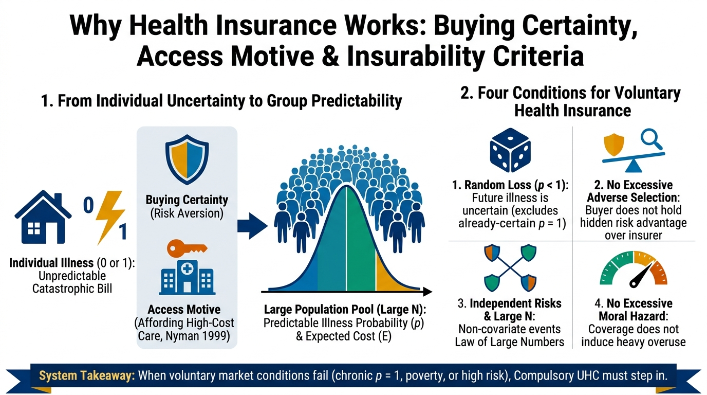

**ภาพที่ 1 การซื้อความแน่นอน แรงจูงใจเข้าถึงบริการ การคาดการณ์ระดับประชากร และเงื่อนไขการประกันสุขภาพภาคสมัครใจ 4 ประการ** แสดงการแปลงความไม่แน่นอนของการเจ็บป่วยระดับปัจเจกสู่ความคาดการณ์ได้ในกองทุนประชากรขนาดใหญ่ ควบคู่กับเงื่อนไขพื้นฐาน 4 ข้อของตลาดประกันภาคสมัครใจ และเหตุผลที่หลักประกันสุขภาพถ้วนหน้าภาคบังคับต้องเข้ามารองรับเมื่อกลไกตลาดสมัครใจมีข้อจำกัด

> ประเด็นสำคัญของหัวข้อย่อยนี้คือ ตลาดประกันสุขภาพภาคสมัครใจทำงานได้ดีเฉพาะกับเหตุการณ์ที่มีโอกาสเกิดต่ำแต่ความเสียหายสูงและผ่านเงื่อนไขทั้งสี่ข้อ จึงไม่อาจคุ้มครองผู้ป่วยโรคเรื้อรังหรือกลุ่มเปราะบางได้อย่างทั่วถึงและต้องอาศัยหลักประกันสุขภาพภาคบังคับของรัฐเข้ามารองรับ

### 1.3 หลักประกันสุขภาพทำหน้าที่อำนวยการเข้าถึงบริการที่จำเป็นและปกป้องครัวเรือนจากรายจ่ายค่ารักษาที่สูงจนล้มละลาย อันนำไปสู่ความเป็นธรรมและหลักประกันสุขภาพถ้วนหน้า (Functions of Health Insurance, Catastrophic Health Expenditure, and UHC)

ในมุมมองของระบบสุขภาพระดับชาติ หลักประกันสุขภาพมิได้เป็นเพียงสินค้าทางการเงิน แต่ทำหน้าที่สำคัญ 2 ประการที่สอดคล้องโดยตรงกับเป้าหมายความเป็นธรรมทางสุขภาพขององค์การอนามัยโลก

- **หน้าที่ที่ 1 — อำนวยการเข้าถึงบริการสุขภาพที่จำเป็น (enable access to needed care):** ขจัดอุปสรรคทางการเงิน ณ จุดรับบริการ (point of service) เพื่อให้ประชาชนได้รับบริการสร้างเสริม ป้องกัน รักษา และฟื้นฟูตามความจำเป็นทางการแพทย์ มิใช่ตามฐานะทางการเงิน ([Kutzin, 2001](https://doi.org/10.1016/s0168-8510%2800%2900149-4); [WHO, 2010](https://iris.who.int/handle/10665/44371))
- **หน้าที่ที่ 2 — ปกป้องครัวเรือนจากรายจ่ายวิบัติทางสุขภาพและความยากจนจากการรักษา (protecting households from catastrophic health expenditure and medical impoverishment):** ป้องกันไม่ให้ครัวเรือนต้องจ่ายค่ารักษาพยาบาลจากกระเป๋าตนเอง (out-of-pocket: OOP) สูงเกินสัดส่วนรายได้หรือความสามารถในการจ่ายจนต้องกู้หนี้ยืมสิน ขายทรัพย์สิน หรือตกสู่เส้นความยากจน เช่น กรณีครอบครัวเกษตรกรที่ต้องดูแลผู้ป่วยไตวายเรื้อรังระยะสุดท้ายก่อนมีสิทธิบัตรทองล้างไต ([Kutzin, 2001](https://doi.org/10.1016/s0168-8510%2800%2900149-4); [Wagstaff et al., 2018](https://doi.org/10.1016/s2214-109x%2817%2930429-1); [WHO, 2010](https://iris.who.int/handle/10665/44371); [Xu et al., 2003](https://doi.org/10.1016/s0140-6736%2803%2913861-5), [2007](https://doi.org/10.1377/hlthaff.26.4.972))
- **สะพานเชื่อมสู่ความเป็นธรรมสองมิติและหลักประกันสุขภาพถ้วนหน้า (Universal Health Coverage: UHC):** การขยายหลักประกันสุขภาพที่มีชุดสิทธิประโยชน์รอบด้านช่วยสร้างความเป็นธรรมทั้ง **มิติด้านบริการ** (เข้าถึงตามความจำเป็น) และ **มิติด้านการคลัง** (ร่วมจ่ายเงินเข้าระบบตามความสามารถในการจ่าย) ([Kutzin, 2013](https://doi.org/10.2471/blt.12.113985); [Murray & Frenk, 2000](https://iris.who.int/handle/10665/268164)) ทั้งนี้ การบรรลุ UHC ได้จริงต้องมีทั้งหลักประกันด้านการเงินควบคู่กับโครงสร้างหน่วยบริการสุขภาพที่กระจายครอบคลุมทั่วถึงและเชื่อมโยงกันให้ประชาชนเดินทางเข้าถึงได้สะดวก ([Tangcharoensathien et al., 2018](https://doi.org/10.1016/s0140-6736%2818%2930198-3); [WHO, 2010](https://iris.who.int/handle/10665/44371); [Xu et al., 2003](https://doi.org/10.1016/s0140-6736%2803%2913861-5))

> ประเด็นสำคัญของหัวข้อย่อยนี้คือ หลักประกันสุขภาพทำหน้าที่ทั้งเปิดประตูให้ประชาชนเข้าถึงบริการที่จำเป็นและเป็นเกราะป้องกันการล้มละลายจากค่ารักษาพยาบาล ซึ่งเมื่อดำเนินการควบคู่กับการกระจายหน่วยบริการที่ทั่วถึงจะเป็นรากฐานสำคัญของหลักประกันสุขภาพถ้วนหน้า

### 1.4 การจ่ายเงินล่วงหน้าและการรวมกองทุนช่วยกระจายความเสี่ยงและเกลี่ยปันรายได้ตามขนาดกองทุน ความเป็นภาคบังคับ และรูปแบบอัตราเงินสมทบ (Prepayment, Risk Pooling, and Contribution Design)

หัวใจทางกลไกของการประกันสุขภาพคือการเปลี่ยนจากการควักกระเป๋าจ่ายเมื่อป่วย ไปสู่ **ระบบจ่ายเงินล่วงหน้า (prepayment system)** และ **การรวมกองทุน (risk pooling)** เพื่อถัวเฉลี่ยภาระระหว่างสมาชิก ดังแสดงในภาพที่ 2 ภาพที่ 3 และตารางที่ 1

- **การกระจายความเสี่ยง (risk cross-subsidization) เทียบกับการเกลี่ยปันรายได้ (income cross-subsidization):** การนำเงินจ่ายล่วงหน้ามารวมในกองทุนเดียวกันทำให้เกิดการอุดหนุนข้ามกลุ่มความเสี่ยง คือเงินจากผู้ที่มีสุขภาพแข็งแรง (ความเสี่ยงต่ำ) ไปช่วยจ่ายค่ารักษาให้ผู้ที่เจ็บป่วย (ความเสี่ยงสูง) และหากออกแบบให้จัดเก็บเงินสมทบหรือภาษีจากผู้มีรายได้สูงในสัดส่วนที่มากกว่าผู้มีรายได้น้อย ก็จะเกิดการเกลี่ยปันรายได้จากคนรวยไปอุดหนุนคนจนควบคู่กัน ([Mathauer et al., 2019](https://doi.org/10.1186/s12939-019-1088-x); [Smith & Witter, 2004](https://doi.org/10.1596/13651); [WHO, 2010](https://iris.who.int/handle/10665/44371))
- **ปัจจัยที่ 1 — ขนาดของกองทุนและความหลากหลายของความเสี่ยง (pool size and risk diversity):** กองทุนขนาดใหญ่ที่มีสมาชิกจำนวนมากและมีโครงสร้างอายุ-สุขภาพหลากหลาย ย่อมถัวเฉลี่ยความเสี่ยงและรับมือรายจ่ายโรคค่าใช้จ่ายสูงได้มั่นคงกว่ากองทุนขนาดเล็กที่แยกเป็นเสี่ยง ๆ ([Mathauer et al., 2019](https://doi.org/10.1186/s12939-019-1088-x); [Smith & Witter, 2004](https://doi.org/10.1596/13651); [WHO, 2010](https://iris.who.int/handle/10665/44371))
- **ปัจจัยที่ 2 — ความเป็นภาคบังคับกับข้อจำกัดของแรงงานนอกระบบ (compulsory vs. voluntary & informal economy):** ประกันภาคบังคับป้องกันไม่ให้คนรวยหรือคนแข็งแรงถอนตัวออกจากกองทุน จึงกระจายความเสี่ยงได้สูงและยั่งยืนกว่าภาคสมัครใจ ([Mathauer et al., 2019](https://doi.org/10.1186/s12939-019-1088-x); [Pettigrew & Mathauer, 2016](https://doi.org/10.1186/s12939-016-0353-5)) อย่างไรก็ดี ในประเทศที่มี **แรงงานนอกระบบ (informal economy)** จำนวนมาก เช่น เกษตรกรและผู้ค้าขายอิสระซึ่งไม่มีบัญชีเงินเดือนให้หักเงินสมทบ การบังคับเก็บเบี้ยมักทำไม่ได้จริงในทางปฏิบัติ ระบบหลักประกันสุขภาพแห่งชาติ (บัตรทอง: UCS) ของไทยจึงเลือกใช้งบประมาณจากภาษีทั่วไปแทนการเก็บเบี้ยจากสมาชิก ทำให้ขยายความครอบคลุมได้ครบถ้วนทันที ([Mathauer et al., 2019](https://doi.org/10.1186/s12939-019-1088-x); [Tangcharoensathien et al., 2018](https://doi.org/10.1016/s0140-6736%2818%2930198-3))
- **ปัจจัยที่ 3 — รูปแบบและอัตราการจัดเก็บเบี้ยประกันหรือเงินสมทบ 5 ระดับ:** เรียงลำดับศักยภาพเชิงหลักการในการกระจายความเสี่ยงและเกลี่ยปันรายได้จากมากไปน้อยได้เป็น **อัตราก้าวหน้า > สัดส่วนของรายได้ (ไม่มีเพดานเงินเดือน) > สัดส่วนของรายได้ (มีเพดานเงินเดือน) > ตามความเสี่ยงระดับชุมชน (community rating) > ตามความเสี่ยงระดับปัจเจก (risk rating)** ทั้งนี้ ในระบบที่ใช้ภาษี ผลความเป็นธรรมจริงยังขึ้นอยู่กับโครงสร้างภาษีของประเทศว่าพึ่งพาภาษีทางตรง (เช่น ภาษีเงินได้ที่มีอัตราก้าวหน้า) มากกว่าภาษีทางอ้อม (เช่น ภาษีมูลค่าเพิ่มซึ่งคนจนรับภาระต่อรายได้สูงกว่า) เพียงใด ([Mossialos et al., 2002](https://iris.who.int/handle/10665/332208); [Smith & Witter, 2004](https://doi.org/10.1596/13651); [Thomson et al., 2009](https://iris.who.int/handle/10665/326415))

**ภาพที่ 2 หลักการจ่ายเงินล่วงหน้า การรวมกองทุน และการกระจายความเสี่ยงควบคู่กับการเกลี่ยปันรายได้** แสดงกลไกการรวมเงินจ่ายล่วงหน้าในกองทุนขนาดใหญ่ที่ก่อให้เกิดทั้งการอุดหนุนข้ามความเสี่ยง (คนแข็งแรงช่วยคนป่วย) และการเกลี่ยปันข้ามระดับรายได้ (คนรวยช่วยคนจน)

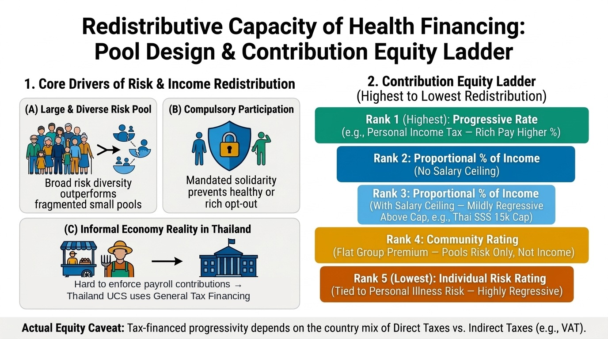

**ภาพที่ 3 ปัจจัยกำหนดศักยภาพการกระจายความเสี่ยงและลำดับขั้นความเป็นธรรมของรูปแบบการจัดเก็บเงินสมทบ 5 ระดับ** เปรียบเทียบผลของขนาดและความหลากหลายของกองทุน ความเป็นภาคบังคับ บริบทแรงงานนอกระบบของไทย และลำดับศักยภาพการเกลี่ยปันรายได้ตั้งแต่อัตราก้าวหน้าจนถึงอัตราตามความเสี่ยงปัจเจก

**ตารางที่ 1** ลำดับศักยภาพในการกระจายความเสี่ยงและเกลี่ยปันรายได้ของรูปแบบการจัดเก็บเบี้ยประกันหรือเงินสมทบ 5 ระดับ

| ลำดับศักยภาพ (มาก → น้อย) | รูปแบบและอัตราการจัดเก็บเบี้ยประกัน/เงินสมทบ | กลไกการคำนวณและผลต่อความเป็นธรรมทางการคลัง | ตัวอย่างในระบบจริง |
| --- | --- | --- | --- |
| **อันดับ 1 (สูงสุด)** | **จัดเก็บอัตราก้าวหน้า (progressive)** | ผู้มีรายได้สูงจ่ายในสัดส่วนเปอร์เซ็นต์ต่อรายได้ที่สูงกว่าผู้มีรายได้น้อย จึงเกลี่ยปันรายได้และกระจายความเสี่ยงได้สูงสุดในเชิงหลักการ (ผลจริงขึ้นกับสัดส่วนภาษีทางตรงเทียบกับทางอ้อม) ([Mossialos et al., 2002](https://iris.who.int/handle/10665/332208); [Thomson et al., 2009](https://iris.who.int/handle/10665/326415)) | ภาษีเงินได้บุคคลธรรมดาที่เป็นแหล่งงบประมาณแผ่นดินหนุนระบบบัตรทอง (UCS) และสวัสดิการข้าราชการ (CSMBS) |
| **อันดับ 2** | **สัดส่วนของรายได้โดยไม่มีเพดานเงินเดือน (proportional without ceiling)** | หักเงินสมทบเป็นเปอร์เซ็นต์คงที่ของรายได้ทุกระดับโดยไม่จำกัดเพดานฐานเงินเดือน ทำให้คนรวยจ่ายเม็ดเงินมากกว่าตามสัดส่วนรายได้จริง ([Mossialos et al., 2002](https://iris.who.int/handle/10665/332208)) | ระบบประกันสุขภาพสังคมในบางประเทศยุโรปที่ยกเลิกเพดานฐานเงินเดือน |
| **อันดับ 3** | **สัดส่วนของรายได้แบบมีเพดานเงินเดือน (proportional with ceiling / mildly regressive)** | หักเป็นเปอร์เซ็นต์ของเงินเดือนแต่กำหนดเพดานฐานคำนวณสูงสุด ทำให้ผู้ที่มีเงินเดือนสูงเกินเพดานจ่ายคิดเป็นสัดส่วนต่อรายได้จริงลดลง จึงมีลักษณะถดถอยเล็กน้อย ([Mossialos et al., 2002](https://iris.who.int/handle/10665/332208); [Thomson et al., 2009](https://iris.who.int/handle/10665/326415)) | ประกันสังคมไทย (SSS) ที่คิดเงินสมทบร้อยละ 5 บนเพดานฐานค่าจ้างไม่เกิน 15,000 บาท/เดือน |
| **อันดับ 4** | **อัตราเบี้ยตามความเสี่ยงระดับชุมชน (community rating)** | สมาชิกทุกคนในชุมชนหรือกลุ่มจ่ายเบี้ยเป็นจำนวนเงินเท่ากันหมด ช่วยเกลี่ยความเสี่ยงจากคนแข็งแรงไปคนป่วยในกลุ่มได้ แต่ไม่ผูกกับรายได้จึงเป็นภาระหนักกว่าต่อคนจน ([Smith & Witter, 2004](https://doi.org/10.1596/13651); [Thomson et al., 2009](https://iris.who.int/handle/10665/326415)) | กองทุนประกันสุขภาพชุมชน หรือบัตรประกันสุขภาพโดยสมัครใจในอดีตที่เก็บเบี้ยราคาเดียวต่อครัวเรือน |
| **อันดับ 5 (ต่ำสุด)** | **อัตราเบี้ยตามความเสี่ยงระดับปัจเจก (risk rating)** | คิดเบี้ยแยกตามความเสี่ยงของแต่ละบุคคล (เช่น อายุ เพศ ประวัติโรค) ผู้สูงอายุหรือผู้ป่วยเรื้อรังต้องจ่ายเบี้ยแพงที่สุด จึงถดถอยสูงและไม่เกิดการเกลี่ยปันรายได้ ([Mossialos et al., 2002](https://iris.who.int/handle/10665/332208); [Smith & Witter, 2004](https://doi.org/10.1596/13651)) | ประกันสุขภาพเอกชนรายบุคคล (individual private health insurance) |

> **🎥 เชื่อมโยงวิดีโอบรรยายประกอบคำสอน (หมวดที่ 1 — Health Economics 03: ระบบประกันสุขภาพ)**
> - [▶ `00:41 – 01:40` การซื้อความแน่นอน (Buying Certainty) และระบบจ่ายเงินล่วงหน้า](https://drive.google.com/file/d/18HJhxQx8TvdAI6KsVLPBFxkAixTwYvJU/view?t=41s) · [▶ `01:40 – 04:54` ความไม่แน่นอนของรายจ่ายสุขภาพระดับครัวเรือนและความเป็นธรรมระดับสังคม](https://drive.google.com/file/d/18HJhxQx8TvdAI6KsVLPBFxkAixTwYvJU/view?t=100s)
> - [▶ `04:54 – 07:58` กลไกการเฉลี่ยความเสี่ยง (Risk Pooling) การคุ้มครองรายจ่ายหายนะ และหน้าที่หลักประกันสุขภาพสู่ UHC](https://drive.google.com/file/d/18HJhxQx8TvdAI6KsVLPBFxkAixTwYvJU/view?t=294s) · [▶ `09:17 – 15:35` ข้อสมมติพื้นฐาน 4 ประการ และเมทริกซ์บริการที่เหมาะต่อการประกันสุขภาพภาคสมัครใจ](https://drive.google.com/file/d/18HJhxQx8TvdAI6KsVLPBFxkAixTwYvJU/view?t=557s)

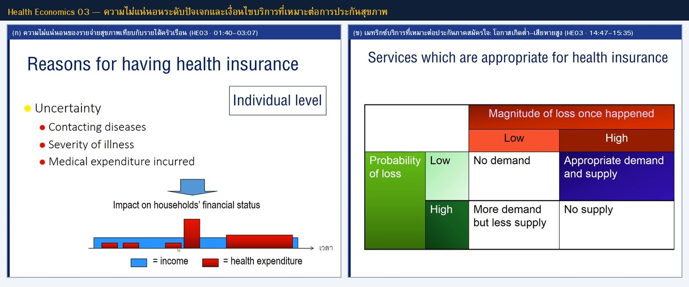

**ภาพประกอบวิดีโอที่ 1.1 ความไม่แน่นอนของรายจ่ายสุขภาพระดับครัวเรือนและเมทริกซ์บริการที่เหมาะต่อการประกันสุขภาพภาคสมัครใจ** (ก) แผนภูมิเปรียบเทียบรายได้ครัวเรือนที่ค่อนข้างคงที่กับรายจ่ายค่ารักษาพยาบาลที่อาจพุ่งสูงเกินรายได้เมื่อเกิดโรคร้ายแรงหรืออุบัติเหตุ (`HE03 · 01:40–03:07`) และ (ข) เมทริกซ์ชี้ว่าบริการที่เหมาะต่อการทำประกันภาคสมัครใจทั้งฝั่งอุปสงค์และอุปทานคือเหตุการณ์ที่มี **โอกาสเกิดต่ำแต่มีขนาดความเสียหายทางการเงินสูง (Low probability, High magnitude of loss)** (`HE03 · 14:47–15:35`)

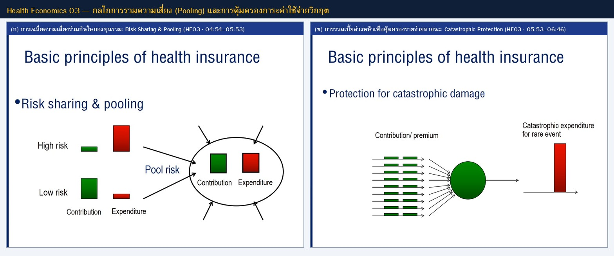

**ภาพประกอบวิดีโอที่ 1.2 แผนภาพการเฉลี่ยความเสี่ยงร่วมกันในกองทุนรวมและการคุ้มครองภาระค่าใช้จ่ายวิกฤต** (ก) การนำเงินสมทบของผู้มีความเสี่ยงต่ำและสูงมารวมในกองทุนเดียวกัน (`Pool risk`) เพื่อถัวเฉลี่ยรายจ่าย (`HE03 · 04:54–05:53`) และ (ข) การรวมเบี้ยจ่ายล่วงหน้ารายย่อยจำนวนมากเพื่อคุ้มครองเหตุการณ์รุนแรงที่เกิดไม่บ่อยแต่มีค่าใช้จ่ายสูงมาก (`Catastrophic protection`) (`HE03 · 05:53–06:46`)

> ประเด็นสำคัญของหัวข้อย่อยนี้คือ กองทุนประกันสุขภาพที่มีขนาดใหญ่ เป็นภาคบังคับ และจัดเก็บเงินในอัตราก้าวหน้าตามรายได้จะมีศักยภาพสูงสุดในการถัวเฉลี่ยความเสี่ยงและเกลี่ยปันรายได้ โดยในบริบทที่มีแรงงานนอกระบบจำนวนมากอย่างประเทศไทย การใช้งบประมาณจากภาษีทั่วไปเป็นกลไกสำคัญที่ทำให้ทุกคนได้รับความคุ้มครองโดยไม่ตกหล่น

## 2. องค์ประกอบของระบบประกันสุขภาพเพิ่มบุคคลที่สามทำหน้าที่จัดซื้อบริการเชิงยุทธศาสตร์ บริหารการคลัง และพัฒนาระบบข้อมูลสารสนเทศ (Components of Health Insurance and Strategic Purchasing)

> คำถามนำของหัวข้อนี้คือ เมื่อเปลี่ยนจากระบบจ่ายเงินเองหน้างานไปสู่ระบบประกันสุขภาพ ผู้รับประกันบุคคลที่สามเข้ามาทำหน้าที่ใดเพื่อให้กองทุนยั่งยืนและคุ้มค่า (What roles does a third-party insurer play in managing benefits, finances, and strategic purchasing?)

หัวข้อนี้วิเคราะห์การเปลี่ยนโครงสร้างความสัมพันธ์จากระบบสองฝ่ายไปสู่สถาปัตยกรรมสามฝ่ายที่มีผู้รับประกันทำหน้าที่บริหารจัดการเชิงรุก ([หัวข้อ 2.1](#hs6-sub-2-1))

### 2.1 ผู้รับประกันเข้ามาเป็นบุคคลที่สามเชื่อมระหว่างผู้มีสิทธิกับหน่วยบริการ พร้อมบริหารจัดการด้านการคลัง การจัดซื้อเชิงยุทธศาสตร์ และระบบข้อมูล (Third-Party Insurer, Strategic Purchasing, Financial Management, and Information Systems)

ในระบบที่ผู้ป่วยจ่ายเงินเองหน้างาน (out-of-pocket) มีผู้เกี่ยวข้องเพียง 2 ฝ่ายคือผู้ใช้บริการกับผู้ให้บริการ แต่เมื่อเปลี่ยนสู่ระบบประกันสุขภาพจะมี **บุคคลที่สาม** คือ **ผู้รับประกัน (insurer)** หรือหน่วยงานบริหารกองทุน (เช่น สปสช. สำนักงานประกันสังคม กรมบัญชีกลาง หรือบริษัทประกัน) เข้ามาทำหน้าที่หลักดังแสดงในภาพที่ 4

- **การบริหารสิทธิประโยชน์และการจัดซื้อบริการเชิงยุทธศาสตร์ (benefit management & strategic purchasing):** ผู้รับประกันทำหน้าที่แทนผู้ประกันตน (insured persons) หรือผู้มีสิทธิ (beneficiaries) ในการคัดเลือกชุดสิทธิประโยชน์ที่คุ้มค่า (เช่น ใช้การประเมินเทคโนโลยีด้านสุขภาพและเกณฑ์ความคุ้มค่าทางเศรษฐศาสตร์ควบคู่กับการป้องกันรายจ่ายวิบัติ) ตลอดจนคัดเลือกทำสัญญาและกำหนดวิธีจ่ายเงินแก่หน่วยบริการ (providers) เพื่อจูงใจให้เกิดคุณภาพและประสิทธิภาพ แทนการตามจ่ายเงินตามใบเรียกเก็บแบบตั้งรับ ([Kutzin, 2001](https://doi.org/10.1016/s0168-8510%2800%2900149-4); [Tangcharoensathien et al., 2015](https://doi.org/10.1093/heapol/czu120); [WHO, 2000](https://cdn.who.int/media/docs/default-source/health-financing/whr-2000.pdf))
- **การบริหารจัดการด้านการคลัง (financial management):** คำนวณความเสี่ยงและจัดเก็บเบี้ยประกันหรือจัดทำงบประมาณให้เพียงพอต่อความยั่งยืนของกองทุน (ตามหลักสมการเบี้ยประกัน `π = pL + T` คือครอบคลุมทั้งค่าสินไหมคาดหมาย `pL` และต้นทุนบริหารจัดการ `T`) บริหารสภาพคล่อง และกำหนดอัตราตลอดจนระบบเบิกจ่ายชดเชยที่รัดกุม ([Kutzin, 2001](https://doi.org/10.1016/s0168-8510%2800%2900149-4); [WHO, 2010](https://iris.who.int/handle/10665/44371); [สุรจิต สุนทรธรรม และคณะ, 2555](https://kb.hsri.or.th/dspace/handle/11228/3691))
- **การพัฒนาระบบข้อมูลสารสนเทศเพื่อการกำกับติดตาม (health information systems):** สร้างฐานข้อมูลทะเบียนผู้มีสิทธิ ข้อมูลการให้บริการและการเบิกจ่าย และระบบตรวจสอบเวชระเบียน เพื่อใช้ในการวางแผนงบประมาณ ปรับอัตราจ่าย และกำกับติดตามคุณภาพบริการอย่างมีประสิทธิผล ([Tangcharoensathien et al., 2015](https://doi.org/10.1093/heapol/czu120); [WHO, 2010](https://iris.who.int/handle/10665/44371); [สุรจิต สุนทรธรรม และคณะ, 2555](https://kb.hsri.or.th/dspace/handle/11228/3691))

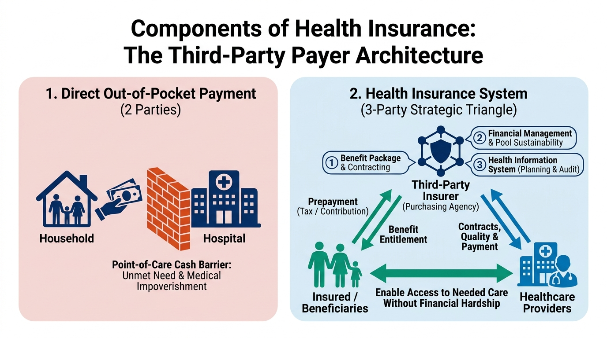

**ภาพที่ 4 องค์ประกอบของระบบประกันสุขภาพ: จากการจ่ายเงินเองหน้างานสู่สามเหลี่ยมยุทธศาสตร์ผู้รับประกันบุคคลที่สาม** เปรียบเทียบอุปสรรคทางการเงินในระบบจ่ายเงินเองสองฝ่าย กับสถาปัตยกรรมสามฝ่ายที่มีผู้รับประกันทำหน้าที่บริหารชุดสิทธิประโยชน์และสัญญา บริหารจัดการการคลัง และพัฒนาระบบข้อมูลสารสนเทศ

> **🎥 เชื่อมโยงวิดีโอบรรยายประกอบคำสอน (หมวดที่ 2 — บทบาทผู้รับประกัน การคำนวณเบี้ย และการกำหนดชุดสิทธิประโยชน์)**
> - [▶ `HE03 · 13:46 – 14:47` ฝั่งผู้รับประกัน (Supply for Health Insurance): ความยั่งยืนทางการคลังและสมการเบี้ยประกัน `π = pL + T`](https://drive.google.com/file/d/18HJhxQx8TvdAI6KsVLPBFxkAixTwYvJU/view?t=826s)
> - [▶ `HE02 · 15:26 – 19:02` การใช้การประเมินทางเศรษฐศาสตร์ (ICER ไม่เกิน 1 GDP/หัว ควบคู่การป้องกันรายจ่ายหายนะและภาระงบประมาณ) กำหนดชุดสิทธิประโยชน์และบัญชียาหลักแห่งชาติ](https://drive.google.com/file/d/1n9ypS2_ybWH8s9j2hTc-qevXpO15aLGU/view?t=926s)

> ประเด็นสำคัญของหัวข้อย่อยนี้คือ การมีผู้รับประกันเป็นบุคคลที่สามช่วยเปลี่ยนอำนาจต่อรองจากผู้ป่วยรายบุคคลไปสู่องค์กรบริหารกองทุนที่ทำหน้าที่จัดซื้อบริการเชิงยุทธศาสตร์ บริหารความสมดุลทางการคลัง และใช้ระบบข้อมูลกำกับคุณภาพและประสิทธิภาพของหน่วยบริการ

## 3. ประเภทของการประกันสุขภาพในประเทศไทยแบ่งเป็นภาคสมัครใจและภาคบังคับ โดยประชากรเกือบทุกคนมีสิทธิหลักในสามระบบใหญ่ (Types of Health Insurance in Thailand)

> คำถามนำของหัวข้อนี้คือ เหตุใดตลาดประกันสุขภาพภาคสมัครใจจึงเผชิญปัญหาการคัดเลือกที่ขัดผลประโยชน์กัน และระบบประกันสุขภาพของไทยจัดโครงสร้างคุ้มครองประชากรอย่างไร (Why does voluntary health insurance suffer from adverse selection, and how are Thailand&#x27;s health insurance schemes structured?)

ระบบประกันสุขภาพแบ่งออกเป็น 2 ประเภทหลัก คือ ภาคสมัครใจ ([หัวข้อ 3.1](#hs6-sec-11)) และภาคบังคับ ([หัวข้อ 3.2](#hs6-sec-12)) ([Kutzin, 2001](https://doi.org/10.1016/s0168-8510%2800%2900149-4); [WHO, 2010](https://iris.who.int/handle/10665/44371))

### 3.1 การประกันสุขภาพโดยสมัครใจเผชิญปัญหาการคัดเลือกที่ขัดผลประโยชน์กัน จึงต้องใช้มาตรการคัดกรองความเสี่ยง ประกันกลุ่ม หรือมุ่งสู่ระบบภาคบังคับ (Voluntary Health Insurance, Adverse Selection, and Underwriting)

> หากเปิดขายบัตรประกันสุขภาพโดยสมัครใจในราคาเดียวโดยไม่ตรวจสุขภาพก่อน ผู้เรียนคิดว่าผู้ที่มีโรคประจำตัวเรื้อรังกับคนหนุ่มสาวที่แข็งแรงดี กลุ่มใดจะรีบมาซื้อบัตรมากกว่ากัน และจะเกิดผลอย่างไรต่อฐานะการเงินของกองทุน

การประกันสุขภาพโดยสมัครใจเปิดให้บุคคลหรือองค์กรเลือกซื้อความคุ้มครองเอง แต่ความสมัครใจนี้เองที่ก่อให้เกิดความล้มเหลวของตลาดประกันภัยและจำกัดความสามารถในการคุ้มครองประชากรทั้งประเทศ

- **รูปแบบของการประกันสุขภาพภาคสมัครใจในไทย:** ปัจจุบันได้แก่ **ประกันสุขภาพเอกชน (private health insurance)** ทั้งแผนรายบุคคลที่ประชาชนซื้อเอง (individual plan) และประกันสุขภาพกลุ่มตามการจ้างงานที่องค์กรซื้อเป็นสวัสดิการให้พนักงาน (employment-based health insurance) ([Pettigrew & Mathauer, 2016](https://doi.org/10.1186/s12939-016-0353-5); [Thomson et al., 2009](https://iris.who.int/handle/10665/326415)) ส่วนในอดีตภาครัฐเคยจัดโครงการบัตรประกันสุขภาพโดยสมัครใจของกระทรวงสาธารณสุข ซึ่งยุติไปเมื่อประกาศใช้ระบบหลักประกันสุขภาพถ้วนหน้า ([Hughes & Leethongdee, 2007](https://doi.org/10.1377/hlthaff.26.4.999); [Tangcharoensathien et al., 2018](https://doi.org/10.1016/s0140-6736%2818%2930198-3))
- **ความยั่งยืนด้านการเงิน (financial sustainability) กับปัญหาการคัดเลือกที่ขัดผลประโยชน์กัน (adverse selection):** กองทุนจะอยู่รอดได้เมื่อเบี้ยที่เก็บล่วงหน้าเพียงพอจ่ายค่ารักษาโดยไม่ขาดทุน แต่เนื่องจากผู้ซื้อรู้สถานะสุขภาพของตนดีกว่าผู้ขาย (information asymmetry) ผู้ที่มีความเสี่ยงสูงหรือเริ่มมีอาการผิดปกติจึงมีแนวโน้มซื้อประกันมากกว่าคนแข็งแรง ส่งผลให้ค่าใช้จ่ายเฉลี่ยของกองทุนพุ่งสูงกว่าที่คำนวณไว้ หากบริษัทปรับขึ้นค่าเบี้ย คนแข็งแรงก็จะยิ่งถอนตัวออกจนกองทุนเสี่ยงล้มละลาย ([Akerlof, 1970](https://doi.org/10.2307/1879431); [Einav & Finkelstein, 2011](https://doi.org/10.1257/jep.25.1.115); [Rothschild & Stiglitz, 1976](https://doi.org/10.2307/1885326); [Smith & Witter, 2004](https://doi.org/10.1596/13651))
- **แนวทางที่ 1 — มาตรการคัดกรองความเสี่ยงของบริษัทประกันเอกชน:** บริษัทเอกชนป้องกันการขาดทุนด้วย 4 เครื่องมือหลัก ได้แก่ (1) คิดเบี้ยตามความเสี่ยงรายบุคคล (risk rating) เช่น ปรับเบี้ยแพงขึ้นตามอายุและเพศ (2) ตรวจคัดกรองสุขภาพและพิจารณารับประกันก่อนทำสัญญา (underwriting) (3) ตัดความคุ้มครองโรคที่เป็นมาก่อนทำประกันออกจากชุดสิทธิประโยชน์ (exclusion of pre-existing conditions) และ (4) แยกแผนสิทธิประโยชน์และราคาตามระดับความเสี่ยง (risk segmentation) ทว่ามาตรการเหล่านี้ทำให้ผู้ป่วยเรื้อรัง ผู้สูงอายุ และคนยากจนซึ่งต้องการความคุ้มครองมากที่สุดกลับถูกกีดกันออกจากระบบ ([Pettigrew & Mathauer, 2016](https://doi.org/10.1186/s12939-016-0353-5); [Rothschild & Stiglitz, 1976](https://doi.org/10.2307/1885326); [Stone, 1993](https://doi.org/10.1215/03616878-18-2-287); [van de Ven & Ellis, 2000](https://doi.org/10.1016/S1574-0064%2800%2980173-0))
- **แนวทางที่ 2 — การจัดทำประกันสุขภาพแบบกลุ่ม (group insurance):** เช่น นายจ้างเหมาซื้อประกันกลุ่มให้ลูกจ้างทั้งบริษัท ช่วยดึงคนวัยทำงานที่แข็งแรงเข้ามาถัวความเสี่ยงและลดปัญหา adverse selection ได้ระดับหนึ่งตามขนาดขององค์กร ([Einav & Finkelstein, 2011](https://doi.org/10.1257/jep.25.1.115); [Smith & Witter, 2004](https://doi.org/10.1596/13651))
- **แนวทางที่ 3 — การมุ่งสู่ประกันสุขภาพภาคบังคับและหลักประกันสุขภาพถ้วนหน้า (compulsory insurance & UHC):** เป็นทางออกที่มีประสิทธิผลสูงสุดและแก้ปัญหา adverse selection ได้อย่างเบ็ดเสร็จ เพราะกฎหมายรวมประชาชนทั้งคนแข็งแรงและคนป่วยเข้าไว้ในกองทุนเดียวกันโดยไม่มีใครถูกคัดออก ([Einav & Finkelstein, 2011](https://doi.org/10.1257/jep.25.1.115); [Mathauer et al., 2019](https://doi.org/10.1186/s12939-019-1088-x); [WHO, 2010](https://iris.who.int/handle/10665/44371))

> ประเด็นสำคัญของหัวข้อย่อยนี้คือ ระบบประกันภาคสมัครใจเผชิญปัญหาผู้มีความเสี่ยงสูงเข้ามาซื้อมากกว่าคนแข็งแรง ทำให้บริษัทเอกชนต้องตั้งกำแพงคัดกรองสุขภาพและตัดโรคที่เป็นมาก่อน การแก้ปัญหานี้อย่างเบ็ดเสร็จและเป็นธรรมจึงต้องอาศัยระบบประกันสุขภาพภาคบังคับที่รวมประชากรทุกคนเข้าด้วยกัน

### 3.2 การประกันสุขภาพภาคบังคับใช้กฎหมายรวมกลุ่มเป้าหมายทั้งหมด โดยประเทศไทยมีสามระบบหลักควบคู่กับระบบย่อยและประกันแบบซ้ำซ้อน (Compulsory Health Insurance and Thai Health Insurance Schemes)

**การประกันสุขภาพภาคบังคับ (compulsory health insurance)** อาศัยกฎหมายกำหนดให้ประชากรกลุ่มเป้าหมายทั้งหมดเข้าสู่ระบบ ([Carrin & James, 2005](https://doi.org/10.1111/j.1468-246X.2005.00209.x); [Mathauer et al., 2019](https://doi.org/10.1186/s12939-019-1088-x); [WHO, 2010](https://iris.who.int/handle/10665/44371)) ซึ่งในประเทศไทยจำแนกออกเป็น 4 รูปแบบและจัดโครงสร้างความคุ้มครองประชากรดังแสดงในภาพที่ 5 ตารางที่ 2 และตารางที่ 3

- **3.2.1 ระบบประกันสังคม (Social Health Insurance: SHI / SSS):** บังคับใช้กับลูกจ้างในภาคการจ้างงานทางการโดยนายจ้าง ลูกจ้าง และรัฐบาลร่วมสมทบเป็นสัดส่วนของเงินเดือนเข้ากองทุนที่มีสำนักงานประกันสังคมบริหารจัดการ จุดสังเกตสำคัญคือในต่างประเทศระบบประกันสังคมมักคุ้มครองคู่สมรสและบุตรด้วย แต่ **ประกันสังคมของไทยคุ้มครองเฉพาะตัวลูกจ้างผู้ส่งเงินสมทบเท่านั้น** (ส่วนคู่สมรสและบุตรหากไม่มีสิทธิอื่นจะได้รับความคุ้มครองในระบบบัตรทองแทน) ([Carrin & James, 2005](https://doi.org/10.1111/j.1468-246X.2005.00209.x); [Tangcharoensathien et al., 2018](https://doi.org/10.1016/s0140-6736%2818%2930198-3); [พระราชบัญญัติประกันสังคม พ.ศ. 2533, 2533](https://www.sso.go.th/wpr/main/law/%E0%B8%9E%E0%B8%A3%E0%B8%B0%E0%B8%A3%E0%B8%B2%E0%B8%8A%E0%B8%9A%E0%B8%B1%E0%B8%8D%E0%B8%8D%E0%B8%B1%E0%B8%95%E0%B8%B4_category_list-label_1_106_0); [สุรจิต สุนทรธรรม และคณะ, 2555](https://kb.hsri.or.th/dspace/handle/11228/3691))
- **3.2.2 รูปแบบที่รัฐจัดหลักประกันโดยใช้เงินภาษี (Tax-based system):** รัฐใช้งบประมาณภาษีทั่วไปจัดสรรรายปีโดยไม่ต้องตั้งหน่วยงานเก็บเบี้ยประกันจากประชาชน (คล้ายระบบของอังกฤษ แคนาดา และออสเตรเลีย) ([Böhm et al., 2013](https://doi.org/10.1016/j.healthpol.2013.09.003); [Mossialos et al., 2002](https://iris.who.int/handle/10665/332208)) ในไทยครอบคลุม **ระบบหลักประกันสุขภาพแห่งชาติ (บัตรทอง: UCS)** **ระบบสวัสดิการรักษาพยาบาลข้าราชการ (CSMBS)** พนักงานองค์กรปกครองส่วนท้องถิ่น องค์กรอิสระ และกองทุนคืนสิทธิให้กลุ่มบุคคลที่มีปัญหาสถานะและสิทธิ [1] ([Tangcharoensathien et al., 2018](https://doi.org/10.1016/s0140-6736%2818%2930198-3); [พระราชกฤษฎีกาเงินสวัสดิการเกี่ยวกับการรักษาพยาบาล พ.ศ. 2553, 2553](https://www.ratchakitcha.soc.go.th/DATA/PDF/2553/A/023/1.PDF); [พระราชบัญญัติหลักประกันสุขภาพแห่งชาติ พ.ศ. 2545, 2545](https://www.ratchakitcha.soc.go.th/DATA/PDF/2545/A/116/1.PDF); [สุรจิต สุนทรธรรม และคณะ, 2555](https://kb.hsri.or.th/dspace/handle/11228/3691))
- **3.2.3 ประกันอุบัติเหตุและการเจ็บป่วยภาคบังคับเฉพาะกรณี:** ประกอบด้วย (1) **ประกัน พ.ร.บ. ผู้ประสบภัยจากรถ (Traffic Accident Insurance)** ตาม พ.ร.บ. คุ้มครองผู้ประสบภัยจากรถ พ.ศ. 2535 ที่บังคับเจ้าของรถทุกคันซื้อประกันบุคคลที่สามโดยมีบริษัทประกันเอกชนเป็นผู้บริหาร ([พระราชบัญญัติคุ้มครองผู้ประสบภัยจากรถ พ.ศ. 2535, 2535](https://www.ratchakitcha.soc.go.th/DATA/PDF/2535/A/044/45.PDF)) และ (2) **กองทุนเงินทดแทน (Workmen&#x27;s Compensation Scheme: WCS)** ที่บังคับนายจ้างจ่ายเงินสมทบฝ่ายเดียวตามระดับความเสี่ยงและประสบการณ์อุบัติเหตุจากการทำงานของสถานประกอบการ เพื่อคุ้มครองลูกจ้างที่เจ็บป่วยหรือบาดเจ็บเนื่องจากการทำงาน บริหารโดยสำนักงานประกันสังคม ([พระราชบัญญัติเงินทดแทน พ.ศ. 2537, 2537](https://www.ratchakitcha.soc.go.th/DATA/PDF/2537/A/028/3.PDF); [พระราชบัญญัติเงินทดแทน (ฉบับที่ 2) พ.ศ. 2561, 2561](https://www.ratchakitcha.soc.go.th/DATA/PDF/2561/A/080/T_0001.PDF); [สุรจิต สุนทรธรรม และคณะ, 2555](https://kb.hsri.or.th/dspace/handle/11228/3691))
- **3.2.4 ประกันสุขภาพแรงงานต่างด้าว (Migrant Health Insurance):** กำหนดให้แรงงานต่างด้าวที่ได้รับอนุญาตทำงานชั่วคราวและผู้ติดตามซึ่งไม่อยู่ในข่ายประกันสังคมต้องตรวจสุขภาพและซื้อบัตรประกันสุขภาพจากโรงพยาบาลสังกัดกระทรวงสาธารณสุขก่อนรับใบอนุญาตทำงาน โดยโรงพยาบาลทำหน้าที่เป็นทั้งผู้รับประกันและผู้จัดบริการในตัว ([Tangcharoensathien et al., 2017](https://doi.org/10.2471/BLT.16.179606))
- **ภาพรวมความครอบคลุมประชากรไทยและการประกันแบบซ้ำซ้อน (duplicated coverage):** ณ เดือนตุลาคม พ.ศ. 2567 คนไทยเกือบทุกคนมีสิทธิหลักใน 3 ระบบใหญ่ ได้แก่ **UCS 46.9 ล้านคน** **SSS 12.8 ล้านคน** และ **CSMBS ประมาณ 5.4 ล้านคน** ร่วมกับระบบย่อย เช่น พนักงานส่วนท้องถิ่น 6.87 แสนคน ส่วนการทำประกันเอกชน กองทุนเงินทดแทน และ พ.ร.บ. ผู้ประสบภัยจากรถ จัดเป็นความคุ้มครองแบบซ้ำซ้อน (duplicated) บนสิทธิพื้นฐานที่ประชาชนมีอยู่แล้ว ([Tangcharoensathien et al., 2018](https://doi.org/10.1016/s0140-6736%2818%2930198-3); [ศูนย์สารสนเทศการประกันสุขภาพ สำนักงานหลักประกันสุขภาพแห่งชาติ, 2567](http://ucinfo.nhso.go.th/); [สุรจิต สุนทรธรรม และคณะ, 2555](https://kb.hsri.or.th/dspace/handle/11228/3691))

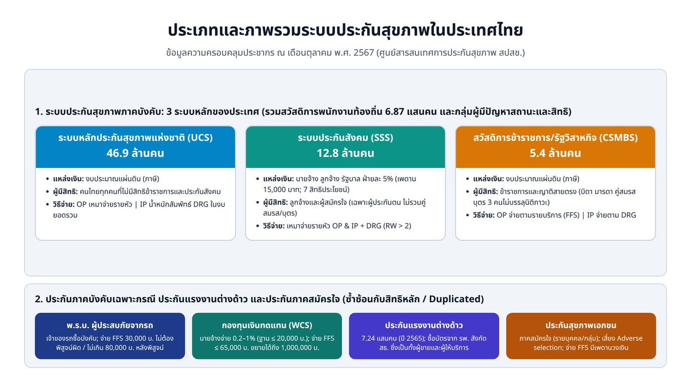

**ภาพที่ 5 ภูมิทัศน์ระบบประกันสุขภาพไทย: จากปัญหา Adverse Selection สู่หลักประกันสุขภาพถ้วนหน้าภาคบังคับ (Universal Health Coverage)** แสดงเหตุผลที่ตลาดประกันภาคสมัครใจเกิดปัญหาการคัดเลือกที่ขัดผลประโยชน์กัน และภาพรวมความครอบคลุมประชากรไทยใน 3 ระบบหลัก ระบบย่อย และความคุ้มครองแบบซ้ำซ้อนเฉพาะกรณี (ข้อมูล ณ ตุลาคม พ.ศ. 2567)

**ตารางที่ 2** ระบบประกันสุขภาพประเภทต่าง ๆ ในประเทศไทย (ทั้งระบบหลัก ระบบย่อย และความคุ้มครองเฉพาะกรณี)

| โครงการ | ผู้มีสิทธิ | แหล่งรายได้ | วิธีจ่ายผู้ให้บริการ |
| --- | --- | --- | --- |
| **ประกันสุขภาพเอกชน** | ผู้ที่หาซื้อประกันเอง (รายบุคคลหรือประกันกลุ่มสวัสดิการบริษัท) | จากเบี้ยประกันที่เก็บได้ | จ่ายตามรายบริการ (Fee-for-service) แต่มีเพดานการจ่ายตามแผนกรมธรรม์ |
| **ประกันสังคม (Social Security Scheme: SSS)** | พนักงานรัฐ/ลูกจ้างเอกชนในหน่วยงานที่มีลูกจ้างตั้งแต่ 1 คนขึ้นไปและผู้ที่สมัครใจเข้าร่วม 12.8 ล้านคน ([พระราชบัญญัติประกันสังคม พ.ศ. 2533, 2533](https://www.sso.go.th/wpr/main/law/%E0%B8%9E%E0%B8%A3%E0%B8%B0%E0%B8%A3%E0%B8%B2%E0%B8%8A%E0%B8%9A%E0%B8%B1%E0%B8%8D%E0%B8%8D%E0%B8%B1%E0%B8%95%E0%B8%B4_category_list-label_1_106_0); [ศูนย์สารสนเทศการประกันสุขภาพ สำนักงานหลักประกันสุขภาพแห่งชาติ, 2567](http://ucinfo.nhso.go.th/)) | ร่วมจ่ายจากนายจ้าง ลูกจ้าง และรัฐบาล อัตราฝ่ายละ 5% ของเงินเดือนลูกจ้าง คิดเพดานเงินเดือนไม่เกิน 15,000 บาท สำหรับสิทธิประโยชน์ 7 อย่าง (เจ็บป่วย คลอดบุตร ทุพพลภาพ เสียชีวิต สงเคราะห์บุตร ชราภาพ และว่างงาน) | เหมาจ่ายรายหัว (Capitation) สำหรับบริการผู้ป่วยนอกและในไปยังโรงพยาบาลคู่สัญญาทั้งรัฐและเอกชน และจ่ายตาม DRG [2] สำหรับผู้ป่วยในที่มีค่าน้ำหนักสัมพัทธ์ (Relative weight) เกิน 2 ([Tangcharoensathien et al., 2018](https://doi.org/10.1016/s0140-6736%2818%2930198-3)) |
| **สวัสดิการรักษาพยาบาลข้าราชการ (Civil Servant Medical Benefit Scheme: CSMBS)** | ข้าราชการและญาติสายตรง (บิดา มารดา คู่สมรส และบุตรสามคนที่ยังไม่บรรลุนิติภาวะ) 5.4 ล้านคน ([พระราชกฤษฎีกาเงินสวัสดิการเกี่ยวกับการรักษาพยาบาล พ.ศ. 2553, 2553](https://www.ratchakitcha.soc.go.th/DATA/PDF/2553/A/023/1.PDF); [ศูนย์สารสนเทศการประกันสุขภาพ สำนักงานหลักประกันสุขภาพแห่งชาติ, 2567](http://ucinfo.nhso.go.th/)) | งบประมาณแผ่นดิน (ภาษีทั่วไป) | จ่ายตามรายบริการ (Fee-for-service) สำหรับผู้ป่วยนอก และ Diagnosis-Related Group (DRG) สำหรับผู้ป่วยใน ([Patcharanarumol et al., 2018](https://doi.org/10.1371/journal.pone.0195179)) |
| **ระบบหลักประกันสุขภาพแห่งชาติ (Universal Coverage Scheme: UCS)** | ประชาชนไทยทุกคนที่ไม่มีสิทธิสวัสดิการข้าราชการและประกันสังคม 46.9 ล้านคน ([พระราชบัญญัติหลักประกันสุขภาพแห่งชาติ พ.ศ. 2545, 2545](https://www.ratchakitcha.soc.go.th/DATA/PDF/2545/A/116/1.PDF); [ศูนย์สารสนเทศการประกันสุขภาพ สำนักงานหลักประกันสุขภาพแห่งชาติ, 2567](http://ucinfo.nhso.go.th/)) | งบประมาณแผ่นดิน (ภาษีทั่วไป) | เหมาจ่ายรายหัว (Capitation) ไปยังโรงพยาบาลรัฐและเอกชนสำหรับผู้ป่วยนอก และใช้น้ำหนักสัมพัทธ์ DRG ในการคำนวณจัดสรรภายใต้งบยอดรวม (Global budget) สำหรับผู้ป่วยใน ([Tangcharoensathien et al., 2015](https://doi.org/10.1093/heapol/czu120)) |
| **กองทุนเงินทดแทน (Workmen&#x27;s Compensation Scheme: WCS)** | ผู้ประกันตนในระบบประกันสังคมที่เจ็บป่วยหรือประสบอุบัติเหตุอันเนื่องจากการทำงาน ([พระราชบัญญัติเงินทดแทน พ.ศ. 2537, 2537](https://www.ratchakitcha.soc.go.th/DATA/PDF/2537/A/028/3.PDF)) | นายจ้างจ่ายฝ่ายเดียว 0.2–1% ของเงินเดือนลูกจ้างตามความเสี่ยงภัยของกิจการ โดยคิดจากค่าจ้างไม่เกิน 20,000 บาทต่อเดือน | จ่ายตามรายบริการ (Fee-for-service) ไม่เกิน 65,000 บาท แต่ขยายได้จนถึง 1,000,000 บาทถ้ามีเหตุจำเป็น โดยให้นายจ้างร่วมรับผิดชอบ ([พระราชบัญญัติเงินทดแทน (ฉบับที่ 2) พ.ศ. 2561, 2561](https://www.ratchakitcha.soc.go.th/DATA/PDF/2561/A/080/T_0001.PDF)) |
| **การประกันสุขภาพตาม พ.ร.บ. คุ้มครองผู้ประสบภัยจากรถ พ.ศ. 2535** | ผู้ที่ได้รับบาดเจ็บจากอุบัติเหตุรถ ([พระราชบัญญัติคุ้มครองผู้ประสบภัยจากรถ พ.ศ. 2535, 2535](https://www.ratchakitcha.soc.go.th/DATA/PDF/2535/A/044/45.PDF)) | เจ้าของรถต้องซื้อประกันให้กับรถของตัวเองก่อนต่อทะเบียนรถ | จ่ายตามรายบริการ (Fee-for-service) 30,000 บาทแรกไม่ต้องพิสูจน์ว่าใครผิด และไม่เกิน 80,000 บาทหลังพิสูจน์ถูกผิด |
| **ประกันสุขภาพแรงงานต่างด้าว** | แรงงานต่างด้าวที่ได้รับอนุญาตให้ทำงานในไทยชั่วคราวและไม่เข้าข่ายประกันสังคมและผู้ติดตาม 7.24 แสนคน (พ.ศ. 2565) ([Tangcharoensathien et al., 2017](https://doi.org/10.2471/BLT.16.179606)) | แรงงานต่างด้าวต้องจ่ายค่าตรวจสุขภาพและค่าบัตรประกันสุขภาพก่อนขึ้นทะเบียนได้รับอนุญาตทำงาน | โรงพยาบาลสังกัดกระทรวงสาธารณสุขเป็นผู้ขายประกันและให้บริการด้วยตนเอง |

หมายเหตุ: ข้อมูลจำนวนผู้ประกันตนในระบบประกันสุขภาพต่าง ๆ ณ เดือนตุลาคม พ.ศ. 2567 ศูนย์สารสนเทศการประกันสุขภาพ สำนักงานหลักประกันสุขภาพแห่งชาติ ([ศูนย์สารสนเทศการประกันสุขภาพ สำนักงานหลักประกันสุขภาพแห่งชาติ, 2567](http://ucinfo.nhso.go.th/))

**ตารางที่ 3** เปรียบเทียบเชิงโครงสร้างและกลไกการคลังของ 3 กองทุนประกันสุขภาพหลักของประเทศไทย

| มิติเปรียบเทียบ | สวัสดิการรักษาพยาบาลข้าราชการ (CSMBS) | ระบบประกันสังคม (SSS) | หลักประกันสุขภาพแห่งชาติ / บัตรทอง (UCS) |
| --- | --- | --- | --- |
| **ปรัชญาและฐานสิทธิ** | สวัสดิการตอบแทนข้าราชการและบุคคลในครอบครัวสายตรง (ประมาณ 5.4 ล้านคน) | ความมั่นคงทางสังคมของแรงงานในระบบ เฉพาะตัวผู้ส่งเงินสมทบ ไม่รวมครอบครัว (12.8 ล้านคน) | สิทธิขั้นพื้นฐานของพลเมืองไทยทุกคนที่ไม่มีสิทธิอื่น (46.9 ล้านคน) |
| **หน่วยงานบริหาร (Purchaser)** | กรมบัญชีกลาง กระทรวงการคลัง | สำนักงานประกันสังคม กระทรวงแรงงาน | สำนักงานหลักประกันสุขภาพแห่งชาติ (สปสช.) |
| **แหล่งเงินและการคลัง** | ภาษีทั่วไป (งบประมาณแผ่นดินปลายเปิดตามการเบิกจริง) | เงินสมทบไตรภาคี (ลูกจ้าง นายจ้าง รัฐ ฝ่ายละ 5% เพดานฐานค่าจ้าง 15,000 บาท สำหรับ 7 กรณี) | ภาษีทั่วไป (งบประมาณแผ่นดินเหมาจ่ายรายหัวปลายปิดรายปี) |
| **การเลือกหน่วยบริการด่านหน้า** | เข้ารับบริการโรงพยาบาลรัฐได้ทุกแห่งโดยไม่ต้องลงทะเบียนหน่วยปฐมภูมิด่านหน้า | ลงทะเบียนเลือกโรงพยาบาลคู่สัญญา (รัฐหรือเอกชน) 1 แห่งเป็นโรงพยาบาลหลัก | ลงทะเบียนหน่วยบริการประจำและเครือข่ายบริการปฐมภูมิ (CUP) ใกล้บ้านเป็นด่านหน้า (gatekeeper) |
| **วิธีจ่ายเงินและผลต่อการคุมต้นทุน** | OP จ่ายตามรายบริการ (FFS) ทำให้รายจ่ายต่อหัวสูงที่สุด; IP จ่ายด้วย DRGs ([Patcharanarumol et al., 2018](https://doi.org/10.1371/journal.pone.0195179)) | เหมาจ่ายรายหัว (Capitation) รวม OP/IP และจ่ายเพิ่มตาม DRGs เมื่อค่าน้ำหนักสัมพัทธ์ RW > 2 ([Tangcharoensathien et al., 2018](https://doi.org/10.1016/s0140-6736%2818%2930198-3)) | OP เหมาจ่ายรายหัว (Capitation); IP ใช้แต้ม DRGs ภายใต้งบประมาณยอดรวมปลายปิด (Global budget) คุมงบรวมได้ดีที่สุด ([Tangcharoensathien et al., 2015](https://doi.org/10.1093/heapol/czu120)) |

> **🎥 เชื่อมโยงวิดีโอบรรยายประกอบคำสอน (หมวดที่ 3 — Health Economics 03 & 04: ประเภทประกันสุขภาพและ 3 กองทุนหลักของไทย)**
> - [▶ `HE03 · 15:35 – 19:00` ความล้มเหลวของตลาดประกันภาคสมัครใจ (Imperfect Information → Adverse Selection) และมาตรการป้องกันตั้งแต่ Risk Rating ถึงประกันภาคบังคับ](https://drive.google.com/file/d/18HJhxQx8TvdAI6KsVLPBFxkAixTwYvJU/view?t=935s)
> - [▶ `HE03 · 19:00 – 27:03` เปรียบเทียบประกันสุขภาพภาคบังคับแบบประกันสังคม (Social Solidarity) กับระบบภาษีทั่วไป (Social Welfare)](https://drive.google.com/file/d/18HJhxQx8TvdAI6KsVLPBFxkAixTwYvJU/view?t=1140s) · [▶ `HE04 · 00:54 – 03:57` ตารางเปรียบเทียบเชิงโครงสร้าง 3 ระบบหลักของไทย (CSMBS · SSS · UCS)](https://drive.google.com/file/d/13-SqlVfRC5-zxyTtvl1nDPkFguSI3Yuo/view?t=54s)

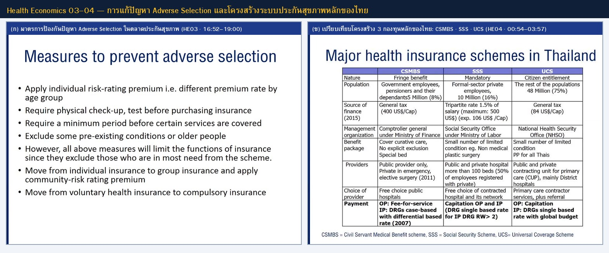

**ภาพประกอบวิดีโอที่ 3.1 มาตรการป้องกันปัญหา Adverse Selection และตารางเปรียบเทียบโครงสร้าง 3 ระบบประกันสุขภาพหลักของไทย** (ก) ลำดับมาตรการป้องกันปัญหา `Adverse selection` และข้อจำกัดของประกันเอกชนที่มักคัดกรองกลุ่มเสี่ยงสูงออก จนต้องเปลี่ยนผ่านสู่ประกันกลุ่มและประกันภาคบังคับ (`HE03 · 16:52–19:00`) และ (ข) ตารางเปรียบเทียบธรรมชาติของสิทธิ แหล่งเงิน หน่วยบริหาร ทางเลือกหน่วยบริการ และวิธีจ่ายเงินของ `CSMBS`, `SSS` และ `UCS` (`HE04 · 00:54–03:57`; *หมายเหตุ: ตัวเลขจำนวนประชากรในสไลด์บรรยายเป็นข้อมูลปี พ.ศ. 2558 ส่วนตัวเลขล่าสุด ณ ตุลาคม พ.ศ. 2567 ให้ยึดตามตารางที่ 2 ในเอกสารนี้*)

> ประเด็นสำคัญของหัวข้อย่อยนี้คือ ประเทศไทยบรรลุหลักประกันสุขภาพถ้วนหน้าด้วยการประสานสามระบบหลักภาคบังคับ (บัตรทอง ประกันสังคม และสวัสดิการข้าราชการ) เข้าด้วยกัน โดยมีความแตกต่างสำคัญอยู่ที่แหล่งเงิน การกำหนดหน่วยปฐมภูมิด่านหน้า และกลไกการจ่ายค่าบริการที่ส่งผลต่อประสิทธิภาพการควบคุมค่าใช้จ่ายต่างกัน

## 4. รูปแบบการจ่ายค่าบริการในระบบประกันสุขภาพกำหนดปัจจัยผลักดันค่าใช้จ่าย แรงจูงใจทางคลินิก และฝ่ายผู้รับความเสี่ยงทางการเงิน (Provider Payment Methods)

> คำถามนำของหัวข้อนี้คือ รูปแบบการจ่ายค่าบริการแต่ละวิธีสร้างแรงจูงใจทางคลินิกอย่างไร และโอนความเสี่ยงทางการเงินไปไว้ที่ฝ่ายใด (How does each provider payment method shape clinical incentives and allocate financial risk?)

รูปแบบการจ่ายเงินแก่หน่วยบริการในไทยมี 4 วิธีหลัก ([หัวข้อ 4.1](#hs6-sub-4-1)–[หัวข้อ 4.4](#hs6-sub-4-4)) ซึ่งเปลี่ยนทั้งตัวขับเคลื่อนค่าใช้จ่ายและสเปกตรัมการรับความเสี่ยงทางการเงินดังแสดงในภาพที่ 6 ([Barnum et al., 1995](https://doi.org/10.1002/hpm.4740100104); [Langenbrunner et al., 2009](https://doi.org/10.1596/978-0-8213-7815-1); [สุรจิต สุนทรธรรม และคณะ, 2555](https://kb.hsri.or.th/dspace/handle/11228/3691))

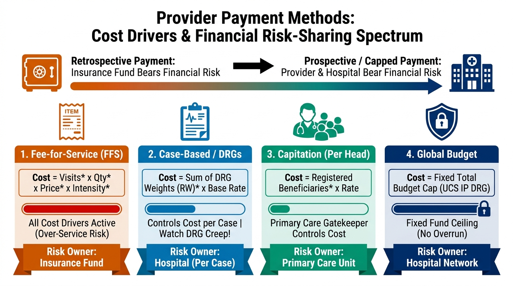

**ภาพที่ 6 รูปแบบการจ่ายค่าบริการแก่หน่วยบริการทั้ง 4 รูปแบบ ปัจจัยผลักดันต้นทุน และสเปกตรัมการโอนความเสี่ยงทางการเงิน** แสดงการโอนภาระความเสี่ยงทางการเงินจากกองทุนประกันสุขภาพไปยังหน่วยบริการและโรงพยาบาล เมื่อเปลี่ยนจากการจ่ายย้อนหลังตามรายบริการ (`Fee-for-service`) ไปสู่การจ่ายตามรายป่วย (`DRGs`) การเหมาจ่ายรายหัว (`Capitation`) และงบประมาณยอดรวม (`Global budget`)

### 4.1 การจ่ายตามรายบริการทิ้งความเสี่ยงทางการเงินไว้ที่กองทุนและจูงใจให้เพิ่มปริมาณบริการทุกมิติ (Fee-for-Service: FFS)

**การจ่ายตามรายบริการ (Fee-for-service: FFS)** คือการจ่ายเงินย้อนหลัง (retrospective payment) แยกตามรายการยา การตรวจทางห้องปฏิบัติการ และหัตถการที่ให้บริการจริงตามราคาที่กำหนด

> ค่าใช้จ่ายของกองทุน = Visits* × Inputs (quantity* × price*) × intensity of services*

- **ปัจจัยผลักดันภาระค่าใช้จ่าย (* cost drivers):** ทุกตัวคูณในสมการล้วนผลักดันรายจ่ายของกองทุนให้พุ่งสูงขึ้นได้ทั้งหมด ทั้งจำนวนครั้งที่ผู้ป่วยมาตรวจ (visits) ปริมาณและราคาของปัจจัยที่ใช้ (quantity × price) และความซับซ้อนเข้มข้นของเทคโนโลยีบริการ (intensity) ([Barber et al., 2019](https://doi.org/10.1787/ed3c16ff-en); [Barnum et al., 1995](https://doi.org/10.1002/hpm.4740100104))
- **ผู้รับความเสี่ยงทางการเงินและผลต่อพฤติกรรมหน่วยบริการ:** โรงพยาบาลเรียกเก็บเงินตามรายการที่ทำจริงได้เกือบทั้งหมด **ความเสี่ยงทางการเงินจึงตกอยู่ที่กองทุนประกันสุขภาพเป็นหลัก** ขณะที่ผู้ให้บริการมีแรงจูงใจทางเศรษฐศาสตร์ให้เพิ่มปริมาณการตรวจสั่งยาและหัตถการเกินจำเป็น (over-provision) เช่น ระบบเบิกจ่ายตรงผู้ป่วยนอกสวัสดิการข้าราชการ (CSMBS OP) และประกันสุขภาพเอกชน ([Langenbrunner et al., 2009](https://doi.org/10.1596/978-0-8213-7815-1); [Robinson, 2001](https://doi.org/10.1111/1468-0009.00202))

> ประเด็นสำคัญของหัวข้อย่อยนี้คือ การจ่ายตามรายบริการทำให้ผู้ป่วยเข้าถึงบริการสะดวกและผู้ให้บริการไม่ลังเลที่จะสั่งการรักษา แต่ทิ้งความเสี่ยงงบบานปลายไว้ที่กองทุนและสร้างแรงจูงใจให้เกิดการสั่งบริการเกินความจำเป็นทุกมิติ

### 4.2 การจ่ายตามรายหัวโยกความเสี่ยงทางการเงินไปยังหน่วยบริการด่านหน้าเพื่อจูงใจให้สร้างเสริมสุขภาพและควบคุมต้นทุน (Capitation)

**การจ่ายตามรายหัว (Capitation)** คือการเหมาจ่ายเงินล่วงหน้า (prospective payment) ต่อคนต่อปีตามจำนวนผู้มีสิทธิที่ลงทะเบียนกับหน่วยบริการซึ่งทำหน้าที่เป็นด่านหน้า (gatekeeper)

> ค่าใช้จ่ายของกองทุน = จำนวนผู้มีสิทธิ* × อัตราเหมาจ่าย

- **ปัจจัยผลักดันภาระค่าใช้จ่ายและรูปแบบการปรับอัตรา:** ตัวขับเคลื่อนรายจ่ายของกองทุนขึ้นกับ **จำนวนผู้มีสิทธิที่ขึ้นทะเบียน** เป็นหลัก โดยอาจจ่ายอัตราเท่ากันทุกคน (flat capitation) หรือปรับอัตราตามโครงสร้างอายุและความเสี่ยงโรคของประชากร (age/risk-adjusted capitation) เพื่อให้เป็นธรรมต่อหน่วยบริการที่ดูแลผู้สูงอายุจำนวนมาก ([Barnum et al., 1995](https://doi.org/10.1002/hpm.4740100104); [Langenbrunner et al., 2009](https://doi.org/10.1596/978-0-8213-7815-1))
- **ผู้รับความเสี่ยงทางการเงินและข้อควรระวัง:** **ความเสี่ยงทางการเงินทั้งหมดถูกโยกมายังหน่วยบริการ** หากประชาชนในพื้นที่สุขภาพแข็งแรงหน่วยบริการจะมีเงินเหลือพัฒนาบริการ จึงจูงใจให้เน้นการสร้างเสริมสุขภาพ ป้องกันโรค และใช้ยาอย่างสมเหตุสมผล (เช่น งบผู้ป่วยนอกของบัตรทอง UCS และงบเหมาจ่ายของประกันสังคม SSS) แต่ผู้ซื้อบริการต้องมีระบบกำกับคุณภาพเพื่อป้องกันไม่ให้หน่วยบริการจำกัดการตรวจรักษาที่จำเป็น (under-provision) หรือคัดเลือกแต่คนแข็งแรง ([Gosden et al., 2000](https://doi.org/10.1002/14651858.CD002215); [Robinson, 2001](https://doi.org/10.1111/1468-0009.00202); [Tangcharoensathien et al., 2015](https://doi.org/10.1093/heapol/czu120))

> ประเด็นสำคัญของหัวข้อย่อยนี้คือ การเหมาจ่ายรายหัวช่วยให้กองทุนคาดการณ์งบประมาณได้แน่นอนและจูงใจให้หน่วยบริการด่านหน้าสร้างเสริมสุขภาพและคุมต้นทุนเอง แต่ต้องกำกับติดตามคุณภาพไม่ให้เกิดการให้บริการต่ำกว่ามาตรฐาน

### 4.3 การจ่ายตามรายป่วยและระบบกลุ่มวินิจฉัยโรคร่วมจูงใจให้ควบคุมต้นทุนต่อราย แต่ต้องระวังการลงรหัสโรคสูงเกินจริง (Case-Based Payment, DRGs, RW, and Upcoding/DRG Creep)

**การจ่ายตามรายป่วย (Case-based payment)** คือการเหมาจ่ายต่อการรักษาผู้ป่วย 1 ราย (per case) โดยในผู้ป่วยนอกอาจจ่ายอัตราคงที่ต่อราย (เช่น ไม่เกิน 700 บาท) ส่วนผู้ป่วยในของไทยใช้ระบบ **กลุ่มวินิจฉัยโรคร่วม (Diagnosis-Related Groups: DRGs)** อย่างแพร่หลาย

> ค่าใช้จ่ายกองทุน = จำนวนผลรวมค่าน้ำหนักสัมพัทธ์ DRGs* × อัตราการจ่ายต่อหน่วยน้ำหนักสัมพัทธ์

- **กลไกของระบบ DRGs ค่าน้ำหนักสัมพัทธ์ (Relative Weight: RW) และดัชนี CMI:** ระบบ DRGs จัดกลุ่มผู้ป่วยในที่มีการวินิจฉัยโรค หัตถการ โรคร่วม/โรคแทรก และการใช้ทรัพยากรใกล้เคียงกันไว้ในกลุ่มเดียวกัน แล้วกำหนด **ค่าน้ำหนักสัมพัทธ์ (RW)** สะท้อนต้นทุนเปรียบเทียบของกลุ่มโรคนั้น (เช่น โรคซับซ้อนมีค่า RW สูงกว่าโรคทั่วไป และค่าเฉลี่ย RW ของผู้ป่วยทั้งหมดในโรงพยาบาลเรียกว่าดัชนีความซับซ้อนผู้ป่วย หรือ Case Mix Index: CMI) แล้วคูณด้วยอัตราจ่ายฐาน (base rate เช่น 10,000 บาทต่อ 1 RW) ([Ellis & McGuire, 1986](https://doi.org/10.1016/0167-6296%2886%2990002-0); [Fetter et al., 1980](https://pubmed.ncbi.nlm.nih.gov/6767915/); [Mathauer & Wittenbecher, 2013](https://doi.org/10.2471/BLT.12.115931); [สำนักพัฒนากลุ่มโรคร่วมไทย, 2563](https://www.tcmc.or.th/_content_images/download/fileupload/S0091.pdf))
- **แรงจูงใจต่อการคุมต้นทุนต่อรายและความเสี่ยงเกิด DRG creep (upcoding):** เนื่องจากโรงพยาบาลได้เงินเหมาต่อการนอนโรงพยาบาล 1 ครั้งตามกลุ่มโรค โรงพยาบาลจึงมีแรงจูงใจลดวันนอนและลดการตรวจที่ซ้ำซ้อนในผู้ป่วยแต่ละราย แต่ตัวขับเคลื่อนรายจ่ายกองทุนจะย้ายไปอยู่ที่ **ผลรวมค่าน้ำหนักสัมพัทธ์ DRGs** ทำให้ต้องเฝ้าระวังการรับผู้ป่วยนอนโรงพยาบาลเพิ่มเกินจำเป็นและปรากฏการณ์ **DRG creep (หรือ upcoding)** คือการลงรหัสการวินิจฉัยหรือภาวะแทรกซ้อนให้รุนแรงเกินความจริงเพื่อเบิกแต้ม RW สูงขึ้น เช่น ผู้ป่วยเป็นไส้ติ่งอักเสบธรรมดาแต่บันทึกข้อมูลเป็นไส้ติ่งอักเสบแตกทะลุ ([Pongpirul et al., 2011](https://doi.org/10.1186/1472-6963-11-71); [Simborg, 1981](https://doi.org/10.1056/NEJM198106253042611))

> ประเด็นสำคัญของหัวข้อย่อยนี้คือ การจ่ายตามกลุ่มวินิจฉัยโรคร่วม (DRGs) สร้างแรงจูงใจให้โรงพยาบาลบริหารจัดการทรัพยากรและวันนอนในผู้ป่วยแต่ละรายอย่างมีประสิทธิภาพ แต่ผู้รับประกันต้องมีระบบตรวจสอบเวชระเบียนเพื่อป้องกันการลงรหัสโรคสูงเกินจริง (DRG creep)

### 4.4 งบประมาณยอดรวมกำหนดเพดานรายจ่ายคงที่ของกองทุนโดยโอนความเสี่ยงส่วนเกินให้โรงพยาบาลบริหารร่วมกัน (Global Budget)

**งบประมาณยอดรวม (Global budget)** คือการกำหนดเพดานวงเงินงบประมาณรวมปลายปิดไว้ล่วงหน้า เพื่อให้กองทุนมั่นใจได้ว่ารายจ่ายรวมจะไม่ทะลุกรอบงบประมาณที่มีอยู่ ดังสรุปเปรียบเทียบทั้ง 4 วิธีในตารางที่ 4

> ค่าใช้จ่ายของกองทุน = งบประมาณยอดรวมที่ตั้ง

- **การผสานแต้ม DRGs ภายใต้งบประมาณยอดรวมในระบบบัตรทอง (UCS IP):** สปสช. กันวงเงินงบผู้ป่วยในระดับเขต/ประเทศไว้เป็นยอดรวมคงที่ แล้วนำผลรวมค่าน้ำหนักสัมพัทธ์ (Adjusted RW) ของทุกโรงพยาบาลมาหารแบ่งวงเงินตามสัดส่วนผลงาน หากปีใดโรงพยาบาลทั่วประเทศส่งแต้ม RW รวมเข้ามามากเกินคาด อัตราจ่ายต่อ 1 RW ก็จะปรับลดลงอัตโนมัติ (เทียบกับ CSMBS IP ที่จ่ายตาม DRGs แบบปลายเปิดจึงยังดันงบรวมให้โตตามผลรวม RW ได้) กองทุนบัตรทองจึงไม่แบกรับความเสี่ยงงบบานปลาย และ **ความเสี่ยงทางการเงินตกอยู่ที่โรงพยาบาล** ([Barber et al., 2019](https://doi.org/10.1787/ed3c16ff-en); [Barnum et al., 1995](https://doi.org/10.1002/hpm.4740100104); [Langenbrunner et al., 2009](https://doi.org/10.1596/978-0-8213-7815-1); [Patcharanarumol et al., 2018](https://doi.org/10.1371/journal.pone.0195179); [Tangcharoensathien et al., 2015](https://doi.org/10.1093/heapol/czu120))

**ตารางที่ 4** เปรียบเทียบรูปแบบการจ่ายค่าบริการแก่หน่วยบริการทั้ง 4 รูปแบบ แรงจูงใจ และผู้รับความเสี่ยงทางการเงิน

| รูปแบบการจ่ายค่าบริการ | กลไกและสมการรายจ่ายกองทุน | ปัจจัยผลักดันค่าใช้จ่าย (* cost driver) | ฝ่ายผู้รับความเสี่ยง แรงจูงใจ และข้อพึงระวัง |
| --- | --- | --- | --- |
| **4.1 จ่ายตามรายบริการ (Fee-for-service)** | จ่ายย้อนหลังตามรายการและราคาจริง: `Visits* × Inputs (quantity* × price*) × intensity*` | ทุกองค์ประกอบ (จำนวนครั้ง ปริมาณ ราคา และความเข้มข้นบริการ) | **กองทุนรับความเสี่ยงเป็นหลัก**; จูงใจให้เพิ่มปริมาณและความเข้มข้นบริการทุกมิติ เสี่ยงเกิดบริการเกินจำเป็น (เช่น CSMBS OP) ([Robinson, 2001](https://doi.org/10.1111/1468-0009.00202)) |
| **4.2 เหมาจ่ายรายหัว (Capitation)** | เหมาจ่ายล่วงหน้าต่อคนต่อปีให้หน่วยด่านหน้า: `จำนวนผู้มีสิทธิ* × อัตราเหมาจ่าย` | จำนวนผู้มีสิทธิที่ลงทะเบียนกับหน่วยบริการ | **หน่วยบริการรับความเสี่ยง**; จูงใจให้สร้างเสริมป้องกันโรคและคุมต้นทุน แต่ต้องกำกับไม่ให้ลดบริการที่จำเป็น (เช่น UCS OP, SSS) ([Gosden et al., 2000](https://doi.org/10.1002/14651858.CD002215)) |
| **4.3 จ่ายตามรายป่วย / กลุ่มวินิจฉัยโรคร่วม (Case-based / DRGs)** | เหมาจ่ายต่อรายตามค่าน้ำหนักสัมพัทธ์: `ผลรวม RW ของ DRGs* × อัตราจ่ายต่อ RW` | จำนวนผู้ป่วยรับไว้นอนโรงพยาบาลและผลรวมค่าน้ำหนักสัมพัทธ์ DRGs | โรงพยาบาลรับความเสี่ยงต้นทุนต่อราย (จูงใจลดวันนอนและต้นทุนต่อเคส) แต่ **ต้องระวังการรับนอนเพิ่มและ DRG creep** (เช่น CSMBS IP) ([Simborg, 1981](https://doi.org/10.1056/NEJM198106253042611)) |
| **4.4 งบประมาณยอดรวม (Global budget)** | กำหนดวงเงินเพดานคงที่ล่วงหน้าแล้วจัดสรรตามผลงาน (เช่น แต้ม DRGs): `งบประมาณยอดรวมที่ตั้ง` | ไม่มีตัวแปรทะลุเพดานงบยอดรวมที่ตั้งไว้ | **โรงพยาบาลรับความเสี่ยงทั้งหมด**; กองทุนคุมงบรวมได้ 100% แต่ต้องตั้งวงเงินให้เพียงพอไม่ให้กระทบคุณภาพบริการ (เช่น UCS IP) ([Tangcharoensathien et al., 2015](https://doi.org/10.1093/heapol/czu120)) |

> **🎥 เชื่อมโยงวิดีโอบรรยายประกอบคำสอน (หมวดที่ 4 — Health Economics 04: กลไกการจ่ายเงินแก่สถานบริการและแรงจูงใจ)**
> - [▶ `03:57 – 06:08` การจ่ายย้อนหลังตามรายบริการ (Fee-for-service) และสมการตัวขับเคลื่อนรายจ่าย](https://drive.google.com/file/d/13-SqlVfRC5-zxyTtvl1nDPkFguSI3Yuo/view?t=237s) · [▶ `06:08 – 13:02` ระบบกลุ่มวินิจฉัยโรคร่วม (DRGs, RW, CMI, Base Rate) และปัญหา DRG Creep](https://drive.google.com/file/d/13-SqlVfRC5-zxyTtvl1nDPkFguSI3Yuo/view?t=368s)
> - [▶ `13:02 – 16:40` การเหมาจ่ายล่วงหน้ารายหัว (Capitation: Flat vs Risk-Adjusted, Inclusive vs Exclusive)](https://drive.google.com/file/d/13-SqlVfRC5-zxyTtvl1nDPkFguSI3Yuo/view?t=782s) · [▶ `16:40 – 24:01` เมทริกซ์แรงจูงใจของผู้ให้บริการ (Provider Incentives) และข้อกังวลสำคัญของแต่ละวิธี](https://drive.google.com/file/d/13-SqlVfRC5-zxyTtvl1nDPkFguSI3Yuo/view?t=1000s)

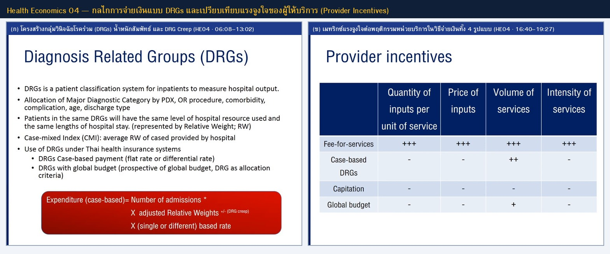

**ภาพประกอบวิดีโอที่ 4.1 โครงสร้างการจ่ายเงินแบบกลุ่มวินิจฉัยโรคร่วม (DRGs) และเมทริกซ์เปรียบเทียบแรงจูงใจต่อพฤติกรรมหน่วยบริการ** (ก) องค์ประกอบของระบบ `DRGs` ดัชนีความซับซ้อนผู้ป่วย (`CMI`) และการประยุกต์ใช้ทั้งแบบอัตราคงที่/หลายอัตรา และแบบจัดสรรภายใต้งบยอดรวม (`Global budget`) (`HE04 · 06:08–13:02`) และ (ข) เมทริกซ์เปรียบเทียบแรงจูงใจในการเพิ่มปริมาณปัจจัยนำเข้า ราคา ปริมาณผู้รับบริการ และความเข้มข้นของบริการ โดย `Fee-for-service` มีแรงจูงใจเพิ่มขึ้นทุกมิติ (`+++`) ขณะที่ `Capitation` จูงใจให้ลดต้นทุนทุกมิติ (`-`) และ `DRGs` จูงใจให้ลดต้นทุนต่อรายแต่เพิ่มจำนวนการรับไว้นอนโรงพยาบาล (`++`) (`HE04 · 16:40–19:27`)

> ประเด็นสำคัญของหัวข้อย่อยนี้คือ ไม่มีวิธีจ่ายเงินแบบใดสมบูรณ์แบบไร้จุดอ่อนในตัวเอง ระบบหลักประกันที่เข้มแข็งจึงมักผสมผสานวิธีจ่ายเงินแบบปลายปิด เช่น เหมาจ่ายรายหัวสำหรับผู้ป่วยนอกควบคู่กับ DRGs ภายใต้งบประมาณยอดรวมสำหรับผู้ป่วยใน เพื่อถ่วงดุลระหว่างการคุมงบประมาณกับคุณภาพการรักษา

## 5. ปัญหาการขาดจริยธรรมในระบบประกันสุขภาพทำให้ต้องมีมาตรการควบคุมค่าใช้จ่ายทั้งสองฝั่ง โดยมาตรการฝั่งผู้ให้บริการมีประสิทธิผลมากกว่า (Moral Hazard, Supplier-Induced Demand, and Cost Containment)

> คำถามนำของหัวข้อนี้คือ การมีบุคคลที่สามเป็นผู้จ่ายค่ารักษาแทนเปลี่ยนพฤติกรรมของผู้ป่วยและแพทย์อย่างไร และเหตุใดมาตรการควบคุมค่าใช้จ่ายฝั่งผู้ให้บริการจึงมีประสิทธิผลมากกว่าฝั่งผู้ใช้บริการ (How does third-party payment induce moral hazard on both sides, and why are supply-side cost controls more effective?)

หัวข้อนี้จำแนกกลไกของ moral hazard ทั้งสองฝั่ง ([หัวข้อ 5.1](#hs6-sub-5-1)) ประเมินมาตรการฝั่งผู้ใช้บริการและการคุ้มครองกลุ่มเปราะบาง ([หัวข้อ 5.2](#hs6-sec-13)) และเปรียบเทียบมาตรการทางตรงกับทางอ้อมฝั่งผู้ให้บริการพร้อมหลักฐานจริงในไทย ([หัวข้อ 5.3](#hs6-sec-14))

### 5.1 การมีบุคคลที่สามเป็นผู้จ่ายค่ารักษาแทนกระตุ้นการใช้และให้บริการเกินจำเป็นทั้งฝั่งผู้ใช้บริการและผู้ให้บริการ (Consumer&#x27;s and Provider&#x27;s Moral Hazard & Supplier-Induced Demand)

> เมื่อทั้งผู้ป่วยและแพทย์ทราบตรงกันว่าค่ารักษาพยาบาลในวันนี้สามารถเบิกจากกองทุนหรือบริษัทประกันได้ทั้งหมด การตัดสินใจเลือกตรวจพิเศษ สั่งยานอกบัญชี หรือผ่าตัดคลอดจะเปลี่ยนไปจากกรณีที่ผู้ป่วยต้องควักเงินจ่ายเองอย่างไร

เมื่อเปลี่ยนผู้จ่ายค่ารักษาจากผู้ป่วยเองมาเป็นบุคคลที่สาม ย่อมส่งผลเปลี่ยนพฤติกรรมของทั้งผู้ป่วยและแพทย์จนอาจเกิดการใช้หรือให้บริการเกินความจำเป็นที่เรียกว่า **ปัญหาการขาดจริยธรรมในระบบประกันสุขภาพ (moral hazard)** ดังแสดงในภาพที่ 7 ([Arrow, 1963](https://www.jstor.org/stable/1812044); [Einav & Finkelstein, 2018](https://doi.org/10.1093/jeea/jvy017); [Pauly, 1968](https://www.jstor.org/stable/1813785); [Zeckhauser, 1970](https://doi.org/10.1016/0022-0531%2870%2990010-4))

- **การแยกแยะการใช้บริการที่พึงประสงค์ออกจาก consumer&#x27;s moral hazard:** การที่ประชาชนมาใช้บริการที่จำเป็นเพิ่มขึ้นหลังมีหลักประกันสุขภาพถือเป็นผลลัพธ์ที่ถูกต้องตามเป้าประสงค์ของการทลายกำแพงทางการเงิน ([Nyman, 1999](https://doi.org/10.1016/s0167-6296%2898%2900049-6)) ส่วน **consumer&#x27;s moral hazard** หมายถึงพฤติกรรมส่วนเกินที่ไม่พึงประสงค์ ได้แก่ (1) ละเลยการดูแลสุขภาพหรือมีพฤติกรรมเสี่ยงมากขึ้นเพราะไม่กังวลค่ารักษา (ex-ante moral hazard) ([Ehrlich & Becker, 1972](https://doi.org/10.1086/259916)) และ (2) เปลี่ยนจากการดูแลตนเองเมื่อเจ็บป่วยเล็กน้อยเป็นไปโรงพยาบาลเกินจำเป็น หรือขอนอนโรงพยาบาลเอกชนทั้งที่รักษาแบบผู้ป่วยนอกได้เพราะกรมธรรม์คุ้มครองเฉพาะผู้ป่วยในและมีเงินชดเชยรายได้รายวันเมื่อนอนโรงพยาบาล (ex-post moral hazard) ([Aron-Dine et al., 2013](https://doi.org/10.1257/jep.27.1.197); [Einav & Finkelstein, 2018](https://doi.org/10.1093/jeea/jvy017); [Manning et al., 1987](https://pubmed.ncbi.nlm.nih.gov/10284091/); [สุรจิต สุนทรธรรม และคณะ, 2555](https://kb.hsri.or.th/dspace/handle/11228/3691))
- **ปัญหาฝั่งผู้ให้บริการ (provider&#x27;s moral hazard) และอุปสงค์ที่ถูกเหนี่ยวนำโดยผู้ให้บริการ (supplier-induced demand: SID):** เนื่องจากแพทย์มีความรู้ทางการแพทย์เหนือกว่าผู้ป่วยมาก (information asymmetry) เมื่อแพทย์ทราบว่าผู้ป่วยเบิกประกันได้ไม่ต้องจ่ายเอง แพทย์จึงตัดสินใจสั่งยาราคาแพง ส่งตรวจเทคโนโลยีขั้นสูง หรือรับนอนโรงพยาบาลได้ง่ายขึ้น โดยเฉพาะเมื่อแพทย์และโรงพยาบาลได้รับค่าตอบแทนแบบจ่ายตามรายบริการ (FFS) ([Ellis & McGuire, 1993](https://doi.org/10.1257/jep.7.4.135); [Evans, 1974](https://doi.org/10.1007/978-1-349-63660-0_10); [Patcharanarumol et al., 2018](https://doi.org/10.1371/journal.pone.0195179))
- **กรณีศึกษาการผ่าตัดคลอดโดยไม่มีข้อบ่งชี้ทางการแพทย์:** การผ่าตัดคลอดในการฝากครรภ์พิเศษในประเทศไทยเป็นตัวอย่างคลาสสิกที่แรงจูงใจของทั้งผู้ป่วย (ต้องการความสะดวกและเลือกฤกษ์เวลาโดยเบิกค่ารักษาได้) และแพทย์ผู้ให้บริการ (บริหารจัดการเวลาง่ายและได้รับค่าตอบแทนเพิ่มตามหัตถการ) สอดรับกันจนทำให้อัตราการผ่าคลอดพุ่งสูงเกินความจำเป็นทางการแพทย์และดันภาระค่าใช้จ่ายรวมของระบบ ([Gruber & Owings, 1996](https://doi.org/10.2307/2555794); [Hanvoravongchai et al., 2000](https://www.worldcat.org/search?q=Implications+of+private+practice+in+public+hospitals+on+the+cesarean+section+rate+in+Thailand))

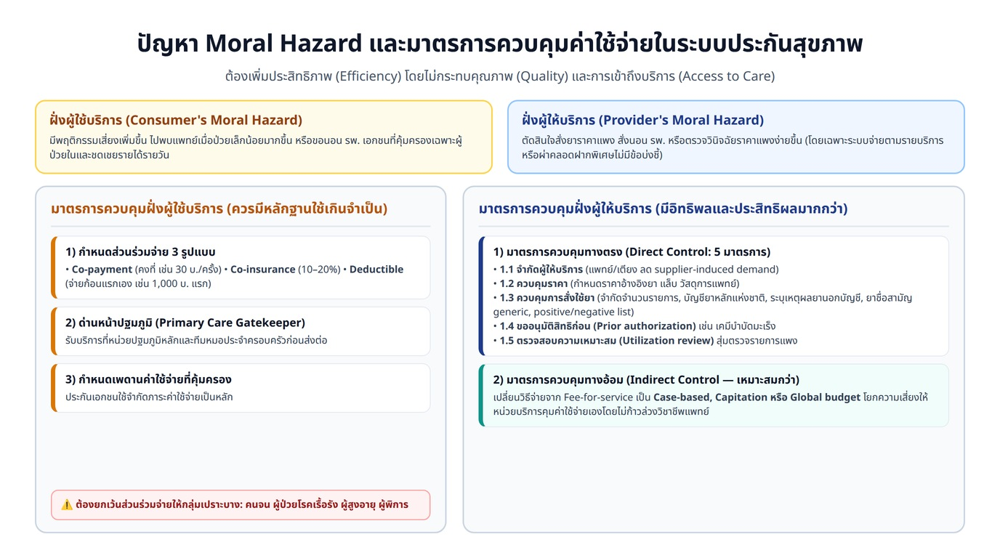

**ภาพที่ 7 กลไกปัญหา Moral Hazard สองฝั่ง และคานงัดการควบคุมค่าใช้จ่ายฝั่งผู้ให้บริการควบคู่เกราะคุ้มครองกลุ่มเปราะบาง** แสดงการเปรียบเทียบแรงขับเคลื่อนค่าใช้จ่ายสองฝั่ง การยกเว้นส่วนร่วมจ่ายแก่กลุ่มเปราะบาง และเหตุผลที่การควบคุมทางอ้อมด้วยการเปลี่ยนวิธีจ่ายเงินฝั่งผู้ให้บริการมีประสิทธิผลสูงสุดโดยไม่กระทบคุณภาพและการเข้าถึงบริการ

> ประเด็นสำคัญของหัวข้อย่อยนี้คือ การมีผู้จ่ายที่สามอาจกระตุ้นการใช้และให้บริการเกินความจำเป็นทั้งฝั่งผู้ป่วยและฝั่งแพทย์ โดยเฉพาะเมื่อผูกกับการจ่ายเงินตามรายบริการที่ทำให้แรงจูงใจของทั้งสองฝ่ายสอดรับกันในการเลือกบริการราคาแพง

### 5.2 มาตรการควบคุมค่าใช้จ่ายฝั่งผู้ใช้บริการต้องมีหลักฐานการใช้บริการเกินจำเป็นและต้องยกเว้นส่วนร่วมจ่ายให้กลุ่มเปราะบาง (Demand-Side Cost Containment and Exemption for Vulnerable Groups)

มาตรการฝั่งผู้ใช้บริการมุ่งชะลออุปสงค์ส่วนเกิน จึงควรนำมาใช้เฉพาะเมื่อมีหลักฐานเชิงประจักษ์ชัดเจนว่ามีการใช้บริการเกินความจำเป็นจริง ([Thomson et al., 2009](https://iris.who.int/handle/10665/326415)) โดยแบ่งออกเป็น 3 มาตรการหลักพร้อมข้อระวังสำคัญด้านความเป็นธรรม

- **มาตรการที่ 1 — การกำหนดส่วนร่วมจ่าย ณ จุดบริการ (cost-sharing) 3 รูปแบบ:** ได้แก่ (1) **ร่วมจ่ายจำนวนเงินคงที่ (co-payment)** เช่น 30 บาทต่อครั้ง ต่อรายการยา หรือต่อวันนอน (2) **ร่วมจ่ายตามสัดส่วนค่ารักษา (co-insurance)** เช่น จ่ายร้อยละ 10–20 ของค่ารักษารวมหรือค่ายา และ (3) **จ่ายความเสียหายส่วนแรกก่อน (deductible)** เช่น ผู้ป่วยจ่าย 1,000 บาทแรกเองแล้วส่วนที่เกินประกันจึงจ่ายให้ ([Aron-Dine et al., 2013](https://doi.org/10.1257/jep.27.1.197); [Manning et al., 1987](https://pubmed.ncbi.nlm.nih.gov/10284091/); [Thomson et al., 2009](https://iris.who.int/handle/10665/326415))
- **ข้อพึงระวังสำคัญเรื่องผลกระทบของส่วนร่วมจ่ายต่อกลุ่มเปราะบาง:** หลักฐานจากการทดลอง RAND Health Insurance Experiment และการทบทวนวรรณกรรมของ Cochrane ยืนยันว่าการเก็บเงินร่วมจ่ายลดทั้งการใช้บริการที่ไม่จำเป็นและบริการที่จำเป็นไปพร้อมกัน ซึ่งส่งผลร้ายแรงไม่ต่างจากการต้องจ่ายเงินเองสำหรับผู้ที่มีความจำเป็นด้านสุขภาพสูงแต่มีรายได้น้อย ดังนั้นจึงต้องมีมาตรการ **ยกเว้นส่วนร่วมจ่ายให้แก่กลุ่มเปราะบาง** เสมอ เช่น **ผู้มีรายได้น้อย ผู้ป่วยโรคเรื้อรังที่ต้องรับยาต่อเนื่อง ผู้สูงอายุ และผู้พิการ** ดังที่ประกาศกระทรวงสาธารณสุขของไทยกำหนดกลุ่มบุคคลที่ได้รับการยกเว้นไม่ต้องจ่ายค่าบริการ 30 บาท ([Brook et al., 1983](https://doi.org/10.1056/NEJM198312083092305); [Lagarde & Palmer, 2011](https://doi.org/10.1002/14651858.CD009094); [Thomson et al., 2009](https://iris.who.int/handle/10665/326415); [ประกาศกระทรวงสาธารณสุข เรื่อง บุคคลที่ต้องจ่ายค่าบริการ พ.ศ. 2555, 2555](https://www.ratchakitcha.soc.go.th/DATA/PDF/2555/E/134/43.PDF))
- **มาตรการที่ 2 — การกำหนดหน่วยบริการปฐมภูมิเป็นด่านหน้า (primary care gatekeeper):** ให้ประชาชนขึ้นทะเบียนกับทีมหมอครอบครัวเพื่อเป็นด่านแรกในการให้คำปรึกษา รักษาโรคทั่วไป และคัดกรองส่งต่อเฉพาะกรณีที่จำเป็น ช่วยลดการข้ามไปแออัดในโรงพยาบาลใหญ่และเพิ่มประสิทธิภาพของระบบโดยไม่สร้างภาระการเงินแก่คนจน ([Garrido et al., 2011](https://doi.org/10.3109/02813432.2010.537015); [Starfield et al., 2005](https://doi.org/10.1111/j.1468-0009.2005.00409.x); [Tangcharoensathien et al., 2015](https://doi.org/10.1093/heapol/czu120))
- **มาตรการที่ 3 — การกำหนดเพดานวงเงินความคุ้มครองสูงสุด (benefit ceiling):** นิยมใช้ในประกันสุขภาพเอกชนเพื่อจำกัดความรับผิดชอบทางการเงินของบริษัทประกันมากกว่าการป้องกันการใช้บริการเกินจำเป็น และผลักภาระส่วนเกินกลับไปให้ครัวเรือนเมื่อป่วยหนัก ([Pettigrew & Mathauer, 2016](https://doi.org/10.1186/s12939-016-0353-5); [Thomson et al., 2009](https://iris.who.int/handle/10665/326415))

> ประเด็นสำคัญของหัวข้อย่อยนี้คือ การเก็บเงินร่วมจ่ายจากผู้ป่วยเป็นดาบสองคมที่อาจกีดกันผู้มีรายได้น้อยและผู้ป่วยเรื้อรังไม่ให้เข้าถึงการรักษาที่จำเป็นจึงต้องมีการยกเว้นให้กลุ่มเปราะบางเสมอ ขณะที่การใช้ระบบบริการปฐมภูมิด่านหน้าเป็นกลไกจัดระเบียบการใช้บริการที่ปลอดภัยและเป็นธรรมกว่า

### 5.3 มาตรการควบคุมค่าใช้จ่ายฝั่งผู้ให้บริการมีอิทธิพลมากกว่า โดยการควบคุมทางอ้อมด้วยการเปลี่ยนวิธีจ่ายเงินเหมาะสมกว่าการก้าวล่วงทางคลินิก (Supply-Side Direct versus Indirect Cost Containment)

เนื่องจากแพทย์และหน่วยบริการเป็นผู้ตัดสินใจหลักในการสั่งตรวจวินิจฉัย สั่งยา และรับผู้ป่วยไว้นอนโรงพยาบาล ปัจจัยฝั่งผู้ให้บริการจึงมีอิทธิพลต่อภาระค่าใช้จ่ายรวมมากกว่าฝั่งผู้ใช้บริการอย่างมาก ([Ellis & McGuire, 1993](https://doi.org/10.1257/jep.7.4.135); [WHO, 2010](https://iris.who.int/handle/10665/44371)) โดยจำแนกมาตรการออกเป็นแบบทางตรงและทางอ้อมดังนี้

- **1.1 มาตรการทางตรง — การจำกัดจำนวนผู้ให้บริการและเตียง (limiting supply & Roemer&#x27;s law):** ข้อมูลเชิงประจักษ์ตามกฎของโรเมอร์ชี้ว่าจำนวนเตียงและแพทย์ที่เพิ่มขึ้นสัมพันธ์โดยตรงกับการใช้บริการและรายจ่ายที่สูงขึ้นผ่านกลไก supplier-induced demand โดยเฉพาะในระบบ FFS กองทุนสาธารณะในหลายประเทศจึงจำกัดสัดส่วนเตียงหรือแพทย์ที่ขึ้นทะเบียนรับเงินจากกองทุนในแต่ละพื้นที่ ([Delamater et al., 2013](https://doi.org/10.1371/journal.pone.0054900); [Evans, 1974](https://doi.org/10.1007/978-1-349-63660-0_10); [Labelle et al., 1994](https://doi.org/10.1016/0167-6296%2894%2990036-1); [Roemer, 1961](https://pubmed.ncbi.nlm.nih.gov/14493273/))
- **1.2 มาตรการทางตรง — การควบคุมราคาและกำหนดเพดานราคาอ้างอิง (price setting & fee schedule):** กองทุนต่อรองและกำหนดราคากลางอ้างอิงในการเบิกจ่ายค่ายา ค่าตรวจทางห้องปฏิบัติการ ค่าตรวจวินิจฉัย และวัสดุทางการแพทย์ เพื่อไม่ให้หน่วยบริการตั้งราคาสูงตามอำเภอใจ ([Barber et al., 2019](https://doi.org/10.1787/ed3c16ff-en); [Tangcharoensathien et al., 2015](https://doi.org/10.1093/heapol/czu120))
- **1.3 มาตรการทางตรง — การกำกับการสั่งใช้ยาอย่างสมเหตุสมผล (prescribing controls):** เนื่องจากค่ายาเป็นสัดส่วนรายจ่ายใหญ่ที่สุดของผู้ป่วยนอก กองทุนจึงใช้เครื่องมือ เช่น จำกัดจำนวนรายการยาต่อใบสั่ง กำหนดให้ใช้ **บัญชียาหลักแห่งชาติ (National List of Essential Medicines)** เป็นลำดับแรก บังคับระบุเหตุผลทางคลินิกเมื่อสั่งยานอกบัญชียาหลัก ใช้ยาชื่อสามัญ (generic substitution) แทนยาต้นแบบราคาแพง และกำหนดบัญชีรายการที่เบิกได้หรือเบิกไม่ได้ (positive/negative list) ([Jongudomsuk et al., 2012](https://doi.org/10.5089/9781616352448.071.ch016); [Patcharanarumol et al., 2018](https://doi.org/10.1371/journal.pone.0195179); [Tangcharoensathien et al., 2015](https://doi.org/10.1093/heapol/czu120))
- **1.4 และ 1.5 มาตรการทางตรง — การขออนุมัติสิทธิล่วงหน้า (prior authorization: PA) และการตรวจสอบความเหมาะสม (utilization review: UR):** บริการราคาแพงมาก เช่น ยาเคมีบำบัดหรือยามุ่งเป้ารักษามะเร็ง มักกำหนดหน่วยบริการที่สั่งได้และต้องลงทะเบียนขออนุมัติก่อนรักษา (PA) ส่วนการทบทวนเวชระเบียนก่อนจ่ายเงิน (UR) มีต้นทุนบริหารสูงจึงมักสุ่มตรวจเฉพาะรายการที่มีค่าใช้จ่ายสูง ([Jongudomsuk et al., 2012](https://doi.org/10.5089/9781616352448.071.ch016); [Patcharanarumol et al., 2018](https://doi.org/10.1371/journal.pone.0195179); [Wickizer & Lessler, 2002](https://doi.org/10.1146/annurev.publhealth.23.100901.140529); [สุรจิต สุนทรธรรม และคณะ, 2555](https://kb.hsri.or.th/dspace/handle/11228/3691))
- **2. มาตรการควบคุมทางอ้อมด้วยการเปลี่ยนวิธีจ่ายเงิน (indirect control via prospective payment) และบทเรียนจริงจาก CSMBS ไทย:** มาตรการทางตรงข้างต้นต้องใช้หลายตัวพร้อมกันและมักสร้างความอึดอัดขัดแย้งเพราะผู้จ่ายเงินต้องเข้าไปก้าวล่วงดุลพินิจทางคลินิกของแพทย์รายเคส ([Wickizer & Lessler, 2002](https://doi.org/10.1146/annurev.publhealth.23.100901.140529)) มาตรการที่มีประสิทธิผลและเหมาะสมกว่าจึงเป็นการเปลี่ยนกลไกจ่ายเงินจาก **Fee-for-service** ไปเป็นการจ่ายล่วงหน้าแบบปลายปิด เช่น **Capitation, Case-based (DRGs) และ Global budget** เพื่อโอนความเสี่ยงทางการเงินให้โรงพยาบาลและทีมแพทย์ร่วมกันบริหารทรัพยากรเอง ดังหลักฐานเชิงประจักษ์ของสวัสดิการข้าราชการไทยในภาพประกอบวิดีโอที่ 5.2 ที่รายจ่ายผู้ป่วยนอก (CSMBS OP ซึ่งจ่ายแบบ FFS) พุ่งทะยานต่อเนื่องแม้พยายามคุมยานอกบัญชี ขณะที่รายจ่ายผู้ป่วยใน (CSMBS IP) ชะลอความชันลงอย่างชัดเจนทันทีที่เปลี่ยนมาจ่ายด้วยระบบ DRGs ในปี ค.ศ. 2007 ([Barnum et al., 1995](https://doi.org/10.1002/hpm.4740100104); [Ellis & McGuire, 1986](https://doi.org/10.1016/0167-6296%2886%2990002-0), [1993](https://doi.org/10.1257/jep.7.4.135); [Patcharanarumol et al., 2018](https://doi.org/10.1371/journal.pone.0195179); [Robinson, 2001](https://doi.org/10.1111/1468-0009.00202); [Tangcharoensathien et al., 2015](https://doi.org/10.1093/heapol/czu120))

> **🎥 เชื่อมโยงวิดีโอบรรยายและกรณีศึกษาเชิงประจักษ์ (หมวดที่ 5 — Health Economics 04 & 05: Moral Hazard และการควบคุมค่าใช้จ่าย)**
> - [▶ `HE04 · 24:01 – 31:12` กลไกการจ่ายเงินโดยบุคคลที่สาม (3rd Party Payment) อัตราการผ่าคลอด (ไทย 39.4%) และ Provider&#x27;s Moral Hazard](https://drive.google.com/file/d/13-SqlVfRC5-zxyTtvl1nDPkFguSI3Yuo/view?t=1441s) · [▶ `HE04 · 31:12 – 36:16` มาตรการฝั่งผู้ใช้บริการ และมาตรการควบคุมทางตรงเทียบกับทางอ้อมฝั่งผู้ให้บริการ](https://drive.google.com/file/d/13-SqlVfRC5-zxyTtvl1nDPkFguSI3Yuo/view?t=1872s)
> - [▶ `HE05 · 00:27 – 07:35` อภิปรายนโยบายร่วมจ่าย (Co-payment) ในระบบบัตรทอง และการยกเว้นให้กลุ่มเปราะบาง](https://drive.google.com/file/d/1uqwf0po7RKplyLFyC5tV1WMJWj6-JuXX/view?t=27s) · [▶ `HE05 · 07:35 – 14:59` กราฟจริงรายจ่ายผู้ป่วยนอกข้าราชการ (CSMBS OP 2002–2018) พุ่งสูงหลังเบิกจ่ายตรง FFS](https://drive.google.com/file/d/1uqwf0po7RKplyLFyC5tV1WMJWj6-JuXX/view?t=455s) · [▶ `HE05 · 14:59 – 21:46` กราฟจริงรายจ่ายผู้ป่วยในข้าราชการ (CSMBS IP 2002–2018) หลังเปลี่ยนมาใช้ DRGs ปี 2007](https://drive.google.com/file/d/1uqwf0po7RKplyLFyC5tV1WMJWj6-JuXX/view?t=899s)

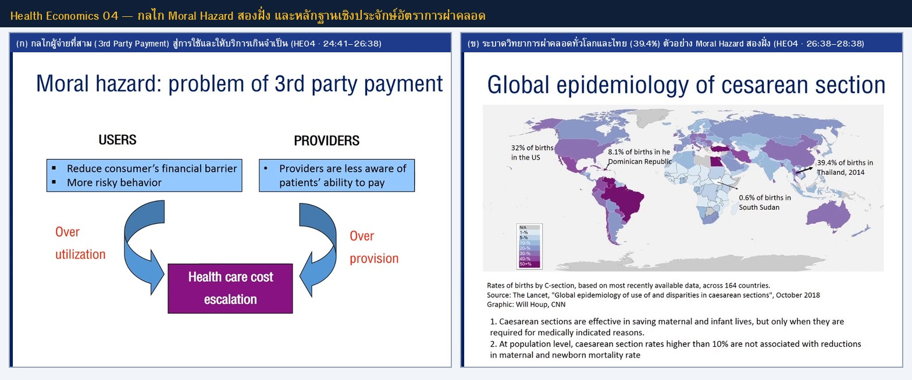

**ภาพประกอบวิดีโอที่ 5.1 กลไกปัญหา Moral Hazard จากผู้จ่ายที่สามและระบาดวิทยาการผ่าคลอดทั่วโลก** (ก) แผนภาพแสดงการลดอุปสรรคทางการเงินฝั่งผู้ใช้บริการควบคู่กับความไม่ตระหนักต่อภาระค่าใช้จ่ายของผู้ป่วยฝั่งผู้ให้บริการ จนนำไปสู่ `Over utilization` และ `Over provision` ที่เร่งค่าใช้จ่ายรวมของระบบ (`HE04 · 24:41–26:38`) และ (ข) ข้อมูลอัตราการผ่าคลอดทั่วโลก (*The Lancet*, 2018) ซึ่งประเทศไทยสูงถึงร้อยละ `39.4` สะท้อนแรงจูงใจที่สอดรับกันทั้งสองฝั่งเมื่อจ่ายค่าตอบแทนตามรายบริการ (`HE04 · 26:38–28:38`)

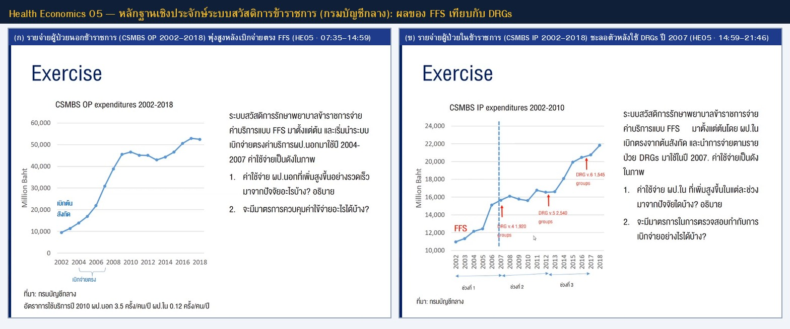

**ภาพประกอบวิดีโอที่ 5.2 หลักฐานเชิงประจักษ์รายจ่ายสวัสดิการรักษาพยาบาลข้าราชการ (กรมบัญชีกลาง) เปรียบเทียบผลของ FFS กับ DRGs** (ก) รายจ่ายผู้ป่วยนอก (`CSMBS OP`) พ.ศ. 2545–2561 พุ่งสูงชันหลังเปิดระบบเบิกจ่ายตรงแบบ `Fee-for-service` ในปี 2004–2007 และชะลอตัวเพียงชั่วคราวเมื่อบังคับระบุเหตุผลสั่งยานอกบัญชียาหลักแห่งชาติก่อนพุ่งขึ้นต่อ (`HE05 · 07:35–14:59`) เทียบกับ (ข) รายจ่ายผู้ป่วยใน (`CSMBS IP`) ที่ความชันของการเพิ่มค่าใช้จ่ายชะลอลงชัดเจนหลังเปลี่ยนจาก `FFS` มาใช้ระบบ `DRGs` ในปี 2007 แม้ยังมีแรงกดดันจากค่า `CMI` ที่ค่อย ๆ สูงขึ้น (`HE05 · 14:59–21:46`)

> ประเด็นสำคัญของหัวข้อย่อยนี้คือ การควบคุมค่าใช้จ่ายในระบบประกันสุขภาพที่ได้ผลยั่งยืนที่สุดไม่ใช่การผลักภาระร่วมจ่ายไปให้ผู้ป่วยหรือการตามตรวจสอบใบสั่งยาทีละใบ แต่คือการออกแบบกลไกการจ่ายเงินแบบล่วงหน้าฝั่งผู้ให้บริการควบคู่กับการใช้บัญชียาหลักแห่งชาติและการต่อรองราคากลาง

## บทสรุป: หลักประกันสุขภาพถ้วนหน้าอาศัยกองทุนภาคบังคับเพื่อก้าวข้ามการคัดเลือกความเสี่ยง และใช้การจัดซื้อเชิงยุทธศาสตร์ควบคู่กลไกจ่ายเงินล่วงหน้าเพื่อความยั่งยืนและเป็นธรรม

> ก่อนอ่านบทสรุป ขอให้ผู้เรียนลองเชื่อมโยงด้วยตนเองว่า เหตุใดหลักประกันสุขภาพถ้วนหน้าจึงต้องเป็นภาคบังคับ และเหตุใดวิธีจ่ายเงินแก่โรงพยาบาลจึงเป็นหัวใจของความยั่งยืนทางการคลังมากกว่าการเก็บเงินร่วมจ่ายจากผู้ป่วย

สาระสำคัญของบทนี้สรุปได้ดังนี้

- **การประกันสุขภาพเปลี่ยนความไม่แน่นอนของการเจ็บป่วยระดับบุคคลให้คาดการณ์ได้ในระดับประชากร เพื่ออำนวยการเข้าถึงบริการและปกป้องครัวเรือนจากการล้มละลาย:** การจ่ายเงินล่วงหน้าและการรวมกองทุนขนาดใหญ่ช่วยถัวเฉลี่ยความเสี่ยงจากคนแข็งแรงไปสู่คนป่วยและเกลี่ยปันรายได้จากคนรวยไปสู่คนจน สร้างความเป็นธรรมทั้งด้านบริการและด้านการคลังอันเป็นรากฐานของหลักประกันสุขภาพถ้วนหน้า ([Kutzin, 2013](https://doi.org/10.2471/blt.12.113985); [Smith & Witter, 2004](https://doi.org/10.1596/13651); [WHO, 2010](https://iris.who.int/handle/10665/44371))
- **ความยั่งยืนและความเป็นอันหนึ่งอันเดียวกันในสังคม (solidarity) ต้องอาศัยหลักประกันสุขภาพภาคบังคับเพื่อแก้ปัญหาการคัดเลือกที่ขัดผลประโยชน์กัน:** ตลาดประกันภาคสมัครใจเผชิญความไม่สมมาตรของข้อมูลที่ผู้มีความเสี่ยงสูงเข้ามาซื้อมากกว่าคนแข็งแรง (adverse selection) จนบริษัทเอกชนต้องคัดกรองผู้ป่วยเรื้อรังและผู้สูงอายุออก รัฐจึงต้องใช้กฎหมายจัดหลักประกันภาคบังคับรวมประชากรทุกคนเข้าสู่ระบบ ดังเช่นสามกองทุนหลักของไทย (บัตรทอง ประกันสังคม และสวัสดิการข้าราชการ) ([Einav & Finkelstein, 2011](https://doi.org/10.1257/jep.25.1.115); [Mathauer et al., 2019](https://doi.org/10.1186/s12939-019-1088-x); [Stone, 1993](https://doi.org/10.1215/03616878-18-2-287); [Tangcharoensathien et al., 2018](https://doi.org/10.1016/s0140-6736%2818%2930198-3))
- **กลไกการจ่ายค่าบริการแก่หน่วยบริการเป็นคานงัดสำคัญที่สุดในการจัดการ moral hazard และรักษาสมดุลระหว่างประสิทธิภาพ คุณภาพ และการเข้าถึงบริการ:** การมีผู้จ่ายที่สามกระตุ้นการใช้และให้บริการเกินจำเป็นทั้งสองฝั่ง แต่การเก็บส่วนร่วมจ่ายฝั่งผู้ป่วยต้องระวังผลกระทบต่อคนจนและผู้ป่วยเรื้อรัง การควบคุมทางอ้อมฝั่งผู้ให้บริการด้วยการเปลี่ยนจาก Fee-for-service ไปสู่การเหมาจ่ายล่วงหน้า (Capitation, DRGs และ Global budget) ควบคู่กับการจัดซื้อเชิงยุทธศาสตร์จึงมีประสิทธิผลสูงกว่าโดยไม่ลดทอนคุณภาพและการเข้าถึงบริการ ([Ellis & McGuire, 1993](https://doi.org/10.1257/jep.7.4.135); [Tangcharoensathien et al., 2015](https://doi.org/10.1093/heapol/czu120); [WHO, 2010](https://iris.who.int/handle/10665/44371); [Zeckhauser, 1970](https://doi.org/10.1016/0022-0531%2870%2990010-4))

### ตารางทบทวนสาระสำคัญ (Rapid Review)

ตารางนี้รวบรวมสาระสำคัญของบทไว้ในหน้าเดียวเพื่อใช้ทบทวนเชื่อมโยงแนวคิดทางเศรษฐศาสตร์ประกันสุขภาพเข้ากับบริบทจริงของประเทศไทย

| ประเด็น | สาระสำคัญ | ตัวอย่างในระบบประกันสุขภาพไทย | แหล่งอ้างอิง |
| --- | --- | --- | --- |
| **การซื้อความแน่นอน แรงจูงใจเข้าถึงบริการ และเงื่อนไขรับประกัน 4 ข้อ** | ปัจเจกไม่แน่นอน (0,1) แต่ระดับประชากรคาดการณ์ได้ด้วยกฎจำนวนมาก; ประกันสมัครใจต้องผ่านเงื่อนไข (1) โอกาส < 1 (2) ไม่มี adverse selection รุนแรง (3) ความเสี่ยงอิสระต่อกัน และ (4) ไม่มี moral hazard รุนแรง | การเข้าถึงการผ่าตัดใหญ่หรือยามะเร็งราคาแพง (access motive); ผู้ป่วยโรคเรื้อรังที่มีโอกาสใช้บริการเท่ากับ 1 มักถูกประกันเอกชนปฏิเสธ | [Biener & Eling (2012)](https://doi.org/10.1057/gpp.2011.29); [Charpentier (2008)](https://doi.org/10.1057/palgrave.gpp.2510155); [Nyman (1999)](https://doi.org/10.1016/s0167-6296%2898%2900049-6); [Smith & Witter (2004)](https://doi.org/10.1596/13651) |
| **หน้าที่หลักประกันสุขภาพ ความเป็นธรรม และ UHC** | (1) อำนวยการเข้าถึงบริการที่จำเป็น และ (2) ปกป้องครัวเรือนจากรายจ่ายวิบัติ (catastrophic expenditure) และความยากจนจากการรักษา | การขยายบัตรทองควบคู่กับเครือข่าย รพ.สต. และโรงพยาบาลชุมชนทั่วประเทศทำให้ครัวเรือนไทยล้มละลายจากค่ารักษาลดลงชัดเจน | [Kutzin (2001)](https://doi.org/10.1016/s0168-8510%2800%2900149-4), [(2013)](https://doi.org/10.2471/blt.12.113985); [Tangcharoensathien et al. (2018)](https://doi.org/10.1016/s0140-6736%2818%2930198-3); [WHO (2010)](https://iris.who.int/handle/10665/44371); [Xu et al. (2003)](https://doi.org/10.1016/s0140-6736%2803%2913861-5) |
| **การรวมกองทุนและลำดับความเป็นธรรมของเงินสมทบ** | กองทุนใหญ่ ภาคบังคับ และอัตราก้าวหน้าเกลี่ยความเสี่ยงและรายได้ดีที่สุด: `ก้าวหน้า > สัดส่วนรายได้ไม่มีเพดาน > มีเพดาน > community rating > risk rating` | ไทยมีแรงงานนอกระบบมากจึงใช้ภาษีทั่วไปหนุนบัตรทอง (UCS) แทนการบังคับเก็บเบี้ยรายคน; ประกันสังคมมีเพดานค่าจ้าง 15,000 บาท | [Mathauer et al. (2019)](https://doi.org/10.1186/s12939-019-1088-x); [Mossialos et al. (2002)](https://iris.who.int/handle/10665/332208); [Thomson et al. (2009)](https://iris.who.int/handle/10665/326415) |
| **ผู้รับประกันบุคคลที่สามและภูมิทัศน์ประกันสุขภาพไทย** | ผู้รับประกันทำหน้าที่จัดซื้อเชิงยุทธศาสตร์ บริหารการคลัง และระบบข้อมูล; ประกันภาคบังคับแก้ปัญหา adverse selection ได้เบ็ดเสร็จ | 3 ระบบหลัก (UCS 46.9 ล้านคน, SSS 12.8 ล้านคนเฉพาะผู้ประกันตน, CSMBS 5.4 ล้านคนรวมครอบครัว) + ท้องถิ่น พ.ร.บ. รถ เงินทดแทน และแรงงานต่างด้าว | [Einav & Finkelstein (2011)](https://doi.org/10.1257/jep.25.1.115); [Tangcharoensathien et al. (2015)](https://doi.org/10.1093/heapol/czu120); [ศูนย์สารสนเทศการประกันสุขภาพ สำนักงานหลักประกันสุขภาพแห่งชาติ (2567)](http://ucinfo.nhso.go.th/) |
| **รูปแบบการจ่ายค่าบริการ 4 วิธีและผู้รับความเสี่ยง** | FFS ทิ้งความเสี่ยงไว้ที่กองทุน; Capitation และ Global budget โอนความเสี่ยงไปหน่วยบริการ; DRGs คุมต้นทุนต่อเคสแต่ต้องระวัง DRG creep | CSMBS OP จ่าย FFS งบพุ่งสูง; UCS OP จ่าย Capitation และ UCS IP จ่าย DRGs ภายใต้ Global budget; ระวังลงรหัสไส้ติ่งแตกเกินจริง | [Barnum et al. (1995)](https://doi.org/10.1002/hpm.4740100104); [Robinson (2001)](https://doi.org/10.1111/1468-0009.00202); [Simborg (1981)](https://doi.org/10.1056/NEJM198106253042611); [Tangcharoensathien et al. (2015)](https://doi.org/10.1093/heapol/czu120) |
| **Moral hazard, SID และการควบคุมค่าใช้จ่าย** | เกิดทั้งสองฝั่งเมื่อมีบุคคลที่สามจ่ายแทน; มาตรการทางอ้อมฝั่งผู้ให้บริการ (เปลี่ยนวิธีจ่ายเงิน) มีประสิทธิผลกว่าและไม่กระทบกลุ่มเปราะบาง | ยกเว้นร่วมจ่าย 30 บาทให้คนจน ผู้ป่วยเรื้อรัง ผู้สูงอายุ ผู้พิการ; ใช้บัญชียาหลัก PA และเปลี่ยน CSMBS IP จาก FFS เป็น DRGs ปี 2007 | [Arrow (1963)](https://www.jstor.org/stable/1812044); [Brook et al. (1983)](https://doi.org/10.1056/NEJM198312083092305); [Ellis & McGuire (1993)](https://doi.org/10.1257/jep.7.4.135); [Patcharanarumol et al. (2018)](https://doi.org/10.1371/journal.pone.0195179) |

### คำศัพท์สำคัญ

| คำศัพท์ | ความหมาย |
| --- | --- |
| **ความไม่พึงปรารถนาในการรับความเสี่ยงและการซื้อความแน่นอน (risk aversion & buying certainty)** | พฤติกรรมที่บุคคลไม่ต้องการเผชิญความเสี่ยงทางการเงินก้อนใหญ่ที่ไม่คาดฝัน จึงยินดีจ่ายเบี้ยประกันล่วงหน้าที่แน่นอนเพื่อแลกกับความคุ้มครองค่ารักษาพยาบาลในอนาคต |
| **แรงจูงใจด้านการเข้าถึงบริการ (access motive)** | คุณค่าสำคัญของประกันสุขภาพในการรวบรวมกำลังซื้อของสมาชิกกองทุนเพื่อช่วยให้ผู้ป่วยเข้าถึงการรักษาพยาบาลราคาแพงซึ่งลำพังรายได้หรือเงินออมของตนเองไม่สามารถจ่ายไหว |
| **กฎจำนวนมาก (law of large numbers)** | หลักสถิติที่เมื่อรวมประชากรเข้าในกองทุนจำนวนมากพอ ความผันผวนของการเจ็บป่วยรายบุคคลจะถัวเฉลี่ยกันจนสามารถคาดการณ์โอกาสป่วยและรายจ่ายรวมของกลุ่มได้อย่างแม่นยำ |
| **ความไม่สมมาตรของข้อมูลและการคัดเลือกที่ขัดผลประโยชน์กัน (information asymmetry & adverse selection)** | ภาวะในตลาดประกันภาคสมัครใจที่ผู้ซื้อทราบความเสี่ยงสุขภาพของตนดีกว่าบริษัทประกัน ทำให้ผู้มีความเสี่ยงสูงแห่เข้ามาซื้อประกันมากกว่าคนแข็งแรงจนกองทุนเสี่ยงขาดทุน |
| **การพิจารณารับประกันและการคิดเบี้ยตามความเสี่ยงเทียบกับระดับชุมชน (underwriting, risk rating & community rating)** | Underwriting คือการตรวจคัดกรองสุขภาพก่อนรับประกัน; Risk rating คือการคิดเบี้ยแยกตามความเสี่ยงรายบุคคล (เช่น อายุ เพศ โรคเดิม); Community rating คือการเก็บเบี้ยอัตราเดียวเท่ากันทุกคนในกลุ่มหรือชุมชน |
| **การจ่ายเงินล่วงหน้าและการรวมกองทุน (prepayment & risk pooling)** | การจัดเก็บเงินสมทบหรือภาษีก่อนเกิดการเจ็บป่วยมารวมในกองทุนเดียว เพื่อถัวเฉลี่ยความเสี่ยงจากคนแข็งแรงไปช่วยคนป่วย และเกลี่ยปันรายได้จากคนรวยไปช่วยคนจน |
| **รายจ่ายวิบัติทางสุขภาพ (catastrophic health expenditure)** | ภาระค่ารักษาพยาบาลที่ครัวเรือนต้องควักกระเป๋าจ่ายเองสูงเกินสัดส่วนรายได้หรือความสามารถในการจ่าย จนกระทบการดำรงชีพพื้นฐานหรือผลักให้ครัวเรือนตกสู่ความยากจน (medical impoverishment) |
| **การจัดซื้อบริการเชิงยุทธศาสตร์ (strategic purchasing)** | กระบวนการที่ผู้บริหารกองทุนคัดเลือกชุดสิทธิประโยชน์ที่คุ้มค่า เลือกทำสัญญากับหน่วยบริการ ใช้กลไกจ่ายเงิน และกำกับข้อมูลอย่างเชิงรุกเพื่อให้ได้บริการที่มีคุณภาพและประสิทธิภาพสูงสุด |
| **การจ่ายตามรายบริการ (Fee-for-service: FFS)** | การจ่ายเงินย้อนหลังตามปริมาณรายการยา การตรวจ และหัตถการที่ให้บริการจริง ทำให้ความเสี่ยงทางการเงินอยู่ที่กองทุนและจูงใจให้เพิ่มปริมาณบริการ |
| **การเหมาจ่ายรายหัวและหน่วยบริการด่านหน้า (Capitation & gatekeeper)** | การจ่ายเงินล่วงหน้าอัตราคงที่หรือปรับตามความเสี่ยงต่อคนต่อปีให้แก่หน่วยบริการปฐมภูมิด่านหน้าที่รับผิดชอบประชากรลงทะเบียน โดยโอนความเสี่ยงทางการเงินให้หน่วยบริการบริหารจัดการเอง |
| **กลุ่มวินิจฉัยโรคร่วม ค่าน้ำหนักสัมพัทธ์ และ DRG creep (DRGs, Relative Weight & upcoding)** | DRGs จัดกลุ่มผู้ป่วยในที่ใช้ทรัพยากรใกล้เคียงกันโดยกำหนดแต้มต้นทุนเปรียบเทียบเป็นค่าน้ำหนักสัมพัทธ์ (RW); ส่วน DRG creep (upcoding) คือการลงรหัสโรคหรือภาวะแทรกซ้อนสูงเกินจริงเพื่อเบิกเงินเพิ่ม |
| **งบประมาณยอดรวม (Global budget)** | การกำหนดเพดานงบประมาณรวมปลายปิดไว้ล่วงหน้า (เช่น งบผู้ป่วยในของระบบบัตรทองที่นำแต้ม DRGs มาจัดสรรภายใต้วงเงินคงที่) ทำให้กองทุนไม่เสี่ยงงบบานปลายและโรงพยาบาลเป็นผู้รับความเสี่ยง |
| **ปัญหาการขาดจริยธรรมในระบบประกันสุขภาพและอุปสงค์ที่ผู้ให้บริการเหนี่ยวนำ (moral hazard & supplier-induced demand)** | Moral hazard คือการใช้บริการเกินจำเป็นฝั่งผู้ป่วยหรือการสั่งบริการเกินจำเป็นฝั่งแพทย์เมื่อมีบุคคลที่สามจ่ายแทน; Supplier-induced demand (SID) คือการที่แพทย์ใช้อำนาจความรู้ที่เหนือกว่าโน้มน้าวหรือสั่งตรวจรักษาเกินความจำเป็นของผู้ป่วย |

## ประเด็นอภิปรายต่อเนื่อง

1. สำหรับแพทย์ผู้ให้บริการในหน่วยบริการนั้น ท่านคิดว่ารูปแบบและสิทธิประโยชน์ของประกันสุขภาพที่แตกต่างกันนั้น จะส่งผลต่อกระบวนการตัดสินใจด้านคลินิกหรือรูปแบบการให้บริการของท่านมากน้อยเพียงใด

### แบบทบทวนความรู้ด้วยตนเอง

ขอให้ผู้เรียนลองเขียนคำตอบด้วยตนเองก่อนเปิดตรวจสอบกับแนวคำตอบด้านล่าง

1. เหตุใดการรวมกลุ่มประชากรขนาดใหญ่ตามกฎจำนวนมากจึงทำให้ระบบประกันสุขภาพคำนวณเบี้ยหรือเงินสมทบได้ และบริการที่จะนำมาจัดประกันสุขภาพภาคสมัครใจต้องผ่านเงื่อนไขพื้นฐานสี่ประการใดบ้าง
2. จงเรียงลำดับศักยภาพการกระจายความเสี่ยงและการเกลี่ยปันรายได้ของรูปแบบการจัดเก็บเบี้ยประกันหรือเงินสมทบทั้ง 5 รูปแบบจากมากไปน้อย พร้อมอธิบายเหตุผลที่ระบบหลักประกันสุขภาพแห่งชาติ (UCS) ของไทยเลือกใช้ภาษีทั่วไปแทนการบังคับเก็บเงินสมทบรายบุคคล
3. ปัญหาการคัดเลือกที่ขัดผลประโยชน์กัน (adverse selection) เกิดขึ้นได้อย่างไรในประกันภาคสมัครใจ มาตรการคัดกรองความเสี่ยงของเอกชนส่งผลอย่างไรต่อความเป็นธรรม และระบบประกันสุขภาพหลักทั้ง 3 ระบบของไทย (CSMBS, SSS, UCS) แตกต่างกันอย่างไรในด้านผู้มีสิทธิ แหล่งเงิน และวิธีจ่ายเงิน
4. จงเปรียบเทียบสมการค่าใช้จ่าย ปัจจัยผลักดันค่าใช้จ่าย (* cost driver) แรงจูงใจทางคลินิก และฝ่ายผู้รับความเสี่ยงทางการเงินของการจ่ายแบบ Fee-for-service, Capitation, Case-based (DRGs) และ Global budget
5. เหตุใดเมื่อมีบุคคลที่สามเป็นผู้จ่ายจึงเกิด moral hazard ทั้งฝั่งผู้ใช้บริการและผู้ให้บริการ จงวิเคราะห์ข้อพึงระวังของการเก็บเงินร่วมจ่ายฝั่งผู้ป่วย และอธิบายพร้อมยกตัวอย่างจริงจากระบบสวัสดิการข้าราชการไทยว่าเหตุใดมาตรการควบคุมทางอ้อมฝั่งผู้ให้บริการจึงมีประสิทธิผลมากกว่า

## แนวคำตอบ

แนวคำตอบต่อไปนี้เป็นแนวคำตอบหนึ่งที่สมเหตุสมผลสำหรับแบบทบทวนความรู้ด้วยตนเอง ขอให้ผู้เรียนลองตอบด้วยตนเองก่อนตรวจสอบ

1. แนวคำตอบหนึ่งที่สมเหตุสมผลคือ แม้การเจ็บป่วยระดับบุคคลจะเป็นเหตุสุ่มที่ไม่แน่นอน (0 หรือ 1) แต่เมื่อรวมประชากรจำนวนมากเข้าด้วยกันตามกฎจำนวนมาก (law of large numbers) ความผันผวนรายบุคคลจะถัวเฉลี่ยกันจนคาดการณ์โอกาสเกิดการเจ็บป่วย (probability of illness) และค่าใช้จ่ายที่คาดหมาย (expected cost of illness) ของทั้งกลุ่มได้ใกล้เคียงความจริง ส่วนบริการที่เหมาะสำหรับประกันภาคสมัครใจต้องผ่านเงื่อนไข 4 ข้อ ได้แก่ (1) โอกาสเจ็บป่วยของปัจเจกน้อยกว่า 1 คือเป็นเหตุสุ่ม (2) ผู้ซื้อไม่รู้ความเสี่ยงของตนดีกว่าผู้รับประกันมากเกินไปจนเกิด adverse selection รุนแรง (3) ความเสี่ยงของแต่ละคนเป็นอิสระต่อกันและมีสมาชิกมากพอ และ (4) การมีประกันไม่กระตุ้นการใช้บริการเกินจำเป็นรุนแรงเกินไป (no excessive moral hazard)
2. แนวคำตอบหนึ่งที่สมเหตุสมผลคือ ลำดับศักยภาพเชิงหลักการจากสูงไปต่ำ ได้แก่ จัดเก็บอัตราก้าวหน้า (progressive) > สัดส่วนของรายได้โดยไม่มีเพดานเงินเดือน > สัดส่วนของรายได้แบบมีเพดานเงินเดือน > อัตราเบี้ยตามความเสี่ยงระดับชุมชน (community rating) > อัตราเบี้ยตามความเสี่ยงระดับปัจเจก (risk rating) โดยผลจริงของระบบภาษียังขึ้นกับสัดส่วนภาษีทางตรงเทียบกับภาษีทางอ้อม สำหรับประเทศไทยมีแรงงานนอกระบบ (เช่น เกษตรกรและผู้ประกอบอาชีพอิสระ) สัดส่วนสูงซึ่งบังคับหักเงินสมทบได้ยากจนอาจกลายเป็นภาคสมัครใจในทางปฏิบัติ การใช้งบประมาณจากภาษีทั่วไปในระบบบัตรทอง (UCS) จึงทำให้คุ้มครองประชากรทุกคนได้ทันทีโดยไม่ทิ้งกลุ่มเปราะบางไว้ข้างหลัง
3. แนวคำตอบหนึ่งที่สมเหตุสมผลคือ ในระบบสมัครใจเกิดความไม่สมมาตรของข้อมูลที่ผู้มีความเสี่ยงสูงรู้ตัวและเข้ามาซื้อประกันมากกว่าคนแข็งแรง ทำให้กองทุนเสี่ยงขาดทุน บริษัทเอกชนจึงป้องกันตัวด้วยการคิดเบี้ยตามความเสี่ยง (risk rating) ตรวจสุขภาพก่อนรับประกัน (underwriting) และตัดโรคที่เป็นมาก่อน (exclusion of pre-existing conditions) ซึ่งกีดกันผู้สูงอายุและผู้ป่วยเรื้อรังออกจากความคุ้มครอง การใช้ระบบภาคบังคับจึงแก้ปัญหาได้เบ็ดเสร็จ สำหรับ 3 ระบบหลักของไทย ได้แก่ (1) CSMBS คุ้มครองข้าราชการและครอบครัวสายตรง 5.4 ล้านคน ใช้ภาษีทั่วไป จ่าย OP แบบ FFS และ IP แบบ DRGs (2) SSS คุ้มครองเฉพาะตัวลูกจ้างในระบบ 12.8 ล้านคน ใช้เงินสมทบ 3 ฝ่ายฝ่ายละ 5% (เพดาน 15,000 บาท) จ่ายเหมาจ่ายรายหัว OP/IP และจ่าย DRGs เมื่อ RW > 2 และ (3) UCS คุ้มครองคนไทยที่เหลือ 46.9 ล้านคน ใช้ภาษีทั่วไป จ่าย OP แบบเหมาจ่ายรายหัวให้เครือข่ายปฐมภูมิ (CUP) และจ่าย IP ด้วยแต้ม DRGs ภายใต้งบยอดรวม (Global budget)
4. แนวคำตอบหนึ่งที่สมเหตุสมผลคือ (1) Fee-for-service (`Visits* × quantity* × price* × intensity*`) มีตัวขับเคลื่อนค่าใช้จ่ายทุกมิติ จูงใจให้เพิ่มปริมาณบริการ และกองทุนรับความเสี่ยงทั้งหมด (2) Capitation (`จำนวนผู้มีสิทธิ* × อัตราเหมาจ่าย`) มีตัวขับเคลื่อนคือจำนวนผู้ลงทะเบียน โอนความเสี่ยงไปให้หน่วยบริการด่านหน้าเพื่อจูงใจให้สร้างเสริมป้องกันโรคและคุมต้นทุน แต่ต้องกำกับไม่ให้ลดบริการที่จำเป็น (3) Case-based / DRGs (`ผลรวม RW* × อัตราจ่ายต่อ RW`) จูงใจให้ลดวันนอนและคุมต้นทุนต่อรายผู้ป่วยใน แต่มีตัวขับเคลื่อนคือจำนวนรับนอนและแต้ม RW จึงต้องระวังการลงรหัสโรคเกินจริง (DRG creep เช่น ลงไส้ติ่งอักเสบเป็นไส้ติ่งแตก) และ (4) Global budget กำหนดเพดานวงเงินคงที่ล่วงหน้า ทำให้กองทุนไม่รับความเสี่ยงเกินงบและโอนความเสี่ยงส่วนเกินให้โรงพยาบาลบริหารจัดการร่วมกัน
5. แนวคำตอบหนึ่งที่สมเหตุสมผลคือ เมื่อมีบุคคลที่สามจ่ายแทน ผู้ป่วยบางส่วนอาจไปใช้บริการเกินจำเป็นเมื่อป่วยเล็กน้อยหรือขอนอนโรงพยาบาลเอกชนเพื่อเบิกประกันและรับเงินชดเชยรายวัน (consumer&#x27;s moral hazard) ขณะที่แพทย์ตัดสินใจสั่งยาแพงหรือส่งตรวจราคาแพงง่ายขึ้นและอาจเหนี่ยวนำอุปสงค์ (provider&#x27;s moral hazard และ supplier-induced demand) โดยเฉพาะภายใต้ระบบ FFS การเก็บส่วนร่วมจ่ายฝั่งผู้ป่วย (co-payment, co-insurance, deductible) มีข้อพึงระวังสำคัญคือจะขัดขวางการเข้าถึงบริการที่จำเป็นของคนจน ผู้ป่วยโรคเรื้อรัง ผู้สูงอายุ และผู้พิการ จึงต้องยกเว้นให้กลุ่มเหล่านี้เสมอ ส่วนมาตรการทางอ้อมฝั่งผู้ให้บริการด้วยการเปลี่ยนวิธีจ่ายเงินจาก FFS เป็นแบบเหมาจ่ายล่วงหน้ามีประสิทธิผลสูงกว่าและไม่ก้าวล่วงดุลพินิจแพทย์รายเคส ดังเห็นได้จากข้อมูลจริงของ CSMBS ไทยที่รายจ่ายผู้ป่วยนอกระบบ FFS พุ่งชันต่อเนื่องแม้บังคับระบุเหตุผลสั่งยานอกบัญชี แต่รายจ่ายผู้ป่วยในชะลอตัวลงชัดเจนหลังเปลี่ยนจาก FFS มาใช้ระบบ DRGs ในปี ค.ศ. 2007

## เชิงอรรถ

[1] เช่น ชนกลุ่มน้อยต่าง ๆ รวมถึงต่างด้าวที่ได้รับอนุญาตให้พำนักในประเทศถาวรหรือชั่วคราวและมีมติคณะรัฐมนตรีรองรับ ([สุรจิต สุนทรธรรม และคณะ, 2555](https://kb.hsri.or.th/dspace/handle/11228/3691))

[2] DRG (Diagnosis-Related Group) คือ ระบบการจัดกลุ่มผู้ป่วยตามการวินิจฉัยโรคและการรักษา โดยผู้ป่วยที่มีระดับการเจ็บป่วยและการรักษาที่ใช้ทรัพยากรในหน่วยบริการสุขภาพใกล้เคียงกันจะมีอยู่ในกลุ่มเดียวกัน ซึ่งจะมีประโยชน์ในการพิจารณาอัตราจ่ายจากกองทุนหลักประกันต่าง ๆ ในการพิจารณาระดับการเจ็บป่วยของผู้ป่วย ([Fetter et al., 1980](https://pubmed.ncbi.nlm.nih.gov/6767915/); [สำนักพัฒนากลุ่มโรคร่วมไทย, 2563](https://www.tcmc.or.th/_content_images/download/fileupload/S0091.pdf))

## เอกสารอ้างอิง

ประกาศกระทรวงสาธารณสุข เรื่อง บุคคลที่ต้องจ่ายค่าบริการ พ.ศ. 2555. (2555, 1 กันยายน). *ราชกิจจานุเบกษา*, เล่ม 129 ตอนพิเศษ 134 ง, หน้า 43. [https://www.ratchakitcha.soc.go.th/DATA/PDF/2555/E/134/43.PDF](https://www.ratchakitcha.soc.go.th/DATA/PDF/2555/E/134/43.PDF)

พระราชกฤษฎีกาเงินสวัสดิการเกี่ยวกับการรักษาพยาบาล พ.ศ. 2553. (2553, 2 เมษายน). *ราชกิจจานุเบกษา*, เล่ม 127 ตอนที่ 23 ก, หน้า 1. [https://www.ratchakitcha.soc.go.th/DATA/PDF/2553/A/023/1.PDF](https://www.ratchakitcha.soc.go.th/DATA/PDF/2553/A/023/1.PDF)

พระราชบัญญัติคุ้มครองผู้ประสบภัยจากรถ พ.ศ. 2535. (2535, 9 เมษายน). *ราชกิจจานุเบกษา*, เล่ม 109 ตอนที่ 44, หน้า 45. [https://www.ratchakitcha.soc.go.th/DATA/PDF/2535/A/044/45.PDF](https://www.ratchakitcha.soc.go.th/DATA/PDF/2535/A/044/45.PDF)

พระราชบัญญัติเงินทดแทน พ.ศ. 2537. (2537, 30 มิถุนายน). *ราชกิจจานุเบกษา*, เล่ม 111 ตอนที่ 28 ก, หน้า 3. [https://www.ratchakitcha.soc.go.th/DATA/PDF/2537/A/028/3.PDF](https://www.ratchakitcha.soc.go.th/DATA/PDF/2537/A/028/3.PDF)

พระราชบัญญัติเงินทดแทน (ฉบับที่ 2) พ.ศ. 2561. (2561, 11 ตุลาคม). *ราชกิจจานุเบกษา*, เล่ม 135 ตอนที่ 80 ก, หน้า 1. [https://www.ratchakitcha.soc.go.th/DATA/PDF/2561/A/080/T_0001.PDF](https://www.ratchakitcha.soc.go.th/DATA/PDF/2561/A/080/T_0001.PDF)

พระราชบัญญัติประกันสังคม พ.ศ. 2533. (2533, 1 กันยายน). *ราชกิจจานุเบกษา*, เล่ม 107 ตอนที่ 161 ฉบับพิเศษ, หน้า 1. [https://www.sso.go.th/wpr/main/law/พระราชบัญญัติ_category_list-label_1_106_0](https://www.sso.go.th/wpr/main/law/%E0%B8%9E%E0%B8%A3%E0%B8%B0%E0%B8%A3%E0%B8%B2%E0%B8%8A%E0%B8%9A%E0%B8%B1%E0%B8%8D%E0%B8%8D%E0%B8%B1%E0%B8%95%E0%B8%B4_category_list-label_1_106_0)

พระราชบัญญัติหลักประกันสุขภาพแห่งชาติ พ.ศ. 2545. (2545, 18 พฤศจิกายน). *ราชกิจจานุเบกษา*, เล่ม 119 ตอนที่ 116 ก, หน้า 1. [https://www.ratchakitcha.soc.go.th/DATA/PDF/2545/A/116/1.PDF](https://www.ratchakitcha.soc.go.th/DATA/PDF/2545/A/116/1.PDF)

ศูนย์สารสนเทศการประกันสุขภาพ สำนักงานหลักประกันสุขภาพแห่งชาติ. (2567). *ข้อมูลจำนวนผู้มีสิทธิในระบบประกันสุขภาพ ณ เดือนตุลาคม พ.ศ. 2567* [ชุดข้อมูล]. สำนักงานหลักประกันสุขภาพแห่งชาติ. [http://ucinfo.nhso.go.th/](http://ucinfo.nhso.go.th/)

สำนักพัฒนากลุ่มโรคร่วมไทย. (2563). *การจัดกลุ่มวินิจฉัยโรคร่วมไทยและน้ำหนักสัมพัทธ์ ฉบับ 6.3.3 เล่ม 1*. สถาบันวิจัยระบบสาธารณสุข. [https://www.tcmc.or.th/_content_images/download/fileupload/S0091.pdf](https://www.tcmc.or.th/_content_images/download/fileupload/S0091.pdf)

สุรจิต สุนทรธรรม, พงษ์พิสุทธิ์ จงอุดมสุข, สัมฤทธิ์ ศรีธำรงสวัสดิ์, จิรุตม์ ศรีรัตนบัลล์, จเด็จ ธรรมธัชอารี, และสิรินาฏ นิภาพร (บ.ก.). (2555). *ระบบหลักประกันสุขภาพไทย*. สำนักงานหลักประกันสุขภาพแห่งชาติ และสถาบันวิจัยระบบสาธารณสุข. [https://kb.hsri.or.th/dspace/handle/11228/3691](https://kb.hsri.or.th/dspace/handle/11228/3691)

Akerlof, G. A. (1970). The market for “lemons”: Quality uncertainty and the market mechanism. *The Quarterly Journal of Economics, 84*(3), 488–500. [https://doi.org/10.2307/1879431](https://doi.org/10.2307/1879431)

Aron-Dine, A., Einav, L., & Finkelstein, A. (2013). The RAND Health Insurance Experiment, three decades later. *Journal of Economic Perspectives, 27*(1), 197–222. [https://doi.org/10.1257/jep.27.1.197](https://doi.org/10.1257/jep.27.1.197)

Arrow, K. J. (1963). Uncertainty and the welfare economics of medical care. *The American Economic Review, 53*(5), 941–973. [https://www.jstor.org/stable/1812044](https://www.jstor.org/stable/1812044)

Barber, S. L., Lorenzoni, L., & Ong, P. (2019). *Price setting and price regulation in health care: Lessons for advancing universal health coverage*. OECD Publishing; World Health Organization. [https://doi.org/10.1787/ed3c16ff-en](https://doi.org/10.1787/ed3c16ff-en)

Barnum, H., Kutzin, J., & Saxenian, H. (1995). Incentives and provider payment methods. *The International Journal of Health Planning and Management, 10*(1), 23–45. [https://doi.org/10.1002/hpm.4740100104](https://doi.org/10.1002/hpm.4740100104)

Biener, C., & Eling, M. (2012). Insurability in microinsurance markets: An analysis of problems and potential solutions. *The Geneva Papers on Risk and Insurance – Issues and Practice, 37*(1), 77–107. [https://doi.org/10.1057/gpp.2011.29](https://doi.org/10.1057/gpp.2011.29)

Böhm, K., Schmid, A., Götze, R., Landwehr, C., & Rothgang, H. (2013). Five types of OECD healthcare systems: Empirical results of a deductive classification. *Health Policy, 113*(3), 258–269. [https://doi.org/10.1016/j.healthpol.2013.09.003](https://doi.org/10.1016/j.healthpol.2013.09.003)

Brook, R. H., Ware, J. E., Jr., Rogers, W. H., Keeler, E. B., Davies, A. R., Donald, C. A., Goldberg, G. A., Lohr, K. N., Masthay, P. C., & Newhouse, J. P. (1983). Does free care improve adults’ health? Results from a randomized controlled trial. *The New England Journal of Medicine, 309*(23), 1426–1434. [https://doi.org/10.1056/NEJM198312083092305](https://doi.org/10.1056/NEJM198312083092305)

Carrin, G., & James, C. (2005). Social health insurance: Key factors affecting the transition towards universal coverage. *International Social Security Review, 58*(1), 45–64. [https://doi.org/10.1111/j.1468-246X.2005.00209.x](https://doi.org/10.1111/j.1468-246X.2005.00209.x)

Charpentier, A. (2008). Insurability of climate risks. *The Geneva Papers on Risk and Insurance – Issues and Practice, 33*(1), 91–109. [https://doi.org/10.1057/palgrave.gpp.2510155](https://doi.org/10.1057/palgrave.gpp.2510155)

Delamater, P. L., Messina, J. P., Grady, S. C., WinklerPrins, V., & Shortridge, A. M. (2013). Do more hospital beds lead to higher hospitalization rates? A spatial examination of Roemer’s Law. *PLoS ONE, 8*(2), Article e54900. [https://doi.org/10.1371/journal.pone.0054900](https://doi.org/10.1371/journal.pone.0054900)

Ehrlich, I., & Becker, G. S. (1972). Market insurance, self-insurance, and self-protection. *Journal of Political Economy, 80*(4), 623–648. [https://doi.org/10.1086/259916](https://doi.org/10.1086/259916)

Einav, L., & Finkelstein, A. (2011). Selection in insurance markets: Theory and empirics in pictures. *Journal of Economic Perspectives, 25*(1), 115–138. [https://doi.org/10.1257/jep.25.1.115](https://doi.org/10.1257/jep.25.1.115)

Einav, L., & Finkelstein, A. (2018). Moral hazard in health insurance: What we know and how we know it. *Journal of the European Economic Association, 16*(4), 957–982. [https://doi.org/10.1093/jeea/jvy017](https://doi.org/10.1093/jeea/jvy017)

Ellis, R. P., & McGuire, T. G. (1986). Provider behavior under prospective reimbursement: Cost sharing and supply. *Journal of Health Economics, 5*(2), 129–151. [https://doi.org/10.1016/0167-6296(86)90002-0](https://doi.org/10.1016/0167-6296%2886%2990002-0)

Ellis, R. P., & McGuire, T. G. (1993). Supply-side and demand-side cost sharing in health care. *Journal of Economic Perspectives, 7*(4), 135–151. [https://doi.org/10.1257/jep.7.4.135](https://doi.org/10.1257/jep.7.4.135)

Evans, R. G. (1974). Supplier-induced demand: Some empirical evidence and implications. In M. Perlman (Ed.), *The economics of health and medical care* (pp. 162–173). Macmillan. [https://doi.org/10.1007/978-1-349-63660-0_10](https://doi.org/10.1007/978-1-349-63660-0_10)

Fetter, R. B., Shin, Y., Freeman, J. L., Averill, R. F., & Thompson, J. D. (1980). Case mix definition by diagnosis-related groups. *Medical Care, 18*(2 Suppl.), iii, 1–53. [https://pubmed.ncbi.nlm.nih.gov/6767915/](https://pubmed.ncbi.nlm.nih.gov/6767915/)

Garrido, M. V., Zentner, A., & Busse, R. (2011). The effects of gatekeeping: A systematic review of the literature. *Scandinavian Journal of Primary Health Care, 29*(1), 28–38. [https://doi.org/10.3109/02813432.2010.537015](https://doi.org/10.3109/02813432.2010.537015)

Gosden, T., Forland, F., Kristiansen, I., Sutton, M., Leese, B., Giuffrida, A., Sergison, M., & Pedersen, L. (2000). Capitation, salary, fee-for-service and mixed systems of payment: Effects on the behaviour of primary care physicians. *Cochrane Database of Systematic Reviews*, (10), Article CD002215. [https://doi.org/10.1002/14651858.CD002215](https://doi.org/10.1002/14651858.CD002215)

Gruber, J., & Owings, M. (1996). Physician financial incentives and cesarean section delivery. *The RAND Journal of Economics, 27*(1), 99–123. [https://doi.org/10.2307/2555794](https://doi.org/10.2307/2555794)

Hanvoravongchai, P., Letiendumrong, J., Teerawattananon, Y., & Tangcharoensathien, V. (2000). Implications of private practice in public hospitals on the cesarean section rate in Thailand. *Human Resources for Health Development Journal, 4*(1), 2–12. [https://www.worldcat.org/search?q=Implications+of+private+practice+in+public+hospitals+on+the+cesarean+section+rate+in+Thailand](https://www.worldcat.org/search?q=Implications+of+private+practice+in+public+hospitals+on+the+cesarean+section+rate+in+Thailand)

Hughes, D., & Leethongdee, S. (2007). Universal coverage in the land of smiles: Lessons from Thailand’s 30 Baht health reforms. *Health Affairs, 26*(4), 999–1008. [https://doi.org/10.1377/hlthaff.26.4.999](https://doi.org/10.1377/hlthaff.26.4.999)

Jongudomsuk, P., Limwattananon, S., Prakongsai, P., Srithamrongsawat, S., Pachanee, K., Mohara, A., Patcharanarumol, W., & Tangcharoensathien, V. (2012). Evidence-based health financing reform in Thailand. In B. Clements, D. Coady, & S. Gupta (Eds.), *The economics of public health care reform in advanced and emerging economies* (pp. 307–326). International Monetary Fund. [https://doi.org/10.5089/9781616352448.071.ch016](https://doi.org/10.5089/9781616352448.071.ch016)

Kutzin, J. (2001). A descriptive framework for country-level analysis of health care financing arrangements. *Health Policy, 56*(3), 171–204. [https://doi.org/10.1016/s0168-8510(00)00149-4](https://doi.org/10.1016/s0168-8510%2800%2900149-4)

Kutzin, J. (2013). Health financing for universal coverage and health system performance: Concepts and implications for policy. *Bulletin of the World Health Organization, 91*(8), 602–611. [https://doi.org/10.2471/blt.12.113985](https://doi.org/10.2471/blt.12.113985)

Labelle, R., Stoddart, G., & Rice, T. (1994). A re-examination of the meaning and importance of supplier-induced demand. *Journal of Health Economics, 13*(3), 347–368. [https://doi.org/10.1016/0167-6296(94)90036-1](https://doi.org/10.1016/0167-6296%2894%2990036-1)

Lagarde, M., & Palmer, N. (2011). The impact of user fees on access to health services in low- and middle-income countries. *Cochrane Database of Systematic Reviews*, (4), Article CD009094. [https://doi.org/10.1002/14651858.CD009094](https://doi.org/10.1002/14651858.CD009094)

Langenbrunner, J. C., Cashin, C., & O’Dougherty, S. (Eds.). (2009). *Designing and implementing health care provider payment systems: How-to manuals*. World Bank. [https://doi.org/10.1596/978-0-8213-7815-1](https://doi.org/10.1596/978-0-8213-7815-1)

Manning, W. G., Newhouse, J. P., Duan, N., Keeler, E. B., Leibowitz, A., & Marquis, M. S. (1987). Health insurance and the demand for medical care: Evidence from a randomized experiment. *The American Economic Review, 77*(3), 251–277. [https://pubmed.ncbi.nlm.nih.gov/10284091/](https://pubmed.ncbi.nlm.nih.gov/10284091/)

Mathauer, I., Saksena, P., & Kutzin, J. (2019). Pooling arrangements in health financing systems: A proposed classification. *International Journal for Equity in Health, 18*, Article 198. [https://doi.org/10.1186/s12939-019-1088-x](https://doi.org/10.1186/s12939-019-1088-x)

Mathauer, I., & Wittenbecher, F. (2013). Hospital payment systems based on diagnosis-related groups: Experiences in low- and middle-income countries. *Bulletin of the World Health Organization, 91*(10), 746–756A. [https://doi.org/10.2471/BLT.12.115931](https://doi.org/10.2471/BLT.12.115931)

Mossialos, E., Dixon, A., Figueras, J., & Kutzin, J. (2002). *Funding health care: Options for Europe* (Policy Brief No. 4). WHO Regional Office for Europe on behalf of the European Observatory on Health Care Systems. [https://iris.who.int/handle/10665/332208](https://iris.who.int/handle/10665/332208)

Murray, C. J. L., & Frenk, J. (2000). A framework for assessing the performance of health systems. *Bulletin of the World Health Organization, 78*(6), 717–731. [https://iris.who.int/handle/10665/268164](https://iris.who.int/handle/10665/268164)

Nyman, J. A. (1999). The value of health insurance: The access motive. *Journal of Health Economics, 18*(2), 141–152. [https://doi.org/10.1016/s0167-6296(98)00049-6](https://doi.org/10.1016/s0167-6296%2898%2900049-6)

Patcharanarumol, W., Panichkriangkrai, W., Sommanuttaweechai, A., Hanson, K., Wanwong, Y., & Tangcharoensathien, V. (2018). Strategic purchasing and health system efficiency: A comparison of two financing schemes in Thailand. *PLOS ONE, 13*(4), Article e0195179. [https://doi.org/10.1371/journal.pone.0195179](https://doi.org/10.1371/journal.pone.0195179)

Pauly, M. V. (1968). The economics of moral hazard: Comment. *The American Economic Review, 58*(3), 531–537. [https://www.jstor.org/stable/1813785](https://www.jstor.org/stable/1813785)

Pettigrew, L. M., & Mathauer, I. (2016). Voluntary health insurance expenditure in low- and middle-income countries: Exploring trends during 1995–2012 and policy implications for progress towards universal health coverage. *International Journal for Equity in Health, 15*, Article 67. [https://doi.org/10.1186/s12939-016-0353-5](https://doi.org/10.1186/s12939-016-0353-5)

Pongpirul, K., Walker, D. G., Winch, P. J., & Robinson, C. (2011). A qualitative study of DRG coding practice in hospitals under the Thai Universal Coverage Scheme. *BMC Health Services Research, 11*, Article 71. [https://doi.org/10.1186/1472-6963-11-71](https://doi.org/10.1186/1472-6963-11-71)

Robinson, J. C. (2001). Theory and practice in the design of physician payment incentives. *The Milbank Quarterly, 79*(2), 149–177. [https://doi.org/10.1111/1468-0009.00202](https://doi.org/10.1111/1468-0009.00202)

Roemer, M. I. (1961). Bed supply and hospital utilization: A natural experiment. *Hospitals, 35*, 36–42. [https://pubmed.ncbi.nlm.nih.gov/14493273/](https://pubmed.ncbi.nlm.nih.gov/14493273/)

Rothschild, M., & Stiglitz, J. (1976). Equilibrium in competitive insurance markets: An essay on the economics of imperfect information. *The Quarterly Journal of Economics, 90*(4), 629–649. [https://doi.org/10.2307/1885326](https://doi.org/10.2307/1885326)

Simborg, D. W. (1981). DRG creep: A new hospital-acquired disease. *The New England Journal of Medicine, 304*(26), 1602–1604. [https://doi.org/10.1056/NEJM198106253042611](https://doi.org/10.1056/NEJM198106253042611)

Smith, P. C., & Witter, S. N. (2004). *Risk pooling in health care financing: The implications for health system performance* (Health, Nutrition and Population Discussion Paper). World Bank. [https://doi.org/10.1596/13651](https://doi.org/10.1596/13651)

Starfield, B., Shi, L., & Macinko, J. (2005). Contribution of primary care to health systems and health. *The Milbank Quarterly, 83*(3), 457–502. [https://doi.org/10.1111/j.1468-0009.2005.00409.x](https://doi.org/10.1111/j.1468-0009.2005.00409.x)

Stone, D. A. (1993). The struggle for the soul of health insurance. *Journal of Health Politics, Policy and Law, 18*(2), 287–317. [https://doi.org/10.1215/03616878-18-2-287](https://doi.org/10.1215/03616878-18-2-287)

Tangcharoensathien, V., Limwattananon, S., Patcharanarumol, W., Thammatacharee, J., Jongudomsuk, P., & Sirilak, S. (2015). Achieving universal health coverage goals in Thailand: The vital role of strategic purchasing. *Health Policy and Planning, 30*(9), 1152–1161. [https://doi.org/10.1093/heapol/czu120](https://doi.org/10.1093/heapol/czu120)

Tangcharoensathien, V., Thwin, A. A., & Patcharanarumol, W. (2017). Implementing health insurance for migrants, Thailand. *Bulletin of the World Health Organization, 95*(2), 146–151. [https://doi.org/10.2471/BLT.16.179606](https://doi.org/10.2471/BLT.16.179606)

Tangcharoensathien, V., Witthayapipopsakul, W., Panichkriangkrai, W., Patcharanarumol, W., & Mills, A. (2018). Health systems development in Thailand: A solid platform for successful implementation of universal health coverage. *The Lancet, 391*(10126), 1205–1223. [https://doi.org/10.1016/s0140-6736(18)30198-3](https://doi.org/10.1016/s0140-6736%2818%2930198-3)

Thomson, S., Foubister, T., & Mossialos, E. (2009). *Financing health care in the European Union: Challenges and policy responses*. WHO Regional Office for Europe on behalf of the European Observatory on Health Systems and Policies. [https://iris.who.int/handle/10665/326415](https://iris.who.int/handle/10665/326415)

van de Ven, W. P. M. M., & Ellis, R. P. (2000). Risk adjustment in competitive health plan markets. In A. J. Culyer & J. P. Newhouse (Eds.), *Handbook of health economics* (Vol. 1, pp. 755–845). Elsevier. [https://doi.org/10.1016/S1574-0064(00)80173-0](https://doi.org/10.1016/S1574-0064%2800%2980173-0)

Wagstaff, A., Flores, G., Hsu, J., Smitz, M.-F., Chepynoga, K., Buisman, L. R., van Wilgenburg, K., & Eozenou, P. (2018). Progress on catastrophic health spending in 133 countries: A retrospective observational study. *The Lancet Global Health, 6*(2), e169–e179. [https://doi.org/10.1016/s2214-109x(17)30429-1](https://doi.org/10.1016/s2214-109x%2817%2930429-1)

Wickizer, T. M., & Lessler, D. (2002). Utilization management: Issues, effects, and future prospects. *Annual Review of Public Health, 23*, 233–254. [https://doi.org/10.1146/annurev.publhealth.23.100901.140529](https://doi.org/10.1146/annurev.publhealth.23.100901.140529)

World Health Organization. (2000). *The world health report 2000: Health systems: Improving performance*. [https://cdn.who.int/media/docs/default-source/health-financing/whr-2000.pdf](https://cdn.who.int/media/docs/default-source/health-financing/whr-2000.pdf)

World Health Organization. (2010). *The world health report: Health systems financing: The path to universal coverage*. [https://iris.who.int/handle/10665/44371](https://iris.who.int/handle/10665/44371)

Xu, K., Evans, D. B., Carrin, G., Aguilar-Rivera, A. M., Musgrove, P., & Evans, T. (2007). Protecting households from catastrophic health spending. *Health Affairs, 26*(4), 972–983. [https://doi.org/10.1377/hlthaff.26.4.972](https://doi.org/10.1377/hlthaff.26.4.972)

Xu, K., Evans, D. B., Kawabata, K., Zeramdini, R., Klavus, J., & Murray, C. J. L. (2003). Household catastrophic health expenditure: A multicountry analysis. *The Lancet, 362*(9378), 111–117. [https://doi.org/10.1016/s0140-6736(03)13861-5](https://doi.org/10.1016/s0140-6736%2803%2913861-5)

Zeckhauser, R. (1970). Medical insurance: A case study of the tradeoff between risk spreading and appropriate incentives. *Journal of Economic Theory, 2*(1), 10–26. [https://doi.org/10.1016/0022-0531(70)90010-4](https://doi.org/10.1016/0022-0531%2870%2990010-4)
