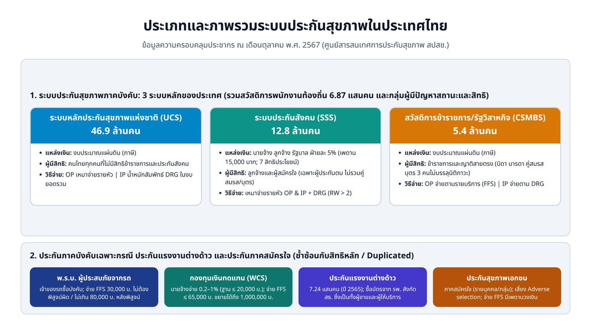
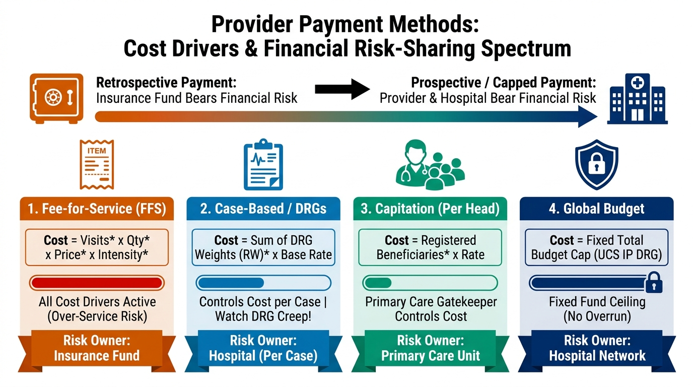

# HS6: การประกันสุขภาพ (Health Insurance) หลักประกันสุขภาพถ้วนหน้า (Universal Health Coverage) และกลไกการจ่ายเงินแก่ผู้ให้บริการ (Provider Payment Methods)

นพ.สัมฤทธิ์ ศรีธำรงสวัสดิ์

## วัตถุประสงค์การเรียนรู้และคำถามนำ

| วัตถุประสงค์การเรียนรู้ | คำถามนำและโครงสร้างเนื้อหา |
|---|---|
| 1. **หลักการของการประกันสุขภาพ (principles of health insurance)** อธิบายการซื้อความแน่นอน การคาดการณ์ระดับประชากร เงื่อนไขการประกันภาคสมัครใจ 4 ข้อ หน้าที่หลักประกันสุขภาพ 2 ประการ และการกระจายความเสี่ยงเทียบกับการเกลี่ยปันรายได้ | **1. เหตุใดการรวมกลุ่มคนจำนวนมากและการจ่ายเงินล่วงหน้าจึงเปลี่ยนความไม่แน่นอนระดับปัจเจกเป็นหลักประกันที่สร้างความเป็นธรรมได้** — ซื้อความแน่นอนและการคาดการณ์ระดับประชากร (1.1) เงื่อนไขรับประกันภาคสมัครใจ 4 ข้อ (1.2) หน้าที่หลักประกันสุขภาพและ UHC (1.3) และการกระจายความเสี่ยงกับการเกลี่ยปันรายได้ (1.4) |
| 2. **องค์ประกอบของการประกันสุขภาพ (components of health insurance)** อธิบายบทบาทของบุคคลที่สาม (ผู้รับประกัน) การบริหารจัดการด้านการคลัง และระบบข้อมูลของกองทุน | **2. เมื่อเปลี่ยนจากระบบจ่ายเงินเองไปสู่ระบบประกันสุขภาพ มีผู้เกี่ยวข้องฝ่ายใดเพิ่มขึ้นและทำหน้าที่ใด** — ผู้รับประกัน (Insurer) การบริหารจัดการด้านการคลัง และระบบข้อมูลสารสนเทศ (2.1) |
| 3. **ประเภทของการประกันสุขภาพในประเทศไทย (types of health insurance in Thailand)** เปรียบเทียบประกันภาคสมัครใจกับภาคบังคับ วิเคราะห์ปัญหาการคัดเลือกที่ขัดผลประโยชน์กัน (adverse selection) และจำแนกระบบประกันสุขภาพต่าง ๆ ของไทย | **3. เหตุใดประกันภาคสมัครใจจึงเกิดปัญหา adverse selection และระบบประกันสุขภาพของไทยจำแนกอย่างไร** — ประกันภาคสมัครใจและมาตรการลด adverse selection (3.1) และประกันภาคบังคับกับระบบหลักและระบบย่อยในไทย (3.2) |
| 4. **รูปแบบการจ่ายค่าบริการในระบบประกันสุขภาพ (provider payment methods)** เปรียบเทียบสมการค่าใช้จ่าย ปัจจัยผลักดันภาระค่าใช้จ่าย (cost driver) และผู้รับความเสี่ยงทางการเงินของวิธีจ่ายค่าบริการทั้ง 4 รูปแบบ | **4. รูปแบบการจ่ายค่าบริการแต่ละวิธีมีปัจจัยผลักดันค่าใช้จ่ายใด และโยกความเสี่ยงทางการเงินไปไว้ที่ฝ่ายใด** — จ่ายตามรายบริการ (4.1) เหมาจ่ายรายหัว (4.2) จ่ายตามรายป่วย/DRGs (4.3) และงบประมาณยอดรวม (4.4) |
| 5. **ปัญหาการขาดจริยธรรมในระบบประกันสุขภาพและการควบคุมค่าใช้จ่าย (moral hazard and cost containment)** อธิบาย moral hazard ทั้งฝั่งผู้ใช้บริการและผู้ให้บริการ และวิเคราะห์มาตรการควบคุมค่าใช้จ่ายโดยไม่กระทบคุณภาพและการเข้าถึงบริการของกลุ่มเปราะบาง | **5. การมีผู้จ่ายที่สามเปลี่ยนพฤติกรรมผู้ใช้บริการและผู้ให้บริการอย่างไร และมาตรการควบคุมค่าใช้จ่ายฝั่งใดมีประสิทธิผลมากกว่า** — Moral hazard สองฝั่ง (5.1) มาตรการฝั่งผู้ใช้บริการ (5.2) และมาตรการทางตรงและทางอ้อมฝั่งผู้ให้บริการ (5.3) |

## 1. หลักการของการประกันสุขภาพมุ่งเปลี่ยนความไม่แน่นอนระดับปัจเจกให้คาดการณ์ได้ในระดับประชากร เพื่ออำนวยการเข้าถึงบริการและกระจายความเสี่ยงทางการเงิน (Principles of Health Insurance)

การประกันสุขภาพอาศัยการคาดการณ์ความเสี่ยงในระดับกลุ่มประชากรและการรวมเงินจ่ายล่วงหน้า เพื่อคุ้มครองภาระค่ารักษาพยาบาลที่ไม่แน่นอนของแต่ละบุคคลและสร้างความเป็นธรรมในระบบบริการสุขภาพ ([Smith & Witter, 2004](https://doi.org/10.1596/13651); [World Health Organization [WHO], 2010](https://iris.who.int/handle/10665/44371))

### 1.1 ผู้ซื้อประกันซื้อความแน่นอนด้านค่ารักษาในอนาคต โดยอาศัยการรวมกลุ่มประชากรขนาดใหญ่ทำให้โอกาสเจ็บป่วยและค่าใช้จ่ายคาดการณ์ได้ (Certainty and Population Predictability)

การซื้อประกันสุขภาพ (health insurance) คือ **การซื้อความแน่นอน (certainty)** ด้านภาระค่ารักษาพยาบาลในอนาคต ผู้ที่มีความสามารถในการจ่ายและไม่พึงปรารถนาในการรับความเสี่ยงจากค่ารักษาที่อาจสูงมากจึงยินดีจ่ายเงินซื้อชุดสิทธิประโยชน์และความคุ้มครองที่คิดว่าคุ้มค่า ([Nyman, 1999](https://doi.org/10.1016/s0167-6296%2898%2900049-6); [Smith & Witter, 2004](https://doi.org/10.1596/13651)) แม้ในระดับปัจเจกการเจ็บป่วยหรือบาดเจ็บจะมีความไม่แน่นอนคือเกิดขึ้นหรือไม่ก็ได้ (0,1) และแต่ละคนใช้บริการต่างกันมากตั้งแต่ไม่ใช้เลยจนถึงนอนโรงพยาบาลบ่อย ๆ แต่เมื่อรวมกลุ่มประชากรให้มีจำนวนมากพอ เราจะคาดการณ์ **โอกาสเกิดการเจ็บป่วย (probability of illness)** และ **ค่าใช้จ่ายที่จะเกิดขึ้น (expected cost of illness)** ของกลุ่มได้ใกล้เคียงความเป็นจริง จึงนำมาคำนวณเบี้ยประกันหรือเงินสมทบและออกแบบชุดสิทธิประโยชน์ที่เหมาะสมได้ ([Biener & Eling, 2012](https://doi.org/10.1057/gpp.2011.29); [Smith & Witter, 2004](https://doi.org/10.1596/13651); [WHO, 2010](https://iris.who.int/handle/10665/44371))

### 1.2 บริการที่เหมาะสำหรับการประกันสุขภาพภาคสมัครใจต้องผ่านเงื่อนไขพื้นฐานสี่ประการ (Insurability Criteria)

การพิจารณาว่าบริการใดเหมาะสำหรับการประกันสุขภาพภาคสมัครใจประกอบด้วยเงื่อนไข 4 ข้อ ([Biener & Eling, 2012](https://doi.org/10.1057/gpp.2011.29); [Charpentier, 2008](https://doi.org/10.1057/palgrave.gpp.2510155); [Smith & Witter, 2004](https://doi.org/10.1596/13651)) ได้แก่

1. **โอกาสเกิดการเจ็บป่วยของปัจเจกต้อง < 1** (หากเท่ากับ 1 หมายถึงป่วยและมาใช้บริการแน่นอน) ([Charpentier, 2008](https://doi.org/10.1057/palgrave.gpp.2510155))
2. **ผู้ซื้อประกันต้องไม่ทราบโอกาสเกิดการเจ็บป่วยของตน** ([Charpentier, 2008](https://doi.org/10.1057/palgrave.gpp.2510155); [Smith & Witter, 2004](https://doi.org/10.1596/13651))
3. **โอกาสเกิดการเจ็บป่วยสำหรับปัจเจกแต่ละคนต้องเป็นอิสระต่อกัน** ([Biener & Eling, 2012](https://doi.org/10.1057/gpp.2011.29); [Charpentier, 2008](https://doi.org/10.1057/palgrave.gpp.2510155))
4. **การเจ็บป่วยที่เกิดขึ้นไม่ได้เป็นประโยชน์แก่ผู้ซื้อประกัน** ([Biener & Eling, 2012](https://doi.org/10.1057/gpp.2011.29); [Charpentier, 2008](https://doi.org/10.1057/palgrave.gpp.2510155); [Smith & Witter, 2004](https://doi.org/10.1596/13651))

### 1.3 หลักประกันสุขภาพทำหน้าที่อำนวยการเข้าถึงบริการที่จำเป็นและปกป้องครัวเรือนจากภาระค่ารักษาสูง อันนำไปสู่ความเป็นธรรมและระบบสุขภาพแบบถ้วนหน้า (Functions of Health Insurance, Equity, and UHC)

**หน้าที่ของหลักประกันสุขภาพ** มี 2 ประการ คือ **(1) อำนวยการเข้าถึงบริการสุขภาพที่จำเป็น (Enable access to needed care)** โดยไม่ให้ภาระค่าใช้จ่ายเป็นสิ่งกีดกั้น ([Kutzin, 2001](https://doi.org/10.1016/s0168-8510%2800%2900149-4); [WHO, 2010](https://iris.who.int/handle/10665/44371)) และ **(2) ปกป้องครัวเรือนจากภาระค่าใช้จ่ายที่สูงจนอาจทำให้ล้มละลายหรือยากจน (protecting households from catastrophic health expenditure and medical impoverishment)** ([Kutzin, 2001](https://doi.org/10.1016/s0168-8510%2800%2900149-4); [Wagstaff et al., 2018](https://doi.org/10.1016/s2214-109x%2817%2930429-1); [WHO, 2010](https://iris.who.int/handle/10665/44371); [Xu et al., 2003](https://doi.org/10.1016/s0140-6736%2803%2913861-5), [2007](https://doi.org/10.1377/hlthaff.26.4.972)) หน้าที่ทั้งสองสอดคล้องกับ **มิติด้านความเป็นธรรมของระบบบริการสุขภาพที่พึงประสงค์** ทั้งมิติด้านบริการ (การเข้าถึงบริการ) และด้านการคลัง (การแบกรับภาระค่าใช้จ่าย) ([Kutzin, 2013](https://doi.org/10.2471/blt.12.113985); [Murray & Frenk, 2000](https://iris.who.int/handle/10665/268164)) การขยายหลักประกันสุขภาพที่มีชุดสิทธิประโยชน์รอบด้านแก่ประชาชนทุกคนควบคู่กับโครงสร้างระบบบริการสุขภาพที่กระจายทั่วถึงและเชื่อมโยงกัน จึงเป็นเครื่องมือสำคัญสู่ **ระบบสุขภาพแบบถ้วนหน้า (Universal Health Coverage)** ([Tangcharoensathien et al., 2018](https://doi.org/10.1016/s0140-6736%2818%2930198-3); [WHO, 2010](https://iris.who.int/handle/10665/44371); [Xu et al., 2003](https://doi.org/10.1016/s0140-6736%2803%2913861-5))

### 1.4 การจ่ายเงินล่วงหน้าและการรวมกองทุนช่วยกระจายความเสี่ยงและเกลี่ยปันรายได้ตามขนาดกองทุน ความเป็นภาคบังคับ และรูปแบบอัตราเงินสมทบ (Prepayment, Pooling, and Contribution Design)

เมื่อมีการจ่ายเงินล่วงหน้า (prepayment system) และนำเงินมารวมกัน (pooling) กองทุนจะกระจายความเสี่ยงของปัจเจกไปยังคนกลุ่มใหญ่ กล่าวคือนำเงินที่เก็บจากคนที่มีความเสี่ยงน้อยไปอุดหนุนคนที่มีความเสี่ยงมาก และหากเก็บเงินสมทบจากคนรวยในสัดส่วนที่สูงกว่าคนจนก็จะเกลี่ยปันรายได้จากคนรวยไปอุดหนุนคนจนได้ด้วย ([Mathauer et al., 2019](https://doi.org/10.1186/s12939-019-1088-x); [Smith & Witter, 2004](https://doi.org/10.1596/13651); [WHO, 2010](https://iris.who.int/handle/10665/44371)) ดังแสดงในภาพที่ 1 ทั้งนี้ ศักยภาพในการกระจายความเสี่ยงและเกลี่ยปันรายได้ขึ้นกับ 3 ปัจจัยหลัก ได้แก่

1. **ขนาดของกองทุน:** กองทุนขนาดใหญ่ที่มีสมาชิกมากมีศักยภาพสูงกว่ากองทุนขนาดเล็ก ([Mathauer et al., 2019](https://doi.org/10.1186/s12939-019-1088-x); [Smith & Witter, 2004](https://doi.org/10.1596/13651); [WHO, 2010](https://iris.who.int/handle/10665/44371))
2. **รูปแบบภาคบังคับเทียบกับภาคสมัครใจ:** ประกันภาคบังคับรวบรวมสมาชิกได้มากกว่าจึงกระจายความเสี่ยงได้สูงกว่าภาคสมัครใจ ([Mathauer et al., 2019](https://doi.org/10.1186/s12939-019-1088-x); [Pettigrew & Mathauer, 2016](https://doi.org/10.1186/s12939-016-0353-5); [Smith & Witter, 2004](https://doi.org/10.1596/13651); [WHO, 2010](https://iris.who.int/handle/10665/44371))
3. **รูปแบบและอัตราการจัดเก็บเบี้ยประกัน/เงินสมทบ:** เรียงลำดับศักยภาพการกระจายความเสี่ยงและเกลี่ยปันรายได้จากสูงไปต่ำได้ดังตารางข้างล่าง ([Mossialos et al., 2002](https://iris.who.int/handle/10665/332208); [Smith & Witter, 2004](https://doi.org/10.1596/13651); [Thomson et al., 2009](https://iris.who.int/handle/10665/326415))

**ภาพที่ 1 หลักการจ่ายเงินล่วงหน้า การรวมกองทุน และการกระจายความเสี่ยงควบคู่กับการเกลี่ยปันรายได้** แสดงการแปลงความไม่แน่นอนด้านค่ารักษาระดับปัจเจกเข้าสู่กองทุนรวมขนาดใหญ่ที่ช่วยอุดหนุนจากผู้มีความเสี่ยงน้อยไปสู่ผู้มีความเสี่ยงมาก และจากคนรวยไปสู่คนจน

| ลำดับศักยภาพ (มาก → น้อย) | รูปแบบและอัตราการจัดเก็บเบี้ยประกัน/เงินสมทบ | ลักษณะสำคัญด้านการกระจายความเสี่ยงและเกลี่ยปันรายได้ |
|---|---|---|
| **อันดับ 1 (สูงสุด)** | **จัดเก็บอัตราก้าวหน้า** (เช่น ภาษีเงินได้ส่วนบุคคล) | คนรวยจ่ายในสัดส่วนที่สูงกว่าคนจน จึงเกลี่ยปันรายได้และกระจายความเสี่ยงได้สูงสุด ([Mossialos et al., 2002](https://iris.who.int/handle/10665/332208)) |
| **อันดับ 2** | **สัดส่วนของรายได้ (ไม่มีเพดานเงินเดือน)** | เก็บเป็นเปอร์เซ็นต์ของเงินเดือนเท่ากันทุกระดับรายได้โดยไม่จำกัดเพดาน ([Mossialos et al., 2002](https://iris.who.int/handle/10665/332208)) |
| **อันดับ 3** | **สัดส่วนของรายได้ (มีเพดานเงินเดือน)** | เก็บเป็นเปอร์เซ็นต์ของเงินเดือนแต่จำกัดเพดานฐานคำนวณ ทำให้ศักยภาพเกลี่ยปันรายได้ลดลงเมื่อรายได้เกินเพดาน ([Thomson et al., 2009](https://iris.who.int/handle/10665/326415)) |
| **อันดับ 4** | **ตามความเสี่ยงระดับชุมชน (community rating)** | สมาชิกในชุมชนจ่ายเบี้ยอัตราเดียวกัน ช่วยเกลี่ยความเสี่ยงในกลุ่มแต่ไม่ผูกกับระดับรายได้ ([Smith & Witter, 2004](https://doi.org/10.1596/13651); [Thomson et al., 2009](https://iris.who.int/handle/10665/326415)) |
| **อันดับ 5 (ต่ำสุด)** | **ตามความเสี่ยงระดับปัจเจก (risk rating)** | คิดเบี้ยตามความเสี่ยงของแต่ละบุคคล จึงกระจายความเสี่ยงและเกลี่ยปันรายได้น้อยที่สุด ([Mossialos et al., 2002](https://iris.who.int/handle/10665/332208); [Smith & Witter, 2004](https://doi.org/10.1596/13651)) |

## 2. องค์ประกอบของระบบประกันสุขภาพเพิ่มบุคคลที่สามทำหน้าที่บริหารสิทธิประโยชน์ การคลัง และข้อมูลสารสนเทศ (Components of Health Insurance)

### 2.1 ผู้รับประกันเข้ามาเป็นบุคคลที่สามเชื่อมระหว่างผู้มีสิทธิกับหน่วยบริการ พร้อมบริหารจัดการด้านการคลังและระบบข้อมูล (Insurer, Financial Management, and Information System)

ในระบบจ่ายเงินเองเมื่อไปใช้บริการมีผู้เกี่ยวข้องเพียง 2 ฝ่าย คือ **ผู้ใช้บริการ** และ **ผู้ให้บริการ** แต่เมื่อเปลี่ยนเป็นระบบประกันสุขภาพจะมี **บุคคลที่สาม** คือ **ผู้รับประกัน (Insurer)** หรือหน่วยงานบริหารกองทุนประกันสุขภาพ เข้ามาทำหน้าที่เชื่อมกลาง ดังแสดงในภาพที่ 2 โดยมีภารกิจหลัก ได้แก่

1. **การบริหารสิทธิประโยชน์และการทำสัญญา:** บริหารสิทธิประโยชน์ให้แก่ผู้ประกันตน (insured persons) หรือผู้มีสิทธิ (Beneficiaries) และทำสัญญาพร้อมจ่ายค่าบริการแก่หน่วยบริการ (Providers)
2. **การบริหารจัดการด้านการคลัง (Financial management):** คำนวณและจัดเก็บเงินสมทบให้เพียงพอ บริหารจัดการกองทุนให้เพียงพอต่อการจ่ายชดเชยชุดสิทธิประโยชน์ที่กำหนด ตลอดจนกำหนดอัตราและบริหารการเบิกจ่ายอย่างมีประสิทธิภาพ
3. **การจัดทำระบบข้อมูลสารสนเทศ:** พัฒนาระบบข้อมูลที่ดีเพื่อใช้ในการวางแผน บริหาร และกำกับติดตามอย่างมีประสิทธิผล

**ภาพที่ 2 ความสัมพันธ์สามฝ่ายในระบบประกันสุขภาพและภารกิจหลักของผู้รับประกัน** แสดงการเปลี่ยนผ่านจากระบบจ่ายเงินเองสองฝ่ายไปสู่การมีผู้รับประกันเป็นบุคคลที่สามทำหน้าที่บริหารสิทธิประโยชน์ บริหารการคลัง และกำกับติดตามด้วยระบบข้อมูล

## 3. ประเภทของการประกันสุขภาพในประเทศไทยแบ่งเป็นภาคสมัครใจและภาคบังคับ โดยประชากรเกือบทุกคนมีสิทธิหลักในสามระบบใหญ่ (Types of Health Insurance in Thailand)

### 3.1 ประกันสุขภาพภาคสมัครใจเผชิญปัญหาการคัดเลือกที่ขัดผลประโยชน์กัน จึงต้องใช้มาตรการคัดกรองความเสี่ยง ประกันกลุ่ม หรือมุ่งสู่ระบบภาคบังคับ (Voluntary Health Insurance and Adverse Selection)

**การประกันสุขภาพโดยสมัครใจ (Voluntary health insurance)** ที่คุ้นเคยคือประกันสุขภาพเอกชน (ทั้งแผนรายบุคคล individual plan และประกันกลุ่มจากการจ้างงาน employment-based health insurance) ส่วนภาครัฐในอดีตเคยมีโครงการบัตรประกันสุขภาพของกระทรวงสาธารณสุขซึ่งยุติไปหลังมีหลักประกันสุขภาพถ้วนหน้า

เพื่อให้กองทุนมี **ความยั่งยืนด้านการเงิน (financial sustainability)** คือเงินที่เก็บล่วงหน้าเพียงพอจ่ายค่าบริการโดยไม่ขาดทุน กองทุนต้องมีสมาชิกมากพอและควบคุมค่าใช้จ่ายได้ดี แต่ระบบภาคสมัครใจมักเกิดปัญหา **“การคัดเลือกที่ขัดผลประโยชน์กัน (Adverse selection)”** คือผู้มีความเสี่ยงสูงมีแนวโน้มซื้อประกันมากกว่าผู้ที่มีสุขภาพดี ทำให้กองทุนเสี่ยงขาดทุน แนวทางป้องกันและลดปัญหามี 3 ระดับ ได้แก่

1. **มาตรการของประกันสุขภาพเอกชน:** (1) กำหนดเบี้ยตามความเสี่ยง (Risk rating เช่น ตามอายุและเพศ) (2) ตรวจสุขภาพก่อนรับประกัน (Underwriting) (3) ตัดความคุ้มครองโรคที่เป็นมาก่อน (Exclusion of pre-existing conditions) และ (4) จัดชุดสิทธิประโยชน์และราคาต่างกันตามกลุ่มความเสี่ยง (Risk segmentation)
2. **ปรับเป็นการประกันกลุ่ม:** เช่น นายจ้างซื้อให้ลูกจ้าง ช่วยลดผลของ adverse selection ได้ระดับหนึ่งตามขนาดกลุ่ม
3. **มุ่งสู่ประกันสุขภาพภาคบังคับและหลักประกันสุขภาพถ้วนหน้า:** เป็นมาตรการที่มีประสิทธิผลที่สุดและแก้ปัญหา adverse selection ได้เบ็ดเสร็จเพราะรวมประชากรทุกคนเข้าสู่ระบบ

### 3.2 ประกันสุขภาพภาคบังคับใช้กฎหมายรวมกลุ่มเป้าหมายทั้งหมด โดยไทยมีสามระบบหลักควบคู่กับระบบย่อยและประกันแบบซ้ำซ้อน (Compulsory Health Insurance and Thai Schemes)

**การประกันสุขภาพภาคบังคับ (Compulsory health insurance)** อาศัยกฎหมายบังคับให้กลุ่มเป้าหมายทั้งหมดเข้าสู่ระบบ แบ่งเป็น 4 รูปแบบในไทย ดังแสดงในภาพที่ 3 และสรุปรายละเอียดในตารางต่อไปนี้ ได้แก่

- **3.2.1 ระบบประกันสังคม (Social Health Insurance):** สำหรับลูกจ้างในระบบการจ้างงานทางการ นายจ้าง ลูกจ้าง และรัฐบาลร่วมจ่ายเงินสมทบเป็นสัดส่วนของเงินเดือน มีสำนักงานประกันสังคมบริหารจัดการ โดยประกันสังคมไทยคุ้มครองเฉพาะตัวแรงงานผู้ส่งเงินสมทบ **ไม่รวมคู่สมรสและบุตร**
- **3.2.2 รูปแบบที่ใช้เงินภาษี (Tax-based system):** รัฐใช้งบประมาณภาษีสนับสนุนโดยไม่ต้องตั้งหน่วยงานเก็บเงินสมทบแต่จัดทำแผนงบประมาณรายปีเสนอรัฐบาล (เช่น อังกฤษ แคนาดา ออสเตรเลีย) ในไทยได้แก่ ระบบหลักประกันสุขภาพแห่งชาติ ระบบสวัสดิการรักษาพยาบาลข้าราชการ พนักงานองค์กรปกครองส่วนท้องถิ่น องค์กรอิสระ และกลุ่มบุคคลที่มีปัญหาสถานะและสิทธิ (เช่น ชนกลุ่มน้อยและคนต่างด้าวที่ได้รับอนุญาตให้พำนักและมีมติคณะรัฐมนตรีรองรับ)
- **3.2.3 ประกันอุบัติเหตุและการเจ็บป่วยภาคบังคับเฉพาะกรณี:** ได้แก่ **(1) ประกัน พ.ร.บ. ผู้ประสบภัยจากรถ พ.ศ. 2535** บังคับเจ้าของรถซื้อประกันบุคคลที่สามโดยบริษัทประกันเอกชนเป็นผู้ดำเนินงาน และ **(2) กองทุนเงินทดแทน (Workmen’s Compensation Scheme)** บังคับนายจ้างจ่ายเงินสมทบฝ่ายเดียวตามประสบการณ์การเกิดอุบัติการณ์เจ็บป่วยหรือบาดเจ็บจากการทำงาน บริหารโดยสำนักงานประกันสังคม
- **3.2.4 ประกันสุขภาพแรงงานต่างด้าว (Migrant health insurance):** บังคับแรงงานต่างด้าวชั่วคราวและผู้ติดตามที่ไม่อยู่ในระบบประกันสังคมซื้อบัตรประกันสุขภาพจากโรงพยาบาลสังกัดกระทรวงสาธารณสุขก่อนรับใบอนุญาตทำงาน โดยโรงพยาบาลเป็นผู้รับประกันและจัดบริการเอง

ณ เดือนตุลาคม พ.ศ. 2567 ประชากรไทยเกือบทุกคนอยู่ภายใต้ **ระบบหลัก 3 ระบบ** คือ **ระบบหลักประกันสุขภาพแห่งชาติ (UCS) 46.9 ล้านคน** **ระบบประกันสังคม (SSS) 12.8 ล้านคน** และ **ระบบสวัสดิการข้าราชการ/รัฐวิสาหกิจ (CSMBS) ประมาณ 5.4 ล้านคน** ร่วมกับระบบย่อย เช่น สวัสดิการพนักงานท้องถิ่น **6.87 แสนคน** และ **ประกันแบบซ้ำซ้อน (duplicated)** กับสิทธิหลัก ได้แก่ ประกันสุขภาพเอกชน กองทุนเงินทดแทน และ พ.ร.บ. คุ้มครองผู้ประสบภัยจากรถ

**ภาพที่ 3 ประเภทและภาพรวมความครอบคลุมของระบบประกันสุขภาพในประเทศไทย** เปรียบเทียบระบบหลักสามระบบ ระบบย่อย และความคุ้มครองแบบซ้ำซ้อนเฉพาะกรณี (ข้อมูลจำนวนผู้มีสิทธิ ณ ตุลาคม พ.ศ. 2567)

| โครงการ | ผู้มีสิทธิ | แหล่งรายได้ | วิธีจ่ายผู้ให้บริการ |
|---|---|---|---|
| **ประกันสุขภาพเอกชน** | ผู้ที่หาซื้อประกันเอง | เบี้ยประกันที่เก็บได้ | จ่ายตามรายบริการ (Fee-for-service) แต่มีเพดานการจ่าย |
| **ประกันสังคม (SSS)** | พนักงานรัฐ/ลูกจ้างเอกชน (ตั้งแต่ 1 คนขึ้นไป) และผู้สมัครใจเข้าร่วม (12.8 ล้านคน) | ร่วมจ่าย นายจ้าง ลูกจ้าง และรัฐบาล ฝ่ายละ 5% ของเงินเดือน (เพดานไม่เกิน 15,000 บาท) สำหรับสิทธิประโยชน์ 7 อย่าง | เหมาจ่ายรายหัว (Capitation) ทั้งผู้ป่วยนอกและในแก่ รพ. คู่สัญญาทั้งรัฐและเอกชน และจ่ายตาม DRG สำหรับผู้ป่วยในที่มีค่าน้ำหนักสัมพัทธ์ (RW) เกิน 2 |
| **สวัสดิการข้าราชการ (CSMBS)** | ข้าราชการและญาติสายตรง (บิดา มารดา คู่สมรส บุตร 3 คนที่ยังไม่บรรลุนิติภาวะ) (5.4 ล้านคน) | งบประมาณแผ่นดิน | ผู้ป่วยนอกจ่ายตามรายบริการ (Fee-for-service); ผู้ป่วยในจ่ายตาม DRG |
| **หลักประกันสุขภาพแห่งชาติ (UC)** | ประชาชนไทยทุกคนที่ไม่มีสิทธิ CSMBS และ SSS (46.9 ล้านคน) | งบประมาณแผ่นดิน | ผู้ป่วยนอกเหมาจ่ายรายหัว (Capitation); ผู้ป่วยในใช้น้ำหนักสัมพัทธ์ DRG คำนวณภายใต้งบยอดรวม |
| **กองทุนเงินทดแทน (WCS)** | ผู้ประกันตนที่เจ็บป่วยหรือประสบอุบัติเหตุเนื่องจากการทำงาน | นายจ้างจ่ายฝ่ายเดียว 0.2–1% ของเงินเดือนตามความเสี่ยงภัยกิจการ (ฐานไม่เกิน 20,000 บาท/เดือน) | จ่ายตามรายบริการ (Fee-for-service) ไม่เกิน 65,000 บาท ขยายได้ถึง 1,000,000 บาทถ้าจำเป็นโดยนายจ้างร่วมรับผิดชอบ |
| **พ.ร.บ. คุ้มครองผู้ประสบภัยจากรถ พ.ศ. 2535** | ผู้ได้รับบาดเจ็บจากอุบัติเหตุรถ | เจ้าของรถซื้อประกันก่อนต่อทะเบียนรถ | จ่ายตามรายบริการ (Fee-for-service) 30,000 บาทไม่ต้องพิสูจน์ถูกผิด และไม่เกิน 80,000 บาทหลังพิสูจน์ถูกผิด |
| **ประกันสุขภาพแรงงานต่างด้าว** | แรงงานต่างด้าวชั่วคราวที่ไม่เข้าข่ายประกันสังคมและผู้ติดตาม (7.24 แสนคน ในปี 2565) | แรงงานต่างด้าวจ่ายค่าตรวจสุขภาพและค่าประกันก่อนขึ้นทะเบียนทำงาน | โรงพยาบาลเป็นผู้ขายประกันและให้บริการเอง |

*หมายเหตุ: ข้อมูลจำนวนผู้มีสิทธิ ณ เดือนตุลาคม พ.ศ. 2567 จากศูนย์สารสนเทศการประกันสุขภาพ สำนักงานหลักประกันสุขภาพแห่งชาติ ([http://ucinfo.nhso.go.th/](http://ucinfo.nhso.go.th/))*

## 4. รูปแบบการจ่ายค่าบริการในระบบประกันสุขภาพกำหนดปัจจัยผลักดันค่าใช้จ่ายและฝ่ายผู้รับความเสี่ยงทางการเงิน (Provider Payment Methods)

ระบบประกันสุขภาพของไทยใช้วิธีจ่ายค่าบริการแก่หน่วยบริการหลัก 4 รูปแบบ ซึ่งแตกต่างกันทั้งสมการรายจ่าย ปัจจัยผลักดันภาระค่าใช้จ่ายของกองทุน (\* cost driver) และฝ่ายที่รับความเสี่ยงทางการเงิน ดังแสดงในภาพที่ 4 และตารางสรุปด้านล่าง

**ภาพที่ 4 เปรียบเทียบรูปแบบการจ่ายค่าบริการทั้ง 4 รูปแบบ สมการต้นทุน และการรับความเสี่ยงทางการเงิน** แสดงการโยกภาระความเสี่ยงทางการเงินจากกองทุนไปยังหน่วยบริการเมื่อเปลี่ยนจากการจ่ายย้อนหลังตามรายบริการไปสู่การเหมาจ่ายรายหัว รายป่วย และงบประมาณยอดรวม

### 4.1 การจ่ายตามรายบริการทิ้งความเสี่ยงทางการเงินไว้ที่กองทุนเป็นหลัก (Fee-for-Service)

**การจ่ายตามรายบริการ (Fee-for-service)** จ่ายย้อนหลังตามรายการบริการ (items of services) และราคาที่โรงพยาบาลหรือกองทุนกำหนด หน่วยบริการเรียกเก็บได้เกือบทั้งหมด ความเสี่ยงทางการเงินจึงอยู่กับ **กองทุนประกันสุขภาพ** เป็นหลัก และทุกองค์ประกอบล้วนเป็นตัวผลักดันค่าใช้จ่าย

> ค่าใช้จ่ายของกองทุน = Visits\* × Inputs (quantity\* × price\*) × intensity of services\*

### 4.2 การจ่ายตามรายหัวโยกความเสี่ยงทางการเงินไปยังหน่วยบริการด่านหน้า (Capitation)

**การจ่ายตามรายหัว (Capitation)** เหมาจ่ายตามจำนวนผู้มีสิทธิที่ขึ้นทะเบียนกับหน่วยบริการซึ่งทำหน้าที่ด่านหน้า (gatekeeper) ความเสี่ยงทางการเงินทั้งหมดจึงถูกโยกไปยัง **หน่วยบริการ** ที่ต้องควบคุมต้นทุนเอง โดยมีจำนวนผู้มีสิทธิขึ้นทะเบียนเป็นตัวผลักดันหลัก

> ค่าใช้จ่ายของกองทุน = จำนวนผู้มีสิทธิ\* × อัตราเหมาจ่าย

### 4.3 การจ่ายตามรายป่วยและระบบ DRGs ให้หน่วยบริการคุมต้นทุนต่อราย แต่ต้องระวัง DRG Creep (Case-Based Payment and DRGs)

**การจ่ายตามรายป่วย (Case-based payment)** เหมาจ่ายต่อรายผู้ป่วย (per case) ทั้งผู้ป่วยนอก (เช่น อัตราคงที่ต่อรายไม่เกิน 700 บาท หรือตามกลุ่มโรค Case mix) และผู้ป่วยในซึ่งไทยใช้ **กลุ่มวินิจฉัยโรคร่วม (Diagnosis-Related Groups: DRGs)** ที่จัดกลุ่มโรคตามความรุนแรงและทรัพยากรที่ใช้เป็นค่าน้ำหนักสัมพัทธ์ (Relative weight) แล้วคูณอัตราจ่ายต่อหน่วย (เช่น 10,000 บาท/หน่วย) ทำให้หน่วยบริการต้องคุมค่าใช้จ่ายต่อรายเอง แต่ต้องระวัง **DRG creep** คือการให้รหัสโรคสูงกว่าความเป็นจริงเพื่อเบิกเงินเพิ่ม (เช่น ผู้ป่วยไส้ติ่งอักเสบแต่ลงข้อมูลเป็นไส้ติ่งอักเสบแตก)

> ค่าใช้จ่ายกองทุน = จำนวนผลรวมค่าน้ำหนักสัมพัทธ์ DRGs\* × อัตราการจ่ายต่อหน่วยน้ำหนักสัมพัทธ์

### 4.4 งบประมาณยอดรวมจำกัดวงเงินคงที่ของกองทุนโดยความเสี่ยงอยู่ที่โรงพยาบาล (Global Budget)

**งบประมาณยอดรวม (global budget)** กำหนดวงเงินรวมที่ตั้งไว้ล่วงหน้า เช่น งบผู้ป่วยในของระบบหลักประกันสุขภาพแห่งชาติที่นำค่าน้ำหนักสัมพัทธ์ DRG มาคำนวณจัดสรรงบยอดรวมตามผลงานให้แต่ละโรงพยาบาล กองทุนจึงไม่แบกรับความเสี่ยงเกินงบที่ตั้งไว้ และความเสี่ยงตกอยู่ที่ **โรงพยาบาล**

> ค่าใช้จ่ายของกองทุน = งบประมาณยอดรวมที่ตั้ง

| รูปแบบการจ่ายค่าบริการ | ลักษณะการจ่าย | ปัจจัยผลักดันค่าใช้จ่ายของกองทุน (\* cost driver) | ฝ่ายผู้รับความเสี่ยงทางการเงินและข้อควรระวัง |
|---|---|---|---|
| **4.1 จ่ายตามรายบริการ (Fee-for-service)** | จ่ายย้อนหลังตามรายการและราคาที่กำหนด | ทุกองค์ประกอบ (จำนวนครั้ง ปริมาณ ราคา และความเข้มข้นบริการ) | **กองทุนรับความเสี่ยงเป็นหลัก**; เสี่ยงเกิดการให้บริการเกินจำเป็น |
| **4.2 จ่ายตามรายหัว (Capitation)** | เหมาจ่ายล่วงหน้าต่อผู้มีสิทธิขึ้นทะเบียนหน่วยบริการด่านหน้า | จำนวนผู้มีสิทธิที่ขึ้นทะเบียน | **หน่วยบริการรับความเสี่ยง**; หน่วยบริการต้องควบคุมค่าใช้จ่ายเอง |
| **4.3 จ่ายตามรายป่วย (Case-based / DRGs)** | เหมาจ่ายต่อรายตามกลุ่มโรคและค่าน้ำหนักสัมพัทธ์ (RW) | ผลรวมค่าน้ำหนักสัมพัทธ์ DRGs | หน่วยบริการคุมค่าใช้จ่ายต่อราย; **ต้องระวัง DRG creep** (ลงรหัสโรคสูงเกินจริง) |
| **4.4 งบประมาณยอดรวม (Global budget)** | กำหนดวงเงินรวมคงที่แล้วจัดสรรตามผลงาน (เช่น แต้ม DRG) | ไม่มีตัวแปรเกินเพดานงบยอดรวมที่ตั้งไว้ | **โรงพยาบาลรับความเสี่ยง**; กองทุนจ่ายไม่เกินงบที่มี |

## 5. ปัญหาการขาดจริยธรรมในระบบประกันสุขภาพทำให้ต้องมีมาตรการควบคุมค่าใช้จ่ายทั้งสองฝั่ง โดยมาตรการฝั่งผู้ให้บริการมีประสิทธิผลมากกว่า (Moral Hazard and Cost Containment)

### 5.1 การมีบุคคลที่สามจ่ายแทนกระตุ้นการใช้และให้บริการเกินจำเป็นทั้งฝั่งผู้ป่วยและฝั่งผู้ให้บริการ (Consumer’s and Provider’s Moral Hazard)

เมื่อเปลี่ยนผู้จ่ายจากผู้ป่วยเอง (out-of-pocket payment) มาเป็นบุคคลที่สาม อาจเกิดการใช้หรือให้บริการเกินจำเป็นที่เรียกว่า **ปัญหาการขาดจริยธรรมในระบบประกันสุขภาพ (moral hazard)** สองฝั่ง ดังแสดงในภาพที่ 5 ได้แก่

- **ฝั่งผู้ใช้บริการ (consumer’s moral hazard):** นอกจากการใช้บริการที่จำเป็นเพิ่มขึ้นตามเป้าประสงค์แล้ว บางกลุ่มอาจมีพฤติกรรมเสี่ยงต่อสุขภาพมากขึ้นเพราะไม่ต้องกังวลค่ารักษา เปลี่ยนจากดูแลตนเองเมื่อป่วยเล็กน้อยเป็นไปพบแพทย์มากขึ้น ใช้บริการเกินจำเป็น (เช่น ผ่าคลอดโดยเฉพาะเมื่อร่วมกับการจ่ายตามรายบริการ) หรือขอนอนโรงพยาบาลเอกชนเมื่อกรมธรรม์คุ้มครองเฉพาะผู้ป่วยในและจ่ายเงินชดเชยการขาดรายได้รายวัน
- **ฝั่งผู้ให้บริการ (provider’s moral hazard):** เมื่อทราบว่าผู้ป่วยไม่ต้องจ่ายเอง แพทย์จึงตัดสินใจสั่งยาราคาแพง สั่งนอนโรงพยาบาล หรือส่งตรวจวินิจฉัยราคาแพงได้ง่ายขึ้น โดยเฉพาะเมื่อแพทย์ได้ค่าตอบแทนตามรายบริการ เช่น การผ่าคลอดโดยไม่มีข้อบ่งชี้ทางการแพทย์เมื่อฝากพิเศษซึ่งเป็นประโยชน์ร่วมกันของทั้งสองฝ่าย

**ภาพที่ 5 กลไก Moral Hazard และมาตรการควบคุมค่าใช้จ่ายฝั่งผู้ใช้บริการเทียบกับฝั่งผู้ให้บริการ** แสดงเปรียบเทียบมาตรการควบคุมอุปสงค์ฝั่งผู้ป่วย (พร้อมการยกเว้นกลุ่มเปราะบาง) กับมาตรการควบคุมทางตรงและทางอ้อมฝั่งผู้ให้บริการ

### 5.2 มาตรการควบคุมค่าใช้จ่ายฝั่งผู้ใช้บริการต้องมีหลักฐานการใช้เกินจำเป็นและต้องยกเว้นส่วนร่วมจ่ายให้กลุ่มเปราะบาง (Demand-Side Measures)

การควบคุมฝั่งผู้รับบริการควรทำเมื่อมีหลักฐานเชิงประจักษ์ว่ามีการใช้บริการเกินจำเป็น แบ่งเป็น 3 มาตรการหลัก คือ

1. **กำหนดส่วนร่วมจ่ายเมื่อไปใช้บริการ:** มี 3 รูปแบบ คือ **(ก) ร่วมจ่ายจำนวนคงที่ (co-payment)** เช่น 30 บาท/ครั้ง ต่อรายการยา หรือต่อวันนอน **(ข) ร่วมจ่ายตามสัดส่วน (co-insurance)** เช่น ร้อยละ 10–20 ของค่าใช้จ่ายรวมหรือค่ายา และ **(ค) ร่วมจ่ายก่อนส่วนแรก (deductible)** เช่น จ่าย 1,000 บาทแรกเองก่อนประกันจ่ายส่วนที่เหลือ *ข้อพึงระวังสำคัญ:* การร่วมจ่ายมีผลไม่ต่างจากการจ่ายเงินเองสำหรับผู้มีความจำเป็นด้านสุขภาพมากแต่มีความสามารถในการจ่ายน้อย จึงต้อง **ยกเว้นส่วนร่วมจ่ายให้กลุ่มเปราะบาง** ได้แก่ **คนจน ผู้ป่วยโรคเรื้อรัง ผู้สูงอายุ และผู้พิการ**
2. **กำหนดให้รับบริการที่หน่วยบริการปฐมภูมิหลักก่อน (primary care gatekeeper):** ให้ทีมหมอประจำครอบครัวเป็นด่านหน้าและที่ปรึกษา ช่วยให้การใช้บริการเกิดผลดีและมีประสิทธิภาพ
3. **กำหนดเพดานค่าใช้จ่ายที่คุ้มครอง:** ใช้เป็นหลักในประกันสุขภาพเอกชนเพื่อจำกัดภาระของบริษัทมากกว่าป้องกันการใช้บริการเกินจำเป็น

### 5.3 มาตรการควบคุมค่าใช้จ่ายฝั่งผู้ให้บริการมีอิทธิพลมากกว่า โดยการควบคุมทางอ้อมด้วยการเปลี่ยนวิธีจ่ายเงินเหมาะสมกว่าการก้าวล่วงทางคลินิก (Supply-Side Measures)

เนื่องจากปัจจัยด้านผู้ให้บริการมีอิทธิพลต่อค่าใช้จ่ายมากกว่าฝั่งผู้ใช้บริการ จึงมีมาตรการทั้งทางตรงและทางอ้อม ดังนี้

1. **มาตรการควบคุมทางตรง (Direct control):**
    - *1.1 การจำกัดจำนวนผู้ให้บริการ (limiting supply):* กำหนดจำนวนแพทย์หรือเตียงต่อประชากรที่ขึ้นทะเบียนกับกองทุน เพื่อลดการโน้มน้าวให้เกิดการใช้บริการ (supplier-induced demand) โดยเฉพาะในระบบจ่ายตามรายบริการ
    - *1.2 การควบคุมราคา:* กำหนดราคาอ้างอิงของยา ค่าตรวจวินิจฉัย ค่าตรวจทางห้องปฏิบัติการ และวัสดุทางการแพทย์
    - *1.3 การควบคุมการสั่งใช้ยา:* กำหนดจำนวนรายการยาที่สั่งได้ ใช้ยาในบัญชียาหลักแห่งชาติเป็นหลัก ให้ระบุเหตุผลเมื่อสั่งยานอกบัญชียาหลักแห่งชาติ ใช้ยาชื่อสามัญ (generic name) แทนยาต้นแบบ และกำหนดรายการยาที่เบิกได้/เบิกไม่ได้ (positive/negative list)
    - *1.4 การควบคุมการใช้บริการ (control use):* กำหนดหน่วยบริการที่ให้การรักษาได้และต้องขึ้นทะเบียนขออนุมัติสิทธิก่อน (Prior authorization) สำหรับบริการราคาแพง เช่น เคมีบำบัดรักษามะเร็ง
    - *1.5 การตรวจสอบความเหมาะสมของการให้บริการ (Utilization review):* ทบทวนความสอดคล้องของการรักษากับโรคก่อนจ่ายเงิน มักสุ่มตรวจรายการราคาแพงเพราะมีต้นทุนตรวจสอบสูง
2. **มาตรการควบคุมทางอ้อม (Indirect control):** มาตรการทางตรงต้องใช้หลายวิธีร่วมกันและอาจก้าวล่วงการตัดสินใจทางวิชาชีพของแพทย์จนเกิดความขัดแย้ง มาตรการที่เหมาะสมกว่าจึงเป็นการเปลี่ยนวิธีจ่ายเงินจากจ่ายตามปริมาณบริการ (fee-for-service) ไปเป็นการจ่ายล่วงหน้า เช่น จ่ายตามรายป่วย (case-based) จ่ายตามรายหัว (capitation) หรืองบประมาณยอดรวม (global budget) เพื่อโยกความเสี่ยงด้านค่าใช้จ่ายให้หน่วยบริการควบคุมเอง

## บทสรุป (สาระสำคัญของบทนี้สรุปได้ดังนี้)

- **จุดมุ่งหมายหลักของการประกันสุขภาพคือการกระจายความเสี่ยงทางการเงินและอำนวยการเข้าถึงบริการสุขภาพที่จำเป็น** การขยายความครอบคลุมแก่ประชาชนทุกคนจึงสร้างความเป็นธรรม (Equity) ทั้งด้านการเข้าถึงบริการและด้านการปกป้องครัวเรือนจากการล้มละลายหรือยากจนลง
- **ความยั่งยืนและความเป็นปึกแผ่นในสังคม (Solidarity) ต้องอาศัยการประกันสุขภาพภาคบังคับ** เพราะกองทุนขนาดใหญ่ที่บังคับเข้าร่วมช่วยแก้ปัญหาการคัดเลือกที่ขัดผลประโยชน์กัน (adverse selection) ซึ่งตลาดประกันภาคสมัครใจไม่สามารถตอบสนองได้ทั่วถึง
- **การควบคุมปัญหา moral hazard ต้องมุ่งเน้นมาตรการฝั่งผู้ให้บริการควบคู่กับการคุ้มครองคุณภาพและการเข้าถึง** โดยมาตรการฝั่งผู้ให้บริการ (โดยเฉพาะการเปลี่ยนวิธีจ่ายเงินเป็นแบบเหมาจ่ายล่วงหน้า) มีประสิทธิผลมากกว่ามาตรการฝั่งผู้รับบริการ และมาตรการทั้งหมดต้องเพิ่มประสิทธิภาพ (Efficiency) โดยไม่ส่งผลลบต่อคุณภาพ (Quality) และการเข้าถึงบริการ (Access to care)

### ตารางทบทวนสาระสำคัญ (Rapid Review)

| ประเด็น | สาระสำคัญ | ตัวอย่างในบท | แหล่งอ้างอิง |
|---|---|---|---|
| **การซื้อความแน่นอนและเงื่อนไขรับประกัน 4 ข้อ** | ปัจเจกไม่แน่นอน (0,1) แต่ระดับประชากรคาดการณ์โอกาสและค่าใช้จ่ายได้; ประกันสมัครใจต้อง (1) โอกาส < 1 (2) ผู้ซื้อไม่รู้ความเสี่ยงตน (3) ความเสี่ยงอิสระต่อกัน (4) ไม่ได้ประโยชน์เมื่อป่วย | คนที่มีโอกาสป่วย = 1 (ป่วยแน่นอน) ไม่เข้าเกณฑ์ประกันสมัครใจ จึงต้องใช้ระบบภาคบังคับ | [Biener & Eling (2012)](https://doi.org/10.1057/gpp.2011.29); [Charpentier (2008)](https://doi.org/10.1057/palgrave.gpp.2510155); [Smith & Witter (2004)](https://doi.org/10.1596/13651) |
| **หน้าที่หลักประกันสุขภาพ ความเป็นธรรม และ UHC** | (1) อำนวยการเข้าถึงบริการที่จำเป็น (2) ปกป้องครัวเรือนจากรายจ่ายหายนะและความยากจน สอดคล้องกับความเป็นธรรมด้านบริการและการคลัง | การบรรลุ UHC ต้องขยายหลักประกันสุขภาพควบคู่กับโครงสร้างบริการที่กระจายทั่วถึง | [Kutzin (2001)](https://doi.org/10.1016/s0168-8510%2800%2900149-4), [(2013)](https://doi.org/10.2471/blt.12.113985); [Tangcharoensathien et al. (2018)](https://doi.org/10.1016/s0140-6736%2818%2930198-3); [WHO (2010)](https://iris.who.int/handle/10665/44371); [Xu et al. (2003)](https://doi.org/10.1016/s0140-6736%2803%2913861-5) |
| **การกระจายความเสี่ยงและลำดับอัตราเงินสมทบ** | กองทุนใหญ่และภาคบังคับกระจายความเสี่ยงได้ดีกว่า; ลำดับการเกลี่ยปันรายได้: อัตราก้าวหน้า > สัดส่วนรายได้ไม่มีเพดาน > มีเพดาน > community rating > risk rating | ภาษีเงินได้บุคคลธรรมดาเป็นอัตราก้าวหน้า ส่วนประกันเอกชนมักคิดเบี้ยตามความเสี่ยงปัจเจก | [Mathauer et al. (2019)](https://doi.org/10.1186/s12939-019-1088-x); [Mossialos et al. (2002)](https://iris.who.int/handle/10665/332208); [Thomson et al. (2009)](https://iris.who.int/handle/10665/326415) |
| **องค์ประกอบและประเภทระบบประกันสุขภาพไทย** | ผู้รับประกันเป็นบุคคลที่สามบริหารสิทธิ การคลัง และข้อมูล; ไทยคุ้มครองประชากรผ่าน 3 ระบบหลักร่วมกับระบบย่อยและประกันซ้ำซ้อน | UCS 46.9 ล้านคน, SSS 12.8 ล้านคน (เฉพาะผู้ประกันตน), CSMBS 5.4 ล้านคน (รวมครอบครัว), ท้องถิ่น 6.87 แสนคน, พ.ร.บ. รถ, เงินทดแทน, ต่างด้าว | ตารางที่ 1 (ข้อมูล ณ ต.ค. 2567, ศูนย์สารสนเทศการประกันสุขภาพ สปสช.) |
| **รูปแบบการจ่ายค่าบริการ 4 วิธี** | FFS กองทุนรับความเสี่ยง; Capitation และ Global budget โยกความเสี่ยงไปหน่วยบริการ; Case-based (DRGs) คุมต้นทุนต่อรายแต่ต้องระวัง DRG creep | ลงรหัสไส้ติ่งอักเสบเป็นไส้ติ่งอักเสบแตกเพื่อเพิ่มค่าน้ำหนักสัมพัทธ์ DRG | หัวข้อ 4.1–4.4 |
| **Moral hazard และการควบคุมค่าใช้จ่าย** | เกิดทั้งฝั่งผู้ใช้บริการและผู้ให้บริการ; มาตรการฝั่งผู้ให้บริการ (โดยเฉพาะทางอ้อมด้วยการเปลี่ยนวิธีจ่ายเงิน) มีประสิทธิผลมากกว่า | ร่วมจ่าย (co-payment, co-insurance, deductible) ต้องยกเว้นคนจน ผู้ป่วยเรื้อรัง ผู้สูงอายุ ผู้พิการ; ฝั่งผู้ให้บริการใช้บัญชียาหลัก PA และการจ่ายล่วงหน้า | หัวข้อ 5 และบทสรุป |

### คำศัพท์สำคัญ

| คำศัพท์ | ความหมาย |
|---|---|
| **การซื้อความแน่นอน (buying certainty)** | หัวใจของการซื้อประกันสุขภาพที่ผู้ไม่พึงปรารถนาจะรับความเสี่ยงยอมจ่ายเบี้ยล่วงหน้าเพื่อแลกกับความแน่นอนของภาระค่ารักษาพยาบาลในอนาคต |
| **การจ่ายเงินล่วงหน้าและการรวมกองทุน (prepayment and pooling)** | กลไกจัดเก็บเงินล่วงหน้ามารวมเป็นกองทุนเพื่อกระจายความเสี่ยงจากผู้มีความเสี่ยงน้อยไปช่วยผู้มีความเสี่ยงมาก และเกลี่ยปันรายได้เมื่อเก็บตามฐานะ |
| **การคัดเลือกที่ขัดผลประโยชน์กัน (adverse selection)** | ปัญหาในระบบประกันภาคสมัครใจที่ผู้มีความเสี่ยงสูงมีแนวโน้มซื้อประกันมากกว่าผู้มีสุขภาพดี ทำให้กองทุนเสี่ยงขาดทุน |
| **อัตราเบี้ยตามความเสี่ยงปัจเจกและระดับชุมชน (risk rating & community rating)** | การคิดเบี้ยประกันแยกตามความเสี่ยงของแต่ละบุคคล (เช่น อายุ เพศ) เทียบกับการคิดเบี้ยอัตราเดียวกันสำหรับสมาชิกในชุมชนหรือกลุ่มเดียวกัน |
| **การจ่ายตามรายบริการ (Fee-for-service)** | การจ่ายค่าบริการย้อนหลังตามรายการและราคาที่ให้บริการจริง ทำให้ความเสี่ยงทางการเงินอยู่กับกองทุนเป็นหลัก |
| **การจ่ายตามรายหัวและหน่วยบริการด่านหน้า (Capitation & gatekeeper)** | การเหมาจ่ายตามจำนวนผู้มีสิทธิที่ขึ้นทะเบียนกับหน่วยบริการปฐมภูมิด่านหน้า โดยโยกความเสี่ยงทางการเงินให้หน่วยบริการบริหารจัดการเอง |
| **กลุ่มวินิจฉัยโรคร่วมและ DRG creep (DRGs & DRG creep)** | ระบบจัดกลุ่มผู้ป่วยในตามความรุนแรงและการใช้ทรัพยากรเป็นค่าน้ำหนักสัมพัทธ์ (RW) ส่วน DRG creep คือการลงรหัสโรคสูงกว่าความจริงเพื่อเบิกเงินเพิ่ม |
| **งบประมาณยอดรวม (Global budget)** | การกำหนดวงเงินงบประมาณรวมคงที่ไว้ล่วงหน้า เช่น งบผู้ป่วยในของระบบบัตรทองที่จัดสรรตามแต้ม DRG โดยโรงพยาบาลเป็นผู้รับความเสี่ยง |
| **ปัญหาการขาดจริยธรรมในระบบประกันสุขภาพ (Moral hazard)** | พฤติกรรมการใช้หรือให้บริการมากเกินจำเป็นเมื่อมีบุคคลที่สามเป็นผู้จ่ายค่ารักษาแทน ทั้งฝั่งผู้ใช้บริการและฝั่งผู้ให้บริการ |
| **การโน้มน้าวให้เกิดการใช้บริการโดยผู้ให้บริการ (Supplier-induced demand)** | การที่ผู้ให้บริการกระตุ้นหรือสั่งการตรวจรักษาเพิ่มขึ้นเกินความจำเป็น โดยเฉพาะในระบบที่จ่ายค่าตอบแทนตามรายบริการ |

### แบบทบทวนความรู้ด้วยตนเอง

1. เหตุใดการรวมกลุ่มประชากรขนาดใหญ่จึงทำให้ระบบประกันสุขภาพคำนวณเบี้ยหรือเงินสมทบได้ และบริการที่จะนำมาจัดประกันสุขภาพภาคสมัครใจต้องมีเงื่อนไขใดบ้าง
2. จงเปรียบเทียบศักยภาพการกระจายความเสี่ยงและการเกลี่ยปันรายได้ของรูปแบบการจัดเก็บเบี้ยประกัน/เงินสมทบทั้ง 5 รูปแบบ พร้อมอธิบายความเชื่อมโยงกับความเป็นธรรมและหลักประกันสุขภาพถ้วนหน้า
3. ระบบประกันสุขภาพภาคสมัครใจเผชิญปัญหา adverse selection อย่างไร มีมาตรการแก้ไขกี่แนวทาง และระบบประกันสุขภาพหลักทั้ง 3 ระบบของไทยแตกต่างกันอย่างไรในด้านผู้มีสิทธิ แหล่งรายได้ และวิธีจ่ายเงิน
4. จงเปรียบเทียบสมการค่าใช้จ่าย ปัจจัยผลักดันค่าใช้จ่าย (\* cost driver) และผู้รับความเสี่ยงทางการเงินของการจ่ายแบบ Fee-for-service, Capitation, Case-based (DRGs) และ Global budget
5. เหตุใดเมื่อมีบุคคลที่สามเป็นผู้จ่ายจึงเกิด moral hazard ทั้งสองฝั่ง จงเปรียบเทียบข้อพึงระวังของการกำหนดส่วนร่วมจ่ายฝั่งผู้ใช้บริการกับเหตุผลที่มาตรการควบคุมทางอ้อมฝั่งผู้ให้บริการมีความเหมาะสมกว่ามาตรการทางตรง

## แนวคำตอบ

1. แนวคำตอบหนึ่งที่สมเหตุสมผลคือ แม้การเจ็บป่วยระดับปัจเจกจะไม่แน่นอน (เกิดขึ้นหรือไม่ก็ได้ 0,1) แต่เมื่อรวมกลุ่มคนจำนวนมากพอจะคาดการณ์โอกาสเกิดการเจ็บป่วยและค่าใช้จ่ายที่คาดหมายของทั้งกลุ่มได้ใกล้เคียงความจริง ส่วนบริการที่เหมาะสำหรับประกันภาคสมัครใจต้องผ่านเงื่อนไข 4 ข้อ ได้แก่ (1) โอกาสเกิดการเจ็บป่วยของปัจเจก < 1 (2) ผู้ซื้อไม่ทราบโอกาสเจ็บป่วยของตน (3) โอกาสเจ็บป่วยของแต่ละคนเป็นอิสระต่อกัน และ (4) การเจ็บป่วยไม่ได้เป็นประโยชน์แก่ผู้ซื้อประกัน
2. แนวคำตอบหนึ่งที่สมเหตุสมผลคือ ศักยภาพการกระจายความเสี่ยงและเกลี่ยปันรายได้เรียงจากมากไปน้อยได้แก่ จัดเก็บอัตราก้าวหน้า > สัดส่วนของรายได้ไม่มีเพดานเงินเดือน > สัดส่วนของรายได้มีเพดานเงินเดือน > ตามความเสี่ยงระดับชุมชน (community rating) > ตามความเสี่ยงระดับปัจเจก (risk rating) การขยายหลักประกันสุขภาพที่มีชุดสิทธิประโยชน์รอบด้านควบคู่กับโครงสร้างบริการที่กระจายทั่วถึงช่วยอำนวยการเข้าถึงบริการที่จำเป็นและปกป้องครัวเรือนจากการล้มละลาย จึงสร้างความเป็นธรรมทั้งด้านบริการและการคลังมุ่งสู่หลักประกันสุขภาพถ้วนหน้า
3. แนวคำตอบหนึ่งที่สมเหตุสมผลคือ ในระบบสมัครใจผู้มีความเสี่ยงสูงมีแนวโน้มซื้อประกันมากกว่าคนสุขภาพดีทำให้กองทุนเสี่ยงขาดทุน แก้ไขได้โดย (1) มาตรการเอกชน เช่น คิดเบี้ยตามความเสี่ยง ตรวจสุขภาพก่อนรับประกัน ตัดโรคที่เป็นมาก่อน หรือแบ่งชุดสิทธิประโยชน์ (2) จัดประกันกลุ่มผ่านการจ้างงาน และ (3) ใช้ประกันภาคบังคับซึ่งแก้ปัญหาได้เบ็ดเสร็จ สำหรับ 3 ระบบหลักของไทย ได้แก่ UCS (46.9 ล้านคน ใช้งบแผ่นดิน จ่าย OP แบบเหมาจ่ายรายหัวและ IP ด้วย DRG ภายใต้งบยอดรวม) SSS (12.8 ล้านคน เฉพาะผู้ประกันตน สมทบ 3 ฝ่ายฝ่ายละ 5% เพดาน 15,000 บาท จ่ายเหมาจ่ายรายหัว OP/IP และ DRG เมื่อ RW > 2) และ CSMBS (5.4 ล้านคน รวมบิดามารดา คู่สมรส บุตร 3 คน ใช้งบแผ่นดิน จ่าย OP แบบ FFS และ IP แบบ DRG)
4. แนวคำตอบหนึ่งที่สมเหตุสมผลคือ (1) Fee-for-service มีปัจจัยผลักดันค่าใช้จ่ายทุกตัวคูณ (Visits, quantity, price, intensity) กองทุนรับความเสี่ยงทั้งหมด (2) Capitation มีปัจจัยผลักดันคือจำนวนผู้มีสิทธิขึ้นทะเบียน โดยโยกความเสี่ยงทั้งหมดไปให้หน่วยบริการด่านหน้า (3) Case-based / DRGs มีปัจจัยผลักดันคือผลรวมค่าน้ำหนักสัมพัทธ์ DRGs หน่วยบริการต้องคุมต้นทุนต่อรายแต่ต้องระวัง DRG creep และ (4) Global budget กำหนดวงเงินคงที่ล่วงหน้า กองทุนไม่รับความเสี่ยงเกินงบและความเสี่ยงอยู่ที่โรงพยาบาล
5. แนวคำตอบหนึ่งที่สมเหตุสมผลคือ เมื่อไม่ต้องจ่ายเงินเอง ณ จุดบริการ ผู้ใช้บริการบางส่วนอาจลดความระมัดระวังหรือมาใช้บริการเกินจำเป็น ขณะที่ผู้ให้บริการตัดสินใจสั่งยาแพง นอนโรงพยาบาล หรือส่งตรวจราคาแพงได้ง่ายขึ้นโดยเฉพาะเมื่อจ่ายแบบ FFS การกำหนดส่วนร่วมจ่าย (co-payment, co-insurance, deductible) มีผลไม่ต่างจากการจ่ายเงินเองต่อกลุ่มที่มีความจำเป็นสูงแต่จ่ายไม่ไหว จึงต้องยกเว้นให้คนจน ผู้ป่วยโรคเรื้อรัง ผู้สูงอายุ และผู้พิการ ส่วนฝั่งผู้ให้บริการ มาตรการทางตรงต้องใช้หลายวิธีร่วมกันและก้าวล่วงการตัดสินใจทางวิชาชีพของแพทย์ การควบคุมทางอ้อมด้วยการเปลี่ยนวิธีจ่ายเงินเป็นแบบล่วงหน้า (case-based, capitation, global budget) จึงเหมาะสมกว่าเพราะให้หน่วยบริการบริหารจัดการควบคุมค่าใช้จ่ายด้วยตนเองโดยไม่ลดทอนคุณภาพและการเข้าถึงบริการ

## เอกสารอ้างอิง

- สุรจิต สุนทรธรรม, และคณะ (บ.ก.). (2555). *ระบบหลักประกันสุขภาพไทย*. สำนักงานหลักประกันสุขภาพแห่งชาติ และสถาบันวิจัยระบบสาธารณสุข. [https://kb.hsri.or.th/dspace/handle/11228/3691](https://kb.hsri.or.th/dspace/handle/11228/3691)
- Biener, C., & Eling, M. (2012). Insurability in microinsurance markets: An analysis of problems and potential solutions. *The Geneva Papers on Risk and Insurance – Issues and Practice, 37*(1), 77–107. [https://doi.org/10.1057/gpp.2011.29](https://doi.org/10.1057/gpp.2011.29)
- Charpentier, A. (2008). Insurability of climate risks. *The Geneva Papers on Risk and Insurance – Issues and Practice, 33*(1), 91–109. [https://doi.org/10.1057/palgrave.gpp.2510155](https://doi.org/10.1057/palgrave.gpp.2510155)
- Kutzin, J. (2001). A descriptive framework for country-level analysis of health care financing arrangements. *Health Policy, 56*(3), 171–204. [https://doi.org/10.1016/s0168-8510(00)00149-4](https://doi.org/10.1016/s0168-8510%2800%2900149-4)
- Kutzin, J. (2013). Health financing for universal coverage and health system performance: Concepts and implications for policy. *Bulletin of the World Health Organization, 91*(8), 602–611. [https://doi.org/10.2471/blt.12.113985](https://doi.org/10.2471/blt.12.113985)
- Mathauer, I., Saksena, P., & Kutzin, J. (2019). Pooling arrangements in health financing systems: A proposed classification. *International Journal for Equity in Health, 18*, Article 198. [https://doi.org/10.1186/s12939-019-1088-x](https://doi.org/10.1186/s12939-019-1088-x)
- Mossialos, E., Dixon, A., Figueras, J., & Kutzin, J. (2002). *Funding health care: Options for Europe* (Policy Brief No. 4). WHO Regional Office for Europe on behalf of the European Observatory on Health Care Systems. [https://iris.who.int/handle/10665/332208](https://iris.who.int/handle/10665/332208)
- Murray, C. J. L., & Frenk, J. (2000). A framework for assessing the performance of health systems. *Bulletin of the World Health Organization, 78*(6), 717–731. [https://iris.who.int/handle/10665/268164](https://iris.who.int/handle/10665/268164)
- Nyman, J. A. (1999). The value of health insurance: The access motive. *Journal of Health Economics, 18*(2), 141–152. [https://doi.org/10.1016/s0167-6296(98)00049-6](https://doi.org/10.1016/s0167-6296%2898%2900049-6)
- Pettigrew, L. M., & Mathauer, I. (2016). Voluntary health insurance expenditure in low- and middle-income countries: Exploring trends during 1995–2012 and policy implications for progress towards universal health coverage. *International Journal for Equity in Health, 15*, Article 67. [https://doi.org/10.1186/s12939-016-0353-5](https://doi.org/10.1186/s12939-016-0353-5)
- Smith, P. C., & Witter, S. N. (2004). *Risk pooling in health care financing: The implications for health system performance* (Health, Nutrition and Population Discussion Paper). World Bank. [https://doi.org/10.1596/13651](https://doi.org/10.1596/13651)
- Tangcharoensathien, V., Witthayapipopsakul, W., Panichkriangkrai, W., Patcharanarumol, W., & Mills, A. (2018). Health systems development in Thailand: A solid platform for successful implementation of universal health coverage. *The Lancet, 391*(10126), 1205–1223. [https://doi.org/10.1016/s0140-6736(18)30198-3](https://doi.org/10.1016/s0140-6736%2818%2930198-3)
- Thomson, S., Foubister, T., & Mossialos, E. (2009). *Financing health care in the European Union: Challenges and policy responses*. WHO Regional Office for Europe on behalf of the European Observatory on Health Systems and Policies. [https://iris.who.int/handle/10665/326415](https://iris.who.int/handle/10665/326415)
- Wagstaff, A., Flores, G., Hsu, J., Smitz, M.-F., Chepynoga, K., Buisman, L. R., van Wilgenburg, K., & Eozenou, P. (2018). Progress on catastrophic health spending in 133 countries: A retrospective observational study. *The Lancet Global Health, 6*(2), e169–e179. [https://doi.org/10.1016/s2214-109x(17)30429-1](https://doi.org/10.1016/s2214-109x%2817%2930429-1)
- World Health Organization. (2010). *The world health report: Health systems financing: The path to universal coverage*. [https://iris.who.int/handle/10665/44371](https://iris.who.int/handle/10665/44371)
- Xu, K., Evans, D. B., Carrin, G., Aguilar-Rivera, A. M., Musgrove, P., & Evans, T. (2007). Protecting households from catastrophic health spending. *Health Affairs, 26*(4), 972–983. [https://doi.org/10.1377/hlthaff.26.4.972](https://doi.org/10.1377/hlthaff.26.4.972)
- Xu, K., Evans, D. B., Kawabata, K., Zeramdini, R., Klavus, J., & Murray, C. J. L. (2003). Household catastrophic health expenditure: A multicountry analysis. *The Lancet, 362*(9378), 111–117. [https://doi.org/10.1016/s0140-6736(03)13861-5](https://doi.org/10.1016/s0140-6736%2803%2913861-5)
