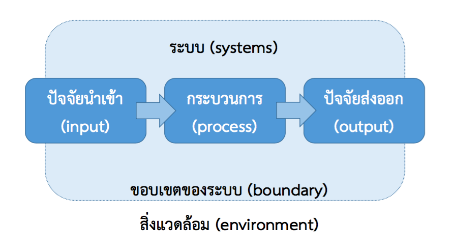
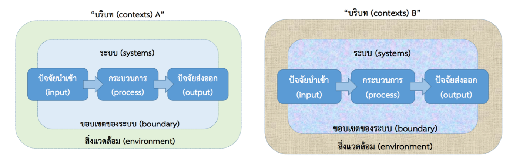
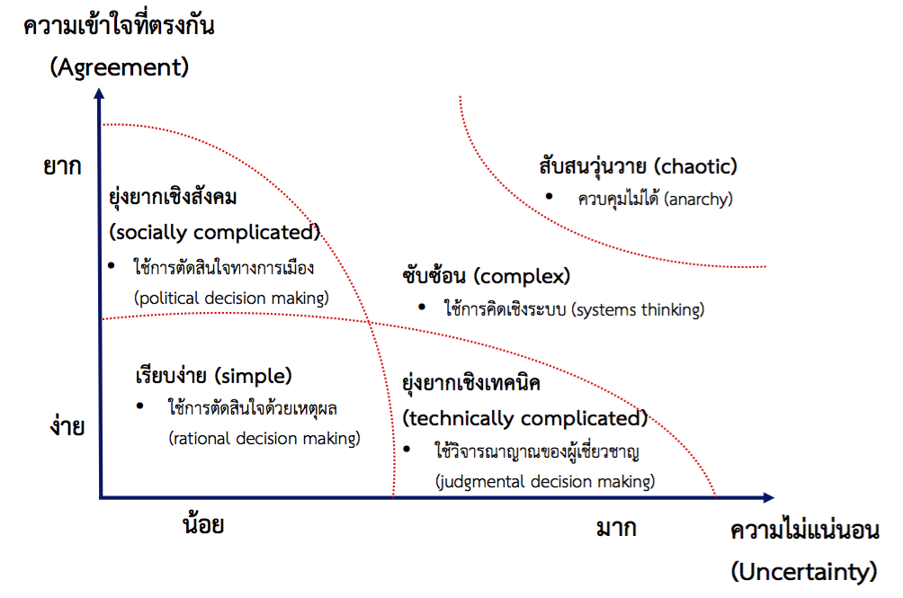
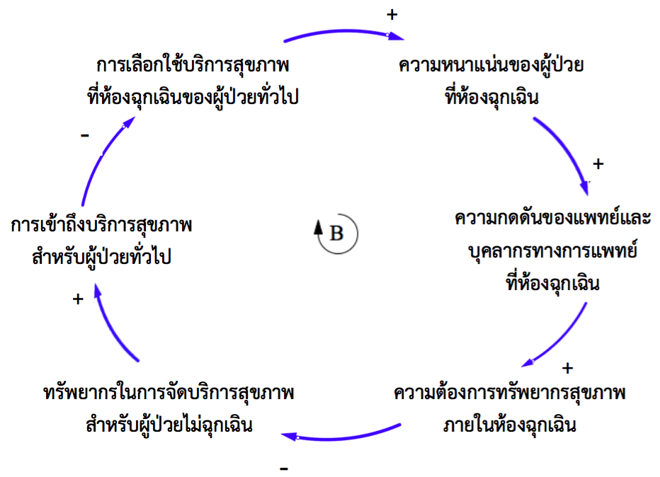
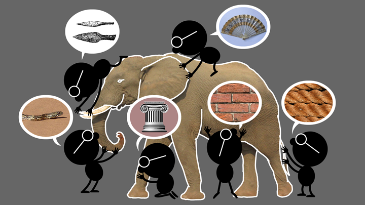
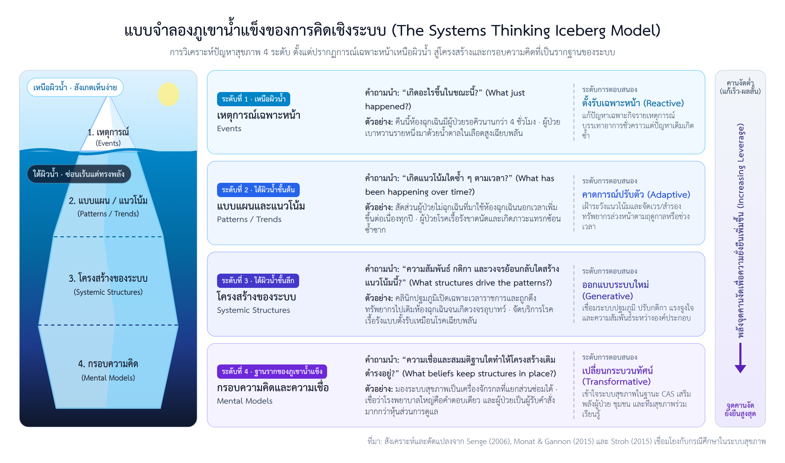

# ST1: แนวคิดเบื้องต้นเกี่ยวกับระบบและการคิดเชิงระบบ (Systems and Systems Thinking)

บวรศม ลีระพันธ์ · ณัฐวุฒิ เอี่ยงธนรัตน์

## วัตถุประสงค์การเรียนรู้และคำถามนำ

| วัตถุประสงค์การเรียนรู้ | คำถามนำและโครงสร้างเนื้อหา |
|---|---|
| 1. **แนวคิดเรื่องระบบ (concepts of systems)** อธิบายความหมาย องค์ประกอบ ขอบเขตของระบบ (boundary) สิ่งแวดล้อม (environment) และหน้าที่ในการเปลี่ยนปัจจัยนำเข้า (input) ผ่านกระบวนการ (process) สู่ปัจจัยส่งออก (output) เพื่อบรรลุเป้าหมาย (goals) ตลอดจนวิเคราะห์อิทธิพลของบริบท (contexts) ต่อการทำงานของระบบ | **1. ระบบคืออะไร และบริบทแวดล้อมส่งผลต่อการทำหน้าที่ของระบบอย่างไร (What is a system, and how do contexts shape how a system functions?)** — ครอบคลุมนิยาม ขอบเขต และกลไก Input–Process–Output ของระบบ (1.1) และบทบาทของบริบทด้านเวลา สถานที่ และการให้ความหมายของผู้คนในระบบระดับต่าง ๆ (1.2) |
| 2. **ประเภทของระบบและระบบซับซ้อนที่ปรับตัวได้ (types of systems and complex adaptive systems)** เปรียบเทียบระบบสามัญ (simple systems) ระบบยุ่งยาก (complicated systems) และระบบซับซ้อนที่ปรับตัวได้ (complex adaptive systems: CAS) พร้อมอธิบายคุณสมบัติสำคัญที่ทำให้ผลลัพธ์ของระบบซับซ้อนไม่สามารถควบคุมด้วยสูตรสำเร็จแบบเส้นตรงได้ | **2. ระบบสามัญ ระบบยุ่งยาก และระบบซับซ้อนแตกต่างกันอย่างไร และเหตุใดสูตรสำเร็จจึงใช้ควบคุมระบบซับซ้อนไม่ได้ทุกครั้ง (How do simple, complicated, and complex systems differ, and why cannot standardized formulas guarantee outcomes in complex systems?)** — ครอบคลุมระบบสามัญและระบบยุ่งยากภายใต้กระบวนทัศน์แบบลดทอนแยกส่วน (2.1) และคุณสมบัติห้าประการของระบบซับซ้อนที่ปรับตัวได้ (2.2) |
| 3. **ระบบสุขภาพในฐานะระบบซับซ้อน (health systems as complex adaptive systems)** วิเคราะห์ความซับซ้อนของการดูแลผู้ป่วยทางคลินิก การดูแลโรคเฉียบพลันเทียบกับโรคเรื้อรัง และการจัดบริการห้องฉุกเฉิน เพื่ออธิบายกลไกวงจรอุบาทว์ (vicious cycle) และผลลัพธ์ที่ไม่ได้ตั้งใจ (unintended consequences) เมื่อแก้ปัญหาแบบแยกส่วน | **3. เหตุใดการมองระบบสุขภาพเหมือนเครื่องยนต์กลไกจึงแก้ปัญหาได้ไม่ยั่งยืน และคุณสมบัติของระบบซับซ้อนปรากฏในคลินิกและระบบบริการสุขภาพจริงอย่างไร (Why does treating health systems like machines fail, and how do complex adaptive properties manifest in clinical care and health systems?)** — ครอบคลุมมุมมองช่างซ่อมเครื่องยนต์เทียบกับผู้ดูแลสิ่งมีชีวิต (3.1) ความซับซ้อนในคลินิกและโรคเรื้อรัง (3.2) และวงจรอุบาทว์ของห้องฉุกเฉินกับตัวอย่างในระบบสุขภาพไทย (3.3) |
| 4. **การคิดเชิงระบบและแบบจำลองภูเขาน้ำแข็ง (systems thinking and the iceberg model)** แยกแยะการคิดเชิงระบบ (systems thinking) ออกจากมุมมองแบบแยกส่วนและการคิดอย่างเป็นระบบ (systematic thinking) และประยุกต์ใช้แบบจำลองภูเขาน้ำแข็ง (Iceberg Model) วิเคราะห์ปัญหาสุขภาพทั้ง 4 ระดับ | **4. การคิดเชิงระบบแตกต่างจากการคิดแบบแยกส่วนและการคิดอย่างเป็นระบบอย่างไร และแพทย์จะใช้แบบจำลองภูเขาน้ำแข็งค้นหาจุดเปลี่ยนที่ยั่งยืนได้อย่างไร (How does systems thinking differ from fragmented and systematic thinking, and how can physicians use the Iceberg Model to create lasting change?)** — ครอบคลุมการคิดเชิงระบบเทียบกับตาบอดคลำช้าง (4.1) แบบจำลองภูเขาน้ำแข็งสี่ระดับ (4.2) และความต่างจากการคิดอย่างเป็นระบบพร้อมคำถามวิจัยระบบสุขภาพ (4.3) |

## (1) ระบบทำหน้าที่เปลี่ยนปัจจัยนำเข้าเป็นปัจจัยส่งออกภายในขอบเขตที่กำหนด และอาจทำหน้าที่ต่างกันไปเมื่อบริบทแวดล้อมเปลี่ยนแปลง (Concepts of Systems)

ก่อนศึกษาระบบสุขภาพและระบบบริการสุขภาพในบทถัดไป ผู้เรียนต้องเข้าใจกรอบแนวคิดพื้นฐานเรื่อง "ระบบ" เพื่อใช้มองการทำงานประสานกันขององค์ประกอบย่อย (หัวข้อ 1.1) และตระหนักว่าบริบทแวดล้อมด้านเวลา สถานที่ และการให้ความหมายของผู้คนสามารถเปลี่ยนการทำหน้าที่ของระบบเดียวกันได้เสมอ (หัวข้อ 1.2)

### 1.1 ระบบคือองค์ประกอบย่อยที่มีความสัมพันธ์และทำหน้าที่ร่วมกันเพื่อบรรลุเป้าหมาย ภายใต้เส้นแบ่งขอบเขตที่แยกจากสิ่งแวดล้อมภายนอก (Definition, Boundary, Input–Process–Output, and Environment)

> หากนำอวัยวะทุกชิ้นของระบบไหลเวียนโลหิตมาวางเรียงไว้บนโต๊ะผ่าตัดโดยไม่เชื่อมต่อกัน อวัยวะเหล่านั้นยังทำหน้าที่เป็น "ระบบไหลเวียนโลหิต" ได้หรือไม่ เพราะเหตุใด

**หัวใจของการเป็นระบบไม่ได้อยู่ที่จำนวนชิ้นส่วน แต่อยู่ที่ความสัมพันธ์และการทำงานประสานกันขององค์ประกอบย่อยภายใต้ขอบเขตที่กำหนดเพื่อมุ่งสู่เป้าหมายร่วมกัน** **ระบบ (systems)** คือกรอบแนวคิดทางวิทยาศาสตร์ที่ใช้พิจารณาภาพรวมของสิ่งที่ประกอบด้วยองค์ประกอบหลายส่วนซึ่งสัมพันธ์และทำหน้าที่ร่วมกัน โดยผู้ศึกษาต้องกำหนด **ขอบเขตของระบบ (boundary)** ให้ชัดเจนว่าครอบคลุมสิ่งใดและแยกออกจาก **สิ่งแวดล้อม (environment)** ซึ่งอยู่ภายนอกหรืออยู่นอกเหนือการควบคุมโดยตรงของระบบอย่างไร แม้ในโลกจริงเส้นแบ่งอาจซ้อนเหลื่อมกันในบางกรณี ([von Bertalanffy, 1968](https://archive.org/details/generalsystemthe0000bert)) ดังแสดงในภาพที่ 1 **หน้าที่ของระบบ (functions)** คือการรับ **ปัจจัยนำเข้า (input)** จากสิ่งแวดล้อมเข้าสู่ **กระบวนการภายในระบบ (process)** เพื่อแปลงเป็น **ปัจจัยส่งออก (output)** คืนสู่สิ่งแวดล้อม อันมุ่งบรรลุ **เป้าหมายของระบบ (goals)** ที่ตั้งไว้ ([Scheerens & Bosker, 1997](https://openlibrary.org/books/OL991578M))

**ภาพที่ 1 กรอบแนวคิดเรื่องระบบ (systems) แสดงความสัมพันธ์ระหว่างปัจจัยนำเข้า (input) กระบวนการ (process) และปัจจัยส่งออกจากระบบ (output) ภายใต้ขอบเขตของระบบ (boundary) และสิ่งแวดล้อม (environment)** (*ที่มา: บวรศม ลีระพันธ์ สังเคราะห์จาก [von Bertalanffy (1968)](https://archive.org/details/generalsystemthe0000bert) และ [Scheerens & Bosker (1997)](https://openlibrary.org/books/OL991578M)*)

### 1.2 บริบทด้านเวลาและสถานที่ตลอดจนการให้ความหมายของผู้เกี่ยวข้อง ทำให้ระบบเดียวกันทำหน้าที่และให้ผลลัพธ์แตกต่างกันได้ (Contexts and Meaning-Making Across Systems)

**ความสามารถในการทำหน้าที่ของระบบไม่คงที่ตายตัว แต่เปลี่ยนแปลงไปตามบริบทด้านเวลา สถานที่ และการตีความให้ความหมายของผู้คนที่เกี่ยวข้องกับระบบนั้น** **บริบท (contexts)** ห่อหุ้มทั้งตัวระบบและสิ่งแวดล้อม จึงส่งผลกระทบได้ทั้งต่อความสัมพันธ์ระหว่างองค์ประกอบภายในระบบ และต่อความสัมพันธ์ระหว่างระบบกับสิ่งแวดล้อม ดังแสดงในภาพที่ 2 ตัวอย่างเช่น ห้องเรียนมัธยมห้องเดิมที่ในสัปดาห์ปกติเต็มไปด้วยกิจกรรมพูดคุย แต่เมื่อเข้าสู่ช่วงใกล้สอบ นักเรียนส่วนใหญ่รับรู้ความตึงเครียดจนลดกิจกรรมร่วมกัน ขณะที่นักเรียนบางคนหรือครูอาจตีความสถานการณ์เดียวกันต่างออกไป

**ภาพที่ 2 การทำหน้าที่ของระบบ (systems) ซึ่งอาจเปลี่ยนแปลงไปตามบริบท (contexts) ที่แตกต่างกัน** (*ที่มา: บวรศม ลีระพันธ์*)

**กรอบแนวคิดเรื่องระบบสามารถนำไปใช้วิเคราะห์ปรากฏการณ์ได้ทุกระดับ ตั้งแต่อวัยวะในร่างกายจนถึงระบบสุขภาพของสังคม** ดังเปรียบเทียบในตารางต่อไปนี้ ทั้งนี้ เราจะคาดการณ์ผลลัพธ์ของระบบได้แม่นยำเพียงใดย่อมขึ้นกับลักษณะความสัมพันธ์ระหว่างปัจจัยนำเข้าและปัจจัยส่งออก ซึ่งนำไปสู่การจำแนกประเภทของระบบในหัวข้อที่ 2

| ตัวอย่างของระบบ | ขอบเขตขององค์ประกอบและกระบวนการหลัก | เป้าหมายและหน้าที่ร่วมกัน |
|---|---|---|
| **ระบบทางชีววิทยา (biological systems)** | โครงสร้างและการทำงานประสานกันของกลุ่มอวัยวะ เนื้อเยื่อ และเซลล์ในร่างกาย ([von Bertalanffy, 1968](https://archive.org/details/generalsystemthe0000bert)) | ทำหน้าที่ทางสรีรวิทยาเพื่อธำรงสมดุลของสิ่งมีชีวิต เช่น ระบบหายใจ ระบบไหลเวียนโลหิต |
| **ระบบเศรษฐกิจ (economic systems)** | ปัจจัยและสถาบันที่เกี่ยวข้องกับการผลิต การกระจายสินค้าและบริการ และการจัดสรรทรัพยากร ([von Bertalanffy, 1968](https://archive.org/details/generalsystemthe0000bert)) | ตอบสนองความต้องการและจัดสรรทรัพยากรที่มีจำกัดในสังคม |
| **ระบบการศึกษา (educational systems)** | ปัจจัยการจัดการเรียนรู้ทั้งในและนอกสถานศึกษา สิ่งแวดล้อมการเรียนรู้ และการสร้างองค์ความรู้ ([Scheerens & Bosker, 1997](https://openlibrary.org/books/OL991578M)) | พัฒนาผู้เรียน เตรียมกำลังคน และสร้างความรู้เพื่อแก้ปัญหาสังคม |
| **ระบบสุขภาพ (health systems)** | กลุ่มประชากร องค์กร และกิจกรรมทั้งหมดที่มีเป้าประสงค์หลักในการสร้าง ซ่อม และรักษาสุขภาพ ([World Health Organization, 2000](https://www.who.int/publications/i/item/924156198X); [World Health Organization, 2007](https://iris.who.int/handle/10665/43918); [World Health Organization Regional Office for the Western Pacific, 2008](https://web.archive.org/web/20140412010308/http://www.wpro.who.int/health_services/health_systems_framework/en/)) | ส่งเสริม ฟื้นฟู และธำรงสุขภาวะของประชาชนอย่างมีคุณภาพและเป็นธรรม |

## (2) ธรรมชาติของระบบจำแนกออกเป็นระบบสามัญ ระบบยุ่งยาก และระบบซับซ้อน ซึ่งกำหนดว่าผลลัพธ์ของระบบคาดการณ์ด้วยสูตรสำเร็จได้หรือไม่ (Types of Systems and Complex Adaptive Systems)

การเลือกวิธีแก้ไขปัญหาในระบบต้องเริ่มจากการวินิจฉัยว่าระบบนั้นมีธรรมชาติแบบใด ([Glouberman & Zimmerman, 2002](https://publications.gc.ca/site/eng/235920/publication.html)) หมวดนี้แยกแยะระบบสามัญและระบบยุ่งยากซึ่งมีความสัมพันธ์เชิงเส้นตรงตามกระบวนทัศน์แยกส่วน (หัวข้อ 2.1) ออกจากระบบซับซ้อนที่ปรับตัวได้ซึ่งเป็นระบบเปิดที่มีความสัมพันธ์ไม่เป็นเส้นตรง (หัวข้อ 2.2)

### 2.1 ระบบสามัญและระบบยุ่งยากวางอยู่บนกระบวนทัศน์แบบลดทอนแยกส่วนที่มีความสัมพันธ์เชิงเส้นตรง จึงคาดการณ์ผลลัพธ์ได้แน่นอนเมื่อทำตามสูตรหรือความเชี่ยวชาญ (Simple and Complicated Systems Under Reductionism)

**ทั้งระบบสามัญและระบบยุ่งยากมีธรรมชาติร่วมกันคือปัจจัยนำเข้าและปัจจัยส่งออกสัมพันธ์กันแบบเส้นตรงและคาดการณ์ผลลัพธ์ได้แน่นอน (linear, deterministic relationship) โดยวางอยู่บนกระบวนทัศน์แบบลดทอนและแยกส่วน (reductionism)** แนวคิดแยกส่วนศึกษาปรากฏการณ์โดยแยกออกจากบริบทแล้วถอดเป็นชิ้นส่วนย่อยเสมือนเครื่องจักร ([von Bertalanffy, 1968](https://archive.org/details/generalsystemthe0000bert)) **ระบบสามัญ (simple systems)** มีองค์ประกอบน้อยและมีขอบเขตชัดเสมือน **ระบบปิด (closed systems)** เช่น การทำอาหารตามตำรา กังหันลมสีข้าว หรือระหัดวิดน้ำ ส่วน **ระบบยุ่งยาก (complicated systems)** ประกอบด้วย **ระบบย่อย (sub-systems)** ที่เป็นระบบสามัญจำนวนมากมาทำงานต่อกัน จึงต้องอาศัยความเชี่ยวชาญเฉพาะทางหลายสาขาแต่ยังให้ผลลัพธ์แม่นยำตามแบบพิมพ์เขียว เช่น การส่งจรวดไปดวงจันทร์ ระบบคอมพิวเตอร์ ระบบรถยนต์ หรือระบบควบคุมการบิน ([Glouberman & Zimmerman, 2002](https://publications.gc.ca/site/eng/235920/publication.html))

### 2.2 ระบบซับซ้อนหรือระบบซับซ้อนที่ปรับตัวได้เป็นระบบเปิดที่มีความสัมพันธ์ไม่เป็นเส้นตรง ปรับตัวจากภายใน และให้ผลลัพธ์เชิงความน่าจะเป็นที่ไม่ซ้ำเดิม (Complex Systems and Complex Adaptive Systems: CAS)

> พ่อแม่ที่เลี้ยงลูกคนแรกจนประสบความสำเร็จ หากนำวิธีเลี้ยงดูแบบเดิมทุกประการไปใช้กับลูกคนที่สอง จะรับประกันผลลัพธ์แบบเดิมได้หรือไม่

**ระบบซับซ้อน (complex systems) หรือระบบซับซ้อนที่ปรับตัวได้ (complex adaptive systems: CAS) เป็นระบบเปิดที่มีขอบเขตไม่ตายตัวและมีความสัมพันธ์ไม่เป็นเส้นตรง จึงให้ผลลัพธ์เชิงความน่าจะเป็น (non-linear, probabilistic relationship) เสมือนการเลี้ยงลูก ระบบชีววิทยา และระบบสุขภาพ** ([Cilliers, 1998](https://doi.org/10.4324/9780203012253); [Glouberman & Zimmerman, 2002](https://publications.gc.ca/site/eng/235920/publication.html); [Begun et al., 2003](https://experts.umn.edu/en/publications/health-care-organizations-as-complex-adaptive-systems/)) คุณสมบัติสำคัญห้าประการของระบบซับซ้อน ได้แก่ (1) **เชื่อมโยงกันอย่างใกล้ชิด (tightly linked)** การเปลี่ยนแปลงในส่วนย่อยหนึ่งย่อมกระทบส่วนอื่น (2) **คุณสมบัติผุดบังเกิด (emerging property)** ปฏิสัมพันธ์ของส่วนย่อยสร้างคุณลักษณะใหม่ระดับภาพรวมซึ่ง *"ส่วนรวมไม่เท่ากับผลรวมของส่วนย่อย" ("The whole is not equal to the sum of its parts.")* (3) **การอภิบาลด้วยการตอบสนองย้อนกลับ (governance by feedback)** ผู้คนตอบสนองทั้งทางเสริมแรงและถ่วงดุลต่อมาตรการแทรกแซงจนเกิด **พฤติกรรมผุดบังเกิด (emerging behaviors)** ที่ย้อนไปเปลี่ยนผลของมาตรการหรือโครงสร้างระบบได้ (4) **การจัดการตัวเอง (self-organizing)** จัดระเบียบจากภายในได้เองโดยไม่มีผู้ใดควบคุมผลลัพธ์ทั้งหมดได้ลำพัง และ (5) **การเปลี่ยนแปลงอย่างต่อเนื่อง (constantly changing)** เรียนรู้และปรับตัวตลอดเวลา ([Cilliers, 1998](https://doi.org/10.4324/9780203012253)) ความแตกต่างของระบบทั้งสามประเภทสรุปได้ดังตารางที่ 1 (ทั้งนี้ เอกสารภาษาไทยบางเล่มแปล `complicated systems` ว่า *"ระบบซับซ้อนแบบกลไก"* และแปล `complex systems` ว่า *"ระบบซับซ้อนแบบองค์รวม"* [อรศรี งามวิทยาพงศ์ และ นภารัตน์ นนทกิจนพเก้า, 2557])

**ตารางที่ 1** ความแตกต่างระหว่างระบบสามัญ (simple systems) ระบบยุ่งยาก (complicated systems) และระบบซับซ้อน (complex systems) ([Glouberman & Zimmerman, 2002](https://publications.gc.ca/site/eng/235920/publication.html))

| ประเด็นเปรียบเทียบ | “การทำกับข้าว” — ระบบสามัญ | “การส่งจรวดไปดวงจันทร์” — ระบบยุ่งยาก | “การเลี้ยงลูก” — ระบบซับซ้อน |
|---|---|---|---|
| **บทบาทของสูตรสำเร็จ** | สูตรทดสอบมาแล้ว ทำซ้ำและลอกเลียนแบบได้ง่าย | สูตรและแบบพิมพ์เขียวจำเป็นอย่างยิ่งต่อการประสานระบบย่อย | สูตรสำเร็จมีข้อจำกัดสูงในการนำไปประยุกต์ใช้จริง |
| **ผลของความสำเร็จในอดีต** | ทำตามตำราที่ดีได้ผลเหมือนเดิมทุกครั้ง | สำเร็จหนึ่งครั้งช่วยเพิ่มความมั่นใจสูงว่าจะสำเร็จในครั้งถัดไป | เพิ่มประสบการณ์พ่อแม่ แต่ไม่รับประกันความสำเร็จในลูกคนถัดไป |
| **ความเชี่ยวชาญเฉพาะทาง** | ไม่จำเป็นต้องเชี่ยวชาญสูง แต่ประสบการณ์ช่วยได้ | จำเป็นต้องพึ่งผู้เชี่ยวชาญระดับสูงหลากหลายสาขาร่วมกัน | ช่วยได้ แต่ไม่ใช่ปัจจัยชี้ขาดที่ขาดไม่ได้ในการเลี้ยงลูกให้ได้ดี |
| **ลักษณะผลผลิตและผลลัพธ์** | มาตรฐานเดียวกัน (standardized) ผลลัพธ์สม่ำเสมอ | จรวดแต่ละลำคล้ายกัน (similar) ผลลัพธ์มีความแน่นอนสูง | เด็กแต่ละคนมีเอกลักษณ์จำเพาะ (unique) ผลลัพธ์ไม่แน่นอน |

## (3) ระบบสุขภาพมีธรรมชาติเป็นระบบซับซ้อนที่ปรับตัวได้ การเข้าใจคุณสมบัตินี้จึงป้องกันไม่ให้แพทย์แก้ปัญหาแบบแยกส่วนจนเกิดวงจรอุบาทว์และผลลัพธ์ที่ไม่ได้ตั้งใจ (Health Systems as Complex Adaptive Systems)

หลักฐานวิชาการยืนยันตรงกันว่าระบบสุขภาพและองค์กรบริการสุขภาพเป็นระบบซับซ้อนที่ปรับตัวได้ มิใช่เครื่องจักร ([Glouberman & Zimmerman, 2002](https://publications.gc.ca/site/eng/235920/publication.html); [Begun et al., 2003](https://experts.umn.edu/en/publications/health-care-organizations-as-complex-adaptive-systems/); [Begun & Kaissi, 2004](https://doi.org/10.1097/00004010-200401000-00005); [Kannampallil et al., 2011](https://doi.org/10.1016/j.jbi.2011.06.006); [Atun, 2012](https://doi.org/10.1093/heapol/czs088); [Tremblay & Richard, 2014](https://doi.org/10.1093/heapro/dar054)) หมวดนี้ชี้ให้เห็นการเปลี่ยนบทบาทของแพทย์จากช่างซ่อมเครื่องยนต์สู่ผู้กระตุ้นการปรับตัว (หัวข้อ 3.1) การจัดการความซับซ้อนในคลินิกและโรคเรื้อรัง (หัวข้อ 3.2) และกลไกวงจรอุบาทว์ในระบบบริการห้องฉุกเฉินพร้อมตัวอย่างในประเทศไทย (หัวข้อ 3.3)

### 3.1 การมองระบบสุขภาพเป็นระบบซับซ้อนเปลี่ยนบทบาทแพทย์จาก "ช่างซ่อมเครื่องยนต์" จากภายนอก ไปสู่ผู้กระตุ้นการเรียนรู้และการปรับตัวจากภายในระบบ (Machine Metaphor vs. Living-System Metaphor)

**ผู้ที่มองระบบสุขภาพเป็นระบบยุ่งยากมักเน้นสั่งการและซ่อมชิ้นส่วนจากภายนอกเสมือน "ช่างซ่อมเครื่องยนต์" ขณะที่ผู้ที่มองเป็นระบบซับซ้อนจะมุ่งเกื้อหนุนการเรียนรู้และแรงจูงใจจากภายในระบบเสมือนการดูแลสิ่งมีชีวิตหรือการเลี้ยงลูก** การยอมรับว่าระบบสุขภาพมีความซับซ้อนและความไม่แน่นอน (uncertainty) **ไม่ได้แปลว่าเราหมดหนทางพัฒนาสุขภาพ** แต่กลับช่วยให้แพทย์ออกแบบการทำงานที่สอดคล้องกับธรรมชาติของมนุษย์และบริบทจริงได้ดียิ่งกว่าการใช้คำสั่งตายตัว ([Glouberman & Zimmerman, 2002](https://publications.gc.ca/site/eng/235920/publication.html); [Begun et al., 2003](https://experts.umn.edu/en/publications/health-care-organizations-as-complex-adaptive-systems/))

### 3.2 ในระดับคลินิก การดูแลผู้ป่วยต้องรับมือกับความไม่แน่นอนและความเข้าใจไม่ตรงกัน และต้องจัดกระบวนการดูแลโรคเรื้อรังที่มีความซับซ้อนให้ต่างจากโรคเฉียบพลันที่มีความยุ่งยาก (Complexity in Clinical Care: Uncertainty, Agreement, and Chronic Complex Diseases)

#### 3.2.1 การตรวจรักษาผู้ป่วยในคลินิกมักอยู่ในพื้นที่ความซับซ้อนที่มีทั้งความไม่แน่นอนของโรคและความเข้าใจไม่ตรงกันระหว่างแพทย์ ผู้ป่วย และญาติ (clinical consultations at the edge of chaos)

> ผู้ป่วยหญิงอายุ 48 ปี เจ็บหน้าอกเรื้อรังไม่จำเพาะ 2–3 สัปดาห์ร่วมกับอาการซึมเศร้า เมื่อแพทย์ส่งตรวจแยกโรคหัวใจก่อนปรึกษาจิตแพทย์ แต่ผู้ป่วยและญาติไม่พอใจเพราะคิดว่าเป็นโรคหัวใจฉุกเฉินที่ต้องรักษาทันที แพทย์ควรรับมืออย่างไร

**การดูแลผู้ป่วยทางคลินิกเป็นระบบซับซ้อนที่ต้องรับมือทั้งความไม่แน่นอนของโรค (uncertainty) และความเข้าใจไม่ตรงกัน (disagreement) ระหว่างแพทย์กับผู้ป่วยและญาติ** ([Innes et al., 2005](https://pmc.ncbi.nlm.nih.gov/articles/PMC1266243/)) ดังแสดงในภาพที่ 3 เมื่อตัดแกนความไม่แน่นอนกับความเข้าใจที่ตรงกัน จะเกิดพื้นที่การตัดสินใจ 5 บริเวณ คือ **เรียบง่าย (simple)** ใช้แนวทางเหตุผลมาตรฐาน **ยุ่งยากเชิงเทคนิค (technically complicated)** ใช้วิจารณญาณผู้เชี่ยวชาญ **ยุ่งยากเชิงสังคม (socially complicated)** ใช้การเจรจาเชิงนโยบาย/การเมือง **ซับซ้อน (complex)** ใช้การคิดเชิงระบบและการสื่อสารความไม่แน่นอนอย่างโปร่งใส และ **สับสนวุ่นวาย (chaotic)** เมื่อทั้งสองแกนพุ่งสูงจนไร้ระเบียบ ([Innes et al., 2005](https://pmc.ncbi.nlm.nih.gov/articles/PMC1266243/); [โกมาตร จึงเสถียรทรัพย์, 2558](https://anthropologist.sac.or.th/anthropologist/112)) ในกรณีผู้ป่วยหญิงอายุ 48 ปี การรับฟังความกลัวและอธิบายเหตุผลของการตรวจแยกโรคหลอดเลือดหัวใจอุดตันอย่างใส่ใจจะช่วยป้องกันไม่ให้การดูแลถลำสู่ภาวะสับสนวุ่นวาย

**ภาพที่ 3 ความสัมพันธ์ระหว่างความไม่แน่นอน (uncertainty) และความเข้าใจที่ตรงกัน (agreement) กับธรรมชาติของกระบวนการดูแลผู้ป่วยและรูปแบบการตัดสินใจ** (*ที่มา: บวรศม ลีระพันธ์ ดัดแปลงจาก [Innes et al. (2005)](https://pmc.ncbi.nlm.nih.gov/articles/PMC1266243/) และ [โกมาตร จึงเสถียรทรัพย์ (2558)](https://anthropologist.sac.or.th/anthropologist/112)*)

#### 3.2.2 การนำรูปแบบบริการสำหรับโรคเฉียบพลันที่มีความยุ่งยากไปใช้ดูแลโรคเรื้อรังที่มีความซับซ้อน ก่อให้เกิดผลลัพธ์สุขภาพที่ไม่ดี การขาดประสิทธิภาพ และความไม่เป็นธรรม (acute complicated vs. chronic complex diseases)

**ปัญหาใหญ่ของระบบบริการสุขภาพยุคปัจจุบันเกิดจากการนำรูปแบบบริการแบบตั้งรับสำหรับ "โรคเฉียบพลันที่มีความยุ่งยาก" ไปใช้ดูแล "โรคเรื้อรังที่มีความซับซ้อน" จนเกิดผลลัพธ์สุขภาพที่ไม่ดี การขาดประสิทธิภาพ (inefficiency) และความไม่เป็นธรรม (inequity)** ([Holman & Lorig, 2000](https://doi.org/10.1136/bmj.320.7234.526)) แม้บางช่วงผู้ป่วยโรคเรื้อรังอาจมีอาการกำเริบเฉียบพลันซ้อนทับ (acute exacerbation on top of chronic disease) แต่ความต้องการพื้นฐานของสองกลุ่มต่างกันอย่างชัดเจน ดังตารางที่ 2

**ตารางที่ 2** ความแตกต่างระหว่างโรคเฉียบพลันที่มีความยุ่งยาก (acute complicated diseases) และโรคเรื้อรังที่มีความซับซ้อน (chronic complex diseases) ([Holman & Lorig, 2000](https://doi.org/10.1136/bmj.320.7234.526))

| ประเด็นเปรียบเทียบ | โรคเฉียบพลันที่มีความยุ่งยาก | โรคเรื้อรังที่มีความซับซ้อน |
|---|---|---|
| **การเกิดอาการและสาเหตุ** | เฉียบพลัน (abrupt onset) สาเหตุจำเพาะชัดเจน | ค่อยเป็นค่อยไป (gradual onset) หลายสาเหตุร่วมกัน (multivariate cause) |
| **การวินิจฉัยและพยากรณ์โรค** | มักแม่นยำและคาดการณ์แนวโน้มได้ชัดเจน | มีความไม่แน่นอนสูง ผันแปรตามบริบทชีวิตผู้ป่วย |
| **เทคโนโลยีการรักษาและเป้าหมาย** | มีประสิทธิผลสูง มุ่งรักษาให้หายขาด (cure) | ไม่หายขาด (no cure) มุ่งการจัดการ ชี้แนะ และดูแลตนเองต่อเนื่อง (management, coaching, self-care) |
| **บทบาทความรู้แพทย์ vs. ผู้ป่วย** | ความรู้วิชาชีพของแพทย์เป็นหลักในระยะวิกฤต | ความรู้วิชาชีพของแพทย์และประสบการณ์ชีวิตของผู้ป่วยสำคัญควบคู่กันในฐานะหุ้นส่วน |

### 3.3 ในระดับระบบบริการและประชากร การแก้ความแออัดของห้องฉุกเฉินแบบแยกส่วนสร้างวงจรอุบาทว์และผลลัพธ์ที่ไม่ได้ตั้งใจ ซึ่งสะท้อนคุณสมบัติของระบบซับซ้อนในระบบสุขภาพจริง (Complexity in Emergency Medical Systems and Real-World Health Systems)

#### 3.3.1 การแก้ความหนาแน่นของห้องฉุกเฉินด้วยการเพิ่มทรัพยากรเฉพาะในห้องฉุกเฉินเพียงจุดเดียว ก่อให้เกิดวงจรอุบาทว์และผลลัพธ์ที่ไม่ได้ตั้งใจ (emergency room crowding, vicious cycles, and unintended consequences)

> หากห้องฉุกเฉินแออัดและโรงพยาบาลแก้ด้วยการดึงแพทย์และงบประมาณมาเพิ่มเฉพาะในห้องฉุกเฉินเพื่อให้ตรวจเร็วขึ้น ในระยะยาวผู้ป่วยที่มาห้องฉุกเฉินจะลดลงหรือเพิ่มขึ้น เพราะเหตุใด

**การเพิ่มแพทย์และทรัพยากรเฉพาะในห้องฉุกเฉินเพียงจุดเดียวช่วยลดคิวได้เพียงระยะสั้น แต่กลับกระตุ้นวงจรอุบาทว์ (vicious cycle) และผลลัพธ์ที่ไม่ได้ตั้งใจ (unintended consequences) จนห้องฉุกเฉินยิ่งแออัดกว่าเดิม** ([Glouberman, 2000](https://web.archive.org/web/20011130151645/http://www.healthandeverything.org/); [Glouberman & Zimmerman, 2002](https://publications.gc.ca/site/eng/235920/publication.html)) เมื่อห้องฉุกเฉินตรวจได้เร็วขึ้น ผู้ป่วยที่ไม่ฉุกเฉินจะเรียนรู้และหันมาใช้ห้องฉุกเฉินเพิ่มขึ้น ขณะเดียวกันโรงพยาบาลที่มีงบจำกัดต้องดึงทรัพยากรออกจากบริการนอกห้องฉุกเฉินมาชดเชย ทำให้คลินิกทั่วไปยิ่งเข้าถึงยากขึ้น ผลักดันผู้ป่วยทั่วไปให้ไหลเข้าห้องฉุกเฉินหนักกว่าเดิม (และบางรายที่ขาดการดูแลระยะต้นอาการทรุดจนฉุกเฉินจริง) ดังแสดงด้วย **แผนผังวงจรเหตุปัจจัย (causal loop diagram: CLD)** ในภาพที่ 4 ซึ่งเครื่องหมาย `+` แทนการเปลี่ยนทิศทางเดียวกัน และ `-` แทนทิศทางตรงกันข้าม (เมื่อครบรอบมีเครื่องหมายลบสองจุดคูณกันเป็นบวก จึงหมุนเสริมแรงเป็นวงจรอุบาทว์ แม้กลางภาพต้นฉบับเขียนอักษร B ไว้ก็ตาม) ทางออกเชิงระบบจึงต้องขยาย **ระบบบริการปฐมภูมิและแพทย์ประจำครอบครัว** นอกห้องฉุกเฉินให้เข้าถึงสะดวกควบคู่กับการออกแบบกติกาและแรงจูงใจที่เหมาะสม ([Glouberman, 2000](https://web.archive.org/web/20011130151645/http://www.healthandeverything.org/); [de Savigny & Adam, 2009](https://iris.who.int/handle/10665/44204))

**ภาพที่ 4 แผนผังวงจรเหตุปัจจัย (causal loop diagram) แสดงวงจรอุบาทว์ (vicious cycle) ของปัญหาความหนาแน่นของผู้ป่วยในห้องฉุกเฉินของโรงพยาบาล** (*ที่มา: บวรศม ลีระพันธ์ สังเคราะห์จาก [Glouberman (2000)](https://web.archive.org/web/20011130151645/http://www.healthandeverything.org/)*)

#### 3.3.2 คุณสมบัติของระบบซับซ้อนที่ปรับตัวได้ปรากฏชัดเจนในระบบสุขภาพไทย ตั้งแต่การดูแลกาย–จิต เครือข่ายประชาสังคม ไปจนถึงการจัดการตนเองในภาวะภัยพิบัติ (five CAS characteristics in Thailand's health system)

**คุณสมบัติทั้งห้าประการของระบบซับซ้อนที่ปรับตัวได้สามารถสังเกตเห็นได้อย่างเป็นรูปธรรมในระบบบริการสุขภาพและสังคมไทย** ([Cilliers, 1998](https://doi.org/10.4324/9780203012253); [de Savigny & Adam, 2009](https://iris.who.int/handle/10665/44204); [Atun, 2012](https://doi.org/10.1093/heapol/czs088)) สรุปได้ดังตารางต่อไปนี้

| คุณสมบัติของระบบซับซ้อน (CAS) | ตัวอย่างรูปธรรมในบริบทการแพทย์และระบบสุขภาพไทย |
|---|---|
| **1. เชื่อมโยงใกล้ชิด (tightly linked)** | สุขภาพกายและจิตเชื่อมโยงกันใกล้ชิด การแยกส่วนให้อายุรแพทย์ดูแต่กายและจิตแพทย์ดูแต่ใจโดยขาดการประสานงานจึงไม่ตอบโจทย์ผู้ป่วยและครอบครัว |
| **2. คุณสมบัติผุดบังเกิด (emerging property)** | กลุ่มการแพทย์พื้นบ้าน ตลาดนัดปลอดสารพิษ และจิตอาสาชุมชน เมื่อเชื่อมเป็นเครือข่ายเกิดพลังผุดบังเกิดเป็นขบวนการภาคประชาสังคมที่ขับเคลื่อนนโยบายสุขภาพระดับชาติได้ |
| **3. อภิบาลด้วยการตอบสนองย้อนกลับ (governance by feedback)** | ผู้ป่วยที่เข้าถึงคลินิกนอกห้องฉุกเฉินไม่สะดวกปรับพฤติกรรมมาใช้ห้องฉุกเฉินเมื่อห้องฉุกเฉินเพิ่มแพทย์ จนหักล้างผลของมาตรการแก้ความแออัด ([Glouberman, 2000](https://web.archive.org/web/20011130151645/http://www.healthandeverything.org/)) |
| **4. การจัดการตัวเอง (self-organizing)** | ในภัยพิบัติสึนามิภาคใต้ พ.ศ. 2547 อาสาสมัครและเครือข่ายหลายภาคส่วนลงพื้นที่ประสานงานช่วยเหลือกันเองโดยไม่ต้องรอคำสั่งส่วนกลาง รับมือวิกฤตได้เกินกว่ากลไกรัฐลำพังจะทำได้ทัน |
| **5. เปลี่ยนแปลงอย่างต่อเนื่อง (constantly changing)** | ชุมชนชนบทปัจจุบันเชื่อมโยงข้อมูลข่าวสารจนมีวิถีบริโภคใกล้เคียงชุมชนเมือง เครื่องมือพัฒนาสุขภาพที่เคยได้ผลในอดีตจึงนำมาใช้ซ้ำแบบตายตัวไม่ได้ |

## (4) การคิดเชิงระบบและแบบจำลองภูเขาน้ำแข็งช่วยให้แพทย์มองทะลุเหตุการณ์เฉพาะหน้าไปสู่โครงสร้างและกรอบความคิดใต้ผิวน้ำ เพื่อสร้างการเปลี่ยนแปลงที่ยั่งยืน (Systems Thinking and the Iceberg Model)

เมื่อเข้าใจธรรมชาติของระบบซับซ้อนแล้ว หมวดนี้สรุปแนวปฏิบัติของนักคิดเชิงระบบเพื่อก้าวพ้นการทำงานแบบแยกส่วน (หัวข้อ 4.1) แนะนำแบบจำลองภูเขาน้ำแข็งสี่ระดับเป็นเครื่องมือหาจุดคานงัด (หัวข้อ 4.2) และแยกแยะการคิดเชิงระบบออกจากการคิดอย่างเป็นระบบพร้อมคำถามหลักของการพัฒนาระบบสุขภาพ (หัวข้อ 4.3)

### 4.1 การคิดเชิงระบบมองปัญหาเป็นส่วนหนึ่งของความสัมพันธ์และพฤติกรรมในระบบที่มีพลวัต จึงก้าวพ้นการทำงานแบบ "ตาบอดคลำช้าง" และการรณรงค์เฉพาะกิจ (Holistic Systems Thinking vs. Event-Focused Fragmentation)

**การคิดเชิงระบบ (systems thinking) คือวิธีคิดวิเคราะห์แบบองค์รวมที่มองปัญหาเป็นส่วนหนึ่งของระบบที่มีพลวัต โดยมุ่งทำความเข้าใจความสัมพันธ์ (relationships) และพฤติกรรม (behaviors) ของผู้คนและองค์กรภายในระบบ แทนการจัดฉากแก้เหตุการณ์เฉพาะหน้า** ([de Savigny & Adam, 2009](https://iris.who.int/handle/10665/44204)) แพทย์ในฐานะ **นักคิดเชิงระบบ (systems thinkers)** จึงเชื่อมโยงสาเหตุของโรคเข้ากับองค์ประกอบระบบบริการสุขภาพและปัจจัยกำหนดสุขภาพทางสังคม เพื่อวางระบบงานระยะยาว ต่างจากการทำงานแยกส่วนแบบ **"ตาบอดคลำช้าง"** (ภาพที่ 5) หรืออาการไร้ระบบที่ [โกมาตร จึงเสถียรทรัพย์ (2558)](https://anthropologist.sac.or.th/anthropologist/112) สรุปไว้ว่า *"คิดเป็นรายเหตุการณ์ ระบบงานไม่ต้องเซ็ต ทำเสร็จแต่งานเฉพาะหน้า แก้ปัญหาแบบเฉพาะกิจ ทั้งชีวิตมีแต่การรณรงค์"* ตลอดจนการพึ่งพาความสามารถเฉพาะตัวของผู้นำคนเดียวซึ่งขาดความยั่งยืนและขยายผลต่อไม่ได้

**ภาพที่ 5 แนวคิดเรื่องมุมมองการคิดแบบแยกส่วนหรือการทำงานในลักษณะ “ตาบอดคลำช้าง”** (*ที่มา: บวรศม ลีระพันธ์ อ้างอิงภาพจาก [Camilleri (2013)](https://web.archive.org/web/20131109021409/http://www.simoncamilleri.com/the_truth_of_the_elephant/)*)

### 4.2 แบบจำลองภูเขาน้ำแข็งจัดลำดับการวิเคราะห์สี่ระดับตั้งแต่เหตุการณ์เหนือผิวน้ำ แนวโน้ม โครงสร้างระบบ ไปจนถึงกรอบความคิด เพื่อเปลี่ยนจากการตั้งรับเฉพาะหน้าสู่การปรับโครงสร้างและกระบวนทัศน์ (The Four-Level Iceberg Model)

> เมื่อพบปัญหาซ้ำเดิมในโรงพยาบาลหรือชุมชน แพทย์จะตั้งคำถามไล่ลำดับอย่างไรเพื่อไม่ให้ทีมหยุดอยู่แค่การวิ่งดับไฟรายวัน

**แบบจำลองภูเขาน้ำแข็ง (Iceberg Model) ช่วยให้นักคิดเชิงระบบส่องลึกจากเหตุการณ์วิกฤตเหนือผิวน้ำลงไปสู่แนวโน้ม โครงสร้างระบบ และกรอบความคิดใต้ผิวน้ำ ตามหลักการที่ว่า "โครงสร้างกำหนดพฤติกรรม และกรอบความคิดหล่อหลอมโครงสร้าง"** ([Senge, 2006](https://books.google.com/books/about/The_Fifth_Discipline.html?id=5jCLbnlmEuYC); [Monat & Gannon, 2015](http://article.sapub.org/10.5923.j.ajss.20150401.02.html); [Stroh, 2015](https://books.google.com/books/about/Systems_Thinking_For_Social_Change.html?id=Fa2PCgAAQBAJ)) ดังแสดงในภาพที่ 6 และตารางที่ 3 แม้การกู้ชีพในระดับเหตุการณ์ยังจำเป็นเร่งด่วนเสมอ แต่การสร้างความยั่งยืนต้องขยับลงสู่ชั้นโครงสร้างและกรอบความคิดซึ่งมีพลัง **จุดคานงัด (leverage)** สูงกว่า

**ภาพที่ 6 แบบจำลองภูเขาน้ำแข็งของการคิดเชิงระบบ (The Systems Thinking Iceberg Model) แสดงการวิเคราะห์ปัญหาสุขภาพสี่ระดับและพลังจุดคานงัดเพื่อความยั่งยืน** (*ที่มา: สังเคราะห์และดัดแปลงจาก [Senge (2006)](https://books.google.com/books/about/The_Fifth_Discipline.html?id=5jCLbnlmEuYC), [Monat & Gannon (2015)](http://article.sapub.org/10.5923.j.ajss.20150401.02.html) และ [Stroh (2015)](https://books.google.com/books/about/Systems_Thinking_For_Social_Change.html?id=Fa2PCgAAQBAJ)*)

**ตารางที่ 3** การประยุกต์ใช้แบบจำลองภูเขาน้ำแข็ง (Iceberg Model) วิเคราะห์ปัญหาความหนาแน่นห้องฉุกเฉินและการดูแลโรคเรื้อรัง

| ระดับและคำถามหลัก | การตอบสนอง | กรณีห้องฉุกเฉินแออัด ([Glouberman, 2000](https://web.archive.org/web/20011130151645/http://www.healthandeverything.org/)) | กรณีโรคเรื้อรังคุมไม่ได้ ([Holman & Lorig, 2000](https://doi.org/10.1136/bmj.320.7234.526)) |
|---|---|---|---|
| **1. เหตุการณ์ (events)** — *เกิดอะไรขึ้นขณะนี้?* | **ตั้งรับเฉพาะหน้า (reactive)** | คืนนี้ผู้ป่วยล้นห้องฉุกเฉิน จึงเรียกแพทย์เวรเสริมเฉพาะกิจ | วันนี้ผู้ป่วยเบาหวานน้ำตาลสูงวิกฤต จึงให้สารน้ำและอินซูลิน |
| **2. แบบแผน/แนวโน้ม (patterns)** — *เกิดอะไรซ้ำ ๆ ตามเวลา?* | **คาดการณ์ปรับตัว (adaptive)** | ผู้ป่วยไม่ฉุกเฉินมาช่วงเย็นและวันหยุดเพิ่มขึ้นทุกปี จึงจัดเวรเพิ่มตามช่วงเวลา | อัตรารับไว้รักษาซ้ำและไตเสื่อมในกลุ่มหาเช้ากินค่ำสูงต่อเนื่อง |
| **3. โครงสร้างระบบ (systemic structures)** — *กติกาและวงจรใดผลิตซ้ำแนวโน้มนี้?* | **ออกแบบระบบใหม่ (generative)** | คลินิกปฐมภูมิเปิดเฉพาะเวลาราชการและถูกดึงงบไปโปะ ER จนเกิดวงจรอุบาทว์ ต้องขยายปฐมภูมินอกเวลาและทีมหมอครอบครัว | คลินิกจัดแบบตั้งรับนัดสั้น ๆ เหมือนโรคเฉียบพลัน ต้องเปลี่ยนเป็นระบบดูแลต่อเนื่อง ชี้แนะการดูแลตนเอง และเชื่อมชุมชน |
| **4. กรอบความคิด (mental models)** — *ความเชื่อใดค้ำจุนโครงสร้างเดิมไว้?* | **เปลี่ยนกระบวนทัศน์ (transformative)** | เปลี่ยนจาก "รพ.ใหญ่และ ER คือที่พึ่งแรกสุด" เป็น "ปฐมภูมิใกล้บ้านคือฐานหลักของการดูแลต่อเนื่อง" | เปลี่ยนจาก "แพทย์คือผู้สั่งการ" เป็น "ผู้ป่วยและครอบครัวคือหุ้นส่วนหลักในการจัดการชีวิตร่วมกับทีมสุขภาพ" |

### 4.3 การคิดเชิงระบบแตกต่างจากการคิดอย่างเป็นระบบตรงที่มุ่งทำความเข้าใจพลวัตของระบบทั้งหมด เพื่อตอบว่ามาตรการใดได้ผล สำหรับใคร และภายใต้บริบทใด (Systems Thinking vs. Systematic Thinking and Realist Inquiry)

**ผู้เรียนต้องแยกแยะ "การคิดอย่างเป็นระบบ (systematic thinking)" ซึ่งหมายถึงการคิดตามลำดับขั้นตอนหรือระเบียบแบบแผนที่ชัดเจน ออกจาก "การคิดเชิงระบบ (systems thinking)" ซึ่งมุ่งทำความเข้าใจความเชื่อมโยงและพลวัตของระบบซับซ้อนทั้งหมด** ([Monat & Gannon, 2015](http://article.sapub.org/10.5923.j.ajss.20150401.02.html)) ตัวอย่างของการคิดอย่างเป็นระบบ เช่น หลักโยนิโสมนสิการ ([สมเด็จพระพุทธโฆษาจารย์ (ป. อ. ปยุตฺโต), 2557](https://www.watnyanaves.net/th/book_detail/583)) และกระบวนการทางวิทยาศาสตร์ ([National Aeronautics and Space Administration, 2008](https://web.archive.org/web/20080514213335/http://www.nasa.gov/audience/foreducators/plantgrowth/reference/Scientific_Method.html)) ซึ่งมีคุณค่าสูงแต่ลำพังอาจไม่ได้พิจารณาวงจรย้อนกลับของระบบซับซ้อน ในการวิจัยและพัฒนาระบบสุขภาพ การคิดเชิงระบบจึงช่วยให้แพทย์ตั้งคำถามได้ลึกกว่าแค่ "มาตรการนี้ได้ผลหรือไม่" ไปสู่คำถามว่า **"กระบวนการหรือมาตรการใดทำงานได้ผลดี ได้ผลดีสำหรับใคร และได้ผลดีภายใต้บริบทหรือเงื่อนไขใด" (*"what works, for whom, and under what circumstances"*)** ([Gilson, 2012](https://ahpsr.who.int/publications/i/item/2015-07-15-health-policy-and-systems-research)) อันเป็นรากฐานของการเป็นทั้ง **นักแก้ไขปัญหา (problem solver)** และ **ผู้นำการเปลี่ยนแปลง (change agent)** ในระบบสุขภาพ

## บทสรุป (สาระสำคัญของบทนี้สรุปได้ดังนี้)

- **ระบบและการพึ่งพิงบริบท:** ระบบคือองค์ประกอบย่อยที่สัมพันธ์กันภายใต้ขอบเขต (`boundary`) เพื่อแปลง `input` → `process` → `output` สู่เป้าหมาย โดยบริบทด้านเวลา สถานที่ และการให้ความหมายของผู้คนทำให้ระบบเดียวกันทำหน้าที่ต่างกันได้
- **ระบบสามัญ ระบบยุ่งยาก และระบบซับซ้อน (CAS):** ระบบสามัญและระบบยุ่งยากมีธรรมชาติเชิงเส้นตรงที่คาดการณ์ผลได้ตามสูตรหรือความเชี่ยวชาญ ส่วนระบบซับซ้อนเป็นระบบเปิดที่ไม่เป็นเส้นตรง เชื่อมโยงใกล้ชิด เกิดคุณสมบัติผุดบังเกิด มีการตอบสนองย้อนกลับ จัดการตัวเองได้ และเปลี่ยนแปลงต่อเนื่อง
- **ระบบสุขภาพในฐานะระบบซับซ้อน:** แพทย์ต้องก้าวจากการซ่อมแยกส่วนแบบเครื่องยนต์สู่การสื่อสารความไม่แน่นอนในคลินิก การดูแลโรคเรื้อรังด้วยความเป็นหุ้นส่วน และการแก้ความแออัดห้องฉุกเฉินด้วยการเสริมระบบปฐมภูมิเพื่อตัดวงจรอุบาทว์และผลลัพธ์ที่ไม่ได้ตั้งใจ
- **การคิดเชิงระบบและแบบจำลองภูเขาน้ำแข็ง:** ต่างจากการทำงานแยกส่วนแบบตาบอดคลำช้างและการคิดตามลำดับขั้น (`systematic thinking`) การคิดเชิงระบบใช้แบบจำลองภูเขาน้ำแข็งส่องลึกจากเหตุการณ์และแนวโน้มลงไปปรับโครงสร้างระบบและกรอบความคิด เพื่อตอบว่ามาตรการใดได้ผล สำหรับใคร และภายใต้บริบทใด

### ตารางทบทวนสาระสำคัญ (Rapid Review)

| ประเด็น | สาระสำคัญ | ตัวอย่างในบท | แหล่งอ้างอิง |
|---|---|---|---|
| **แนวคิดพื้นฐานเรื่องระบบและบริบท** | องค์ประกอบย่อยสัมพันธ์กันภายใต้ `boundary` แยกจาก `environment` แปลง `input` → `process` → `output` สู่เป้าหมาย และเปลี่ยนตามบริบทเวลา สถานที่ และการตีความ | ภาพที่ 1–2 ห้องเรียนมัธยมช่วงใกล้สอบ และระบบชีววิทยา–เศรษฐกิจ–การศึกษา–สุขภาพ | [von Bertalanffy (1968)](https://archive.org/details/generalsystemthe0000bert); [Scheerens และ Bosker (1997)](https://openlibrary.org/books/OL991578M); [World Health Organization (2000)](https://www.who.int/publications/i/item/924156198X) |
| **ระบบสามัญ ระบบยุ่งยาก และระบบซับซ้อน** | สามัญและยุ่งยากเป็นเชิงเส้นตรง (`linear, deterministic`) บนฐาน `reductionism` ส่วนระบบซับซ้อน (`CAS`) เป็นระบบเปิดเชิงความน่าจะเป็น (`non-linear, probabilistic`) | ตารางที่ 1 เปรียบเทียบการทำกับข้าว การส่งจรวดไปดวงจันทร์ และการเลี้ยงลูก | [Cilliers (1998)](https://doi.org/10.4324/9780203012253); [Glouberman และ Zimmerman (2002)](https://publications.gc.ca/site/eng/235920/publication.html) |
| **คุณสมบัติ 5 ประการของ CAS ในระบบสุขภาพ** | `tightly linked`, `emerging property`, `governance by feedback`, `self-organizing`, `constantly changing` | เชื่อมกาย–จิต เครือข่ายประชาสังคม ผู้ป่วยตอบสนองคิว ER อาสาสมัครสึนามิ พ.ศ. 2547 และวิถีชุมชนชนบท–เมือง | [Cilliers (1998)](https://doi.org/10.4324/9780203012253); [Begun และคณะ (2003)](https://experts.umn.edu/en/publications/health-care-organizations-as-complex-adaptive-systems/); [Atun (2012)](https://doi.org/10.1093/heapol/czs088) |
| **ความซับซ้อนในคลินิกและโรคเฉียบพลัน vs. โรคเรื้อรัง** | คลินิกอยู่บนจุดตัดความไม่แน่นอนกับความเห็นต่าง (ภาพที่ 3) โรคเรื้อรังไม่หายขาดและมีหลายสาเหตุ ต้องใช้ความเป็นหุ้นส่วนแทนรูปแบบตั้งรับของโรคเฉียบพลัน | หญิงอายุ 48 ปีเจ็บหน้าอกเรื้อรังแยกโรคหัวใจกับซึมเศร้า และตารางที่ 2 | [Holman และ Lorig (2000)](https://doi.org/10.1136/bmj.320.7234.526); [Innes และคณะ (2005)](https://pmc.ncbi.nlm.nih.gov/articles/PMC1266243/); [โกมาตร จึงเสถียรทรัพย์ (2558)](https://anthropologist.sac.or.th/anthropologist/112) |
| **วงจรอุบาทว์ของห้องฉุกเฉิน** | เพิ่มทรัพยากรเฉพาะใน ER ดึงดูดผู้ป่วยไม่ฉุกเฉินและดึงงบจากบริการนอก ER จนเกิด `vicious cycle` และ `unintended consequences` | ภาพที่ 4 (`CLD` ห้องฉุกเฉิน) และการขยายบริการปฐมภูมิ/หมอครอบครัวควบคู่กัน | [Glouberman (2000)](https://web.archive.org/web/20011130151645/http://www.healthandeverything.org/); [de Savigny และ Adam (2009)](https://iris.who.int/handle/10665/44204) |
| **แบบจำลองภูเขาน้ำแข็ง (Iceberg Model)** | วิเคราะห์ 4 ระดับ: `events` → `patterns` → `systemic structures` → `mental models` เพื่อขยับจุดคานงัดสู่การเปลี่ยนระบบและกระบวนทัศน์ | ภาพที่ 6 และตารางที่ 3 เปรียบเทียบทั้ง 4 ระดับในกรณี ER และโรคเรื้อรัง | [Senge (2006)](https://books.google.com/books/about/The_Fifth_Discipline.html?id=5jCLbnlmEuYC); [Monat และ Gannon (2015)](http://article.sapub.org/10.5923.j.ajss.20150401.02.html); [Stroh (2015)](https://books.google.com/books/about/Systems_Thinking_For_Social_Change.html?id=Fa2PCgAAQBAJ) |
| **การคิดเชิงระบบ vs. การคิดอย่างเป็นระบบ** | `systematic thinking` เน้นลำดับขั้นตอน ส่วน `systems thinking` เน้นความสัมพันธ์และพลวัตทั้งระบบเพื่อตอบ *"what works, for whom, and under what circumstances"* | ตาบอดคลำช้าง (ภาพที่ 5) โยนิโสมนสิการ กระบวนการวิทยาศาสตร์ และคำถามวิจัย HPSR | [de Savigny และ Adam (2009)](https://iris.who.int/handle/10665/44204); [Gilson (2012)](https://ahpsr.who.int/publications/i/item/2015-07-15-health-policy-and-systems-research); [สมเด็จพระพุทธโฆษาจารย์ (ป. อ. ปยุตฺโต) (2557)](https://www.watnyanaves.net/th/book_detail/583) |

### คำศัพท์สำคัญ

| คำศัพท์ | ความหมาย |
|---|---|
| **ระบบ (systems) และขอบเขตของระบบ (boundary)** | กรอบแนวคิดที่พิจารณาภาพรวมขององค์ประกอบย่อยที่สัมพันธ์และทำหน้าที่ร่วมกันเพื่อบรรลุเป้าหมาย โดยมีเส้นแบ่งขอบเขตแยกสิ่งที่ศึกษาออกจากสิ่งแวดล้อมภายนอก (`environment`) |
| **บริบท (contexts)** | เงื่อนไขด้านเวลา สถานที่ และการให้ความหมายของผู้คนที่เกี่ยวข้อง ซึ่งทำให้ระบบเดียวกันทำหน้าที่และให้ผลลัพธ์แตกต่างกันได้ |
| **กระบวนทัศน์แบบลดทอนและแยกส่วน (reductionism)** | แนวคิดที่แยกสิ่งที่ศึกษาออกจากบริบทแล้วถอดเป็นชิ้นส่วนย่อยเพื่อวิเคราะห์ทีละส่วน เหมาะกับระบบสามัญและระบบยุ่งยากแต่ไม่เพียงพอสำหรับระบบซับซ้อน |
| **ระบบสามัญ (simple systems) vs. ระบบยุ่งยาก (complicated systems)** | ระบบที่มีความสัมพันธ์เหตุผลเชิงเส้นตรงและคาดการณ์ผลได้แน่นอน (`linear, deterministic`) โดยระบบสามัญมีส่วนประกอบน้อยทำตามสูตรได้ง่าย ส่วนระบบยุ่งยากมีระบบย่อยมากและต้องพึ่งผู้เชี่ยวชาญหลายสาขา |
| **ระบบซับซ้อนที่ปรับตัวได้ (complex adaptive systems: CAS)** | ระบบเปิดที่องค์ประกอบเชื่อมโยงกันอย่างไม่เป็นเส้นตรง ปรับตัวและเรียนรู้จากภายในผ่านการตอบสนองย้อนกลับและการจัดการตัวเอง ให้ผลลัพธ์เชิงความน่าจะเป็น (`non-linear, probabilistic`) |
| **คุณสมบัติผุดบังเกิด (emerging property / emergence)** | คุณลักษณะหรือพลังใหม่ระดับภาพรวมที่เกิดจากปฏิสัมพันธ์ของส่วนย่อย โดยไม่เท่ากับผลบวกของคุณสมบัติส่วนย่อยเมื่อแยกกันอยู่ |
| **การอภิบาลด้วยการตอบสนองย้อนกลับ (governance by feedback)** | กลไกที่ผู้คนหรือองค์ประกอบในระบบซับซ้อนปรับพฤติกรรมตอบสนองทั้งทางบวกและลบต่อมาตรการแทรกแซง จนอาจย้อนกลับไปเปลี่ยนผลลัพธ์หรือโครงสร้างของระบบ |
| **การจัดการตัวเอง (self-organizing)** | ความสามารถของระบบซับซ้อนในการจัดระเบียบความสัมพันธ์และกิจกรรมขึ้นเองจากภายใน โดยไม่ต้องรอคำสั่งควบคุมจากภายนอกตลอดเวลา |
| **โรคเฉียบพลันที่มีความยุ่งยาก vs. โรคเรื้อรังที่มีความซับซ้อน** | โรคที่เกิดฉับพลัน สาเหตุชัด มุ่งรักษาหายขาดด้วยเทคโนโลยี เทียบกับโรคที่ค่อยเป็นค่อยไปจากหลายสาเหตุ ไม่หายขาด ต้องอาศัยความเป็นหุ้นส่วนและการดูแลตนเองต่อเนื่อง |
| **วงจรอุบาทว์ (vicious cycle) และผลลัพธ์ที่ไม่ได้ตั้งใจ (unintended consequences)** | วงจรป้อนกลับที่ทางแก้ระยะสั้นกลับไปกระตุ้นกลไกข้างเคียงให้ปัญหาเดิมรุนแรงขึ้นเรื่อย ๆ และเกิดผลกระทบไม่พึงประสงค์นอกเหนือจากที่ตั้งใจไว้ |
| **แผนผังวงจรเหตุปัจจัย (causal loop diagram: CLD)** | แผนภาพแสดงความสัมพันธ์และวงจรตอบสนองย้อนกลับระหว่างตัวแปร โดยใช้ `+` แทนการเปลี่ยนทิศทางเดียวกัน และ `-` แทนทิศทางตรงกันข้าม |
| **แบบจำลองภูเขาน้ำแข็ง (Iceberg Model)** | กรอบวิเคราะห์ปัญหาเชิงระบบ 4 ระดับ: เหตุการณ์เฉพาะหน้า (`events`) → แนวโน้ม (`patterns`) → โครงสร้างระบบ (`systemic structures`) → กรอบความคิด (`mental models`) |
| **กรอบความคิด (mental models)** | ความเชื่อ ค่านิยม และสมมติฐานที่ฝังลึกในวิธีคิดของผู้คนและองค์กรซึ่งค้ำจุนโครงสร้างระบบเดิมไว้ เป็นชั้นที่มีพลังจุดคานงัดสูงสุด |
| **การคิดเชิงระบบ (systems thinking) vs. การคิดอย่างเป็นระบบ (systematic thinking)** | วิธีคิดองค์รวมที่เข้าใจความสัมพันธ์และพลวัตของระบบซับซ้อนทั้งหมด (`systems thinking`) เทียบกับวิธีคิดที่มีลำดับขั้นตอนชัดเจนแต่อาจไม่ได้พิจารณาระบบทั้งหมด (`systematic thinking`) |

### แบบทบทวนความรู้ด้วยตนเอง

ขอให้ผู้เรียนลองตอบด้วยตนเองก่อนตรวจสอบกับแนวคำตอบด้านล่าง

1. เหตุใดระบบที่มีปัจจัยนำเข้าและองค์ประกอบชุดเดียวกันจึงอาจทำหน้าที่และให้ผลลัพธ์ต่างกันเมื่อเปลี่ยนเวลาหรือสถานที่ จงยกตัวอย่างประกอบ
2. จงเปรียบเทียบความต่างระหว่าง "ระบบยุ่งยาก" กับ "ระบบซับซ้อนที่ปรับตัวได้" และอธิบายว่าความไม่แน่นอนของระบบสุขภาพทำให้เราไม่สามารถพัฒนาสุขภาพประชาชนได้ใช่หรือไม่
3. ในกรณีผู้ป่วยหญิงอายุ 48 ปีที่เจ็บหน้าอกเรื้อรังร่วมกับอาการซึมเศร้า กรอบความไม่แน่นอนกับความเข้าใจที่ตรงกันช่วยชี้แนะท่าทีของแพทย์อย่างไร
4. เหตุใดการนำรูปแบบบริการของโรคเฉียบพลันที่มีความยุ่งยากไปใช้ดูแลโรคเรื้อรังที่มีความซับซ้อน จึงก่อผลเสียต่อทั้งสุขภาพ ประสิทธิภาพ และความเป็นธรรม
5. จงอธิบายกลไกวงจรอุบาทว์เมื่อแก้ความแออัดห้องฉุกเฉินด้วยการเพิ่มทรัพยากรเฉพาะในห้องฉุกเฉินเพียงจุดเดียว พร้อมเสนอทางออกเชิงระบบ
6. หากผู้ป่วยเบาหวานวัยทำงานในชุมชนขาดนัดและเกิดภาวะแทรกซ้อนซ้ำซาก จงวิเคราะห์ด้วยแบบจำลองภูเขาน้ำแข็งทั้ง 4 ระดับ และเปรียบเทียบบทบาทของการคิดเชิงระบบกับการคิดอย่างเป็นระบบ

## แนวคำตอบ

แนวคำตอบต่อไปนี้เป็นแนวคำตอบหนึ่งที่สมเหตุสมผลสำหรับทบทวนความเข้าใจด้วยตนเอง

1. เพราะการทำหน้าที่ของระบบขึ้นกับบริบท (เวลา สถานที่ และการให้ความหมายของผู้คน) ซึ่งเปลี่ยนความสัมพันธ์ทั้งภายในระบบและกับสิ่งแวดล้อม เช่น ห้องเรียนมัธยมเดิมที่ช่วงปกติพูดคุยคึกคัก แต่ช่วงใกล้สอบนักเรียนส่วนใหญ่ให้ความหมายด้วยความกดดันจนเงียบเครียด ขณะที่ครูหรือบางคนรับรู้ต่างออกไป
2. ระบบยุ่งยาก (เช่น ส่งจรวด) มีส่วนย่อยมากแต่เหตุและผลสัมพันธ์เชิงเส้นตรงตามแบบพิมพ์เขียว ส่วนระบบซับซ้อนที่ปรับตัวได้ (เช่น เลี้ยงลูกและระบบสุขภาพ) เป็นระบบเปิดที่ไม่เป็นเส้นตรง มีการตอบสนองย้อนกลับและจัดการตัวเอง จึงให้ผลเชิงความน่าจะเป็น แต่ความไม่แน่นอนไม่ได้แปลว่าพัฒนาไม่ได้ เหมือนพ่อแม่ที่เข้าใจเอกลักษณ์ของลูกย่อมเกื้อหนุนให้ลูกเติบโตได้ดีกว่าการบังคับด้วยสูตรตายตัว
3. สถานการณ์อยู่ในพื้นที่ "ซับซ้อน" เพราะมีความไม่แน่นอนทางคลินิก (ต้องตรวจแยกโรคหลอดเลือดหัวใจก่อนดูแลโรคซึมเศร้า) ร่วมกับความเข้าใจไม่ตรงกันกับผู้ป่วยและญาติที่กลัวภาวะหัวใจฉุกเฉิน แพทย์จึงต้องรับฟังความกังวลและสื่อสารเหตุผลการตรวจรวมถึงความไม่แน่นอนอย่างโปร่งใสเพื่อสร้างความเข้าใจร่วมกัน ไม่ให้ถลำสู่ภาวะสับสนวุ่นวาย (chaotic)
4. เพราะโรคเรื้อรังมีหลายสาเหตุ ไม่หายขาด และต้องพึ่งการจัดการตนเองร่วมกับครอบครัวในฐานะหุ้นส่วน ต่างจากโรคเฉียบพลันที่มุ่งรักษาหายขาดระยะสั้น การจัดบริการแบบตั้งรับระยะสั้นจึงทำให้คุมโรคไม่ได้ เกิดภาวะแทรกซ้อนนอนโรงพยาบาลซ้ำ สิ้นเปลืองทรัพยากรตติยภูมิ (ขาดประสิทธิภาพ) และเบียดบังโอกาสเข้าถึงบริการของผู้อื่น (ไม่เป็นธรรม)
5. การเพิ่มแพทย์เฉพาะใน ER ทำให้คิวสั้นลงชั่วคราว ดึงดูดผู้ป่วยไม่ฉุกเฉินให้มา ER เพิ่มขึ้น ขณะที่โรงพยาบาลต้องดึงงบและคนออกจากบริการนอก ER มาโปะ ทำให้คลินิกทั่วไปเข้าถึงยากขึ้นและผลักผู้ป่วยไหลเข้า ER หนักกว่าเดิมเป็นวงจรอุบาทว์ ทางออกเชิงระบบคือต้องเสริมบริการปฐมภูมินอกเวลาและทีมหมอครอบครัวควบคู่กับการจัดกติกาและแรงจูงใจที่เหมาะสม
6. (1) *เหตุการณ์* น้ำตาลสูงวิกฤต แก้ด้วยการรักษาฉุกเฉิน (2) *แนวโน้ม* วัยแรงงานขาดนัดและเกิดภาวะแทรกซ้อนซ้ำทุกปี (3) *โครงสร้างระบบ* คลินิกเปิดเฉพาะเวลาราชการชนเวลาหาเลี้ยงชีพและขาดการเชื่อมกับ รพ.สต./ชุมชน ต้องออกแบบบริการปฐมภูมิยืดหยุ่นเชิงรุก (4) *กรอบความคิด* เปลี่ยนจาก "แพทย์สั่งและผู้ป่วยไม่ร่วมมือ" เป็น "ผู้ป่วยและครอบครัวคือหุ้นส่วนร่วมออกแบบการดูแลตามบริบทชีวิต" โดย `systematic thinking` ช่วยจัดขั้นตอนแนวทางเวชปฏิบัติให้เป็นระเบียบ ส่วน `systems thinking` ช่วยเข้าใจวงจรความสัมพันธ์และบริบททั้งระบบว่าอะไรได้ผล สำหรับใคร และในเงื่อนไขใด

## เอกสารอ้างอิง

โกมาตร จึงเสถียรทรัพย์. (2558). *ปรับกระบวนทัศน์ พัฒนาระบบ: District Health Systems กับการพัฒนาทีมหมอครอบครัว* [เอกสารประกอบการสัมมนาวิชาการสาธารณสุขจังหวัดเชียงใหม่: นวัตกรรมสู่การบริการด้วยใจ]. สำนักวิจัยสังคมและสุขภาพ. [https://anthropologist.sac.or.th/anthropologist/112](https://anthropologist.sac.or.th/anthropologist/112)

สมเด็จพระพุทธโฆษาจารย์ (ป. อ. ปยุตฺโต). (2557). โยนิโสมนสิการ. ใน *พุทธธรรม ฉบับปรับขยาย*. มหาวิทยาลัยมหาจุฬาลงกรณราชวิทยาลัย. [https://www.watnyanaves.net/th/book_detail/583](https://www.watnyanaves.net/th/book_detail/583)

อรศรี งามวิทยาพงศ์, และ นภารัตน์ นนทกิจนพเก้า. (2557). *ความซับซ้อนในการพัฒนา: ความรู้เบื้องต้นเพื่อการเปลี่ยนแปลง*. โรงพิมพ์เม็ดทราย.

Atun, R. (2012). Health systems, systems thinking and innovation. *Health Policy and Planning, 27*(Suppl. 4), iv4–iv8. [https://doi.org/10.1093/heapol/czs088](https://doi.org/10.1093/heapol/czs088)

Begun, J. W., & Kaissi, A. A. (2004). Uncertainty in health care environments: Myth or reality? *Health Care Management Review, 29*(1), 31–39. [https://doi.org/10.1097/00004010-200401000-00005](https://doi.org/10.1097/00004010-200401000-00005)

Begun, J. W., Zimmerman, B., & Dooley, K. (2003). Health care organizations as complex adaptive systems. In S. S. Mick & M. E. Wyttenbach (Eds.), *Advances in health care organization theory* (pp. 253–288). Jossey-Bass. [https://experts.umn.edu/en/publications/health-care-organizations-as-complex-adaptive-systems/](https://experts.umn.edu/en/publications/health-care-organizations-as-complex-adaptive-systems/)

Camilleri, S. (2013). *The truth of the elephant*. [https://web.archive.org/web/20131109021409/http://www.simoncamilleri.com/the_truth_of_the_elephant/](https://web.archive.org/web/20131109021409/http://www.simoncamilleri.com/the_truth_of_the_elephant/)

Cilliers, P. (1998). *Complexity and postmodernism: Understanding complex systems*. Routledge. [https://doi.org/10.4324/9780203012253](https://doi.org/10.4324/9780203012253)

de Savigny, D., & Adam, T. (Eds.). (2009). *Systems thinking for health systems strengthening*. Alliance for Health Policy and Systems Research, World Health Organization. [https://iris.who.int/handle/10665/44204](https://iris.who.int/handle/10665/44204)

Gilson, L. (Ed.). (2012). *Health policy and systems research: A methodology reader*. Alliance for Health Policy and Systems Research, World Health Organization. [https://ahpsr.who.int/publications/i/item/2015-07-15-health-policy-and-systems-research](https://ahpsr.who.int/publications/i/item/2015-07-15-health-policy-and-systems-research)

Glouberman, S. (2000). *Why emergency rooms are overloaded*. Health and Everything. [https://web.archive.org/web/20011130151645/http://www.healthandeverything.org/](https://web.archive.org/web/20011130151645/http://www.healthandeverything.org/)

Glouberman, S., & Zimmerman, B. (2002). *Complicated and complex systems: What would successful reform of Medicare look like?* (Discussion Paper No. 8). Commission on the Future of Health Care in Canada. [https://publications.gc.ca/site/eng/235920/publication.html](https://publications.gc.ca/site/eng/235920/publication.html)

Holman, H., & Lorig, K. (2000). Patients as partners in managing chronic disease: Partnership is a prerequisite for effective and efficient health care. *BMJ, 320*(7234), 526–527. [https://doi.org/10.1136/bmj.320.7234.526](https://doi.org/10.1136/bmj.320.7234.526)

Innes, A. D., Campion, P. D., & Griffiths, F. E. (2005). Complex consultations and the 'edge of chaos'. *British Journal of General Practice, 55*(510), 47–52. [https://pmc.ncbi.nlm.nih.gov/articles/PMC1266243/](https://pmc.ncbi.nlm.nih.gov/articles/PMC1266243/)

Kannampallil, T. G., Schauer, G. F., Cohen, T., & Patel, V. L. (2011). Considering complexity in healthcare systems. *Journal of Biomedical Informatics, 44*(6), 943–947. [https://doi.org/10.1016/j.jbi.2011.06.006](https://doi.org/10.1016/j.jbi.2011.06.006)

Monat, J. P., & Gannon, T. F. (2015). What is systems thinking? A review of selected literature plus recommendations. *American Journal of Systems Science, 4*(1), 11–26. [http://article.sapub.org/10.5923.j.ajss.20150401.02.html](http://article.sapub.org/10.5923.j.ajss.20150401.02.html)

National Aeronautics and Space Administration. (2008). *Scientific method*. [https://web.archive.org/web/20080514213335/http://www.nasa.gov/audience/foreducators/plantgrowth/reference/Scientific_Method.html](https://web.archive.org/web/20080514213335/http://www.nasa.gov/audience/foreducators/plantgrowth/reference/Scientific_Method.html)

Scheerens, J., & Bosker, R. J. (1997). *The foundations of educational effectiveness*. Pergamon. [https://openlibrary.org/books/OL991578M](https://openlibrary.org/books/OL991578M)

Senge, P. M. (2006). *The fifth discipline: The art & practice of the learning organization* (Rev. ed.). Doubleday. (Original work published 1990). [https://books.google.com/books/about/The_Fifth_Discipline.html?id=5jCLbnlmEuYC](https://books.google.com/books/about/The_Fifth_Discipline.html?id=5jCLbnlmEuYC)

Stroh, D. P. (2015). *Systems thinking for social change: A practical guide to solving complex problems, avoiding unintended consequences, and achieving lasting results*. Chelsea Green Publishing. [https://books.google.com/books/about/Systems_Thinking_For_Social_Change.html?id=Fa2PCgAAQBAJ](https://books.google.com/books/about/Systems_Thinking_For_Social_Change.html?id=Fa2PCgAAQBAJ)

Tremblay, M.-C., & Richard, L. (2014). Complexity: A potential paradigm for a health promotion discipline. *Health Promotion International, 29*(2), 378–388. [https://doi.org/10.1093/heapro/dar054](https://doi.org/10.1093/heapro/dar054)

von Bertalanffy, L. (1968). *General system theory: Foundations, development, applications*. George Braziller. [https://archive.org/details/generalsystemthe0000bert](https://archive.org/details/generalsystemthe0000bert)

World Health Organization. (2000). *The world health report 2000: Health systems: Improving performance*. World Health Organization. [https://www.who.int/publications/i/item/924156198X](https://www.who.int/publications/i/item/924156198X)

World Health Organization. (2007). *Everybody's business: Strengthening health systems to improve health outcomes: WHO's framework for action*. World Health Organization. [https://iris.who.int/handle/10665/43918](https://iris.who.int/handle/10665/43918)

World Health Organization Regional Office for the Western Pacific. (2008). *The WHO health systems framework*. [https://web.archive.org/web/20140412010308/http://www.wpro.who.int/health_services/health_systems_framework/en/](https://web.archive.org/web/20140412010308/http://www.wpro.who.int/health_services/health_systems_framework/en/)
