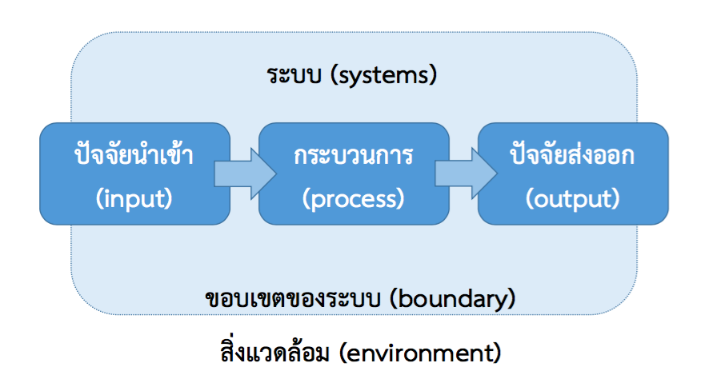
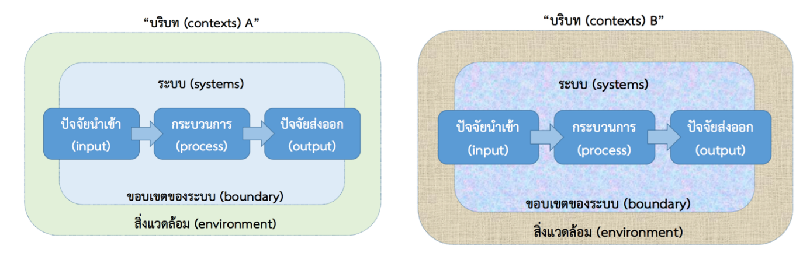
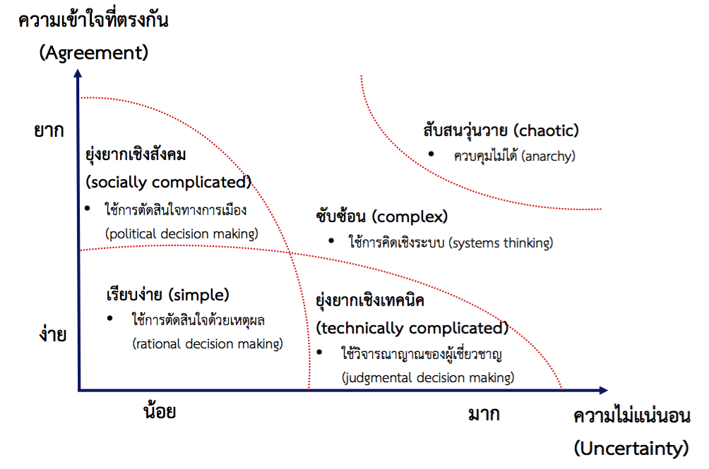
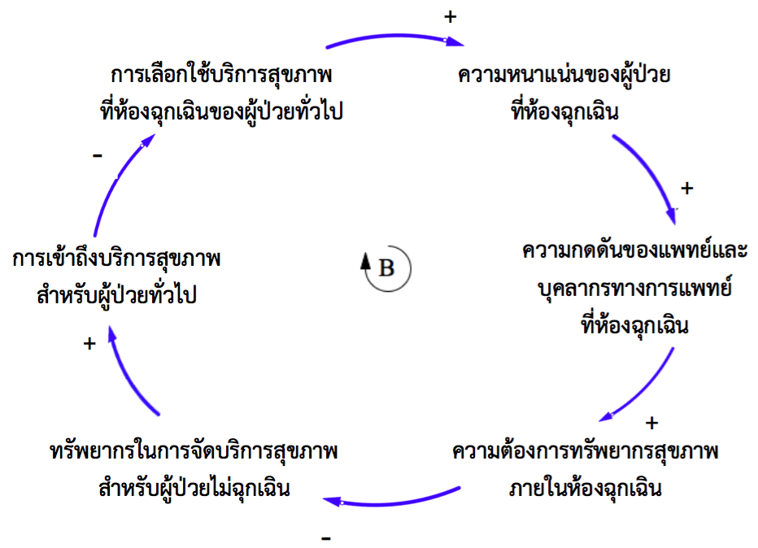
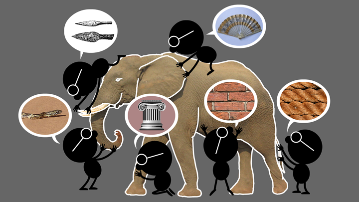
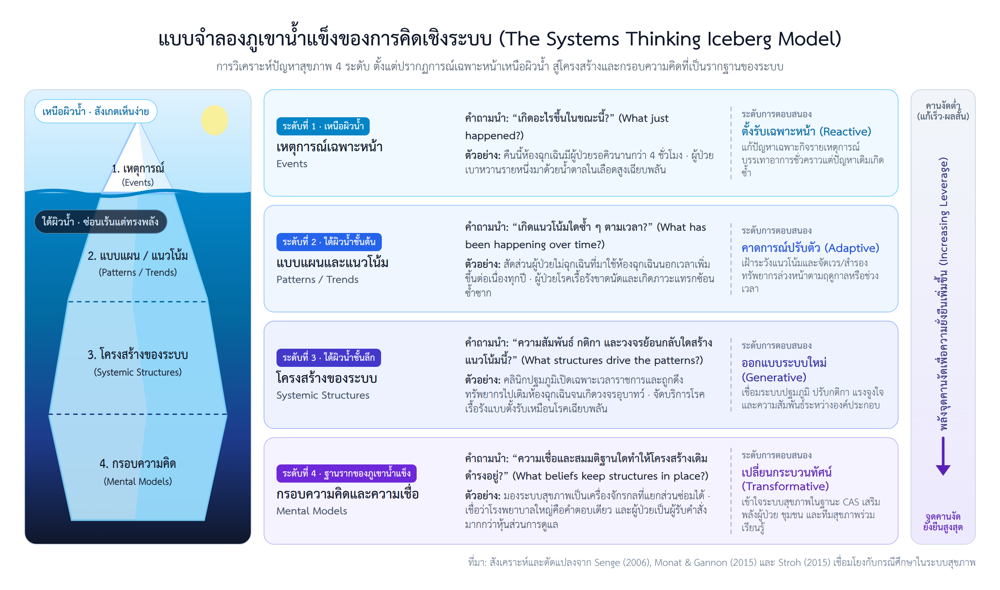

# ST1: แนวคิดเบื้องต้นเกี่ยวกับระบบและการคิดเชิงระบบ (Systems and Systems Thinking)

บวรศม ลีระพันธ์

ณัฐวุฒิ เอี่ยงธนรัตน์

## วัตถุประสงค์การเรียนรู้และคำถามนำ

| วัตถุประสงค์การเรียนรู้ | คำถามนำ |
|---|---|
| 1. **แนวคิดเรื่องระบบ (concepts of systems)** อธิบายความหมาย องค์ประกอบ ขอบเขตของระบบ (boundary) สิ่งแวดล้อม (environment) และหน้าที่ของระบบในการเปลี่ยนปัจจัยนำเข้า (input) ผ่านกระบวนการ (process) ไปเป็นปัจจัยส่งออก (output) เพื่อบรรลุเป้าหมาย (goals) ตลอดจนวิเคราะห์อิทธิพลของบริบท (contexts) ต่อการทำงานของระบบ | 1. ระบบคืออะไร และบริบทแวดล้อมส่งผลต่อการทำหน้าที่ของระบบอย่างไร (What is a system, and how do contexts shape how a system functions?) |
| 2. **ประเภทของระบบและระบบซับซ้อนที่ปรับตัวได้ (types of systems and complex adaptive systems)** เปรียบเทียบความแตกต่างระหว่างระบบสามัญ (simple systems) ระบบยุ่งยาก (complicated systems) และระบบซับซ้อนหรือระบบซับซ้อนที่ปรับตัวได้ (complex adaptive systems: CAS) พร้อมอธิบายคุณสมบัติสำคัญที่ทำให้ผลลัพธ์ของระบบซับซ้อนไม่สามารถควบคุมด้วยสูตรสำเร็จแบบเส้นตรงได้ | 2. ระบบสามัญ ระบบยุ่งยาก และระบบซับซ้อนแตกต่างกันอย่างไร และเหตุใดสูตรสำเร็จจึงใช้ควบคุมระบบซับซ้อนไม่ได้ทุกครั้ง (How do simple, complicated, and complex systems differ, and why cannot standardized formulas guarantee outcomes in complex systems?) |
| 3. **ระบบสุขภาพในฐานะระบบซับซ้อน (health systems as complex adaptive systems)** วิเคราะห์ความซับซ้อนของการดูแลผู้ป่วยทางคลินิก การดูแลโรคเฉียบพลันเทียบกับโรคเรื้อรัง และการจัดบริการห้องฉุกเฉิน เพื่ออธิบายกลไกการเกิดวงจรอุบาทว์ (vicious cycle) และผลลัพธ์ที่ไม่ได้ตั้งใจ (unintended consequences) เมื่อแก้ปัญหาแบบแยกส่วน | 3. เหตุใดการมองระบบสุขภาพเหมือนเครื่องยนต์กลไกจึงแก้ปัญหาได้ไม่ยั่งยืน และคุณสมบัติของระบบซับซ้อนปรากฏในคลินิกและระบบบริการสุขภาพจริงอย่างไร (Why does treating health systems like machines fail, and how do complex adaptive properties manifest in clinical care and health systems?) |
| 4. **การคิดเชิงระบบและแบบจำลองภูเขาน้ำแข็ง (systems thinking and the iceberg model)** แยกแยะการคิดเชิงระบบ (systems thinking) ออกจากมุมมองแบบแยกส่วนและการคิดอย่างเป็นระบบ (systematic thinking) และประยุกต์ใช้แบบจำลองภูเขาน้ำแข็ง (Iceberg Model) วิเคราะห์ปัญหาสุขภาพตั้งแต่ระดับเหตุการณ์ แนวโน้ม โครงสร้างระบบ ไปจนถึงกรอบความคิด | 4. การคิดเชิงระบบแตกต่างจากการคิดแบบแยกส่วนและการคิดอย่างเป็นระบบอย่างไร และแพทย์จะใช้แบบจำลองภูเขาน้ำแข็งค้นหาจุดเปลี่ยนที่ยั่งยืนได้อย่างไร (How does systems thinking differ from fragmented and systematic thinking, and how can physicians use the Iceberg Model to create lasting change?) |

คำถามนำแต่ละข้อเปิดหัวข้อหลักที่มีเลขเดียวกันในเนื้อหา และแยกเป็นคำถามย่อยซึ่งเปิดหัวข้อย่อยที่มีเลขเดียวกัน ดังนี้

1. แนวคิดเรื่องระบบ (concepts of systems)
    1. ระบบประกอบด้วยอะไร ขอบเขตของระบบแยกจากสิ่งแวดล้อมอย่างไร และระบบทำหน้าที่เพื่อบรรลุเป้าหมายด้วยกลไกใด (What constitutes a system, how does its boundary separate it from the environment, and how does it function to achieve its goals?)
    2. เหตุใดระบบเดียวกันจึงทำหน้าที่และให้ผลลัพธ์แตกต่างกันเมื่อบริบทด้านเวลา สถานที่ และการให้ความหมายของผู้คนเปลี่ยนไป (Why does the same system function differently across changing contexts of time, place, and human meaning-making?)
2. ประเภทของระบบและระบบซับซ้อนที่ปรับตัวได้ (types of systems and complex adaptive systems)
    1. ระบบสามัญและระบบยุ่งยากมีลักษณะอย่างไร และเกี่ยวข้องกับกระบวนทัศน์แบบลดทอนและแยกส่วนอย่างไร (What characterizes simple and complicated systems, and how do they relate to reductionism?)
    2. ระบบซับซ้อนหรือระบบซับซ้อนที่ปรับตัวได้มีคุณสมบัติแตกต่างจากระบบสามัญและระบบยุ่งยากอย่างไร (How do complex adaptive systems differ fundamentally from simple and complicated systems?)
3. ระบบสุขภาพในฐานะระบบซับซ้อน (health systems as complex adaptive systems)
    1. มุมมองของแพทย์ที่พิจารณาระบบสุขภาพเป็นระบบยุ่งยากต่างจากผู้ที่พิจารณาเป็นระบบซับซ้อนอย่างไร (How does viewing health systems as complicated machines differ from viewing them as complex living systems?)
    2. ความซับซ้อนปรากฏในกระบวนการดูแลผู้ป่วยทางคลินิกและในการแยกแยะโรคเฉียบพลันออกจากโรคเรื้อรังอย่างไร (How does complexity manifest in clinical consultations and in distinguishing acute complicated from chronic complex diseases?)
    3. การแก้ปัญหาความหนาแน่นของห้องฉุกเฉินแบบแยกส่วนก่อให้เกิดวงจรอุบาทว์และผลลัพธ์ที่ไม่ได้ตั้งใจอย่างไร และคุณสมบัติของระบบซับซ้อนสะท้อนอยู่ในระบบสุขภาพไทยอย่างไร (How do fragmented fixes for emergency room crowding trigger vicious cycles and unintended consequences, and how do complex adaptive properties appear in Thailand's health system?)
4. การคิดเชิงระบบและแบบจำลองภูเขาน้ำแข็ง (systems thinking and the iceberg model)
    1. การคิดเชิงระบบคืออะไร และแตกต่างจากการทำงานแบบแยกส่วนหรือ "ตาบอดคลำช้าง" อย่างไร (What is systems thinking, and how does it overcome fragmented "blind men and the elephant" approaches?)
    2. แบบจำลองภูเขาน้ำแข็งช่วยจัดลำดับการวิเคราะห์ปัญหาสุขภาพจากเหตุการณ์เหนือผิวน้ำไปสู่โครงสร้างและกรอบความคิดใต้ผิวน้ำอย่างไร (How does the Iceberg Model guide analysis from surface events to underlying systemic structures and mental models?)
    3. การคิดเชิงระบบแตกต่างจากการคิดอย่างเป็นระบบอย่างไร และช่วยตอบคำถามเพื่อพัฒนาระบบสุขภาพได้อย่างไร (How does systems thinking differ from systematic thinking, and what core question does it answer for health systems strengthening?)

## (1) ระบบทำหน้าที่เปลี่ยนปัจจัยนำเข้าเป็นปัจจัยส่งออกภายในขอบเขตที่กำหนด และอาจทำหน้าที่ต่างกันไปเมื่อบริบทแวดล้อมเปลี่ยนแปลง (Concepts of Systems)

> คำถามนำของหัวข้อนี้คือ ระบบคืออะไร และบริบทแวดล้อมส่งผลต่อการทำหน้าที่ของระบบอย่างไร (What is a system, and how do contexts shape how a system functions?)

ก่อนศึกษาโครงสร้างและหน้าที่ของระบบสุขภาพและระบบบริการสุขภาพในบทถัดไป ผู้เรียนจำเป็นต้องมีกรอบแนวคิดพื้นฐานเรื่อง "ระบบ" เพื่อใช้เป็นเลนส์ทำความเข้าใจการทำงานร่วมกันขององค์ประกอบต่าง ๆ หัวข้อนี้เริ่มจากการนิยามองค์ประกอบ ขอบเขต และกลไกการทำหน้าที่พื้นฐานของระบบ (หัวข้อ 1.1) แล้วขยายไปสู่บทบาทของบริบทแวดล้อมและตัวอย่างของระบบในระดับต่าง ๆ จนถึงระบบสุขภาพ (หัวข้อ 1.2)

### 1.1 ระบบคือองค์ประกอบย่อยที่มีความสัมพันธ์และทำหน้าที่ร่วมกันเพื่อบรรลุเป้าหมาย ภายใต้เส้นแบ่งขอบเขตที่แยกจากสิ่งแวดล้อมภายนอก (Definition, Boundary, Input–Process–Output, and Environment)

> คำถามย่อยของหัวข้อนี้คือ ระบบประกอบด้วยอะไร ขอบเขตของระบบแยกจากสิ่งแวดล้อมอย่างไร และระบบทำหน้าที่เพื่อบรรลุเป้าหมายด้วยกลไกใด (What constitutes a system, how does its boundary separate it from the environment, and how does it function to achieve its goals?)

> หากนำอวัยวะทุกชิ้นของระบบไหลเวียนโลหิตมาวางเรียงไว้บนโต๊ะผ่าตัดโดยไม่เชื่อมต่อกัน อวัยวะเหล่านั้นยังนับเป็น "ระบบไหลเวียนโลหิต" ที่ทำหน้าที่สูบฉีดเลือดเลี้ยงร่างกายได้หรือไม่ เพราะเหตุใด

อวัยวะที่วางแยกจากกันไม่สามารถสูบฉีดเลือดได้ เพราะหัวใจของการเป็นระบบไม่ได้อยู่ที่จำนวนชิ้นส่วน แต่อยู่ที่ความสัมพันธ์และการทำงานประสานกันของชิ้นส่วนเหล่านั้น **ระบบ (systems)** หมายถึงกรอบแนวคิดทางวิทยาศาสตร์ที่ใช้พิจารณาภาพรวมของสิ่งที่ประกอบขึ้นจากองค์ประกอบหรือส่วนย่อยหลายส่วนซึ่งมีความสัมพันธ์กันเพื่อทำหน้าที่ร่วมกัน โดยผู้ศึกษาต้องกำหนด **ขอบเขตของระบบ (boundary)** ให้ชัดเจนว่าการศึกษาครั้งนั้นครอบคลุมองค์ประกอบใดบ้างและไม่ครอบคลุมองค์ประกอบใด ([von Bertalanffy, 1968](https://archive.org/details/generalsystemthe0000bert)) การขีดเส้นขอบเขตดังกล่าวช่วยให้ผู้เรียนแยกแยะระบบที่สนใจศึกษาออกจากสิ่งที่อยู่นอกเหนือขอบเขตนั้น ซึ่งเรียกว่า **สิ่งแวดล้อม (environment)** โดยทั่วไปสิ่งแวดล้อมมักถูกพิจารณาว่าอยู่ภายนอกหรืออยู่นอกเหนือการควบคุมโดยตรงของระบบ แม้ในบางกรณียกเว้นในโลกความจริงเส้นแบ่งระหว่างระบบกับสิ่งแวดล้อมอาจซ้อนเหลื่อมกันจนแยกขาดได้ไม่สมบูรณ์ก็ตาม ([von Bertalanffy, 1968](https://archive.org/details/generalsystemthe0000bert))

เมื่อกำหนดขอบเขตของระบบได้แล้ว เราจะพิจารณาการทำงานของระบบผ่านกลไกการแปลงทรัพยากรไปสู่ผลลัพธ์ ดังแสดงในภาพที่ 1 **หน้าที่ของระบบ (functions)** โดยทั่วไปคือการรับ **ปัจจัยนำเข้า (input)** จากสิ่งแวดล้อมเข้าสู่ **กระบวนการภายในระบบ (process)** เพื่อแปรเปลี่ยนปัจจัยนำเข้านั้นให้กลายเป็น **ปัจจัยส่งออก (output)** แล้วส่งกลับคืนสู่สิ่งแวดล้อมภายนอกระบบ ([Scheerens & Bosker, 1997](https://openlibrary.org/books/OL991578M)) ความสามารถในการทำหน้าที่ของระบบหนึ่งจึงตัดสินได้จากความสามารถในการจัดกระบวนการเปลี่ยนปัจจัยนำเข้าให้กลายเป็นปัจจัยส่งออกได้อย่างเหมาะสม เพื่อมุ่งไปสู่ **เป้าหมายของระบบ (goals)** ที่ตั้งไว้

**ภาพที่ 1 กรอบแนวคิดเรื่องระบบ (systems) แสดงความสัมพันธ์ระหว่างปัจจัยนำเข้า (input) กระบวนการ (process) และปัจจัยส่งออกจากระบบ (output) ภายใต้ขอบเขตของระบบ (boundary) และสิ่งแวดล้อม (environment)** (*ที่มา: บวรศม ลีระพันธ์ สังเคราะห์จาก [von Bertalanffy (1968)](https://archive.org/details/generalsystemthe0000bert) และ [Scheerens & Bosker (1997)](https://openlibrary.org/books/OL991578M)*)

> ประเด็นสำคัญของหัวข้อย่อยนี้คือ ระบบคือกลุ่มขององค์ประกอบย่อยที่มีความสัมพันธ์และทำหน้าที่ร่วมกันภายใต้ขอบเขตที่แยกจากสิ่งแวดล้อม โดยรับปัจจัยนำเข้าผ่านกระบวนการภายในระบบเพื่อสร้างปัจจัยส่งออกที่มุ่งบรรลุเป้าหมายของระบบ

### 1.2 บริบทด้านเวลาและสถานที่ตลอดจนการให้ความหมายของผู้เกี่ยวข้อง ทำให้ระบบเดียวกันทำหน้าที่และให้ผลลัพธ์แตกต่างกันได้ (Contexts and Meaning-Making Across Systems)

> คำถามย่อยของหัวข้อนี้คือ เหตุใดระบบเดียวกันจึงทำหน้าที่และให้ผลลัพธ์แตกต่างกันเมื่อบริบทด้านเวลา สถานที่ และการให้ความหมายของผู้คนเปลี่ยนไป (Why does the same system function differently across changing contexts of time, place, and human meaning-making?)

> ห้องเรียนชั้นมัธยมศึกษาห้องเดิมที่มีครูและนักเรียนกลุ่มเดิม เหตุใดในสัปดาห์ปกติจึงเต็มไปด้วยการพูดคุยทำกิจกรรมนอกเวลา แต่ในช่วงสัปดาห์ก่อนสอบปลายภาคกลับเงียบขรึมและตึงเครียด ขณะที่นักเรียนบางคนหรือครูประจำชั้นกลับไม่ได้รู้สึกตึงเครียดไปด้วย

ความสามารถในการทำหน้าที่ของระบบไม่ได้คงที่ตายตัว แต่แปรเปลี่ยนไปตาม **บริบท (contexts)** ที่ห่อหุ้มทั้งตัวระบบและสิ่งแวดล้อมอยู่เสมอ โดยเฉพาะบริบทด้าน **เวลา (time)** และ **สถานที่ (place)** ตลอดจนการตีความและการให้ความหมายต่อสิ่งแวดล้อมที่เปลี่ยนไปของบุคคลหรือกลุ่มบุคคลที่เกี่ยวข้องกับระบบนั้น ดังตัวอย่างห้องเรียนในช่วงใกล้สอบที่นักเรียนส่วนใหญ่รับรู้บรรยากาศว่าตึงเครียดจนลดการทำกิจกรรมร่วมกันและมุ่งอ่านหนังสือ ขณะที่นักเรียนบางคนหรือครูประจำชั้นอาจให้ความหมายต่อสถานการณ์เดียวกันต่างออกไป บริบทที่แตกต่างกันจึงส่งผลกระทบได้ทั้งต่อความสัมพันธ์ระหว่างองค์ประกอบภายในระบบ และต่อความสัมพันธ์ระหว่างระบบกับสิ่งแวดล้อมภายนอก ดังแสดงในภาพที่ 2

**ภาพที่ 2 การทำหน้าที่ของระบบ (systems) ซึ่งอาจเปลี่ยนแปลงไปตามบริบท (contexts) ที่แตกต่างกัน** (*ที่มา: บวรศม ลีระพันธ์*)

กรอบแนวคิดเรื่องระบบสามารถนำไปใช้วิเคราะห์ปรากฏการณ์ในระดับต่าง ๆ ได้อย่างกว้างขวาง ตั้งแต่ระดับอวัยวะในร่างกายไปจนถึงระดับสังคม ตัวอย่างของระบบที่สำคัญเปรียบเทียบได้ดังตารางต่อไปนี้

| ตัวอย่างของระบบ | ขอบเขตขององค์ประกอบและกระบวนการหลักที่ศึกษา | เป้าหมายและหน้าที่ร่วมกันของระบบ |
|---|---|---|
| **ระบบทางชีววิทยา (biological systems)** | โครงสร้างและการทำงานประสานกันของกลุ่มอวัยวะ เนื้อเยื่อ และเซลล์จำนวนหนึ่งในร่างกาย ([von Bertalanffy, 1968](https://archive.org/details/generalsystemthe0000bert)) | ทำหน้าที่ทางสรีรวิทยาจำเพาะเพื่อธำรงสมดุลของสิ่งมีชีวิต เช่น ระบบหายใจและระบบไหลเวียนโลหิต |
| **ระบบเศรษฐกิจ (economic systems)** | ปัจจัยและสถาบันทั้งหมดที่เกี่ยวข้องกับการผลิต การกระจายสินค้าและบริการ และการจัดสรรทรัพยากรในสังคม ([von Bertalanffy, 1968](https://archive.org/details/generalsystemthe0000bert)) | ตอบสนองความต้องการทางเศรษฐกิจและจัดสรรทรัพยากรที่มีอยู่จำกัดให้แก่สมาชิกในสังคม |
| **ระบบการศึกษา (educational systems)** | ปัจจัยด้านการจัดการเรียนรู้ทั้งในและนอกสถานศึกษา สิ่งแวดล้อมที่ส่งเสริมการเรียนรู้ของประชาชน และการสร้างองค์ความรู้ ([Scheerens & Bosker, 1997](https://openlibrary.org/books/OL991578M)) | พัฒนาศักยภาพผู้เรียน เตรียมกำลังคนเข้าสู่สังคมเศรษฐกิจ และสร้างความรู้เพื่อแก้ไขปัญหาของสังคม |
| **ระบบสุขภาพ (health systems)** | กลุ่มประชากร องค์กร และกิจกรรมทั้งหมดที่มีเป้าประสงค์หลักในการสร้างสุขภาพ ซ่อมสุขภาพ และรักษาสุขภาพ ([World Health Organization, 2000](https://www.who.int/publications/i/item/924156198X); [World Health Organization, 2007](https://iris.who.int/handle/10665/43918); [World Health Organization Regional Office for the Western Pacific, 2008](https://web.archive.org/web/20140412010308/http://www.wpro.who.int/health_services/health_systems_framework/en/)) | ส่งเสริม ฟื้นฟู และธำรงไว้ซึ่งสุขภาวะของประชาชนอย่างมีคุณภาพและเป็นธรรม |

กล่าวโดยสรุป เราจะคาดการณ์การทำหน้าที่หรือผลลัพธ์ของระบบหนึ่งได้แม่นยำเพียงใด ย่อมขึ้นอยู่กับว่าเราเข้าใจลักษณะและขนาดของความสัมพันธ์ระหว่างปัจจัยนำเข้ากับปัจจัยส่งออกของระบบนั้นมากน้อยเพียงใด ซึ่งธรรมชาติของความสัมพันธ์ดังกล่าวไม่ได้เหมือนกันในทุกระบบ และนำไปสู่การจำแนกประเภทของระบบในหัวข้อถัดไป

> ประเด็นสำคัญของหัวข้อย่อยนี้คือ บริบทด้านเวลา สถานที่ และการให้ความหมายของผู้คนส่งผลต่อความสัมพันธ์ทั้งภายในระบบและระหว่างระบบกับสิ่งแวดล้อม ระบบเดียวกันจึงอาจทำหน้าที่ต่างกันไปเมื่อบริบทเปลี่ยน

## (2) ธรรมชาติของระบบจำแนกออกเป็นระบบสามัญ ระบบยุ่งยาก และระบบซับซ้อน ซึ่งกำหนดว่าผลลัพธ์ของระบบคาดการณ์ด้วยสูตรสำเร็จได้หรือไม่ (Types of Systems and Complex Adaptive Systems)

> คำถามนำของหัวข้อนี้คือ ระบบสามัญ ระบบยุ่งยาก และระบบซับซ้อนแตกต่างกันอย่างไร และเหตุใดสูตรสำเร็จจึงใช้ควบคุมระบบซับซ้อนไม่ได้ทุกครั้ง (How do simple, complicated, and complex systems differ, and why cannot standardized formulas guarantee outcomes in complex systems?)

การเลือกวิธีวิเคราะห์และแก้ไขปัญหาในระบบใด ๆ ต้องเริ่มจากการวินิจฉัยเสียก่อนว่าระบบนั้นมีธรรมชาติแบบใด ([Glouberman & Zimmerman, 2002](https://publications.gc.ca/site/eng/235920/publication.html)) หัวข้อนี้เปรียบเทียบระบบสามัญและระบบยุ่งยากซึ่งวางอยู่บนความสัมพันธ์เชิงเส้นตรงที่คาดการณ์ได้ (หัวข้อ 2.1) กับระบบซับซ้อนหรือระบบซับซ้อนที่ปรับตัวได้ซึ่งมีพลวัตไม่เป็นเส้นตรงและปรับตัวได้เองจากภายใน (หัวข้อ 2.2)

### 2.1 ระบบสามัญและระบบยุ่งยากวางอยู่บนกระบวนทัศน์แบบลดทอนแยกส่วนที่มีความสัมพันธ์เชิงเส้นตรง จึงคาดการณ์ผลลัพธ์ได้แน่นอนเมื่อทำตามสูตรหรือความเชี่ยวชาญ (Simple and Complicated Systems Under Reductionism)

> คำถามย่อยของหัวข้อนี้คือ ระบบสามัญและระบบยุ่งยากมีลักษณะอย่างไร และเกี่ยวข้องกับกระบวนทัศน์แบบลดทอนและแยกส่วนอย่างไร (What characterizes simple and complicated systems, and how do they relate to reductionism?)

> การปรุงอาหารตามตำราอาหารกับการส่งจรวดไปดวงจันทร์มีความยากง่ายต่างกันมหาศาล แต่ทั้งสองกิจกรรมมีสิ่งใดที่เหมือนกันในแง่ความแน่นอนของผลลัพธ์เมื่อปฏิบัติตามขั้นตอนและสูตรคำนวณอย่างถูกต้อง

แม้การส่งจรวดจะอาศัยความรู้ทางวิศวกรรมขั้นสูงกว่าการทำอาหารมาก แต่ทั้งสองระบบมีธรรมชาติร่วมกันคือ "เมื่อใส่ปัจจัยนำเข้าและควบคุมขั้นตอนตามสูตรเดิม ย่อมได้ผลลัพธ์เดิมอย่างแม่นยำ" นักวิชาการจำแนกระบบที่มีความสัมพันธ์เช่นนี้ออกเป็นสองระดับตามจำนวนองค์ประกอบและความเชี่ยวชาญที่ต้องใช้ ([Glouberman & Zimmerman, 2002](https://publications.gc.ca/site/eng/235920/publication.html))

**ระบบสามัญ (simple systems)** หมายถึงระบบที่มีองค์ประกอบภายในจำนวนไม่มากและมีขอบเขตชัดเจนจนแยกออกจากสิ่งแวดล้อมได้ง่าย จึงอาจเรียกอีกชื่อหนึ่งว่า **ระบบปิด (closed systems)** ลักษณะเด่นคือปัจจัยนำเข้าและปัจจัยส่งออกมีความสัมพันธ์เชิงเส้นตรงที่คาดการณ์ผลลัพธ์ได้ด้วยความแน่นอน (linear, deterministic relationship) ตัวอย่างเช่น การเตรียมอาหารตามสูตรปรุงอาหาร การสีข้าวด้วยกังหันลม หรือการวิดน้ำด้วยระหัดวิดน้ำ ([Glouberman & Zimmerman, 2002](https://publications.gc.ca/site/eng/235920/publication.html))

**ระบบยุ่งยาก (complicated systems)** หมายถึงระบบที่มีองค์ประกอบภายในจำนวนมาก หรือประกอบขึ้นจาก **ระบบย่อย (sub-systems)** จำนวนมากมาทำงานต่อกัน โดยแต่ละระบบย่อยยังมีลักษณะเป็นระบบสามัญที่มีปัจจัยนำเข้าและปัจจัยส่งออกชัดเจน ระบบยุ่งยากโดยรวมจึงยังคงมีความสัมพันธ์เชิงเส้นตรงและคาดการณ์ผลลัพธ์ได้ด้วยความแน่นอน (linear, deterministic relationship) หากมีความเชี่ยวชาญทางเทคนิคหลายสาขามาประกอบกันอย่างแม่นยำ ตัวอย่างเช่น ระบบการส่งจรวดไปดวงจันทร์ ระบบคอมพิวเตอร์ ระบบรถยนต์ หรือระบบควบคุมการบินของเครื่องบินซึ่งประกอบด้วยระบบไฟฟ้า ระบบเครื่องยนต์ ระบบควบคุมทิศทาง และระบบความปลอดภัย ([Glouberman & Zimmerman, 2002](https://publications.gc.ca/site/eng/235920/publication.html))

ทั้งระบบสามัญและระบบยุ่งยากสะท้อนวิธีคิดทางวิทยาศาสตร์กระแสหลักที่เรียกว่า **กระบวนทัศน์แบบลดทอนและแยกส่วน (reductionism)** คือแนวคิดที่ศึกษาปรากฏการณ์โดยแยกสิ่งที่สนใจออกจากบริบทแวดล้อม แยกส่วนใหญ่ออกเป็นชิ้นส่วนย่อย ๆ แล้ววิเคราะห์กลไกการทำงานของแต่ละชิ้นส่วนเสมือนฟันเฟืองเครื่องจักร ([von Bertalanffy, 1968](https://archive.org/details/generalsystemthe0000bert); [Glouberman & Zimmerman, 2002](https://publications.gc.ca/site/eng/235920/publication.html)) กระบวนทัศน์นี้ประสบความสำเร็จอย่างสูงในการสร้างเทคโนโลยีและวิศวกรรม แต่มีข้อจำกัดทันทีเมื่อนำไปใช้กับระบบที่มีมนุษย์และสังคมเข้ามาเกี่ยวข้อง

> ประเด็นสำคัญของหัวข้อย่อยนี้คือ ระบบสามัญและระบบยุ่งยากมีความสัมพันธ์ระหว่างเหตุและผลแบบเส้นตรงที่คาดการณ์ผลลัพธ์ได้แน่นอน ต่างกันเพียงจำนวนระบบย่อยและระดับความเชี่ยวชาญที่ใช้ โดยทั้งคู่วางอยู่บนกระบวนทัศน์แบบลดทอนและแยกส่วน

### 2.2 ระบบซับซ้อนหรือระบบซับซ้อนที่ปรับตัวได้เป็นระบบเปิดที่มีความสัมพันธ์ไม่เป็นเส้นตรง ปรับตัวจากภายใน และให้ผลลัพธ์เชิงความน่าจะเป็นที่ไม่ซ้ำเดิม (Complex Systems and Complex Adaptive Systems: CAS)

> คำถามย่อยของหัวข้อนี้คือ ระบบซับซ้อนหรือระบบซับซ้อนที่ปรับตัวได้มีคุณสมบัติแตกต่างจากระบบสามัญและระบบยุ่งยากอย่างไร (How do complex adaptive systems differ fundamentally from simple and complicated systems?)

> พ่อแม่ที่เลี้ยงลูกคนแรกจนเติบโตและประสบความสำเร็จเป็นอย่างดี หากนำวิธีการเลี้ยงดูแบบเดิมทุกประการไปใช้กับลูกคนที่สอง จะรับประกันได้หรือไม่ว่าลูกคนที่สองจะเติบโตและตอบสนองเหมือนลูกคนแรกทุกประการ

ผู้เรียนย่อมตระหนักจากประสบการณ์ชีวิตได้ทันทีว่าไม่มีตำราเลี้ยงลูกเล่มใดรับประกันผลลัพธ์แบบเดียวกันทุกครั้ง เพราะเด็กแต่ละคนมีความคิด ความรู้สึก และการเรียนรู้ที่ตอบสนองต่อพ่อแม่และสิ่งแวดล้อมไม่เหมือนกัน **ระบบซับซ้อน (complex systems)** หมายถึงระบบที่มีองค์ประกอบและระบบย่อยจำนวนมากซึ่งมีปฏิสัมพันธ์กันอย่างไม่เป็นเส้นตรง มีขอบเขตของระบบไม่ตายตัวหรือเปลี่ยนแปลงอยู่เสมอจนแยกออกจากสิ่งแวดล้อมได้ยาก จึงจัดเป็น **ระบบเปิด (open systems)** ที่ไม่สามารถคาดเดาผลลัพธ์ได้อย่างแน่นอนตายตัวทุกครั้ง แต่ให้ผลลัพธ์ในลักษณะ **ความสัมพันธ์ไม่เป็นเส้นตรงและเป็นเชิงความน่าจะเป็น (non-linear, probabilistic relationship)** ตัวอย่างเช่น การเลี้ยงลูกของพ่อแม่ ระบบชีววิทยาในร่างกายมนุษย์ ระบบสุขภาพ และระบบบริการสุขภาพ ([Cilliers, 1998](https://doi.org/10.4324/9780203012253); [Glouberman & Zimmerman, 2002](https://publications.gc.ca/site/eng/235920/publication.html))

คุณสมบัติสำคัญที่ทำให้ระบบซับซ้อนแตกต่างจากระบบสามัญและระบบยุ่งยากอย่างถึงรากฐาน สรุปได้เป็นห้าลักษณะที่เชื่อมโยงกัน ([Cilliers, 1998](https://doi.org/10.4324/9780203012253)) ได้แก่

1. **การเชื่อมโยงกันอย่างใกล้ชิดขององค์ประกอบภายในระบบ (tightly linked)** เมื่อเกิดการเปลี่ยนแปลงขึ้นในระบบย่อยส่วนหนึ่ง ผลกระทบจะส่งต่อไปยังระบบย่อยส่วนอื่น ๆ อย่างหลีกเลี่ยงไม่ได้
2. **คุณสมบัติผุดบังเกิด (emerging property หรือ emergence)** ปฏิสัมพันธ์ระหว่างองค์ประกอบย่อยก่อให้เกิดคุณสมบัติใหม่ของระบบในภาพรวม ซึ่งไม่สามารถอธิบายได้ด้วยการนำคุณสมบัติของแต่ละชิ้นส่วนเมื่ออยู่แยกกันมาบวกรวมกัน ดังคำกล่าวคลาสสิกที่ว่า *"ส่วนรวมไม่เท่ากับผลรวมของส่วนย่อย" ("The whole is not equal to the sum of its parts.")* ([von Bertalanffy, 1968](https://archive.org/details/generalsystemthe0000bert); [Cilliers, 1998](https://doi.org/10.4324/9780203012253))
3. **กลไกการอภิบาลภายในระบบด้วยการตอบสนองย้อนกลับ (governance by feedback)** เมื่อมีมาตรการแทรกแซง (interventions) เข้าไปในระบบ ผู้คนและองค์ประกอบในระบบจะเกิดการตอบสนองย้อนกลับทั้งในทางเสริมแรง (เชิงบวก) และทางต้านกลับหรือถ่วงดุล (เชิงลบ) จนอาจเกิดพฤติกรรมใหม่ที่ไม่เคยมีมาก่อน (**พฤติกรรมผุดบังเกิด [emerging behaviors]**) ซึ่งย้อนกลับไปเปลี่ยนแปลงตัวมาตรการแทรกแซงหรือเปลี่ยนโครงสร้างของระบบเองได้
4. **ความสามารถในการจัดการตัวเอง (self-organizing)** พลวัตและการจัดระเบียบใหม่ของระบบสามารถเกิดขึ้นได้เองจากปฏิสัมพันธ์ภายในโดยไม่ต้องรอคำสั่งหรือการควบคุมจากภายนอกตลอดเวลา และไม่มีบุคคลหรือหน่วยงานเดี่ยวใดสามารถควบคุมผลลัพธ์ทั้งหมดของระบบได้แต่เพียงลำพัง
5. **การเปลี่ยนแปลงอย่างต่อเนื่อง (constantly changing)** ระบบมีการเรียนรู้และปรับตัวซ้ำแล้วซ้ำเล่าข้ามช่วงเวลาและในหลายระดับพร้อมกัน

เพื่อให้เห็นความแตกต่างของระบบทั้งสามประเภทอย่างชัดเจน [Glouberman และ Zimmerman (2002)](https://publications.gc.ca/site/eng/235920/publication.html) ได้เปรียบเทียบผ่านอุปมาสามกิจกรรมที่เข้าใจง่าย ดังแสดงในตารางที่ 1

**ตารางที่ 1** ความแตกต่างระหว่างระบบสามัญ (simple systems) ระบบยุ่งยาก (complicated systems) และระบบซับซ้อน (complex systems)

| ประเด็นเปรียบเทียบ | “การทำกับข้าว” — ระบบสามัญ (simple systems) | “การส่งจรวดไปดวงจันทร์” — ระบบยุ่งยาก (complicated systems) | “การเลี้ยงลูก” — ระบบซับซ้อน (complex systems) |
|---|---|---|---|
| **บทบาทของสูตรสำเร็จ (formulae / recipes)** | สูตรมีความสำคัญและได้รับการทดสอบมาแล้วว่าทำซ้ำหรือลอกเลียนแบบได้ง่าย ([Glouberman & Zimmerman, 2002](https://publications.gc.ca/site/eng/235920/publication.html)) | สูตรและแบบพิมพ์เขียวมีความจำเป็นและสำคัญอย่างยิ่งต่อการประสานระบบย่อยจำนวนมาก ([Glouberman & Zimmerman, 2002](https://publications.gc.ca/site/eng/235920/publication.html)) | สูตรสำเร็จมีข้อจำกัดสูงเมื่อนำไปประยุกต์ใช้จริง ([Glouberman & Zimmerman, 2002](https://publications.gc.ca/site/eng/235920/publication.html)) |
| **ผลของความสำเร็จในอดีตต่อครั้งถัดไป** | การทำตามตำราที่ดีย่อมให้ผลลัพธ์เหมือนเดิมทุกครั้ง ([Glouberman & Zimmerman, 2002](https://publications.gc.ca/site/eng/235920/publication.html)) | การส่งจรวดสำเร็จหนึ่งครั้งช่วยเพิ่มความมั่นใจอย่างมากว่าการส่งครั้งถัดไปจะสำเร็จเช่นกัน ([Glouberman & Zimmerman, 2002](https://publications.gc.ca/site/eng/235920/publication.html)) | การเลี้ยงลูกคนแรกช่วยเพิ่มประสบการณ์ของพ่อแม่ แต่ไม่รับประกันความสำเร็จในการเลี้ยงลูกคนถัดไป ([Glouberman & Zimmerman, 2002](https://publications.gc.ca/site/eng/235920/publication.html)) |
| **ความจำเป็นของความเชี่ยวชาญเฉพาะทาง** | ไม่จำเป็นต้องใช้ความเชี่ยวชาญขั้นสูง แต่ประสบการณ์ช่วยเพิ่มอัตราความสำเร็จ ([Glouberman & Zimmerman, 2002](https://publications.gc.ca/site/eng/235920/publication.html)) | ความสำเร็จขึ้นอยู่กับความเชี่ยวชาญระดับสูงในหลากหลายสาขาวิชาที่มาทำงานร่วมกัน ([Glouberman & Zimmerman, 2002](https://publications.gc.ca/site/eng/235920/publication.html)) | ความเชี่ยวชาญมีส่วนช่วยได้ แต่ไม่ใช่ปัจจัยชี้ขาดหรือปัจจัยที่ขาดไม่ได้ในการเลี้ยงลูกให้เติบโตด้วยดี ([Glouberman & Zimmerman, 2002](https://publications.gc.ca/site/eng/235920/publication.html)) |
| **ลักษณะของสิ่งที่เกี่ยวข้องและผลลัพธ์** | สร้างผลผลิตที่มีมาตรฐานเดียวกัน (standardized) และให้ผลลัพธ์ที่ดีสม่ำเสมอทุกครั้ง ([Glouberman & Zimmerman, 2002](https://publications.gc.ca/site/eng/235920/publication.html)) | จรวดแต่ละลำมีลักษณะเหมือนกันเป็นส่วนใหญ่ (similar) และให้ผลลัพธ์ที่มีความแน่นอนสูง ([Glouberman & Zimmerman, 2002](https://publications.gc.ca/site/eng/235920/publication.html)) | เด็กแต่ละคนมีเอกลักษณ์จำเพาะตัว (unique) และผลลัพธ์มีความไม่แน่นอนสูง ([Glouberman & Zimmerman, 2002](https://publications.gc.ca/site/eng/235920/publication.html)) |

ในวรรณกรรมวิชาการด้านระบบสุขภาพ นักวิชาการมักเรียก "ระบบซับซ้อน" เต็มรูปว่า **ระบบซับซ้อนที่ปรับตัวได้ (complex adaptive systems: CAS)** เพื่อเน้นย้ำความสามารถในการตอบสนองย้อนกลับ การจัดการตัวเอง และการปรับตัวจากภายในอย่างไม่หยุดนิ่ง ([Begun et al., 2003](https://experts.umn.edu/en/publications/health-care-organizations-as-complex-adaptive-systems/); [de Savigny & Adam, 2009](https://iris.who.int/handle/10665/44204)) ทั้งนี้ เมื่อผู้เรียนอ่านเอกสารภาษาไทยของนักวิชาการด้านการพัฒนาบางท่าน อาจพบคำแปลของ `complex systems` ว่า **"ระบบซับซ้อนแบบองค์รวม"** เพื่อชี้ให้เห็นว่าองค์ประกอบย่อยเชื่อมโยงกันจนแยกส่วนไม่ได้และเกิดคุณสมบัติผุดบังเกิดในภาพรวม คู่ขนานกับการแปล `complicated systems` ว่า **"ระบบซับซ้อนแบบกลไก"** ซึ่งยังแยกส่วนวิเคราะห์เหมือนเครื่องจักรได้ (อรศรี งามวิทยาพงศ์ และ นภารัตน์ นนทกิจนพเก้า, 2557) การทราบรากศัพท์ทั้งสองชุดจะช่วยให้ผู้เรียนเชื่อมโยงตำราไทยและสากลได้โดยไม่สับสน

> ประเด็นสำคัญของหัวข้อย่อยนี้คือ ระบบซับซ้อนที่ปรับตัวได้เป็นระบบเปิดที่มีความสัมพันธ์ไม่เป็นเส้นตรงและให้ผลลัพธ์เชิงความน่าจะเป็น โดยมีลักษณะสำคัญคือการเชื่อมโยงใกล้ชิด คุณสมบัติผุดบังเกิด การอภิบาลด้วยการตอบสนองย้อนกลับ การจัดการตัวเอง และการเปลี่ยนแปลงอย่างต่อเนื่อง

## (3) ระบบสุขภาพมีธรรมชาติเป็นระบบซับซ้อนที่ปรับตัวได้ การเข้าใจคุณสมบัตินี้จึงป้องกันไม่ให้แพทย์แก้ปัญหาแบบแยกส่วนจนเกิดวงจรอุบาทว์และผลลัพธ์ที่ไม่ได้ตั้งใจ (Health Systems as Complex Adaptive Systems)

> คำถามนำของหัวข้อนี้คือ เหตุใดการมองระบบสุขภาพเหมือนเครื่องยนต์กลไกจึงแก้ปัญหาได้ไม่ยั่งยืน และคุณสมบัติของระบบซับซ้อนปรากฏในคลินิกและระบบบริการสุขภาพจริงอย่างไร (Why does treating health systems like machines fail, and how do complex adaptive properties manifest in clinical care and health systems?)

หลักฐานทางวิชาการจำนวนมากยืนยันตรงกันว่าระบบสุขภาพและองค์กรบริการสุขภาพมีธรรมชาติเป็นระบบซับซ้อนที่ปรับตัวได้ มิใช่ระบบสามัญหรือระบบยุ่งยากแบบเครื่องจักร ([Glouberman & Zimmerman, 2002](https://publications.gc.ca/site/eng/235920/publication.html); [Begun et al., 2003](https://experts.umn.edu/en/publications/health-care-organizations-as-complex-adaptive-systems/); [Begun & Kaissi, 2004](https://doi.org/10.1097/00004010-200401000-00005); [Kannampallil et al., 2011](https://doi.org/10.1016/j.jbi.2011.06.006); [Atun, 2012](https://doi.org/10.1093/heapol/czs088); [Tremblay & Richard, 2014](https://doi.org/10.1093/heapro/dar054)) หัวข้อนี้เริ่มจากการเปรียบเทียบท่าทีการทำงานของแพทย์ภายใต้สองมุมมอง (หัวข้อ 3.1) จากนั้นวิเคราะห์กรณีศึกษาในระดับการดูแลผู้ป่วยทางคลินิกและโรคเรื้อรัง (หัวข้อ 3.2) ก่อนขยายสู่ระดับการจัดระบบบริการห้องฉุกเฉินและตัวอย่างจริงในระบบสุขภาพไทย (หัวข้อ 3.3)

### 3.1 การมองระบบสุขภาพเป็นระบบซับซ้อนเปลี่ยนบทบาทแพทย์จาก "ช่างซ่อมเครื่องยนต์" จากภายนอก ไปสู่ผู้กระตุ้นการเรียนรู้และการปรับตัวจากภายในระบบ (Machine Metaphor vs. Living-System Metaphor)

> คำถามย่อยของหัวข้อนี้คือ มุมมองของแพทย์ที่พิจารณาระบบสุขภาพเป็นระบบยุ่งยากต่างจากผู้ที่พิจารณาเป็นระบบซับซ้อนอย่างไร (How does viewing health systems as complicated machines differ from viewing them as complex living systems?)

แม้ทุกฝ่ายจะเห็นพ้องว่าระบบสุขภาพประกอบด้วยส่วนย่อยมากมายจนไม่ใช่ระบบสามัญแน่นอน แต่ความเห็นมักแยกออกเป็นสองแนวทางเมื่อต้องเลือกว่าจะปฏิบัติต่อระบบสุขภาพเสมือน "ระบบยุ่งยาก" หรือ "ระบบซับซ้อน" ([Glouberman & Zimmerman, 2002](https://publications.gc.ca/site/eng/235920/publication.html))

หากแพทย์และผู้ปฏิบัติงานมองระบบสุขภาพเป็น **ระบบยุ่งยาก (complicated systems)** ย่อมมีแนวโน้มวางแผนพัฒนาสุขภาพโดยเน้นการสั่งการและควบคุมจากภายนอกเสมือนตนเองเป็น **"ช่างซ่อมเครื่องยนต์"** ที่ถอดชิ้นส่วนย่อยออกมาค้นหาจุดชำรุดแล้วซ่อมแซมทีละจุด ในทางตรงกันข้าม หากมองระบบสุขภาพเป็น **ระบบซับซ้อน (complex systems)** แพทย์จะทำงานเสมือน **"ผู้ดูแลสิ่งมีชีวิตหรือผู้เลี้ยงดูเด็ก"** ที่ตระหนักว่าระบบสุขภาพมีการเรียนรู้ ปรับตัว และขับเคลื่อนจากแรงจูงใจและความสัมพันธ์ภายในระบบเอง ([Glouberman & Zimmerman, 2002](https://publications.gc.ca/site/eng/235920/publication.html); [Begun et al., 2003](https://experts.umn.edu/en/publications/health-care-organizations-as-complex-adaptive-systems/)) จุดสำคัญที่ผู้เรียนควรตระหนักคือ การยอมรับว่าระบบสุขภาพมีความซับซ้อน (complexity) และมีความไม่แน่นอน (uncertainty) **ไม่ได้แปลว่าเราหมดหนทางที่จะพัฒนาสุขภาพของประชาชน** เช่นเดียวกับการเลี้ยงเด็กแต่ละคนที่มีความไม่แน่นอนสูงแต่ความเข้าใจในเอกลักษณ์และศักยภาพภายในของเด็กกลับช่วยให้พ่อแม่เกื้อหนุนให้เด็กเติบโตได้เต็มศักยภาพยิ่งกว่าการบังคับด้วยสูตรสำเร็จตายตัว ([Glouberman & Zimmerman, 2002](https://publications.gc.ca/site/eng/235920/publication.html))

> ประเด็นสำคัญของหัวข้อย่อยนี้คือ การมองระบบสุขภาพเป็นระบบยุ่งยากทำให้มุ่งซ่อมแซมชิ้นส่วนจากภายนอกเหมือนเครื่องจักร ส่วนการมองเป็นระบบซับซ้อนมุ่งกระตุ้นการเรียนรู้และการปรับตัวจากภายในเสมือนสิ่งมีชีวิต โดยยอมรับความไม่แน่นอนควบคู่กับการส่งเสริมศักยภาพของระบบ

### 3.2 ในระดับคลินิก การดูแลผู้ป่วยต้องรับมือกับความไม่แน่นอนและความเข้าใจไม่ตรงกัน และต้องจัดกระบวนการดูแลโรคเรื้อรังที่มีความซับซ้อนให้ต่างจากโรคเฉียบพลันที่มีความยุ่งยาก (Complexity in Clinical Care: Uncertainty, Agreement, and Chronic Complex Diseases)

> คำถามย่อยของหัวข้อนี้คือ ความซับซ้อนปรากฏในกระบวนการดูแลผู้ป่วยทางคลินิกและในการแยกแยะโรคเฉียบพลันออกจากโรคเรื้อรังอย่างไร (How does complexity manifest in clinical consultations and in distinguishing acute complicated from chronic complex diseases?)

#### 3.2.1 การตรวจรักษาผู้ป่วยในคลินิกมักอยู่ในพื้นที่ความซับซ้อนที่มีทั้งความไม่แน่นอนของโรคและความเข้าใจไม่ตรงกันระหว่างแพทย์ ผู้ป่วย และญาติ (clinical consultations at the edge of chaos)

> ผู้ป่วยหญิงไทยอายุ 48 ปี มาด้วยอาการเจ็บหน้าอกเรื้อรัง 2–3 สัปดาห์ซึ่งไม่ตรงกับลักษณะจำเพาะของโรคหลอดเลือดหัวใจตีบ และตรวจพบอาการเข้าได้กับโรคซึมเศร้าร่วมด้วย เมื่อแพทย์ส่งตรวจเพิ่มเติมเพื่อแยกโรคทางกายก่อนปรึกษาจิตแพทย์ แต่ผู้ป่วยและญาติกลับไม่พอใจเพราะเข้าใจว่าเป็นโรคหัวใจที่ต้องรักษาฉุกเฉินทันที ความขัดแย้งนี้เกิดจากอะไร

กระบวนการดูแลผู้ป่วยข้างเตียงเองก็มีธรรมชาติเป็น **ระบบซับซ้อนที่ปรับตัวได้ (complex adaptive system)** เพราะต้องเผชิญทั้ง **ความไม่แน่นอนและคาดเดาได้ยาก (uncertainty and unpredictability)** ของอาการและพยาธิสภาพ ควบคู่กับ **ความเข้าใจที่ไม่ตรงกัน (disagreement)** ระหว่างแพทย์ บุคลากรสุขภาพ ผู้ป่วย และครอบครัวอยู่เสมอ ([Innes et al., 2005](https://pmc.ncbi.nlm.nih.gov/articles/PMC1266243/)) ในกรณีผู้ป่วยหญิงอายุ 48 ปีข้างต้น แพทย์ใช้วิจารณญาณทางคลินิกส่งตรวจทางห้องปฏิบัติการเพื่อแยกโรคหลอดเลือดหัวใจอุดตัน (coronary artery disease) ซึ่งเป็นภาวะอันตรายออกก่อนวางแผนดูแลโรคซึมเศร้า (major depressive disorder) ที่อาจแสดงออกเป็นอาการทางกาย ขณะที่ผู้ป่วยและญาติตีความจากความกลัวว่าอาการเจ็บหน้าอกทุกชนิดคือภาวะฉุกเฉินถึงชีวิต

ดังแสดงในภาพที่ 3 เมื่อนำแกน **ความไม่แน่นอน (uncertainty)** มาตัดกับแกน **ความเข้าใจที่ตรงกัน (agreement)** ตามกรอบแนวคิดความซับซ้อนในการตรวจรักษา ([Innes et al., 2005](https://pmc.ncbi.nlm.nih.gov/articles/PMC1266243/); [โกมาตร จึงเสถียรทรัพย์, 2558](https://anthropologist.sac.or.th/anthropologist/112)) จะจำแนกสถานการณ์การตัดสินใจออกได้เป็นห้าบริเวณ ได้แก่ (1) **เรียบง่าย (simple)** เมื่อความไม่แน่นอนน้อยและทุกฝ่ายเห็นตรงกันง่าย จึงใช้การตัดสินใจด้วยเหตุผลตามแนวทางมาตรฐาน (rational decision making) (2) **ยุ่งยากเชิงเทคนิค (technically complicated)** เมื่อเห็นตรงกันในเป้าหมายแต่มีความไม่แน่นอนทางเทคนิคสูง จึงต้องอาศัยวิจารณญาณของผู้เชี่ยวชาญ (judgmental decision making) (3) **ยุ่งยากเชิงสังคม (socially complicated)** เมื่อความไม่แน่นอนทางเทคนิคไม่มากแต่ผู้คนเห็นต่างกันสูง จึงต้องใช้การเจรจาต่อรองและการตัดสินใจเชิงนโยบายหรือการเมือง (political decision making) (4) **ซับซ้อน (complex)** เมื่อมีทั้งความไม่แน่นอนและมุมมองที่เห็นต่างกันในระดับปานกลางถึงมาก ซึ่งต้องอาศัย **การคิดเชิงระบบ (systems thinking)** การรับฟัง และการสื่อสารความไม่แน่นอนอย่างใส่ใจ และ (5) **สับสนวุ่นวาย (chaotic)** เมื่อทั้งความไม่แน่นอนและความขัดแย้งพุ่งสูงเกินขอบเขตจนควบคุมไม่ได้ (anarchy) การที่แพทย์เข้าใจธรรมชาติของพื้นที่ "ซับซ้อน" และอธิบายเหตุผลรวมถึงความไม่แน่นอนของการวินิจฉัยให้ผู้ป่วยและญาติเข้าใจอย่างโปร่งใส จะช่วยประคับประคองความสัมพันธ์และป้องกันไม่ให้การดูแลถลำเข้าสู่ภาวะสับสนวุ่นวาย ([Innes et al., 2005](https://pmc.ncbi.nlm.nih.gov/articles/PMC1266243/))

**ภาพที่ 3 ความสัมพันธ์ระหว่างความไม่แน่นอน (uncertainty) และความเข้าใจที่ตรงกัน (agreement) กับธรรมชาติของกระบวนการดูแลผู้ป่วยและรูปแบบการตัดสินใจ** (*ที่มา: บวรศม ลีระพันธ์ ดัดแปลงจาก [Innes et al. (2005)](https://pmc.ncbi.nlm.nih.gov/articles/PMC1266243/) และ [โกมาตร จึงเสถียรทรัพย์ (2558)](https://anthropologist.sac.or.th/anthropologist/112)*)

> ประเด็นสำคัญของหัวข้อย่อยนี้คือ การดูแลผู้ป่วยทางคลินิกมักอยู่ในพื้นที่ซับซ้อนที่มีทั้งความไม่แน่นอนของโรคและความเข้าใจไม่ตรงกันระหว่างแพทย์กับผู้ป่วยและญาติ แพทย์จึงต้องสื่อสารความไม่แน่นอนและสร้างความเข้าใจร่วมกันเพื่อป้องกันไม่ให้สถานการณ์กลายเป็นความสับสนวุ่นวาย

#### 3.2.2 การนำรูปแบบบริการสำหรับโรคเฉียบพลันที่มีความยุ่งยากไปใช้ดูแลโรคเรื้อรังที่มีความซับซ้อน ก่อให้เกิดผลลัพธ์สุขภาพที่ไม่ดี การขาดประสิทธิภาพ และความไม่เป็นธรรม (acute complicated vs. chronic complex diseases)

> เหตุใดระบบโรงพยาบาลที่กู้ชีพผู้ป่วยกล้ามเนื้อหัวใจขาดเลือดเฉียบพลันได้อย่างยอดเยี่ยม กลับมักล้มเหลวเมื่อใช้วิธีนัดตรวจสั้น ๆ และสั่งยาแบบเดิมในการดูแลผู้ป่วยโรคเบาหวานและความดันโลหิตสูงในระยะยาว

การแยกแยะระหว่างระบบยุ่งยากกับระบบซับซ้อนยังอธิบายความแตกต่างเชิงโครงสร้างระหว่างกลุ่มโรคสำคัญสองกลุ่มในเวชปฏิบัติ ได้แก่ **โรคเฉียบพลันที่มีความยุ่งยาก (acute complicated diseases)** กับ **โรคเรื้อรังที่มีความซับซ้อน (chronic complex diseases)** ([Holman & Lorig, 2000](https://doi.org/10.1136/bmj.320.7234.526); [Glouberman & Zimmerman, 2002](https://publications.gc.ca/site/eng/235920/publication.html)) คุณลักษณะที่แตกต่างกันของโรคทั้งสองกลุ่มสรุปได้ดังตารางที่ 2

**ตารางที่ 2** ความแตกต่างระหว่างโรคเฉียบพลันที่มีความยุ่งยาก (acute complicated diseases) และโรคเรื้อรังที่มีความซับซ้อน (chronic complex diseases)

| ประเด็นเปรียบเทียบ | โรคเฉียบพลันที่มีความยุ่งยาก (acute complicated diseases) | โรคเรื้อรังที่มีความซับซ้อน (chronic complex diseases) |
|---|---|---|
| **ลักษณะการเกิดอาการและสาเหตุ** | เกิดอาการขึ้นอย่างเฉียบพลัน (abrupt onset) และส่วนใหญ่ระบุสาเหตุจำเพาะได้ชัดเจน ([Holman & Lorig, 2000](https://doi.org/10.1136/bmj.320.7234.526)) | เกิดอาการแบบค่อยเป็นค่อยไป (gradual onset) และเกิดจากหลายสาเหตุร่วมกันทั้งชีวภาพ พฤติกรรม และสังคม (multivariate cause) ([Holman & Lorig, 2000](https://doi.org/10.1136/bmj.320.7234.526)) |
| **การวินิจฉัยและการพยากรณ์โรค** | มักมีความแม่นยำและคาดการณ์แนวโน้มของโรคได้ค่อนข้างชัดเจน ([Holman & Lorig, 2000](https://doi.org/10.1136/bmj.320.7234.526)) | มีความไม่แน่นอนสูงและผันแปรตามบริบทชีวิตของผู้ป่วยแต่ละราย ([Holman & Lorig, 2000](https://doi.org/10.1136/bmj.320.7234.526)) |
| **ประสิทธิผลของเทคโนโลยีการรักษาและเป้าหมาย** | เทคโนโลยีทางการแพทย์มักมีประสิทธิผลสูงและช่วยให้ผู้ป่วยหายขาด (cure) กลับสู่สุขภาวะเดิมได้ ([Holman & Lorig, 2000](https://doi.org/10.1136/bmj.320.7234.526)) | เทคโนโลยีการรักษายังไม่สามารถทำให้หายขาดได้ (no cure) และอาจมีผลข้างเคียง จึงต้องมุ่งเน้นการจัดการต่อเนื่อง การชี้แนะ และการดูแลตนเอง (management, coaching, self-care) ([Holman & Lorig, 2000](https://doi.org/10.1136/bmj.320.7234.526)) |
| **บทบาทความรู้ของแพทย์เทียบกับความรู้ของผู้ป่วย** | ความรู้ทางวิชาชีพของแพทย์มีความสำคัญเป็นหลักเหนือประสบการณ์ทั่วไปของผู้ป่วยในระยะวิกฤต ([Holman & Lorig, 2000](https://doi.org/10.1136/bmj.320.7234.526)) | ความรู้ทางวิชาชีพของแพทย์และความรู้ประสบการณ์ในชีวิตจริงของผู้ป่วยและครอบครัวต่างมีความสำคัญควบคู่กันในฐานะหุ้นส่วนการดูแล ([Holman & Lorig, 2000](https://doi.org/10.1136/bmj.320.7234.526)) |

แม้ในชีวิตจริงโรคทั้งสองกลุ่มอาจซ้อนทับกันได้เป็นบางช่วง เช่น ผู้ป่วยโรคเรื้อรังเกิดอาการกำเริบเฉียบพลันซ้อนทับขึ้นมา (acute exacerbation on top of chronic disease) แต่ความต้องการด้านกระบวนการดูแลหลักของทั้งสองกลุ่มแตกต่างกันโดยสิ้นเชิง ปัญหาสำคัญของระบบบริการสุขภาพทั่วโลกในปัจจุบันเกิดจากการนำรูปแบบการจัดบริการที่ออกแบบไว้สำหรับรักษาโรคเฉียบพลันแบบตั้งรับในโรงพยาบาล ไปใช้ดูแลผู้ป่วยโรคเรื้อรังที่มีความซับซ้อน ซึ่งนอกจากจะทำให้ควบคุมโรคได้ไม่ดีแล้ว ยังก่อให้เกิดปัญหา **การขาดประสิทธิภาพ (inefficiency)** จากการใช้ทรัพยากรโรงพยาบาลระดับสูงอย่างสิ้นเปลือง และซ้ำเติม **ความไม่เป็นธรรม (inequity)** ในการเข้าถึงทรัพยากรสุขภาพของกลุ่มประชากรอีกด้วย ([Holman & Lorig, 2000](https://doi.org/10.1136/bmj.320.7234.526))

> ประเด็นสำคัญของหัวข้อย่อยนี้คือ โรคเฉียบพลันที่มีความยุ่งยากมุ่งการรักษาให้หายขาดด้วยความเชี่ยวชาญของแพทย์ ส่วนโรคเรื้อรังที่มีความซับซ้อนเกิดจากหลายสาเหตุและต้องอาศัยความเป็นหุ้นส่วนและการดูแลตนเองต่อเนื่อง การจัดบริการโรคเรื้อรังด้วยรูปแบบเดียวกับโรคเฉียบพลันจึงก่อให้เกิดทั้งผลลัพธ์ที่ไม่ดี การขาดประสิทธิภาพ และความไม่เป็นธรรม

### 3.3 ในระดับระบบบริการและประชากร การแก้ความแออัดของห้องฉุกเฉินแบบแยกส่วนสร้างวงจรอุบาทว์และผลลัพธ์ที่ไม่ได้ตั้งใจ ซึ่งสะท้อนคุณสมบัติของระบบซับซ้อนในระบบสุขภาพจริง (Complexity in Emergency Medical Systems and Real-World Health Systems)

> คำถามย่อยของหัวข้อนี้คือ การแก้ปัญหาความหนาแน่นของห้องฉุกเฉินแบบแยกส่วนก่อให้เกิดวงจรอุบาทว์และผลลัพธ์ที่ไม่ได้ตั้งใจอย่างไร และคุณสมบัติของระบบซับซ้อนสะท้อนอยู่ในระบบสุขภาพไทยอย่างไร (How do fragmented fixes for emergency room crowding trigger vicious cycles and unintended consequences, and how do complex adaptive properties appear in Thailand's health system?)

#### 3.3.1 การแก้ความหนาแน่นของห้องฉุกเฉินด้วยการเพิ่มทรัพยากรเฉพาะในห้องฉุกเฉินเพียงจุดเดียว ก่อให้เกิดวงจรอุบาทว์และผลลัพธ์ที่ไม่ได้ตั้งใจ (emergency room crowding, vicious cycles, and unintended consequences)

> เมื่อห้องฉุกเฉินของโรงพยาบาลมีผู้ป่วยรอตรวจหนาแน่น หากผู้บริหารแก้ปัญหาด้วยการดึงแพทย์และงบประมาณมาเพิ่มที่ห้องฉุกเฉินเพียงจุดเดียวเพื่อให้ตรวจได้เร็วขึ้น ผู้เรียนคิดว่าในอีกหกเดือนข้างหน้าจำนวนผู้ป่วยที่มาห้องฉุกเฉินจะลดลงหรือเพิ่มขึ้น เพราะเหตุใด

ปัญหาความหนาแน่นและการรอคิวในห้องฉุกเฉินเป็นตัวอย่างคลาสสิกที่ชี้ให้เห็นอันตรายของการแก้ปัญหาซับซ้อนด้วยวิธีคิดแบบระบบยุ่งยาก ([Glouberman, 2000](https://web.archive.org/web/20011130151645/http://www.healthandeverything.org/); [Glouberman & Zimmerman, 2002](https://publications.gc.ca/site/eng/235920/publication.html)) เมื่อผู้บริหารมองปัญหาเฉพาะภายในขอบเขตห้องฉุกเฉิน จึงตัดสินใจเพิ่มจำนวนแพทย์และทรัพยากรในห้องฉุกเฉิน ซึ่งช่วยลดเวลารอคิวได้จริงในระยะสั้น แต่ในระยะยาวเมื่อประชาชนเรียนรู้ว่ามาห้องฉุกเฉินแล้วได้รับบริการสะดวกรวดเร็วกว่าคลินิกผู้ป่วยนอกหรือหน่วยบริการอื่น ผู้ป่วยที่ไม่ได้เจ็บป่วยฉุกเฉินจึงยิ่งเลือกมาใช้บริการที่ห้องฉุกเฉินเพิ่มขึ้น ส่งผลให้ความหนาแน่นและความกดดันต่อบุคลากรในห้องฉุกเฉินพุ่งสูงขึ้นกว่าเดิม ขณะเดียวกันโรงพยาบาลซึ่งมีงบประมาณและกำลังคนจำกัดจำต้องดึงทรัพยากรออกจากการจัดบริการสุขภาพที่ไม่ฉุกเฉินเพื่อมาชดเชยให้ห้องฉุกเฉิน ทำให้บริการผู้ป่วยทั่วไปนอกห้องฉุกเฉินยิ่งเข้าถึงยากขึ้น ผลักดันให้ผู้ป่วยทั่วไปหันมาพึ่งห้องฉุกเฉินมากขึ้นไปอีก (และผู้ป่วยทั่วไปบางรายที่เข้าไม่ถึงการดูแลต่อเนื่องในระยะต้นอาจมีอาการทรุดหนักจนกลายเป็นผู้ป่วยฉุกเฉินจริงในเวลาต่อมา) ปรากฏการณ์ที่ทางแก้ระยะสั้นกลับย้อนไปซ้ำเติมปัญหาเดิมให้รุนแรงขึ้นอย่างไม่สิ้นสุดนี้เรียกว่า **วงจรอุบาทว์ (vicious cycle)** และเป็นตัวอย่างชัดเจนของ **ผลลัพธ์ที่ไม่ได้ตั้งใจหรือไม่ได้วางแผนไว้ล่วงหน้า (unintended consequences)** ([Glouberman, 2000](https://web.archive.org/web/20011130151645/http://www.healthandeverything.org/); [de Savigny & Adam, 2009](https://iris.who.int/handle/10665/44204); [Atun, 2012](https://doi.org/10.1093/heapol/czs088))

พลวัตของวงจรดังกล่าวสามารถเขียนแทนด้วย **แผนผังวงจรเหตุปัจจัย (causal loop diagram: CLD)** ดังแสดงในภาพที่ 4 ในการอ่านแผนผังนี้ เครื่องหมายบวก (`+`) บนลูกศรหมายถึงตัวแปรต้นทางและปลายทางเปลี่ยนแปลงไปใน **ทิศทางเดียวกัน** (เช่น เมื่อการเลือกใช้ห้องฉุกเฉินของผู้ป่วยทั่วไปเพิ่มขึ้น ความหนาแน่นที่ห้องฉุกเฉินก็เพิ่มขึ้น) ส่วนเครื่องหมายลบ (`-`) หมายถึงตัวแปรทั้งสองเปลี่ยนแปลงไปใน **ทิศทางตรงกันข้าม** (เช่น เมื่อความต้องการทรัพยากรในห้องฉุกเฉินเพิ่มขึ้น ทรัพยากรที่เหลือสำหรับบริการไม่ฉุกเฉินจะลดลง และเมื่อการเข้าถึงบริการสำหรับผู้ป่วยทั่วไปนอกห้องฉุกเฉินลดลง การหันมาเลือกใช้ห้องฉุกเฉินของผู้ป่วยทั่วไปก็จะเพิ่มขึ้น) ผู้เรียนจะสังเกตได้ว่าเมื่อไล่ครบรอบวงจรมีเครื่องหมายลบสองตำแหน่งหักล้างกัน ผลรวมของทั้งวงจรจึงหมุนไปในทิศทางเสริมแรงให้ปัญหาความหนาแน่นทวีความรุนแรงขึ้นเรื่อย ๆ เป็นวงจรอุบาทว์ (แม้สัญลักษณ์กลางภาพต้นฉบับจะเขียนอักษร B ไว้ แต่เมื่อนับขั้วความสัมพันธ์ครบรอบแล้วมีธรรมชาติเป็นวงจรเสริมแรงที่ขยายปัญหาให้รุนแรงขึ้น ซึ่งผู้เรียนจะได้ฝึกวิเคราะห์อย่างละเอียดอีกครั้งในเวิร์กชอปแผนผังวงจรเหตุปัจจัย)

**ภาพที่ 4 แผนผังวงจรเหตุปัจจัย (causal loop diagram) แสดงวงจรอุบาทว์ (vicious cycle) ของปัญหาความหนาแน่นของผู้ป่วยในห้องฉุกเฉินของโรงพยาบาล** (*ที่มา: บวรศม ลีระพันธ์ สังเคราะห์จาก [Glouberman (2000)](https://web.archive.org/web/20011130151645/http://www.healthandeverything.org/)*)

เมื่อเปลี่ยนมามองห้องฉุกเฉินในฐานะส่วนหนึ่งของ **ระบบซับซ้อน (complex systems)** ที่เชื่อมโยงกับพฤติกรรมการเรียนรู้ของผู้ป่วยและหน่วยบริการภายนอกทั้งหมด แนวทางการแก้ไขของแพทย์และผู้กำหนดนโยบายจะเปลี่ยนไปอย่างสิ้นเชิง กล่าวคือ นอกจากการจัดทรัพยากรที่จำเป็นในห้องฉุกเฉินแล้ว ต้องขยายการเข้าถึงบริการสุขภาพนอกห้องฉุกเฉินควบคู่กัน โดยเฉพาะการพัฒนาระบบบริการสุขภาพระดับปฐมภูมิและการจัดให้ประชาชนมีแพทย์หรือทีมผู้ให้บริการสุขภาพประจำครอบครัว (primary care providers) ที่เข้าถึงได้สะดวก ตลอดจนออกแบบกติกาและแรงจูงใจที่เหมาะสมเพื่อให้ผู้ที่มีอาการไม่ฉุกเฉินรับบริการในหน่วยปฐมภูมิแทนห้องฉุกเฉิน ([Glouberman, 2000](https://web.archive.org/web/20011130151645/http://www.healthandeverything.org/); [de Savigny & Adam, 2009](https://iris.who.int/handle/10665/44204))

> ประเด็นสำคัญของหัวข้อย่อยนี้คือ การแก้ความแออัดของห้องฉุกเฉินด้วยการเพิ่มทรัพยากรเฉพาะในห้องฉุกเฉินเพียงจุดเดียวดึงดูดผู้ป่วยไม่ฉุกเฉินให้เข้ามามากขึ้นและบั่นทอนบริการนอกห้องฉุกเฉิน จนเกิดเป็นวงจรอุบาทว์และผลลัพธ์ที่ไม่ได้ตั้งใจ การแก้ไขที่ยั่งยืนจึงต้องพัฒนาระบบบริการปฐมภูมิและกติกาของระบบควบคู่กัน

#### 3.3.2 คุณสมบัติของระบบซับซ้อนที่ปรับตัวได้ปรากฏชัดเจนในระบบสุขภาพไทย ตั้งแต่การดูแลกาย–จิต เครือข่ายประชาสังคม ไปจนถึงการจัดการตนเองในภาวะภัยพิบัติ (five CAS characteristics in Thailand's health system)

เนื่องจากระบบสุขภาพมีความสัมพันธ์ที่ไม่เป็นเส้นตรง (non-linearity) มีความไม่แน่นอน (uncertainty) และเกิดผลลัพธ์ที่ไม่ได้ตั้งใจได้เสมอ การสังเกตคุณสมบัติพื้นฐานทั้งห้าประการของระบบซับซ้อนผ่านตัวอย่างจริงในสังคมไทยจะช่วยให้ผู้เรียนเข้าใจกลไกธรรมชาติของระบบสุขภาพอย่างเป็นรูปธรรม ([Cilliers, 1998](https://doi.org/10.4324/9780203012253); [de Savigny & Adam, 2009](https://iris.who.int/handle/10665/44204); [Atun, 2012](https://doi.org/10.1093/heapol/czs088)) ดังสรุปในตารางต่อไปนี้

| คุณสมบัติของระบบซับซ้อนที่ปรับตัวได้ | กลไกที่เกิดขึ้นในระบบสุขภาพ | ตัวอย่างรูปธรรมในบริบทการแพทย์และระบบสุขภาพไทย |
|---|---|---|
| **การเชื่อมโยงกันอย่างใกล้ชิด (tightly linked)** ([Cilliers, 1998](https://doi.org/10.4324/9780203012253); [Kannampallil et al., 2011](https://doi.org/10.1016/j.jbi.2011.06.006)) | การเปลี่ยนแปลงในระบบย่อยหนึ่งส่งผลกระทบต่อเนื่องไปยังระบบย่อยอื่น ๆ เสมอ | สุขภาพกายและสุขภาพจิตของผู้ป่วยเชื่อมโยงกันอย่างแยกไม่ออก หากจัดบริการแยกส่วนให้อายุรแพทย์ดูเฉพาะโรคทางกายและจิตแพทย์ดูเฉพาะจิตใจโดยขาดการประสานงาน ย่อมไม่สามารถตอบสนองความต้องการองค์รวมของผู้ป่วยและครอบครัวได้ |
| **คุณสมบัติผุดบังเกิด (emerging property)** ([Cilliers, 1998](https://doi.org/10.4324/9780203012253); [de Savigny & Adam, 2009](https://iris.who.int/handle/10665/44204)) | ปฏิสัมพันธ์ระหว่างกลุ่มย่อยก่อให้เกิดพลังหรือคุณลักษณะใหม่ระดับมหภาคที่ใหญ่กว่าผลรวมของส่วนย่อย | กลุ่มการแพทย์พื้นบ้าน ตลาดนัดปลอดสารพิษ และกลุ่มจิตอาสาพัฒนาสุขภาพในแต่ละชุมชน เมื่อเชื่อมร้อยกันเป็นเครือข่ายภาคประชาชน ได้ก่อให้เกิดคุณสมบัติผุดบังเกิดเป็นขบวนการภาคประชาสังคมที่ร่วมขับเคลื่อนนโยบายสุขภาพระดับประเทศได้ |
| **การอภิบาลด้วยการตอบสนองย้อนกลับ (governance by feedback)** ([Cilliers, 1998](https://doi.org/10.4324/9780203012253); [Atun, 2012](https://doi.org/10.1093/heapol/czs088)) | ประชาชนและบุคลากรปรับเปลี่ยนพฤติกรรมตอบสนองต่อมาตรการแทรกแซงทั้งทางบวกและทางลบ | ผู้ป่วยที่ประสบความไม่สะดวกในการเข้าถึงบริการนอกห้องฉุกเฉินปรับพฤติกรรมมาใช้ห้องฉุกเฉินมากขึ้นเมื่อห้องฉุกเฉินเพิ่มแพทย์ จนย้อนกลับไปหักล้างผลของมาตรการแก้ความแออัด ([Glouberman, 2000](https://web.archive.org/web/20011130151645/http://www.healthandeverything.org/)) |
| **การจัดการตัวเอง (self-organizing)** ([Cilliers, 1998](https://doi.org/10.4324/9780203012253); [Begun et al., 2003](https://experts.umn.edu/en/publications/health-care-organizations-as-complex-adaptive-systems/)) | ผู้คนและองค์กรในระบบรวมตัวกันจัดระเบียบการทำงานขึ้นเองได้โดยไม่ต้องรอคำสั่งจากศูนย์กลาง | ในเหตุการณ์ธรณีพิบัติภัยสึนามิภาคใต้ของประเทศไทยเมื่อ พ.ศ. 2547 อาสาสมัครและเครือข่ายหลากหลายภาคส่วนตัดสินใจลงพื้นที่ประสานงานช่วยเหลือผู้ประสบภัยขึ้นเองโดยไม่ต้องรอคำสั่งการจากส่วนกลาง ก่อเกิดเครือข่ายบรรเทาทุกข์ที่รับมือปัญหาสุขภาพซับซ้อนได้เกินกว่าที่กลไกภาครัฐลำพังจะทำได้ทัน |
| **การเปลี่ยนแปลงอย่างต่อเนื่อง (constantly changing)** ([Cilliers, 1998](https://doi.org/10.4324/9780203012253); [Tremblay & Richard, 2014](https://doi.org/10.1093/heapro/dar054)) | ชุมชนและประชากรเรียนรู้จากประสบการณ์ในอดีตและรับอิทธิพลจากข้อมูลข่าวสารจนเปลี่ยนวิถีชีวิตตลอดเวลา | ชุมชนชนบทในปัจจุบันมีวิถีบริโภคและพฤติกรรมสุขภาพใกล้เคียงชุมชนเมืองมากขึ้นจากความเชื่อมโยงของระบบข้อมูลข่าวสารทั้งในและต่างประเทศ ทำให้เครื่องมือพัฒนาสุขภาพที่เคยได้ผลในอดีตไม่อาจนำมาใช้ซ้ำแบบตายตัวได้อีก |

> ประเด็นสำคัญของหัวข้อย่อยนี้คือ ระบบสุขภาพไทยแสดงคุณสมบัติของระบบซับซ้อนครบทุกด้าน ทั้งความเชื่อมโยงระหว่างกายกับจิต พลังผุดบังเกิดของเครือข่ายภาคประชาชน การตอบสนองย้อนกลับของผู้รับบริการ การจัดการตนเองของอาสาสมัครในยามภัยพิบัติ และการเปลี่ยนแปลงอย่างไม่หยุดนิ่งของชุมชน

## (4) การคิดเชิงระบบและแบบจำลองภูเขาน้ำแข็งช่วยให้แพทย์มองทะลุเหตุการณ์เฉพาะหน้าไปสู่โครงสร้างและกรอบความคิดใต้ผิวน้ำ เพื่อสร้างการเปลี่ยนแปลงที่ยั่งยืน (Systems Thinking and the Iceberg Model)

> คำถามนำของหัวข้อนี้คือ การคิดเชิงระบบแตกต่างจากการคิดแบบแยกส่วนและการคิดอย่างเป็นระบบอย่างไร และแพทย์จะใช้แบบจำลองภูเขาน้ำแข็งค้นหาจุดเปลี่ยนที่ยั่งยืนได้อย่างไร (How does systems thinking differ from fragmented and systematic thinking, and how can physicians use the Iceberg Model to create lasting change?)

เมื่อเข้าใจธรรมชาติของระบบซับซ้อนแล้ว คำถามสำคัญสำหรับแพทย์คือเราจะฝึกวิธีคิดอย่างไรเพื่อวิเคราะห์และพัฒนาระบบสุขภาพได้อย่างได้ผลจริง หัวข้อนี้นิยามการคิดเชิงระบบเทียบกับมุมมองแบบแยกส่วน (หัวข้อ 4.1) แนะนำแบบจำลองภูเขาน้ำแข็งสี่ระดับเป็นเครื่องมือวิเคราะห์เชิงลึก (หัวข้อ 4.2) และแยกแยะการคิดเชิงระบบออกจาก "การคิดอย่างเป็นระบบ" พร้อมเชื่อมสู่คำถามหลักของการวิจัยและพัฒนาระบบสุขภาพ (หัวข้อ 4.3)

### 4.1 การคิดเชิงระบบมองปัญหาเป็นส่วนหนึ่งของความสัมพันธ์และพฤติกรรมในระบบที่มีพลวัต จึงก้าวพ้นการทำงานแบบ "ตาบอดคลำช้าง" และการรณรงค์เฉพาะกิจ (Holistic Systems Thinking vs. Event-Focused Fragmentation)

> คำถามย่อยของหัวข้อนี้คือ การคิดเชิงระบบคืออะไร และแตกต่างจากการทำงานแบบแยกส่วนหรือ "ตาบอดคลำช้าง" อย่างไร (What is systems thinking, and how does it overcome fragmented "blind men and the elephant" approaches?)

**การคิดเชิงระบบ (systems thinking)** หมายถึงวิธีคิดวิเคราะห์เพื่อแก้ไขปัญหาโดยมองภาพรวมแบบองค์รวม และพิจารณาว่า "ปัญหา" ที่ปรากฏเป็นเพียงส่วนหนึ่งของระบบที่มีพลวัตและมีขอบเขตกว้างขวางกว่าตัวปัญหานั้น การแก้ไขปัญหาให้สำเร็จจึงไม่อาจมุ่งจัดฉากให้เกิดผลลัพธ์ในเหตุการณ์ใดเหตุการณ์หนึ่งเพียงลำพัง แต่ต้องทำความเข้าใจ **ความสัมพันธ์ (relationships)** ระหว่างองค์ประกอบของระบบ และ **พฤติกรรม (behaviors)** ของกลุ่มคนหรือองค์กรภายในระบบซึ่งหล่อหลอมให้เกิดคุณสมบัติของระบบโดยรวม ([de Savigny & Adam, 2009](https://iris.who.int/handle/10665/44204))

สำหรับแพทย์ในฐานะ **นักคิดเชิงระบบ (systems thinkers)** การแก้ปัญหาสุขภาพจึงไม่แยกขาดจากการพัฒนาระบบสุขภาพ แพทย์จะเริ่มต้นด้วยการเชื่อมโยงปัจจัยกระตุ้นและสาเหตุโดยตรงของโรคเข้ากับองค์ประกอบหลักของระบบบริการสุขภาพและปัจจัยกำหนดสุขภาพทางสังคม วิเคราะห์ทิศทางความสัมพันธ์ทั้งทางบวกและทางลบ ทั้งแบบทิศทางเดียวและแบบปฏิกิริยาสองทิศทาง ตลอดจนทำความเข้าใจแรงจูงใจและพฤติกรรมของผู้มีส่วนเกี่ยวข้องทุกฝ่าย เพื่อออกแบบระบบงานที่ป้องกันมิให้ปัญหาเดิมหวนกลับมาซ้ำอีก ([de Savigny & Adam, 2009](https://iris.who.int/handle/10665/44204); [Atun, 2012](https://doi.org/10.1093/heapol/czs088))

ในทางตรงกันข้าม การทำงานโดยขาดการคิดเชิงระบบมักตกอยู่ในสภาพ **"ตาบอดคลำช้าง"** ดังแสดงในภาพที่ 5 กล่าวคือ ผู้ปฏิบัติงานแต่ละส่วนสัมผัสเพียงชิ้นส่วนย่อยที่ตนรับผิดชอบแล้วด่วนสรุปว่าเป็นภาพทั้งหมดของปัญหา นำไปสู่การทำงานแก้ปัญหาเป็นรายประเด็นหรือรายกิจกรรม ดังคำสะท้อนของ [โกมาตร จึงเสถียรทรัพย์ (2558)](https://anthropologist.sac.or.th/anthropologist/112) ที่สรุปอาการของการทำงานไร้ระบบไว้อย่างคมคายว่า *"คิดเป็นรายเหตุการณ์ ระบบงานไม่ต้องเซ็ต ทำเสร็จแต่งานเฉพาะหน้า แก้ปัญหาแบบเฉพาะกิจ ทั้งชีวิตมีแต่การรณรงค์"* ตัวอย่างเช่น การจัดโครงการรณรงค์ระยะสั้นเพื่อขอความร่วมมือเฉพาะหน้าโดยไม่วางระบบงานระยะยาว หรือการพึ่งพาความสามารถพิเศษเฉพาะตัวของผู้นำคนใดคนหนึ่ง ซึ่งแม้อาจเกิดผลสำเร็จเฉพาะพื้นที่หรือเฉพาะช่วงเวลา แต่ไม่สามารถขยายผลไปยังบริบทอื่นและขาดความยั่งยืนทันทีที่ตัวบุคคลย้ายออกไป

**ภาพที่ 5 แนวคิดเรื่องมุมมองการคิดแบบแยกส่วนหรือการทำงานในลักษณะ “ตาบอดคลำช้าง”** (*ที่มา: บวรศม ลีระพันธ์ อ้างอิงภาพจาก [Camilleri (2013)](https://web.archive.org/web/20131109021409/http://www.simoncamilleri.com/the_truth_of_the_elephant/)*)

> ประเด็นสำคัญของหัวข้อย่อยนี้คือ การคิดเชิงระบบมองปัญหาเป็นผลจากความสัมพันธ์และพฤติกรรมภายในระบบที่มีพลวัต จึงมุ่งพัฒนาระบบงานระยะยาวแทนการมองแยกส่วนแบบตาบอดคลำช้าง การรณรงค์เฉพาะกิจ หรือการพึ่งพาความสามารถเฉพาะบุคคลที่ไม่ยั่งยืน

### 4.2 แบบจำลองภูเขาน้ำแข็งจัดลำดับการวิเคราะห์สี่ระดับตั้งแต่เหตุการณ์เหนือผิวน้ำ แนวโน้ม โครงสร้างระบบ ไปจนถึงกรอบความคิด เพื่อเปลี่ยนจากการตั้งรับเฉพาะหน้าสู่การปรับโครงสร้างและกระบวนทัศน์ (The Four-Level Iceberg Model)

> คำถามย่อยของหัวข้อนี้คือ แบบจำลองภูเขาน้ำแข็งช่วยจัดลำดับการวิเคราะห์ปัญหาสุขภาพจากเหตุการณ์เหนือผิวน้ำไปสู่โครงสร้างและกรอบความคิดใต้ผิวน้ำอย่างไร (How does the Iceberg Model guide analysis from surface events to underlying systemic structures and mental models?)

> เมื่อพบปัญหาซ้ำเดิมในโรงพยาบาลหรือในชุมชนระหว่างออกฝึกภาคสนาม ผู้เรียนจะตั้งคำถามไล่ลำดับอย่างไรเพื่อไม่ให้ทีมหยุดอยู่แค่การแก้ปัญหาเฉพาะหน้ารายวัน

เพื่อเปลี่ยนคำเตือนเรื่อง "อย่าคิดเป็นรายเหตุการณ์" ให้เป็นขั้นตอนการวิเคราะห์ที่ปฏิบัติได้จริง นักคิดเชิงระบบใช้ **แบบจำลองภูเขาน้ำแข็ง (Iceberg Model)** เป็นเครื่องมือส่องลึกลงไปใต้ผิวน้ำ ([Senge, 2006](https://books.google.com/books/about/The_Fifth_Discipline.html?id=5jCLbnlmEuYC); [Monat & Gannon, 2015](http://article.sapub.org/10.5923.j.ajss.20150401.02.html); [Stroh, 2015](https://books.google.com/books/about/Systems_Thinking_For_Social_Change.html?id=Fa2PCgAAQBAJ)) แนวคิดหลักของแบบจำลองนี้คือ เหตุการณ์วิกฤตหรืออาการของปัญหาที่เราเห็นในแต่ละวันเปรียบเสมือนยอดภูเขาน้ำแข็งที่โผล่พ้นน้ำขึ้นมาเพียงส่วนน้อย ขณะที่มวลน้ำแข็งขนาดมหึมาที่พยุงและผลิตซ้ำปัญหานั้นซ่อนตัวอยู่ใต้น้ำสามระดับลดหลั่นกันลงไป ดังแสดงในภาพที่ 6

**ภาพที่ 6 แบบจำลองภูเขาน้ำแข็งของการคิดเชิงระบบ (The Systems Thinking Iceberg Model) แสดงการวิเคราะห์ปัญหาสุขภาพสี่ระดับและพลังจุดคานงัดเพื่อความยั่งยืน** (*ที่มา: สังเคราะห์และดัดแปลงจาก [Senge (2006)](https://books.google.com/books/about/The_Fifth_Discipline.html?id=5jCLbnlmEuYC), [Monat & Gannon (2015)](http://article.sapub.org/10.5923.j.ajss.20150401.02.html) และ [Stroh (2015)](https://books.google.com/books/about/Systems_Thinking_For_Social_Change.html?id=Fa2PCgAAQBAJ)*)

หลักการสำคัญของแบบจำลองภูเขาน้ำแข็งคือ **"โครงสร้างเป็นตัวกำหนดพฤติกรรม และกรอบความคิดเป็นตัวหล่อหลอมโครงสร้าง" (structure drives behavior, and mental models shape structure)** ([Senge, 2006](https://books.google.com/books/about/The_Fifth_Discipline.html?id=5jCLbnlmEuYC); [Monat & Gannon, 2015](http://article.sapub.org/10.5923.j.ajss.20150401.02.html)) ยิ่งผู้เรียนตั้งคำถามลึกลงไปถึงระดับโครงสร้างของระบบและระดับกรอบความคิดมากเท่าใด มาตรการที่ออกแบบก็ยิ่งมีพลัง **จุดคานงัด (leverage)** ที่สร้างการเปลี่ยนแปลงได้อย่างยั่งยืนมากขึ้นเท่านั้น ([Stroh, 2015](https://books.google.com/books/about/Systems_Thinking_For_Social_Change.html?id=Fa2PCgAAQBAJ)) ตารางที่ 3 แสดงการประยุกต์ใช้ทั้งสี่ระดับกับกรณีศึกษาหลักในบทนี้

**ตารางที่ 3** การประยุกต์ใช้แบบจำลองภูเขาน้ำแข็ง (Iceberg Model) วิเคราะห์ปัญหาความหนาแน่นห้องฉุกเฉินและการดูแลผู้ป่วยโรคเรื้อรัง

| ระดับของภูเขาน้ำแข็งและคำถามหลัก | ลักษณะการตอบสนอง | กรณีความหนาแน่นของห้องฉุกเฉิน ([Glouberman, 2000](https://web.archive.org/web/20011130151645/http://www.healthandeverything.org/)) | กรณีผู้ป่วยโรคเรื้อรังควบคุมโรคไม่ได้ ([Holman & Lorig, 2000](https://doi.org/10.1136/bmj.320.7234.526)) |
|---|---|---|---|
| **1. เหตุการณ์เฉพาะหน้า (events)** — *เกิดอะไรขึ้นในขณะนี้?* ([Senge, 2006](https://books.google.com/books/about/The_Fifth_Discipline.html?id=5jCLbnlmEuYC); [Stroh, 2015](https://books.google.com/books/about/Systems_Thinking_For_Social_Change.html?id=Fa2PCgAAQBAJ)) | **ตั้งรับเฉพาะหน้า (reactive)** แก้อาการรายครั้งเพื่อให้ผ่านพ้นวิกฤตตรงหน้า | คืนนี้ผู้ป่วยล้นห้องฉุกเฉินและรอตรวจนาน จึงเรียกแพทย์เวรเสริมเฉพาะกิจ | วันนี้ผู้ป่วยเบาหวานมานอนโรงพยาบาลด้วยภาวะน้ำตาลในเลือดสูงวิกฤต จึงให้สารน้ำและอินซูลินจนพ้นขีดอันตราย |
| **2. แบบแผนและแนวโน้ม (patterns / trends)** — *เกิดอะไรขึ้นซ้ำ ๆ ตามเวลา?* ([Monat & Gannon, 2015](http://article.sapub.org/10.5923.j.ajss.20150401.02.html); [Stroh, 2015](https://books.google.com/books/about/Systems_Thinking_For_Social_Change.html?id=Fa2PCgAAQBAJ)) | **คาดการณ์ปรับตัว (adaptive)** เฝ้าระวังแนวโน้มและเตรียมทรัพยากรรองรับล่วงหน้า | สถิติชี้ว่าผู้ป่วยไม่ฉุกเฉินมาห้องฉุกเฉินช่วงเย็นและวันหยุดเพิ่มขึ้นทุกปี จึงจัดตารางเวรแพทย์เพิ่มในช่วงเวลาดังกล่าว | ข้อมูลโรงพยาบาลพบอัตราการรับไว้รักษาซ้ำและภาวะแทรกซ้อนทางไตของผู้ป่วยเบาหวานกลุ่มทำงานหาเช้ากินค่ำสูงต่อเนื่อง |
| **3. โครงสร้างของระบบ (systemic structures)** — *ความสัมพันธ์ กติกา การจัดสรรทรัพยากร และวงจรย้อนกลับใดผลิตซ้ำแนวโน้มนี้?* ([Senge, 2006](https://books.google.com/books/about/The_Fifth_Discipline.html?id=5jCLbnlmEuYC); [de Savigny & Adam, 2009](https://iris.who.int/handle/10665/44204)) | **ออกแบบระบบใหม่ (generative)** ปรับโครงสร้างบริการ กติกา แรงจูงใจ และความเชื่อมโยง | คลินิกปฐมภูมิเปิดเฉพาะเวลาราชการและถูกดึงงบประมาณไปเติมห้องฉุกเฉินจนเกิดวงจรอุบาทว์ จึงต้องขยายบริการปฐมภูมินอกเวลาและระบบหมอครอบครัวควบคู่กับการคัดกรอง | คลินิกโรคเรื้อรังจัดบริการแบบตั้งรับนัดสั้น ๆ เหมือนโรคเฉียบพลัน ขาดระบบชี้แนะการดูแลตนเองและขาดการเชื่อมกับชุมชนและสถานที่ทำงาน จึงต้องปรับรูปแบบบริการสู่การดูแลโรคเรื้อรังเชิงรุก |
| **4. กรอบความคิด (mental models)** — *ความเชื่อ ค่านิยม และสมมติฐานใดของผู้คนทำให้โครงสร้างเดิมดำรงอยู่?* ([Senge, 2006](https://books.google.com/books/about/The_Fifth_Discipline.html?id=5jCLbnlmEuYC); [Stroh, 2015](https://books.google.com/books/about/Systems_Thinking_For_Social_Change.html?id=Fa2PCgAAQBAJ)) | **เปลี่ยนกระบวนทัศน์ (transformative)** ปรับวิธีมองโลกและบทบาทของผู้เกี่ยวข้องในระบบ | เปลี่ยนกรอบคิดของผู้บริหารและประชาชนจาก "โรงพยาบาลใหญ่และห้องฉุกเฉินคือที่พึ่งแรกสุดที่สะดวกที่สุด" มาเป็น "ระบบปฐมภูมิใกล้บ้านคือฐานหลักของการดูแลต่อเนื่อง" | เปลี่ยนกรอบคิดของทีมสุขภาพจาก "แพทย์คือผู้สั่งการให้ผู้ป่วยทำตาม" มาเป็น "ผู้ป่วยและครอบครัวคือหุ้นส่วนหลักที่มีความรู้ประสบการณ์สำคัญในการจัดการชีวิตร่วมกับทีมสุขภาพ" |

ทั้งนี้ แบบจำลองภูเขาน้ำแข็งไม่ได้สอนให้แพทย์ละเลยการช่วยชีวิตเฉพาะหน้าในระดับเหตุการณ์ ผู้ป่วยวิกฤตตรงหน้าย่อมต้องได้รับการกู้ชีพทันทีเสมอ แต่เตือนสติว่าหากแพทย์และผู้บริหารหยุดอยู่แค่ระดับเหตุการณ์โดยไม่ขยับลงไปแก้ไขโครงสร้างและกรอบความคิดใต้ผิวน้ำ บุคลากรจะต้องวิ่งตามดับไฟเดิมซ้ำแล้วซ้ำเล่าอย่างไม่มีวันจบสิ้น ([Senge, 2006](https://books.google.com/books/about/The_Fifth_Discipline.html?id=5jCLbnlmEuYC); [Stroh, 2015](https://books.google.com/books/about/Systems_Thinking_For_Social_Change.html?id=Fa2PCgAAQBAJ))

> ประเด็นสำคัญของหัวข้อย่อยนี้คือ แบบจำลองภูเขาน้ำแข็งช่วยจัดลำดับการวิเคราะห์จากเหตุการณ์เฉพาะหน้าและแนวโน้มตามเวลา ลงไปสู่โครงสร้างความสัมพันธ์ของระบบและกรอบความคิดของผู้คน ซึ่งเป็นจุดคานงัดที่สร้างการเปลี่ยนแปลงได้ยั่งยืนกว่าการตั้งรับรายเหตุการณ์

### 4.3 การคิดเชิงระบบแตกต่างจากการคิดอย่างเป็นระบบตรงที่มุ่งทำความเข้าใจพลวัตของระบบทั้งหมด เพื่อตอบว่ามาตรการใดได้ผล สำหรับใคร และภายใต้บริบทใด (Systems Thinking vs. Systematic Thinking and Realist Inquiry)

> คำถามย่อยของหัวข้อนี้คือ การคิดเชิงระบบแตกต่างจากการคิดอย่างเป็นระบบอย่างไร และช่วยตอบคำถามเพื่อพัฒนาระบบสุขภาพได้อย่างไร (How does systems thinking differ from systematic thinking, and what core question does it answer for health systems strengthening?)

> ในภาษาไทย คำว่า "การคิดเชิงระบบ" กับ "การคิดอย่างเป็นระบบ" มีรูปคำใกล้เคียงกันมาก ผู้เรียนคิดว่าการทำตามขั้นตอนระเบียบวิธีวิจัยทางคลินิกอย่างเป็นลำดับขั้น นับเป็น "การคิดเชิงระบบ" เสมอไปหรือไม่ เพราะเหตุใด

ข้อสับสนทางภาษาที่พบบ่อยมากในหมู่นักศึกษาแพทย์และบุคลากรสุขภาพคือการใช้คำว่า **การคิดเชิงระบบ (systems thinking)** ปะปนกับคำว่า **การคิดอย่างเป็นระบบ (systematic thinking)** ทั้งที่แนวคิดทั้งสองมีจุดมุ่งหมายและขอบเขตการมองต่างกันอย่างชัดเจน ([Monat & Gannon, 2015](http://article.sapub.org/10.5923.j.ajss.20150401.02.html))

**การคิดอย่างเป็นระบบ (systematic thinking)** หมายถึงวิธีคิดวิเคราะห์ที่มีระเบียบแบบแผน กฎเกณฑ์ หรือลำดับขั้นตอนชัดเจนเป็นขั้นเป็นตอน (methodical, step-by-step thinking) แต่อาจมุ่งพิจารณาเฉพาะส่วนย่อยที่สนใจโดยไม่ได้มองว่าปัญหานั้นเป็นส่วนหนึ่งของพลวัตของระบบซับซ้อนทั้งหมด ตัวอย่างของการคิดอย่างเป็นระบบที่มีคุณค่าสูงในตัวเอง เช่น **การคิดตามหลักโยนิโสมนสิการ** ในพุทธปรัชญา ซึ่งจำแนกวิธีคิดไว้อย่างมีระเบียบแบบแผนหลายวิธี อาทิ การคิดแยกแยะส่วนประกอบ การคิดเห็นคุณโทษและทางออก การคิดสืบสาวเหตุปัจจัย การคิดจำแนกตามเงื่อนไขหรือลำดับเหตุการณ์ และการคิดจำแนกทางเลือก ([สมเด็จพระพุทธโฆษาจารย์ (ป. อ. ปยุตฺโต), 2557](https://www.watnyanaves.net/th/book_detail/583)) หรือ **กระบวนการทางวิทยาศาสตร์ (scientific method)** ที่เดินตามลำดับขั้นตั้งแต่การสังเกต ตั้งคำถาม ตั้งสมมติฐาน ทดลองควบคุมตัวแปร วิเคราะห์ข้อมูล และสรุปผล ([National Aeronautics and Space Administration, 2008](https://web.archive.org/web/20080514213335/http://www.nasa.gov/audience/foreducators/plantgrowth/reference/Scientific_Method.html))

ในขณะที่การคิดอย่างเป็นระบบเหมาะอย่างยิ่งกับการแก้ปัญหาที่แยกตัวแปรออกมาศึกษาได้ชัดเจน **การคิดเชิงระบบ (systems thinking)** คือวิธีคิดที่พัฒนาขึ้นเพื่อรับมือกับ **ปัญหาที่มีความซับซ้อน (complex problems)** โดยเฉพาะ โดยมุ่งทำความเข้าใจธรรมชาติของระบบทั้งหมด ความเชื่อมโยงหลายทิศทาง วงจรตอบสนองย้อนกลับ และบริบทที่เปลี่ยนแปลงตลอดเวลา ([de Savigny & Adam, 2009](https://iris.who.int/handle/10665/44204); [Monat & Gannon, 2015](http://article.sapub.org/10.5923.j.ajss.20150401.02.html)) การคิดทั้งสองแบบจึงไม่ได้เป็นคู่ตรงข้ามที่ต้องเลือกทิ้งฝ่ายใดฝ่ายหนึ่ง แต่แพทย์ต้องใช้ควบคู่กันให้ถูกกับธรรมชาติของปัญหา

ในวงการแพทย์และการวิจัยนโยบายและระบบสุขภาพ (Health Policy and Systems Research: HPSR) การคิดเชิงระบบช่วยให้ผู้เรียนก้าวข้ามคำถามแบบเส้นตรงที่ถามเพียงว่า "มาตรการนี้ได้ผลหรือไม่โดยเฉลี่ย" ไปสู่คำถามเชิงระบบที่ใกล้เคียงความเป็นจริงของสังคมมนุษย์มากกว่า คือ **"กระบวนการหรือมาตรการใดทำงานได้ผลดี ได้ผลดีสำหรับใคร และได้ผลดีภายใต้บริบทหรือเงื่อนไขใด" (*"what works, for whom, and under what circumstances"*)** ([Gilson, 2012](https://ahpsr.who.int/publications/i/item/2015-07-15-health-policy-and-systems-research)) ความเข้าใจเรื่องระบบซับซ้อนและการคิดเชิงระบบในบทนี้จึงเป็นรากฐานสำคัญที่จะช่วยให้ผู้เรียนศึกษาบทเรียนระบบสุขภาพ (HS1–HS6) ลงฝึกปฏิบัติงานในชุมชนภาคสนาม และเติบโตเป็นแพทย์ที่ทำหน้าที่ได้ทั้ง **นักแก้ไขปัญหา (problem solver)** และ **ผู้นำการเปลี่ยนแปลง (change agent)** เพื่อสร้างระบบสุขภาพที่เป็นธรรมและยั่งยืนต่อไป

> ประเด็นสำคัญของหัวข้อย่อยนี้คือ การคิดอย่างเป็นระบบเน้นระเบียบขั้นตอนที่ชัดเจน ส่วนการคิดเชิงระบบเน้นการเข้าใจความสัมพันธ์และพลวัตของระบบซับซ้อนทั้งหมด เพื่ออธิบายว่ามาตรการใดได้ผล สำหรับใคร และภายใต้บริบทใด อันเป็นรากฐานของบทบาทแพทย์ในฐานะนักแก้ไขปัญหาและผู้นำการเปลี่ยนแปลง

## บทสรุป (สาระสำคัญของบทนี้สรุปได้ดังนี้)

> ก่อนอ่านบทสรุป ขอให้ผู้เรียนลองเชื่อมโยงด้วยตนเองว่า แนวคิดเรื่องระบบ ความต่างของระบบยุ่งยากกับระบบซับซ้อน วงจรอุบาทว์ของห้องฉุกเฉิน และแบบจำลองภูเขาน้ำแข็ง จะเปลี่ยนวิธีที่ผู้เรียนมองปัญหาผู้ป่วยและชุมชนอย่างไร

- **ระบบคือการทำงานประสานกันขององค์ประกอบย่อยภายใต้ขอบเขตที่กำหนดเพื่อเปลี่ยนปัจจัยนำเข้าให้บรรลุเป้าหมาย และผลลัพธ์ของระบบย่อมแปรเปลี่ยนไปตามบริบทเสมอ** การกำหนดขอบเขตของระบบช่วยแยกสิ่งที่ศึกษาออกจากสิ่งแวดล้อม แต่เนื่องจากเวลา สถานที่ และการให้ความหมายของผู้คนในแต่ละบริบทส่งผลต่อความสัมพันธ์ขององค์ประกอบ ระบบเดียวกันในต่างบริบทจึงอาจทำหน้าที่และให้ผลลัพธ์ไม่เหมือนกัน
- **การแยกแยะระบบซับซ้อนที่ปรับตัวได้ออกจากระบบสามัญและระบบยุ่งยาก ป้องกันไม่ให้แพทย์นำสูตรสำเร็จแบบเครื่องจักรไปใช้ผิดกับระบบของมนุษย์และสังคม** ระบบสามัญและระบบยุ่งยากวางอยู่บนกระบวนทัศน์แยกส่วนที่มีความสัมพันธ์เชิงเส้นตรงและคาดการณ์ผลได้แน่นอน ขณะที่ระบบซับซ้อนเป็นระบบเปิดที่มีความเชื่อมโยงใกล้ชิด เกิดคุณสมบัติผุดบังเกิด มีการตอบสนองย้อนกลับ จัดการตัวเองได้ และเปลี่ยนแปลงต่อเนื่อง จึงให้ผลลัพธ์เชิงความน่าจะเป็นที่ไม่ซ้ำเดิมเสมือนการเลี้ยงเด็กแต่ละคน
- **ระบบสุขภาพและระบบบริการสุขภาพมีธรรมชาติเป็นระบบซับซ้อนที่ปรับตัวได้ การแก้ปัญหาแบบแยกส่วนจึงมักล้มเหลวและสร้างวงจรอุบาทว์หรือผลลัพธ์ที่ไม่ได้ตั้งใจ** ในระดับคลินิก แพทย์ต้องสื่อสารความไม่แน่นอนเพื่อประสานความเข้าใจกับผู้ป่วยและญาติ และต้องดูแลโรคเรื้อรังที่มีความซับซ้อนด้วยความเป็นหุ้นส่วนแทนรูปแบบตั้งรับของโรคเฉียบพลัน ส่วนในระดับระบบบริการ การเติมทรัพยากรเฉพาะในห้องฉุกเฉินเพียงจุดเดียวกลับดึงดูดผู้ป่วยไม่ฉุกเฉินและบั่นทอนบริการปฐมภูมินอกห้องฉุกเฉินจนความแออัดรุนแรงขึ้นกว่าเดิม
- **การคิดเชิงระบบและแบบจำลองภูเขาน้ำแข็งช่วยให้แพทย์มองทะลุเหตุการณ์เฉพาะหน้าลงไปปรับโครงสร้างระบบและกรอบความคิด พร้อมตั้งคำถามว่าอะไรได้ผล สำหรับใคร และภายใต้บริบทใด** ต่างจากการคิดแบบแยกส่วนดั่งตาบอดคลำช้างและการคิดอย่างเป็นระบบที่เน้นเพียงลำดับขั้นตอน การคิดเชิงระบบพาแพทย์ส่องลึกจากเหตุการณ์และแนวโน้มลงไปแก้ไขโครงสร้างความสัมพันธ์และกรอบความคิดใต้ผิวน้ำ เพื่อทำหน้าที่เป็นทั้งนักแก้ไขปัญหาและผู้นำการเปลี่ยนแปลงในระบบสุขภาพอย่างยั่งยืน

### ตารางทบทวนสาระสำคัญ (Rapid Review)

| ประเด็น | สาระสำคัญ | ตัวอย่างในบท | แหล่งอ้างอิง |
|---|---|---|---|
| **แนวคิดพื้นฐานเรื่องระบบและบริบท** | ระบบประกอบด้วยองค์ประกอบย่อยที่สัมพันธ์กันภายใต้ขอบเขต (`boundary`) แยกจากสิ่งแวดล้อม (`environment`) ทำหน้าที่แปลง `input` → `process` → `output` สู่เป้าหมาย (`goals`) โดยแปรเปลี่ยนตามบริบทเวลา สถานที่ และการตีความของผู้คน | ภาพที่ 1 ภาพที่ 2 บรรยากาศห้องเรียนมัธยมช่วงใกล้สอบ และระบบชีววิทยา–เศรษฐกิจ–การศึกษา–สุขภาพ | [von Bertalanffy (1968)](https://archive.org/details/generalsystemthe0000bert); [Scheerens และ Bosker (1997)](https://openlibrary.org/books/OL991578M); [World Health Organization (2000)](https://www.who.int/publications/i/item/924156198X) |
| **ระบบสามัญ ระบบยุ่งยาก และระบบซับซ้อน** | ระบบสามัญและระบบยุ่งยากมีธรรมชาติเชิงเส้นตรง (`linear, deterministic`) บนฐานคิดแยกส่วน (`reductionism`) ส่วนระบบซับซ้อน (`CAS`) เป็นระบบเปิดที่ไม่เป็นเส้นตรงและให้ผลเชิงความน่าจะเป็น (`non-linear, probabilistic`) | ตารางที่ 1 เปรียบเทียบการทำกับข้าว การส่งจรวดไปดวงจันทร์ และการเลี้ยงลูก | [Cilliers (1998)](https://doi.org/10.4324/9780203012253); [Glouberman และ Zimmerman (2002)](https://publications.gc.ca/site/eng/235920/publication.html) |
| **คุณสมบัติของระบบซับซ้อนที่ปรับตัวได้ในระบบสุขภาพ** | เชื่อมโยงใกล้ชิด (`tightly linked`) คุณสมบัติผุดบังเกิด (`emerging property`) อภิบาลด้วยการตอบสนองย้อนกลับ (`governance by feedback`) จัดการตัวเอง (`self-organizing`) และเปลี่ยนแปลงต่อเนื่อง (`constantly changing`) | ความเชื่อมโยงกาย–จิต เครือข่ายแพทย์พื้นบ้าน/ประชาสังคม ผู้ป่วยตอบสนองต่อคิวห้องฉุกเฉิน อาสาสมัครภัยสึนามิ พ.ศ. 2547 และวิถีชุมชนชนบท–เมือง | [Cilliers (1998)](https://doi.org/10.4324/9780203012253); [Begun และคณะ (2003)](https://experts.umn.edu/en/publications/health-care-organizations-as-complex-adaptive-systems/); [Atun (2012)](https://doi.org/10.1093/heapol/czs088) |
| **ความซับซ้อนในคลินิกและโรคเฉียบพลัน vs. โรคเรื้อรัง** | คลินิกอยู่กึ่งกลางความไม่แน่นอนและความเข้าใจไม่ตรงกัน (ภาพที่ 3) ส่วนโรคเรื้อรังที่มีความซับซ้อนเกิดจากหลายสาเหตุและรักษาไม่หายขาด ต้องใช้ความเป็นหุ้นส่วนและการดูแลตนเอง ต่างจากโรคเฉียบพลันที่มีความยุ่งยาก | หญิงอายุ 48 ปีเจ็บหน้าอกเรื้อรังแยกโรคหัวใจกับโรคซึมเศร้า และตารางที่ 2 | [Holman และ Lorig (2000)](https://doi.org/10.1136/bmj.320.7234.526); [Innes และคณะ (2005)](https://pmc.ncbi.nlm.nih.gov/articles/PMC1266243/); [โกมาตร จึงเสถียรทรัพย์ (2558)](https://anthropologist.sac.or.th/anthropologist/112) |
| **วงจรอุบาทว์ของห้องฉุกเฉินและผลลัพธ์ที่ไม่ได้ตั้งใจ** | การเพิ่มทรัพยากรเฉพาะในห้องฉุกเฉินดึงดูดผู้ป่วยไม่ฉุกเฉินให้มามากขึ้นและดึงทรัพยากรออกจากบริการปฐมภูมินอกห้องฉุกเฉิน จนเกิด `vicious cycle` และ `unintended consequences` | ภาพที่ 4 (`Causal Loop Diagram` ห้องฉุกเฉิน) และการขยายบริการปฐมภูมิ/แพทย์ประจำครอบครัวเป็นทางออกเชิงระบบ | [Glouberman (2000)](https://web.archive.org/web/20011130151645/http://www.healthandeverything.org/); [Glouberman และ Zimmerman (2002)](https://publications.gc.ca/site/eng/235920/publication.html); [de Savigny และ Adam (2009)](https://iris.who.int/handle/10665/44204) |
| **แบบจำลองภูเขาน้ำแข็ง (Iceberg Model)** | วิเคราะห์ไล่ระดับจากเหตุการณ์ (`events`) → แบบแผน/แนวโน้ม (`patterns`) → โครงสร้างระบบ (`systemic structures`) → กรอบความคิด (`mental models`) เพื่อยกระดับจุดคานงัดจากตั้งรับเฉพาะหน้าสู่การเปลี่ยนกระบวนทัศน์ | ภาพที่ 6 และตารางที่ 3 เปรียบเทียบทั้ง 4 ระดับในกรณีห้องฉุกเฉินและโรคเรื้อรัง | [Senge (2006)](https://books.google.com/books/about/The_Fifth_Discipline.html?id=5jCLbnlmEuYC); [Monat และ Gannon (2015)](http://article.sapub.org/10.5923.j.ajss.20150401.02.html); [Stroh (2015)](https://books.google.com/books/about/Systems_Thinking_For_Social_Change.html?id=Fa2PCgAAQBAJ) |
| **การคิดเชิงระบบ vs. การคิดอย่างเป็นระบบ** | `systematic thinking` เน้นระเบียบขั้นตอนชัดเจน ส่วน `systems thinking` เน้นเข้าใจความสัมพันธ์และพลวัตของระบบซับซ้อนทั้งระบบ เพื่อตอบว่าอะไรได้ผล สำหรับใคร และในบริบทใด | เปรียบเทียบกับตาบอดคลำช้าง (ภาพที่ 5) หลักโยนิโสมนสิการ กระบวนการทางวิทยาศาสตร์ และคำถามวิจัย HPSR | [de Savigny และ Adam (2009)](https://iris.who.int/handle/10665/44204); [Gilson (2012)](https://ahpsr.who.int/publications/i/item/2015-07-15-health-policy-and-systems-research); [สมเด็จพระพุทธโฆษาจารย์ (ป. อ. ปยุตฺโต) (2557)](https://www.watnyanaves.net/th/book_detail/583) |

### คำศัพท์สำคัญ

| คำศัพท์ | ความหมาย |
|---|---|
| **ระบบ (systems) และขอบเขตของระบบ (boundary)** | กรอบแนวคิดที่พิจารณาภาพรวมขององค์ประกอบย่อยที่มีความสัมพันธ์และทำหน้าที่ร่วมกันเพื่อบรรลุเป้าหมาย โดยมีเส้นแบ่งขอบเขตแยกสิ่งที่ศึกษาออกจากสิ่งแวดล้อมภายนอก (`environment`) |
| **บริบท (contexts)** | เงื่อนไขด้านเวลา สถานที่ และการให้ความหมายของผู้คนที่เกี่ยวข้อง ซึ่งทำให้ระบบเดียวกันทำหน้าที่และให้ผลลัพธ์แตกต่างกันได้ |
| **กระบวนทัศน์แบบลดทอนและแยกส่วน (reductionism)** | แนวคิดที่ศึกษาปรากฏการณ์โดยแยกออกจากบริบทแวดล้อม แล้วแยกออกเป็นชิ้นส่วนย่อยเพื่อศึกษากลไกทีละส่วน เหมาะกับระบบสามัญและระบบยุ่งยากแต่ไม่เพียงพอสำหรับระบบซับซ้อน |
| **ระบบสามัญ (simple systems) vs. ระบบยุ่งยาก (complicated systems)** | ระบบที่มีความสัมพันธ์ระหว่างเหตุและผลเชิงเส้นตรงและคาดการณ์ผลได้แน่นอน (`linear, deterministic`) โดยระบบสามัญมีส่วนประกอบน้อยทำซ้ำตามสูตรได้ง่าย ส่วนระบบยุ่งยากมีระบบย่อยมากและต้องอาศัยผู้เชี่ยวชาญหลายสาขา |
| **ระบบซับซ้อนที่ปรับตัวได้ (complex adaptive systems: CAS)** | ระบบเปิดที่มีองค์ประกอบเชื่อมโยงกันอย่างไม่เป็นเส้นตรง ปรับตัวและเรียนรู้ได้จากภายในผ่านกลไกตอบสนองย้อนกลับและการจัดการตัวเอง ทำให้ผลลัพธ์มีลักษณะเชิงความน่าจะเป็น (`non-linear, probabilistic`) |
| **คุณสมบัติผุดบังเกิด (emerging property / emergence)** | คุณลักษณะหรือพลังใหม่ของระบบในภาพรวมที่เกิดจากปฏิสัมพันธ์ระหว่างองค์ประกอบย่อย โดยไม่เท่ากับการนำคุณสมบัติของแต่ละส่วนย่อยเมื่อแยกกันอยู่มาบวกรวมกัน |
| **การอภิบาลด้วยการตอบสนองย้อนกลับ (governance by feedback)** | กลไกภายในระบบซับซ้อนที่ผู้คนหรือองค์ประกอบปรับพฤติกรรมตอบสนองทั้งทางบวกและทางลบต่อมาตรการแทรกแซง จนอาจย้อนกลับไปเปลี่ยนผลของมาตรการหรือโครงสร้างของระบบเอง |
| **การจัดการตัวเอง (self-organizing)** | ความสามารถของระบบซับซ้อนในการปรับจัดระเบียบความสัมพันธ์และกิจกรรมขึ้นเองจากภายใน โดยไม่ต้องอาศัยการสั่งการควบคุมจากภายนอกตลอดเวลา |
| **โรคเฉียบพลันที่มีความยุ่งยาก (acute complicated diseases) vs. โรคเรื้อรังที่มีความซับซ้อน (chronic complex diseases)** | โรคที่เกิดฉับพลัน สาเหตุชัด และมุ่งรักษาให้หายขาดด้วยเทคโนโลยีทางการแพทย์ เทียบกับโรคที่ค่อยเป็นค่อยไปจากหลายสาเหตุ ไม่หายขาด และต้องอาศัยความเป็นหุ้นส่วนและการดูแลตนเองต่อเนื่องร่วมกับทีมสุขภาพ |
| **วงจรอุบาทว์ (vicious cycle) และผลลัพธ์ที่ไม่ได้ตั้งใจ (unintended consequences)** | วงจรป้อนกลับที่การแก้ปัญหาระยะสั้นกลับไปกระตุ้นกลไกข้างเคียงให้ปัญหาเดิมทวีความรุนแรงขึ้นอย่างไม่สิ้นสุด และก่อให้เกิดผลกระทบที่ไม่พึงประสงค์นอกเหนือจากที่ผู้วางแผนตั้งใจไว้ |
| **แผนผังวงจรเหตุปัจจัย (causal loop diagram: CLD)** | แผนภาพแสดงความสัมพันธ์เชิงเหตุผลและวงจรตอบสนองย้อนกลับระหว่างตัวแปรในระบบ โดยใช้เครื่องหมาย `+` แทนการเปลี่ยนแปลงทิศทางเดียวกัน และ `-` แทนการเปลี่ยนแปลงทิศทางตรงกันข้าม |
| **แบบจำลองภูเขาน้ำแข็ง (Iceberg Model)** | กรอบวิเคราะห์ปัญหาเชิงระบบ 4 ระดับ ตั้งแต่เหตุการณ์เฉพาะหน้าเหนือผิวน้ำ (`events`) แนวโน้มตามเวลา (`patterns`) โครงสร้างของระบบ (`systemic structures`) ไปจนถึงกรอบความคิดและความเชื่อพื้นฐาน (`mental models`) |
| **กรอบความคิด หรือแบบจำลองทางความคิด (mental models)** | ความเชื่อ ค่านิยม และสมมติฐานที่ฝังลึกอยู่ในวิธีคิดของผู้คนและองค์กร ซึ่งทำหน้าที่ค้ำจุนโครงสร้างและกติกาของระบบให้ดำรงอยู่ เป็นชั้นที่มีพลังจุดคานงัดสูงสุดในแบบจำลองภูเขาน้ำแข็ง |
| **การคิดเชิงระบบ (systems thinking) vs. การคิดอย่างเป็นระบบ (systematic thinking)** | วิธีคิดแบบองค์รวมที่มองปัญหาเป็นส่วนหนึ่งของความสัมพันธ์และพลวัตของระบบซับซ้อนทั้งหมด (`systems thinking`) เทียบกับวิธีคิดที่มีลำดับขั้นตอนหรือกฎเกณฑ์ชัดเจนแต่อาจไม่ได้พิจารณาระบบทั้งหมด (`systematic thinking`) |

### แบบทบทวนความรู้ด้วยตนเอง

ขอให้ผู้เรียนลองตอบคำถามต่อไปนี้ด้วยตนเองก่อนตรวจสอบกับแนวคำตอบด้านล่าง

1. เหตุใดระบบที่มีปัจจัยนำเข้าและโครงสร้างองค์ประกอบชุดเดียวกันจึงอาจทำหน้าที่และให้ผลลัพธ์แตกต่างกันเมื่อนำไปดำเนินการในต่างพื้นที่หรือต่างช่วงเวลา จงอธิบายพร้อมยกตัวอย่างประกอบ
2. จงเปรียบเทียบความแตกต่างที่สำคัญระหว่าง "ระบบยุ่งยาก (complicated systems)" กับ "ระบบซับซ้อนที่ปรับตัวได้ (complex adaptive systems)" และอธิบายว่าการยอมรับว่าระบบสุขภาพมีความไม่แน่นอนหมายความว่าแพทย์ไม่สามารถวางแผนพัฒนาสุขภาพให้สำเร็จได้ใช่หรือไม่
3. ในกรณีผู้ป่วยหญิงอายุ 48 ปีที่มาด้วยอาการเจ็บหน้าอกเรื้อรังไม่จำเพาะร่วมกับอาการของโรคซึมเศร้า เหตุใดจึงเกิดความไม่พอใจจากผู้ป่วยและญาติ และกรอบความสัมพันธ์ระหว่างความไม่แน่นอนกับความเข้าใจที่ตรงกันช่วยชี้แนะแนวทางปฏิบัติของแพทย์อย่างไร
4. เหตุใดการจัดบริการดูแลผู้ป่วยโรคเรื้อรังที่มีความซับซ้อนในรูปแบบเดียวกับโรคเฉียบพลันที่มีความยุ่งยาก จึงก่อให้เกิดผลเสียทั้งต่อสุขภาพของผู้ป่วย ประสิทธิภาพของโรงพยาบาล และความเป็นธรรมของระบบสุขภาพ
5. จงอธิบายกลไกวงจรอุบาทว์ (vicious cycle) และผลลัพธ์ที่ไม่ได้ตั้งใจ (unintended consequences) เมื่อโรงพยาบาลแก้ปัญหาความหนาแน่นในห้องฉุกเฉินด้วยการทุ่มทรัพยากรเพิ่มเฉพาะในห้องฉุกเฉินเพียงอย่างเดียว พร้อมเสนอแนวทางแก้ไขตามมุมมองระบบซับซ้อน
6. หากพบปัญหาผู้ป่วยเบาหวานในชุมชนขาดนัดและเกิดภาวะแทรกซ้อนซ้ำซาก จงใช้แบบจำลองภูเขาน้ำแข็งทั้ง 4 ระดับวิเคราะห์ปัญหานี้ และอธิบายว่าการคิดเชิงระบบ (systems thinking) แตกต่างจากการคิดอย่างเป็นระบบ (systematic thinking) อย่างไรในการออกแบบทางออก

## แนวคำตอบ

แนวคำตอบต่อไปนี้เป็นแนวคำตอบหนึ่งที่สมเหตุสมผลสำหรับใช้ทบทวนความเข้าใจด้วยตนเอง

1. เพราะการทำหน้าที่ของระบบขึ้นอยู่กับบริบท (contexts) ทั้งด้านเวลา สถานที่ และการตีความให้ความหมายของผู้คนที่อยู่ในระบบและสิ่งแวดล้อม เมื่อบริบทเปลี่ยน ความสัมพันธ์ระหว่างองค์ประกอบภายในระบบและระหว่างระบบกับสิ่งแวดล้อมย่อมเปลี่ยนตาม เช่น ห้องเรียนมัธยมห้องเดิมที่ในช่วงปกติมีกิจกรรมหลากหลาย แต่เมื่อเข้าสู่ช่วงใกล้สอบ นักเรียนส่วนใหญ่ให้ความหมายต่อช่วงเวลานั้นด้วยความกดดันจนบรรยากาศตึงเครียดและลดการสุงสิงกัน ขณะที่ครูหรือนักเรียนบางคนอาจรับรู้ต่างออกไป ในทำนองเดียวกัน นโยบายสุขภาพเดียวกันเมื่อนำไปใช้ในชุมชนเมืองกับชุมชนชนบทห่างไกลย่อมให้ผลลัพธ์ต่างกันตามบริบท
2. ระบบยุ่งยาก (เช่น การส่งจรวดไปดวงจันทร์) แม้มีระบบย่อยมากและต้องใช้ความเชี่ยวชาญหลายสาขา แต่ความสัมพันธ์ระหว่างเหตุและผลยังเป็นเส้นตรงและคาดการณ์ผลลัพธ์ได้แน่นอนตามแบบพิมพ์เขียว ส่วนระบบซับซ้อนที่ปรับตัวได้ (เช่น การเลี้ยงลูกและระบบสุขภาพ) เป็นระบบเปิดที่มีความสัมพันธ์ไม่เป็นเส้นตรง มีการตอบสนองย้อนกลับ จัดการตัวเองได้ และเกิดคุณสมบัติผุดบังเกิด จึงให้ผลลัพธ์เชิงความน่าจะเป็น อย่างไรก็ตาม ความไม่แน่นอนนี้ไม่ได้แปลว่าเราพัฒนาสุขภาพไม่ได้ เปรียบเสมือนการเลี้ยงเด็กแต่ละคนที่มีเอกลักษณ์จำเพาะ ซึ่งความเข้าใจธรรมชาติความซับซ้อนกลับช่วยให้แพทย์ส่งเสริมการเรียนรู้และการปรับตัวจากภายในระบบได้เหมาะสมและได้ผลดียิ่งขึ้น
3. ความขัดแย้งเกิดจากธรรมชาติของการตรวจรักษาที่อยู่ในพื้นที่ "ซับซ้อน (complex)" ซึ่งมีทั้งความไม่แน่นอนทางการแพทย์ (ต้องตรวจแยกโรคหลอดเลือดหัวใจอุดตันออกก่อนรักษาโรคซึมเศร้า) และความเข้าใจไม่ตรงกันระหว่างแพทย์กับผู้ป่วยและญาติที่กังวลว่าเป็นภาวะหัวใจฉุกเฉินถึงชีวิต กรอบแนวคิดนี้ชี้แนะว่าแพทย์ไม่ควรสั่งการฝ่ายเดียวเหมือนปัญหาเรียบง่าย แต่ต้องรับฟังความกังวล อธิบายเหตุผลของการตรวจแยกโรค และสื่อสารธรรมชาติของความไม่แน่นอนอย่างโปร่งใสเพื่อสร้างความเข้าใจร่วมกัน ป้องกันไม่ให้สถานการณ์ถลำไปสู่ภาวะสับสนวุ่นวาย (chaotic)
4. เนื่องจากโรคเฉียบพลันที่มีความยุ่งยากเกิดอาการฉับพลัน สาเหตุจำเพาะ และใช้เทคโนโลยีทางการแพทย์รักษาให้หายขาดได้โดยความรู้แพทย์เป็นหลัก แต่โรคเรื้อรังที่มีความซับซ้อนเกิดจากหลายสาเหตุร่วมกัน ไม่หายขาด และต้องอาศัยการปรับวิถีชีวิตและการดูแลตนเองของผู้ป่วยร่วมกับครอบครัวในฐานะหุ้นส่วนตลอดเวลา การนำระบบตั้งรับระยะสั้นของโรคเฉียบพลันมาใช้กับโรคเรื้อรังจึงทำให้ผู้ป่วยคุมโรคไม่ได้ เกิดภาวะแทรกซ้อนต้องกลับมานอนโรงพยาบาลซ้ำซาก สิ้นเปลืองทรัพยากรระดับตติยภูมิโดยไม่คุ้มค่า (ขาดประสิทธิภาพ) และเบียดบังโอกาสการเข้าถึงบริการของกลุ่มเปราะบางอื่น ๆ (เกิดความไม่เป็นธรรม)
5. เมื่อเพิ่มแพทย์และทรัพยากรเฉพาะในห้องฉุกเฉิน คิวรอตรวจจะสั้นลงชั่วคราว ทำให้ผู้ป่วยที่ไม่ฉุกเฉินเรียนรู้ว่ามาห้องฉุกเฉินสะดวกกว่าคลินิกทั่วไปจึงพากันมาห้องฉุกเฉินเพิ่มขึ้น ขณะเดียวกันโรงพยาบาลต้องดึงงบและบุคลากรออกจากบริการผู้ป่วยนอกที่ไม่ฉุกเฉินมาโปะห้องฉุกเฉิน ทำให้บริการทั่วไปยิ่งเข้าถึงยากขึ้น ผลักดันผู้ป่วยทั่วไปให้ไหลเข้าห้องฉุกเฉินหนักกว่าเดิมและผู้ป่วยบางส่วนที่ไม่ได้รับการดูแลระยะต้นอาการทรุดจนกลายเป็นผู้ป่วยฉุกเฉินจริง เกิดเป็นวงจรอุบาทว์และผลลัพธ์ที่ไม่ได้ตั้งใจ การแก้ไขเชิงระบบจึงต้องมองเชื่อมทั้งระบบบริการ โดยพัฒนาระบบบริการปฐมภูมิและทีมหมอครอบครัวให้เข้าถึงสะดวกนอกเวลา ควบคู่กับการจัดกติกาและแรงจูงใจที่เหมาะสมสำหรับอาการไม่ฉุกเฉิน
6. การวิเคราะห์ด้วยแบบจำลองภูเขาน้ำแข็ง 4 ระดับ ได้แก่ (1) *ระดับเหตุการณ์* ผู้ป่วยรายหนึ่งมาด้วยน้ำตาลสูงวิกฤต แก้เฉพาะหน้าด้วยการปรับยาและรักษาในโรงพยาบาล (2) *ระดับแนวโน้ม* ผู้ป่วยวัยแรงงานขาดนัดและเกิดภาวะแทรกซ้อนซ้ำทุกปี (3) *ระดับโครงสร้างระบบ* คลินิกเปิดเฉพาะเวลาราชการซึ่งชนกับเวลาหาเลี้ยงชีพ นัดตรวจสั้นแบบตั้งรับ และขาดการเชื่อมกับ รพ.สต. หรืออาสาสมัครในชุมชน จึงต้องออกแบบระบบบริการปฐมภูมิเชิงรุกและเวลาบริการที่ยืดหยุ่น และ (4) *ระดับกรอบความคิด* เปลี่ยนความเชื่อจาก "ผู้ป่วยไม่ให้ความร่วมมือและแพทย์คือผู้สั่งการ" เป็น "ผู้ป่วยและครอบครัวคือหุ้นส่วนที่ต้องร่วมออกแบบแผนการดูแลให้เข้ากับบริบทชีวิตจริง" ทั้งนี้ การคิดอย่างเป็นระบบ (systematic thinking) จะช่วยจัดลำดับขั้นตอนการทำงานหรือแนวทางเวชปฏิบัติให้เป็นระเบียบ แต่การคิดเชิงระบบ (systems thinking) ช่วยให้เห็นความสัมพันธ์ข้ามองค์ประกอบ วงจรย้อนกลับ และบริบทของทั้งระบบ เพื่อตอบว่ามาตรการใดได้ผล สำหรับใคร และภายใต้เงื่อนไขใด

## เอกสารอ้างอิง

โกมาตร จึงเสถียรทรัพย์. (2558). *ปรับกระบวนทัศน์ พัฒนาระบบ: District Health Systems กับการพัฒนาทีมหมอครอบครัว* [เอกสารประกอบการสัมมนาวิชาการสาธารณสุขจังหวัดเชียงใหม่: นวัตกรรมสู่การบริการด้วยใจ]. สำนักวิจัยสังคมและสุขภาพ. [https://anthropologist.sac.or.th/anthropologist/112](https://anthropologist.sac.or.th/anthropologist/112)

สมเด็จพระพุทธโฆษาจารย์ (ป. อ. ปยุตฺโต). (2557). โยนิโสมนสิการ. ใน *พุทธธรรม ฉบับปรับขยาย*. มหาวิทยาลัยมหาจุฬาลงกรณราชวิทยาลัย. [https://www.watnyanaves.net/th/book_detail/583](https://www.watnyanaves.net/th/book_detail/583)

อรศรี งามวิทยาพงศ์, และ นภารัตน์ นนทกิจนพเก้า. (2557). *ความซับซ้อนในการพัฒนา: ความรู้เบื้องต้นเพื่อการเปลี่ยนแปลง*. โรงพิมพ์เม็ดทราย.

Atun, R. (2012). Health systems, systems thinking and innovation. *Health Policy and Planning, 27*(Suppl. 4), iv4–iv8. [https://doi.org/10.1093/heapol/czs088](https://doi.org/10.1093/heapol/czs088)

Begun, J. W., & Kaissi, A. A. (2004). Uncertainty in health care environments: Myth or reality? *Health Care Management Review, 29*(1), 31–39. [https://doi.org/10.1097/00004010-200401000-00005](https://doi.org/10.1097/00004010-200401000-00005)

Begun, J. W., Zimmerman, B., & Dooley, K. (2003). Health care organizations as complex adaptive systems. In S. S. Mick & M. E. Wyttenbach (Eds.), *Advances in health care organization theory* (pp. 253–288). Jossey-Bass. [https://experts.umn.edu/en/publications/health-care-organizations-as-complex-adaptive-systems/](https://experts.umn.edu/en/publications/health-care-organizations-as-complex-adaptive-systems/)

Camilleri, S. (2013). *The truth of the elephant*. [https://web.archive.org/web/20131109021409/http://www.simoncamilleri.com/the_truth_of_the_elephant/](https://web.archive.org/web/20131109021409/http://www.simoncamilleri.com/the_truth_of_the_elephant/)

Cilliers, P. (1998). *Complexity and postmodernism: Understanding complex systems*. Routledge. [https://doi.org/10.4324/9780203012253](https://doi.org/10.4324/9780203012253)

de Savigny, D., & Adam, T. (Eds.). (2009). *Systems thinking for health systems strengthening*. Alliance for Health Policy and Systems Research, World Health Organization. [https://iris.who.int/handle/10665/44204](https://iris.who.int/handle/10665/44204)

Gilson, L. (Ed.). (2012). *Health policy and systems research: A methodology reader*. Alliance for Health Policy and Systems Research, World Health Organization. [https://ahpsr.who.int/publications/i/item/2015-07-15-health-policy-and-systems-research](https://ahpsr.who.int/publications/i/item/2015-07-15-health-policy-and-systems-research)

Glouberman, S. (2000). *Why emergency rooms are overloaded*. Health and Everything. [https://web.archive.org/web/20011130151645/http://www.healthandeverything.org/](https://web.archive.org/web/20011130151645/http://www.healthandeverything.org/)

Glouberman, S., & Zimmerman, B. (2002). *Complicated and complex systems: What would successful reform of Medicare look like?* (Discussion Paper No. 8). Commission on the Future of Health Care in Canada. [https://publications.gc.ca/site/eng/235920/publication.html](https://publications.gc.ca/site/eng/235920/publication.html)

Holman, H., & Lorig, K. (2000). Patients as partners in managing chronic disease: Partnership is a prerequisite for effective and efficient health care. *BMJ, 320*(7234), 526–527. [https://doi.org/10.1136/bmj.320.7234.526](https://doi.org/10.1136/bmj.320.7234.526)

Innes, A. D., Campion, P. D., & Griffiths, F. E. (2005). Complex consultations and the 'edge of chaos'. *British Journal of General Practice, 55*(510), 47–52. [https://pmc.ncbi.nlm.nih.gov/articles/PMC1266243/](https://pmc.ncbi.nlm.nih.gov/articles/PMC1266243/)

Kannampallil, T. G., Schauer, G. F., Cohen, T., & Patel, V. L. (2011). Considering complexity in healthcare systems. *Journal of Biomedical Informatics, 44*(6), 943–947. [https://doi.org/10.1016/j.jbi.2011.06.006](https://doi.org/10.1016/j.jbi.2011.06.006)

Monat, J. P., & Gannon, T. F. (2015). What is systems thinking? A review of selected literature plus recommendations. *American Journal of Systems Science, 4*(1), 11–26. [http://article.sapub.org/10.5923.j.ajss.20150401.02.html](http://article.sapub.org/10.5923.j.ajss.20150401.02.html)

National Aeronautics and Space Administration. (2008). *Scientific method*. [https://web.archive.org/web/20080514213335/http://www.nasa.gov/audience/foreducators/plantgrowth/reference/Scientific_Method.html](https://web.archive.org/web/20080514213335/http://www.nasa.gov/audience/foreducators/plantgrowth/reference/Scientific_Method.html)

Scheerens, J., & Bosker, R. J. (1997). *The foundations of educational effectiveness*. Pergamon. [https://openlibrary.org/books/OL991578M](https://openlibrary.org/books/OL991578M)

Senge, P. M. (2006). *The fifth discipline: The art & practice of the learning organization* (Rev. ed.). Doubleday. (Original work published 1990). [https://books.google.com/books/about/The_Fifth_Discipline.html?id=5jCLbnlmEuYC](https://books.google.com/books/about/The_Fifth_Discipline.html?id=5jCLbnlmEuYC)

Stroh, D. P. (2015). *Systems thinking for social change: A practical guide to solving complex problems, avoiding unintended consequences, and achieving lasting results*. Chelsea Green Publishing. [https://books.google.com/books/about/Systems_Thinking_For_Social_Change.html?id=Fa2PCgAAQBAJ](https://books.google.com/books/about/Systems_Thinking_For_Social_Change.html?id=Fa2PCgAAQBAJ)

Tremblay, M.-C., & Richard, L. (2014). Complexity: A potential paradigm for a health promotion discipline. *Health Promotion International, 29*(2), 378–388. [https://doi.org/10.1093/heapro/dar054](https://doi.org/10.1093/heapro/dar054)

von Bertalanffy, L. (1968). *General system theory: Foundations, development, applications*. George Braziller. [https://archive.org/details/generalsystemthe0000bert](https://archive.org/details/generalsystemthe0000bert)

World Health Organization. (2000). *The world health report 2000: Health systems: Improving performance*. World Health Organization. [https://www.who.int/publications/i/item/924156198X](https://www.who.int/publications/i/item/924156198X)

World Health Organization. (2007). *Everybody's business: Strengthening health systems to improve health outcomes: WHO's framework for action*. World Health Organization. [https://iris.who.int/handle/10665/43918](https://iris.who.int/handle/10665/43918)

World Health Organization Regional Office for the Western Pacific. (2008). *The WHO health systems framework*. [https://web.archive.org/web/20140412010308/http://www.wpro.who.int/health_services/health_systems_framework/en/](https://web.archive.org/web/20140412010308/http://www.wpro.who.int/health_services/health_systems_framework/en/)
